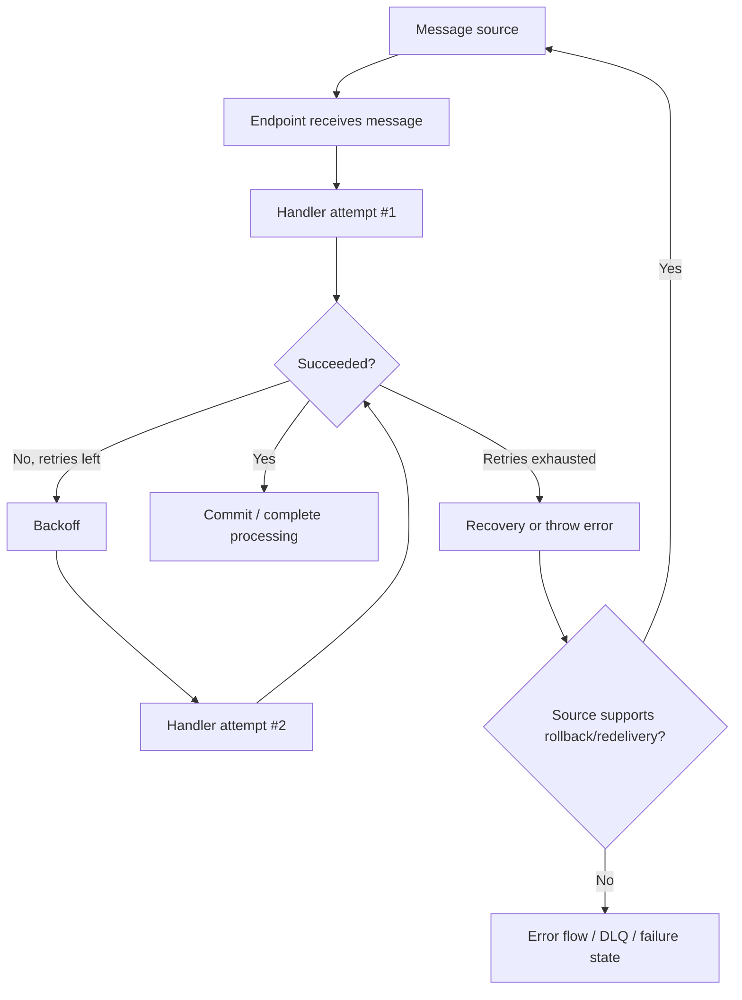
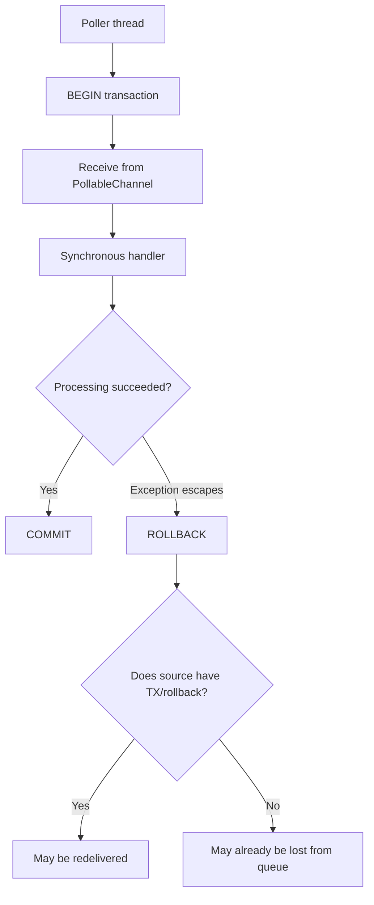
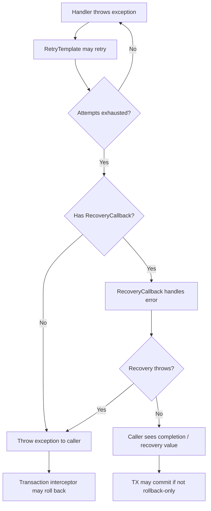

# Retry with Transactions and Rollback in Spring Integration Runtime

## 1. The Problem: Retrying After Errors While Keeping Data Consistent

An `IntegrationFlow` receives an order, checks inventory, writes to the database, and sends a notification. When the database reports a deadlock, retrying can allow the request to succeed. However, if the previous attempt already wrote partial data, sent an email, or acknowledged the message with the broker, uncontrolled retries can duplicate business actions.

In **Spring Integration Runtime**, retry and transaction are two independent mechanisms:

- **Retry** decides *whether to re-invoke a failed operation*, at most how many times, and how to wait between attempts.
- **Transaction** decides *which operations commit or roll back together* on success or failure.
- **Recovery** decides *what to do when retries cannot continue*: return an error, route to an error flow, send to a dead-letter destination, or compensate.

The single most important point is **the nesting order between retry and transaction**. When retry wraps the transaction, each attempt can run inside a fresh transaction. When the transaction wraps retry, attempts may share the same transaction already marked rollback-only, so even if the final attempt does not throw, committing still fails.

After this lesson, you will be able to:

1. Explain the lifecycle of attempts, commits, rollbacks, recovery, and redelivery.
2. Choose the right retry–transaction ordering for databases, pollers, and message brokers.
3. Use `RetryTemplate`, `TransactionTemplate`, and `RequestHandlerRetryAdvice` with the right scope.
4. Understand why `DirectChannel`, `ExecutorChannel`, `QueueChannel`, and pollers create different transaction boundaries.
5. Design idempotency, dead-lettering, observability, and runtime failure diagnostics.

This topic belongs to the **Retries and recovery** chapter of the `SPRING_INTEGRATION_RUNTIME` module. The examples focus on orchestrating message flows through channels, endpoints, consumers, pollers, and executors; they do not assume the entire flow automatically runs inside one transaction.

## 2. Core Vocabulary

| Concept | Meaning | Misconception to avoid |
| --- | --- | --- |
| **Attempt** | One invocation of the operation wrapped by retry | Three attempts means one initial call plus up to two retries, not three retries. |
| **Retry policy** | Conditions permitting retry, attempt limits, and exception types | Not every exception should be retried. |
| **Backoff** | Pause between attempts; can use exponential delay and jitter | Tight immediate retries easily overload a struggling service. |
| **Transaction boundary** | Scope of resources that commit or roll back together | An annotation on a Java method does not necessarily make the entire flow transactional. |
| **Rollback-only** | A transaction marked so it cannot commit | Catching an exception and succeeding on retry does not necessarily clear rollback-only. |
| **Recovery** | Final action when retries cannot continue | Finishing error handling does not imply source data rolled back. |
| **Redelivery** | Source system re-delivering a message after rollback, nack, or timeout | Distinct from in-JVM method retry. |
| **Idempotency** | Processing the same business event multiple times still yields the right business result | A single delivery's message ID is not always a durable idempotency key. |

Distinguishing **internal retry** from **source redelivery**:



This diagram is a logical model: whether the source redelivers depends on the actual transport and transaction/acknowledgement mechanics. An in-memory `QueueChannel`, a JMS listener with a transacted session, and a Kafka consumer with offset commits are three different mechanisms.

## 3. Ordering One: Retry Wrapping the Transaction

This is usually the right approach when a failure leaves the current database transaction unusable, such as a deadlock or a transaction already marked rollback-only.

```text
Retry boundary
  ├─ Attempt 1: BEGIN TX-1 → DB operation fails → ROLLBACK TX-1
  ├─ wait backoff
  ├─ Attempt 2: BEGIN TX-2 → DB operation fails → ROLLBACK TX-2
  ├─ wait backoff
  └─ Attempt 3: BEGIN TX-3 → DB operation succeeds → COMMIT TX-3
```

On each attempt, a separate transaction begins and ends. Exceptions are **thrown out of the transaction callback** so the transaction manager knows to roll back. The retry handler re-invokes only after the prior transaction has finished.

### 3.1. Java Example with `RetryTemplate` and `TransactionTemplate`

The classes below assume the project includes Spring Retry and Spring Transaction. `OrderRepository` is an application business interface declared right inside the example.

```java
import org.springframework.retry.backoff.FixedBackOffPolicy;
import org.springframework.retry.policy.SimpleRetryPolicy;
import org.springframework.retry.support.RetryTemplate;
import org.springframework.transaction.PlatformTransactionManager;
import org.springframework.transaction.TransactionDefinition;
import org.springframework.transaction.support.TransactionTemplate;

public final class TransactionalOrderProcessor {
    private final OrderRepository repository;
    private final RetryTemplate retry;
    private final TransactionTemplate perAttemptTransaction;

    public TransactionalOrderProcessor(
            OrderRepository repository,
            PlatformTransactionManager transactionManager) {
        this.repository = repository;

        this.retry = new RetryTemplate();
        // maxAttempts = 3: includes the initial attempt.
        this.retry.setRetryPolicy(new SimpleRetryPolicy(3));

        FixedBackOffPolicy backoff = new FixedBackOffPolicy();
        backoff.setBackOffPeriod(300L);
        this.retry.setBackOffPolicy(backoff);

        this.perAttemptTransaction = new TransactionTemplate(transactionManager);
        // Ensure each attempt gets its own transaction, even if the caller has a TX.
        this.perAttemptTransaction.setPropagationBehavior(
                TransactionDefinition.PROPAGATION_REQUIRES_NEW);
    }

    public void process(String orderId) {
        retry.execute(context -> {
            perAttemptTransaction.executeWithoutResult(status -> {
                repository.markConfirmed(orderId);
                // If this throws RuntimeException, this transaction rolls back.
            });
            return null;
        });
    }

    public interface OrderRepository {
        void markConfirmed(String orderId);
    }
}
```

**Key details explained:**

1. `RetryTemplate` sits **outside** `TransactionTemplate`. An exception in the current attempt exits the transaction callback, causing the transaction manager to roll back before retrying.
2. `PROPAGATION_REQUIRES_NEW` gives each attempt a fresh transaction. With `REQUIRED`, if the caller already has an active transaction, attempts may join that open transaction; then "one transaction per attempt" no longer holds.
3. `SimpleRetryPolicy(3)` in this generic example may retry exceptions allowed by its default rules; production code should **classify** retryable failures instead of retrying validation or permission errors.
4. If `repository.markConfirmed(...)` writes to the database and then calls an external service, rolling back the database **does not undo** side effects already applied in the external service.
5. If nested under another outer transaction, `REQUIRES_NEW` commits independently; if the outer transaction rolls back later, the source message may still be redelivered. Thus idempotency remains mandatory.

Never hold a long transaction open across backoff waits. With this layout, backoff executes **outside each attempt's transaction**, reducing lock and connection hold times while waiting to retry.

## 4. Ordering Two: Transaction Wrapping Retry

```text
BEGIN TX
  Retry boundary
    ├─ Attempt 1: DB throws error, resource/TX may be marked rollback-only
    ├─ Attempt 2: code may run again or DB rejects because TX is broken
    └─ Attempt 3: Java method no longer throws
COMMIT? → may fail / UnexpectedRollbackException
```

Example illustrating this ordering:

```java
public void transactionOutsideRetry(
        String orderId,
        RetryTemplate retry,
        TransactionTemplate transaction,
        TransactionalOrderProcessor.OrderRepository repository) {

    transaction.executeWithoutResult(status -> {
        retry.execute(context -> {
            repository.markConfirmed(orderId);
            return null;
        });
    });
}
```

Potential upside: if every error can recover cleanly within one transaction while resources remain valid, all attempts share a single atomic unit. With databases, however, many SQL failures leave the statement, session, or transaction unable to continue safely:

- An inner Spring transaction interceptor may already have called `setRollbackOnly()` when a method threw.
- PostgreSQL puts a transaction into an aborted state after a SQL error until rollback.
- A JDBC connection or ORM persistence context may no longer be trustworthy after certain errors.
- A transaction wrapping backoff holds locks and connections longer, raising contention.

Therefore, **do not retry SQL inside the same transaction by default**. Once an exception marks the transaction rollback-only, catching it in `RetryTemplate` does not make the transaction state "clean" again. Spring may throw `UnexpectedRollbackException` at commit time. For deadlocks, serialization failures, or timeouts, you usually need to retry **the whole transaction unit** from scratch.

### 4.1. Ordering Decision Table

| Scenario | Typically suitable approach | Why |
| --- | --- | --- |
| DB deadlock, serialization failure, transient data access error | Retry wrapping transaction | Each new attempt needs a clean transaction and resources. |
| Transient network error calling an independent API | Retry around HTTP call, consider keeping outside DB TX | Avoid holding locks during backoff; use timeouts/idempotency. |
| Pure state read with no side effects | Retry per specific error policy; may not need write TX | Minimal risk of repeating side effects. |
| Combined DB update and event publish requiring consistency | Outbox or explicitly coordinated mechanism | Retrying one side does not make DB and broker atomic. |
| Consumer with broker redelivery | Coordinate retry attempts and redelivery policy together | Two stacked retry layers can cause retry storms. |
| Unrecoverable validation/business rule | No retry; return error or dead-letter | Repeating with identical data yields no new outcome. |

These are design guidelines. The final choice must match your specific transaction manager, datasource, broker, resources, and business domain.

## 5. `@Transactional`, Proxies, and `RequestHandlerRetryAdvice`

In a Spring Integration flow, a consumer endpoint can invoke a service bean annotated with `@Transactional`. At the same time, `RequestHandlerRetryAdvice` can wrap **the handler call** to retry when the handler throws.

```java
import org.springframework.stereotype.Service;
import org.springframework.transaction.annotation.Transactional;

@Service
public class InventoryService {
    private final InventoryRepository repository;

    public InventoryService(InventoryRepository repository) {
        this.repository = repository;
    }

    @Transactional
    public void reserve(String productId, int amount) {
        repository.decreaseAvailable(productId, amount);
        // An escaping RuntimeException triggers rollback by default.
    }

    public interface InventoryRepository {
        void decreaseAvailable(String productId, int amount);
    }
}
```

If handler retry advice wraps the call to `InventoryService.reserve(...)`'s **transactional proxy** with no outer transaction, each retry calls the proxy anew and can start a fresh transaction. Conversely, if a transaction advice wraps the retry advice, or a poller already opened a transaction with propagation `REQUIRED`, retries can run inside the existing transaction.

Therefore, **never infer ordering merely by spotting two annotations/advices**. Verify:

- Which advice is outer and which is inner; the order of proxy/interceptor application.
- Whether `@Transactional` is genuinely invoked through the Spring proxy (self-invocation within the same bean bypasses the proxy).
- Whether propagation is `REQUIRED` or `REQUIRES_NEW`, and whether a poller or upstream component already opened a transaction.
- Whether the exception actually escapes the transactional method so the transaction manager triggers rollback, or is caught and swallowed.

### 5.1. Example Retry Advice Configuration for an Endpoint

Spring Integration's `RequestHandlerRetryAdvice` uses `RetryTemplate` to re-invoke a handler per retry policy. The snippet below configures only **handler-level retry**, without yet setting transaction scope:

```java
import org.springframework.context.annotation.Bean;
import org.springframework.context.annotation.Configuration;
import org.springframework.integration.handler.advice.RequestHandlerRetryAdvice;
import org.springframework.retry.backoff.FixedBackOffPolicy;
import org.springframework.retry.policy.SimpleRetryPolicy;
import org.springframework.retry.support.RetryTemplate;

@Configuration
public class RetryAdviceConfiguration {

    @Bean
    public RequestHandlerRetryAdvice requestHandlerRetryAdvice() {
        RetryTemplate retryTemplate = new RetryTemplate();
        retryTemplate.setRetryPolicy(new SimpleRetryPolicy(3));

        FixedBackOffPolicy backoff = new FixedBackOffPolicy();
        backoff.setBackOffPeriod(200L);
        retryTemplate.setBackOffPolicy(backoff);

        RequestHandlerRetryAdvice advice = new RequestHandlerRetryAdvice();
        advice.setRetryTemplate(retryTemplate);
        return advice;
    }
}
```

Apply this advice to a DSL `handle(...)` endpoint via `advice(requestHandlerRetryAdvice)`, or via `adviceChain` on `@ServiceActivator` where appropriate. If a transaction advice is also present, **verify actual execution order** rather than assuming bean names or annotation declaration order always yields the right transaction scope.

## 6. Poller Transactions and Message Rollback

A `PollableChannel` such as `QueueChannel` is read by a poller. A poller's transaction advice can wrap **receiving the message and synchronous downstream dispatching**. This is a very different boundary from retry placed only around one service handler.



**Critical condition:** whether a transaction rollback returns the message to its source depends on **the source type**, message store, and corresponding transaction manager.

- A default in-memory `QueueChannel` does not magically become a durable/rollback-capable queue just because the poller declares a transaction.
- A pollable channel backed by a transactional message store (such as an appropriate JDBC store) can roll back a receive **if** it genuinely participates in the right transaction.
- With JMS, ack/rollback/redelivery follow the JMS listener/adapter session/transaction and broker rules.
- With Kafka, offset commits, delivery, and consumer groups are a separate concern; a lone JDBC transaction does not automatically control offset commits.

### 6.1. Configuring a Transactional Poller with Java DSL

Conceptual example:

```java
import java.time.Duration;
import org.springframework.context.annotation.Bean;
import org.springframework.context.annotation.Configuration;
import org.springframework.integration.dsl.IntegrationFlow;
import org.springframework.integration.dsl.Pollers;
import org.springframework.transaction.PlatformTransactionManager;

@Configuration
public class PollerFlowConfiguration {

    @Bean
    public IntegrationFlow orderPollingFlow(
            PlatformTransactionManager transactionManager,
            OrderService orderService) {

        return IntegrationFlow.from(
                    "durableOrderQueue",
                    endpoint -> endpoint.poller(
                            Pollers.fixedDelay(Duration.ofSeconds(1))
                                   .maxMessagesPerPoll(1)
                                   .transactional(transactionManager)))
                .handle(orderService, "process")
                .get();
    }

    public interface OrderService {
        void process(String orderId);
    }
}
```

This pattern assumes the `durableOrderQueue` bean is an independently configured `PollableChannel` with appropriate persistence and rollback mechanics. `.transactional(transactionManager)` configures transaction advice on the poller; it **does not automatically set up** a durable message store, database schema, or broker transaction manager.

When the handler calls downstream through a `DirectChannel` and an exception propagates back to the poller, the poller's transaction can span the synchronous segment. When the flow crosses an `ExecutorChannel`, work running on the worker thread is no longer inside the transaction on the poller thread. Standard transaction managers bind transactions to threads, so do not treat both branches as a single transaction.

### 6.2. Poller Transaction Wrapping Retry Advice: A Classic Trap

```text
Poller
  BEGIN TX-OUTER
    Receive message from transactional source
    Handler retry advice
      Attempt 1: DAO exception → may mark TX-OUTER rollback-only
      Attempt 2: DAO succeeds at Java level
  COMMIT TX-OUTER ? → may still roll back / UnexpectedRollbackException
```

Especially with `@Transactional(propagation = REQUIRED)` on the service, each attempt **joins** `TX-OUTER`. If database operations must retry with a fresh transaction, establish an effective separate scope, such as `REQUIRES_NEW` around each attempt; then re-evaluate atomicity between **source ack** and **data commit**. That setup can commit DB changes while the message still gets redelivered if the outer transaction rolls back.

## 7. How Caught Errors, Exhausted Retries, and Recovery Affect Commit

The transaction manager decides commit/rollback based on transaction state and exceptions **escaping the boundary**. A recovery handler can make an exception appear handled, which does not automatically guarantee rollback.



### 7.1. `ErrorMessageSendingRecoverer`

In Spring Integration, `ErrorMessageSendingRecoverer` can be paired with retry advice to publish an `ErrorMessage` to a channel when attempts exhaust. Error messages help track the exception, failed message, and original context when available. However:

- Sending an `ErrorMessage` **does not mean** the source message will roll back or the broker will redeliver.
- If the recovery callback completes without throwing, an outer transaction advice may treat the call as successful and commit **unless the transaction was already marked rollback-only**.
- If you need the source to roll back so the broker redelivers, let the exception or rollback-only state reach the right transaction boundary instead of designing recovery as a success confirmation.
- If choosing to dead-letter and then ack the source, ensure DLQ persistence is sufficiently reliable; a database outbox or coordinated transaction/ack mechanism may be required to avoid data loss.

**Designing recovery is a decision about message state**, not just a logging choice.

### 7.2. Never Swallow Exceptions Inside a Transaction That Must Roll Back

```java
// Risk: exception is caught, so the transaction does not know to roll back.
transactionTemplate.executeWithoutResult(status -> {
    try {
        repository.saveBusinessState(orderId);
    } catch (RuntimeException ex) {
        logFailure(ex);
        // Without rollback-only, the transaction may commit the rest.
    }
});

// When signaling failure without rethrowing the exception:
transactionTemplate.executeWithoutResult(status -> {
    try {
        repository.saveBusinessState(orderId);
    } catch (RuntimeException ex) {
        logFailure(ex);
        status.setRollbackOnly();
    }
});
```

Both snippets assume `transactionTemplate`, `repository`, and `logFailure(...)` are defined in the application. For unrecoverable errors, normally **rethrow the exception** so the outer transaction manager and retry policy know the operation failed. Calling `status.setRollbackOnly()` explicitly is only appropriate when the caller contract allows it.

With `@Transactional`, default rollback applies to `RuntimeException` and `Error`. Checked exceptions may require `rollbackFor` or explicit rules. Never "fix" a policy by catching exceptions and turning them into normal completions.

## 8. Threading Boundaries to Watch

`RequestHandlerRetryAdvice` only retries **the handler invocation it wraps**. It does not rewind the entire flow, re-read messages from a broker, or carry transactions across threads.

| Component | Thread and error path | Consequence for retry/rollback |
| --- | --- | --- |
| `DirectChannel` | Subscriber runs on sender thread | Retry and transaction can cover the synchronous segment if advice is placed appropriately. |
| `ExecutorChannel` | Consumer runs on executor thread | Upstream transaction does not automatically flow to worker; downstream errors do not return to original caller. |
| `QueueChannel` + poller | Poller fetches messages periodically | Receive transaction depends on poller config and message store; handler retry is only one layer. |
| `PublishSubscribeChannel` with executor | Subscribers process asynchronously | Each subscriber may need its own transaction/error policy. |
| JMS inbound gateway/adapter | Listener container and broker control delivery | Must coordinate session transactions, ack, redelivery, and Spring Integration retry. |
| Kafka inbound adapter | Poll/consumer and offset strategy | Committing offsets differs from DB commits; do not infer offset rollback from a DAO's `@Transactional`. |

Example flow:

```text
Gateway → DirectChannel → validate → ExecutorChannel → chargePayment → audit
                         (caller thread)   (worker thread)
```

If a transaction opens before `ExecutorChannel`, it typically ends once the message is handed off, without waiting for `chargePayment` to finish. Gateway retry will not automatically "re-invoke" the segment handed to the executor if the worker later fails. To control outcomes, design appropriate reply/error paths, correlation, and timeouts.

## 9. Transactions Across DB and Broker Are Not Automatically Atomic

A classic scenario:

```text
JMS/Kafka event → update orders in DB → publish "OrderConfirmed"
```

Three side effects occur:

1. The source message is acked / its offset is committed.
2. The database commits the state change.
3. The outbound event is published.

A single local database transaction **does not cover** broker acks and external publishes outside the DB. An error after DB commit but before broker ack can cause redelivery; an error after ack but before publish can leave the outbound event missing.

Solutions by requirement:

- **Idempotent consumer:** use a durable `eventId`/`orderId`, unique constraint, or processed-state record so redelivery never deducts inventory twice.
- **Transactional outbox:** write the DB change and an outbound event record in **the same local DB transaction**, then publish via a separate retrying worker; downstream consumers must still be idempotent.
- **Broker-specific transaction/ack strategy:** configure session, offsets, retry/redelivery, and DLQ properly for your adapter; understand the coordination limits between broker and DB.
- **Distributed transaction/XA:** choose only when infrastructure and resources genuinely support it and operational cost is justified; never assume Spring Integration turns it on automatically.
- **Compensation/saga:** when workflows span services that cannot roll back together, define compensating actions keyed off committed states.

### 9.1. Business Deduplication Example

Suppose a message with `eventId = E-87` requests confirming order `SO-42`. Data model design:

```sql
CREATE TABLE processed_events (
    event_id VARCHAR(100) PRIMARY KEY,
    processed_at TIMESTAMP NOT NULL
);
```

Inside **the same DB transaction** as the order update:

1. Attempt to insert `event_id`; if it already exists, handle as an already-processed event per business policy.
2. Update the order state and write an outbox record if needed.
3. Commit together.

If the transaction rolls back, both the processed marker and the order update roll back together. On redelivery, duplicate events are detected far more reliably than relying on `MessageHeaders.ID` or checking an in-memory variable. Implementation must handle concurrency constraints and unique-key conflicts properly.

## 10. Effective Retry Policy: Retry Recoverable Failures

Not every exception should be retried:

| Error | Reference decision | Notes |
| --- | --- | --- |
| Deadlock / serialization conflict | Retry the whole transaction, bounded attempts, backoff/jitter | Inspect driver and DB engine error codes. |
| Transient DB connection error | Retry transaction if resources can recover | Do not keep using a broken connection/session. |
| HTTP 429/503 | Bounded retry; honor `Retry-After` when appropriate | Use an idempotency key for operations with side effects. |
| Timeout calling an external service | Check whether the request may have succeeded remotely | A timeout does not prove the remote side did not execute. |
| `ValidationException` | Do not retry | Input data does not fix itself after backoff. |
| Permission denied, schema mismatch | Usually do not retry immediately | Requires fixing configuration or data. |
| Infinitely looping poison message | Route to DLQ / manual review | Avoid tying up poller resources and clogging queues. |

Select `maxAttempts`, backoff, and jitter according to SLA. With 3 attempts and backoffs of 200 ms and 400 ms, a handler spends `t1 + t2 + t3 + 600ms` (excluding queueing); gateway timeouts must accommodate this budget. If the broker also performs 5 redeliveries, total handler invocations can reach 3 × 5 in one scenario, depending on how retry layers stack. Measure attempts **both inside the JVM and from the broker**.

Never retry unboundedly beneath an open transaction. When handlers are slow, raising attempts reduces throughput, holds connections longer, and causes queue backlogs to spike quickly.

## 11. Diagnosing Commits and Rollbacks with Runtime Evidence

When failures happen, distinguish **handler did not throw**, **DB commit succeeded**, and **broker ack succeeded**. These three milestones are not equivalent.

### 11.1. Logging Valuable Signals

Every attempt should correlate to the same **business/event ID**, flow/endpoint, and retry count:

```text
eventId=E-87 flow=confirmOrder attempt=1 tx=TX-1
  stage=dbUpdate outcome=rollback cause=DeadlockLoserDataAccessException

eventId=E-87 flow=confirmOrder attempt=2 tx=TX-2
  stage=dbUpdate outcome=commit

eventId=E-87 stage=sourceAck outcome=success
```

This is an **illustrative log format**, not default logging generated automatically by Spring Integration. Proper instrumentation, transaction callbacks, or metrics are needed to confirm real commits/rollbacks; never infer "COMMIT" merely because a method returned.

You can check whether a transaction is active on the current thread via `TransactionSynchronizationManager.isActualTransactionActive()`, though this only proves a transaction is active—not that it committed. Log at transaction manager boundaries and correlate with broker acks/offsets when investigating lost or duplicate messages.

### 11.2. Symptom → Cause Table

| Symptom | Possible cause | Investigation path |
| --- | --- | --- |
| Final attempt succeeds yet caller receives `UnexpectedRollbackException` | Retried inside a transaction already marked rollback-only | Check advice order, propagation, and first-attempt exception. |
| Retries run yet DB rows remain empty | Every transaction rolled back or callback set rollback-only | Correlate attempt counts with transaction begin/rollback/commit. |
| DB commits yet broker redelivers | Ack/offset not committed; separate transactions | Check transaction manager, ack timing, and idempotency. |
| Message disappears from `QueueChannel` after handler error | In-memory queue does not support rollback on receive | Inspect actual channel type, store, and poller transaction. |
| Error handler runs yet source message is still acked | Recoverer swallowed error or error flow does not affect source TX | Check recovery callback and rollback-only status. |
| Errors surge and queues back up | Retry storm, missing backoff, saturated executor | Measure retries, active pool threads, latency, backlog, broker redelivery. |
| Email/payment sent twice | External side effect outside TX was not idempotent | Use idempotency key, outbox, and external API status lookup. |
| `@Transactional` has no effect | Self-invocation, non-proxied bean, unsupported method visibility | Verify bean/proxy, AOP, and active transaction inside method. |
| Error occurs on `ExecutorChannel` after gateway returned | Async boundary decoupled from caller | Follow `errorChannel`, correlation, and worker reply flow. |
| Retries exhaust yet nothing arrives in DLQ | Recoverer unconfigured, wrong `errorChannel`, or publish failed | Trace final exception, destination, recoverer, and publish confirmation. |

## 12. Minimal Test Scenario Suite

When writing integration tests, assert both **final state** and **actual invocation counts**:

| Case | Trigger | Expectation |
| --- | --- | --- |
| Transient DB error, attempt 2 succeeds | Attempt 1 throws transient exception | Attempt 1 rolls back; attempt 2 gets a fresh transaction and commits exactly one change. |
| Permanent business error | Negative quantity input | No retry; no data written; error/recovery path matches contract. |
| Outer transaction marked rollback-only | Throw inside an open transaction then retry inside it | Do not mistake method success for commit success; may hit `UnexpectedRollbackException`. |
| Retries exhausted, recovery rethrows | All 3 attempts fail | Caller/poller sees failure; rolls back if transaction covers that scope. |
| Retries exhausted, recovery publishes error | All 3 attempts fail | `ErrorMessage` published; verify source ack/commit matches design. |
| Broker redelivery after DB commit | Simulate ack failure after DB commit | Business action not executed twice thanks to stable idempotency key. |
| Executor thread fails | Route processing through `ExecutorChannel` | Worker error handler runs; caller transaction is not confused with worker transaction. |
| JDBC message store rollback | Use transactional queue store and failing handler | Message re-received per store policy; avoid in-memory queue assumptions. |

In Spring integration tests, await async results with latches or bounded test utilities rather than using `Thread.sleep` to assert a rollback occurred. Measure exact committed row counts, external API call counts, event ID state, and broker state.

## 13. Pre-Production Design Checklist

1. Define **the unit to retry**: single handler, full DB transaction, or entire message delivery.
2. Map exact **advice ordering**: retry outside or transaction outside; verify proxies and propagation.
3. Determine **whether the source can roll back**: JDBC store, JMS session, Kafka offset, or in-memory queue.
4. Check **thread boundaries**: `DirectChannel` vs. `ExecutorChannel`/poller.
5. Classify **retryable exceptions**, cap attempts, apply backoff/jitter, and set timeouts.
6. Enforce **idempotency** for DB and external APIs, even when in-JVM retries succeed.
7. Decide **what happens when retries exhaust**: rethrow/rollback, error channel, DLQ, or compensation.
8. Verify whether **recovery swallows exceptions** and causes the source to ack/commit.
9. Propagate **`eventId`/`traceId`/`correlationId`** to link attempts and redeliveries; never log secret payloads.
10. Run failure-injection tests across DB commit, broker ack, outbox publish, and consumer restart.

## 14. Self-Assessment Questions and Exercises

### Questions

1. Why does `RetryTemplate.execute(() -> transactionTemplate.execute(...))` behave differently from `transactionTemplate.execute(() -> retryTemplate.execute(...))`?
2. If an earlier attempt triggers rollback-only, why can a later attempt succeeding in Java still end with `UnexpectedRollbackException`?
3. How do `PROPAGATION_REQUIRED` and `PROPAGATION_REQUIRES_NEW` differ when a poller has already opened a transaction?
4. Why does a poller's transaction not automatically cross an `ExecutorChannel`?
5. Does an in-memory `QueueChannel` restore a message after a DB rollback? When can a receive actually roll back?
6. If `ErrorMessageSendingRecoverer` publishes an error and returns normally, is the outer transaction guaranteed to roll back?
7. A payment API times out; why can retrying without an idempotency key charge twice?
8. When the DB has already committed and the broker redelivers the message, which key prevents duplicate processing?

### Guided Exercises

**Exercise 1 — Observing transaction ordering.** Use `TransactionalOrderProcessor` from section 3, changing `markConfirmed` so attempt 1 throws a runtime exception and attempt 2 succeeds. Count transaction starts/rollbacks/commits, then write a control version with `TransactionTemplate` wrapping retry. Compare results when the exception marks rollback-only.

**Exercise 2 — Transactional polling.** Create a `QueueChannel` backed by an appropriate transactional message store, a poller with `maxMessagesPerPoll=1`, and a failing handler. Verify whether the message is re-received after rollback. Repeat with an in-memory `QueueChannel` and explain the difference.

**Exercise 3 — Recovery contract.** Use three attempts: on exhaustion, compare (a) rethrowing vs. (b) publishing `ErrorMessage` and completing. For each case, document expectations for transaction commit/rollback, source ack, redelivery, and DLQ. Add an `eventId` to prove no duplicate processing happens on redelivery.

## 15. References

- [Spring Integration Reference — Retry Advice](https://docs.spring.io/spring-integration/reference/handler-advice/classes.html)
- [Spring Integration Reference — Transactions Support](https://docs.spring.io/spring-integration/reference/transactions.html)
- [Spring Integration Reference — Error Handling](https://docs.spring.io/spring-integration/reference/error-handling.html)
- [Spring Integration Reference — Poller Configuration](https://docs.spring.io/spring-integration/reference/endpoint.html)
- [Spring Retry — RetryTemplate API](https://docs.spring.io/spring-retry/docs/current/apidocs/org/springframework/retry/support/RetryTemplate.html)
- [Spring Framework Reference — Transaction Propagation](https://docs.spring.io/spring-framework/reference/data-access/transaction/declarative/tx-propagation.html)
- [Spring Framework Reference — Rolling Back a Declarative Transaction](https://docs.spring.io/spring-framework/reference/data-access/transaction/declarative/rolling-back.html)
