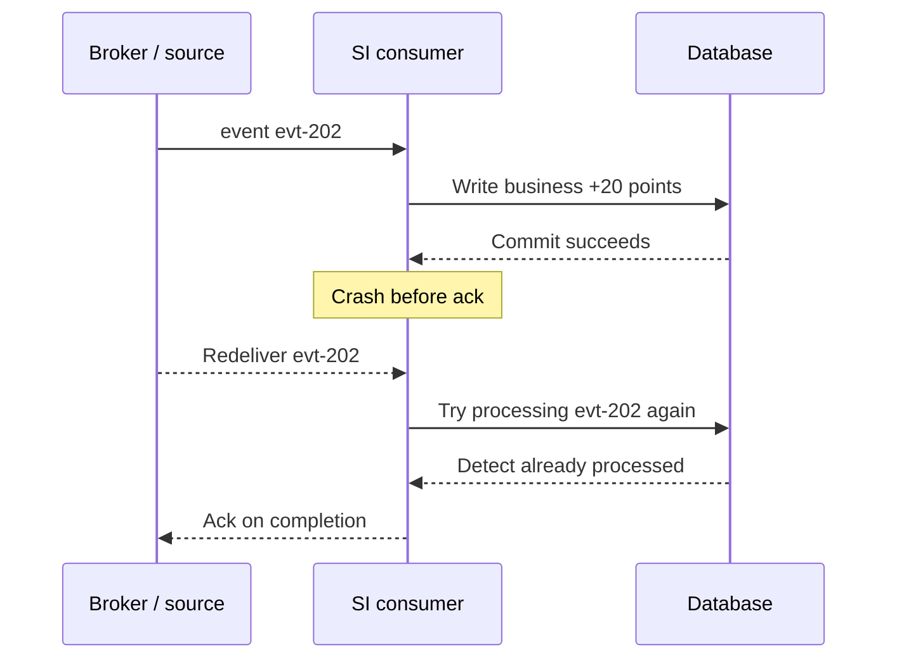
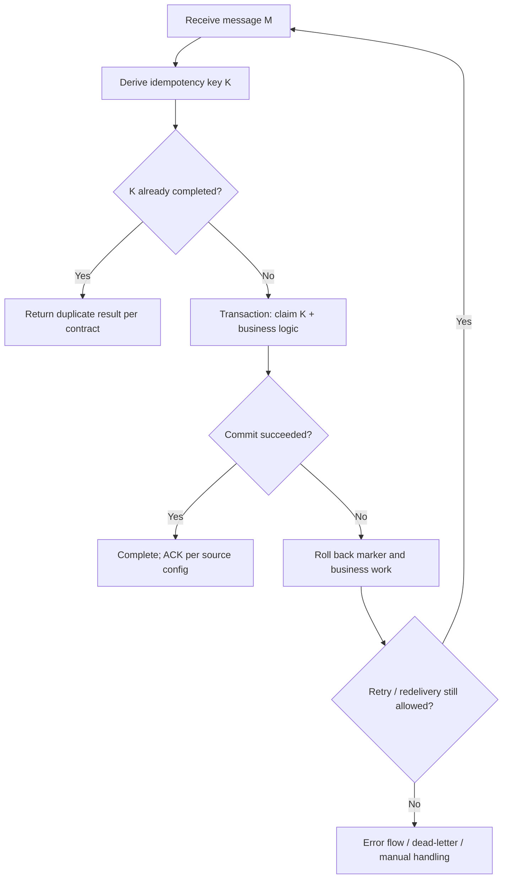

# Idempotency When Messages Are Reprocessed in Spring Integration

## 1. Context: Retries Can Run the Same Business Logic Multiple Times

In the `SPRING_INTEGRATION_RUNTIME` module, Spring Integration dispatches messages across **channels, endpoints, consumers, pollers, and executors**, while combining retries, transactions, message stores, correlation, error handling, and runtime state monitoring. Whenever a consumer may reprocess a message, an essential design requirement is **idempotency**: processing the same business request repeatedly without producing unintended extra effects.

For example, a loyalty points system processes the event:

```text
AwardPoints(eventId="evt-202", customerId=42, points=20)
```

If the message is delivered to the handler **twice**, the business only wants to add **20 points once**, rather than adding 40. The problem is not that the message appeared twice on a channel, but that the **business effect** was applied twice.

Lesson objectives:

1. Distinguish **retry**, **redelivery**, and **idempotent processing**.
2. Choose a stable idempotency key and define the protection scope.
3. Implement an **inbox/deduplication** mechanism using unique constraints and transactions to handle duplicates safely.
4. Understand the roles of `IdempotentReceiverInterceptor`, metadata stores, and Spring Integration retry advice.
5. Design specifically for side effects outside the database, request–reply flows, concurrency, and late-arriving messages.
6. Diagnose "already processed successfully yet received again" cases via logs, transactions, error flows, and message stores.

## 2. What Does Idempotent Mean—and What Does It Not Mean?

An operation `f` is **idempotent** when applying it multiple times to the same request yields the same business effect as applying it once:

\[
f(f(s, m), m) = f(s, m)
\]

Where `s` is the initial state and `m` is a **business request with a stable identity**. The equality refers to **observable state or effects**, not necessarily how many times a Java method is invoked.

| Action | Naturally idempotent? | Explanation |
|---|---|---|
| `UPDATE orders SET status='PAID' WHERE id=?` | Usually yes, for that status column alone | Writing the same status repeatedly yields the same state, assuming no triggers/other side effects. |
| `UPDATE customer_points SET points=points+20` | No | Every execution adds more points. |
| `INSERT payment(order_id, ...)` with a suitable unique key | Partially | A constraint prevents duplicate payment rows, but does not prevent calling an external payment gateway twice. |
| Sending a confirmation email | Not by default | Two send calls can deliver two emails. |
| Calling a payment API supporting an idempotency key | Conditionally | Depends on the provider's contract and key retention window. |

**Idempotent ≠ the message is processed exactly once.** A handler may be called three times while the net business effect happens only once. A pipeline marketed as "exactly once" at a broker or transaction log **does not automatically** guarantee exactly-once across another database, HTTP API, email, or external system.

Also distinguish a **duplicate delivery** from two distinct valid requests with identical contents: two 20-point awards carrying **two different event IDs** can be two independent business operations that must both execute.

## 3. Why Is the Same Message Reprocessed?

A message can reach a handler again through several paths:

- **Endpoint retry:** `RequestHandlerRetryAdvice` re-invokes the handler after an exception, possibly on the same logical message.
- **Source redelivery:** a broker, inbound adapter, queue, or orchestrator resends when no ack/commit was received or after a consumer restarts.
- **Pollers and message stores:** rollbacks, re-reading already-fetched items, incomplete claims, or crash recovery can lead to reprocessing.
- **Concurrency:** two consumers/threads pick up copies of the same event, or the producer emits duplicates due to a race condition.
- **Intentional replay:** data recovery, operational batch re-runs, or replaying events from an event log.

**Common timeline:**



This is "**commit succeeded, yet acknowledgement to the source failed**." It cannot be solved completely by increasing retries or waiting longer; you must be able to recognize already-completed work when the message arrives again.

### Three Layers to Distinguish

| Layer | Question | Example |
|---|---|---|
| **Delivery** | How many times can the message arrive? | At-least-once: at least once, possibly multiple times. |
| **Execution** | How many times is the handler invoked? | Twice due to retry/redelivery. |
| **Business effect** | How many times does the real state change occur? | Only once thanks to an idempotency key and transaction. |

Idempotency primarily governs **business effect**; do not use handler execution counts as the sole measure.

## 4. Choosing the Right Idempotency Key Before Writing Code

To recognize "the same request," you need a **key that stays stable** across retries, redeliveries, threads, and restarts.

A well-designed key usually consists of:

```text
<consumer / business / processing version>:<sourceEventId>
Example: loyalty-award-v1:evt-202
```

| Component | Role | Notes |
|---|---|---|
| `sourceEventId` | Distinguishes each event emitted by the **producer** | Must remain unchanged on retry, replay, or republishing the same event. |
| Consumer/operation | Prevents distinct business handlers from blocking one another | The same event may be processed independently by billing and notification. |
| Version | Controls reprocessing after business semantics change | Change version only with an explicit migration/replay decision. |
| Payload fingerprint (optional) | Detects matching keys with conflicting data | If the ID matches yet the payload differs, flag a data error instead of treating it as a benign duplicate. |

**Avoid unstable or overly broad keys:**

- `MessageHeaders.ID` is assigned by the framework to a **message instance**; if an adapter constructs a fresh message on redelivery, the UUID can change. Do not use it as a cross-system event ID unless the source guarantees it stays constant.
- Receive timestamps, thread IDs, or fresh random UUIDs generated at processing time invalidate deduplication.
- Using only `customerId` mistakenly blocks subsequent valid point awards for the same customer.
- `correlationId` is used for grouping/splitters/aggregators; it is **not automatically** equivalent to the identity of one business task.

Keys also have a **retention lifetime**: if stored for 7 days while the source can replay after 30 days, an old event can still cause duplicate effects once its marker expires. Size retention to match replay contracts, storage policies, and data costs.

## 5. Four Ways to Achieve Idempotency at the Business Layer

### 5.1. Naturally Idempotent Updates

Prefer target-state assignments over incremental commands when the domain allows:

```sql
-- Idempotent with respect to this column alone:
UPDATE orders SET status = 'CONFIRMED' WHERE id = 42;

-- Not idempotent:
UPDATE customer_points SET points = points + 20 WHERE customer_id = 42;
```

Watch out for triggers, emitted events, emails, audits, or `updated_at` updates: even when the primary value stays unchanged, **side effects** can still repeat.

### 5.2. Unique Constraints on Business Tables

For example, allow only one invoice per `order_id`, or one points-award entry per `event_id`. The database arbitrates contention across threads and instances far more reliably than an in-JVM `Set`.

### 5.3. Inbox/Processed-Message Ledger and Transaction

Create a table recording **successfully applied messages**. Write both the marker and the business update in **the same database transaction**. Key collisions are skipped; if processing fails, **roll back both the marker and the business change** so a later attempt can proceed.

This approach is implemented in full in section 6.

### 5.4. Idempotency at the Target System or via Outbox

When external side effects exist—such as a payment API, email gateway, or another database—a local database transaction **cannot roll back the external transaction**. You then need target-system protocols (idempotency keys/unique business operations), an outbox, or stateful workflows with reconciliation; see section 9.

## 6. Spring Integration Example: Awarding Points Exactly Once with PostgreSQL

**Assumptions:** A Spring application with `spring-integration-core`, `spring-jdbc`, `spring-tx`, a PostgreSQL datasource, and a transaction manager. Java samples use `record` (Java 17+). This lesson focuses on messages entering `awardsIn` through an endpoint and handling duplicates, independent of a specific transport.

### 6.1. Schema and Ledger Setup

```sql
CREATE TABLE customer_points (
    customer_id BIGINT PRIMARY KEY,
    points BIGINT NOT NULL DEFAULT 0
);

CREATE TABLE processed_message (
    consumer_name VARCHAR(100) NOT NULL,
    event_id VARCHAR(200) NOT NULL,
    processed_at TIMESTAMPTZ NOT NULL DEFAULT CURRENT_TIMESTAMP,
    PRIMARY KEY (consumer_name, event_id)
);

INSERT INTO customer_points(customer_id, points)
VALUES (42, 100);
```

The unique primary key `(consumer_name, event_id)` protects across **multiple threads and multiple processes** sharing the database. This example targets PostgreSQL; `ON CONFLICT DO NOTHING` must be adapted if running a different DBMS.

### 6.2. Channel and Transaction Configuration

```java
package example.integration;

import org.springframework.context.annotation.Bean;
import org.springframework.context.annotation.ComponentScan;
import org.springframework.context.annotation.Configuration;
import org.springframework.integration.channel.DirectChannel;
import org.springframework.integration.config.EnableIntegration;
import org.springframework.messaging.MessageChannel;
import org.springframework.transaction.annotation.EnableTransactionManagement;

@Configuration
@EnableIntegration
@EnableTransactionManagement
@ComponentScan(basePackageClasses = LoyaltyPointsHandler.class)
public class LoyaltyFlowConfig {

    @Bean
    public MessageChannel awardsIn() {
        return new DirectChannel();
    }
}
```

`DirectChannel` keeps the flow simple to observe and verify. When switching to an `ExecutorChannel` or polling consumer, transactions must start **on the actual processing thread**; do not expect a sender thread's transaction to propagate across an executor.

### 6.3. Business Message and Handler

```java
package example.integration;

public record AwardPoints(
        String eventId,
        long customerId,
        int points
) {}
```

```java
package example.integration;

import org.springframework.integration.annotation.MessageEndpoint;
import org.springframework.integration.annotation.ServiceActivator;
import org.springframework.jdbc.core.JdbcTemplate;
import org.springframework.transaction.annotation.Transactional;

@MessageEndpoint
public class LoyaltyPointsHandler {

    private static final String CONSUMER = "loyalty-award-v1";
    private final JdbcTemplate jdbc;

    public LoyaltyPointsHandler(JdbcTemplate jdbc) {
        this.jdbc = jdbc;
    }

    @ServiceActivator(inputChannel = "awardsIn")
    @Transactional
    public void award(AwardPoints event) {
        if (event.eventId() == null || event.eventId().isBlank()) {
            throw new IllegalArgumentException("eventId is required");
        }
        if (event.points() <= 0) {
            throw new IllegalArgumentException("points must be positive");
        }

        // Claim the idempotency key inside the same DB transaction.
        int claimed = jdbc.update(
            "INSERT INTO processed_message(consumer_name, event_id) " +
            "VALUES (?, ?) ON CONFLICT DO NOTHING",
            CONSUMER,
            event.eventId()
        );

        if (claimed == 0) {
            // Event already processed by this consumer.
            // For a one-way flow, returning is valid.
            return;
        }

        int updated = jdbc.update(
            "UPDATE customer_points SET points = points + ? " +
            "WHERE customer_id = ?",
            event.points(),
            event.customerId()
        );

        if (updated != 1) {
            throw new IllegalStateException(
                "No customer_points row for customerId=" + event.customerId()
            );
        }
        // Committing the transaction persists both the marker and the points.
    }
}
```

**Why does this prevent duplicates?**

1. The first arrival of `evt-202` inserts the marker, yielding `claimed == 1`; the handler adds 20 points and commits.
2. The second arrival with the same `consumer_name` and `event_id` hits the existing primary key; `claimed == 0`, so no points are added.
3. If the database fails or the points update throws **before commit**, the transaction rolls back **both the marker insert and the points update**; a later retry can still claim and process it.
4. If two workers insert `evt-202` concurrently, PostgreSQL's unique constraint and transaction coordination allow only one request to win once the competing transaction's outcome is resolved. The other observes the duplicate or retries on a serialization/transaction error if applicable.

Mandatory conditions: `@Transactional` must genuinely be applied by Spring AOP; `JdbcTemplate` and the transaction manager must share **the same datasource/database**; avoid self-invocation bypassing the proxy; never catch and swallow exceptions causing the transaction to commit by mistake. If `JdbcTemplate` or a transaction manager is not yet configured in your infrastructure, configure them before running the example.

> For a real message, **"marker committed" must represent "business effect committed."** Never commit the marker first and perform business updates in a separate transaction: crashing in between turns an unprocessed message into "already processed."

### 6.4. Sending the Same Event Twice and Observing

From a Spring bean holding `ApplicationContext context`:

```java
import example.integration.AwardPoints;
import org.springframework.context.ApplicationContext;
import org.springframework.messaging.MessageChannel;
import org.springframework.messaging.support.MessageBuilder;

MessageChannel channel =
        context.getBean("awardsIn", MessageChannel.class);

AwardPoints event = new AwardPoints("evt-202", 42L, 20);

channel.send(MessageBuilder.withPayload(event).build());
channel.send(MessageBuilder.withPayload(event).build());
```

After both sends, query the database:

```sql
SELECT points
FROM customer_points
WHERE customer_id = 42;
-- Expected result: 120, not 140.

SELECT consumer_name, event_id
FROM processed_message
WHERE consumer_name = 'loyalty-award-v1'
  AND event_id = 'evt-202';
-- Expected: exactly one row.
```

In this `DirectChannel` example, the method runs synchronously inside `send()`. If testing on an `ExecutorChannel`, **wait for the handler to finish** before asserting state, or use conditional polling in tests; `send() == true` only confirms the channel accepted the message per its contract.

### 6.5. Failures at Different Points in Time

| Failure point | Ledger & points update | Will redelivering the message double-credit? |
|---|---|---|
| Before inserting marker | Nothing written | No: next attempt processes normally. |
| Marker inserted, points update failed, transaction rolled back | **Both rolled back** | No: next attempt can claim and process. |
| Points updated, not yet committed, process crashes | Transaction rolled back by DB | No: next attempt re-runs cleanly. |
| Both marker and points committed, broker not yet acked | Both persisted | No: next attempt hits `ON CONFLICT` and skips. |
| External API call succeeded, yet DB rolled back | External side effect may still exist | **At risk** if the API lacks an idempotency key. |
| Ledger purged before replay window | Deduplication marker gone | **At risk** when the source replays old events. |

## 7. How Does Spring Integration Support Idempotent Receivers?

Alongside a hand-built inbox table, Spring Integration provides the **Idempotent Receiver** pattern via `IdempotentReceiverInterceptor`, typically paired with `MetadataStoreSelector` and a `ConcurrentMetadataStore`. This advice sits at the **message handler** boundary and uses a key/value strategy to decide whether a message is a duplicate.

Key concepts:

| Component | Role |
|---|---|
| `IdempotentReceiverInterceptor` | Advice wrapping a handler, evaluating each message via a selector and applying duplicate behavior. |
| `MetadataStoreSelector` | Uses the message to derive a key and store/compare metadata to recognize previously seen messages. |
| `ConcurrentMetadataStore` | Metadata store interface offering concurrent operations like `putIfAbsent` and `replace`. |
| `SimpleMetadataStore` | In-memory store suited to demos/local runs; unsuitable for deduplicating across multiple instances and restarts. |
| Durable/shared store, e.g., `JdbcMetadataStore` | Enables sharing keys across instances and restarts when properly configured. |

**Separate "message already seen" from "business logic committed":** storing a key in a metadata store before calling a service and treating that as proof of completion can drop processing. For example:

```text
1. Selector writes key evt-202 to the store.
2. Handler calls the database and fails.
3. Retry sees the key already exists and skips.
4. Result: business work NEVER completed, yet the message is marked duplicate.
```

Therefore, for critical stateful operations, ensure **the metadata marker and business effect share the same atomic scope**, or build an `IN_PROGRESS / COMPLETED` state machine with leases, rollback, and verified recovery. You can coordinate a shared transaction across store and business logic only if both genuinely support the same transaction; never assume two distinct resources coordinate atomically on their own.

**Interceptor duplicate behavior:** depending on version and configuration, duplicates may be **marked with a header**, sent to a discard flow, or rejected per policy. Do not assume every duplicate automatically vanishes. Verify the actual configuration and test downstream side effects; a duplicate-marker header does not stop business code from executing if the flow lets the message pass through.

Also note cases using a **value strategy** (such as an increasing version or offset) as opposed to checking key existence alone. Define "duplicate" according to **source semantics**. Comparing keys alone can block legitimate updates to the same entity; comparing values carelessly can let an old replay slip through.

## 8. Retry Advice, Rollbacks, and Message Stores: Where Should Idempotency Live?

`RequestHandlerRetryAdvice` can retry a handler on error; channel consumers or polling endpoints can also retry/redeliver. From an idempotency perspective, those are different paths converging on the same question: **has the business effect of this logical event already completed?**



Two boundaries require close control:

**First, the transaction boundary.** With `DirectChannel`, the handler may run on the thread holding a transaction opened by the caller/poller. With `ExecutorChannel`, processing runs on a different worker thread; the sender thread's transaction **does not automatically travel** with the message. To make ledger and business updates atomic, open the transaction on the handler thread, typically via `@Transactional` on a properly proxied service.

**Second, the retry boundary.** If retry advice retries inside the same transaction already marked rollback-only, subsequent attempts may fail to commit. Depending on architecture, each attempt needs a fresh transaction or retry must wrap the transactional operation; configure advice/transaction order and test with failure injection. Never assume one annotation setup works for all flows.

Finally, **source ack/offset/claim** must align with the adapter/broker contract. If the DB commits while the ack is lost, deduplication keeps things safe; conversely, acking too early before commit can **lose messages** in a way idempotency cannot rescue.

### When Should Retries Stop?

Retries make sense for **transient** errors like deadlocks, network timeouts, or database overload. Permanent data errors (blank keys, conflicting payloads, business invariant violations) usually belong in an error flow or dead-letter queue after a bounded policy, not endless retries. Idempotency neither fixes bad data nor replaces a backoff/retry policy.

## 9. Side Effects Outside the Database: Limits of the Inbox Pattern

The `processed_message` pattern in section 6 protects two updates within **a single database transaction**. It does **not** directly protect this scenario:

```text
BEGIN DB TRANSACTION
  INSERT processed_message(...)
  HTTP POST /payments/charge      <- provider charged successfully
  UPDATE local_state(...)
ROLLBACK due to DB error          <- local marker is gone
RETRY: HTTP POST again            <- risk of charging twice
```

No local transaction can roll back an already-completed HTTP request. Options include:

1. **Idempotency key at the target service:** send the same business operation ID on every retry; the provider must guarantee key recognition, rules for mismatched payloads, and retention duration.
2. **Transactional outbox:** in the same DB transaction, write the business update and an `outbox` record to be sent; a separate worker dispatches externally and retries. Downstream consumers must still be idempotent against duplicates, because the outbox publisher can still resend after a crash.
3. **Inbox at the receiver:** consume events and persist both the marker and business updates in the consumer's own database.
4. **Stateful workflow and reconciliation:** store `PENDING`, `SENT`, `CONFIRMED`, query real provider status on ambiguous timeouts, and only then decide to retry or compensate.

```mermaid
sequenceDiagram
    participant A as Handler
    participant DB as Local DB
    participant W as Outbox worker
    participant P as External provider
    A->>DB: Tx: update state + create outbox(eventId)
    DB-->>A: Commit
    W->>DB: Read pending outbox rows
    W->>P: Call(eventId as idempotency key)
    P-->>W: Confirmed
    W->>DB: Mark outbox delivered
    Note over W,P: Retries may repeat calls; provider must prevent duplicate effects
```

If a provider does not support idempotency, do not claim "exactly once"; define reconciliation, compensation, and accepted business bounds.

## 10. Duplicates in Request–Reply Flows: What Should Be Returned?

In a one-way flow like awarding points in section 6, skipping duplicates and returning is valid. However, if the caller uses a **messaging gateway** expecting a reply, returning `null` or `void` on a duplicate can leave the gateway **without a response** and time out, or trigger `ReplyRequiredException` when the endpoint requires a reply.

An idempotent request–reply flow typically needs to:

- **Return the stored result** keyed by the idempotency key, such as the transaction ID and final status from the first run.
- Or explicitly return an **ALREADY_PROCESSED** status if the contract allows it.
- If the first run is still `IN_PROGRESS`, return `IN_PROGRESS`/`202 Accepted` or wait for a bounded duration as required, rather than executing twice.
- When the same key arrives with a different payload, return a **conflict** per contract instead of silently reusing another request's result.

Never use `replyChannel` or `errorChannel` headers as idempotency keys: they represent **communication addresses** and can change across retries.

## 11. Concurrency, Locking, and State Retention

### 11.1. Two Workers Receiving the Same Event

A "`SELECT` to check existence then `INSERT`" pattern suffers from race conditions:

```text
Worker A: SELECT evt-202 -> not found
Worker B: SELECT evt-202 -> not found
Worker A: award points
Worker B: award points
Worker A/B: insert marker
```

Only a **unique constraint** or a genuinely atomic `putIfAbsent` on a shared store can coordinate claims across workers. In the PostgreSQL example, `INSERT ... ON CONFLICT DO NOTHING` runs **inside the same transaction** as the points update; there is no unprotected two-step "check then act."

### 11.2. Long-Running Processing and Leases

When business logic cannot fit inside one short DB transaction, a state machine is usually clearer than a boolean:

| State | Meaning | What to handle |
|---|---|---|
| Not present | Event not yet claimed | Allow processing. |
| `IN_PROGRESS` with owner/lease | A worker is actively processing | Block concurrent effects; define lease expiration if the worker dies. |
| `COMPLETED` with result/hash | Finished | Skip duplicates or return cached result. |
| `FAILED_RETRYABLE` | Hit a retryable error | Apply backoff, increment attempt, manage claim ownership. |
| `FAILED_FINAL` | Stopped per policy | Error channel, DLQ, or manual handling. |

**An expired lease does not prove no side effect occurred.** The previous worker might have called the provider successfully right before failing to update state. Use fencing tokens, target-system idempotency, and resource-appropriate reconciliation.

### 11.3. Purging the Ledger

Retention must exceed the **longest delay window** across redeliveries, retries, dead-letter replays, and data restores that the system promises to support. If the ledger must be pruned, retain result summaries/tombstones or watermarks so stale re-arrivals can be detected.

## 12. Diagnosing Idempotency Failures at Runtime

| Symptom | Possible cause | Check |
|---|---|---|
| Handler runs twice yet DB changes only once | Redelivery/retry; deduplication worked | Correlate `eventId`, attempt count, ledger, and commit/ack timing. |
| Points added twice | Unstable key; marker written outside TX; check-then-insert race | Compare keys across retries, unique constraints, transaction traces. |
| Event never processed yet skipped | Marker committed too early; ledger restore out of sync with business state | Reconcile ledger markers against business state and inspect rollback paths. |
| Duplicate key errors across two workers | Marker insert lacks conflict handling | Inspect transaction isolation, unique conflicts, and retry path. |
| Two valid events treated as duplicates | Overly broad key (e.g., `customerId` only) | Check logical event identity rules and consumer namespaces. |
| Payment called twice despite local DB dedup | External side effect not atomic with local DB | Check provider idempotency key, outbox, and reconciliation. |
| Gateway times out on duplicate request | Duplicate branch returns no reply | Inspect request–reply contract and stored results. |
| Old event reprocessed weeks later | Ledger purged/TTL expired before replay window | Compare retention against DLQ, retry, backup, and replay schedules. |

**Recommended metrics and logs:** `eventId` (or a safe/hashed form), consumer name, attempt number, claim status, duplicate count, transaction outcome, processing time, channel/endpoint, executor/poller queue time, ack/offset, and error/recovery destination. Logs should answer: "**How many attempts occurred for this event? How many times did the business effect commit?**"

Never log raw sensitive payloads, access tokens, or payment details. With messages legitimately redelivered multiple times, rising duplicate metrics are **not an error by themselves**; what matters is whether business effects multiplied.

## 13. Verification Exercises

Use the PostgreSQL sample in section 6 to run controlled scenarios:

1. **Baseline:** send `evt-202` twice; verify points increase only from 100 to 120 and `processed_message` contains one marker.
2. **Two valid events:** send `evt-203` and `evt-204` for the same `customerId=42`, each with `points=20`; points increase by 40.
3. **Rollback:** intentionally throw an exception after claiming the key but before commit; verify both marker and points roll back, then resend and confirm it succeeds.
4. **Concurrency:** switch to an executor-backed dispatcher or submit two concurrent requests with the same `eventId`. Verify no double credit occurs even with two workers involved.
5. **Crash after commit:** simulate redelivering the same message after the ledger committed; verify points do not change.
6. **Conflicting key:** send the same `eventId` with a changed payload; store a payload hash and reject conflicts instead of silently treating them as normal duplicates.
7. **Outside the database:** replace the local points update with a mock external API and inject a failure between the API call and commit; observe why a target-side idempotency key or outbox is required.
8. **Gateway:** if converting the flow to request–reply, ensure duplicates still receive a valid, meaningful reply.

For each case, record: **event ID**, attempt count, executing consumer/handler, ledger state, commit/rollback timing, final business effect, and ack/recovery if applicable. That provides technical evidence for evaluating idempotency.

## 14. Key Takeaways

- **Retries and redeliveries are normal** in messaging systems; every handler must account for the consequences if the same logical event arrives again.
- **Idempotency keys must be stable**, scoped tightly per event and clearly per consumer/operation; avoid regenerated message UUIDs, receive timestamps, or bare entity IDs.
- **Markers and business effects must be atomic** within the same database. Unique constraints arbitrate concurrency; transaction rollbacks ensure failed work is not recorded as "processed."
- `IdempotentReceiverInterceptor` and metadata stores are useful tools for detecting duplicates, yet **having seen a key** does not by itself prove **business work committed**.
- **External side effects** require target-system idempotency, outbox/inbox, or reconciling workflows; a single local transaction cannot promise end-to-end exactly-once.
- For gateways, duplicate branches still need a **contract-compliant reply**; for pollers/executors, track retries, transactions, and acks across the exact thread boundaries.

### References

- [Spring Integration Reference — Idempotent Receiver](https://docs.spring.io/spring-integration/reference/handler-advice/idempotent-receiver.html): idempotent receiver pattern and message handler advice.
- [Spring Integration Reference — Retry Advice](https://docs.spring.io/spring-integration/reference/handler-advice/classes.html): retry/recovery mechanics and advice ordering.
- [Spring Integration Reference — Metadata Store](https://docs.spring.io/spring-integration/reference/meta-data-store.html): storing metadata and store implementations.
- [Spring Integration Reference — Transaction Support](https://docs.spring.io/spring-integration/reference/transactions.html): endpoint transactions and thread boundaries.
- [Spring Integration Reference — Polling Consumer](https://docs.spring.io/spring-integration/reference/endpoint.html): polling endpoint mechanics and execution model.
