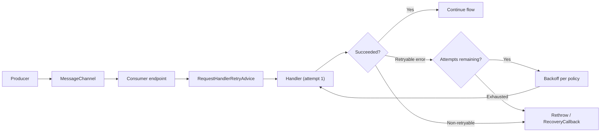
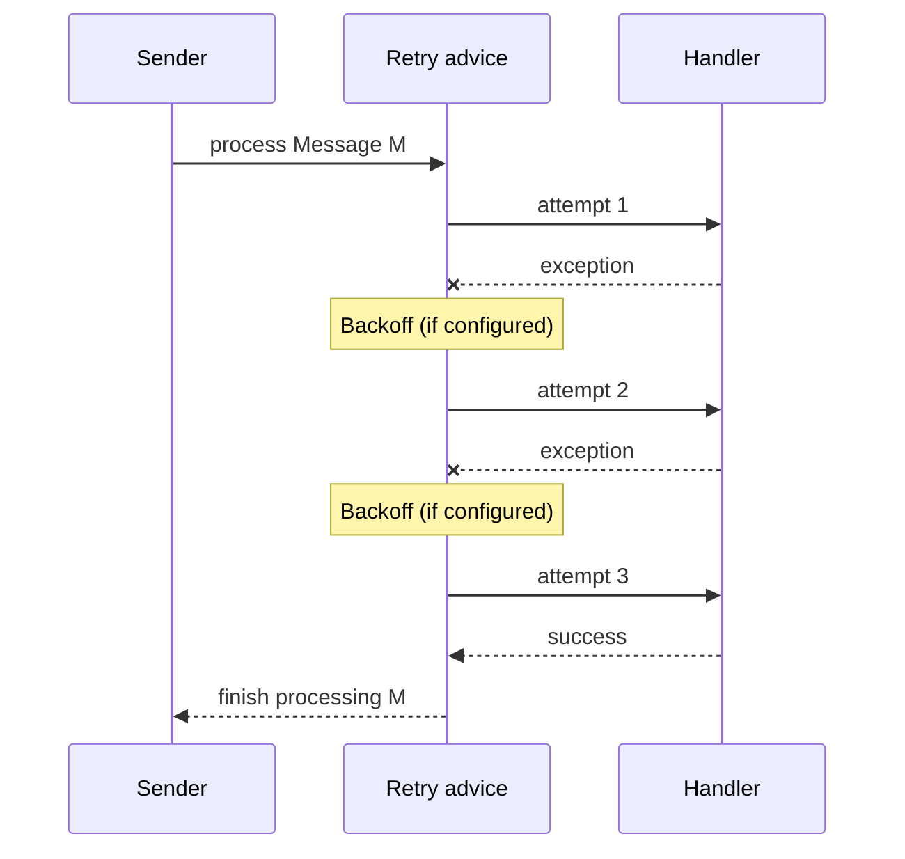
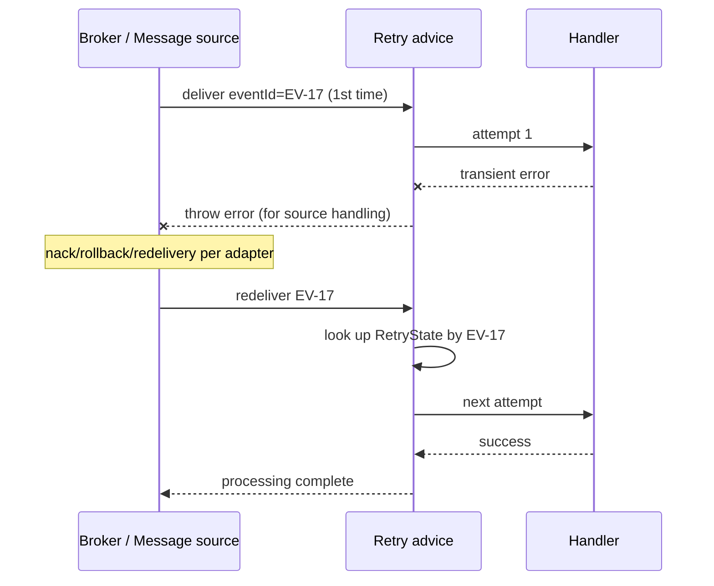
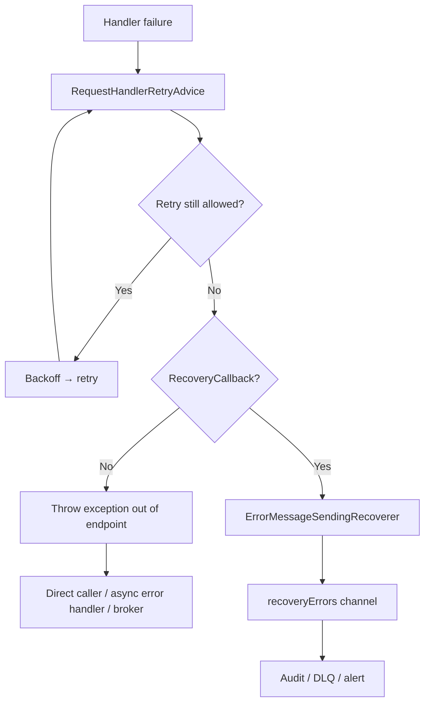

# RequestHandlerRetryAdvice in Spring Integration

## Goals and context

In Spring Integration, a message typically travels from a `MessageChannel` to a consumer endpoint and is then passed to a `MessageHandler`. If the handler calls a database or an external service, a short-lived network glitch can cause processing to fail even when the message is valid. `RequestHandlerRetryAdvice` allows **retrying the handler invocation** according to a bounded policy, wait intervals, and a clear recovery path.

This lesson belongs to the **Advice chain** chapter of the **SPRING_INTEGRATION_RUNTIME** module. The topic ties directly to the runtime: channels and endpoints decide when a message is processed; the retry advice decides whether and when the handler invocation is repeated; executors, pollers, transactions, error channels, and message stores affect where errors surface as well as the risk of duplicate processing.

After this lesson, you will be able to:

- Identify the true scope of `RequestHandlerRetryAdvice` and distinguish it from retries at the poller, broker, or HTTP client level.
- Configure **stateless retry** using `RetryTemplate`, `RetryPolicy`, and `BackOffPolicy`.
- Handle **retries exhausted** cases by rethrowing the error or using `RecoveryCallback`/`ErrorMessageSendingRecoverer`.
- Classify exceptions by cause, avoiding retries on data errors that cannot self-recover.
- Explain **stateful retry** combined with redelivery from JMS/AMQP/Kafka or a message source with redelivery support.
- Order retry advice with transaction advice, and assess impacts on threading, throughput, idempotency, and observability.
- Write test scenarios that verify invocation counts, delays, exceptions, and recovery.

The main API examples use **Spring Integration 6.5.x, Spring Retry 2.x, and Java 17+**. Retry APIs in newer Spring Framework/Integration lines may differ; when copying examples, align dependency versions and Javadoc.

## 1. What is RequestHandlerRetryAdvice?

`RequestHandlerRetryAdvice` resides in the package:

```java
org.springframework.integration.handler.advice.RequestHandlerRetryAdvice
```

This class extends `AbstractRequestHandlerAdvice` and implements an AOP advice around invoking a message handler. It uses **Spring Retry** to control attempt counts, retryable exception types, backoff, and recovery.



**The advice wraps the handler invocation; it does not alter the channel or source on its own.** It does not register subscribers, create pollers/executors, durably persist messages, or open transactions automatically. Retries happen within the scope of the endpoint to which the advice is attached.

A successful handler invocation may return a result, complete with no reply, or trigger sending a reply afterward. Under standard request-handler advice mechanics, sending the reply and downstream endpoints **are not automatically included in the retry scope**.

### Components and roles

| Component | Role |
|---|---|
| `RequestHandlerRetryAdvice` | Plugs a retry policy into the `MessageHandler` invocation within an advice chain. |
| `RetryTemplate` | Orchestrates attempts, checks `RetryPolicy`, applies `BackOffPolicy`, and invokes callbacks. |
| `RetryPolicy` | Decides which exceptions are retryable and whether attempts are exhausted. |
| `BackOffPolicy` | Specifies how long to wait between attempts; can be fixed or exponential. |
| `RecoveryCallback` | Decides final behavior when retries can no longer continue. |
| `ErrorMessageSendingRecoverer` | A `RecoveryCallback` that sends the final error as an `ErrorMessage` to a message channel. |
| `RetryStateGenerator` | Produces a message state key for **stateful retry**. |
| `RetryContext` | Holds information about the current attempt such as retry count and last exception. |

Distinguish an **attempt** from a **retry**: one initial call plus two retries equals **three attempts**. In Spring Retry 2.x, `new SimpleRetryPolicy(3)` means at most **3 total handler executions**, not 3 retries after the first call.

## 2. Where is advice attached?

For annotation-based endpoints, you can specify the advice bean name in `@ServiceActivator`:

```java
@ServiceActivator(
        inputChannel = "paymentRequests",
        adviceChain = "retryAdvice")
public void charge(String request) {
    // Business logic: may throw an exception.
}
```

The `retryAdvice` bean must exist in the Spring context, have a compatible type, and be initialized before the endpoint uses it. The `adviceChain` attribute accepts `String[]`, allowing multiple advice instances:

```java
@ServiceActivator(
        inputChannel = "paymentRequests",
        adviceChain = {"retryAdvice", "transactionAdvice"})
public void charge(String request) {
    // ...
}
```

The example above illustrates how to declare ordering; to run it, both beans and an appropriate transaction manager must be declared.

With Java DSL, you can configure request-handler advice on the endpoint:

```java
@Bean
IntegrationFlow paymentFlow(PaymentService service,
                            RequestHandlerRetryAdvice retryAdvice) {
    return IntegrationFlow.from("paymentRequests")
            .handle(service, "charge",
                    endpoint -> endpoint.advice(retryAdvice))
            .get();
}
```

`PaymentService` and the `charge` method are application components you need to define. The DSL example fits request-handler endpoints that support `.advice(...)`; specialized builders may offer different configuration APIs.

### Handler advice vs. poller advice

Suppose a flow is:

```text
File inbound adapter → transformer A → HTTP gateway B → JDBC handler C
```

- Attaching retry to **handler B**: retry targets B's invocation, avoiding re-running A just because B failed.
- Attaching retry to **handler C**: retry targets C, without automatically re-invoking HTTP gateway B.
- Attaching retry to the **poller** at the source: depending on the advice and transaction scope, the entire processing path spawned by the poll may repeat; side effects that already succeeded upstream can easily occur again.

Scope is a critical safety factor. If you want to retry an entire sub-flow, you need an advice mechanism at a layer wrapping that sub-flow, rather than expecting every `RequestHandlerRetryAdvice` to automatically wrap downstream handlers.

## 3. Stateless retry: retrying within the same processing pass

This is the common and default mode. An input message is handled by the same advice invocation; when the handler fails, the advice keeps invoking the handler on that thread until it succeeds or the policy is exhausted.



Key points:

- The inbound adapter does not need to redeliver the message for attempt 2 or 3 to happen.
- When the handler is called again, **side effects from failed attempts may have partially occurred**.
- A sleep-based `BackOffPolicy` holds the processing thread during the wait interval.
- With `DirectChannel`, that is usually the caller's thread. With a poller or `ExecutorChannel`, the held thread is the corresponding worker.
- Retry advice does not automatically turn business errors into a single transaction, nor does it automatically roll back side effects.

### Defaults and limits

In Spring Integration 6.x using Spring Retry 2.x, the minimal configuration:

```java
@Bean
RequestHandlerRetryAdvice retryAdvice() {
    return new RequestHandlerRetryAdvice();
}
```

uses Spring Retry's default template/policy: **up to three calls** on continued failure, **no meaningful backoff**, and **no RecoveryCallback** unless you configure one. When attempts are exhausted, the exception propagates back to the component invoking the handler. With a synchronous channel, the caller typically sees the exception; with a poller/executor, an appropriate error handler may receive it.

Do not treat these defaults as a universal SLA: tune retryable exceptions, max attempts, backoff, timeouts, message sources, and downstream latency.

## 4. End-to-end example: transient errors, permanent errors, and recovery

The following Spring configuration example creates a `DirectChannel` input, a `QueueChannel` receiving errors after retries are exhausted, and a service activator. It uses `new SimpleRetryPolicy(3)` and a fixed 100 ms backoff to make the results easy to observe.

Required dependencies (if not already provided by Spring Boot/dependency management): `spring-integration-core` and `spring-retry`, along with compatible Spring Framework dependencies. In real projects, let BOM/Boot manage consistent versions.

```java
import java.util.concurrent.ConcurrentHashMap;
import java.util.concurrent.atomic.AtomicInteger;

import org.springframework.beans.factory.annotation.Qualifier;
import org.springframework.context.annotation.AnnotationConfigApplicationContext;
import org.springframework.context.annotation.Bean;
import org.springframework.context.annotation.Configuration;
import org.springframework.integration.annotation.ServiceActivator;
import org.springframework.integration.channel.DirectChannel;
import org.springframework.integration.channel.QueueChannel;
import org.springframework.integration.config.EnableIntegration;
import org.springframework.integration.handler.advice.ErrorMessageSendingRecoverer;
import org.springframework.integration.handler.advice.RequestHandlerRetryAdvice;
import org.springframework.messaging.Message;
import org.springframework.messaging.MessageChannel;
import org.springframework.messaging.MessagingException;
import org.springframework.messaging.PollableChannel;
import org.springframework.messaging.support.ErrorMessage;
import org.springframework.messaging.support.MessageBuilder;
import org.springframework.retry.backoff.FixedBackOffPolicy;
import org.springframework.retry.policy.SimpleRetryPolicy;
import org.springframework.retry.support.RetryTemplate;

@Configuration
@EnableIntegration
public class RetryAdviceExample {

    @Bean
    public MessageChannel orders() {
        return new DirectChannel();
    }

    @Bean
    public PollableChannel exhaustedErrors() {
        return new QueueChannel(16);
    }

    @Bean("retryAdvice")
    public RequestHandlerRetryAdvice retryAdvice(
            @Qualifier("exhaustedErrors") MessageChannel exhaustedErrors) {

        RetryTemplate template = new RetryTemplate();

        // Three calls: 1 initial attempt + up to 2 retries.
        template.setRetryPolicy(new SimpleRetryPolicy(3));

        FixedBackOffPolicy backOff = new FixedBackOffPolicy();
        backOff.setBackOffPeriod(100L);
        template.setBackOffPolicy(backOff);

        RequestHandlerRetryAdvice advice = new RequestHandlerRetryAdvice();
        advice.setRetryTemplate(template);

        // Runs only if retries are exhausted or the exception is non-retryable.
        advice.setRecoveryCallback(
                new ErrorMessageSendingRecoverer(exhaustedErrors));

        return advice;
    }

    @Bean
    public OrderService orderService() {
        return new OrderService();
    }

    public static class OrderService {
        private final ConcurrentHashMap<String, AtomicInteger> calls =
                new ConcurrentHashMap<>();

        @ServiceActivator(
                inputChannel = "orders",
                adviceChain = "retryAdvice")
        public void submit(String orderId) {
            int attempt = calls.computeIfAbsent(
                    orderId, key -> new AtomicInteger())
                    .incrementAndGet();

            System.out.printf("order=%s attempt=%d%n", orderId, attempt);

            // Fail first two attempts, succeed on third.
            if (orderId.startsWith("FLAKY") && attempt < 3) {
                throw new IllegalStateException("Temporary failure");
            }

            // Always fail: after three attempts the recoverer is invoked.
            if (orderId.startsWith("FAIL")) {
                throw new IllegalArgumentException("Invalid order");
            }

            System.out.println("COMPLETED " + orderId);
        }
    }

    public static void main(String[] args) {
        try (var context = new AnnotationConfigApplicationContext(
                RetryAdviceExample.class)) {

            MessageChannel input =
                    context.getBean("orders", MessageChannel.class);
            PollableChannel recovery =
                    context.getBean("exhaustedErrors", PollableChannel.class);

            input.send(MessageBuilder.withPayload("FLAKY-01").build());
            // FLAKY-01: attempt 1, 2, 3, then COMPLETED.

            input.send(MessageBuilder.withPayload("FAIL-02")
                    .setHeader("correlationId", "batch-42")
                    .build());

            Message<?> received = recovery.receive(2_000);
            if (received instanceof ErrorMessage error) {
                Throwable failure = error.getPayload();
                System.out.println("RECOVERY ERROR: "
                        + failure.getClass().getSimpleName());

                Message<?> original = error.getOriginalMessage();
                if (original == null && failure instanceof MessagingException ex) {
                    original = ex.getFailedMessage();
                }
                if (original != null) {
                    System.out.println("Failed payload: "
                            + original.getPayload());
                }
            }
        }
    }
}
```

**Expected flow:**

1. `FLAKY-01` fails on attempts 1 and 2, and succeeds on attempt 3. `exhaustedErrors` receives no error for this message.
2. `FAIL-02` fails on all three attempts. `ErrorMessageSendingRecoverer` forwards the final error to `exhaustedErrors`; the program reads it from the queue.
3. Because the recoverer typically completes with a `null` result, sending the message to the handler returns after recovery; that **does not mean business processing succeeded**.
4. `ErrorMessage.getOriginalMessage()` or `MessagingException.getFailedMessage()` can help trace back to the input message, but you must check for `null` because they depend on how the error was created and the publisher's context.

In the demo, `OrderService` keeps a counter in memory so learners can see invocation counts; in production, use metrics/logs or test spies, and avoid holding unbounded mutable business state in a singleton handler. If the same `orderId` is sent again, the demo counter keeps incrementing: this is not idempotency logic.

### When there is no recovery callback

Remove the line `advice.setRecoveryCallback(...)`: if `FAIL-02` still fails after three calls, the exception propagates out of the advice. With `DirectChannel`, `input.send(...)` will observe an exception from the handler layer, usually a `MessagingException` wrapping the business cause.

```java
try {
    input.send(MessageBuilder.withPayload("FAIL-02").build());
} catch (MessagingException ex) {
    System.err.println("Handler exhausted: " + ex.getMessage());
}
```

Do not assume setting an `errorChannel` header on the input is enough to turn a **synchronous** error into an `ErrorMessage`. When you want to publish errors after retries are exhausted, you need a recovery callback, a gateway error flow, or an error-handling mechanism suited to the endpoint.

## 5. RetryPolicy: retry only the right error types

Not every exception is a transient error. Retrying an `IllegalArgumentException` caused by a bad payload creates wasted load and delays responses. In Spring Retry 2.x, `SimpleRetryPolicy` can accept a map of allowed exceptions, attempt count, and cause-traversal rules.

Example that retries only recoverable I/O errors, even when wrapped inside a `MessagingException`:

```java
import java.io.IOException;
import java.util.HashMap;
import java.util.Map;
import org.springframework.retry.policy.SimpleRetryPolicy;

Map<Class<? extends Throwable>, Boolean> retryable = new HashMap<>();
retryable.put(IOException.class, true);

SimpleRetryPolicy policy = new SimpleRetryPolicy(
        3,             // Maximum 3 total attempts
        retryable,
        true,          // Traverse cause chain
        false);        // Unlisted exceptions: do not retry
```

Then:

```java
RetryTemplate template = new RetryTemplate();
template.setRetryPolicy(policy);
advice.setRetryTemplate(template);
```

Here, the `advice` variable represents an initialized `RequestHandlerRetryAdvice`. This classification approach is useful because the framework may wrap method errors in a `MessageHandlingException` or another `MessagingException`. With `traverseCauses=false`, the classifier may inspect only the outermost exception and miss the nested error type.

### Suggested policy table

| Error group | Should you retry? | Reason |
|---|---|---|
| Socket timeout, HTTP 503, temporary disconnect | Usually yes, bounded by count and time | External state may recover. |
| Rate limit / HTTP 429 | Conditionally | Respect `Retry-After` or partner limits. |
| Validation, invalid schema, missing required fields | Usually no | Resending the same payload will not fix the data. |
| Authentication/authorization failure | Usually no with the same credentials | Token/permissions must be updated; tight retries can worsen the incident. |
| Optimistic locking/deadlock | Conditionally | Only when the transaction can safely re-run and logic is idempotent. |
| Missing channel/bean or configuration error | No | Configuration must be fixed; retrying does not resolve the cause. |
| Unknown cause | Follow safe policy | Prefer logging/auditing/recovery instead of unbounded retries. |

A method might throw `IllegalStateException` for both transient and permanent errors. Use specific exception types or a classifier policy based on the actual cause to avoid wrong decisions.

### `maxAttempts` and `retryCount`

In Spring Retry:

- `maxAttempts = 1`: invokes the handler once, **no retries**.
- `maxAttempts = 3`: invokes the handler once initially and up to two retries.
- `RetryContext.getRetryCount()` is typically 0 before the first error and increments with recorded failures.

In logs, name `attemptNumber` (1-based) and `retryCount` (usually 0-based) clearly to avoid confusion.

## 6. BackOffPolicy: wait intervals and resources

Back-to-back retries without backoff can hammer an overloaded service with bursts of requests. Spring Retry provides `FixedBackOffPolicy` and `ExponentialBackOffPolicy`:

```java
import org.springframework.retry.backoff.ExponentialBackOffPolicy;

ExponentialBackOffPolicy backOff = new ExponentialBackOffPolicy();
backOff.setInitialInterval(1_000L); // before first retry: ~1s
backOff.setMultiplier(2.0);         // subsequent intervals ~2s, ~4s...
backOff.setMaxInterval(10_000L);    // cap for each wait interval

RetryTemplate template = new RetryTemplate();
template.setRetryPolicy(new SimpleRetryPolicy(4));
template.setBackOffPolicy(backOff);
```

With four attempts and the configuration above, theoretical wait times before attempts 2, 3, and 4 are roughly 1, 2, and 4 seconds respectively (excluding network, overhead, and scheduler variance). This is **wait time on the current thread**, not a durable delay queue.

| Operational dimension | Risk of improper backoff |
|---|---|
| `DirectChannel` | Blocks the caller thread, increasing latency/API timeouts. |
| Synchronous poller | A failing message can block pulling other messages during retries. |
| `ExecutorChannel` | Ties up worker threads; backlog grows and the thread pool can exhaust. |
| Request/reply gateway | Caller or gateway may time out before all attempts complete. |
| Multi-instance system | Synchronized retries cause traffic spikes; consider jitter or rate limiting. |

For high volume or retries needing minutes/hours of delay, you usually need a **retry queue/scheduled redelivery** design rather than sleeping thousands of threads. That is an infrastructure choice, not a simple `BackOffPolicy` parameter on the advice.

### Estimating time budgets

Suppose each downstream call timeout is 2 seconds, the policy allows 3 attempts, and backoff is 1 second then 2 seconds. Worst-case duration can reach roughly:

```text
3 × 2 seconds (call time) + (1 + 2) seconds (backoff)
≈ 9 seconds, excluding overhead/queuing
```

If the gateway timeout is only 5 seconds, the caller may time out before the policy finishes. Meanwhile, retries can keep running and produce side effects later. Align caller, downstream, retry policy, and flow processing timeouts.

## 7. RecoveryCallback and ErrorMessageSendingRecoverer

When retries are exhausted, there are two main options:

1. **Rethrow:** let the exception propagate out of the advice. The caller, poller, container, or adapter decides rollback, logging, error channel, or redelivery.
2. **Recover:** invoke `RecoveryCallback` to record the error, return a fallback value, or send a message to an error-handling channel.

`ErrorMessageSendingRecoverer` is a built-in recovery implementation:

```java
@Bean
RequestHandlerRetryAdvice retryAdvice(
        @Qualifier("recoveryErrors") MessageChannel recoveryErrors) {

    RequestHandlerRetryAdvice advice = new RequestHandlerRetryAdvice();
    advice.setRecoveryCallback(
            new ErrorMessageSendingRecoverer(recoveryErrors));
    return advice;
}
```

The example requires a `recoveryErrors` channel bean. This recovery approach converts the final error into an `ErrorMessage` so an error flow can audit, alert, or route to a DLQ. It **does not automatically persist** errors across restarts; durability depends on the chosen channel, consumer, and message store/DLQ.

### Recovery can "swallow" exceptions

`RecoveryCallback` returns a result to the advice layer. If the callback handles the error without throwing an exception, the outer call may treat the advice as completed. Some consequences:

- For a `void`-returning service activator, there is no reply; upstream components may evaluate this differently depending on the adapter.
- For a gateway expecting a reply, `null` may cause a `ReplyRequiredException` or a timeout instead of returning a success payload.
- For JMS/AMQP/Kafka, swallowing the exception may cause the source to ack/commit per its configuration while the business operation **has not succeeded**.
- If the recovery channel cannot accept the error message, the recovery step itself may throw a secondary error.

Therefore, clearly define whether "handled the error" means **durably persisted to a DLQ and current responsibility is complete**, or merely "logged." Those two cases do not mean the same thing for acknowledgment.

### Reading the error and original message

`ErrorMessage` carries a `Throwable` payload. Information about the original message can be obtained from two places:

```java
import org.springframework.messaging.Message;
import org.springframework.messaging.MessagingException;
import org.springframework.messaging.support.ErrorMessage;

public void audit(ErrorMessage error) {
    Throwable failure = error.getPayload();

    Message<?> original = error.getOriginalMessage();
    if (original == null && failure instanceof MessagingException ex) {
        original = ex.getFailedMessage();
    }

    String id = original == null
            ? "unknown"
            : String.valueOf(original.getHeaders().getId());

    System.err.println("messageId=" + id
            + " exception=" + failure.getClass().getName());
}
```

Not every publisher populates `originalMessage` or `failedMessage`. If an exception is wrapped across multiple layers, inspect the `cause` chain and message context before deciding retry classification.

## 8. Stateful retry: letting the source redeliver the message

**Stateless retry** repeats the handler within a single processing pass. **Stateful retry** preserves retry state across multiple message deliveries sharing the **same key**, while throwing the exception so the caller/source can roll back or request redelivery.



In Spring Integration 6.x, stateful retry can be enabled with `RetryStateGenerator`:

```java
import org.springframework.integration.handler.advice.RequestHandlerRetryAdvice;
import org.springframework.integration.handler.advice.SpelExpressionRetryStateGenerator;

RequestHandlerRetryAdvice advice = new RequestHandlerRetryAdvice();

// The eventId header must remain stable across redeliveries.
advice.setRetryStateGenerator(
        new SpelExpressionRetryStateGenerator("headers['eventId']"));
```

This illustrates how to generate a state key for a `RequestHandlerRetryAdvice` used in an endpoint. You must configure the source for redelivery and appropriate business retry/recovery policies; this snippet alone does not enable redelivery.

### Comparing stateless vs. stateful

| Criterion | Stateless | Stateful |
|---|---|---|
| Who initiates the next attempt? | The advice within the same call stack. | The source/transport redelivers the message. |
| Exception on each failure | Advice typically retains it to retry internally. | Usually thrown back to the source to rollback/nack/redeliver. |
| Retry state | Scoped to the current invocation. | Keyed to recognize the same message across multiple deliveries. |
| Backoff | Waits between attempts in the same processing pass. | Coordinates advice backoff with the source's redelivery schedule. |
| Transaction | Each attempt can be a separate transaction if advice is ordered properly. | Each redelivery is typically a new processing pass/transaction depending on adapter. |
| Main risks | Thread blocking, repeated side effects, and increased latency. | Wrong state key, cache expiration, redelivery storms, broker loops. |
| Best suited for | Short HTTP client calls or a handler with transient errors. | Brokers supporting rollback/nack/requeue or sources guaranteeing redelivery. |

**The state key must be stable and sufficiently distinct.** Using `message.getHeaders().getId()` may not work if the adapter generates a new message ID on each redelivery; use a business event ID or broker delivery key per the source contract. Avoid generic payloads because different messages could accidentally share retry state.

### Two things to check with stateful retry

- **State storage:** default retry state is not automatically persisted across restarts or distributed across instances. In multi-consumer/multi-instance setups, determine your cache strategy, message partitioning, and redelivery behavior.
- **Source behavior:** if the broker always acks messages even when the handler throws an exception, stateful retry merely stores state with no subsequent retry. Test acknowledgment/rollback directly with the adapter in use.

## 9. Advice ordering and transaction boundaries

Advice acts as **around interceptors**. An advice listed earlier in the chain is the outermost layer; the last advice sits closest to the handler. Ordering changes transaction scope.

### Retry outside transaction

```text
RetryAdvice
  ├─ TransactionAdvice → Handler attempt 1 → rollback
  ├─ TransactionAdvice → Handler attempt 2 → rollback
  └─ TransactionAdvice → Handler attempt 3 → commit
```

Conceptual configuration:

```java
@ServiceActivator(
        inputChannel = "payments",
        adviceChain = {"retryAdvice", "transactionAdvice"})
public void charge(String paymentId) {
    // ...
}
```

**If the transaction advice opens a new transaction per invocation**, each attempt gets its own transaction/rollback. This is typically the right choice when the failure is a deadlock/optimistic locking conflict and the entire transaction's work can safely re-run.

### Transaction outside retry

```text
TransactionAdvice
  └─ RetryAdvice
       ├─ Handler attempt 1 (failure)
       ├─ Handler attempt 2 (failure)
       └─ Handler attempt 3 (success)
  → one outer transaction per configuration
```

If transaction advice is the outermost layer, attempts may execute in **the same transaction**, or the transaction may already be marked rollback-only from the first failure. Succeeding on the final attempt does not guarantee a commit will succeed.

**Scope note:** for reply-producing handlers, some regular advice wraps `handleRequestMessage()` rather than the entire `handleMessage()`; `HandleMessageAdvice` implementations have a different scope. When combining retry, idempotent receiver, or advice that must govern an entire sub-flow, verify the actual AOP order and scope rather than just reading the list of names in `adviceChain`.

### Interaction with pollers and executors

- `DirectChannel`: advice and handler run on the sender thread; backoff can delay the caller.
- `QueueChannel` + poller: advice runs on the poller thread; long retries reduce how many messages can be polled per cycle.
- `ExecutorChannel`: advice runs on a worker; heavy retries reduce available workers.
- Poller transaction advice placed outside handler advice can make the transaction span multiple operations; inspect the actual scope.
- A dynamic `IntegrationFlow` can start/stop consumer endpoints; the existence of an advice bean does not prove the endpoint is actively processing messages.

## 10. Idempotency: prerequisite for safe retries

Retry **does not mean** exactly-once. An HTTP request may already have been accepted and committed by a partner while the client timed out before receiving the response. A retry can create a second payment or order request.

Common failure pattern:

```text
Attempt 1: send create-payment command → server creates payment → response lost
Attempt 2: resend create-payment command → server creates a second payment
```

Mitigations:

1. Generate a **stable idempotency key** tied to the business event, such as `paymentId` or `orderEventId`.
2. Downstream stores the key and returns the same result / skips repeating the side effect for the same key.
3. If writing to a DB and then publishing an event, consider transactional outbox/inbox to avoid duplicate or lost events.
4. If external side effects cannot be rolled back, design compensation and auditing instead of relying on DB rollback.
5. When retries end in recovery, persist a clear status: `COMPLETED`, `RETRY_EXHAUSTED`, `QUARANTINED`, or equivalent.

A **Correlation ID** helps trace related messages but does not guarantee idempotency on its own. A framework-generated **Message ID** is also not guaranteed to stay stable across redelivery or transformation. Distinguish message identifiers from business operation identifiers.

### Handler retries and broker retries can multiply invocations

For example, handler advice allows up to three attempts, while the broker redelivers the same message five times. If each redelivery starts a fresh stateless cycle, handler invocations can reach:

```text
3 attempts/delivery × 5 deliveries = 15 handler invocations
```

This is a **theoretical upper bound** if every call fails and both retry layers are active; the actual count depends on retry policy, acknowledgment, recovery, and container configuration. Therefore, coordinate retry budgets across handlers, adapters, brokers, and other client libraries.

## 11. Errors, errorChannel, and recovery states

Spring Integration provides distinct error paths:



On the **synchronous path**, an exception without recovery is normally thrown back over `DirectChannel` to the caller. Setting the `errorChannel` header does not automatically catch all synchronous errors.

On the **asynchronous path**, a poller/executor error handler or inbound adapter can create an `ErrorMessage` per configuration. If `ErrorMessageSendingRecoverer` is already used on the handler, the exception may be handled at the advice before reaching an outer error handler; do not expect two error messages for the same attempt.

In an error flow:

- Inspect the exception chain and failed/original message if present.
- Record `retryCount`, redelivery count, handler/endpoint ID, and business correlation.
- Classify the final error: permanently invalid, temporarily unavailable, unknown.
- Verify whether writing to the DLQ/message store is **durable** and actually succeeded.
- Alert if the recovery channel has no consumer or its queue is full.

`ErrorMessageSendingRecoverer` only handles **publishing**; it does not decide transaction commit, broker acknowledgment, or business compensation. When a pipeline requires a reply, design the gateway's response/exception contract explicitly.

## 12. Performance observability and runtime diagnostics

Retries change how long a message occupies a handler. A frequently failing operation can create an executor backlog even when successful throughput is low.

Monitor these signals:

| Metric/trace | Operational question |
|---|---|
| `attemptCount` and `retryCount` per handler | How many requests had to be retried? |
| `retryExhausted` | What percentage of failures exhausted the policy? |
| Actual latency per attempt | Where is downstream slow: network, DB, locks? |
| Total backoff time | How long are threads held waiting? |
| Queue depth and worker utilization | Are retries causing starvation/backpressure? |
| Recovery publish failures | Are errors being lost due to full channels or missing subscribers? |
| Business ID/correlation ID | Which attempts/redeliveries belong to the same operation? |
| Transaction rollbacks and broker redeliveries | Is the system repeatedly cycling messages? |

Spring Retry provides `RetryListener` and `RetryContext` to hook into each retry attempt. You can use Micrometer/Observation/logging per your runtime setup to record attempts and outcomes. Do not put high-cardinality business IDs like `orderId` into metric tags; place them in controlled logs/tracing instead.

### Common configuration mistakes

| Symptom | Likely cause | Check |
|---|---|---|
| Handler runs only once | Advice bean not attached, exception non-retryable, or policy allows 1 attempt | Check `adviceChain`, policy, bean names, and logs. |
| Retries occur with no delay | `BackOffPolicy` not configured or default no-backoff | Inspect the actual `RetryTemplate` inside the advice. |
| `SocketTimeoutException` is wrapped and not retried | Classifier inspects only the wrapper error | Enable cause traversal and configure the exact exception type. |
| Validation errors are retried | Default policy retries all exceptions | Define an explicit retryable map with default false. |
| Error written to recovery channel but caller thinks it succeeded | `RecoveryCallback` consumed the exception | Verify the reply/ack contract and business status. |
| Gateway times out before retries finish | Timeout is smaller than total call + backoff | Balance time budget and attempt count. |
| Bulk slowdown after switching to executor | Workers blocked during backoff | Check pool size, queue capacity, and deferred retry strategy. |
| Stateful retry does not increment attempts | Key differs across redeliveries or source does not redeliver | Trace state key and real ack/rollback behavior. |
| One retry creates two payments | Earlier attempt had a side effect despite returning an error | Implement downstream idempotency keys. |
| Error flow receives two errors for one event | Multiple retry/error-publisher layers or multiple subscribers | Trace call paths and event IDs; avoid duplicate handling. |
| Transaction does not commit after successful retry | First failure marked transaction rollback-only | Check advice ordering and transaction boundaries. |

### Checklist when debugging "retry is not working"

1. Verify the message **reached the endpoint** and the handler bean is actually invoked.
2. Verify `RequestHandlerRetryAdvice` is attached with the exact bean name in the annotation/DSL.
3. Inspect the **root and wrapper exceptions**; compare against `RetryPolicy`.
4. Log `attemptNumber` clearly in tests and verify execution count.
5. Compare backoff and total wait time against source/gateway timeouts.
6. Check for a `RecoveryCallback` and determine whether the exception is propagated or consumed.
7. Check transactions, broker/container redelivery, and idempotency if side effects exist.
8. Monitor error channels, DLQs, queue backlogs, and endpoint lifecycle.

## 13. Hands-on exercises and testing

### Exercise 1 — Retrying transient errors

With `RetryAdviceExample`:

- Send message `FLAKY-01`; verify the handler is invoked **3 times** and no `ErrorMessage` arrives at `exhaustedErrors`.
- Change the condition to succeed on attempt 2; verify call count drops to 2.
- Add a 200 ms backoff; measure total duration and observe the impact when many messages are sent concurrently.

**Expected result:** retries stop immediately upon success; attempt count does not exceed `maxAttempts`.

### Exercise 2 — Recovery after exhausting attempts

- Send `FAIL-02`; verify the handler is invoked 3 times and the recoverer sends **one** `ErrorMessage` to `exhaustedErrors`.
- From `ErrorMessage`, inspect the exception class and failed/original message if available.
- Remove the recovery callback and verify the error propagates to the caller over `DirectChannel`.
- Try stopping the recovery consumer or filling the channel to observe secondary errors from publish failure.

**Expected result:** clear behavior when retries are exhausted; never confuse "error recorded" with "business processing succeeded."

### Exercise 3 — Exception classification

Configure `SimpleRetryPolicy(3, retryable, true, false)` to retry only `IOException`:

- Handler throws `IOException` or an exception with an `IOException` cause: allowed to retry per policy.
- Handler throws `IllegalArgumentException`: transitions immediately to recovery/rethrow per the chosen mechanism.
- Explain why `traverseCauses=true` is needed when Spring Integration wraps handler exceptions.

### Exercise 4 — Transactions and stateful retry

- Attach transaction advice and test both orderings with retry advice.
- On DB error, verify transaction/rollback counts using data from the transaction manager or an integration test.
- With a message source supporting redelivery, use `SpelExpressionRetryStateGenerator` on a stable business event ID header.
- Test the same event redelivered multiple times, then test two distinct events; verify retry state is not wrongly shared.
- Enable downstream idempotency and prove no duplicate side effect is created when a prior attempt committed externally.

### Assertions to include in integration tests

```java
// Pseudocode for JUnit/AssertJ and a test spy bean:
// assertThat(handler.calls("FLAKY-01")).isEqualTo(3);
// assertThat(recoveryChannel.receive(0)).isNull();
// input.send(messageWithPayload("FAIL-02"));
// assertThat(handler.calls("FAIL-02")).isEqualTo(3);
// Message<?> error = recoveryChannel.receive(1000);
// assertThat(error).isInstanceOf(ErrorMessage.class);
// assertThat(((ErrorMessage) error).getPayload()).isInstanceOf(Throwable.class);
```

When measuring backoff, use an appropriate time source or testing utility with reasonable tolerance; avoid millisecond-exact assertions in CI. Transaction/redelivery tests must run through real adapters/containers, because direct handler unit tests do not prove proper acknowledgment and rollback.

## 14. Production design checklist

- [ ] Retry only recoverable exceptions; do not blindly retry all business errors.
- [ ] `maxAttempts` is understood as **total invocations**, not confused with retry count.
- [ ] Backoff aligns with timeouts, SLOs, and poller/executor worker counts; add jitter/rate limits when needed.
- [ ] Retry advice is attached to the right handler, avoiding repeated upstream/downstream side effects.
- [ ] Retry/transaction advice ordering has been tested with real transactions.
- [ ] Stable idempotency keys exist for writes, charges, and event emissions.
- [ ] Exhausted behavior is clearly defined: rethrow, fallback, persistent DLQ, or compensation.
- [ ] Error flows preserve necessary origin info while avoiding leaking sensitive payloads.
- [ ] Source acknowledgment/redelivery is not accidentally altered by a callback swallowing exceptions.
- [ ] Retries at handler, broker, HTTP client, and scheduler layers are distinguished to bound total attempts.
- [ ] Stateful keys and retry state do not collide or mutate across redeliveries; cache/distribution evaluated.
- [ ] Metrics/logs capture attempts, exhausted failures, latency, backlog, rollbacks, and correlation.
- [ ] Tests cover success after N attempts, non-retryable failures, exhaustion, recovery failure, transactions, and restarts.

## References

- [Spring Integration 6.5 — Adding Behavior to Endpoints](https://docs.spring.io/spring-integration/reference/6.5/handler-advice.html).
- [Spring Integration 6.5 — Provided Advice Classes / Retry Advice](https://docs.spring.io/spring-integration/reference/6.5/handler-advice/classes.html).
- [Spring Integration 6.5 — Ordering Advices within Advice Chain](https://docs.spring.io/spring-integration/reference/6.5/handler-advice/order.html).
- [Spring Integration 6.5 — Service Activator](https://docs.spring.io/spring-integration/reference/6.5/service-activator.html).
- [Spring Integration 6.5.x Javadoc — RequestHandlerRetryAdvice](https://docs.spring.io/spring-integration/docs/6.5.x/api/org/springframework/integration/handler/advice/RequestHandlerRetryAdvice.html).
- [Spring Integration 6.5.x Javadoc — RetryStateGenerator](https://docs.spring.io/spring-integration/docs/6.5.x/api/org/springframework/integration/handler/advice/RetryStateGenerator.html).
- [Spring Retry 2.x Javadoc — RetryTemplate](https://docs.spring.io/spring-retry/docs/2.0.x/apidocs/org/springframework/retry/support/RetryTemplate.html).
- [Spring Retry 2.x Javadoc — SimpleRetryPolicy](https://docs.spring.io/spring-retry/docs/2.0.x/apidocs/org/springframework/retry/policy/SimpleRetryPolicy.html).

**Remember:** `RequestHandlerRetryAdvice` repeats **the advised handler invocation**. For safe retries, you must simultaneously choose the right exceptions, attempt count, backoff, recovery, transaction scope, and idempotency. Only when those boundaries are clearly defined will retries help Spring Integration recover from transient errors without causing data corruption or runtime bottlenecks.
