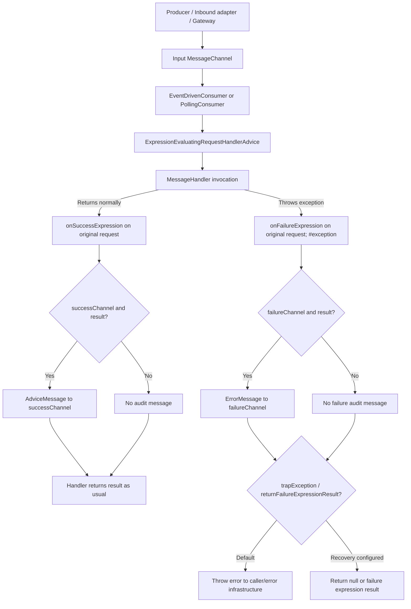
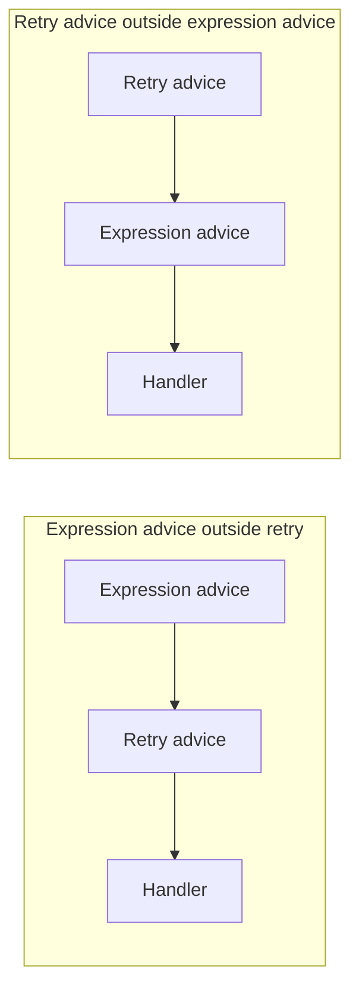

# ExpressionEvaluatingRequestHandlerAdvice in Spring Integration

## 1. Goals and runtime context

`ExpressionEvaluatingRequestHandlerAdvice` is a built-in Spring Integration advice for **evaluating a SpEL expression after a message handler succeeds or fails**. Depending on configuration, the evaluation result is sent to a dedicated channel, helping the system record outcomes, orchestrate compensating actions, or emit notifications independently of main processing.

This lesson is in the **Advice chain** chapter of the `SPRING_INTEGRATION_RUNTIME` module. The module covers how Spring Integration orchestrates message flows through channels, endpoints, consumers, pollers, and executors; and how it manages flow lifecycle, transactions, retries, message stores, errors, correlation, and runtime diagnostics. All of this matters because the advice runs **at a specific handler boundary**, depending on threads, errors, and chain ordering.

Full class name:

```java
org.springframework.integration.handler.advice
    .ExpressionEvaluatingRequestHandlerAdvice
```

This class extends `AbstractRequestHandlerAdvice`, belonging to the AOP `Advice` family for `MessageHandler`. It is **not** a standalone `MessageHandler`, `MessageChannel`, or poller; nor is it a flow-wide SpEL transformer.

**After this lesson, you will be able to:**

1. State precisely when `onSuccessExpression` and `onFailureExpression` are evaluated.
2. Distinguish `AdviceMessage`, `ErrorMessage`, business replies, and errors thrown back to the caller.
3. Configure the advice using Java DSL or `@ServiceActivator(adviceChain=...)`.
4. Predict behavior when using `trapException`, `returnFailureExpressionResult`, and `propagateEvaluationFailures`.
5. Choose the advice position within a retry/transaction chain and analyze failure boundaries when using an executor or poller.
6. Observe, test, and troubleshoot routing, SpEL, correlation, and side-effect errors.

## 2. Where does the advice sit in request handling?

A handler is registered on an endpoint; the endpoint is triggered by a consumer when receiving a message from a channel. The advice is installed **on the handler invocation**. When the handler returns or throws, the advice uses that outcome to decide whether to evaluate the success or failure branch.



**Key point:** the advice sees the **handler's original input message**. It does not automatically use the reply message as the root object for expressions. The handler may return a `String`, `Message<?>`, or `null`; which branch runs depends on **whether an exception escapes the invocation**, not on whether the returned payload is "business-successful."

| Case | Advice interpretation | Consequence |
|---|---|---|
| Handler returns a valid payload | Success | May send `AdviceMessage` to success channel; handler result is forwarded normally. |
| Handler returns `null` without throwing | Success | `onSuccessExpression` can still run; does not mean the caller is guaranteed a reply. |
| Handler throws `IllegalStateException` | Failure | May send `ErrorMessage` to failure channel; by default the error still propagates. |
| Handler catches exception and returns error DTO | Success | To the advice, the invocation finished normally. Define clear business semantics. |
| Message is filtered before reaching handler | Advice is not invoked | No success/failure message is emitted for this handler. |
| Async worker completes after invocation already returned control | Depends on async model | Do not assume business work finishes before an async boundary. |

### Advice is not equivalent to a "try/catch for the entire IntegrationFlow"

Consider a flow:

```text
input -> transform A -> outbound gateway B -> database handler C
```

If you attach `ExpressionEvaluatingRequestHandlerAdvice` to **B**, it observes the invocation of handler **B**. An error in **C** occurring after B has finished does not automatically become a failure of B's advice. Similarly, advice attached to a poller has a different scope from advice attached directly to a handler.

When you need to monitor multiple endpoints, attach advice at each appropriate boundary or use flow-wide tracing/metrics. Do not assume a single advice measures end-to-end latency.

## 3. Two expressions and two channels

Four properties govern the core behavior:

- `onSuccessExpression`: SpEL expression evaluated against the **original request `Message<?>`** after the handler succeeds.
- `successChannel`: channel receiving the success expression result, wrapped as an **`AdviceMessage`**.
- `onFailureExpression`: SpEL expression evaluated against the **original request `Message<?>`** after the handler throws an exception; the context includes the special `#exception` variable.
- `failureChannel`: channel receiving the failure expression result, wrapped as an **`ErrorMessage`**.

Main setter APIs (Spring Integration 6.5):

| Method | Effect |
|---|---|
| `setOnSuccessExpressionString(String)` or `setOnSuccessExpression(Expression)` | Declares SpEL evaluated after success. |
| `setOnFailureExpressionString(String)` or `setOnFailureExpression(Expression)` | Declares SpEL evaluated after an exception. |
| `setSuccessChannel(MessageChannel)` / `setSuccessChannelName(String)` | Sets the channel receiving `AdviceMessage`. |
| `setFailureChannel(MessageChannel)` / `setFailureChannelName(String)` | Sets the channel receiving `ErrorMessage`. |
| `setTrapException(boolean)` | When `true`, traps the exception and returns `null` by default behavior (default `false`). |
| `setReturnFailureExpressionResult(boolean)` | Allows returning the failure expression result as the handler result; pay attention to the reply contract. |
| `setPropagateEvaluationFailures(boolean)` | For **success expression evaluation errors**, `true` propagates the error to the caller, default `false` catches it. Does not change failure expression rules. |

> Since Spring Integration **5.1.3**, if a success/failure channel is configured **without providing the corresponding expression**, the default expression is `payload`. This is the payload of the **input message**, not the handler's return value.

### 3.1. Root object and variables in SpEL

Suppose the request entering the handler has the structure:

```text
Message:
  payload: "file-42.csv"
  headers:
    requestId: "REQ-42"
    tenant: "north"
```

Expressions can be written as:

```text
payload                                -> "file-42.csv"
headers['requestId']                   -> "REQ-42"
headers['tenant'] + ':' + payload      -> "north:file-42.csv"
payload + ':uploaded'                  -> "file-42.csv:uploaded"
#exception.message                     -> error message, only in failure context
#exception.class.simpleName            -> error type, only in failure context
```

`#exception` in the failure expression is the exception caught by the advice; in practice it may be a `MessagingException` whose `cause` is the business exception. Therefore, use `#exception.cause.message` only when you know `cause` is non-null; a safer general pattern is `#exception.toString()` or a null-checked expression.

**Do not use `#exception` in the success expression.** An error thrown while evaluating the success expression itself does not cause the advice to switch to running the failure expression. Per the API, *the failure expression is not executed if the success expression throws an exception*.

### 3.2. Do not confuse the advice-emitted message with the main reply

Take a handler `process("A")` returning `"DONE:A"`. There can be **two outputs**:

1. **Primary handler result:** `"DONE:A"` is forwarded by the endpoint's reply/output channel mechanism.
2. **Side signal from advice:** the success expression evaluates to `"A:OK"` and sends an `AdviceMessage` to `successChannel`.

`successChannel` is **not** an alternative output channel for the endpoint. Treat it as an observation or compensation branch; if you want to alter the primary payload, use a transformer, service activator, or a purpose-built return/recovery mechanism.

## 4. Structure of AdviceMessage and ErrorMessage

### 4.1. Success: `AdviceMessage<T>`

When the success expression returns a result and a success channel is configured, Spring Integration sends an `org.springframework.integration.message.AdviceMessage<T>`. Contents:

- `getPayload()`: the evaluated SpEL value (e.g., `"REQ-42:SUCCESS"`).
- `getInputMessage()`: reference to the **original input message** that the advice passed to the handler.
- Headers: metadata of the emitted message; do not rely solely on copied headers to trace back to the original.

```java
import org.springframework.integration.message.AdviceMessage;
import org.springframework.messaging.Message;

void recordSuccess(Message<?> message) {
    if (message instanceof AdviceMessage<?> adviceMessage) {
        Object outcome = adviceMessage.getPayload();
        Message<?> original = adviceMessage.getInputMessage();
        String requestId = String.valueOf(
                original.getHeaders().get("requestId"));

        System.out.printf("request=%s result=%s%n", requestId, outcome);
    }
}
```

In the success branch, the payload of `AdviceMessage` is **not by default the handler's return value**. If the expression is `payload`, this payload is the **input** payload. This matters greatly when the handler transforms data: the audit result and business reply can be completely different.

### 4.2. Failure: `ErrorMessage` with rich contextual exception

When the handler throws and the failure expression yields a suitable result, the advice sends an `org.springframework.messaging.support.ErrorMessage` to the failure channel. Its payload is an instance of:

```java
ExpressionEvaluatingRequestHandlerAdvice
    .MessageHandlingExpressionEvaluatingAdviceException
```

This is a subclass of `MessagingException` containing:

| Property | Accessed via | Meaning |
|---|---|---|
| Failure expression result | `getEvaluationResult()` | Evaluated SpEL value, e.g., failed task code. |
| Original input / failed message | `getFailedMessage()` | The message the handler received when the error occurred. |
| Original cause | `getCause()` | The original or wrapped exception caught by the advice. |

Example consumer inspecting the failure channel:

```java
import org.springframework.integration.handler.advice
    .ExpressionEvaluatingRequestHandlerAdvice
    .MessageHandlingExpressionEvaluatingAdviceException;
import org.springframework.messaging.support.ErrorMessage;

void recordFailure(ErrorMessage error) {
    Throwable payload = error.getPayload();
    if (payload instanceof MessageHandlingExpressionEvaluatingAdviceException e) {
        System.out.println("evaluationResult = " + e.getEvaluationResult());
        System.out.println("failedMessage = " + e.getFailedMessage());
        System.out.println("cause = " + e.getCause());
    }
}
```

**Note:** A failure `ErrorMessage` emitted by the advice **does not have the same payload type** as a success `AdviceMessage`. Consumers must know how to read the right class. `evaluationResult` is not `ErrorMessage.getPayload()` directly; it lives **inside the exception**.

### 4.3. Failure channel is not the same as the global errorChannel

`failureChannel` is a channel configured **specifically for the advice**. The global `errorChannel` and the `errorChannel` header belong to Spring Integration's error-publishing mechanism at other boundaries. When `trapException=false`, an exception can **both be sent as an ErrorMessage to failureChannel and continue propagating to the caller or error infrastructure**. This is useful for auditing, but can easily cause double counting if multiple error flows log the event.

## 5. Example 1: observing success/failure handling with Java DSL

Below is a Spring Integration 6.x / Java 17 example for a filename-processing task. A one-way handler simulates an upload without requiring a reply. The advice emits a separate message for either the success or failure branch.

**Assumptions:** The application includes `spring-boot-starter-integration`, the configuration bean is scanned by Spring, and no other handler consumes `fileJobs`. Code uses the same package for ease of reading.

### 5.1. Declare channels, advice, and flow

```java
import org.springframework.context.annotation.Bean;
import org.springframework.context.annotation.Configuration;
import org.springframework.integration.channel.DirectChannel;
import org.springframework.integration.dsl.IntegrationFlow;
import org.springframework.integration.handler.advice
        .ExpressionEvaluatingRequestHandlerAdvice;
import org.springframework.messaging.MessageChannel;

@Configuration
public class FileJobConfig {

    @Bean
    MessageChannel fileJobs() {
        return new DirectChannel();
    }

    @Bean
    MessageChannel fileJobSuccess() {
        return new DirectChannel();
    }

    @Bean
    MessageChannel fileJobFailure() {
        return new DirectChannel();
    }

    @Bean
    ExpressionEvaluatingRequestHandlerAdvice fileJobAdvice() {
        ExpressionEvaluatingRequestHandlerAdvice advice =
                new ExpressionEvaluatingRequestHandlerAdvice();

        advice.setOnSuccessExpressionString(
                "headers['requestId'] + ':SUCCESS:' + payload");
        advice.setOnFailureExpressionString(
                "headers['requestId'] + ':FAILED:' + #exception.toString()");

        advice.setSuccessChannelName("fileJobSuccess");
        advice.setFailureChannelName("fileJobFailure");

        // One-way demo example: error is observed and not thrown to producer.
        advice.setTrapException(true);
        return advice;
    }

    @Bean
    IntegrationFlow fileJobFlow(
            ExpressionEvaluatingRequestHandlerAdvice fileJobAdvice) {

        return IntegrationFlow.from("fileJobs")
                .<String>handle((payload, headers) -> {
                    if (payload.startsWith("bad")) {
                        throw new IllegalStateException("upload rejected");
                    }
                    // Simulate successful one-way task.
                    return null;
                }, endpoint -> endpoint.advice(fileJobAdvice))
                .get();
    }
}
```

**Explanation:**

- `fileJobs` is the endpoint's input channel; `DirectChannel` runs the handler on a synchronous call stack.
- After the handler returns normally, the advice evaluates the success expression and emits an `AdviceMessage` to `fileJobSuccess`.
- When the handler throws, the advice evaluates the failure expression against the original request with `#exception`, then emits an `ErrorMessage` to `fileJobFailure`.
- `setTrapException(true)` is chosen deliberately **only for this one-way task demo**: the exception does not propagate back to the producer. For request–reply flows that must surface errors clearly, keep the default `false` or design an explicit result/fallback.
- A handler returning `null` without throwing **is still treated as a handler success**. In a gateway waiting for a reply, this can cause a timeout; do not copy this configuration verbatim for request–reply without adjusting the contract.

### 5.2. Declare consumers for both branches

```java
import org.springframework.integration.annotation.ServiceActivator;
import org.springframework.integration.message.AdviceMessage;
import org.springframework.messaging.Message;
import org.springframework.messaging.support.ErrorMessage;
import org.springframework.stereotype.Component;

@Component
public class FileJobObservers {

    @ServiceActivator(inputChannel = "fileJobSuccess")
    public void onSuccess(Message<?> message) {
        AdviceMessage<?> adviceMessage = (AdviceMessage<?>) message;
        Message<?> original = adviceMessage.getInputMessage();
        System.out.println("SUCCESS " + adviceMessage.getPayload()
                + " originalPayload=" + original.getPayload());
    }

    @ServiceActivator(inputChannel = "fileJobFailure")
    public void onFailure(ErrorMessage message) {
        Throwable error = message.getPayload();
        System.out.println("FAILURE " + error.getMessage());
    }
}
```

These are two side-channel consumers; they do not replace the processing in `fileJobFlow`. In production, use structured logging/tracing or a dedicated audit-persisting consumer; avoid printing full payloads if they contain sensitive data.

### 5.3. Send test messages and read results

```java
import org.springframework.messaging.Message;
import org.springframework.messaging.MessageChannel;
import org.springframework.messaging.support.MessageBuilder;

void demo(MessageChannel fileJobs) {
    Message<String> ok = MessageBuilder
            .withPayload("report.csv")
            .setHeader("requestId", "R-100")
            .build();

    Message<String> bad = MessageBuilder
            .withPayload("bad-report.csv")
            .setHeader("requestId", "R-101")
            .build();

    fileJobs.send(ok);
    fileJobs.send(bad);
}
```

Expected outcomes:

| Request | Handler | Side-channel |
|---|---|---|
| `R-100`, `report.csv` | Returns `null` normally | `fileJobSuccess` receives `AdviceMessage` with payload `"R-100:SUCCESS:report.csv"`. |
| `R-101`, `bad-report.csv` | Throws `IllegalStateException` | `fileJobFailure` receives `ErrorMessage`; exception holds `evaluationResult` starting with `"R-101:FAILED:"`. |

Because `trapException=true`, sending `bad-report.csv` does not cause the producer to receive the handler's exception in this demo. If changed to `false`, the error message can still reach `fileJobFailure` before the exception continues propagating to the caller; test the exact application behavior you intend.

## 6. Example 2: annotation adviceChain and fail-fast configuration

You can attach advice directly to a POJO service activator by bean name:

```java
import org.springframework.integration.annotation.ServiceActivator;
import org.springframework.stereotype.Component;

@Component
public class PaymentService {

    @ServiceActivator(
            inputChannel = "payments.in",
            requiresReply = "true",
            adviceChain = "paymentAdvice"
    )
    public String process(String paymentId) {
        if (paymentId.startsWith("INVALID")) {
            throw new IllegalArgumentException("invalid payment");
        }
        return "ACCEPTED:" + paymentId;
    }
}
```

Advice bean:

```java
import org.springframework.context.annotation.Bean;
import org.springframework.context.annotation.Configuration;
import org.springframework.integration.handler.advice
        .ExpressionEvaluatingRequestHandlerAdvice;

@Configuration
class PaymentAdviceConfig {

    @Bean
    ExpressionEvaluatingRequestHandlerAdvice paymentAdvice() {
        var advice = new ExpressionEvaluatingRequestHandlerAdvice();
        advice.setOnSuccessExpressionString(
                "'payment:' + payload + ':handler-success'");
        advice.setOnFailureExpressionString(
                "'payment:' + payload + ':handler-failure'");
        advice.setSuccessChannelName("paymentAuditSuccess");
        advice.setFailureChannelName("paymentAuditFailure");

        // Default trapException=false: do not swallow payment errors.
        return advice;
    }
}
```

To run this example, declare the channels `payments.in`, `paymentAuditSuccess`, `paymentAuditFailure`, and appropriate consumers. If using a `@MessagingGateway` expecting a `String` reply, a succeeding handler returns `"ACCEPTED:..."` via the request's reply channel. The audit message is not automatically returned to the gateway. When the handler throws, the advice emits the failure audit message, and then **the error continues propagating** along the default error path.

An XML variant of the same idea:

```xml
<int:service-activator input-channel="payments.in"
                       ref="paymentService"
                       method="process">
    <int:request-handler-advice-chain>
        <ref bean="paymentAdvice"/>
    </int:request-handler-advice-chain>
</int:service-activator>
```

Do not use both the annotation and XML on the same logic unless you intentionally want two endpoints; the examples merely illustrate two alternative configuration styles.

## 7. How exactly do the flags change semantics?

You need a solid grasp of this section before deploying into a real flow.

### 7.1. `trapException`: swallow or propagate the error?

By default `trapException=false`. When the handler throws an exception, the advice can evaluate the failure expression, send an `ErrorMessage` to the failure channel, and **then still rethrow the exception** to the caller or outer error-handling infrastructure.

If enabled:

```java
advice.setTrapException(true);
```

the advice catches the error and **returns `null`** under default behavior (unless logic to return the failure evaluation result is configured). This suits fire-and-forget flows with an error audit branch, but carries risks:

- Upstream may think the invocation "succeeded" even though business logic failed.
- An outer retry advice may not see the exception and therefore will not retry.
- A gateway waiting for a reply may time out instead of receiving an exception if the result is `null`.
- If an outer transaction boundary only rolls back on escaping exceptions, swallowing the error can cause the transaction to commit unintentionally.

**Rule:** only enable trapping when you have clearly defined what "error handled here" means, have durable logging/error sinks, and downstream does not need to see the exception.

### 7.2. `returnFailureExpressionResult`: feeding failure results back into the handler contract

```java
advice.setOnFailureExpressionString("'FAILED:' + payload");
advice.setReturnFailureExpressionResult(true);
```

This flag allows the **result of the failure expression** to become the return value for the `AbstractReplyProducingMessageHandler` layer. It does not turn every failure into a "success" in business terms; the upper layer still needs to **turn the result into a reply and route it to the right channel**.

Specifically:

- Ensure the result type matches the gateway signature or downstream consumer.
- Distinguish the **side message sent to `failureChannel`** from the **return value of the advice/handler**. Both can happen simultaneously depending on configuration.
- Test combinations with `trapException`, `requiresReply`, and the output channel. Do not treat this flag as a general-purpose way to swallow errors.
- If you want to return an error response with a clear contract, it is better to build a DTO (such as `PaymentResult.failed(...)`) in an error flow or the business layer.

### 7.3. `propagateEvaluationFailures`: errors in the SpEL success expression itself

Suppose the handler succeeds, but the success expression is:

```java
advice.setOnSuccessExpressionString("payload.nonExistingProperty");
```

If `payload` is a `String`, accessing this property can trigger a SpEL evaluation error.

- Default `propagateEvaluationFailures=false`: exceptions thrown while **evaluating the success expression** are caught by the advice; main processing may still be considered successful.
- When `true`, success-expression evaluation errors can be thrown back to the caller.
- For **failure-expression evaluation errors**, this flag **does not apply**; the API docs state the original failure cause still propagates unless `trapException=true`.
- If the **success expression** throws, the advice **does not run `onFailureExpression`** to handle that error.

This is an important distinction: "the handler failed" and "the expression observing the handler failed" are **two different error classes**. Do not let complex, error-prone, or side-effect-heavy audit expressions disrupt the business flow unintentionally.

### 7.4. Behavior matrix

The table below describes common scenarios, assuming valid expressions and channels with no other advice interfering:

| Handler | Configuration | Side-channel | Impact on main result |
|---|---|---|---|
| Returns normally | Success expression + success channel | `AdviceMessage` | Normal reply logic preserved. |
| Returns `null` normally | Success expression + success channel | `AdviceMessage` | Still no reply if the endpoint produces none. |
| Throws | `trapException=false` + failure channel | `ErrorMessage` | Exception continues propagating. |
| Throws | `trapException=true` + failure channel | `ErrorMessage` | Error is trapped; typically returns `null` unless a replacement result is configured. |
| Throws | `returnFailureExpressionResult=true` | May emit `ErrorMessage` if failure channel is configured | Failure expression result can be passed to reply-producing handler layer; test flag combinations. |
| Handler succeeds but success SpEL throws | `propagateEvaluationFailures=false` | May fail to emit success message | Evaluation error is caught; does not trigger failure expression. |
| Handler succeeds but success SpEL throws | `propagateEvaluationFailures=true` | No success message emitted | Evaluation error propagates to caller. |

## 8. Advice order, retries, and transactions: operational consequences

In Spring Integration, `ExpressionEvaluatingRequestHandlerAdvice` can be combined with `RequestHandlerRetryAdvice`, `RequestHandlerCircuitBreakerAdvice`, or transaction advice. **Advice order determines exception scope and how many times expressions run.**

### 8.1. Retry outside vs. expression advice outside



**Expression advice outside retry:** what sits inside the expression advice is the entire retry loop. If the handler fails twice and succeeds on the 3rd attempt, the expression advice typically observes only the **final outcome**: one success. If retries are exhausted and an exception escapes, the failure expression runs for the final failure.

**Retry outside expression advice:** each retry pass goes through the expression advice, so the failure expression/channel can run **multiple times** for the same request. This multiplies audit events and risks repeating compensating actions.

If the expression advice sits **inside retry** with `trapException=true`, it can swallow the error before retry sees the exception: retry gets no signal to try again. When you want to audit "one final outcome," place the expression advice outside retry and verify chain order with tests.

### 8.2. Transactions and side effects

The success expression is evaluated after the handler invocation within the advice's scope finishes. That **does not guarantee the DB transaction has committed**.

Example:

```text
TransactionAdvice (outer)
  -> ExpressionAdvice (inner)
      -> Handler: UPDATE payment
      -> ExpressionAdvice: send AdviceMessage SUCCESS
  -> Transaction commit (may fail)
```

Here `SUCCESS` means "the handler did not throw," not necessarily "the transaction committed." If the side-channel consumer immediately performs non-rollbackable work, it can happen **before** the transaction commits.

Safer designs for notifications requiring accuracy:

- Use after-commit events or a transactional outbox if publishing must happen after DB commit.
- Define transaction boundaries separately for the handler, channel send, and side-channel consumer.
- Do not write/move files or call external APIs inside SpEL without handling retries, rollbacks, and idempotency.
- Keep expressions lightweight: compute codes/results; delegate heavy work to another handler with a clear transaction boundary.

### 8.3. Why shouldn't every failure event trigger automatic retries?

Suppose an outbound FTP adapter uploads a file successfully, but code emitting an audit event fails. If the audit logic throws an exception and retry wraps the handler as well, the retry could upload the file **a second time**. Account for idempotency, "at-least-once" semantics, advice placement, and recovery policies. Retries do not guarantee exactly-once execution.

## 9. Threading, pollers, and endpoint lifecycle

The advice executes on the thread **invoking the handler**, unless the processing itself introduces another asynchronous mechanism.

| Architecture | When advice runs | What to observe |
|---|---|---|
| `DirectChannel` → handler | On the `send()` calling thread, synchronously | Exceptions usually propagate to sender; synchronous side-channel sends can add sender latency. |
| `ExecutorChannel` → handler | On an executor worker when the handler is dispatched | Exceptions must be handled by worker/error infrastructure; thread-local transactions do not propagate from sender. |
| `QueueChannel` + `PollingConsumer` | When the poller fetches a message and invokes the handler | Channel backlog, poller state, and error flow; no advice event appears while messages remain queued. |
| `@MessagingGateway` sync | When the handler on the request–reply path executes | Distinguish handler outcome, gateway reply, and gateway timeout; advice success does not create the main reply. |
| Dynamic `IntegrationFlow` stop/start | When the endpoint is running and receiving messages | No advice events occur when the endpoint is stopped or receives no messages. |

Do not treat `AdviceMessage` as a **broker ack**. For example, if a listener pulls a message from Kafka/JMS and invokes a handler via `IntegrationFlow`: an advice emitting success only confirms the handler invocation did not throw at this boundary; broker acknowledgment/commit has its own mechanism.

When you must guarantee side-channel events are never lost, check capacity, persistence, acknowledgments, and error handling of the **channel receiving side events**. A `DirectChannel` with no subscriber or a throwing consumer can affect the main handler invocation; do not treat sending audit messages as a free operation.

## 10. Hands-on exercises: build, observe, and diagnose a flow

### Exercise A — Distinguishing success from reply

Configure advice:

```java
advice.setOnSuccessExpressionString(
        "'audit:' + headers['requestId']");
advice.setSuccessChannelName("auditEvents");
```

Handler:

```java
public String handle(String value) {
    return "business:" + value;
}
```

Send a message with payload `"item-7"`, `requestId="R-7"`.

**Expected:**

- Business reply: `"business:item-7"` (if the endpoint has an output/reply route).
- Advice side event: `AdviceMessage` with payload `"audit:R-7"`.
- `AdviceMessage.getInputMessage().getPayload()` is still `"item-7"`.

### Exercise B — Failure expression while exception still propagates

Configure:

```java
advice.setOnFailureExpressionString(
        "headers['requestId'] + ':' + #exception.class.simpleName");
advice.setFailureChannelName("auditErrors");
advice.setTrapException(false);
```

Handler throws `IllegalArgumentException("bad input")`.

**Expected:** `auditErrors` receives an `ErrorMessage` whose `evaluationResult` contains the request ID and exception name. At the same time, the error can still propagate to the caller if the flow is synchronous. Inspect `getCause()` on the exception in the error payload when the handler has wrapped the error.

### Exercise C — Why isn't retry working?

Given the chain:

```text
RetryAdvice -> ExpressionAdvice(trapException=true) -> Handler
```

The handler always throws. Observe how many times retry counts.

**Answer:** The inner expression advice traps the exception, so the outer retry typically sees no error to trigger a retry. If you need retries, let the exception propagate; only trap at a boundary where recovery is genuinely intended.

### Exercise D — Broken SpEL success expression

The handler finishes without error, but `onSuccessExpression="payload.missingField"` while the payload is a String.

**Question:** Is `onFailureExpression` invoked?  
**Answer:** No. The handler did not throw; the error belongs to the success expression. Use `propagateEvaluationFailures` and appropriate tests to decide whether to propagate this error outward.

### Exercise E — Poller not running

Requests sit in `QueueChannel` while the endpoint poller is stopped. Neither `successChannel` nor `failureChannel` sees any events.

**Answer:** The advice has never been invoked because the consumer has not received any messages. Check poller/endpoint status and queue depth before editing expressions.

### Exercise F — Guaranteeing post-commit results

The business method writes to the DB, the success expression sends a call to update an external system, and the outer transaction later rolls back.

**Answer:** The success expression ran before commit; external side effects do not automatically roll back with the DB. Move side effects to an after-commit event or outbox + idempotent consumer, rather than merely reordering logs.

## 11. Diagnosing when advice "doesn't run" or "runs wrong"

| Symptom | Common cause | Check/fix |
|---|---|---|
| No success message even though handler returns normally | Advice not attached to the right endpoint, missing subscriber, wrong channel name, SpEL returns `null`/throws | Verify actual advice chain; log expression result; check channel bean/consumer. |
| Failure event arrives but caller still gets exception | Default `trapException=false` | Intentional behavior; only enable trapping if error is handled and new contract is defined. |
| Failure event gets logged twice | Both published to `failureChannel` and exception propagated to `errorChannel` | Use correlation ID to deduplicate; distinguish audit events from error events. |
| `ErrorMessage` consumer fails casting | Assumed payload is the failure expression String | Read `MessageHandlingExpressionEvaluatingAdviceException.getEvaluationResult()`. |
| Success audit emitted when business returns FAILED DTO | Handler did not throw | If FAILED should count as failure, update business contract/throw or route by DTO in a separate step. |
| Gateway times out after `trapException=true` | Advice returns `null`, no reply | Return a valid error response or let error propagate; check `requiresReply` and gateway timeout. |
| SpEL expression accesses wrong property | Treated handler output as root | Use `payload`/`headers` of the original request; observing output requires a different mechanism. |
| Audit counts multiple times during retry | Expression advice sits inside retry | Place outside the retry loop if you only want the final outcome; use an idempotency key. |
| No failure seen after async worker throws | Exception happened outside the synchronous invocation wrapped by the advice | Check executor/future completion/error handling and advice boundaries. |
| Handler latency spikes after adding audit | Synchronous side-channel, slow subscriber, or blocked channel send | Use an appropriate channel/executor, measure latency, and apply backpressure as needed. |
| Transaction rolls back after emitting success | Advice ran before outer transaction commit | Outbox/after-commit, redesign transaction boundary. |

### Suggested diagnostic sequence

1. Put a request ID/correlation ID in headers; trace a single message from the input channel to the handler.
2. Confirm the endpoint is **started** and the consumer or poller actually dispatched the message.
3. Confirm the advice is attached to the right handler and the chain holds advice in the intended order.
4. Inspect handler return/throw; distinguish exceptions caught inside the method from exceptions escaping it.
5. Evaluate expressions against the **original input message**; inspect `#exception` only in the failure case.
6. Check channel name, bean, subscriber, channel type, and side-message send timing.
7. On failure, read `ErrorMessage.payload.cause` and `evaluationResult`; cross-check the global error flow to avoid double counting.
8. With retry/transaction/gateway, check advice order, error trapping, timeouts, and commit boundaries.
9. Monitor latency, queue depth, audit event counts, SpEL evaluation error rate, and side-channel delivery success.

## 12. Design principles for using advice safely

- **Short expressions with minimal side effects:** good for computing codes, picking header attributes, and building audit info. Avoid putting network calls or complex DB updates directly in SpEL.
- **Keep handler success distinct from business success:** a method returning `null` or an error DTO is still a success if it does not throw an exception.
- **Do not swallow exceptions just to silence error logs:** `trapException=true` changes semantics, affecting retries, transaction rollbacks, and gateways.
- **Treat the side-channel as a real branch:** ensure subscribers, send-error handling, backpressure, and idempotency when audit data matters.
- **Design correlation explicitly:** preserve `requestId`/`traceId` from the input message; `MessageHeaders.ID` may change when creating new messages.
- **Test across thread boundaries:** the same advice configuration behaves differently in error routing and caller behavior between `DirectChannel` and executors/pollers.
- **Do not treat advice as full retry, circuit breaker, or monitoring:** it evaluates a single handler's outcome; use the right component for those other capabilities.
- **Verify behavior after version upgrades:** especially if relying on SpEL, advice ordering, exception wrapping, reactive/async completion, or gateway timeouts.

## 13. Self-check questions

**1.** The handler returns `null` without throwing. Does `onSuccessExpression` or `onFailureExpression` run?  
**Answer:** The success branch, because the handler invocation completed normally. If a gateway requires a reply, a timeout or `ReplyRequiredException` may occur at another layer depending on configuration.

**2.** What message type does `successChannel` receive? Is its payload necessarily the handler's return value?  
**Answer:** `AdviceMessage`; its payload is the **success expression** value evaluated against the original request, not necessarily the return value.

**3.** To retrieve the value computed by the failure expression from a message on `failureChannel`, where do you look?  
**Answer:** The `ErrorMessage` payload is a `MessageHandlingExpressionEvaluatingAdviceException`; call `getEvaluationResult()` on that exception.

**4.** The handler throws, and the advice sends an `ErrorMessage` to `failureChannel`. Does the caller automatically stop seeing errors?  
**Answer:** No. By default `trapException=false`, so the exception still propagates.

**5.** Does `propagateEvaluationFailures=false` make the failure expression swallow all errors?  
**Answer:** No. This flag concerns errors when evaluating the **success expression**; for the failure expression, per the API the original exception still propagates unless trapping is configured.

**6.** A retry wraps outside an expression advice that has `trapException=true`. Why doesn't retry happen?  
**Answer:** Because the inner advice traps the exception, so the outer retry sees no failure.

**7.** When can a success `AdviceMessage` fail to reflect a committed transaction?  
**Answer:** When an outer transaction commits after the success expression has already run, or the transaction sits at another boundary.

**8.** The handler uses an executor and fails after the producer's send method has already returned. Does the error always propagate back to the producer?  
**Answer:** No. Error propagation depends on where the worker executes, the error infrastructure, and the flow's reply/error channels; inspect the thread boundaries.

## 14. Official references

1. [Spring Integration 6.5 — Expression Evaluating Advice and provided advice classes](https://docs.spring.io/spring-integration/reference/6.5/handler-advice/classes.html). Describes success/failure paths, `AdviceMessage`, `ErrorMessage`, and Java DSL.
2. [Spring Integration 6.5 — Adding Behavior to Endpoints](https://docs.spring.io/spring-integration/reference/6.5/handler-advice.html). Scope of request-handler advice chains vs. pollers/flows.
3. [API 6.5 — ExpressionEvaluatingRequestHandlerAdvice](https://docs.spring.io/spring-integration/docs/6.5.0/api/org/springframework/integration/handler/advice/ExpressionEvaluatingRequestHandlerAdvice.html). Setters, defaults, and `#exception` variable.
4. [API — AdviceMessage](https://docs.spring.io/spring-integration/docs/6.5.0/api/org/springframework/integration/message/AdviceMessage.html). Message type emitted when the handler succeeds.
5. [API — MessageHandlingExpressionEvaluatingAdviceException](https://docs.spring.io/spring-integration/docs/6.5.0/api/org/springframework/integration/handler/advice/ExpressionEvaluatingRequestHandlerAdvice.MessageHandlingExpressionEvaluatingAdviceException.html). `evaluationResult`, `failedMessage`, `cause`.
6. [Spring Integration 6.5 — Error Handling](https://docs.spring.io/spring-integration/reference/6.5/error-handling.html). Error infrastructure, sync/async, and `errorChannel`.
7. [Spring Integration 6.5 — Message Channels](https://docs.spring.io/spring-integration/reference/6.5/channel.html). `DirectChannel`, `ExecutorChannel`, and `QueueChannel`.
