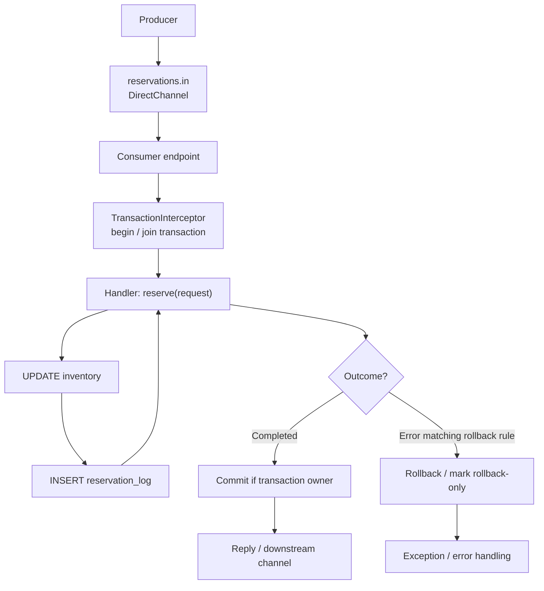
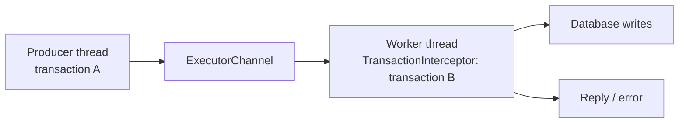

# TransactionInterceptor in the advice chain

## 1. Goal: which part of a message flow does a transaction protect?

In Spring Integration, a consumer endpoint receives a message from a channel and invokes a handler to process it. The handler may read/write a database, transform a payload, call another service, or produce a reply. If a data-mutating step fails partway through, the application needs to know **which operations must commit and which must roll back**.

Spring Framework's `TransactionInterceptor` is an **AOP `MethodInterceptor`** that can be placed in an endpoint's **advice chain** in Spring Integration. When the endpoint is invoked, the interceptor uses a `PlatformTransactionManager` to start or join a transaction, run the handler, and then decide commit/rollback based on the outcome and transaction policy.

For example, reservation processing includes:

1. Decrementing available inventory in the database.
2. Writing a reservation log record to the same database.
3. Returning a result to the message flow.

If writing the log fails, both database changes must roll back. `TransactionInterceptor` can establish a transaction scope for the handler performing those operations, provided both operations use the same appropriate transaction manager.

This lesson belongs to the **Advice chain** chapter of the **SPRING_INTEGRATION_RUNTIME** module. The focus is how transactions actually work at runtime across channels, endpoints, consumers, pollers, and executors; and how to coordinate retries, error handling, message stores, correlation, and performance observability. An advice configuration only makes sense when you understand the **execution boundary** the advice wraps.

> **Key idea:** `TransactionInterceptor` does not automatically turn an entire `IntegrationFlow` into a single transaction. It wraps the advised invocation; which operations participate in the transaction and whether the transaction continues across another endpoint depend on threads, channels, transaction managers, and the message source.

## 2. How the advice chain runs when an endpoint receives a message

Spring Integration allows configuring one or more advice around a **handler endpoint**. You can picture the call chain as:



The diagram describes scope in a business sense; the exact timing of reply dispatch depends on the handler and endpoint. You must not infer from the diagram that sending a reply to a broker or every downstream endpoint will automatically participate in the same database transaction.

**Components:**

| Component | Responsibility |
| --- | --- |
| `MessageChannel` | Delivers messages to consumers; channel type determines synchronous/asynchronous dispatching. |
| Consumer endpoint | Subscribes to receive messages from the channel, invokes the message handler, and applies configured advice. |
| `TransactionInterceptor` | Begins/joins a transaction and applies commit/rollback rules around the advised invocation. |
| `PlatformTransactionManager` | Manages transactions for a specific resource, such as JDBC/JPA. |
| Business handler | Performs processing and accesses transactional resources. |
| `ErrorMessage` / error channel | Routes errors according to the endpoint/adapter error-handling mechanism where applicable; does not replace the transaction manager. |

`TransactionInterceptor` can appear alongside logging advice, retry advice, and timing advice. **Ordering** in the chain determines whether a retry runs inside a fresh transaction or inside the same transaction scope.

## 3. Distinguishing handler transaction advice from poller transactions

Two common configurations have different scopes:

| Where the transaction is placed | What is wrapped | Key things to note |
| --- | --- | --- |
| **Handler endpoint:** `.handle(..., e -> e.advice(txAdvice))` | The invocation to the advised handler, in that endpoint's execution context | Suitable for protecting a handler's database operations. Does not automatically wrap receiving from a queue or steps outside the advice scope. |
| **Polling endpoint:** `Pollers.fixedDelay(...).transactional(txManager)` | The poll cycle including receive and processing within the scope created by poller transaction advice | Useful when receiving from a message store/data source and processing must coordinate transactionally. |
| **`@Transactional` on a Spring-managed service** | Method calls into the service through a Spring transaction proxy | Suitable when transactions belong to business logic and the service is called from multiple places, not only `IntegrationFlow`. |
| **Transaction on an inbound adapter** | Scope opened by the adapter/container/message source | Acknowledgments, offsets, or broker transactions have their own contracts; do not assume JDBC transactions automatically synchronize with brokers. |

Simply adding `TransactionInterceptor` to a handler does not make a transaction cover a poll from `QueueChannel`. If you need atomic handling between **receiving from a transactional source** and **writing to a database**, verify the resources, transaction manager, and polling consumer policy.

### Start/end boundaries worth checking

On a synchronous `DirectChannel` path, if the handler has no existing transaction, advice with `REQUIRED` propagation can start a new transaction when the handler is called. When the handler returns or throws an exception, the interceptor completes the transaction according to its rules. If a compatible transaction already exists on that thread, `REQUIRED` typically **joins the existing transaction**; in that case, the final commit may be decided by the outer caller.

Therefore, "handler returned successfully" does not mean "database committed at that exact moment" if the handler joined an outer transaction.

## 4. Complete example: transaction advice around a service activator

This example demonstrates a synchronous flow that receives a reservation request, updates an inventory table, and writes a log record in the same JDBC transaction. The classes below can live in a demo Java file in an application that already has Spring Integration, Spring JDBC, and a `PlatformTransactionManager` bound to a `DataSource`.

Assume the database has these test tables:

```sql
CREATE TABLE inventory (
    sku VARCHAR(40) PRIMARY KEY,
    available INTEGER NOT NULL
);

CREATE TABLE reservation_log (
    reservation_id VARCHAR(60) PRIMARY KEY,
    sku VARCHAR(40) NOT NULL,
    quantity INTEGER NOT NULL
);

INSERT INTO inventory (sku, available) VALUES ('SKU-001', 10);
```

Declare the request and result:

```java
record ReserveRequest(String reservationId, String sku, int quantity) {}

record ReserveReceipt(String reservationId, String status) {}
```

The handler uses `JdbcTemplate`; both SQL statements participate in the same transaction if `JdbcTemplate` and the transaction manager use the same `DataSource`:

```java
import org.springframework.jdbc.core.JdbcTemplate;

class ReservationService {

    private final JdbcTemplate jdbc;

    ReservationService(JdbcTemplate jdbc) {
        this.jdbc = jdbc;
    }

    public ReserveReceipt reserve(ReserveRequest request) {
        if (request.quantity() <= 0) {
            throw new IllegalArgumentException("Quantity must be positive");
        }

        int changed = jdbc.update(
            "UPDATE inventory SET available = available - ? " +
            "WHERE sku = ? AND available >= ?",
            request.quantity(), request.sku(), request.quantity());

        if (changed != 1) {
            throw new IllegalStateException("Insufficient stock");
        }

        jdbc.update(
            "INSERT INTO reservation_log (reservation_id, sku, quantity) " +
            "VALUES (?, ?, ?)",
            request.reservationId(), request.sku(), request.quantity());

        // Trigger a failure condition AFTER executing both SQL statements.
        if ("FAIL".equals(request.reservationId())) {
            throw new IllegalStateException("Simulated error to trigger rollback");
        }

        return new ReserveReceipt(request.reservationId(), "RESERVED");
    }
}
```

Create `TransactionInterceptor` and attach it to the **`.handle` endpoint**, rather than attaching it to an arbitrary object and expecting the whole flow to be protected:

```java
import org.springframework.context.annotation.Bean;
import org.springframework.context.annotation.Configuration;
import org.springframework.integration.channel.DirectChannel;
import org.springframework.integration.channel.QueueChannel;
import org.springframework.integration.config.EnableIntegration;
import org.springframework.integration.dsl.IntegrationFlow;
import org.springframework.jdbc.core.JdbcTemplate;
import org.springframework.messaging.MessageChannel;
import org.springframework.messaging.PollableChannel;
import org.springframework.transaction.PlatformTransactionManager;
import org.springframework.transaction.TransactionDefinition;
import org.springframework.transaction.interceptor.DefaultTransactionAttribute;
import org.springframework.transaction.interceptor.TransactionInterceptor;

@Configuration
@EnableIntegration
class ReservationIntegrationConfig {

    @Bean("reservations.in")
    MessageChannel reservationInput() {
        return new DirectChannel();
    }

    @Bean("reservations.done")
    PollableChannel reservationOutput() {
        // In-memory queue for reading demo results; does not guarantee durability.
        return new QueueChannel(100);
    }

    @Bean
    ReservationService reservationService(JdbcTemplate jdbc) {
        return new ReservationService(jdbc);
    }

    @Bean
    TransactionInterceptor reservationTransactionAdvice(
            PlatformTransactionManager txManager) {
        DefaultTransactionAttribute attribute =
            new DefaultTransactionAttribute();
        attribute.setPropagationBehavior(
            TransactionDefinition.PROPAGATION_REQUIRED);
        attribute.setTimeout(10); // seconds; timeout depends on resource support
        return new TransactionInterceptor(txManager, attribute);
    }

    @Bean
    IntegrationFlow reservationFlow(
            ReservationService reservationService,
            TransactionInterceptor reservationTransactionAdvice) {

        return IntegrationFlow.from("reservations.in")
            .handle(reservationService, "reserve",
                endpoint -> endpoint.advice(reservationTransactionAdvice))
            .channel("reservations.done")
            .get();
    }
}
```

The example uses Java `record` (Java 16+), with the `ReserveRequest`/`ReserveReceipt` records from the previous snippet. The application needs `JdbcTemplate` and `PlatformTransactionManager` beans for the database and corresponding schema. Spring Boot can auto-configure these beans when dependencies and DataSource are properly set up; otherwise, declare them explicitly.

**Actual execution path:**

1. Producer sends `Message<ReserveRequest>` to `reservations.in`.
2. `DirectChannel` delivers the message to the endpoint invoking `ReservationService.reserve`.
3. Transaction advice starts/joins the appropriate transaction and then calls the service.
4. `JdbcTemplate` updates inventory and inserts the log record within the transaction scope.
5. If the service returns `ReserveReceipt` successfully, the transaction completes per the active propagation and policy; the reply goes to `reservations.done`.
6. If the service throws `IllegalStateException`, default rollback rules apply for runtime errors. Both JDBC changes inside the newly created transaction are rolled back.

### Verifying against data

```java
import org.springframework.context.ApplicationContext;
import org.springframework.messaging.Message;
import org.springframework.messaging.MessageChannel;
import org.springframework.messaging.PollableChannel;
import org.springframework.messaging.support.GenericMessage;

MessageChannel input =
    context.getBean("reservations.in", MessageChannel.class);
PollableChannel output =
    context.getBean("reservations.done", PollableChannel.class);

input.send(new GenericMessage<>(
    new ReserveRequest("OK-1", "SKU-001", 2)));

Message<?> result = output.receive(1_000);
// Payload: ReserveReceipt("OK-1", "RESERVED")

try {
    input.send(new GenericMessage<>(
        new ReserveRequest("FAIL", "SKU-001", 3)));
} catch (RuntimeException ex) {
    // Error may be wrapped by Spring Messaging at the endpoint layer.
    System.out.println(ex.getMessage());
}
// Check database: the FAIL attempt does not further reduce inventory
// and leaves no reservation_log record with id = FAIL.
```

`context` here is the started `ApplicationContext`. The value of `available` after one successful `OK-1` must be `8` (starting from `10`); after `FAIL` it remains `8` if rollback worked and no outer unfinished transaction exists. Results can be wrong if test data is not reset, the transaction manager does not share the same DataSource, or another task concurrently updates inventory.

This is a far more meaningful test than just checking that an advice bean exists: **re-measure database state after failure** to prove rollback truly occurred.

## 5. Propagation, rollback rules, and timeouts

Transaction attributes govern outcomes far more than the name `TransactionInterceptor`.

| Attribute | Typical behavior | Common risk |
| --- | --- | --- |
| `PROPAGATION_REQUIRED` | Joins an existing transaction, or creates a new one if none exists | Assuming the handler commits on its own while the transaction belongs to the caller. |
| `PROPAGATION_REQUIRES_NEW` | Suspends any existing transaction and creates a new one if supported by the transaction manager | Side effects committed in the new transaction persist even if the outer transaction rolls back. |
| `PROPAGATION_MANDATORY` | Requires an existing transaction | Fails if the flow reaches the endpoint from a thread without a transaction. |
| `PROPAGATION_SUPPORTS` | Joins if a transaction exists, runs non-transactionally otherwise | No rollback guarantee for calls without an existing transaction. |
| `readOnly` | Hint/constraint depending on the transaction manager and resource | Not a security mechanism blocking every SQL write statement. |
| `timeout` | Requests a transaction time limit when supported | Does not by default interrupt a blocked Java thread or cancel an HTTP call. |
| Rollback rule | Defaults to rolling back on `RuntimeException` and `Error` | Standard checked exceptions do not trigger rollback unless configured. |

Example customizing rollback for a checked exception:

```java
import org.springframework.transaction.interceptor.RuleBasedTransactionAttribute;
import org.springframework.transaction.interceptor.RollbackRuleAttribute;

RuleBasedTransactionAttribute attribute =
    new RuleBasedTransactionAttribute();
attribute.setPropagationBehavior(
    TransactionDefinition.PROPAGATION_REQUIRED);
attribute.getRollbackRules().add(
    new RollbackRuleAttribute(Exception.class));

TransactionInterceptor txAdvice =
    new TransactionInterceptor(transactionManager, attribute);
```

This snippet shows how to add a rollback rule for `Exception`; `transactionManager` is a configured bean. Consider the scope of the rule carefully: rolling back on every checked exception may be inappropriate if certain exceptions represent acceptable business outcomes.

**Errors caught and ignored:** If a handler catches an exception and returns a normal result without marking the transaction rollback-only, the interceptor sees a successful invocation and may commit. If rollback is needed, let the appropriate exception escape, or intentionally mark rollback-only at the transaction management layer.

**Rollback-only from an inner transaction:** If a participant in an existing transaction marks it rollback-only, the outer caller may hit `UnexpectedRollbackException` when trying to commit. This is not a "Spring Integration sent the message twice" bug; trace the transaction scope and the exception that caused the flag to be set.

## 6. Poller transactions: when must you wrap receive as well?

Suppose messages sit in a `QueueChannel` backed by a transactional message store. A poller pulls a message and passes it to a handler. If the transaction wraps only the handler, **pulling the message from the queue** may already have completed before the handler begins its transaction. When the handler fails, rolling back the database may not return the message to the queue.

You can configure a transaction on the **poller**, using the Spring Integration DSL API:

```java
import java.time.Duration;
import org.springframework.integration.channel.QueueChannel;
import org.springframework.integration.dsl.IntegrationFlow;
import org.springframework.integration.dsl.Pollers;
import org.springframework.transaction.PlatformTransactionManager;

@Bean
IntegrationFlow polledReservationFlow(
        QueueChannel pendingReservations,
        ReservationService service,
        PlatformTransactionManager txManager) {

    return IntegrationFlow.from(pendingReservations,
        spec -> spec.poller(
            Pollers.fixedDelay(Duration.ofSeconds(1))
                .maxMessagesPerPoll(1)
                .transactional(txManager)))
        .handle(service, "reserve")
        .get();
}
```

This is an **illustrative configuration snippet**: `pendingReservations` must be a declared `QueueChannel` bean connected to a producer; for receive rollback to work properly, you need a transactional message store compatible with `txManager` and any other requirements of the implementation. A default **in-memory `QueueChannel`** does not become a rollback-capable dequeue source simply by adding `.transactional(txManager)`.

In particular, if the source is a file polling adapter, JDBC adapter, or message broker, inspect that source's transaction/acknowledgment semantics independently. A JDBC transaction does not automatically roll back an outbound HTTP call, an email send, or a committed broker offset.

### When to choose poller vs. handler?

- Choose **handler advice** if you only need to protect operations inside the handler, or if the handler is also invoked from other sources.
- Choose **poller transaction** when the **receive + processing** scope matters and the source/queue supports corresponding transactions.
- Complex systems may have both, but you must define propagation and managers explicitly to avoid misunderstandings about nested transactions or two independent transactions.

## 7. Coordinating `TransactionInterceptor` with retry advice

`RequestHandlerRetryAdvice` can retry handler invocations on qualifying exceptions. When combining retries and transactions, **wrapping order** is critical.

### Model A: retry outside, transaction inside

```text
Retry advice
  attempt 1 -> TransactionInterceptor -> Handler -> error -> rollback
  attempt 2 -> TransactionInterceptor -> Handler -> error -> rollback
  attempt 3 -> TransactionInterceptor -> Handler -> success -> commit
```

This is usually the right model for transient errors when you want **each attempt to have its own transaction**. In Spring Integration DSL, advice ordering should be verified against your actual configuration and framework version; placing retry advice before transaction advice in the chain intends for retry to wrap transactional invocations:

```java
// retryAdvice is a configured RequestHandlerRetryAdvice with a retry policy.
// txAdvice is a TransactionInterceptor using the appropriate transaction manager.
.handle(reservationService, "reserve",
    e -> e.advice(retryAdvice, txAdvice))
```

Verify via transaction start/end logs and handler execution counts; do not judge solely by how many times `retryCallback` runs. If an **outer transaction** already exists and propagation remains `REQUIRED`, the inner advice may continue joining that transaction rather than creating an independent transaction as in the ideal diagram.

### Model B: transaction outside, retry inside

```text
TransactionInterceptor
  begin
    Retry advice
      attempt 1 -> Handler -> error
      attempt 2 -> Handler -> success
  commit / rollback
```

In this model, attempts may share **the same transaction**, depending on the transaction manager and resources. Some database errors render a transaction unusable or mark it rollback-only; retrying inside the same transaction can repeat uselessly, or hit a final rollback even though the handler returned successfully.

### Practical rules

1. Apply retries only to **recoverable errors**, such as properly classified deadlocks or transient outages.
2. Malformed data, validation failures, or missing bean configurations should not be retried repeatedly.
3. Each attempt can re-execute steps that already had side effects; require idempotency keys and check what the transaction actually covers.
4. Do not hold a transaction open across sleep/backoff without a clear reason; it can hold locks and connections for a long time.
5. Set retry limits, appropriate backoff, recovery/DLQ or final failure channels; monitor total processing time.

`TransactionInterceptor` does not provide retries by itself. Retry advice, transaction advice, and error channels each serve distinct responsibilities.

## 8. Channels, executors, and thread boundaries

Transactions managed by standard transaction managers are typically bound to the **current thread**. Therefore, channel choice can change which transaction the handler sees.

| Case | Handler thread | Transaction context |
| --- | --- | --- |
| `DirectChannel`, synchronous steps | Usually the message-sending thread | Can join the caller's transaction via `REQUIRED`. |
| `ExecutorChannel` before handler | Executor worker | The producer thread's transaction usually **does not propagate** to the worker; handler advice can start a new transaction. |
| `QueueChannel` with poller | Poller's polling/task executor thread | Transaction opened by poller or handler advice on that thread. |
| `PublishSubscribeChannel` with executor | May dispatch across different workers | Do not assume all subscribers share the producer's transaction. |



In the diagram, transactions A and B are **two separate contexts to reason about independently**; dispatching from producer to executor does not make B a child or part of A.

For example, if a gateway calls synchronously and the flow switches through an executor, that changes exception visibility, reply timing, wait duration, and rollback behavior. If error publishing occurs on the worker, the error may be sent as an `ErrorMessage` to a configured error channel; the producer will not necessarily catch an exception directly from `send()`.

**What to measure:** thread names before/after channels, `TransactionSynchronizationManager.isActualTransactionActive()` inside the handler, transaction manager name, and commit/rollback timestamps. Never use the mere presence of an exception in logs as proof that a transaction rolled back.

## 9. Error channels, transactions, and original message state

When a handler wrapped by transaction advice throws an exception:

- On a **synchronous path** through `DirectChannel`, an unhandled exception can propagate back to the producer/gateway. Transaction advice rolls back per policy.
- On an **asynchronous path** through an executor/poller/adapter, the error-handling component can wrap it into an `ErrorMessage` and send it to an error channel. This depends on specific configuration and is not guaranteed for every exception.
- If the error handler throws again, is stopped, or the error channel has no consumer, recording/recovering the error can fail further. **Database rollback and error flow success are two separate outcomes.**

An `ErrorMessage` usually has a `Throwable` payload, sometimes a `MessagingException` carrying `failedMessage`. To correlate with the original message, check headers such as `correlationId`, `replyChannel`, `errorChannel`, and custom `traceId`. Do not assume every error message automatically copies all business headers from the original message; inspect `failedMessage` when available.

Suppose `ReserveRequest("FAIL", "SKU-001", 3)` arrived from a broker source and the handler rolled back JDBC successfully. If the adapter acked the message too early, the broker may not redeliver it. Conversely, if the message is redelivered after rollback, the handler may run again. Hence, define **database transactions**, **source ack mechanics**, **retries**, and **idempotency** together.

## 10. Message stores and consistency during recovery

When storing messages in a `QueueChannel`, the channel receives messages via its own mechanism. If the queue is purely in-memory, a JDBC transaction does not turn that queue into persistent storage.

Key design questions:

| Question | What to check |
| --- | --- |
| Where is the message before processing? | In-memory queue, JDBC message store, Kafka/RabbitMQ, or another adapter? |
| Can receive be rolled back? | Does the message store/adapter support transactions; which transaction manager is used? |
| When is the message acknowledged? | Before processing, after processing, after commit, or per container semantics? |
| Are DB updates and new message publishes in the same transaction? | If cross-resource atomicity is required, consider coordinated transactions or a transactional outbox. |
| What if the worker crashes after DB commit but before ack? | Redelivery may occur; the handler must be idempotent. |
| What if the handler called HTTP before DB rollback? | HTTP calls do not roll back automatically; design idempotency, compensation, or an alternative architecture. |

In practice, teams typically choose **at-least-once delivery + idempotent processing** for brokered flows, or a **transactional outbox** when event emission must match DB commits. Do not treat `TransactionInterceptor` as an "exactly-once" promise across all sources and targets.

## 11. IntegrationFlow lifecycle and runtime transaction observability

Advice is normally configured when endpoints/flows are constructed; an endpoint's `start`/`stop` state controls message intake, without altering the advice's rollback definition.

For flows registered dynamically via `IntegrationFlowContext`, check:

1. Is the endpoint started and subscribed to the right input channel? Are any messages in-flight during a stop?
2. Is `TransactionInterceptor` actually attached to the **running endpoint**, or does it just exist as an unused bean?
3. Does the injected transaction manager match the handler's data source?
4. Are there `ExecutorChannel` boundaries, polling executors, or `@Async` tasks inside the handler that switch threads?
5. Does the flow have retry advice or error handling that swallows exceptions and causes transactions to commit?
6. During drain/shutdown, which messages finished, which remain queued, and which will be redelivered?

### What to log/measure

A disciplined observability setup records:

- `messageId`, `correlationId`/`traceId`, endpoint ID, thread name, attempt number.
- Processing start/end timestamps, queue wait time, transaction duration.
- Counts of commits, rollbacks, retries, timeouts, deadlocks, and `UnexpectedRollbackException`.
- JDBC pool: active/idle connections; lock waits; throughput and executor queue depth.
- `TransactionSynchronizationManager.isActualTransactionActive()` at suspect points.

Do not log full payloads containing sensitive data. When debugging SQL transactions, DEBUG/TRACE logs from Spring transactions or JDBC can help pinpoint boundaries; keep them bounded by time and environment.

## 12. Common symptoms and how to diagnose

| Symptom | Suspect cause | How to verify/fix |
| --- | --- | --- |
| Added `TransactionInterceptor` but data still commits after error | Advice not attached to endpoint, exception caught and result returned, rollback rule mismatch | Inspect endpoint config, exceptions escaping handler, and transaction traces. |
| One table rolls back, another still writes | Two different datasources/transaction managers, `REQUIRES_NEW`, or non-transactional work | Verify DataSource, connections, propagation, and transaction logs. |
| Error surfaces at commit time | Transaction marked rollback-only or constraint violation detected late | Inspect nested cause and `UnexpectedRollbackException`. |
| Retry runs but still rolls back at the end | Retry sits inside an outer transaction already marked rollback-only | Inspect advice order, existing transactions, and per-attempt transaction setup. |
| Transaction "disappears" after `ExecutorChannel` | Thread handoff means producer's transaction does not propagate | Attach advice at the worker endpoint and verify active transaction there. |
| Handler rolls back but message does not return to queue | Transaction wraps only handler; source/queue lacks compatible receive rollback | Inspect poller transaction, store/adapter, and ack semantics. |
| Error sent to error channel while DB still commits | Handler swallows error, rollback rule mismatch, or error handling sits outside transaction | Separate business error, commit, and `ErrorMessage` publish; inspect transaction trace. |
| Throughput drops after enabling transactions | Holding locks/connections too long, advice wrapping slow I/O or retry/backoff | Measure transaction duration, wait time, concurrency; narrow transaction scope. |
| Duplicates after crash/retry | Message redelivered when DB already committed or external side effects happened | Enforce idempotency and review ack/outbox strategy. |
| Timeout configured but HTTP still hangs | Transaction timeout is not a deadline/interrupt for arbitrary blocking calls | Configure HTTP/JDBC timeouts and circuit breakers separately. |

When troubleshooting, proceed step by step: identify **message ID and handler**, identify which advice actually wraps the handler, check **transaction manager + thread**, read the **root cause**, and then compare database state, queue/broker state, and the error channel. Diagnose from observed results rather than assuming from annotation counts.

## 13. Hands-on exercises and self-check

**Exercise 1 — Prove rollback.** Run the Section 4 example with `ReserveRequest("OK-1", "SKU-001", 2)` and then `ReserveRequest("FAIL", "SKU-001", 3)`. Query `inventory.available` and count `reservation_log` rows via SQL after each run; explain why `FAIL` leaves neither update behind.

**Exercise 2 — Change rollback rules.** Throw a checked exception at the end of `reserve` and test whether default behavior rolls back when the exception actually escapes the advised call. Then add `RollbackRuleAttribute` and test again. Note the service method must declare an appropriate `throws` signature for Java to compile.

**Exercise 3 — Find thread boundaries.** Insert an `ExecutorChannel` right before the service activator, log the thread name and `TransactionSynchronizationManager.isActualTransactionActive()` inside the handler. Compare having vs. omitting transaction advice at the post-executor endpoint.

**Exercise 4 — Retries and duplicate data.** Configure a `RequestHandlerRetryAdvice` with up to 3 attempts and deliberately trigger a transient failure in the service. Compare transaction advice inside vs. outside retry, observing commits/rollbacks, locks, and duplicate data when idempotency is missing.

**Exercise 5 — Poller and recovery.** Replace the inbound `DirectChannel` with a polled `QueueChannel`. Compare transaction only on `.handle` versus transaction on `Pollers...transactional(...)`, using a transactional message store if testing receive rollback. Explain why an in-memory queue does not have the guarantees of a persistent store.

**Self-check questions:**

1. Which part of a Spring Integration flow does `TransactionInterceptor` wrap when attached via `.handle(..., e -> e.advice(...))`?
2. Under what condition does `PROPAGATION_REQUIRED` create a new transaction, and when does it merely join an outer transaction?
3. How does placing retry outside vs. inside a transaction change behavior?
4. Why doesn't a JDBC transaction automatically follow a message across an `ExecutorChannel`?
5. Does a handler rolling back its database guarantee the broker will redeliver the message? What condition is still missing?
6. When a handler catches an exception and returns a normal reply, why might the transaction commit?
7. Which metrics/logs prove that a rollback actually happened?

**Design principle:** Place `TransactionInterceptor` at the exact boundary of the work requiring atomicity; verify the transaction manager, propagation, and rollback rules; observe execution threads and advice order; and design retries, error handling, message stores, acknowledgments, and idempotency as parts of a single runtime contract.
