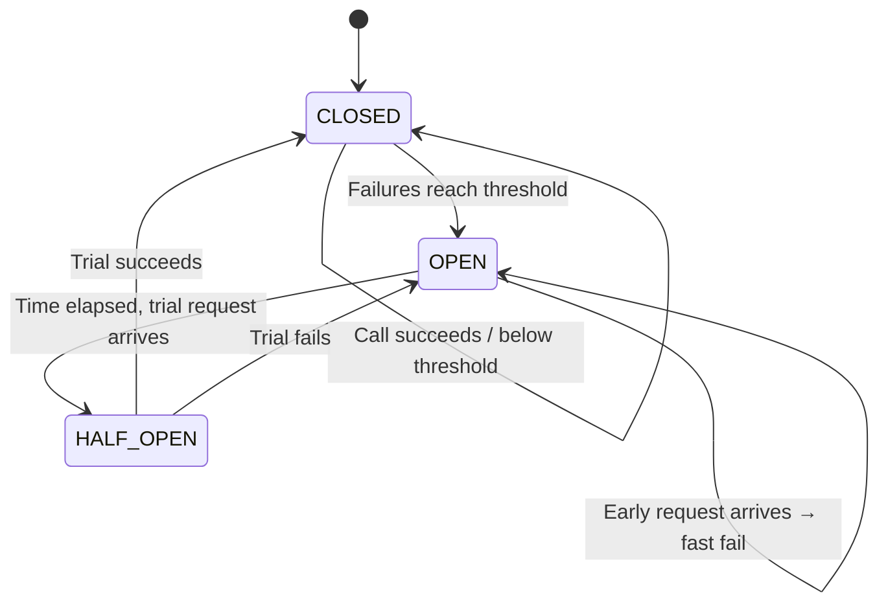
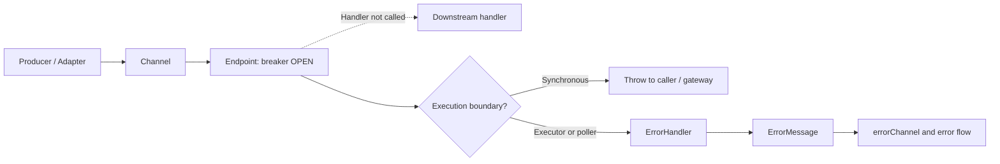
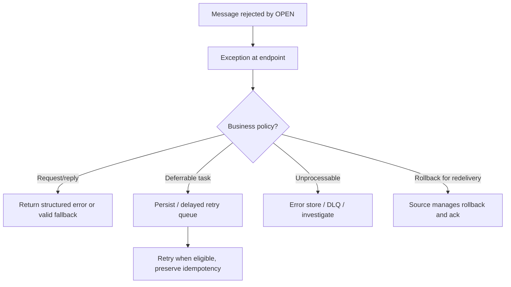

# Circuit breaker advice and open state in Spring Integration

## Learning objectives

In an `IntegrationFlow`, a handler may call a REST API, database, broker, or external system. If downstream is failing, letting every message keep attempting calls and timing out sequentially ties up threads, fills queues, drives up latency, and can cascade failures to other components. A **circuit breaker** detects repeated failures and temporarily blocks further calls to an unhealthy resource.

This lesson belongs to the **Advice chain** chapter of the **SPRING_INTEGRATION_RUNTIME** module. The direct topic is **Circuit breaker advice and open state**. We examine how Spring Integration orchestrates messages across channels, endpoints, consumers, pollers, and executors when the breaker changes state, while connecting to retries, recovery, transactions, message stores, error flows, correlation, and runtime observability.

After studying this lesson, you will be able to:

- Explain the three logical states **CLOSED**, **OPEN**, and **HALF_OPEN**, especially the impact of **OPEN** on message flows.
- Describe `RequestHandlerCircuitBreakerAdvice` parameters `threshold`, `halfOpenAfter`, and `failCountReset`, and how they interact.
- Attach a circuit breaker to an endpoint using Java DSL and pinpoint the exact work being protected.
- Analyze advice ordering across circuit breaker, retry, recovery, and transaction advice, and the impact on downstream call counts.
- Diagnose why a message is rejected immediately, never appears in downstream logs, or produces an `ErrorMessage` even though the handler never ran.
- Test, measure, and operate breakers safely in multi-threaded, multi-instance systems with redelivery.

## 1. What does a circuit breaker protect?

A circuit breaker is typically placed around an **operation at risk of repeated failures**, such as calling an inventory system:

```text
Order message
   -> DirectChannel / ExecutorChannel / Poller
   -> Consumer endpoint
   -> [Circuit breaker advice]
   -> MessageHandler
   -> Inventory API
```

When the breaker is **CLOSED**, calls pass through. If the handler fails consecutively enough times to hit the threshold, the breaker opens (**OPEN**) and subsequent calls fail fast **without executing the protected handler**. After a wait interval, a recovery trial call is permitted in **HALF_OPEN**; its outcome decides whether to return to CLOSED or stay OPEN.

Do not confuse a breaker with retry:

| Mechanism | Question it answers | Behavior when downstream fails |
| --- | --- | --- |
| **Retry** | How many times should one request be retried? | Repeats the handler per attempt count, exception, and backoff policies |
| **Circuit breaker** | Should new requests be allowed to touch downstream right now? | Observes failures, opens the circuit, and fast-fails new calls |
| **Timeout** | How long may a single call wait? | Terminates the operation if no result arrives on time |
| **Bulkhead / concurrency limit** | How many concurrent calls are permitted at most? | Caps concurrency so one downstream cannot exhaust all workers |
| **Recovery / fallback** | After a failure or rejection, how should the message be handled? | Returns a fallback result, emits an error, persists, or routes to another flow |

A circuit breaker **does not automatically** add timeouts, concurrency limits, retries, fallbacks, or dead-letter queues. Each mechanism requires its own configuration and business contract.

### 1.1. Why does the OPEN state matter?

Suppose an endpoint receives 100 messages/second, the inventory API is timing out after 5 seconds, and the thread pool has only 20 workers. If every request keeps calling downstream, workers quickly get tied up in waiting calls, backlogs grow, and gateways can time out across the board.

When the breaker is OPEN, new messages **fail fast** at the advice boundary. That rejection is still a business failure that must be handled, but it avoids adding load to a broken dependency and reduces thread occupancy per message. Therefore, **OPEN can be a sign that protection is working properly**, not necessarily a new bug in the circuit breaker itself.

Actual benefit still depends on breaker placement: if a CPU-heavy transformer or network-calling adapter runs **before** the wrapped endpoint, those parts have already executed before the breaker can reject.

## 2. Lifecycle: CLOSED → OPEN → HALF_OPEN



This is a **logical model** for learning and system observation. Details of state storage, timing, and concurrency handling vary by implementation/version; do not infer a background job automatically transitions states without checking the exact configuration.

### 2.1. CLOSED: calls pass through and failures are counted

In normal state, the handler executes. Errors observed by the advice contribute to the failure counter. When failures reach the threshold, the breaker transitions to OPEN.

- An **exception caught and swallowed by the handler** can make the breaker observe the result as a successful call.
- Exceptions raised **before reaching the advised endpoint** are not counted by that endpoint's breaker.
- If the advice sits **outside** retry, a sequence of multiple attempts may be seen as **one** final failure outcome.
- If the advice sits **inside** retry, each attempt passing through the breaker can affect the counter.

Thus, "3 errors" means **3 failures observed by the advice at the boundary it wraps**, not necessarily 3 HTTP requests, 3 original messages, or 3 log entries.

### 2.2. OPEN: rejecting before the handler runs

In OPEN, the breaker typically throws an error indicating the circuit is open as soon as a message arrives at the protected boundary. Consequences:

1. The wrapped downstream handler **is not invoked** for rejected messages.
2. Synchronous callers can observe the exception quickly, after passing through Spring Messaging wrappers.
3. If the error occurs on an executor/poller thread, the error handler at that boundary may produce an `ErrorMessage` and route it to an error channel.
4. If the flow has transactions, retries, or recovery outside the advice, commit/rollback, further retries, and acks depend on those outer layers.
5. There is no automatic mechanism that "holds messages until the circuit closes" solely because the breaker is OPEN; deferring work requires an appropriate queue/retry scheduler or storage.

In particular: **OPEN does not stop inbound adapters from receiving messages**. It only changes whether the advised handler segment executes. Sources can still push many messages to the endpoint, causing each one to be rejected in turn.

### 2.3. HALF_OPEN: probing recovery readiness

After `halfOpenAfter`, the breaker may allow one or a few trial requests through, depending on the implementation's algorithm. If the trial succeeds, the breaker returns to CLOSED; if it fails again, the breaker goes back to OPEN and starts another protection window.

**Do not assume strictly one concurrent probe across every version/configuration.** In multi-worker systems, multiple messages may arrive right as the window expires; verify the implementation's race behavior if strict probe limits are required. If you need to isolate trial requests, consider adding a concurrency limit/bulkhead or a dedicated breaker with explicit concurrency guarantees.

In many implementations, `halfOpenAfter` gates whether the **next incoming call** probes recovery. Without new messages, there is not necessarily a background job probing downstream and transitioning state.

## 3. Three parameters of RequestHandlerCircuitBreakerAdvice

Spring Integration provides `RequestHandlerCircuitBreakerAdvice` to apply a circuit breaker at a handler boundary. Three common parameters:

| Property | Meaning | Illustrative value |
| --- | --- | --- |
| `threshold` | Number of failures observed by the advice to open the circuit | `3` |
| `halfOpenAfter` | Wait duration after opening before allowing a recovery probe | `10_000` ms (10 seconds) |
| `failCountReset` | Interval used to reset accumulated failure counts before the threshold is reached | `30_000` ms (30 seconds) |

Distinguish clearly: **`halfOpenAfter` is not an API timeout**, and **`failCountReset` is not when an OPEN circuit automatically closes**.

### 3.1. Timeline example

Suppose `threshold=3`, `halfOpenAfter=10s`, `failCountReset=30s`. Ignoring concurrent requests to focus solely on logical behavior:

| Time | Event at wrapped endpoint | Observation |
| --- | --- | --- |
| `t=0s` | Message A calls API and fails | CLOSED; failure accumulated |
| `t=1s` | Message B calls API and fails | CLOSED; below threshold |
| `t=2s` | Message C calls API and fails | Reaches `threshold`; transitions OPEN |
| `t=3s` | Message D arrives | Fast-rejected; API not called |
| `t=8s` | Message E arrives | Too early to probe recovery; still rejected |
| `t≈12s+` | Message F arrives after wait | Can be used as the HALF_OPEN probe |
| After F succeeds | API returns valid response | Breaker returns to CLOSED |
| After F fails | API fails again | Breaker re-opens and starts a new wait window |

`failCountReset` is helpful for sparse errors while the breaker is still closed. For example, one error occurs followed by a long healthy period: you shouldn't keep adding stale failures to new failures and trip the circuit over widely spaced glitches. Check the exact reset timing semantics against your framework version/configuration; do not assume it acts like an arbitrary sliding window from other breaker libraries.

### 3.2. Parameters must reflect traffic volume and recovery goals

At 10 requests/day, `threshold=3` accumulates slowly; at 20,000 requests/second, three errors can happen in an instant. Choose parameters based on **traffic volume and baseline error rates**, rather than copying one set of numbers across every endpoint.

Answer these questions:

- What is the downstream client timeout? Does OPEN trigger before too many workers are tied up?
- What is the service's natural error rate, and how many consecutive failures prove the service is unhealthy?
- How long should you wait before probing recovery so you avoid repeatedly overloading downstream?
- If downstream advertises maintenance windows or `Retry-After`, how should recovery policy adjust?
- While OPEN, should messages fail immediately, queue with backpressure, or be stored for deferred processing?

## 4. Attaching circuit breaker advice to an IntegrationFlow

The Spring Integration 6.x example below shows a handler calling an inventory reservation API. It uses `RequestHandlerCircuitBreakerAdvice` on the message-processing endpoint, pinpointing the exact protected boundary.

```java
import org.springframework.beans.factory.annotation.Qualifier;
import org.springframework.context.annotation.Bean;
import org.springframework.context.annotation.Configuration;
import org.springframework.integration.channel.DirectChannel;
import org.springframework.integration.config.EnableIntegration;
import org.springframework.integration.dsl.IntegrationFlow;
import org.springframework.integration.handler.advice.RequestHandlerCircuitBreakerAdvice;
import org.springframework.messaging.MessageChannel;
import org.springframework.messaging.MessageHandler;

@Configuration
@EnableIntegration
class InventoryIntegrationConfig {

    record ReserveStock(String sku, int quantity) {}

    interface InventoryClient {
        void reserve(String sku, int quantity);
    }

    @Bean("stockInput")
    MessageChannel stockInput() {
        return new DirectChannel();
    }

    @Bean("inventoryCircuitBreaker")
    RequestHandlerCircuitBreakerAdvice inventoryCircuitBreaker() {
        RequestHandlerCircuitBreakerAdvice breaker =
                new RequestHandlerCircuitBreakerAdvice();

        breaker.setThreshold(3);
        breaker.setHalfOpenAfter(10_000);
        breaker.setFailCountReset(30_000);
        return breaker;
    }

    @Bean
    IntegrationFlow stockReservationFlow(
            @Qualifier("stockInput") MessageChannel input,
            InventoryClient inventoryClient,
            @Qualifier("inventoryCircuitBreaker")
                    RequestHandlerCircuitBreakerAdvice breaker) {

        MessageHandler reserveHandler = message -> {
            ReserveStock request =
                    (ReserveStock) message.getPayload();
            inventoryClient.reserve(request.sku(), request.quantity());
        };

        return IntegrationFlow.from(input)
                .handle(reserveHandler, endpoint -> endpoint.advice(breaker))
                .get();
    }
}
```

To run this example, you need a real `InventoryClient` bean, the Spring Integration dependency, and an appropriate Spring context setup. `ReserveStock` can be replaced with your application DTO; the code intentionally uses a one-way `MessageHandler` to keep focus on the circuit breaker.

Pay attention to these points:

1. `stockInput` is a `DirectChannel`, so in this configuration processing runs synchronously on the thread calling `send()`.
2. The breaker is attached **at the handler endpoint**, so it can prevent `inventoryClient.reserve(...)` from being invoked.
3. Code that constructs DTOs, validates input, or performs I/O **before** the endpoint can still execute even when the breaker is OPEN.
4. The advice holds state in the **configured bean instance**. Sharing one breaker bean across unrelated endpoints makes them share the same counter/failure history. Usually you should separate breakers per dependency or protection scope.
5. If the handler catches API errors, logs them, and returns normally, the breaker may not see any failure. Decide explicitly which exceptions must reach the advice and which are translated into valid results.

### 4.1. A producer sending messages into the flow

```java
import org.springframework.messaging.Message;
import org.springframework.messaging.MessageChannel;
import org.springframework.messaging.support.MessageBuilder;

// stockInput is injected from the Spring context.
Message<InventoryIntegrationConfig.ReserveStock> message =
        MessageBuilder
                .withPayload(
                        new InventoryIntegrationConfig.ReserveStock("SKU-42", 2))
                .setHeader("correlationId", "order-42")
                .setHeader("businessKey", "order-42")
                .build();

stockInput.send(message);
```

In CLOSED state, `send()` enters the handler and waits for completion. When the breaker is OPEN, `send()` can receive an exception quickly along the call stack. Catch exceptions at the appropriate call boundary and decide whether to return an error or defer processing per the application contract.

To observe **how many times the handler actually ran**, increment a counter right before `inventoryClient.reserve(...)`. When OPEN, incoming message counts can continue rising while client invocation counts stay flat; this is the signature of fail-fast behavior.

### 4.2. Does a breaker wrap an entire IntegrationFlow?

Not by default. The advice wraps only the **endpoint to which it is attached**, for example:

```text
input
  -> validate()                      # outside the breaker
  -> transform()                     # outside the breaker
  -> handle(inventoryClient)         # protected by the breaker
  -> routeToNextEndpoint()           # outside the breaker
```

If the transformer fails while mapping JSON, the breaker on `handle(inventoryClient)` was never called and does not increment its failure count. If a downstream endpoint after the handler fails, that also does not automatically count against the inventory handler's breaker. To protect a larger unit of work, design the invocation/handler boundary deliberately and verify its impact on transactions and side effects.

## 5. OPEN in DirectChannel, ExecutorChannel, and pollers

The OPEN state raises an error at the advice site, but **who receives that error** depends on the executing thread:

| How the endpoint is invoked | When OPEN | Who can observe the error? | What to check |
| --- | --- | --- | --- |
| Synchronous `DirectChannel` | Advice rejects on the sender's thread | `send()` caller or synchronous upstream gateway | Exception stack, latency, current transaction |
| After `ExecutorChannel` | Worker picks up message and hits rejection at advice | Worker error handler may publish `ErrorMessage` | `errorChannel` header, default channel, queue backlog |
| Poller-driven consumer | Poll cycle invokes endpoint and is rejected | Poller error handler, transaction/source | Ack, rollback, message redelivery |
| Message-driven inbound adapter | Adapter thread/container invokes endpoint | Adapter and broker error policy | Redelivery, nack/ack, DLQ, and delay |
| Request/reply gateway | Error occurs on flow serving the gateway | Gateway caller, error flow, or timeout depending on config | `errorChannel`, `replyChannel`, timeout, and fallback |



The diagram shows **configurable paths**, not all branches firing simultaneously. A synchronous exception **is not automatically published** to an error channel just because the message carries an `errorChannel` header. A component must catch the exception and publish an `ErrorMessage`.

### 5.1. OPEN does not automatically stop inbound adapters

If a consumer receives push messages from a broker, the broker can still deliver messages to the container. The advice may reject every attempt, and the adapter may redeliver continuously if transactions roll back or messages are nacked. This can create a **hot loop**, even while the breaker successfully protects downstream.

Solutions depend on the source: listener container backoff, redelivery caps, delayed retry queues, pausing/resuming consumers, DLQs, or persisting messages for deferred processing. Pick the right mechanism instead of immediately retrying OPEN errors.

### 5.2. OPEN does not automatically "lock" the entire message queue

A `QueueChannel`, broker queue, or message store **upstream** of the endpoint can keep accumulating messages. The breaker decides whether to invoke the handler, but does not guarantee every queued message will be processed safely once the circuit closes. Define queue capacity, TTL, ordering, duplicate tolerance, and catch-up consumption when downstream recovers.

## 6. Circuit breaker in an advice chain: order changes meaning

An endpoint can have multiple advice: retry, breaker, transaction, and observation/logging advice. **Wrapping order determines which advice sees which exceptions**, how many times, and within what transaction scope.

### 6.1. Breaker outside retry

```text
CircuitBreakerAdvice                 <- sees final outcome of retry loop
  -> RetryAdvice                    <- may call handler multiple times
      -> Handler -> Inventory API
```

Suppose retry allows up to 3 attempts and the breaker has `threshold=2`. If every message goes through 3 attempts and fails, the outer breaker typically sees **one failure outcome per invocation**. After two failed invocations, the breaker can open. Actual HTTP requests could number 6 before OPEN.

Advantage: the breaker measures request health after exhausting the retry budget. Drawback: attempts consume time and keep adding load when the API is already overloaded.

**Watch out for recovery:** if an inner `RetryAdvice` uses a `RecoveryCallback` that catches the error and returns normally, the outer breaker may see a success, skewing metrics if policy requires counting underlying failures. Recovery and fallback must be modeled as explicit, meaningful outcomes.

### 6.2. Retry outside breaker

```text
RetryAdvice
  -> CircuitBreakerAdvice           <- sees each individual attempt
      -> Handler -> Inventory API
```

When the handler fails repeatedly, the breaker increments its failure count faster and can open **mid-retry**. Subsequent attempts can be rejected by OPEN rather than calling the API. The outer retry policy can also see the OPEN exception and retry the rejected call itself; if it retries immediately without proper backoff, the application merely spins on rejections.

What to do: classify the OPEN exception as a signal **not to retry immediately**, or use retry delays aligned with recovery windows. Do not blindly allow retries on all `RuntimeException` types.

### 6.3. Comparison table

| Option | What the breaker typically counts | When it makes sense | Risk |
| --- | --- | --- | --- |
| Breaker outside retry | Outcome of the whole retried processing pass | Need to assess reliability after spending the retry budget | One message can trigger multiple requests before the breaker opens |
| Breaker inside retry | Failure of each attempt reaching the breaker | Need to shed load fast when downstream fails continuously | Can trip mid-retry; OPEN exception may be retried repeatedly |
| Breaker outside swallowing recovery | May see normal result instead of true failure | Recovery genuinely produces a valid outcome | Masks downstream failures |
| Breaker wrapping transaction | Sees errors from the inner transactional unit | Need to monitor the entire operation's outcome | Can mix DB/validation errors into external API counters |

In the DSL, endpoints allow adding advice to the chain, e.g., `endpoint.advice(breaker, retryAdvice)`; however, verify with **tests observing actual invocation order** for your framework version and advice mechanism before concluding which advice is outer or inner. The table above describes **two nested structures**, rather than asserting parameter order always matches execution order across every configuration.

### 6.4. Where does transaction advice go?

There are two distinct models:

```text
A. TransactionAdvice
      -> CircuitBreakerAdvice
           -> Handler

B. CircuitBreakerAdvice
      -> TransactionAdvice
           -> Handler
```

In A, when the breaker is OPEN, a transaction may already have been opened before the advice rejects. In B, the OPEN error occurs before entering the inner transaction boundary. Exact behavior depends on Spring transaction advice, propagation, and endpoint configuration.

In particular, a handler that writes to a DB and then calls an API can leave partial side effects if the API times out while the DB transaction rolls back or vice versa. The breaker only decides whether to invoke the handler; **it does not provide exactly-once semantics**. Use idempotency keys, proper transactions, and if needed outbox/saga or compensation for independent systems.

## 7. Exception classification and the OPEN signal

An Inventory API timeout and an order validation error should not affect the API's circuit breaker equally. However, do not assume `RequestHandlerCircuitBreakerAdvice` always offers all the fine-grained exception classification rules of dedicated resilience libraries.

**Issues to consider in the wrapped region:**

- Timeouts, connection resets, or 503 errors usually indicate downstream is unhealthy and should count as failures.
- Validation failures, missing fields, and type mismatches inside the handler **can be counted as failures by the advice** if those exceptions cross the same boundary.
- Exceptions wrapped in `MessagingException` or client wrappers can cause outermost-class classification to misbehave.
- An HTTP error response where the client is coded to return a normal `Result.error(...)` object will not automatically become an exception for the breaker to count.
- Exceptions caught and ignored before the advice boundary are also not counted.

The usual design fix is to **place the breaker tightly around the downstream call** and keep input validation in an earlier step. If you need custom rules such as "count 5xx, ignore 4xx," normalize result signals in an adapter, consider a customized advice/classifier, or use a dedicated breaker that satisfies the contract; do not assume every property exists out of the box on Spring Integration's breaker.

### 7.1. "Circuit open" must be distinguished from "downstream call failed"

These two cases leave different traces:

```text
CLOSED -> Handler invoked -> API timeout          # downstream call executed and failed
OPEN   -> Breaker rejects -> Handler not invoked  # no downstream call
```

In error records and monitoring, store both cause categories: **execution failure** and **short-circuit rejection**. Lumping both into a single "API failure" metric can mislead operators into thinking downstream is still receiving constant traffic when the breaker is actually blocking it.

Conversely, if circuits open across many application replicas, total rejections can be huge even while downstream calls are low. Track this state to tune retry queues, half-open intervals, and operator alerts.

## 8. OPEN, error flows, fallbacks, and message stores

An OPEN breaker typically raises an exception right at the advice boundary. How to **handle the message after rejection** must be explicitly decided:



For a synchronous gateway, a valid fallback might be "reservation pending confirmation, check back later," but only if the API contract permits it. Never return "order succeeded" merely because the breaker refused to call the inventory system.

For asynchronous flows, the executor/poller error handler can wrap the exception in an `ErrorMessage`. When processing it:

- Check `ErrorMessage.getPayload()` for the exception; follow `getCause()` if wrapped.
- Retrieve `getOriginalMessage()` or `MessagingException.getFailedMessage()` if present; both can be `null`.
- Retain `businessKey`, `correlationId`, endpoint name, timestamp, retry status, and reason code.
- Persist the error durably if replay after restart is needed; logs or in-memory channels are not durable DLQs.
- Define who owns ack/rollback; **completing an error flow does not automatically ack or roll back the source message**.

Example error record stored for replay:

```json
{
  "businessKey": "order-42",
  "correlationId": "corr-42",
  "endpoint": "stockReservationFlow",
  "reason": "CIRCUIT_OPEN",
  "firstSeenAt": "2026-11-20T10:00:00Z",
  "nextEligibleAt": "2026-11-20T10:00:10Z",
  "attempt": 1,
  "status": "DEFERRED"
}
```

This is an **illustrative application schema**, not JSON generated automatically by Spring Integration. `nextEligibleAt` is a scheduling timestamp chosen by the application, not necessarily derived from an API reading internal breaker state. If a worker replays too early, the breaker is still OPEN and the message may be rejected again.

### 8.1. Recovery must not hide unintended errors

Suppose an outer recovery advice catches all exceptions, logs them, and returns normally. With a transactional inbound adapter, processing may appear complete and the adapter may ack/commit, dropping the message from the source even though business work did not run.

A policy may allow "persisted to a durable error store so ack is safe"; however, verify the write succeeded **before** letting the source complete the delivery. If recording the error fails, keep the failure path open so the source handles redelivery per contract.

## 9. Threading, instances, and real-world breaker state

### 9.1. Where does a breaker's state live?

`RequestHandlerCircuitBreakerAdvice` is stateful at runtime, typically held in a bean instance inside the application context. When running multiple nodes/pods, each node usually has its own breaker instance and counters unless you actively build shared state.

Example:

```text
Pod A: breaker OPEN      -> blocks calls going through A
Pod B: breaker CLOSED    -> can still call downstream via B
Pod C: breaker HALF_OPEN -> allows recovery trial call via C
```

This means cluster-wide average charts can hide per-instance state. Alerts should include rejection counts per instance/endpoint alongside real downstream health. Restarting a process can create a fresh advice instance in its initial state; do not treat a restart as proof that the external system has recovered.

### 9.2. Concurrency and half-open probes

State can change while multiple workers execute near-simultaneously. Some requests may **already have passed the breaker** and still be running when another request trips state to OPEN. Opening the circuit cannot automatically cancel in-flight I/O calls. When investigating "a few requests still hit the API after OPEN," distinguish in-flight requests from newly started ones.

If you need strictly one probe during HALF_OPEN or at most N concurrent requests, verify the behavior of your advice version and add an appropriate concurrency limiter. Do not confuse a circuit breaker with a semaphore.

### 9.3. OPEN can still overload the system

The breaker sheds load on the dependency, yet backlogs upstream of the endpoint can keep growing if inbound still ingests quickly, retry policies immediately re-drive OPEN errors, or synchronous error flows perform slow I/O. Monitor:

- Message rate per channel and endpoint.
- Queue depth, queue age, retry queue, DLQ, and message wait times.
- Thread pools: active, pool size, queued, rejected.
- Rates of execution failure, short-circuit rejection, half-open trials, and recovery success.
- Latency of downstream calls **actually executed** vs. latency of fast-rejected requests.

## 10. Monitoring state and investigating incidents

Do not assume a default dashboard always displays exact `OPEN/HALF_OPEN/CLOSED` states for every advice instance. Exposing states/metrics depends on Spring Integration version, management/observability setup, and application instrumentation. If SLOs matter, instrument the endpoint boundary and verify signals distinguish original failures from breaker rejections.

| Signal | What to measure | How to interpret |
| --- | --- | --- |
| `handler.invoked` | Actual calls reaching the handler | During OPEN, should stay nearly flat |
| `handler.failure` | Failures from handlers that actually ran | Reflects downstream or handler logic |
| `circuit.rejected` | Messages fast-rejected | Rises while OPEN |
| `circuit.recovered` | Post-wait trial calls that succeeded | Shows recovery path is working |
| `errorFlow.persisted` | Errors persisted for reprocessing | Ensures messages are not lost |
| `queue.depth` and `queue.age` | Backlog and wait time | Prevents breaker from protecting the API while exhausting memory |
| `downstream.latency` | Only calls that actually hit the API | Reveals slow/failing dependency symptoms |
| `attempt.count` / `delivery.count` | Handler retries and source redeliveries | Detects layered retries multiplying invocations |

Metric names in the table are **naming suggestions for custom instrumentation**, not a claim that all exist out of the box in Spring Integration. Use endpoint ID, instance ID, and exception type as bounded-cardinality dimensions; attach `correlationId` to logs/tracing rather than putting per-message values into metric labels.

### 10.1. Diagnostic workflow for "continuous OPEN errors"

1. **Pinpoint location:** which endpoint/advice bean is rejecting? Which dependency does it protect?
2. **Verify root cause:** before OPEN, were there timeouts, 5xx errors, DB locks, or validation errors? Is the cause chain masked by wrappers?
3. **Inspect parameters:** `threshold`, `halfOpenAfter`, `failCountReset`, client timeouts, retry policy, advice order.
4. **Compare against reality:** did new messages arrive after `halfOpenAfter`? Did the trial call succeed or fail again?
5. **Check multi-instance behavior:** do states and exception rates differ across pods?
6. **Check backpressure:** are executors, queues, pollers, source redeliveries, and DLQs saturating?
7. **Verify recovery path:** were rejected messages given proper error responses, safely persisted, or replayed with idempotency?

Useful log example:

```text
time=... instance=pod-a endpoint=stockReservationFlow
businessKey=order-42 correlationId=corr-42
outcome=SHORT_CIRCUITED handlerInvoked=false

time=... instance=pod-b endpoint=stockReservationFlow
businessKey=order-43 correlationId=corr-43
outcome=DOWNSTREAM_FAILURE handlerInvoked=true cause=SocketTimeoutException
```

This log only illustrates fields your application records. Do not log full payloads containing personal data or tokens unless required for investigation.

## 11. Common pitfalls

| Symptom | Cause or misconception | How to fix |
| --- | --- | --- |
| "Breaker OPEN means Spring Integration stops receiving messages" | Breaker only blocks the attached endpoint | Check input sources, queues, and policies for rejected messages |
| "Once `halfOpenAfter` elapses, it automatically probes the API" | No new messages arrived or no separate prober exists | Check the next incoming invocation and actual half-open mechanics |
| "With a breaker enabled, timeouts are unnecessary" | An allowed request can still hang | Configure explicit HTTP/DB client timeouts |
| "A validation error rightly opens the circuit" | Validation sits inside the downstream-protected boundary | Move validation upstream; normalize exceptions and policies |
| "There were 5 HTTP timeouts but the breaker saw only 1 error" | Retry sits inside the breaker | Measure both attempts and invocations; verify advice order |
| "When OPEN, errorChannel always receives a message" | Synchronous flow with no error publisher | Check caller, executor/poller error handler, or recovery |
| "Circuit closed, so past orders must have succeeded" | Successful half-open probe does not confirm older messages | Check business state and perform controlled replay |
| "Restarting the pod fixed the API error" | Breaker state simply reset on startup | Investigate dependency health rather than relying on process state |
| "Recovery logged it, so we can ack the message" | Logs are not a durable error store | Ack per contract only after durable recording/recovery succeeds |
| "Using one breaker bean for all APIs is fine" | Endpoints may share a single state/counter | Separate breakers per dependency and protection scope |

## 12. Guided exercises

### Exercise A — Observe CLOSED → OPEN transition

Use a fake `InventoryClient` that always throws `IllegalStateException` in the Section 4 flow. Set `threshold=3`, `halfOpenAfter=10_000`. Send messages with different `businessKey` values, recording actual handler calls and response durations.

```java
import java.util.concurrent.atomic.AtomicInteger;

AtomicInteger downstreamCalls = new AtomicInteger();

InventoryIntegrationConfig.InventoryClient fake = (sku, qty) -> {
    int n = downstreamCalls.incrementAndGet();
    throw new IllegalStateException("Inventory unavailable, call=" + n);
};
```

**Expected comparison in a sequential scenario:** the first calls invoke the handler and throw; after reaching the threshold, subsequent messages fail fast and `downstreamCalls` stops increasing. Do not assert all outer exceptions share the exact same class; observe the cause chain and actual invocation behavior.

### Exercise B — Test HALF_OPEN and recovery

Modify the fake client so it can switch from failing to succeeding. After the circuit is OPEN, wait `halfOpenAfter`, send a new message, and observe whether the handler is called as a trial. If it succeeds, send another message to verify the breaker lets traffic through again; if it still fails, observe it returning to fast-fail rejections.

**Expected:** OPEN is not permanent; recovery happens via a trial call after the time condition. Record wall-clock timestamps, thread names, and downstream call counts.

### Exercise C — Compare two advice orderings

Configure `RetryAdvice` with max three attempts and a breaker with a two-failure threshold. Run two nested structures:

```text
I.  CircuitBreaker -> Retry -> Handler
II. Retry -> CircuitBreaker -> Handler
```

Use an always-failing fake client; record handler calls per invocation, invocations before OPEN, and final caller error. Also try adding a recovery callback inside `RetryAdvice` that returns normally to see what the outer breaker observes.

**Expected:** advice ordering changes how failures are counted and how OPEN triggers. Prove it with instrumentation rather than guessing from bean lists.

### Exercise D — Switch from synchronous to executor

Run the same endpoint first through `DirectChannel`, then through `ExecutorChannel`. Send messages while the breaker is OPEN; log thread name, `send()` duration, caller exception, and messages arriving in the error flow. Ensure the error channel has a consumer and distinguish messages that never invoked the handler from those that ran and failed.

**Expected:** the same breaker changes error propagation paths across a thread boundary. Messages are not automatically persisted just because an `ErrorMessage` is emitted.

### Exercise E — Recovery, redelivery, and idempotency

Simulate a redelivery-capable adapter, a durable error store, and an unavailable `InventoryClient`. Define whether OPEN returns an error or persists the message for delayed replay; record `businessKey`, `correlationId`, status, and delivery count. Once the fake client recovers, replay pending messages and verify inventory is never reserved twice for the same business key.

**Expected:** the breaker sheds load on the dependency while source/recovery mechanisms ensure business correctness and prevent lost or duplicated messages. Also test when the error store itself fails to verify rollback/ack behavior.

## 13. Self-check questions

1. Why doesn't a circuit breaker placed on a handler stop an upstream transformer from calling HTTP?
2. What is the difference between **OPEN** and **HALF_OPEN**? When can a new message serve as a trial call?
3. Which three behaviors do `threshold`, `halfOpenAfter`, and `failCountReset` control?
4. When a breaker is OPEN on a `DirectChannel`, what do the caller and default error channel see if there is no extra error publisher?
5. Why can API call counts differ from the exception count seen by the breaker when `RetryAdvice` is placed inside it?
6. If retry wraps outside the breaker, what happens when the retry policy keeps immediately retrying an OPEN exception?
7. Why can catching an exception in recovery and returning normally corrupt ack/rollback outcomes?
8. Why can three pods of the same application have one pod OPEN and another CLOSED at the same time?
9. Why shouldn't OPEN be treated as an automatic dead-letter queue?
10. Which metrics distinguish errors from downstream calls that actually ran versus short-circuited messages?
11. Does downstream recovery guarantee previously failed messages are automatically reprocessed?
12. When should you pair timeouts, bulkheads, backoff, idempotency, and a durable error store alongside a circuit breaker?

**Remember:** `RequestHandlerCircuitBreakerAdvice` protects **the handler invocation wrapped by the advice**. When **OPEN**, messages can be rejected immediately before the handler runs; that protects downstream, yet remains an outcome that must be handled by the caller, error flow, or storage queue. To operate safely, understand **advice order, thread/transaction boundaries, retry/recovery policies, correlation, and per-instance state**.
