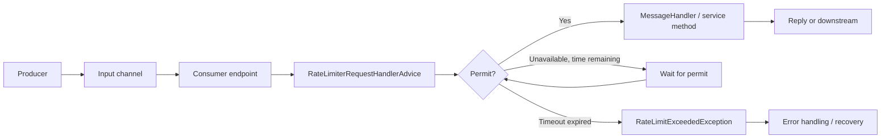
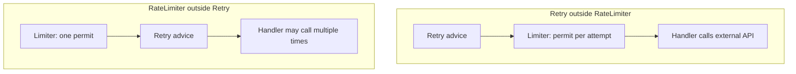

# Rate limiting advice in Spring Integration Runtime

## 1. Goals and context

In **Spring Integration Runtime**, messages flow through a `MessageChannel`, a consumer endpoint receives them, and a `MessageHandler` is invoked. When the handler calls a partner API—for example a payment gateway allowing only 100 requests/minute—incoming message velocity can exceed the actual quota. Accepting a message into a channel does not mean the external backend is ready for the corresponding call.

**`RateLimiterRequestHandlerAdvice`** belongs to the **Advice chain** chapter of `SPRING_INTEGRATION_RUNTIME` and is used to limit **the invocation rate of a handler**. The advice sits before the business call and requests a permit from Resilience4j; when no permit is available, it can wait up to a configured duration or reject the request.

This lesson connects rate limiting with channels, endpoints, consumers, pollers, executors, `IntegrationFlow` lifecycle, transactions, retries, message stores, error channels, correlation, and runtime performance scenarios.

**Goals after this lesson:**

- Explain `limitForPeriod`, `limitRefreshPeriod`, and `timeoutDuration`.
- Configure `RateLimiterRequestHandlerAdvice` in `@ServiceActivator`.
- Distinguish waiting for a permit, rejection, retry, and recovery.
- Understand advice chain ordering, JVM-local limits, and multi-instance risks.
- Diagnose waiting threads, gateway timeouts, message backlogs, and quota-exceeded errors.

**Version:** examples use Spring Integration **6.x** (API 6.5), Java 17+, and a compatible Resilience4j version. `RateLimiterRequestHandlerAdvice` was added in Spring Integration **5.2**; check your dependencies/BOM for the exact version deployed.

## 2. Rate limit is not the same as concurrency limit

Rate limiting answers **how many calls may start within a period**. Concurrency limiting answers **how many calls are executing simultaneously**.

| Mechanism | Limits | Does not guarantee by itself |
|---|---|---|
| **Rate limiter** | Number of permits per time period | Number of simultaneously running calls |
| **Semaphore/Bulkhead** | Number of concurrent in-flight tasks | Call rate per minute |
| **`QueueChannel` + poller** | Buffering capacity and polled message count | Fixed rate if processing behaves abnormally |
| **Retry advice** | Number of error-handling attempts | External API quota |
| **Circuit breaker** | Calls when a dependency's errors exceed threshold | Rate limits while the service is healthy |
| **Backpressure** | Send/receive pace matching system capacity | Provider-specific quota contracts |

Suppose a limiter grants 2 calls/second, yet each call takes 5 seconds. Subsequent periods keep issuing permits, raising concurrent requests. If a partner requires both **2 req/s** and **at most 4 in-flight requests**, pair it with a bulkhead/concurrency limit.

A rate limiter also **does not persist messages to durable storage**. When no permit is available, the thread may wait; when the timeout expires, the request is rejected. For controlled retries/requeueing, add logic at the source, flow, or recovery layer.

## 3. Where is the advice placed in a message flow?

Full class name:

```java
org.springframework.integration.handler.advice.RateLimiterRequestHandlerAdvice
```

This class extends `AbstractRequestHandlerAdvice` and protects **the handler at the endpoint where the advice is attached**. It does not automatically wrap the entire downstream flow.



Example flow:

```text
Inbound adapter -> orders.in -> transformer
    -> HTTP outbound gateway [RateLimiter advice]
    -> orders.out -> downstream consumer
```

Advice on the HTTP outbound gateway counts only calls entering **that gateway**. If another handler makes three HTTP calls inside one invocation, advice wrapping that handler may consume **one permit per invocation**, while real quota consumes three calls. Therefore, attach the limiter right at **the point actually calling the rate-limited resource**.

### 3.1. Handler advice vs. poller advice

**Handler advice** is suited for protecting a specific outbound API. **Poller advice** wraps the polling task and can affect a synchronous processing chain initiated by the poller; scope and semantics differ.

- `DirectChannel`: advice typically runs directly on the thread calling `send()`.
- `ExecutorChannel`: producer hands the message to an executor; advice runs only when a worker executes the handler.
- `QueueChannel` with polling consumer: when advice runs depends on the poll schedule, endpoint status, and backlog.
- `PublishSubscribeChannel`: if multiple subscribers have advice-protected endpoints, each invocation can consume permits from the limiter that endpoint uses.

A limiter does not control endpoint lifecycle, `SmartLifecycle`, task executors, or poller schedules.

## 4. How does Resilience4j issue permits?

`RateLimiterRequestHandlerAdvice` uses `io.github.resilience4j.ratelimiter.RateLimiter`. Resilience4j manages permits by **time period**; in each period, a configured permit budget is refreshed.

| `RateLimiterConfig` property | Meaning | Example |
|---|---|---|
| `limitRefreshPeriod` | Length of each permit refresh period | `Duration.ofSeconds(1)` |
| `limitForPeriod` | Number of permits allowed per period | `2` |
| `timeoutDuration` | Maximum time to wait for a permit | `Duration.ofMillis(100)` |

```java
RateLimiterConfig config = RateLimiterConfig.custom()
        .limitRefreshPeriod(Duration.ofSeconds(1))
        .limitForPeriod(2)
        .timeoutDuration(Duration.ofMillis(100))
        .build();
```

On a limiter instance, this configuration means **two permits per one-second period**. When permits are exhausted, the next call may wait up to 100 ms to acquire one. If the deadline expires without a permit, the call is rejected.

**Algorithm note:** this is Resilience4j's periodic quota, not a promise that "every arbitrary 1,000 ms sliding window contains at most two calls." Calls near the boundary of two periods can land very close together. When a partner enforces a sliding window or another algorithm, leave a safety margin.

### 4.1. Three outcomes when requesting a permit

1. **Permit available:** the handler is invoked immediately.
2. **Permits exhausted, `timeoutDuration > 0`:** the thread may wait briefly to acquire a permit in the next period.
3. **No permit acquired within timeout:** Resilience4j throws `RequestNotPermitted`, which Spring Integration wraps in `RateLimiterRequestHandlerAdvice.RateLimitExceededException` with message/target context.

With `timeoutDuration = Duration.ZERO`, lack of a permit normally leads to **fail fast**. The message is not durably queued, nor is it automatically replayed in the next period.

A consumed permit represents the right to **start an invocation**; unlike a semaphore, it is not returned when the method finishes. If you need to cap concurrently running tasks, combine with a bulkhead or bounded executor.

### 4.2. Rate limiter timeout is not other timeouts

| Wait duration | Scope |
|---|---|
| `RateLimiterConfig.timeoutDuration` | Waiting for a permit before entering the handler |
| HTTP client timeout | Waiting for upstream/downstream network I/O |
| Gateway `replyTimeout` | Waiting for a reply per message channel semantics |
| Retry backoff | Waiting between retry attempts |
| Poller interval | Waiting until the next message poll |

With `DirectChannel`, the producer thread can block while waiting for a permit, so a gateway timeout does not necessarily interrupt the synchronous call. When defining SLOs, sum permit wait time, handler execution, retries, HTTP timeouts, and queue time.

## 5. RateLimiterRequestHandlerAdvice API

Constructors supported in Spring Integration 6.x:

```java
new RateLimiterRequestHandlerAdvice()
new RateLimiterRequestHandlerAdvice("partner-a")
new RateLimiterRequestHandlerAdvice(rateLimiterConfig)
new RateLimiterRequestHandlerAdvice(rateLimiterConfig, "partner-a")
new RateLimiterRequestHandlerAdvice(rateLimiter)
```

The constructor accepting a `RateLimiter` is convenient when two endpoints must share **the same quota**. The constructor accepting `RateLimiterConfig` creates a limiter from config. Meaningful names make traces/metrics easier to read.

Observation and adjustment APIs:

```java
RateLimiter limiter = advice.getRateLimiter();

int available = advice.getMetrics().getAvailablePermissions();
int waiting = advice.getMetrics().getNumberOfWaitingThreads();

advice.setLimitForPeriod(3);
advice.setTimeoutDuration(Duration.ofMillis(200));
```

`getAvailablePermissions()` can go negative due to reservations for future periods; `getNumberOfWaitingThreads()` is an estimate. Changing `limitForPeriod` takes effect in the next period, and changing `timeoutDuration` does not alter timeouts for threads already waiting.

### 5.1. Shared quota vs. independent quotas

Two advice beans with identical configuration **do not** share a permit budget. If two endpoints call the same partner, they can share an instance:

```java
RateLimiter shared = RateLimiter.of("partnerQuota", config);

RateLimiterRequestHandlerAdvice adviceA =
        new RateLimiterRequestHandlerAdvice(shared);
RateLimiterRequestHandlerAdvice adviceB =
        new RateLimiterRequestHandlerAdvice(shared);
```

However, `RateLimiter` lives in process memory. If you deploy 3 pods and each pod allows 10 req/s, the cluster total can approach **30 req/s** under balanced load. Matching limiter names across JVMs do not synchronize quotas. Cluster-wide quotas require a distributed limiter, a centralized gateway, or splitting the permit budget across instances.

## 6. Example: two requests allowed, third request rejected

This test uses Spring Integration 6.x, Java 17+, `spring-integration-core`, and compatible `resilience4j-ratelimiter` from dependency management.

Create a `DirectChannel` as input to observe synchronous exceptions on `send()` and a `QueueChannel` to receive normal replies. Set a **1-minute** period, 2 permits, and `timeoutDuration=ZERO` so three consecutive calls easily fall into the same period.

### 6.1. Spring configuration

```java
import java.time.Duration;
import java.util.concurrent.atomic.AtomicInteger;

import io.github.resilience4j.ratelimiter.RateLimiterConfig;
import org.springframework.context.annotation.Bean;
import org.springframework.context.annotation.Configuration;
import org.springframework.integration.annotation.ServiceActivator;
import org.springframework.integration.channel.DirectChannel;
import org.springframework.integration.channel.QueueChannel;
import org.springframework.integration.config.EnableIntegration;
import org.springframework.integration.handler.advice.RateLimiterRequestHandlerAdvice;
import org.springframework.messaging.MessageChannel;
import org.springframework.messaging.PollableChannel;

@Configuration
@EnableIntegration
public class RateLimitFlowConfig {

    @Bean("quota.input")
    MessageChannel quotaInput() {
        return new DirectChannel();
    }

    @Bean("quota.results")
    PollableChannel quotaResults() {
        return new QueueChannel();
    }

    @Bean("quotaAdvice")
    RateLimiterRequestHandlerAdvice quotaAdvice() {
        RateLimiterConfig config = RateLimiterConfig.custom()
                .limitRefreshPeriod(Duration.ofMinutes(1))
                .limitForPeriod(2)
                .timeoutDuration(Duration.ZERO)
                .build();

        return new RateLimiterRequestHandlerAdvice(config, "vendor-api");
    }

    @Bean
    VendorHandler vendorHandler() {
        return new VendorHandler();
    }
}

class VendorHandler {

    private final AtomicInteger invoked = new AtomicInteger();

    @ServiceActivator(
            inputChannel = "quota.input",
            outputChannel = "quota.results",
            adviceChain = "quotaAdvice")
    public String invoke(String orderId) {
        int n = invoked.incrementAndGet();
        return "sent:" + orderId + ":call-" + n;
    }

    int count() {
        return invoked.get();
    }
}
```

An endpoint discovered from `@ServiceActivator` calls `invoke()` when a message arrives. The advice sits before this call, so rejected attempts **do not increment `invoked`**. The two successful calls produce normal replies to `quota.results`.

### 6.2. Running the test

```java
import org.springframework.context.annotation.AnnotationConfigApplicationContext;
import org.springframework.integration.channel.QueueChannel;
import org.springframework.messaging.Message;
import org.springframework.messaging.MessageChannel;
import org.springframework.messaging.MessagingException;
import org.springframework.messaging.support.MessageBuilder;

public class RateLimitDemo {

    public static void main(String[] args) {
        try (var context = new AnnotationConfigApplicationContext(
                RateLimitFlowConfig.class)) {

            MessageChannel input =
                    context.getBean("quota.input", MessageChannel.class);
            QueueChannel results =
                    context.getBean("quota.results", QueueChannel.class);

            for (int i = 1; i <= 3; i++) {
                Message<String> msg = MessageBuilder
                        .withPayload("ORD-" + i)
                        .setHeader("traceId", "rate-demo")
                        .build();

                try {
                    input.send(msg);
                    System.out.println("Accepted request " + i);
                }
                catch (MessagingException ex) {
                    System.out.println("Rejected request " + i
                            + ": " + ex.getClass().getSimpleName());
                }
            }

            for (int i = 0; i < 2; i++) {
                Message<?> reply = results.receive(1_000);
                if (reply == null) {
                    throw new IllegalStateException("Expected success reply");
                }
                System.out.println(reply.getPayload());
            }

            System.out.println("Extra reply: " + results.receive(0));
            // null
            System.out.println("Handler calls: "
                    + context.getBean(VendorHandler.class).count()); // 2
        }
    }
}
```

**Expected:** within the same 60-second period, the first two requests are permitted, and the third is rejected with no normal reply. An outer exception may wrap `RateLimitExceededException`; when debugging, traverse the cause chain to `RequestNotPermitted`. If the test happens to cross a period boundary, results can differ.

### 6.3. Permit-waiting mode

Change the config to:

```java
RateLimiterConfig config = RateLimiterConfig.custom()
        .limitRefreshPeriod(Duration.ofSeconds(1))
        .limitForPeriod(1)
        .timeoutDuration(Duration.ofSeconds(2))
        .build();
```

Three consecutive messages can be processed sequentially as new permits are issued, provided per-call timeouts do not expire. With `DirectChannel`, the thread calling `send()` waits for a permit. This is not a durable message queue; if the process stops while threads are waiting, the limiter provides no automatic replay.

## 7. RateLimitExceededException, error channels, and recovery

When permit acquisition fails, Resilience4j raises `RequestNotPermitted`. Spring Integration throws `RateLimiterRequestHandlerAdvice.RateLimitExceededException`, a `MessagingException` wrapping the error along with request message/target context for root-cause inspection.

**A quota error is not a business error from the external API.** When the limiter rejects **before the handler call**, that endpoint's handler does not execute. However, upstream steps may already have produced side effects before the message reached this handler. Avoid concluding the entire transaction is untouched just because a rate-limit error occurred.

| Execution mode | When permit cannot be acquired | Consequence to verify |
|---|---|---|
| Synchronous `DirectChannel` | Error usually propagates to the thread calling `send()` | Whether the caller catches the error |
| `ExecutorChannel` | Error occurs on an executor worker | Producer may already have returned from `send()` before worker fails |
| `QueueChannel` + polling consumer | Error inside polling task | Error handler, transaction, and redelivery |
| `@MessagingGateway` | Caller may receive error or timeout depending on flow | Which channel the gateway awaits replies on |
| JMS/AMQP/Kafka adapter | ACK/requeue/rebalance per adapter and transaction | Message may redeliver or be dropped per configured policy |

`RateLimiterRequestHandlerAdvice` **does not create a recovery queue on its own**. Without another error-handling advice, exceptions follow endpoint semantics. On synchronous paths, exceptions can return to the producer; on async/polling paths, they can produce an `ErrorMessage` sent to the `errorChannel` header or global error channel.

### 7.1. Handling overload: wait, reject, or store?

- **Fail fast:** `timeoutDuration=Duration.ZERO`, then return a "busy" status or propagate the error upstream. Suits request-response APIs needing fast feedback.
- **Short wait:** small timeout to absorb moderate bursts, provided the worker pool has capacity and callers can wait.
- **Controlled queue:** if every request must eventually be processed, use a durable transport or channel backed by a `MessageStore`, a throttled consumer, and proper ACK/retry policies.
- **Quarantine/DLQ:** store failure records with business key, exception type, timestamp, and status for controlled replay.

Strictly avoid a tight loop immediately retrying every `RateLimitExceededException`. Once a quota is exhausted, retrying without delay only spikes CPU, advice entries, and queue lengths. If retries are needed, use backoff or transport-scheduled redelivery with attempt limits and an overall deadline.

### 7.2. How can ErrorMessageSendingRecoverer be involved?

`RequestHandlerRetryAdvice` can use `ErrorMessageSendingRecoverer` after retries are exhausted. At that point, an `ErrorMessage` event is sent to the **retry advice's recovery channel**. That belongs to the retry layer, not an automatic feature of the rate limiter.

If retry advice is allowed to catch `RateLimitExceededException`, verify the policy does not accidentally retry quota rejections immediately. Usually you should distinguish:

- `RequestNotPermitted`: **rejected by the local limiter**.
- HTTP 429: the handler **already called downstream** and was rejected by the service's own quota.
- `TimeoutException`/other HTTP errors: the handler may have invoked the call without receiving a response.
- Validation error: invalid message, generally should not be retried under quota.

Each case requires different retry, recovery, and idempotency strategies.

### 7.3. Reply channel on rejection

A handler blocked before returning **emits no normal reply**. If a gateway is awaiting a reply, it may see an exception or time out depending on channel and error path; there is no rule fabricating a success reply for rejected requests.

When a gateway waits too long across an `ExecutorChannel`, the caller may exceed `replyTimeout` and resend the same business request. The original request may still be queued or waiting for a permit and execute later. That is why idempotency keys and tracking business state across submissions are essential.

## 8. Rate limiter and advice chain ordering

An endpoint may combine retry, rate limiting, circuit breaker, transaction, or logging advice. **AOP order affects how many permits are consumed.**

Example:

```java
@ServiceActivator(
        inputChannel = "partner.in",
        adviceChain = {"retryAdvice", "rateLimiterAdvice"})
public String callPartner(String payload) {
    return partnerClient.call(payload);
}
```

Standard advice instances wrap nested inside one another. If **retry wraps outside rate limiter**, every retry attempt entering the handler must acquire a permit. If **rate limiter wraps outside retry**, the entire group of retry attempts may consume only one permit, even though multiple real calls hit the external API.



**Design rule:** if the third party meters quota **per HTTP call**, the limiter must guard **each actual HTTP attempt**. At the same time, the retry policy must avoid immediately retrying the limiter's own rejection error.

If the quota contract meters **per logical business request**, one permit for the whole retry group can work, provided you accept the risk of actual HTTP attempts exceeding the partner's quota. No single advice order fits every system.

### 8.1. Circuit breaker and rate limiter

A circuit breaker rejects calls when a dependency has a high error rate; a rate limiter rejects calls exceeding a time-window budget. When the circuit is open, failing calls may hit the breaker before acquiring a permit or after acquiring one, depending on advice order. If you want to avoid burning permits while the circuit is open, order them appropriately and verify with metrics.

### 8.2. Transaction advice and wait times

If a transaction opens **before** waiting for a permit, a thread can hold a transaction/database connection before executing any business work. This increases transaction duration, timeout risk, and lock contention. Usually you should place rate limiting **before opening expensive transactions**, if business semantics and topology allow.

In Spring Integration, many reply-producing handlers apply `AbstractRequestHandlerAdvice` around `handleRequestMessage()`, whereas `HandleMessageAdvice` applies around `handleMessage()`. When both advice types appear together, actual runtime order may not match declaration order. Never rely solely on the annotation array order as proof; verify with logs or invocation-count tests.

### 8.3. Poller advice vs. handler advice

Placing retry in **poller advice** can re-run synchronous downstream steps of a poll; placing a rate limiter on a **specific outbound handler** throttles only that handler's invocations.

A poller with `maxMessagesPerPoll=10` does not mean the limiter will grant 10 permits or that all 10 will succeed. Permit usage depends on each invocation reaching the advised handler and the limiter's state.

## 9. Threading, performance, and lifecycle

### 9.1. Waiting for permits occupies threads

Suppose 100 messages enter an `ExecutorChannel` backed by a handler limited to 2 req/s with a 10-second permit timeout. Many workers can block waiting, causing:

- Thread pool exhaustion even though CPU and the HTTP backend are not overloaded.
- Growing executor queues and rising end-to-end latency.
- Upstream gateway timeouts while requests sit in queues or wait for permits.
- Pollers missing subsequent poll cycles if workers stay blocked too long.
- If retry backoff also sleeps on the thread, total blocking grows further.

A limiter is not a non-blocking scheduler. Use sensible `timeoutDuration`, bounded queues, and producer-level backpressure when needed. Under sustained traffic above quota, **throttling the source or pairing a durable queue + bounded consumer** is far easier to operate than leaving hundreds of workers blocked waiting for permits.

### 9.2. MessageStore, correlation, and durability

`RateLimiterRequestHandlerAdvice` keeps Resilience4j permit state in process memory. It **does not save failed messages to a `MessageStore`** and does not create correlation keys.

- `QueueChannel` can use a durable message store when configured; that is the channel's responsibility.
- Aggregators use their own correlation/release strategies and message groups; a permit does not replace grouping logic.
- `correlationId` or trace IDs link inputs with retries/recovery, but do not prevent duplicate side effects by themselves.
- If multiple callers share a reply queue, a caller might read the wrong reply; use a gateway temporary reply channel or demultiplex by correlation.

If you need replay after rejections or restarts, choose a source with proper persistence/acknowledgment guarantees, assign a stable business ID, and check idempotency before calling external APIs.

### 9.3. Managing IntegrationFlow at runtime

Starting/stopping an endpoint via `SmartLifecycle` stops message intake, but does not reset a singleton `RateLimiter` living in the application context. If a dynamic flow is unregistered and recreated with a different limiter bean, in-memory quota state can shift with the new instance.

Clarify:

- Does the limiter belong to one endpoint or is it shared across multiple flows?
- On flow restart, is the live limiter bean reused or rebuilt?
- During a rolling restart across pods, could fresh quotas be granted simultaneously on each pod?
- When updating limits at runtime, is cross-process coordination required?

These are ownership/runtime design questions, not a `status` property in course metadata.

## 10. Observing RateLimiter metrics

Read metrics directly:

```java
RateLimiterRequestHandlerAdvice advice = ...;

String limiterName = advice.getRateLimiter().getName();
int available = advice.getMetrics().getAvailablePermissions();
int waiting = advice.getMetrics().getNumberOfWaitingThreads();
```

`available` is an estimated permit count that can be negative due to reservations. `waiting` estimates waiting threads in the process. Both numbers help during debugging, but do not replace latency, throughput, and error metrics.

| Metric | Operational question |
|---|---|
| Granted/rejected permits | How many requests were blocked by quota? |
| Waiting threads | Are worker pools being tied up by the limiter? |
| Permit wait time p50/p95/p99 | How much latency is added before the handler? |
| Handler execution time | Is the external API slow or the rate limiter slow? |
| Input queue depth/oldest age | Where is the flow building backlog? |
| Gateway timeouts | Are callers timing out before messages even run? |
| Retry attempts | How many external calls does one logical message trigger? |
| HTTP 429 from provider | Does internal quota mismatch real partner limits? |
| Error channel/Recovery queue | Are quota errors being processed or piling up? |

Use trace IDs/correlation IDs to connect message arrival, pre/post permit wait, external API call, and reply emission. Avoid logging sensitive payloads or tokens. Do not use business request IDs or user IDs as the **limiter name** or metric tags if that causes excessive cardinality.

### 10.1. Changing configuration at runtime

`RateLimiterRequestHandlerAdvice` allows:

```java
advice.setLimitForPeriod(5);
advice.setTimeoutDuration(Duration.ofMillis(250));
```

Changing `limitForPeriod` takes effect from the next period; changing `timeoutDuration` does not modify deadlines for threads already waiting. This API **does not cancel** calls that already acquired permits and are executing.

If you need to change `limitRefreshPeriod`, do not assume the advice has a setter for it. Check the Resilience4j API/version and create a new limiter with the desired config under a safe cutover plan. Do not continuously mutate limits from noisy real-time metrics without checking feedback loops.

## 11. Common pitfalls

| Symptom | Possible cause | How to check |
|---|---|---|
| Calls exceed `limitForPeriod` | Spanning multiple periods, multiple pods, or independent limiters | Compare timestamps, replicas, beans, and limiter names |
| Advice exists yet every request passes through | Attached to wrong handler, quota too high, separate stateful limiters | Inspect `adviceChain`, limiter identity, metrics |
| Callers are slow despite low CPU | Workers waiting for permits | `getNumberOfWaitingThreads()`, thread dumps, queues |
| `RateLimitExceededException` | Permit wait timeout expired | Distinguish from HTTP timeouts and HTTP 429 |
| Messages are never reprocessed | No backoff/recovery/redelivery; errors logged and dropped | Verify error channel, ACK, retry policy |
| Retries blow past quota | Limiter outside retry or uncontrolled retry policy | Compare actual outbound calls vs. permits |
| HTTP 429 despite active limiter | Shared API key, multiple instances, different sliding window | Compare account-wide quota and `Retry-After` |
| Lower throughput than expected | Period too long, uneven permit usage, slow poller | Measure queue depth, available permits, consumer speed |
| Errors appear only on async workers | Error handling on executor/poller threads | Monitor error channel and worker logs |
| Quota appears reset after restart | Process-local limiter recreated | Define cluster-wide quota and bean lifecycle |
| Transactions stay open while waiting | Transaction opened before limiter | Check advice ordering, connection/lock metrics |
| Handler replies yet gateway times out | Queue + permit wait + execution exceeds gateway timeout | Observe latency stage by stage |

**Practical debugging workflow:**

1. Identify the quota-governed handler: is the advice attached to the right endpoint?
2. Inspect `limitRefreshPeriod`, `limitForPeriod`, `timeoutDuration`, limiter name, and instance.
3. Determine scope: one bean, multiple handlers, one JVM, or multiple pods.
4. Separate **waiting for a permit** from **inside the handler** using pre/post timestamps in logs.
5. Read the exception chain: `RateLimitExceededException`/`RequestNotPermitted` or an external API error?
6. Check error channels, gateway replies, ACKs, retries, and message stores if replay is required.
7. Measure executor saturation, poller concurrency, queue depth, and elapsed time before changing quotas.

## 12. Hands-on exercises

### Exercise 1 — Fail fast and wait

Run Section 6 code with `timeoutDuration=ZERO` and verify two handler calls. Switch to `timeoutDuration=Duration.ofSeconds(2)`, `limitRefreshPeriod=Duration.ofSeconds(1)`, `limitForPeriod=1`. Measure the duration of each `send()`.

**Question:** which thread actually waits for the permit when input is a `DirectChannel`?

### Exercise 2 — Two endpoints sharing a limiter

Create two service activators calling the same partner, first sharing **one** `RateLimiter` and then using **two independent limiters**. Send messages through both and compare total permitted calls per period.

### Exercise 3 — Rate limiter combined with retry

Have a handler call an external service that fails twice and succeeds on the third try. Test placing retry outside the rate limiter and rate limiter outside retry. Count permits and actual calls. Which setup enforces quota **per HTTP attempt**?

### Exercise 4 — Executor and timeouts

Put an `ExecutorChannel` in front of a low-quota handler and send many messages concurrently. Watch waiting threads, executor queue, gateway timeouts, and reply latency as you vary `timeoutDuration`.

### Exercise 5 — Async errors and recovery

Set `timeoutDuration=ZERO` and simulate a polling consumer getting rejected. Identify which channel receives the `ErrorMessage`, the ACK/rollback behavior, and choose delayed requeue or DLQ. Never replay indefinitely without bounds.

### Exercise 6 — Multi-pod quota

Suppose 4 pods each have `limitForPeriod=10` and `limitRefreshPeriod=1s`, while the partner allows at most 20 req/s **across the entire account**. Explain how total traffic can exceed the limit and propose a distributed limiter or centralized gateway solution.

## 13. Production design checklist

1. **Limit at the right boundary:** the outbound handler/API call actually consuming quota.
2. **Limit the right unit:** per business request vs. per retry attempt; pick the matching advice chain.
3. **Set explicit timeouts:** short wait or fail fast to avoid tying up worker pools.
4. **Have an overload path:** return busy, delayed requeue, bounded recovery, or DLQ.
5. **Protect side effects:** transactions, ACKs, and idempotency across retries and redeliveries.
6. **Account for the whole system:** replicas, apps sharing an API key, and partner quota changes.
7. **Observe:** permits, waiting threads, latency, 429s, queue depth, and error channels.
8. **Separate rate from concurrency:** if the backend caps in-flight calls, add a bulkhead/worker limit.

`RateLimiterRequestHandlerAdvice` is a tool for controlling **handler invocation rate** at runtime. End-to-end effectiveness depends on advice placement, retry order, permit wait duration, channels/threading, overload handling, and cluster-wide quota requirements.

## 14. Official references

- [Spring Integration 6.5 – Provided Advice Classes, Rate Limiter Advice](https://docs.spring.io/spring-integration/reference/6.5/handler-advice/classes.html): purpose, Resilience4j API, and `@ServiceActivator` configuration.
- [Spring Integration 6.5.0 Javadoc – RateLimiterRequestHandlerAdvice](https://www.springframework.org/spring-integration/docs/6.5.0/api/org/springframework/integration/handler/advice/RateLimiterRequestHandlerAdvice.html): constructors, `getMetrics()`, setters, `RateLimitExceededException`.
- [Spring Integration Reference – Handling Message Advice](https://docs.spring.io/spring-integration/reference/handler-advice/handle-message.html): scope of `handleRequestMessage()` vs. `handleMessage()`, and cases where `HandleMessageAdvice` changes ordering.
- [Spring Integration Reference – Messaging Endpoints](https://docs.spring.io/spring-integration/reference/endpoint.html): poller advice, transactions, and task executors.
- [Resilience4j Documentation – RateLimiter](https://resilience4j.readme.io/docs/ratelimiter): periods, permits, metrics, and dynamic config updates.
- [Resilience4j Source – RateLimiter.java](https://github.com/resilience4j/resilience4j/blob/master/resilience4j-ratelimiter/src/main/java/io/github/resilience4j/ratelimiter/RateLimiter.java): `acquirePermission()` contract and dynamic methods.
