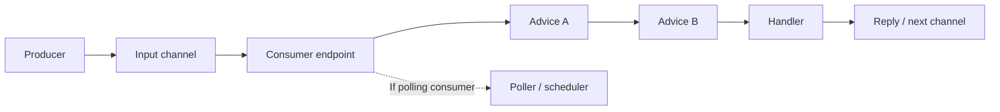
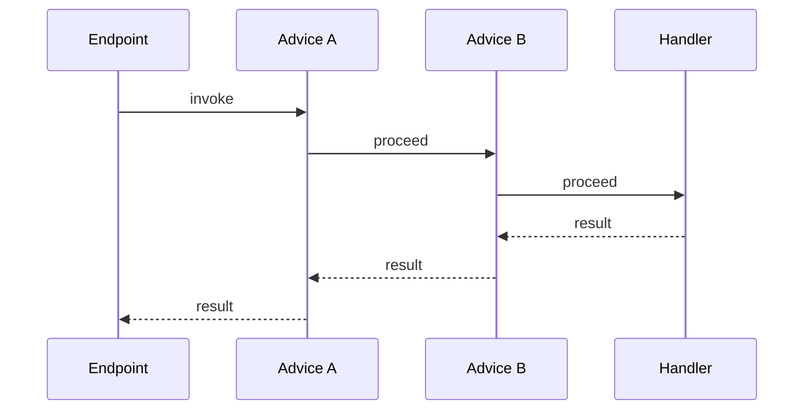
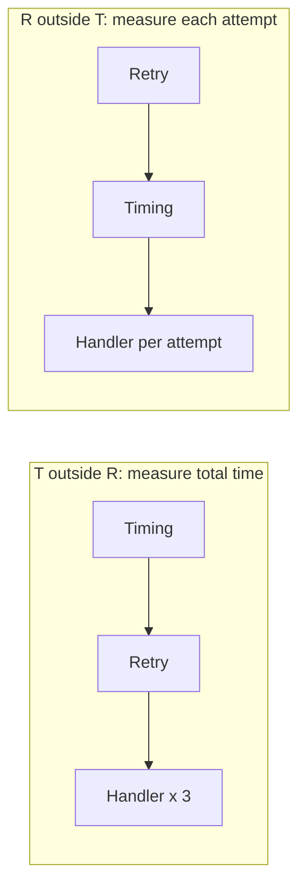
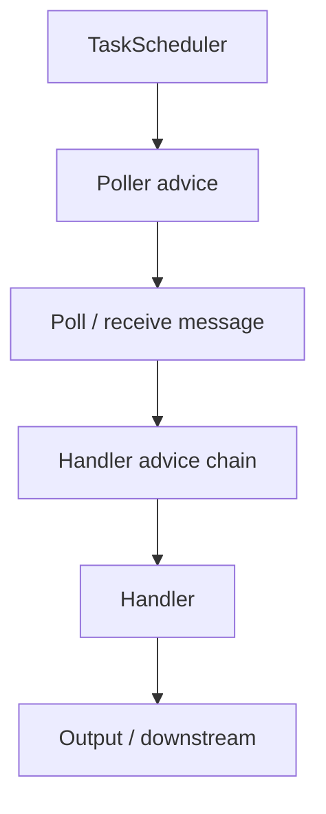
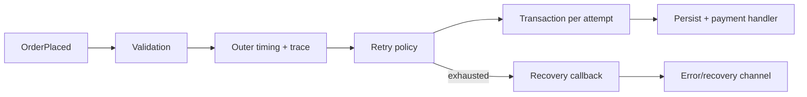
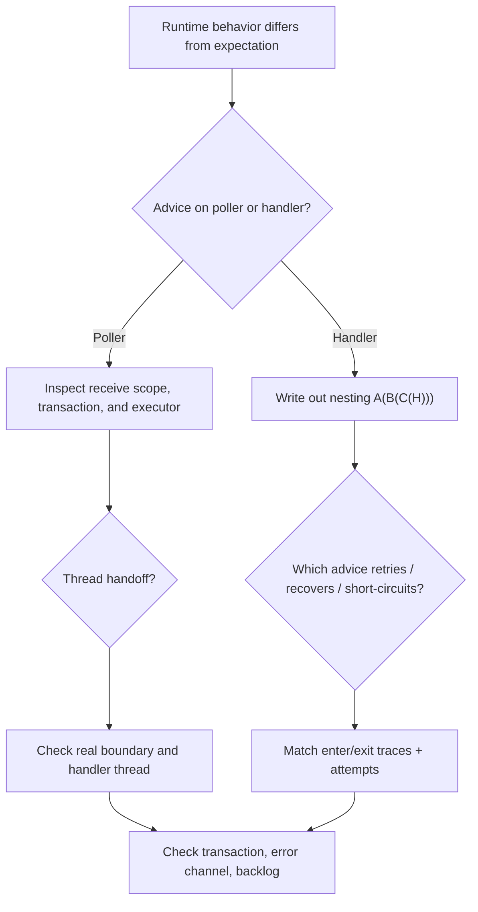

# Ordering multiple advice

In **Spring Integration runtime**, a message travels from a channel through a consumer endpoint to a handler. Along the way, systems often need multiple cross-cutting policies: logging, timing, authorization checks, retries, transactions, and recovery. Spring Integration allows attaching an **advice chain** to an endpoint to wrap the processing invocation. When there are two or more advice instances, **the declared order determines how they nest**, directly affecting handler call counts, transaction hold durations, where exceptions are caught, and what result continues down the message flow.

This lesson belongs to the **Advice chain** chapter of the `SPRING_INTEGRATION_RUNTIME` module. The focus is reading multi-advice ordering accurately, testing ordering with traces, and choosing how to arrange advice for a real message flow. Examples connect to channels, endpoints, pollers, executors, retries, error channels, message stores, and runtime diagnostics.

## 1. Which step does an advice chain wrap?

An **advice** is a component that adds behavior before, after, or around an operation invoked by the framework. In message processing, advice can do things such as:

- Record start/end timestamps and correlation info.
- Retry an operation on transient errors.
- Begin/commit/roll back transactions per configuration.
- Classify exceptions and route final failures to an error/recovery flow.
- Enforce access control, limits, or additional measurements.

**Where advice is placed matters just as much as its order.** A chain attached at a **handler endpoint** normally wraps handler execution. Advice placed on a **poller** can wrap a polling cycle (including receiving the message and steps invoked within that poll scope). Advice does not automatically "blanket" an entire message flow simply because an `IntegrationFlow` has multiple endpoints.



For `DirectChannel`, synchronous endpoint processing typically runs on the producer's thread. With `QueueChannel`, a polling consumer must fetch the message before invoking the handler. With `ExecutorChannel`, dispatching may run on an executor thread. Adding advice **does not automatically change** channel type, thread model, or delivery guarantees.

## 2. Core rule: the first advice is outermost

For **around advice** following the standard interceptor model, the declaration order:

```text
advice(A), advice(B), advice(C) -> targetHandler
```

can be visualized as:

```text
A.before
  B.before
    C.before
      handler()
    C.after / finally
  B.after / finally
A.after / finally
```

**Inbound direction:** A → B → C → handler. **Outbound direction:** handler → C → B → A. The first advice in the chain is the outermost wrapper; the last advice sits closest to the handler. This is the foundational rule for predicting log order, measured durations, and where exceptions can be caught.



In the following conceptual example, `A` logs before/after all of `B`; `B` logs closer to the handler call:

```java
// Pseudocode to illustrate nesting
Object execute() {
    return A.around(() ->
        B.around(() ->
            C.around(() -> handler.process(message))));
}
```

**Not every advice calls its inner target exactly once.** A retry advice can invoke `proceed/execute` multiple times; a circuit breaker can reject without invoking the handler; a recovery advice can turn an exception into a result; some advice are observation interceptors that only run `finally`. Thus, actual logs may not form a simple "before/after" pair.

## 3. When the handler throws: exit order matters even more

Suppose the handler throws `IllegalStateException`. If no advice handles the exception, the stack unwinds through the advice in reverse order and throws to the endpoint/caller:

```text
A.before
B.before
handler -> throws IllegalStateException
B.catch(error)
B.finally
A.catch(error)
A.finally
caller/endpoint receives exception
```

If **B catches the exception and returns a fallback**, then A sees a **normal result**:

```text
A.before
B.before
handler -> throws
B.recover -> returns "PENDING_REVIEW"
B.finally
A.afterSuccess("PENDING_REVIEW")
A.finally
```

This has operational consequences: an outer advice that counts exceptions to calculate "failure rate" may **never see the exception** if an inner advice recovered. To measure failed attempts, place instrumentation at the right layer or read data from a retry listener/recovery callback.

| Behavior of inner advice | What outer advice observes | Risk of misinterpretation |
| --- | --- | --- |
| Rethrows exception | Exception propagates outward | Knows a failure occurred, but not which attempt failed |
| Returns fallback | Normal result | Easy to miscount as business success |
| Does not call `proceed()` | No handler invocation | May be an intentional rejection, not a handler "skipped due to bug" |
| Calls `proceed()` multiple times | Multiple inner executions | Risk of repeating side effects if not idempotent |

## 4. Configuring multiple advice on a handler with Java DSL

An easy way to see ordering is to create two tracing advice beans and attach them in order to a service activator in `IntegrationFlow`. The Spring Integration (Java 17+) example below uses `AbstractRequestHandlerAdvice`, the advice type suited for request-handler invocations.

```java
import org.springframework.context.annotation.Bean;
import org.springframework.context.annotation.Configuration;
import org.springframework.integration.annotation.EnableIntegration;
import org.springframework.integration.channel.DirectChannel;
import org.springframework.integration.dsl.IntegrationFlow;
import org.springframework.integration.handler.advice.AbstractRequestHandlerAdvice;
import org.springframework.messaging.Message;
import org.springframework.messaging.MessageChannel;

@Configuration
@EnableIntegration
public class AdviceOrderConfig {

    @Bean
    MessageChannel commands() {
        return new DirectChannel();
    }

    @Bean
    TraceAdvice outerTrace() {
        return new TraceAdvice("A");
    }

    @Bean
    TraceAdvice innerTrace() {
        return new TraceAdvice("B");
    }

    @Bean
    IntegrationFlow commandFlow(MessageChannel commands,
                                TraceAdvice outerTrace,
                                TraceAdvice innerTrace) {
        return IntegrationFlow.from(commands)
                .handle(String.class, (payload, headers) -> {
                    System.out.println("handler: " + payload);
                    return "DONE:" + payload;
                }, endpoint -> endpoint.advice(outerTrace, innerTrace))
                .handle(message -> System.out.println(
                        "downstream: " + message.getPayload()))
                .get();
    }

    static final class TraceAdvice extends AbstractRequestHandlerAdvice {
        private final String name;

        TraceAdvice(String name) {
            this.name = name;
        }

        @Override
        protected Object doInvoke(ExecutionCallback callback,
                                  Object target,
                                  Message<?> message) throws Exception {
            System.out.println(name + ": before");
            try {
                Object result = callback.execute();
                System.out.println(name + ": success");
                return result;
            }
            catch (Exception ex) {
                System.out.println(name + ": error " +
                        ex.getClass().getSimpleName());
                throw ex;
            }
            finally {
                System.out.println(name + ": finally");
            }
        }
    }
}
```

A producer in the same application can obtain the `commands` bean and send:

```java
commands.send(
    org.springframework.messaging.support.MessageBuilder
        .withPayload("CMD-42")
        .build());
```

If the handler processes normally, the expected trace order is:

```text
A: before
B: before
handler: CMD-42
B: success
B: finally
A: success
A: finally
downstream: DONE:CMD-42
```

The example uses `DirectChannel` so traces are easy to follow. In applications with multiple beans of type `TraceAdvice`, identify dependencies explicitly with `@Qualifier` or bean names when Spring cannot infer them. If configuring `commands` and advice via bean methods, register them in the same Spring context and ensure the consumer endpoint is started before sending.

Changing the order to `endpoint.advice(innerTrace, outerTrace)` flips the order **at entry/exit**: B outside, A inside. That is the quickest way to verify that chain ordering has a real effect.

## 5. Ordering retry and timing

Take two advice instances:

- `T`: records processing duration using a monotonic clock such as `System.nanoTime()`.
- `R`: `RequestHandlerRetryAdvice` tries the handler up to three times with backoff.

The two arrangements produce **two different metric meanings**:

| Configuration | Nesting | Duration measured by `T` |
| --- | --- | --- |
| `advice(T, R)` | `T(R(handler))` | Entire retry chain including backoff intervals |
| `advice(R, T)` | `R(T(handler))` | Each processing attempt measured individually, since retry invokes T repeatedly |

Suppose the handler fails twice and succeeds on the third attempt. With `T` outside `R`, `T` usually records once with the total duration; with `T` inside `R`, `T` can record three times. For complete latency visibility, systems often need **both metrics**: total processing time per message and per-attempt duration.



You should also distinguish **attempt failed** counts from **message finally failed** counts. A message that failed twice before succeeding is not a permanently failed message. If retry recovers and returns a fallback, a "handler success" metric on an outer advice can misreport business status.

## 6. Ordering retry and transaction

This pair of advice has a major impact on correctness. Use `R` for retry, `TX` for transaction, and `H` for handler:

### 6.1. Retry outside, transaction inside: `R(TX(H))`

```text
Retry
  attempt 1:
    begin TX-1 -> handler -> error -> rollback TX-1
  backoff
  attempt 2:
    begin TX-2 -> handler -> error -> rollback TX-2
  backoff
  attempt 3:
    begin TX-3 -> handler -> success -> commit TX-3
```

If the transaction interceptor genuinely starts a **new transaction for each attempt**, this approach ensures each try begins with a clean transaction. This is usually desirable when a DB operation can fail and the entire unit of work can be retried. However, transaction propagation (for example, an already-active outer transaction) still determines whether a new transaction is actually created; ordering the chain alone is not enough to guarantee a separate physical transaction per attempt.

### 6.2. Transaction outside, retry inside: `TX(R(H))`

```text
begin TX-1
  Retry
    attempt 1 -> handler -> error
    attempt 2 -> handler -> error
    attempt 3 -> handler -> success
commit / rollback TX-1
```

In this arrangement, attempts can share the same transaction. If an earlier failure marks the transaction `rollback-only` or invalidates resources, a later attempt may not rescue the transaction even if the handler logic returns successfully. You can hit `UnexpectedRollbackException` at commit time.

| Criterion | Retry outside TX | TX outside retry |
| --- | --- | --- |
| Transaction boundary per attempt | Can be separate per try if propagation fits | Usually one boundary spanning all attempts |
| Risk of reusing a poisoned transaction | Lower if each attempt gets a fresh TX | Risk of reusing a `rollback-only` transaction |
| Total transaction hold time | Usually shorter per transaction | Can include backoff sleep between attempts |
| When handler has non-DB side effects | Must still be made idempotent | Must still be made idempotent |
| Automatically guarantees redelivery/ack? | No | No |

**Scope warning:** the example above holds only when `TX` is truly transaction advice around the handler. A `poller transaction advice` can place a transaction **around both receiving the message and processing it**; adding handler retry inside means receiving the message can still sit inside the outer transaction around retry. Inspect **placement** before applying this comparison table.

## 7. Poller advice vs. handler advice

With a `QueueChannel` or polling source such as JDBC/file, there are at least two boundaries:



**Handler advice** wraps a single handler's execution invocation. **Poller advice** wraps the polling operation according to the appropriate advice type and poller configuration; some poller advice can govern the message-fetching source too. Practical observation must account for endpoint type, poller configuration, and whether message processing hands off to an executor.

Conceptual example declaring the two scopes separately via annotations:

```java
// Advice bean names are declared in the same Spring context.
// Choose appropriate advice for each boundary (poller vs. handler).
@ServiceActivator(
    inputChannel = "workQueue",
    adviceChain = {"handlerTimingAdvice", "handlerRetryAdvice"},
    poller = @Poller(
        fixedDelay = "500",
        maxMessagesPerPoll = "5",
        adviceChain = {"pollerTransactionAdvice"}
    )
)
public void consume(String payload) {
    // Business processing
}
```

*This snippet illustrates where the annotation attributes go; import `@ServiceActivator` and `@Poller`, and define `workQueue` as a `PollableChannel` along with the corresponding advice beans. A transaction advice on the poller combined with handler retry must be tested against the actual sources/stores in use.*

If the requirement is to **roll back reading from a transactional message store** when the handler fails, a poller transaction may be needed. If the goal is simply retrying an HTTP request inside the handler, handler advice is usually a better fit. **Do not put the same advice on both boundaries** without accounting for nested retries, nested transactions, and total attempt counts.

### 7.1. Executors create another boundary

Suppose a poller receives a message and dispatches it to an `ExecutorChannel` or an asynchronous handler. A transaction started at the poller is typically bound to the **current thread**; it does not automatically propagate to a worker thread. A `TransactionInterceptor` around the poller does not guarantee the asynchronous handler participates in that transaction. Place transactions right where DB operations run and verify commit/rollback on the actual execution thread.

Conversely, measuring duration only at the poller can record "finished" as soon as the message is submitted to the executor, before the handler has actually finished. Advice placement defines what "completion time" means.

## 8. Retry and recovery: ordering can turn exceptions into success

`RequestHandlerRetryAdvice` can be configured with a `RecoveryCallback`; a common option is `ErrorMessageSendingRecoverer` to send the final error to a recovery channel. When the recoverer sends an `ErrorMessage` and **returns normally**, outer advice may not see the original exception.

```text
AuditAdvice (outer)
  RetryAdvice (inner)
    handler attempt 1 -> throw
    handler attempt 2 -> throw
    handler attempt 3 -> throw
    RecoveryCallback -> send(ErrorMessage)
  RetryAdvice returns normally
AuditAdvice records "success" if it only inspects exception state
```

Therefore distinguish:

- **Attempt-level failure:** an individual handler invocation failed.
- **Retry exhausted:** no further retries are allowed by policy.
- **Recovery action completed:** the callback sent an error message or saved recovery status.
- **Business success:** the business operation truly succeeded, not merely "no exception thrown."

If the callback rethrows an exception so an outer context rolls back, execution differs from returning a fallback. In environments with broker ack/nack, an error-swallowing callback may cause the listener to treat the message as processed; exact behavior depends on adapter, transaction, and listener configuration.

Do not treat `ErrorMessageSendingRecoverer` as an independently ordered advice when it is configured as a **recovery callback inside `RetryAdvice`**. Recovery at the end of multiple tries is part of the retry policy, not an interceptor around each attempt.

## 9. Ordering circuit breakers, authorization checks, and retries

Some advice does more than observe—it can **short-circuit and skip calling the handler**. Ordering becomes a policy decision:

| Illustrative chain | What is observed / controlled | When to consider |
| --- | --- | --- |
| `CircuitBreaker(Retry(H))` | Circuit breaker usually sees the outcome of the entire retry chain | One outer call can cause multiple underlying requests |
| `Retry(CircuitBreaker(H))` | Circuit breaker sits close to the handler and sees each attempt | Open state can cause remaining retry attempts to fail fast |
| `Authorization(Retry(H))` | Checks permissions once per outer invocation | Credentials must remain valid across the entire processing chain |
| `Retry(Authorization(H))` | Re-checks permissions on each attempt | Can add overhead and change which error types get retried |

This is a conceptual model: real circuit breakers have their own counters, policies, and exception mappings. You cannot infer exact count behavior from a chain of names without inspecting the concrete configuration.

Safety principles:

1. Never blindly retry authorization failures or invalid data.
2. Cap total external requests when multiple retry layers exist (handler, HTTP client, broker redelivery).
3. Maintain stable idempotency keys across all attempts with side effects.
4. Decide the desired order from **intended outcomes**, then write trace tests for that exact chain.

## 10. Designing advice order for a real-world scenario

Consider a flow receiving `OrderPlaced`, needing validation, a DB write, and a payment system call. The system wants to log total duration, retry transient errors, and track the final outcome:



This is only a **conceptual design sequence**, not a universally safe recipe for every payment flow. An external payment API call is not rolled back by a local database transaction. You must use idempotency keys and reconciliation when payment outcomes are ambiguous.

A complete design typically needs:

| Layer | Policy choice | Verification |
| --- | --- | --- |
| Validation before retry | Reject fixed schema errors | Invalid data never enters hot retries |
| Trace/timing outside retry | Measure total latency and business key | One total duration per message |
| Bounded retry | Retry only transient errors with backoff | Exact attempt count and time limits |
| Transaction at right scope | Fresh transaction per attempt when needed | Verify rollback/commit in integration tests |
| Final recovery | Persist failure durably or throw intentionally | Clear final state, replayable |
| Per-attempt metrics | Count individual errors and execution time | Separate attempt failures from final failures |

Attaching a single advice chain cannot replace **splitting business steps** when each step needs different transactions, reliability guarantees, or retry policies. Often the right design is splitting the flow into multiple endpoints and channels, with tailored advice on each endpoint.

## 11. Advice order with correlation, message stores, and idempotency

Multiple advice instances can read `MessageHeaders`, but do not assume they automatically rewrite or synchronize every header. Create or preserve `correlationId` and business keys **before the retry boundary** so every attempt ties back to the same work.

Questions to answer:

- What is the business event ID? Is `orderId` stable across retries or redeliveries?
- Does a failed attempt roll back all side effects inside the transaction?
- If the handler wrote to the DB and then hit an HTTP error, does the idempotency layer prevent duplicate writes?
- Does retry context live in RAM or a stateful retry cache? After a restart, which source redelivers the message?
- Does the message store support transactional dequeue, or is it just an in-memory queue?

If an **idempotency advice** sits outside retry and marks a message processed before processing truly finishes, inner attempts may not be guarded properly. If idempotency sits inside retry, it must distinguish an **in-flight attempt** from a **committed business operation**. This requires careful state and transaction design, not simply swapping advice positions.

## 12. Observing runtime order in production

When investigating "the handler ran multiple times yet timing logged once" or "the transaction didn't roll back as expected," record the **actual execution order** rather than staring at bean names:

| Log/metric field | Question it helps answer |
| --- | --- |
| Advice name + enter/exit timestamps | Which advice is outer and which is inner? |
| Handler/endpoint name | Which endpoint is the advice wrapping? |
| `threadName` | Did execution switch threads via a scheduler/executor? |
| `messageId` and `correlationId` | Same message or a newly redelivered message? |
| Attempt number and exception type | Did retry actually re-invoke the handler? |
| Transaction active/appropriate ID | Did a transaction open per attempt or once? |
| Retry exhausted / recovery outcome | Did the callback swallow the error or rethrow? |
| Queue depth/poller latency | Are long retries inflating backlogs? |

You can use `TransactionSynchronizationManager.isActualTransactionActive()` in Spring transaction environments to check whether a transaction is bound to the current thread. However, `true` does not prove every downstream resource shares that transaction; verify the transaction manager, propagation, and actual resources.

Measure latency using `System.nanoTime()` or suitable metrics/observation tools. Log minimal identifying fields; avoid logging full payloads with sensitive data. If you only see an outer stack trace, check whether an inner advice caught, wrapped, or converted an earlier exception into a fallback.

### 12.1. Quick diagnostic workflow



If you see the handler run three times with the same message ID, that is usually retry within the same invocation context. If the IDs differ, it may be producer resends or source redelivery creating a new message. That is only a **clue to investigate**, not conclusive proof, because messages can also be reconstructed within a single flow.

## 13. Common mistakes when ordering multiple advice

| Mistake | Consequence | How to fix |
| --- | --- | --- |
| Thinking declaring A before B means A finishes before B | Log/exception order opposite of expectation | Remember A is outer, B is inner; exit order reverses |
| Measuring timing inside retry and calling it total latency | Omits backoff and full chain duration | Place timing outside retry; add per-attempt metrics if needed |
| Transaction wrapping retry hits `rollback-only` | Later attempt "succeeds" yet commit fails | Consider retry outside transaction with appropriate propagation |
| Recovery callback returns normally, outer advice reports success | Masks business failure | Track final outcomes and recovery states separately |
| Attaching retry to both poller and handler unintentionally | Multiplied attempts, amplified side effects | Draw the call tree and calculate total invocations before deploying |
| Assuming poller transactions follow async handlers | Transaction does not exist on worker thread | Place transactions at the worker's actual boundary |
| Retrying validation/auth errors or non-idempotent payments | Log storms, duplicated business actions | Classify errors and design idempotency |
| Putting audit subscribers on the hot path without error handling | Logging errors disrupt main flow | Set timeouts, error policies, isolate side effects when needed |
| Attaching advice to the first endpoint and expecting flow-wide coverage | Downstream endpoints have no advice | Configure each endpoint explicitly or use an appropriate cross-cutting mechanism |

## 14. Hands-on exercises

### Exercise 1 — Trace order without running the app

Given `advice(A, B, C)`, where every advice logs before/after and always proceeds once. Write the expected log when the handler succeeds, when the handler throws an exception, and when B catches an exception and returns a fallback. Check your answers against `A(B(C(handler)))`.

### Exercise 2 — Swap order and read traces

Use `AdviceOrderConfig` from Section 4. Send `CMD-42`; capture logs. Change `endpoint.advice(outerTrace, innerTrace)` to `endpoint.advice(innerTrace, outerTrace)` and send again. Confirm entry/exit flips while the handler still runs once per message.

### Exercise 3 — Timing outside vs. inside retry

Attach `RequestHandlerRetryAdvice` with max three attempts to a handler that deliberately fails twice and succeeds once. Try `advice(timingAdvice, retryAdvice)` and `advice(retryAdvice, timingAdvice)`. Count how many times timing runs and check whether measured durations include backoff.

### Exercise 4 — Retry and transaction

In a test DB environment with a transaction manager, trigger a transient failure on the first write. Compare `Retry(Transaction(handler))` against `Transaction(Retry(handler))`; log active transaction status and real commits/rollbacks. Never test against live payments or irreversible side effects. Analyze why marking a transaction `rollback-only` impacts the next attempt.

### Exercise 5 — Poller, executor, and recovery

Create a `QueueChannel` with a polling service activator and retry advice. Then add an async boundary using an executor. Observe threads, backlogs, when messages are dequeued, where exceptions appear, and when the recovery callback runs. Try having the callback send an `ErrorMessage` to a separate channel; verify that publishing an error does not automatically replay the business message.

## 15. Self-check questions

1. With `advice(A, B)`, who runs `before` first? → A. Who handles `after` last? → A.
2. When B catches an exception and returns a fallback, does A always see the original exception? → No, A may only see a normal result.
3. To measure total duration including retries/backoff, where does timing go? → Outside retry advice.
4. Why can `Transaction(Retry(handler))` be unsuitable after a DB error? → Attempts may share a transaction already marked `rollback-only`.
5. Does poller advice always share the same scope as handler advice? → No; poller advice can wrap receiving the message, whereas handler advice wraps the handler invocation.
6. Does a poller transaction automatically propagate across an `ExecutorChannel`? → Never assume so; transactions are typically bound to specific threads and boundaries.
7. Does a `RecoveryCallback` returning normally mean business processing succeeded? → No; evaluate the final result and recovery status separately.

**Remember:** When using multiple advice, draw **`A(B(C(handler)))`**, identify the exact wrapped region, and trace **entry, exit, exceptions, and repeated invocations**. Advice ordering defines the runtime semantics of retries, transactions, timing, and recovery; keeping a flow safe also requires handling threads, message sources, message stores, correlation, and idempotency properly.
