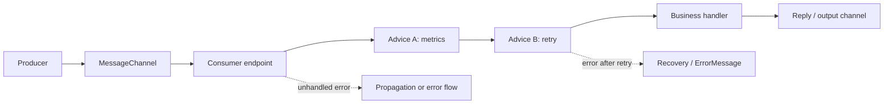
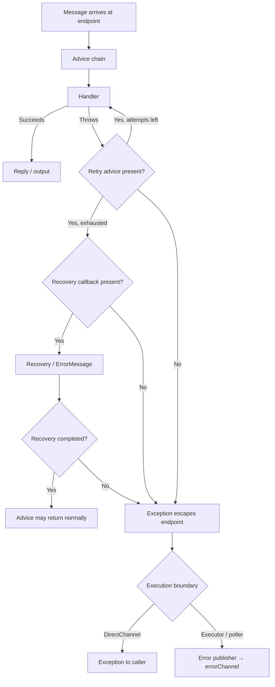

# How advice affects metrics and error flows in Spring Integration

## 1. Problem: for the same failure, why do numbers and paths differ?

In Spring Integration, a message travels through a `MessageChannel` and is passed by a **consumer endpoint** to a handler. We can attach an **advice chain** around the handler invocation to handle retries, timing, rate limiting, transactions, or exceptions. Even though advice does not need to alter core business logic, it can significantly change:

- **Actual handler invocation count**: how many times do retries re-run the call?
- **What metrics measure**: one input message, one handler attempt, or the full retry and backoff duration?
- **When errors are recorded**: does the exception escape immediately, get converted by advice into a recovery outcome, or reach `errorChannel` later?
- **Threads and transactions**: which thread runs the handler/advice, and do transactions/observations cross an `ExecutorChannel`?
- **Accuracy of statistics**: a business-failed task may be counted as "success" if outer advice only sees recovery returning normally.

This lesson belongs to the **Advice chain** chapter of the **SPRING_INTEGRATION_RUNTIME** module. The goal is to design advice placement and measure what actually happens at runtime across channels, endpoints, consumers, executors/pollers, retries, message stores, correlation, and error flows.

> **Core principle:** "The handler invocation completed without throwing" differs from "the message succeeded in business terms." An advice can absorb an exception, send an `ErrorMessage` to a recovery channel, and return normally; metrics outside the advice must account for this semantics.

## 2. Where does an advice chain sit in a message flow?

**Request-handler advice** intercepts around the handler receiving a message and executing its work. Common configurations are `@ServiceActivator(adviceChain = ...)`, DSL endpoint/handler advice, and suitable advice on polling endpoints. Not every advice shares the same scope.



With an advice list `[A, B]` applied outer-to-inner, the typical invocation pattern is:

```text
A.before
  B.before
    handler(message)
  B.after
A.after
```

When `B` is retry advice, `B` can call the handler multiple times before returning to `A`. A meter placed inside `B` and a meter placed outside `B` observe **two different units of measurement**.

Distinguish three interception layers:

| Layer | Examples | Impact scope |
| --- | --- | --- |
| Request-handler advice | `RequestHandlerRetryAdvice`, `AbstractRequestHandlerAdvice` subclasses | Wraps message-processing execution of the advised handler |
| Poller/endpoint advice | Transaction/advice attached to a poller | Wraps the poll operation and processing within that interceptor's scope |
| Channel/observation instrumentation | Channel interceptors, Micrometer/Observation | Records message send/receive timing at the channel or endpoint level |

**Never assume an advice attached to one handler covers the entire flow.** For example, if handler A has retry advice, handler B downstream of an `ExecutorChannel` does not get retries just because A has advice. End-to-end measurement requires correlation IDs, multi-point observation, or proper distributed tracing.

## 3. Retries reshape measurements

Suppose message `order-42` enters an endpoint once. The handler calls a third-party service, suffers two transient failures, and succeeds on the third attempt:

```text
Input message: 1
  |
  +-- Attempt #1: 35 ms, throws TimeoutException
  +-- Backoff:    200 ms
  +-- Attempt #2: 42 ms, throws TimeoutException
  +-- Backoff:    200 ms
  +-- Attempt #3: 30 ms, succeeds
  |
  +-- Successful output/reply: 1

Messages entering endpoint = 1
Business invocations = 3
Failed attempts = 2
Retry exhausted count = 0
Total duration approx = 507 ms (excluding overhead)
```

For the exact same run, all of these metrics can be accurate while expressing different facets:

| Metric | Value in example | Meaning |
| --- | ---: | --- |
| `messages_received_total` | 1 | One message entered the endpoint |
| `handler_attempts_total` | 3 | Handler ran three times |
| `handler_attempt_failures_total` | 2 | Two attempts threw errors |
| `handler_recovered_total` | 0 | No recovery branch needed |
| `message_processing_success_total` | 1 | Final processing pass completed |
| `handler_attempt_duration` | 35, 42, 30 ms | Duration of each individual call alone |
| `message_total_duration` | ~507 ms | Total time including retries and backoff |

Metric names in the table are **application-defined example names only**, not guaranteed default meter names across every Spring Integration/Micrometer version.

If measured once outside retry, observed latency is higher than individual attempt latency. If measured both inside and outside, assign **two distinct metric names** so one message is never accidentally summed as multiple requests.

### Advice order and measurement outcomes

Suppose we define `TimingAdvice` to measure duration around `callback.execute()`:

| Advice list | What `TimingAdvice` measures | Failure scenario |
| --- | --- | --- |
| `[retryAdvice, timingAdvice]` | Each retry calls timing advice: one measurement per attempt | Sees per-attempt failures |
| `[timingAdvice, retryAdvice]` | One timing advice wraps all retries, backoff, and recovery | Only sees exceptions escaping retry; normal recovery may look like "success" |
| `[retryAdvice, timingAdvice, auditAdvice]` | Timing wraps both audit and handler for each attempt | Audits run on every retry if audit is also inside |
| `[timingAdvice, retryAdvice, auditAdvice]` | Timing wraps the entire processing pass | Audits can still repeat across attempts |

Do not merely ask "which advice comes first?"; ask precisely **what a callback wraps and whether that callback can be re-invoked**. Verify declared order and proxy behavior in your actual configuration whenever multiple advice/proxy types interact.

## 4. Java example: measuring per-attempt timing and routing post-retry errors

This example illustrates a **one-way** flow: input is `String orderId`; the handler may throw, retry advice retries, and after exhausting retries an `ErrorMessage` is sent to a recovery channel. The code uses common APIs from Spring Integration 6.x–7.x; **default retry policies can vary by version**, so production code should declare attempt counts/backoff explicitly using the project's versioned API.

### 4.1. Creating attempt-timing advice with Micrometer

`AbstractRequestHandlerAdvice` lets you wrap handler execution via `doInvoke(...)`. This example tags a meter by outcome to distinguish successful vs. failed attempts:

```java
import io.micrometer.core.instrument.MeterRegistry;
import io.micrometer.core.instrument.Timer;
import org.springframework.integration.handler.advice.AbstractRequestHandlerAdvice;
import org.springframework.messaging.Message;

public final class AttemptTimingAdvice
        extends AbstractRequestHandlerAdvice {

    private final MeterRegistry registry;

    public AttemptTimingAdvice(MeterRegistry registry) {
        this.registry = registry;
    }

    @Override
    protected Object doInvoke(
            ExecutionCallback callback,
            Object target,
            Message<?> message) throws Exception {

        Timer.Sample sample = Timer.start(registry);
        String outcome = "success";

        try {
            return callback.execute();
        } catch (Exception | Error ex) {
            outcome = "failure";
            throw ex; // Important: do not swallow errors in timing advice.
        } finally {
            sample.stop(registry.timer(
                    "app.orders.handler.attempt.duration",
                    "outcome", outcome));
        }
    }
}
```

The `outcome=success|failure` tags have **low cardinality**. Never add `messageId`, `correlationId`, `orderId`, exception messages, or stack traces as Micrometer tags: each unique value creates a new time series, consuming RAM and straining metrics backends.

**Measurement limitation:** This advice catches exceptions thrown by the callback. It cannot tell if a method swallowed errors internally via `try/catch`, nor does it automatically track "failed in business terms but recovered." For business outcomes, emit dedicated metrics on the recovery branch or classify results per business contract.

### 4.2. Configuring input, recovery channel, and advice chain

```java
import org.springframework.beans.factory.annotation.Qualifier;
import org.springframework.context.annotation.Bean;
import org.springframework.context.annotation.Configuration;
import org.springframework.integration.channel.DirectChannel;
import org.springframework.integration.config.EnableIntegration;
import org.springframework.integration.handler.advice.ErrorMessageSendingRecoverer;
import org.springframework.integration.handler.advice.RequestHandlerRetryAdvice;
import org.springframework.messaging.MessageChannel;
import io.micrometer.core.instrument.MeterRegistry;

@Configuration
@EnableIntegration
public class OrderAdviceConfig {

    @Bean("ordersIn")
    public MessageChannel ordersIn() {
        return new DirectChannel();
    }

    @Bean("retryFailures")
    public MessageChannel retryFailures() {
        return new DirectChannel();
    }

    @Bean("attemptTimingAdvice")
    public AttemptTimingAdvice attemptTimingAdvice(MeterRegistry registry) {
        return new AttemptTimingAdvice(registry);
    }

    @Bean("retryAdvice")
    public RequestHandlerRetryAdvice retryAdvice(
            @Qualifier("retryFailures") MessageChannel retryFailures) {

        RequestHandlerRetryAdvice advice = new RequestHandlerRetryAdvice();

        // For Spring Integration 6.x, configure Spring Retry's
        // RetryTemplate; for 7.x use RetryPolicy from
        // org.springframework.core.retry.
        // Set max retries/backoff explicitly per project version.

        advice.setRecoveryCallback(
                new ErrorMessageSendingRecoverer(retryFailures));
        return advice;
    }
}
```

The `MeterRegistry` bean must be provided by the application's Micrometer/Actuator setup or declared manually. `retryFailures` is a `DirectChannel`, so it dispatches errors synchronously to its subscriber and does not persist messages across restarts.

**Placement of the two advice beans matters:** the handler config below places retry outside timing. Each retry calling down into the callback produces one attempt measurement. Putting timing outside retry produces one measurement for the entire process.

### 4.3. Service activator and error consumer

```java
import org.springframework.integration.annotation.MessageEndpoint;
import org.springframework.integration.annotation.ServiceActivator;
import org.springframework.messaging.support.ErrorMessage;

@MessageEndpoint
public class OrderEndpoints {

    @ServiceActivator(
        inputChannel = "ordersIn",
        adviceChain = {"retryAdvice", "attemptTimingAdvice"})
    public void handleOrder(String orderId) {
        if (orderId.startsWith("poison-")) {
            throw new IllegalArgumentException("Order rejected");
        }
        // Execute business logic; produces no reply in this example.
    }

    @ServiceActivator(inputChannel = "retryFailures")
    public void onRetryExhausted(ErrorMessage error) {
        Throwable failure = error.getPayload();

        // Demo: consumer only prints a trace; production needs a safe store/DLQ.
        System.err.println(
                "Retry exhausted: " + failure.getClass().getName());
    }
}
```

After sending `poison-101` to `ordersIn`, the handler can be retried according to the retry policy. Each throwing attempt records `outcome=failure`. Once retries are exhausted, `ErrorMessageSendingRecoverer` creates an `ErrorMessage` and sends it to `retryFailures`, triggering `onRetryExhausted`.

**Semantics note:** If the recovery callback successfully sends the error and returns normally, the retry layer may treat the exception as **recovered**. That does not mean the order was processed successfully. In this one-way flow example, the message has no reply; that is why you should emit a dedicated "retry exhausted" metric inside `onRetryExhausted`.

### 4.4. Testing with a message

```java
import org.springframework.messaging.MessageChannel;
import org.springframework.messaging.support.MessageBuilder;

MessageChannel input =
        applicationContext.getBean("ordersIn", MessageChannel.class);

input.send(MessageBuilder.withPayload("poison-101")
        .setHeader("correlationId", "checkout-101")
        .build());
```

Keeping `DirectChannel`, the entire handler and advice chain normally execute on the `send()` thread. When the recovery callback succeeds, the sender may not see an exception; to detect business failure, observe `retryFailures` or business state.

If the consumer on `retryFailures` throws, errors from **publishing/recovery** may propagate or be handled by the framework depending on endpoint and execution boundary. In production, ensure the dead-letter sink does not merely log and silently treat every failure as durably saved.

## 5. Metrics at each layer: what is measured, and is anything double-counted?

Spring Integration offers instrumentation for channels, handlers, and endpoints; it can integrate with **Micrometer** and **Observation** depending on version and configuration. Exact meter names and tags depend on version, binders, observation conventions, and management settings. Inspect the live `MeterRegistry`/`ObservationRegistry` rather than guessing fixed counter names.

A flow `inputChannel → executor → serviceActivator[retry] → outputChannel` can produce distinct observations:

| Measurement layer | Unit of measurement | Incremented on each retry? |
| --- | --- | --- |
| Ingress adapter | Incoming request or message | Usually once per inbound delivery, barring redelivery |
| `MessageChannel.send` | Channel send operation | Retries inside the handler do not re-send through the upstream channel |
| Consumer endpoint | Message receive/handling pass | Depends on instrumentation placement relative to the advice chain |
| Attempt-timing advice | Callback invocation executing handler | Yes, if positioned inside retry |
| Total-duration advice | Whole retry sequence of one processing pass | Usually one sample if positioned outside retry |
| Recovery consumer | One error/recovery branch message handled | Once retries exhaust, if publish succeeds |
| Error channel | `ErrorMessage` dispatch | Depends on publisher/subscriber count and channel config |
| Business outcome | Order actually completed / rejected | Must be defined by business logic, never inferred solely from exceptions |

**Never sum channel, endpoint, and handler metrics into a "total requests" figure**: a single message traverses multiple channels and handlers, so summing them artificially inflates request counts.

### Metrics worth defining separately

| Suggested application metric | Type | Interpretation |
| --- | --- | --- |
| `app.orders.message.received` | Counter | New message entering the defined boundary |
| `app.orders.handler.attempt.duration` | Timer | Duration of each handler execution |
| `app.orders.processing.total.duration` | Timer | Total duration including retries/backoff |
| `app.orders.retry.exhausted` | Counter | Executions that exhausted all retries |
| `app.orders.recovery.success` | Counter | Successful writes to the recovery sink |
| `app.orders.recovery.failure` | Counter | Failed writes to the recovery sink |
| `app.orders.inflight` | Gauge | Executions currently waiting or processing |
| `app.orders.deadletter.backlog` | Gauge | Records awaiting investigation or replay |

These are **example naming conventions**, not built-in Spring Integration metrics.

A `Timer` already tracks `count`, `totalTime`, and can publish `max`/percentiles/histograms per config. Avoid creating a separate counter duplicating the same timer's count unless it has independent meaning. For latency, watch median, p95/p99, and timeouts together; looking only at averages hides long retry/backoff tails.

## 6. How does advice interact with exceptions and error flows?

A handler invocation can follow several paths on failure:



The diagram shows that **`errorChannel` is not automatically the destination of every exception**. Key points:

1. **Advice runs before error-publishing boundaries**: if it catches and handles the exception and returns normally, outer error handlers never see the original exception.
2. **Advice rethrows the exception**: in a synchronous `DirectChannel` flow, the error usually propagates back to the caller; in an async task managed by Spring Integration, it can be wrapped as an `ErrorMessage` sent to an error channel.
3. **Recovery callback sends an `ErrorMessage`**: this is an **active** publish path owned by the advice, independent of the error publisher catching unhandled exceptions at async boundaries.
4. **Other advice can also alter outcomes**: for example, an expression-evaluating advice can record an error, send a message to a failure channel, and either rethrow or trap depending on config.
5. **Output/reply is a separate path**: do not assume an `ErrorMessage` sent to a failure channel becomes a gateway's business reply unless a suitable reply path is explicitly designed.

### Behavior with `ExpressionEvaluatingRequestHandlerAdvice`

`ExpressionEvaluatingRequestHandlerAdvice` can evaluate expressions on success or exception, send results to configured success/failure channels, and expose options controlling trapping or propagating exceptions.

It is great for **leaving an audit trail** or emitting outcome events, yet easy to misinterpret:

- If the advice rethrows, the outer endpoint can still push the error to the caller or `errorChannel`.
- If the advice traps/handles the error, outer layers may see normal completion.
- If you combine both expression-evaluating advice and a retry recoverer, **two notifications may fire for one failure** unless you assign clear ownership of failure events.

Designate one place to record **terminal business failures** and keep other layers as auxiliary telemetry. "A failure message on `failureChannel`" and "an `ErrorMessage` on `errorChannel`" are two events that can differ in both payload and emission timing.

## 7. Comparison table: synchronous, asynchronous, and poller

Advice always executes at the handler/endpoint where it is attached. However, **the thread running the handler** depends on the channel and consumer:

| Flow | Where handler/advice runs | Uncaught error behavior | Metric implications |
| --- | --- | --- | --- |
| `DirectChannel → handler` | Thread calling `send()` | Usually returns to caller | `send()` latency may include advice and retry durations |
| `ExecutorChannel → handler` | `TaskExecutor` worker | May publish `ErrorMessage` to error channel | Producer `send()` may finish before handler; measure worker latency separately |
| `QueueChannel → poller → handler` | Poller/scheduler thread | Uses poller's error handler | Poll interval, queue wait, and execution duration are three distinct quantities |
| Sync request/reply gateway | Thread or reply path managed by gateway | May throw to gateway caller or enter configured error flow | Also measure reply wait time and gateway timeouts |
| Redelivery-capable broker source | Adapter/container consumer thread | May rollback/nack/requeue per transport | One business message can enter the endpoint across multiple deliveries |

**Note:** Placing retry advice inside a handler does not make the producer thread "wait for retries" across an `ExecutorChannel`. Nor does it automatically propagate the producer's transaction context or tracing context to worker threads.

If the flow uses custom `@Async`, `CompletableFuture` on another executor, or manually spawned threads, error handling and context propagation for that mechanism must be explicitly designed; do not assume Spring Integration wraps every exception.

### How does poller advice differ from handler advice?

A `PollerMetadata` can carry advice for the poller; a transaction interceptor or poll-task advice can span receiving messages from a `PollableChannel`. By contrast, `RequestHandlerRetryAdvice` wraps execution of a **specific handler**.

For instance, with a transactional input queue: a message is polled, the handler retries and recovers, and recovery returns normally; the poller transaction may **commit** because it saw no exception. That is valid if business policy says the message was safely quarantined, but dangerous if the error flow only logged without durable persistence.

To roll back when the recovery sink fails, **let DLQ write errors escape** across the right transaction boundary. With external adapters/brokers, verify exact ack/nack semantics via integration tests against the real source.

## 8. Advice order with transactions, retries, and recovery

Wrapping order between retries and transactions determines how attempts use transactions.

Suppose `TxAdvice` opens a transaction and `RetryAdvice` can re-invoke the handler:

```text
A. TxAdvice outer, RetryAdvice inner

Tx.begin
  Retry(attempt 1)
  Retry(attempt 2)
  Retry(attempt 3)
Tx.commit/rollback
```

```text
B. RetryAdvice outer, TxAdvice inner

Retry:
  Tx.begin → attempt 1 → rollback
  Tx.begin → attempt 2 → rollback
  Tx.begin → attempt 3 → commit
```

These two diagrams are **models for reasoning**, not a promise that every `TransactionInterceptor` attaches identically to every advice chain. Real behavior depends on the transaction manager, transaction propagation, and advice placement (handler vs. poller).

If attempts share one transaction marked `rollback-only` after the first error, a later attempt may "succeed" in business code yet still fail to commit. Putting each retry inside a fresh transaction often fits short-lived DB operations better. Conversely, retrying network calls where each attempt causes external side effects requires **idempotency** to avoid duplicate charges or orders.

### Relationship with message stores

Aggregators, resequencers, or persistent queues may use a `MessageStore`/`MessageGroupStore`. Retry advice on a handler **does not guarantee** that updating the store, sending a reply, and acking the source happen in one atomic transaction. Multi-resource flows (DB + broker) often require outbox/inbox patterns, idempotent receivers, and reconciliation.

If retries deliver the same message to a stateful handler multiple times, consider duplicates, group correlation, completion, cleanup, and late messages. A rising `handler_attempt_failures` metric does not mean "failed business messages" rose proportionally.

## 9. Where should error metrics live to avoid misinterpretation?

A practical operational rule is to separate **attempt failures**, **terminal failures**, and **recovery deliveries**:

| Event | Where to emit | When to increment counter |
| --- | --- | --- |
| Attempt failed | Advice inside retry | Every time the handler throws an exception |
| Retries exhausted | Recovery callback or exhausted branch | Once when no retries remain for that processing pass |
| Business operation succeeded | After confirming business completion | Once per business key/idempotency unit |
| Error quarantined | After durable sink confirms write | Only when persisting the recovery record actually succeeds |
| Recovery sink failed | Sink's error path | When the record is rejected or commit fails |
| `ErrorMessage` published | Publisher or error consumer | Per actual publish/consume; duplicates may occur |

A single business failure can produce 3 attempt failures and 1 terminal failure. If recovery ultimately succeeds, never classify this case as **business success** merely because outer timing advice saw no exception.

### Designing labels and correlation

- **Meter tags**: flow name, static endpoint name, normalized error category, outcome, retry/terminal flag. These have low variance.
- **Log/tracing fields**: `correlationId`, `messageId`, `orderId`, attempt number, thread name, error channel, exception chain. These can be high cardinality yet remain searchable in controlled logs/traces.
- **Business record**: final status by idempotent key, failure ID, timestamp, retry count, replay attempt, schema version.

Never use `correlationId` as a Micrometer tag unless your metrics backend is specifically engineered for that cardinality. Millions of time series do not speed up troubleshooting.

## 10. Observation, tracing, and queue wait time

Micrometer Observation and tracing usually provide broader context across message flows; traditional metrics aggregate counts and durations. When advice alters retries or threads, define observation scope clearly:

- An **ingress** span/observation measures request intake or processing within a defined boundary.
- A **handler** span shows which thread ran the handler and how long it took.
- A **retry attempt** span (if custom-instrumented) distinguishes a second retry from the initial attempt.
- **Queue wait time** from enqueue until a worker actually starts processing must be measured separately to assess backpressure. A timer wrapping only the handler never sees time spent in a `QueueChannel` or executor queue.
- If tracing context is not propagated across workers/executors or message headers, spans split into disconnected traces; stable correlation IDs reconnect them when needed.

Never treat a successful `send()` to an `ExecutorChannel` as proof the handler ran successfully. When worker pools saturate, queues grow, or tasks are rejected, real latency diverges sharply from `send()` latency.

**Charting tip:** plot p95 handler attempt latency, p95 total processing latency, executor queue depth, time-in-queue, and retry exhausted rate separately. When third-party errors spike, attempt duration may stay nearly flat while total duration and queue backlog surge together due to backoff/retries.

## 11. Diagnostic scenarios: why do metrics rise while errorChannel stays empty?

An endpoint has `RetryAdvice` and `ErrorMessageSendingRecoverer` writing to `retryFailures`. The `attempt_failure` metric increments by 3, yet subscribers on the global `errorChannel` bean receive nothing. This can be **completely expected behavior**:

1. Handler throws on each attempt; advice inside retry records failure.
2. Retries exhaust and invoke the recoverer.
3. Recoverer **explicitly** publishes an `ErrorMessage` to the `retryFailures` channel you specified.
4. The `retryFailures` subscriber handles it successfully.
5. Retry advice completes normally; no exception escapes to the boundary's error publisher.

Telemetry takeaway: **zero errors on the global `errorChannel`** does not mean zero errors occurred; check recovery channels and business outcomes too.

Conversely, if no recoverer is configured and a handler behind an `ExecutorChannel` throws after retries exhaust, the exception can reach the async error publisher, which typically chooses the `errorChannel` header (if set) or the global `errorChannel` bean. On synchronous `DirectChannel`, exceptions usually return to the caller.

### Second scenario: "success" metric increases for quarantined errors

Suppose `[TimingAdvice, RetryAdvice]` is used and the recovery callback writes a DLQ record and returns normally. The outer `TimingAdvice` completes `callback.execute()` without seeing an exception and therefore increments success. That metric only means **the advised invocation returned normally**, not that the handler processed the order successfully.

Fixes:

1. Place meters inside retry if measuring **attempt outcomes**.
2. Measure **terminal business outcomes** at the business result or recovery branch.
3. Name and document units clearly: `attempt`, `message`, `delivery`, `business operation`.
4. If measuring total duration, tag outcomes like `completed`, `recovered`, `failed` at a layer aware of recovery rather than labeling every normal return as `business_success`.

## 12. Diagnostic checklist for advice chain issues

| Symptom | Possible cause | How to verify |
| --- | --- | --- |
| One message produces multiple handler logs | Retry invokes handler multiple times or broker redelivers | Log attempt index, original message ID, and delivery ID |
| Failure count exceeds input message count | Counter tracks individual attempts | Compare `attempt_failures` against `terminal_failures` |
| Duration rises when adding retry | Timer outside retry includes backoff | Inspect advice order and Timer start/stop placement |
| `errorChannel` empty after retries exhaust | Recoverer routed to a custom channel and succeeded | Inspect `retryFailures`, track recovery counters |
| Error appears twice | Advice emits failure event and exception also propagates | Trace from recoverer/failureChannel to async error publisher |
| Caller sees no error | Recovery absorbed exception or handler ran async | Check channel type, callback return, error channels |
| No metrics despite handler running | Advice not attached to endpoint, registry/observation disabled | Verify advice bean, annotation, registry, and meter existence |
| Metrics explode time series | Used `orderId`/exception message as tags | Check unique label values and replace with normalized error types |
| DB rolls back even after successful retry | Transaction marked rollback-only on earlier attempt | Inspect transaction boundary and propagation |
| Task queue grows while handler duration looks normal | Delay happens before handler, outside advice timer | Measure queue wait, active workers, and rejections |

Distinguish **errors originating in the handler** from **errors raised while the advice records metrics, emits events, or publishes recovery**. For example, a meter registry or error subscriber throwing inside `finally` can mask the original exception; production instrumentation must minimize secondary failures.

### Recommended debugging sequence

1. Print/log endpoint config: input/output channels, advice chain, poller, executor, error handler, and retry policy.
2. Send one message with a stable `correlationId`; confirm single receipt at ingress.
3. Log enter/exit of each advice (in lab only) and before the handler; compare order and threads.
4. Trigger a transient error followed by success: count attempts, total duration, and verify zero terminal failures.
5. Trigger a permanent error: confirm retry exhaustion, chosen error/recovery channel, and caller behavior.
6. Force the recovery sink to fail: observe whether exceptions are swallowed and how source transaction/ack behaves.
7. Apply concurrent load: watch executor queue, queue wait, backoff, and metric cardinality.

## 13. Lab with expected numbers

Set up a mock handler:

- `flaky-1` fails on attempt 1, succeeds on attempt 2.
- `poison-1` always throws `IllegalArgumentException`.
- `ok-1` always succeeds.

Use a retry policy allowing **at most three total attempts** (explicitly configured via your project version's API). Keep `[retryAdvice, attemptTimingAdvice]` and a consumer recording events on `retryFailures`.

| Message | Handler attempts | Attempt failures | Terminal recovery events | Business result |
| --- | ---: | ---: | ---: | --- |
| `ok-1` | 1 | 0 | 0 | Succeeded |
| `flaky-1` | 2 | 1 | 0 | Succeeded |
| `poison-1` | 3 | 3 | 1 | Incomplete, recovered/quarantined |
| **Total** | **6** | **4** | **1** | **2 succeeded, 1 quarantined** |

These are **expected numbers under lab assumptions**: one message of each type, no broker redelivery, no duplicates, exact three-attempt retry, and recovery sends once successfully. In real systems, adapter redeliveries, duplicates, and recovery failures change these figures.

Next, reverse the order to `[attemptTimingAdvice, retryAdvice]`:

- The attempt timer with the old name now receives **one sample per message**, no longer measuring individual attempts; therefore rename the **metric** if using it for total duration.
- `poison-1` may record `outcome=success` on the outer timer if the recovery callback returns normally.
- Thus dashboards become misleading if you reorder advice without updating metric semantics and alert thresholds.

Extension exercise: place the handler behind an `ExecutorChannel` and add a controlled sleep/backoff. Compare `send()` duration, worker duration, executor queue depth, and elapsed time from ingress to recovery. Verify `correlationId` on the error message.

## 14. Design rules and summary

1. **Choose the unit of measurement explicitly**: attempt, handler invocation, message delivery, flow processing, or business operation.
2. **Order advice by intent**: retry wrapping timing measures each attempt; timing wrapping retry measures end-to-end retry duration.
3. **Do not equate normal return with business success** when recovery callbacks or exception-trapping advice are present.
4. **Separate error paths**: handler exception, retry exhausted, recovery sink failure, and async `errorChannel` can be four distinct events.
5. **Manage transactions and threads** at the right boundary; advice does not carry transactions/context across `ExecutorChannel`.
6. **Measure queue wait and retry exhausted** alongside handler latency to detect saturation and downstream outages.
7. **Keep cardinality low** on meter tags; use logs and traces with correlation IDs for per-message investigation.
8. **Verify with deliberate fault injection**: test transient failures, terminal failures, recovery failures, sync/async paths, and retries with side effects.

An advice chain orchestrates execution at an endpoint; it simultaneously governs **which errors remain visible externally** and **which code segment a measurement wraps**. A reliable system captures how many times a handler tried, why it retried, when recovery triggered, where the error went, and what the final business outcome was.

## References

- [Spring Integration Reference — Message Handler Advice](https://docs.spring.io/spring-integration/reference/handler-advice.html)
- [Spring Integration Reference — Provided Advice Classes](https://docs.spring.io/spring-integration/reference/handler-advice/classes.html)
- [Spring Integration Reference — Error Handling](https://docs.spring.io/spring-integration/reference/error-handling.html)
- [Spring Integration Reference — Metrics and Management](https://docs.spring.io/spring-integration/reference/metrics.html)
- [Micrometer — Concepts and Observation](https://docs.micrometer.io/micrometer/reference/observation/introduction.html)
