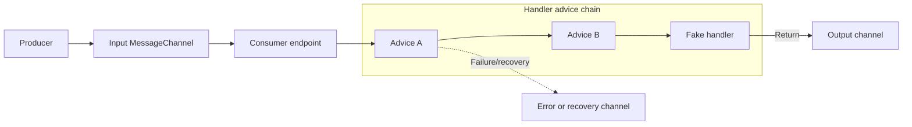

# Testing advice with a fake handler in Spring Integration

## 1. Goals and scope

In Spring Integration, an **advice chain** is a sequence of advice objects wrapping calls to a message handler. Advice can log, measure timing, retry, apply transactions, or route failures to recovery. Adding advice can change how many times the handler executes, the final exception, the reply, and the executing thread. Therefore, checking only the method's return value is not enough.

The lesson **"Testing advice with a fake handler"** belongs to the **Advice chain** chapter of the **SPRING_INTEGRATION_RUNTIME** module. Its scope connects directly to message flow operations: channels, endpoints, consumers, pollers, executors, transactions, retries, message stores, errors, and correlation. The goal is to design tests that deterministically reproduce failures and observe the exact runtime boundaries.

A **fake handler** is a Java class substituting for real business logic. We control it to succeed immediately, fail a set number of times before succeeding, or always fail; because the fake avoids external APIs or databases, tests stay fast and deterministic.

After this lesson, you will be able to:

1. Verify that `RequestHandlerRetryAdvice` is attached to the right endpoint and genuinely re-invokes the handler.
2. Assert attempt counts, retryable/non-retryable exceptions, replies, and recovery after exhausting retries.
3. Observe advice ordering and explain why advice inside vs. outside retry yields different results.
4. Distinguish tests on synchronous `DirectChannel` from `ExecutorChannel`, polling consumers, and message stores.
5. Design dedicated tests for transaction rollbacks, idempotency, and correlation.

> **Reference versions:** Spring Integration 6.5.x, Spring Retry 2.x, Spring Framework 6.x, JUnit Jupiter 5, and Java 17+. When upgrading versions, re-verify APIs and handler-advice mechanics.

## 2. Scoping what advice covers



In Java DSL, a configuration such as `.handle(fake, "handle", spec -> spec.advice(retryAdvice))` places the advice at **that handler's invocation**. It does not automatically retry the whole flow starting from the producer. Conversion errors before the handler is called can sit outside the advice scope; failures in another downstream endpoint are likewise not automatically covered.

Three complementary levels of testing:

| Level | What it proves | What it does not prove |
| --- | --- | --- |
| Unit test on `RetryTemplate`/policy | Attempt counts, exception matching, backoff, and pure callbacks. | That the advice is actually attached to the endpoint in the flow. |
| Integration test with a fake handler | Wiring: channel → endpoint → advice → handler → reply/error. | Real broker, database, or network ack/rollback behavior. |
| End-to-end with real adapters/transports | Real redelivery, transactions, timeouts, persistence, and recovery. | Too slow or coarse to replace focused tests. |

**Attempt convention:** `maxAttempts = 3` in Spring Retry includes **the initial call plus at most two retries**. A handler that fails twice and succeeds on the third try is invoked three times total.

## 3. Scenario matrix before writing tests

| Scenario | Fake handler | Required assertions |
| --- | --- | --- |
| Immediate success | Returns `ACCEPTED` on first try. | One call, one reply, no recovery. |
| Transient failure | First two calls throw a retryable error; third succeeds. | Three calls, one reply, no duplicate replies. |
| Retries exhausted | Always throws a retryable error, `maxAttempts=3`. | Three calls, no success reply, expected exception or recovery. |
| Business error | Always throws a non-retryable error. | One call, no pointless retry loop. |
| Multi-advice chain | Two probes record before/after. | Correct event order and call count per advice. |
| Recovery | Exhausts attempts and emits `ErrorMessage`. | One recovery event, no false success reply. |
| Async thread | Handler runs via executor or poller. | Observe errors on the worker rather than relying on synchronous `send()` throws. |
| Side effects | Fake "writes" data then throws timeout. | Idempotency guard works, no duplicate business outcome. |

Tests should check attempt counts on the fake **and** inspect reply/error channels: asserting only `calls == 3` can miss a handler emitting two replies or a recovery callback signaling false success.

## 4. Complete integration test example with a fake handler

This example defines the fake, flow, and assertions in a single test class. It uses `DirectChannel` so sender, advice, and handler execute synchronously, and `QueueChannel` to collect results. The test requires Spring Integration Core, Spring Retry, `spring-test`, and JUnit 5 dependencies.

```java
import java.util.concurrent.atomic.AtomicInteger;

import org.junit.jupiter.api.Test;
import org.springframework.beans.factory.annotation.Autowired;
import org.springframework.beans.factory.annotation.Qualifier;
import org.springframework.context.annotation.Bean;
import org.springframework.context.annotation.Configuration;
import org.springframework.integration.annotation.EnableIntegration;
import org.springframework.integration.channel.DirectChannel;
import org.springframework.integration.channel.QueueChannel;
import org.springframework.integration.dsl.IntegrationFlow;
import org.springframework.integration.handler.advice.RequestHandlerRetryAdvice;
import org.springframework.messaging.Message;
import org.springframework.messaging.MessageChannel;
import org.springframework.messaging.PollableChannel;
import org.springframework.messaging.handler.annotation.Payload;
import org.springframework.messaging.support.GenericMessage;
import org.springframework.retry.support.RetryTemplate;
import org.springframework.test.annotation.DirtiesContext;
import org.springframework.test.context.junit.jupiter.SpringJUnitConfig;

import static org.junit.jupiter.api.Assertions.*;

@SpringJUnitConfig(AdviceChainTest.Config.class)
@DirtiesContext(classMode = DirtiesContext.ClassMode.AFTER_EACH_TEST_METHOD)
class AdviceChainTest {

    @Autowired
    @Qualifier("testInput")
    MessageChannel input;

    @Autowired
    @Qualifier("testOutput")
    PollableChannel output;

    @Autowired
    FakeHandler fake;

    @Test
    void successDoesNotRetry() {
        fake.failFirst(0, false);

        assertTrue(input.send(new GenericMessage<>("order-A")));

        assertEquals(1, fake.calls());
        assertEquals("ACCEPTED:order-A", receivePayload());
        assertNull(output.receive(0));
    }

    @Test
    void twoFailuresThenSuccessProduceOneReply() {
        fake.failFirst(2, false);

        assertTrue(input.send(new GenericMessage<>("order-B")));

        assertEquals(3, fake.calls()); // 1 initial attempt + 2 retries
        assertEquals("ACCEPTED:order-B", receivePayload());
        assertNull(output.receive(0)); // No second reply
    }

    @Test
    void threeRetryableFailuresExhaustPolicy() {
        fake.failFirst(100, false);

        RuntimeException error = assertThrows(RuntimeException.class,
                () -> input.send(new GenericMessage<>("order-C")));

        assertTrue(hasCause(error, IllegalStateException.class));
        assertEquals(3, fake.calls());
        assertNull(output.receive(0));
    }

    @Test
    void validationErrorIsNotRetried() {
        fake.failFirst(100, true);

        RuntimeException error = assertThrows(RuntimeException.class,
                () -> input.send(new GenericMessage<>("order-D")));

        assertTrue(hasCause(error, IllegalArgumentException.class));
        assertEquals(1, fake.calls());
        assertNull(output.receive(0));
    }

    private Object receivePayload() {
        Message<?> reply = output.receive(0);
        assertNotNull(reply);
        return reply.getPayload();
    }

    private static boolean hasCause(Throwable exception, Class<?> type) {
        for (Throwable cause = exception;
             cause != null;
             cause = cause.getCause()) {
            if (type.isInstance(cause)) {
                return true;
            }
        }
        return false;
    }

    static class FakeHandler {
        private final AtomicInteger attempts = new AtomicInteger();
        private volatile int failuresBeforeSuccess;
        private volatile boolean validationFailure;

        void failFirst(int times, boolean invalidRequest) {
            attempts.set(0);
            failuresBeforeSuccess = times;
            validationFailure = invalidRequest;
        }

        int calls() {
            return attempts.get();
        }

        public String handle(@Payload String orderId) {
            int attempt = attempts.incrementAndGet();
            if (attempt <= failuresBeforeSuccess) {
                if (validationFailure) {
                    throw new IllegalArgumentException("Invalid order");
                }
                throw new IllegalStateException("Temporary downstream outage");
            }
            return "ACCEPTED:" + orderId;
        }
    }

    @Configuration
    @EnableIntegration
    static class Config {
        @Bean
        FakeHandler fakeHandler() {
            return new FakeHandler();
        }

        @Bean
        MessageChannel testInput() {
            return new DirectChannel();
        }

        @Bean
        PollableChannel testOutput() {
            return new QueueChannel();
        }

        @Bean
        RequestHandlerRetryAdvice testRetryAdvice() {
            RetryTemplate template = RetryTemplate.builder()
                    .maxAttempts(3)
                    .retryOn(IllegalStateException.class)
                    .traversingCauses()
                    .noBackoff() // Remove wait times from unit/logic tests
                    .build();

            RequestHandlerRetryAdvice advice = new RequestHandlerRetryAdvice();
            advice.setRetryTemplate(template);
            return advice;
        }

        @Bean
        IntegrationFlow testFlow(FakeHandler fakeHandler,
                                 RequestHandlerRetryAdvice testRetryAdvice) {
            return IntegrationFlow.from("testInput")
                    .handle(fakeHandler, "handle",
                            e -> e.advice(testRetryAdvice))
                    .channel("testOutput")
                    .get();
        }
    }
}
```

### Explaining test design choices

- `input.send(...)` flows through **the real channel and endpoint**, proving `RequestHandlerRetryAdvice` is genuinely attached. Calling `fake.handle(...)` directly only tests a Java method; calling `retryTemplate.execute(...)` directly only tests Spring Retry.
- `.maxAttempts(3)` includes the initial attempt; `.noBackoff()` keeps the test fast and independent of schedulers. Write a separate test if you need to verify timing.
- Spring Integration can wrap handler exceptions inside `MessagingException` or other wrappers. `.traversingCauses()` lets the policy classify the root error; `hasCause(...)` decouples assertions from wrapper classes.
- `@DirtiesContext` creates a fresh context after each test, preventing shared counters and queues. Large suites can reset the fake before each test instead, provided all state, channels, and in-flight tasks are thoroughly cleaned up.
- `receive(0)` works because `DirectChannel` in this example is synchronous. With another thread or a polling consumer, wait with a timeout.

## 5. Testing advice order in the chain

With two advice instances A and B, standard AOP wrapping order is:

```text
A.before
    B.before
        handler
    B.after
A.after
```

To verify a chain is invoked in the exact intended order, use a `MethodInterceptor` that records events:

```java
import java.util.List;
import org.aopalliance.intercept.MethodInterceptor;

static MethodInterceptor probe(String name, List<String> events) {
    return invocation -> {
        events.add(name + ".before");
        try {
            return invocation.proceed();
        }
        finally {
            events.add(name + ".after");
        }
    };
}
```

In a **separate flow test**, place `outerProbe` before retry and `innerProbe` after retry:

```java
// outerProbe and innerProbe are MethodInterceptor instances; events is a thread-safe list.
return IntegrationFlow.from("testInput")
        .handle(fakeHandler, "handle",
                e -> e.advice(outerProbe, testRetryAdvice, innerProbe))
        .channel("testOutput")
        .get();
```

When the fake fails the first two attempts and succeeds on the third, the expected event sequence under this nesting is:

```text
outer.before
inner.before
inner.after
inner.before
inner.after
inner.before
inner.after
outer.after
```

Explanation: `outerProbe` wraps **the entire retry invocation**, so it emits one before/after pair; `innerProbe` sits **inside retry**, so it emits three pairs. Swapping positions changes how many times logs or timings fire per advice. The test should assert the entire event sequence, `fake.calls() == 3`, `outer.before == 1`, and `inner.before == 3`; if actual output differs, inspect the final chain registered on the endpoint rather than just checking bean names.

**Transaction connection:** retry wrapping transaction advice can create a fresh transaction per attempt if propagation and proxies align; transaction advice wrapping retry can place all attempts inside one transaction marked `rollback-only` on the first failure. Fakes and event logs only prove call order—they do not prove commits/rollbacks are right.

## 6. Testing recovery when retries are exhausted

Not every error after the final retry is thrown back to the sender. When a `RecoveryCallback` is configured, the advice can route the error to a channel or return a fallback:

| Configuration | Ending behavior | Assertions to verify |
| --- | --- | --- |
| No recovery callback | Exception is typically rethrown if handler still fails. | `assertThrows(...)` on synchronous path, no success reply. |
| `ErrorMessageSendingRecoverer` | Sends `ErrorMessage` to the recovery channel. | One error event, no success reply, exception and failed message traceable. |
| Recovery returns valid fallback | Can complete the invocation with a replacement result. | Exact fallback value; never equate with real processing success. |
| Recovery itself throws | Passes error up to caller/endpoint layer for handling. | Final exception and error handling at the right layer. |

Example replacing the Section 4 advice with a recovery setup in **an isolated test context**. Add a channel to collect errors:

```java
import org.springframework.beans.factory.annotation.Qualifier;
import org.springframework.context.annotation.Bean;
import org.springframework.integration.channel.QueueChannel;
import org.springframework.integration.handler.advice.ErrorMessageSendingRecoverer;
import org.springframework.integration.handler.advice.RequestHandlerRetryAdvice;
import org.springframework.messaging.MessageChannel;
import org.springframework.messaging.PollableChannel;
import org.springframework.retry.support.RetryTemplate;

@Bean
PollableChannel recoveryEvents() {
    return new QueueChannel();
}

@Bean
RequestHandlerRetryAdvice adviceWithRecovery(
        @Qualifier("recoveryEvents") MessageChannel recoveryChannel) {

    RetryTemplate template = RetryTemplate.builder()
            .maxAttempts(3)
            .retryOn(IllegalStateException.class)
            .traversingCauses()
            .noBackoff()
            .build();

    RequestHandlerRetryAdvice advice = new RequestHandlerRetryAdvice();
    advice.setRetryTemplate(template);
    advice.setRecoveryCallback(
            new ErrorMessageSendingRecoverer(recoveryChannel));
    return advice;
}
```

In the recovery test flow, configure `endpoint.advice(adviceWithRecovery)` instead of `testRetryAdvice`, keeping fake, input, and output wired accordingly. Inject `PollableChannel recoveryEvents` into the test. Assertions look like:

```java
import org.springframework.messaging.Message;
import org.springframework.messaging.support.ErrorMessage;
import org.springframework.messaging.support.MessageBuilder;

fake.failFirst(100, false);
input.send(MessageBuilder.withPayload("order-42")
        .setHeader("correlationId", "payment-42")
        .build());

assertEquals(3, fake.calls());
assertNull(output.receive(0));               // No business reply

Message<?> failure = recoveryEvents.receive(0);
assertNotNull(failure);
assertTrue(failure instanceof ErrorMessage);
assertNotNull(((ErrorMessage) failure).getPayload());
assertNull(recoveryEvents.receive(0));        // Exactly one recovery event
```

When verifying `correlationId`, locate `failedMessage` inside the appropriate `MessagingException` within the error payload (you may need to unwrap layers), and compare its header against the original message. **Do not** assume every header of the original message appears directly on **ErrorMessage headers**. Distinguish three entities: original message, failed message held by the exception, and error message sent through the channel.

An easy-to-miss detail: once the callback sends the error event and returns `null`, `send()` in a synchronous flow can complete without throwing, even though the fake never succeeded. Tests must verify business status via outputs/recovery and side effects; `send() == true` alone only means dispatch succeeded.

If an inbound adapter defines its own `errorChannel`, that differs from the `recoveryEvents` channel directly targeted by the recoverer. The source transport may decide ack/rollback differently depending on whether the final exception escapes the handler; test against the real source when those semantics matter.

## 7. Testing failure causes: don't retry at the wrong layer

To verify the advice's exact scope, simulate failures at multiple points:

| Failure location | How many times is the fake called? | Meaning |
| --- | --- | --- |
| Converter or resolver fails **before** reaching handler | Can be 0. | Retry advice wrapping the handler cannot handle failures in an earlier layer. |
| Fake throws retryable exception | Up to `maxAttempts`. | Typical behavior of `RequestHandlerRetryAdvice`. |
| Fake throws non-retryable exception | Usually once, then stops/recovers. | Policy must inspect root cause accurately. |
| Handler succeeds, yet a downstream endpoint throws | Earlier fake may run only once. | Advice on an upstream handler does not automatically cover downstream endpoints. |
| Producer/adapter fails before sending message | Fake called 0 times. | Source errors have their own retry/redelivery mechanisms. |

Spring Integration can wrap handler exceptions in `MessageHandlingException`; when using `.retryOn(SomeException.class)`, verify the policy checks deeper causes. `.traversingCauses()` in Section 4 prevents false negatives caused by wrappers while still refusing to retry `IllegalArgumentException`.

A useful check is having the fake record every attempt in a list and verifying **there are never two replies**, even when the method executes three times. If a handler performs a side effect before throwing, three attempts can produce three side effects despite producing only one final reply. Hence you must also test idempotency.

## 8. Testing threads, executors, and pollers

In Section 4, `DirectChannel` runs synchronously, so `output.receive(0)` right after `input.send(...)` works. With `ExecutorChannel` or `QueueChannel` + polling consumer:

1. The producer can return from `send()` before the handler even runs.
2. Exceptions occur on worker/poller threads; you cannot always wrap `send()` with `assertThrows(...)`.
3. Retries with backoff hold the handler thread, growing queue depth and lowering throughput.
4. `receive(0)` can return `null` simply because the reply hasn't arrived yet, not because the advice failed.

In async tests, wait with a timeout:

```java
Message<?> reply = output.receive(2_000);
assertNotNull(reply, "No reply before test deadline");
```

Use `CountDownLatch` to control when the handler starts and finishes without relying on arbitrary sleeps:

```java
import java.util.concurrent.CountDownLatch;
import java.util.concurrent.TimeUnit;

CountDownLatch entered = new CountDownLatch(1);
CountDownLatch release = new CountDownLatch(1);

// Inside fake handler running on executor:
entered.countDown();
if (!release.await(2, TimeUnit.SECONDS)) {
    throw new IllegalStateException("Simulated timeout");
}
// In test: entered.await(timeout,...); assert state;
// then release.countDown() in finally.
```

When proving the handler ran on a different thread, the fake can record `Thread.currentThread().getName()` (or thread ID) into a thread-safe collector. Avoid asserting fixed thread-name prefixes if executors differ in CI; compare identity against the producer thread or assert the exact property needed.

**Backoff:** retry-logic tests should use `noBackoff()` to avoid waiting. Write separate tests for `FixedBackOffPolicy` or `ExponentialBackOffPolicy`: measure with `System.nanoTime()` and allow scheduler tolerance instead of asserting exact milliseconds. Overly tight timing assertions cause flaky CI failures even when the app is correct.

## 9. Transactions, side effects, correlation, and message stores

A fake holding an `AtomicInteger` and returning a String **does not simulate rollback**. When transactions are the target, write a test with a real transaction manager and transactional data source. One scenario to test:

```text
Attempt #1: insert record A into database -> simulate error
Attempt #2: insert record A -> succeed
Business expectation: only one record A is committed.
```

Test both transaction advice outside retry and retry outside transaction. Depending on propagation, each attempt may start a fresh transaction, or all attempts may share one transaction marked `rollback-only` after the first error. Measure this by inspecting commits/rollbacks and querying stored data—never infer it from `fake.calls()`.

**Idempotency:** even when a local transaction rolls back, an HTTP call that succeeded on a remote service can still return a timeout. Retries can resend and duplicate work. Tests should generate a stable business/idempotency key, have the fake track state by key, and simulate a failure *after* the side effect to prove only one business outcome occurs. `correlationId` aids tracing, but alone does not prevent duplicate execution.

**Message stores:** `QueueChannel` can use an in-memory or persistent store; retry state and message stores have separate lifecycles. Tests covering restarts or redelivery must use a real persistent store/broker and check how messages are acked, retried, dead-lettered, or replayed and how associated state is maintained.

**Correlation and errors:** attach a `correlationId` header to the original message; if recovery emits an `ErrorMessage`, verify the link via the failed message, not merely by channel name. With concurrent messages, verify per business key instead of assuming queue order always matches producer send order.

## 10. Designing a fake handler safe for repeated and parallel tests

The Section 4 fake works best for **sequential tests, each with its own context**. For concurrency tests, one shared `AtomicInteger` cannot track attempts **per message**. Key state by message:

```java
import java.util.concurrent.ConcurrentHashMap;
import java.util.concurrent.atomic.AtomicInteger;

class PerMessageAttempts {
    private final ConcurrentHashMap<String, AtomicInteger> calls =
            new ConcurrentHashMap<>();

    int next(String businessKey) {
        return calls.computeIfAbsent(businessKey, ignored -> new AtomicInteger())
                .incrementAndGet();
    }

    int count(String businessKey) {
        AtomicInteger counter = calls.get(businessKey);
        return counter == null ? 0 : counter.get();
    }
}
```

Inside the fake, decide failures using the message's `businessKey` and `next(key)`. When asserting results, query the same key so parallel flows never mix. Avoid storing "last message" in a shared mutable field; messages may execute concurrently. If using Mockito instead of a hand-written fake, ensure stubs are thread-safe and verify invocations with exact argument matchers.

When multiple tests share a Spring context, clean up queues, fake state, executor tasks, and external side effects. `@DirtiesContext` is straightforward for small test suites; larger suites can optimize once full state reset is proven.

## 11. Observing and diagnosing errors when testing advice

Signals worth collecting:

| Signal | Source | Meaning |
| --- | --- | --- |
| `attempts` count | Fake or retry listener | Policy genuinely caps execution count. |
| Before/after order | `MethodInterceptor` probe | Chain has the expected order and scope. |
| Root exception | Throwable chain | Distinguishes retried errors from those routed to recovery. |
| Reply/recovery counts | Output/recovery channels | No false success replies or duplicate events. |
| Thread name/id | Producer, handler, recoverer | Pinpoints channel/poller thread boundaries. |
| `correlationId` | Input, failed message | Links each failure back to its original message. |
| Duration/queue depth | Probes and endpoint metrics | Reveals backoff holding workers, backlogs, or timeouts. |

Common failures and fixes:

| Symptom | Common cause | Where to check |
| --- | --- | --- |
| Fake runs only once when three expected. | Advice not attached, exception non-retryable, wrapper not traversed. | `.advice(...)`, `retryOn(...)`, `traversingCauses()`, root cause. |
| Direct `RetryTemplate` test passes, yet flow doesn't retry. | Test bypassed the real endpoint. | Send messages through the flow's input channel. |
| Test takes seconds despite no network I/O. | Production backoff left enabled. | Use `noBackoff()` for logic tests. |
| `send()` doesn't throw when handler fails. | Recovery callback swallowed error or async consumer. | Recovery channel, error handling, execution thread. |
| Reply appears twice. | Two endpoints emit replies or repeated side effects. | Flow topology, reply routing, idempotency. |
| Async test is flaky. | `receive(0)` too early, arbitrary sleeps, shared state. | `receive(timeout)`, latches, isolated contexts. |
| Exception assertion is brittle. | Framework wraps errors across multiple layers. | Inspect cause chains and business outcomes. |
| Rollback test passes with an in-memory list. | List does not participate in transaction manager. | Test against a real transactional store. |

**IntegrationFlow lifecycle:** if a flow is registered dynamically with `IntegrationFlowContext`, test that it is started before receiving messages and stops receiving after stop/remove. One advice bean can serve multiple handlers; never store mutable test state inside a singleton advice shared across multiple flows without synchronization.

## 12. Hands-on exercises and self-check questions

**Exercise 1 — Attempt counts:** change `maxAttempts(3)` to 1 and 4 in the test. Have the fake fail twice then succeed. Predict call counts, outcomes, exceptions, or recovery for each setting.

**Exercise 2 — Error types:** add `PermanentBusinessException`. Write a policy that retries only `IllegalStateException`, then assert `PermanentBusinessException` stops after one attempt.

**Exercise 3 — Advice ordering:** attach `outerProbe` and `innerProbe` before/after retry. Assert the event sequence when the handler succeeds on the first try and when it fails twice. Swap order and explain the difference.

**Exercise 4 — Recovery:** build a separate test context using `adviceWithRecovery`, send input with `correlationId`; verify three attempts, one `ErrorMessage`, and no business reply. Analyze how a recovery callback affects how the source considers the message handled.

**Exercise 5 — Executor:** move the handler onto an executor thread, record thread names, and use latches. Explain why `assertThrows(...)` around `send()` is no longer enough to observe handler exceptions.

**Exercise 6 — Idempotency:** have the fake persist a record by business key and then throw a timeout after saving on the first attempt. Prove retries do not create duplicate records.

**Exercise 7 — Transport:** with a redelivery-capable source, verify total attempts across handler and broker, ack/rollback behavior, and the poison message's final destination after exhausting retries.

Self-check questions:

1. Why must tests send messages through a channel instead of calling the fake's method directly?
2. Why is `fake.calls() == 3` alone insufficient to prove correct handling?
3. How many total handler invocations does `maxAttempts = 3` allow?
4. When a recovery callback emits an `ErrorMessage`, why can `send()` complete normally?
5. What changes when retry advice sits outside vs. inside transaction advice?
6. Why doesn't a polling consumer's exception necessarily propagate back to the producer?
7. Can an in-memory fake verify a real transaction rollback?

## 13. References

- Spring Integration 6.5 — [Handler Advice: Provided Advice Classes](https://docs.spring.io/spring-integration/reference/6.5/handler-advice/classes.html).
- Spring Integration 6.5 — [`RequestHandlerRetryAdvice` API](https://docs.spring.io/spring-integration/docs/6.5.0/api/org/springframework/integration/handler/advice/RequestHandlerRetryAdvice.html).
- Spring Integration 6.5 — [`ErrorMessageSendingRecoverer` API](https://docs.spring.io/spring-integration/docs/6.5.0/api/org/springframework/integration/handler/advice/ErrorMessageSendingRecoverer.html).
- Spring Integration 6.5 — [Testing Support](https://docs.spring.io/spring-integration/reference/6.5/testing.html).
- Spring Integration 6.5 — [Java DSL](https://docs.spring.io/spring-integration/reference/6.5/dsl.html).
- Spring Retry 2.x — [`RetryTemplate` API](https://docs.spring.io/spring-retry/docs/2.0.x/apidocs/spring.retry/org/springframework/retry/support/RetryTemplate.html).
- Spring Framework — [`@DirtiesContext` API](https://docs.spring.io/spring-framework/docs/current/javadoc-api/org/springframework/test/annotation/DirtiesContext.html).
