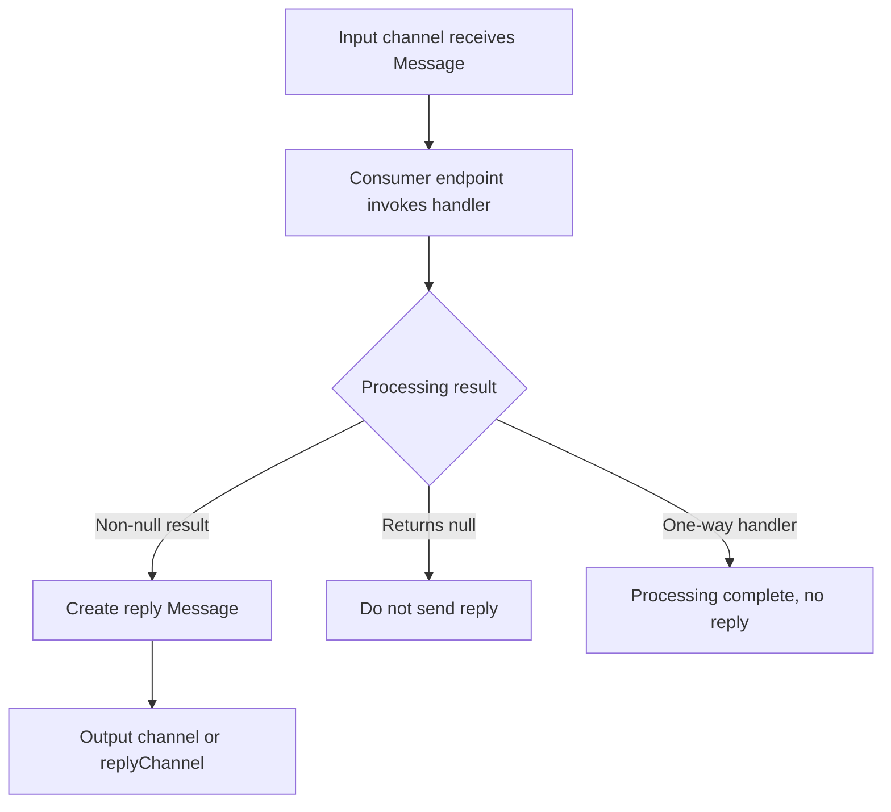

# Reply Messages, Null Replies, and One-Way Handlers

In the `SPRING_INTEGRATION_RUNTIME` module, the **Message runtime** section explains how Spring Integration orchestrates message flows across channels, endpoints, consumers, pollers, and executors. A key point to master when reading or designing flows is that after an endpoint processes a message, it can produce a reply, intentionally produce no reply, or simply perform a one-way operation. These three cases have different runtime behaviors and directly affect downstream steps.

## 1. Replies begin with the handler contract

Spring Integration passes data as `Message<?>`. A message has a payload and headers; headers carry metadata such as routing, correlation, timestamp, or processing information.

A consumer endpoint receives a message from an input channel and invokes a handler. The endpoint manages wiring the handler to the messaging infrastructure, while the handler executes business logic. Therefore, distinguish:

- **Reply message**: the handler produces a non-null result. Spring Integration wraps the result in an output message and sends it to the reply destination.
- **Null reply**: the handler is reply-capable, but this execution returns `null`. No output message is sent.
- **One-way handler**: the handler only receives and processes the message, with no contract to return a result. Typical examples are a `void`-returning method or an implementation of `MessageHandler`.

The Java contract of `MessageHandler` is `void handleMessage(Message<?> message)`. Handlers of this kind do not return a reply via a return value. Reply-producing handlers, such as service activators or transformers, are supported by Spring Integration via a dedicated reply-producing mechanism.



The important point is that **a Java method's return value does not automatically mean every handler emits a message**. The handler type and endpoint configuration determine whether the runtime creates and sends a reply.

## 2. How are reply messages created and routed?

For a reply-producing handler, the processing method can return a payload or a message. When returning a non-null payload, Spring Integration builds an output message to forward the result. Appropriate headers from the request can be retained to maintain processing context.

The reply destination is determined by endpoint and request configuration:

1. If the endpoint configures an `outputChannel`, that is the explicitly designated reply destination.
2. If there is no `outputChannel`, the runtime can use the request's `replyChannel` header.
3. The `replyChannel` header can contain a `MessageChannel` object or a channel name for the runtime to resolve.
4. If the handler produces a reply without a valid destination, the reply cannot be forwarded; check the output channel configuration and routing headers.

In Java DSL, the channel placed immediately after a reply-producing endpoint serves as that endpoint's output:

```java
@Bean
IntegrationFlow processOrders(OrderService service) {
    return IntegrationFlow.from("orders.in")
        .handle(Order.class,
            (order, headers) -> service.process(order),
            endpoint -> endpoint.requiresReply(true))
        .channel("orders.out")
        .get();
}
```

In this example, `service.process(order)` returns a result so the endpoint emits a reply to `orders.out`. Configuring `requiresReply(true)` expresses that every processing invocation must produce a reply. If the business logic might not find data or produce a result, design that case explicitly before enabling this setting.

A request can already carry a reply channel. For example, the sender constructs a request as follows:

```java
Message<String> request = MessageBuilder.withPayload("C-42")
    .setReplyChannel(replyChannel)
    .build();
```

When an endpoint processes a request without its own configured output channel, `replyChannel` provides the path to return the result to the sender. This pattern commonly appears in request-reply interactions, gateways, or when using a messaging template to send and wait for a response.

Distinguish the following three headers/concepts:

| Component | Role |
|---|---|
| `replyChannel` | Specifies where to send the reply for the request |
| `errorChannel` | Routes error information when an exception occurs according to the error handling mechanism |
| `correlationId` | Identifies messages belonging to the same group or business context; commonly useful for aggregators and resequencers |

`replyChannel` is routing information. `correlationId` is correlation metadata. Having a correlation ID does not mean the request has a reply destination, and having a reply channel does not automatically guarantee messages are grouped properly.

## 3. A null reply means no message is emitted

In Spring Integration, the payload of a `Message` cannot be `null`. Therefore, when a reply-producing handler returns `null`, the runtime interprets that invocation as producing no reply. It does not create a message with a null payload.

For example, a customer lookup service may return `null` when no record is found:

```java
@Bean
IntegrationFlow findCustomer(CustomerService service) {
    return IntegrationFlow.from("customer.lookup")
        .handle(String.class,
            (customerId, headers) -> service.find(customerId))
        .channel("customer.found")
        .get();
}
```

If `service.find(customerId)` returns a customer, the resulting message proceeds to `customer.found`. If the result is `null`, the endpoint sends no reply and downstream steps receive no message for that invocation.

### 3.1. Configuring requiresReply

For a reply-producing handler, `requiresReply` determines whether producing no reply is acceptable:

- By default, `requiresReply` is `false`: a null result is treated as no reply; the endpoint emits no output message.
- When `requiresReply(true)` is set: if the handler produces no reply, Spring Integration throws `ReplyRequiredException`.

Example:

```java
.handle(Order.class,
    (order, headers) -> orderService.process(order),
    endpoint -> endpoint.requiresReply(true))
```

This configuration fits when the business contract mandates a result—such as processing a validated command where every valid request must receive a processing status. It helps catch an unexpected code path returning null early.

Do not enable `requiresReply(true)` just to "make sure the flow keeps running". If the business logic allows having no result, this setting turns an expected case into an exception. Explicitly decide whether having no result is a valid state or a contract violation.

### 3.2. How null replies affect the caller

Subsequent behavior depends on how the caller interacts:

- With one-way sending, the sender simply sends the message; it does not wait for a reply.
- With synchronous request-reply, the caller waits on the reply channel. If the handler emits no reply, the caller may wait until `replyTimeout` expires, then receive a timeout or no reply depending on the API used.
- With asynchronous flows, the reply may arrive later on another channel. Timeout and correlation must match actual processing times.

Thus, a flow can complete business processing successfully while the caller still times out if the handler returns null when the caller is waiting for a reply. A null reply does not automatically mean business failure; it only indicates that no response message was emitted.

### 3.3. A null reply is not a substitute for a filter or business result

Using `return null` to represent every "no data" situation often makes flows hard to observe. Different situations get collapsed into the same symptom: downstream receives no message.

Choose the mechanism according to business intent:

- Use a **filter** when deciding whether a message should continue. You can configure a discard channel to handle rejected messages.
- Use a **router** when messages must go to "found", "not found", or "invalid" branches.
- Return an **explicit business result** when downstream needs to know the processing status, such as `FOUND`, `NOT_FOUND`, or `REJECTED`.
- Only use a null reply when emitting no message is intentional behavior and callers/downstream components are designed to accept it.

For example, instead of overloading `null` with multiple meanings, a service can return a result object containing both status and data. The flow can then route by status, log, or return a clear response to the caller.

## 4. One-way handlers: receiving messages without returning a reply

A one-way handler performs an action and ends message processing at that endpoint. Common examples include:

- Writing audit logs or saving history.
- Sending telemetry or metrics.
- Writing data to a target system.
- Calling an external service in fire-and-forget style.
- Performing a side effect without needing to return data to a next step.

A service activator can use a `void`-returning method:

```java
@ServiceActivator(inputChannel = "audit.events")
public void record(AuditEvent event) {
    auditService.store(event);
}
```

Or use the `MessageHandler` contract directly in Java DSL:

```java
@Bean
IntegrationFlow auditFlow(AuditService auditService) {
    return IntegrationFlow.from("audit.events")
        .handle((MessageHandler) message ->
            auditService.store((AuditEvent) message.getPayload()))
        .get();
}
```

In both examples, the endpoint consumes the message and performs a side effect. No reply message is created from a return value.

**One-way does not mean ignoring errors.** If `auditService.store(...)` throws an exception, the error still travels through the endpoint's, channel's, poller's, or flow's error handling mechanism. The difference is that the handler returns no reply on success.

### 4.1. Does a one-way handler stop the downstream flow?

Yes, if a downstream step is waiting for a reply from that handler. A one-way endpoint emits no output message to pass to the next step. Similarly, a reply-producing handler returning null produces no message for the next step.

If you want both to perform a side effect and continue processing the same message, choose one of the following approaches:

- Use a handler that returns the payload or message to forward after completing the side effect.
- Use a `wireTap` to dispatch a side branch for audit/logging while the main flow continues.
- Use publish-subscribe when multiple subscribers need to receive the same message.

For example, a handler that both records an audit log and returns the order:

```java
.handle(Order.class, (order, headers) -> {
    auditService.store(order);
    return order;
})
.channel("orders.next")
```

Here the handler is no longer one-way under the reply contract: it produces a reply containing the order so the main flow continues. If you only want auditing on a side branch, `wireTap` usually expresses intent more clearly and avoids forcing audit logic to determine the main flow's output message.

### 4.2. Adapters and gateways also reflect this distinction

In external system integration, choose the right endpoint type:

- An **inbound adapter** receives data from an external system and creates a Spring message to enter the flow.
- An **outbound adapter** receives a Spring message and sends data to an external system; typically produces no business reply.
- An **inbound gateway** receives a request from an external system and can return a response to that system.
- An **outbound gateway** sends a request to an external system and receives a reply.

If the caller expects a response, use a gateway or design a corresponding reply channel. Using a one-way adapter and waiting for a response creates mismatched expectations about the message contract.

## 5. Channels, pollers, and executors affect when replies arrive

Reply/null/one-way describes the handler's outcome. Channels and dispatch mechanisms determine where, when, and on which thread the message is delivered to the handler.

| Mechanism | Execution behavior | Consequence when there is no reply |
|---|---|---|
| `DirectChannel` | Subscriber typically runs synchronously on the sending thread | The next step in the reply path is not invoked if the handler produces no output |
| `ExecutorChannel` | Dispatches via executor; processing may run on another thread | The request-reply side still expects a reply via a channel and may time out if none arrives |
| `QueueChannel` + poller | Messages are held in a queue and fetched by consumers via a poller | Sending to the queue does not mean business processing is complete or a reply exists |

With `DirectChannel`, processing time is normally included within the message send call. With `ExecutorChannel` or `QueueChannel`, sending and processing can be decoupled. Therefore, when diagnosing timeouts, examine queue wait time, poller schedules, executor saturation, and handler execution time.

Do not assume that using an executor causes the runtime to create asynchronous replies automatically. A reply must still be produced by the handler and sent to a valid destination. If the handler returns null or is one-way, changing the channel will not make a reply appear.

## 6. Distinguishing no reply from error handling

The three situations below have different meanings:

| Situation | Runtime outcome | How to handle |
|---|---|---|
| Handler returns null, `requiresReply=false` | No reply; no exception raised solely because of null | Verify whether this is a valid business branch |
| Handler returns null, `requiresReply=true` | Throws `ReplyRequiredException` | Check the reply contract and the code path returning null |
| Handler throws an exception | Error handled via error channel, error handler, advice, or endpoint mechanism | Inspect root cause exception and retry/transaction policy |

`errorChannel` is not a destination for "empty replies". A null reply does not automatically create an `ErrorMessage`. If you need to represent business failure, return a structured error result or intentionally throw an exception per the flow's contract.

If an endpoint has transaction advice, an exception like `ReplyRequiredException` can participate in rollback rules for the transaction wrapping the handler call. However, side effects already performed on systems outside the transaction are not automatically undone. Define transaction boundaries and operation idempotency before relying on retries.

## 7. How to diagnose when the caller receives no reply

When a gateway or request-reply component receives no result, check in the following order:

1. **Check handler type and return value.** Does the method return null on any branch? Is it `void` or a one-way `MessageHandler`?
2. **Check `requiresReply`.** If enabled, do all successful paths actually produce a non-null reply?
3. **Check the reply destination.** Does the endpoint have an `outputChannel`? If not, does the request carry a valid `replyChannel` header? Can the channel name be resolved and does it have an appropriate subscriber?
4. **Check downstream flow.** Is a preceding step a one-way handler or null reply preventing a message from being emitted?
5. **Check timeouts and dispatch mechanisms.** For gateways, check `replyTimeout`; for queues, check poller delay; for executors, check task queues and thread pool state.
6. **Classify errors.** Look for `ReplyRequiredException`, channel resolution errors, message send errors, or timeouts. Each points to a different class of root cause.

In integration tests, verify both sides: a message appears on the output channel when the handler returns a result, and does not appear when the handler returns null/is one-way. If `requiresReply(true)` is enabled, write a test confirming the null-returning branch throws `ReplyRequiredException`. Testing caller behavior on reply timeout is also important if the flow is invoked in request-reply mode.

## 8. Rules for choosing the right contract

| Business need | Suitable design |
|---|---|
| Always must return a result to the caller | Reply-producing handler and `requiresReply(true)` |
| May have no result and caller accepts receiving no reply | Reply-producing handler with intentional null reply, `requiresReply(false)` |
| Must clearly report "not found" or "rejected" | Return a status-bearing DTO/result or route to a corresponding branch |
| Only record or perform a side effect | One-way handler, `void` method, or `MessageHandler` |
| Perform a side effect and continue the main flow | Handler returns the message/payload, or use `wireTap` for a side branch |
| Send a request to an external system and require a response | Gateway with appropriate request-reply configuration |

When designing a message flow, determine upfront whether an endpoint's job is to **consume**, **transform and reply**, or **route** messages. Then choose the corresponding handler type, output channel, reply channel, and timeout. An explicit contract prevents callers from waiting indefinitely, downstream components from silently receiving nothing, or valid business branches from turning into exceptions.
