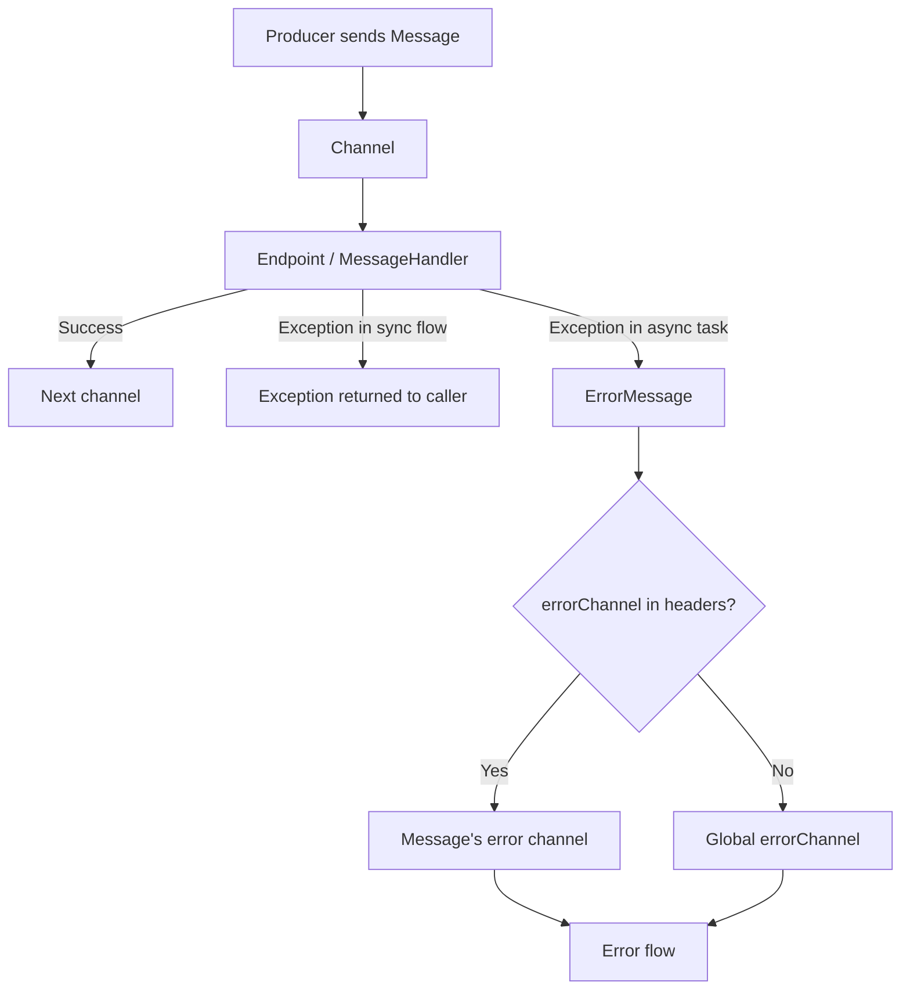

# ErrorMessage and Exceptions in a Flow

In Spring Integration, a message passes through multiple runtime components: channels receive and transfer the message, endpoints invoke handlers, consumers execute the work, and pollers or executors determine the timing and thread of execution. Therefore, when a step raises an error, the first thing to determine is **where the error occurred and whether it is running in a synchronous or asynchronous context**. These two factors determine whether the exception is thrown back to the sender or converted into an `ErrorMessage` on an error channel.

`ErrorMessage` is the mechanism for representing an error as a message so another flow can receive and process it. It does not replace all Java or Spring Messaging exception mechanisms. Along some paths, exceptions are still thrown back to the caller; along other paths, the runtime publishes an `ErrorMessage` for decoupled handling. Understanding this boundary helps design retries, transactions, failed-message persistence, and redrive without accidentally losing errors or processing a message multiple times.

## 1. Where do exceptions arise in a message flow?

A typical flow can be visualized as follows:

```text
Producer -> Channel -> Endpoint -> MessageHandler -> Next channel
```

Exceptions can appear in multiple places:

- **Producer or message-sending step:** invalid input data, error creating the message, or the channel rejecting the message.
- **Channel:** unable to transfer the message, timeout when sending to a bounded channel, or executor rejecting the task.
- **Endpoint or handler:** payload conversion error, service invocation error, database access error, or unhandled business error.
- **Poller and consumer:** error when polling messages from a source, when processing messages pulled from a `QueueChannel`, or when running a scheduled task.
- **Runtime infrastructure:** error during endpoint initialization, background task execution, or calling a supporting component.

Spring Messaging provides `MessagingException` as the base exception class for many message-related errors. Some common specialized exceptions include:

| Exception | Typical meaning |
|---|---|
| `MessagingException` | General error while processing or sending a message. |
| `MessageHandlingException` | A message handler failed to process a message. This exception typically holds a reference to the failing message. |
| `MessageDeliveryException` | Unable to deliver or dispatch the message to its destination. |
| `MessageTimeoutException` | A message send or receive operation exceeded the allowed wait time. |
| `MessageConversionException` | Unable to convert a message or payload as required. |

Exceptions can be nested. For example, a data access error can become the cause of a `MessageHandlingException`, which is then placed into an `ErrorMessage`. When investigating, look for the root cause rather than reading only the outermost exception class name. With `MessagingException`, you can check `getFailedMessage()` to find the message that the processing component considers failed.

## 2. Structure and meaning of ErrorMessage

`ErrorMessage` belongs to Spring Messaging (`org.springframework.messaging.support.ErrorMessage`) and is a special kind of `Message`. Its payload is a `Throwable` object—the exception or error that occurred. Beyond the payload, it can hold the original message associated with the error via `getOriginalMessage()`.

```text
ErrorMessage
├── payload          -> Throwable (the exception causing the error)
├── headers          -> MessageHeaders
└── originalMessage  -> original Message<?>, if available to the runtime
```

Two message references must be distinguished:

- `ErrorMessage.getOriginalMessage()` is the original message attached when the `ErrorMessage` was created. It may be absent if the error occurred before the runtime had an input message, such as certain polling or infrastructure errors.
- `MessagingException.getFailedMessage()` is the message recorded as failed by a `MessagingException`. This information resides inside the exception payload, so check the exception type before accessing it.

For example, an `ErrorMessage` may wrap a `MessageHandlingException`; in that case, you can check both `error.getOriginalMessage()` and `((MessagingException) error.getPayload()).getFailedMessage()`. These two references serve different purposes and should not be assumed to always be identical.

Do not confuse `ErrorMessage` with a business message whose payload is an `Error`, `Failure`, or error description string. `ErrorMessage` is a runtime structure carrying an actual exception, enabling error-handling flows to classify by exception type, read causes, and retrieve related messages.

## 3. Synchronous vs. asynchronous execution determines where exceptions are handled

This is the most important point when reading runtime behavior. The same handler throwing the same exception can yield different observable outcomes depending on the channel and execution thread.

| Component or execution mode | Where the handler runs | Typical error behavior |
|---|---|---|
| `DirectChannel` | Synchronously on the thread calling `send()` | Exceptions from the subscriber propagate back to the caller. The caller may receive the exception directly or wrapped. |
| `PublishSubscribeChannel` without executor | Synchronously on the sending thread | Errors from subscribers occur during the send call and can propagate back to the caller. |
| `ExecutorChannel` | A thread managed by an executor | The caller typically only knows the send was accepted. Errors when the handler runs are handled by the async task's error handler and error channel mechanism. |
| `QueueChannel` | The thread of the consumer/poller pulling messages from the queue | Producer and consumer are decoupled. Processing errors occur on the consumer side and cannot by default be returned to the original `send()` call. |
| `PublishSubscribeChannel` with executor | Subscribers can run on the executor | Errors arising in an asynchronous branch must be handled in that branch's execution context. |

In a synchronous flow, an exception is part of the invocation outcome. For example, if a service sends a message to a `DirectChannel` and the handler throws an exception, the send call can fail immediately at the caller. In this situation, do not assume Spring Integration automatically turns every exception into an `ErrorMessage` on the global `errorChannel`.

In an asynchronous flow, the sending thread no longer executes the handler directly. When the handler fails, the runtime needs another place to publish the error. Spring Integration's error-handling mechanism typically creates an `ErrorMessage` and sends it to the appropriate error channel. Therefore, checking the actual channel and executor configuration is the first step when an error does not show up at the `send()` call site.



The diagram shows the typical path of an error from an asynchronous handler. Errors occurring before a message exists, errors from the error handler itself, or errors from executor task rejection may follow different paths. Therefore, when diagnosing, identify the exact origin of the exception instead of inferring solely from the first channel type.

### Global errorChannel and per-message error channels

Spring Integration provides a global channel named `errorChannel` as the default destination for many `ErrorMessage`s published by the error-handling mechanism. In the default configuration, this channel has a subscriber that logs errors. An application can add to or replace this configuration to route errors into business flows, persistence, alerting, or exception-type routing.

A message can also specify its own error-handling destination via the `errorChannel` header (constant `MessageHeaders.ERROR_CHANNEL`). The header value can be a `MessageChannel` or a channel name resolved in the context. When the error-publishing mechanism uses this header, errors go to the message's dedicated channel; if no dedicated destination is present, the global `errorChannel` is used as a fallback.

Example of setting a dedicated error channel when building a message:

```java
Message<Order> request = MessageBuilder.withPayload(order)
    .setHeader(MessageHeaders.ERROR_CHANNEL, "orderErrorChannel")
    .build();
```

This header is useful when groups of messages require different error-handling policies. For instance, order errors might go to a flow that persists failed orders, while data sync errors go to a sync-task error flow. Ensure the channel is declared and has an appropriate consumer; simply setting the header name does not create the channel or handler automatically.

## 4. Building an error flow

An error flow should receive `ErrorMessage`, inspect the exception and related message, classify the error, and take appropriate action. You can use a service activator that receives `ErrorMessage` directly to retain both payload and `originalMessage`:

```java
@Component
public class IntegrationErrorHandler {

    @ServiceActivator(inputChannel = "errorChannel")
    public void handle(ErrorMessage error) {
        Throwable failure = error.getPayload();
        Message<?> original = error.getOriginalMessage();

        // Classify failure, write logs with sensitive data redacted,
        // or persist original and error info to a store for later handling.
    }
}
```

In this example:

1. `inputChannel = "errorChannel"` subscribes the handler to the global error channel.
2. `error.getPayload()` returns a `Throwable`; you can traverse `getCause()` to find the root error.
3. `error.getOriginalMessage()` provides the input message if it was attached to the `ErrorMessage`.
4. The handler can record correlation IDs, exception type, error timestamp, and processing status for traceability.

To use a dedicated channel, declare a `MessageChannel` bean named `orderErrorChannel` and register a handler with `@ServiceActivator(inputChannel = "orderErrorChannel")`. Then set the `MessageHeaders.ERROR_CHANNEL` header on the message as in the previous example. For a more complex flow, use Java DSL to route, transform, or branch the error message before invoking a handling service.

Do not treat an error flow as a place that merely logs and ignores every error. Depending on the business domain, it may need to persist failed messages durably, mark processing status, emit alerts, forward to a dead-letter channel, or support a controlled redrive process. If the error flow's handler throws another exception, error handling itself fails; have logging, monitoring, and fallback plans for this case.

## 5. Errors in pollers and consumers

With `QueueChannel`, a send operation typically only places the message into the queue. A polling consumer retrieves the message and passes it to the endpoint for processing. Thus, exceptions from the handler occur on the poller thread, after the producer sent the message. The producer cannot receive that exception as a direct result of its earlier `send()` call.

A poller can also encounter errors when querying a data source for messages, before an input message is even created successfully. In that case, `ErrorMessage` may lack `originalMessage`. Configure error handling on the right polling endpoint/poller, especially if the application has multiple pollers with different error policies. Spring Integration Java DSL supports declaring an error channel in poller configuration; a typical configuration pattern is:

```java
Pollers.fixedDelay(1_000)
    .errorChannel("pollerErrors");
```

The snippet above illustrates the poller configuration part; it must be attached to the corresponding source polling endpoint. Exact API names and configuration placement may vary depending on how endpoints are declared and the Spring Integration version used by the application.

For inbound adapters or message-driven consumers, check the error channel and error handler configuration of the adapter/container. Errors occurring while receiving data from an external system can differ from errors occurring after a message has entered the flow. Do not assume every adapter error carries the original business message.

## 6. Distinguishing error handling, retries, and dead-letter

These three mechanisms address three different needs:

| Mechanism | Purpose | When appropriate |
|---|---|---|
| Endpoint error handling | Convert an error into a result or recovery action at the step where it occurred | When the endpoint knows clearly how to recover from or translate that error. |
| Retry | Re-attempt an operation likely to succeed on a subsequent try | When the error is transient, such as a timeout or a briefly unavailable dependency. |
| Dead-letter / failed-message storage | Retain unprocessable messages for investigation or later redrive | When retries are exhausted, the error is non-recoverable, or manual intervention is needed. |

### Endpoint-level retry

Spring Integration supports attaching advice to endpoints. `RequestHandlerRetryAdvice` combined with `RetryTemplate` lets you define attempt counts, retryable exception types, and backoff between attempts. The following example illustrates a policy of up to three attempts for transient data access errors:

```java
@Bean
RequestHandlerRetryAdvice transientRetryAdvice() {
    RetryTemplate template = new RetryTemplate();
    template.setRetryPolicy(new SimpleRetryPolicy(
        3,
        Map.of(TransientDataAccessException.class, true),
        true
    ));

    ExponentialBackOffPolicy backOff = new ExponentialBackOffPolicy();
    backOff.setInitialInterval(250L);
    backOff.setMultiplier(2.0);
    backOff.setMaxInterval(5_000L);
    template.setBackOffPolicy(backOff);

    RequestHandlerRetryAdvice advice = new RequestHandlerRetryAdvice();
    advice.setRetryTemplate(template);
    return advice;
}
```

Attach the advice to the processing endpoint:

```java
@Bean
IntegrationFlow orderFlow(
        OrderService orderService,
        RequestHandlerRetryAdvice transientRetryAdvice) {

    return IntegrationFlow.from("orders")
        .handle(orderService, "publish",
            endpoint -> endpoint.advice(transientRetryAdvice))
        .get();
}
```

The example uses Spring Retry and Spring Integration APIs; the corresponding dependencies and imports for `RetryTemplate`, `SimpleRetryPolicy`, `ExponentialBackOffPolicy`, `RequestHandlerRetryAdvice`, `TransientDataAccessException`, and `Map` are required. `traverseCauses = true` enables the retry policy to inspect nested causes inside wrapper exceptions. In production systems, the retryable exception list must be chosen carefully; invalid data errors, constraint violations, or permanent business errors should generally not be retried.

Retries must have limits and backoff to avoid adding load when a dependency is overloaded. The handler must also be idempotent or have duplicate-handling protection, because one attempt may have already produced side effects in an external system before a timeout made the caller think the operation failed.

### Dead-letter and redrive

When retries are exhausted or an unrecoverable error occurs, the application can store the message along with exception details in a durable store or send it to a dead-letter channel. An error record should contain at minimum:

- The message or sufficient data to reconstruct the operation, protected according to the application's data policy.
- The original exception, cause chain, and related endpoint/channel names if identifiable.
- Message ID, correlation ID, error timestamp, and attempt count.
- Error handling status, redrive timestamp, and redrive outcome if executed.

Redrive is the act of re-introducing a stored message into a flow entry point after the root cause has been resolved. This is a controlled operational action: you must specify the entry point, check idempotency, limit redrive counts, and avoid feeding a failed message back into the error flow in an infinite loop.

Sending an `ErrorMessage` to an error channel does not automatically mean the original message will be retried. An error flow is usually a decoupled branch; if you want to replay a message, the application must intentionally store and resend the appropriate message.

## 7. Relationship between exceptions, transactions, and message acknowledgment

Exceptions can determine whether a transaction rolls back or commits. In a synchronous flow, if a handler throws an exception out of the transaction scope, the transaction interceptor can mark the transaction for rollback according to configured rollback rules. If the exception is caught and handled as success, the transaction may commit even though the original business operation failed.

When an error is forwarded to an error channel and the error handler consumes the error message without rethrowing, the caller or the transaction wrapping the send step may no longer observe that failure. Therefore, **a successfully sent `ErrorMessage` does not automatically mean the transaction processing the original message rolled back**. Explicitly design where transactions open, where exceptions are caught, and rollback policies.

Asynchronous boundaries require extra attention. Thread-bound transactions normally do not propagate across an `ExecutorChannel` to executor threads. If downstream work needs a transaction, configure transactions at the downstream endpoint or consumer. For pollers, transactions are typically configured around the poll/process cycle according to the data source's needs. Also examine when a message is acknowledged or deleted from the source: if acknowledged before durable error persistence, a failure in the error flow can forfeit redrive capability.

A reliable design typically defines three points clearly: when the message is considered received, when business side effects commit, and when a failed message is durably stored. These three points must align with the message source's acknowledgment, transaction, and retry mechanisms.

## 8. Diagnosing errors at runtime

When a message does not reach the expected endpoint or an exception does not appear where anticipated, check in the following order:

1. **Identify the endpoint raising the error.** Read the stack trace, handler name, and deepest cause. Distinguish errors while sending a message, errors inside the handler, poller errors, and executor errors.
2. **Identify channel type and thread.** `DirectChannel` normally runs synchronously; `ExecutorChannel` or pollers change the thread and timing of execution. Check whether the executor is rejecting tasks or overloaded.
3. **Check whether the exception carries an associated message.** For `ErrorMessage`, inspect the payload and `originalMessage`; for `MessagingException`, inspect `failedMessage` if present. Do not assume every error has an original message.
4. **Check the error channel destination.** Check whether the message has an `errorChannel` header, whether that channel name is declared, whether the channel has a subscriber, and whether the handler is active.
5. **Check poller/adapter configuration.** Verify error channel, error handler, transaction advice, receive timeout, and how the consumer acknowledges messages.
6. **Check retries and side effects.** Verify which exceptions are retried, attempt counts, backoff, recovery callbacks, and duplicate handling.
7. **Trace with correlation.** Use message ID, correlation ID, endpoint, timestamp, and attempt count to correlate logs across threads and flow branches.

When logging, record exception type, cause, message ID, correlation ID, and relevant endpoint/channel names. Avoid logging entire payloads or headers containing tokens, personal data, or secrets. For large payloads, log identifiers or sanitized summaries instead of copying the entire message into logs.

## 9. Common design mistakes

- **Assuming every exception automatically goes to the global `errorChannel`.** Errors in synchronous flows typically propagate to the caller; evaluate the channel and execution context.
- **Configuring an error flow without checking subscribers.** Error messages may land on a channel with no consumer, or the error flow's consumer itself may fail.
- **Retrying every exception.** This prolongs processing, increases load, and repeats unrecoverable errors.
- **Using an error flow as a default retry mechanism.** An error flow does not automatically restore endpoint state or transactions that have already ended.
- **Swallowing exceptions and reporting success.** The system may commit transactions or acknowledge messages even though business side effects did not complete.
- **Ignoring idempotency.** Retries or redrives can create duplicate orders, payments, or records if handlers lack duplicate protection.
- **Failing to store failed messages durably.** If you only log and the process stops, data needed for investigation or replay may be lost.
- **Letting the error handler throw errors back into the same error-handling path.** Bound loops and maintain an independent fallback for error-flow failures.

## 10. Design reminders

When designing a flow with error handling, be able to answer the following questions:

- Does the handler run synchronously, on an executor, or inside a poller?
- Will exceptions propagate to the caller or be published as `ErrorMessage`?
- Is a per-message error channel needed, and who consumes that channel?
- Which errors are retried, up to how many times, and with what backoff?
- After retries are exhausted, where is the message stored and who is authorized to redrive it?
- At which boundary do transactions roll back; when is the message acknowledged or removed from the source?
- How do you trace a message across multiple channels/threads without exposing sensitive data?

When these questions are answered clearly, `ErrorMessage` becomes an intentional part of the message flow architecture: exceptions are preserved alongside necessary context, error flows can classify and store failures, and retries, transactions, and redrives have clear operational boundaries.
