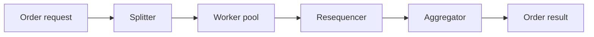
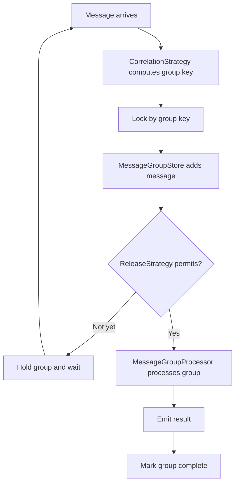

# Sequence, Correlation, and Group State

In Spring Integration, a message flow can split one message into multiple child messages, process them on different branches or threads, and wait for results to return. At that point, the runtime must answer three questions: which messages belong to the same processing run, where each message sits in the sequence, and where arrived messages are stored while waiting for the rest.

The three corresponding concepts are **sequence metadata**, **correlation**, and **message group state**. They form the foundation for `Splitter`, `Aggregator`, `Resequencer`, and scatter-gather flows. Understanding them properly prevents aggregators from waiting forever, mixing results from two requests, emitting incomplete results, or holding messages in memory indefinitely.

## 1. The runtime problem: multiple messages for one piece of work

Suppose an order has three order lines. The flow splits the order into three messages, sends each order line through a worker pool for pricing and inventory checks, and then combines the three results into a single `OrderResult`.



Workers have varying processing times. The third message may reach the aggregator before the first message. Looking solely at the payload, the aggregator does not know whether three messages share the same origin or belong to three different orders. Relying solely on arrival order can scramble the output.

Spring Integration solves this with metadata on messages and state stored per group:

- `correlationId` identifies messages belonging to the same processing group.
- `sequenceNumber` indicates the message's position in the sequence.
- `sequenceSize` indicates the expected number of messages in the sequence, if known in advance.
- `MessageGroupStore` holds arrived messages and group metadata until the group is released or expires.

Sequence headers only describe relationships and positions. They do not automatically force channels or executors to process messages in order. When ordering must be restored after parallel processing, the flow must use a `Resequencer` or sort explicitly in the appropriate processing step.

## 2. Sequence metadata in message headers

Spring Integration declares standard headers in `IntegrationMessageHeaderAccessor`.

| Header | Data type | Runtime meaning |
| --- | --- | --- |
| `CORRELATION_ID` | `Object` | Key linking messages belonging to the same group. |
| `SEQUENCE_NUMBER` | `Integer` | Position of the message in the sequence; usually paired with `SEQUENCE_SIZE`, though it can also be used for unbounded sequences in a resequencer. |
| `SEQUENCE_SIZE` | `Integer` | Total expected number of messages in the group. |
| `SEQUENCE_DETAILS` | Nested list | Stack of correlation information for nested splitters. Primarily internal framework metadata. |

For example, a splitter breaking an order into three parts might produce messages as follows:

| Payload | `correlationId` | `sequenceNumber` | `sequenceSize` |
| --- | --- | ---: | ---: |
| Order line A | `order-run-81` | 1 | 3 |
| Order line B | `order-run-81` | 2 | 3 |
| Order line C | `order-run-81` | 3 | 3 |

`MessageHeaders.ID` cannot replace `CORRELATION_ID`. ID identifies a specific message instance and typically changes when the framework creates a new message after a transformation step. Correlation ID identifies a business group comprising multiple messages.

### How does a splitter create sequences?

`AbstractMessageSplitter` adds `CORRELATION_ID`, `SEQUENCE_NUMBER`, and `SEQUENCE_SIZE` to produced messages. This is the default splitter behavior. Therefore, common `split → process each part → aggregate` flows usually do not need to assign these three headers manually.

Other endpoints can emit multiple copies of a message without attaching sequence metadata by default. For example, `PublishSubscribeChannel` and `RecipientListRouter` do not enable `apply-sequence` by default. When using them as scatter-gather branches and wanting an aggregator to recognize the branch count, enable `apply-sequence` or design appropriate correlation/release metadata yourself.

If building messages manually for an aggregator or resequencer, you can set headers explicitly:

```java
Message<OrderLine> part = MessageBuilder.withPayload(line)
    .setHeader(IntegrationMessageHeaderAccessor.CORRELATION_ID, batchId)
    .setHeader(IntegrationMessageHeaderAccessor.SEQUENCE_NUMBER, index + 1)
    .setHeader(IntegrationMessageHeaderAccessor.SEQUENCE_SIZE, totalParts)
    .build();
```

In this example, `index` starts at `0`, while sequence numbers are assigned starting from `1`. For messages created by a standard splitter, writing this manual header assignment is unnecessary.

### Sequences across endpoints

Endpoints that produce output messages usually forward input headers when they simply return a new payload. If a transformer or service method returns a complete `Message` itself, that code is responsible for providing the necessary headers on the new message. A custom message builder can accidentally drop `correlationId` or sequence metadata; the aggregator will then treat the message as a separate group or fail to determine when the group is complete.

Inspect headers at critical flow boundaries, especially after custom transformers, gateways, adapters, and application-constructed message conversions.

### Nested splitters and `SEQUENCE_DETAILS`

A flow may split an order into shipments, then further split each shipment into order lines. Multiple sequence levels exist at that point. Keeping only one set of `correlationId`/`sequenceNumber`/`sequenceSize` would let the inner level overwrite the outer level's info.

`SEQUENCE_DETAILS` stores a stack of correlation data so the framework restores the previous level's context once the current-level group is aggregated. In standard nested splitter-aggregator flows, Spring Integration since version 5.3 performs `popSequenceDetails()` when processing group results to restore the outer sequence. This is an internal header; do not manually mutate this nested list structure in business code.

## 3. Correlation: determining which group a message belongs to

Correlation computes the group key. When an aggregator or resequencer receives a message, the endpoint runs a `CorrelationStrategy` to obtain a key. Messages with the same key are stored in the same `MessageGroup`.

By default, the correlation strategy reads the `IntegrationMessageHeaderAccessor.CORRELATION_ID` header via `HeaderAttributeCorrelationStrategy`. You can replace it with a custom `CorrelationStrategy` or an expression based on headers/payload.

A good correlation key should:

1. Never return `null`.
2. Have stable `equals()` and `hashCode()`, since the key is used in the store's map structure.
3. Represent the exact single execution whose results need combining.
4. Not collide across flows or correlation endpoints sharing the same storage area.

For example, `customerId` is rarely sufficient as a correlation key: the same customer might submit two orders concurrently. `orderId` may work if each order has only one processing group; if an order is re-run or split into multiple independent batches, include `requestId`, `batchId`, or a unique execution ID.

The correlation key is also a state isolation boundary. If two aggregators share a store and happen to produce the same key for two different jobs, messages can get mixed or one endpoint's group can be processed by the other upon expiry. Design namespaced keys or provide a separate store per endpoint.

## 4. Message groups and state lifecycle

A `MessageGroup` is the collection of messages currently being gathered under a correlation key, along with metadata such as creation/update timestamps and completion status. `MessageGroupStore` is responsible for storing and retrieving those groups. Consequently, correlation/release handler logic does not have to hold all state manually in fields of a message-processing object.



Basic lifecycle:

1. **Receive message:** the correlation strategy computes the group key.
2. **Synchronize updates:** the handler acquires a lock for the key so multiple threads do not update the same group concurrently.
3. **Store message:** the store adds the message to the `MessageGroup`.
4. **Evaluate condition:** the release strategy decides whether the group is ready to be processed.
5. **Release:** the message group processor builds the result; the handler sends the result to the output channel and updates group state.
6. **Complete or expire:** the group is retained briefly to recognize late-arriving messages, or cleaned up per expiry policy.

Groups can linger for a long time if messages are missing or the release strategy never returns `true`. This is why an aggregator is a stateful endpoint that requires explicit timeout, persistence, and cleanup policies.

## 5. Aggregator: when to group and emit results

An aggregator combines two independent decisions:

- **Correlation strategy:** which messages belong to the same group?
- **Release strategy:** when is the group ready to be processed?

After release, `MessageGroupProcessor` decides how the result is produced. The default processor, `DefaultAggregatingMessageGroupProcessor`, creates a message whose payload is a `List` of payloads in the group. An application can replace it with a POJO or custom processor to build business DTOs, compute totals, verify completeness, or emit multiple messages.

Do not assume the collection inside the group always preserves sequence order. `SimpleMessageGroup` may use a collection that does not guarantee iteration order. If the output payload must follow the original order, sort by `SEQUENCE_NUMBER` inside the output processor or place a resequencer where ordered emission is required.

The default release strategy relies on `SEQUENCE_SIZE` and sequence metadata. Since Spring Integration 5.0, `SimpleSequenceSizeReleaseStrategy` is the default implementation when partial group release is not required; it is designed to be more efficient for large groups. For applications needing different rules, a custom `ReleaseStrategy` can be used.

### Java DSL example: parallel processing then gathering results

```java
@Bean
IntegrationFlow splitAndGatherFlow(TaskExecutor workers, LineProcessor lineProcessor) {
    return IntegrationFlows.from("orders.input")
        .split()
        .channel(MessageChannels.executor(workers))
        .handle(lineProcessor, "process")
        .aggregate(spec -> spec.outputProcessor(group -> group.getMessages().stream()
            .sorted(Comparator.comparingInt(message ->
                new IntegrationMessageHeaderAccessor(message).getSequenceNumber()))
            .map(message -> message.getPayload())
            .toList()))
        .get();
}
```

The input payload must be a collection/array or a type the splitter can iterate over. The splitter creates child messages and sequence metadata. `ExecutorChannel` allows messages to be processed on worker threads, so completion times can differ from original order. The output processor sorts messages in the group by `SEQUENCE_NUMBER`, then builds the payload list in original order. The example assumes messages retain their sequence headers after `LineProcessor.process()`.

The example above uses the default correlation and release supplied by the splitter. When receiving messages from multiple sources or needing to group by a different business key, configure the correlation strategy and release strategy explicitly:

```java
.aggregate(spec -> spec
    .correlationStrategy(message ->
        message.getHeaders().get("batchId"))
    .releaseStrategy(group -> group.size() == 10)
    .outputProcessor(group -> group.getMessages().stream()
        .map(message -> message.getPayload())
        .toList()))
```

This second configuration groups messages by the `batchId` header, releases the group once 10 messages arrive, and returns a list of payloads. This is an example for a fixed-size batch; if message counts vary per request, carry the expected total in metadata and write a matching release strategy. Do not use `size() == 10` for flows that may send fewer or more than 10 messages.

### Filters and missing sequences

Suppose a splitter produces three messages with `sequenceSize = 3`, but a filter drops message number 2. The aggregator still waits for three elements per the sequence metadata, while only two messages can ever arrive. The group will not automatically complete merely because all remaining messages were processed.

There are three ways to handle this depending on business requirements:

- Use a release strategy based on actual post-filter conditions.
- Replace dropped messages with a compensation message so the aggregator still recognizes that slot was processed.
- Use timeouts and a partial result/discard policy if waiting for all messages is time-bounded.

Do not mechanically change the release strategy to `group.size() >= sequenceSize`: if a filter drops messages, that condition is still never reached; if duplicate messages arrive multiple times, counting size alone can yield wrong results.

### Iterators or streams of unknown size

For an `Iterator`/`Iterable` whose element count the framework cannot determine, the splitter may set `SEQUENCE_SIZE` to `0`. A release strategy based on sequence size will not know when the group is complete. Since version 5.0, the splitter has enhanced ability to determine size when the data type supports it, yet not every stream/iterator can be counted upfront without consuming data.

For sources with unknown message counts, choose a different completion rule: a custom release strategy based on an end-of-sequence marker, a protocol-provided count, a time window, or an explicit completion event. Timeout should only serve as a fallback mechanism when the business domain accepts incomplete results.

## 6. Resequencer: restoring order without merging payloads

A resequencer uses correlation to hold messages belonging to the same group, then releases them in `SEQUENCE_NUMBER` order. It does not combine multiple payloads into one aggregated payload. This is the main difference from an aggregator:

| Endpoint | Behavior | Output |
| --- | --- | --- |
| `Resequencer` | Orders messages by sequence number. | Multiple individual messages, emitted in order. |
| `Aggregator` | Waits until group meets conditions, then processes the whole group. | Usually a single aggregated message. |

A resequencer is useful when a sequence traverses executors, queues, or branches with uneven completion times. By default, a resequencer waits for the entire sequence before releasing; it can be configured to release valid partial sequences earlier via `release-partial-sequences` when business rules allow. It works well for relatively short sequences and small sequence gaps; many disjoint sequences with large gaps can incur significant storage and processing overhead.

In Java DSL, you can place `.resequence()` after a parallel-processing endpoint to emit each message in sequence order before connecting to downstream steps:

```java
.channel(MessageChannels.executor(workers))
.handle(lineProcessor, "process")
.resequence()
.channel("orderedLines")
```

A resequencer cannot guess missing messages. If a sequence has numbers 1, 2, and 4 with `sequenceSize = 4`, it cannot emit the entire sequence as if number 3 existed. Clearly decide whether to wait, time out to release the remainder, or send incomplete groups to a discard/error flow.

## 7. Timeouts, expiry, and late-arriving messages

Two mechanisms are commonly used to handle stalled groups:

| Mechanism | Scope | Purpose |
| --- | --- | --- |
| `group-timeout` / `group-timeout-expression` | Per group; timeout resets when a new message arrives. | Forces completion or expiry of a group when no new message arrives within the configured duration. |
| `MessageGroupStoreReaper` | Groups in the store; runs periodically. | Finds aged groups and invokes expiry callbacks to handle/clean up state. |

When a group expires, `send-partial-result-on-expiry = true` allows sending the remaining messages as a partial result. If disabled, the group is discarded per configuration. Define the output channel, discard channel, and how expiration causes are recorded so downstream components do not mistake an incomplete result for a complete one.

### Why do released groups remain in the store?

After a group completes, Spring Integration normally keeps empty group metadata if `expire-groups-upon-completion = false` (default). This metadata helps detect and discard late-arriving messages with the same correlation ID. If the entire group were deleted immediately, a late message could start a brand-new group and wait forever since the sequence was already released.

Changing `expire-groups-upon-completion` to `true` deletes the group completely on completion. A late message with the same correlation ID can then start a new group. Only enable this option if the application has another mechanism to handle duplicate/late messages and accepts those semantics.

Empty group metadata also needs cleanup after a period of time. `MessageGroupStoreReaper` can do this; the scheduler's interval affects actual expiry timing. If the reaper runs every 10 minutes, a group reaching expiry age right after a run may wait nearly 10 more minutes before being processed.

## 8. Persistence, concurrency, and performance

The default `MessageGroupStore` is usually the in-memory `SimpleMessageStore`. This is a simple choice for development or flows that can tolerate losing state when the process stops. For production flows requiring group recovery across restarts or shared processing across multiple instances, consider persistent stores such as JDBC, Redis, MongoDB, or an infrastructure-appropriate implementation.

Persistence does not automatically guarantee every payload/header can be stored. Some implementations serialize messages; payload and header types incompatible with the serializer may fail or be stripped from persisted data. Check serialization policies and headers holding special objects, especially channel references or non-serializable objects.

### Synchronization by group key

Spring Integration uses a `LockRegistry` to synchronize updates for the same correlation key. For a single group, concurrently arriving messages are processed sequentially at the group update region, while different groups can still progress independently. The default lock registry is in-memory. When multiple application instances write to a shared persistent store, use an appropriate shared lock registry to prevent two nodes from updating the same group without cross-process synchronization.

Each correlation endpoint should have its own lock registry; sharing across multiple aggregators can cause deadlocks in certain nested flows. When sharing a store across multiple endpoints, besides namespacing keys clearly, pay attention to expiry callbacks: do not share the same `MessageGroupStore` instance across multiple aggregators/resequencers when endpoints rely on `expireMessageGroups`, as one endpoint's callback could inadvertently act on another endpoint's groups.

### Bounding group size

The larger a group, the more messages and metadata must be stored, iterated, and serialized. For large groups:

- Choose a release strategy suited to size and partial-release requirements. `SimpleSequenceSizeReleaseStrategy` is more efficient for large groups when partial emission is not needed and old-style duplicate sequence detection/rejection is unnecessary.
- Avoid creating too many groups with unique correlation keys that never complete.
- Limit payloads/headers retained in groups; carry only necessary data across branches.
- Set timeouts/reapers according to reasonable arrival delays, then monitor group counts and stored message counts.
- Do not retain references to a group's message collection after the processor finishes if the store may clear the collection on release. If you need to keep results, create a new collection and copy the needed elements.

## 9. Common troubleshooting scenarios

| Symptom | Causes to check | How to handle |
| --- | --- | --- |
| Aggregator emits no result | Missing messages; `SEQUENCE_SIZE` equals 0; filter dropped part of the sequence; header dropped; correlation key altered. | Log `correlationId`, `sequenceNumber`, `sequenceSize` at aggregator input; inspect each branch and release strategy. |
| Results from two requests mixed | Correlation key not unique per execution. | Use request/execution ID or composite key; check which endpoints share a store. |
| Results emitted out of order | Sequence headers present but flow processes in parallel; aggregator does not guarantee output payload order. | Place a resequencer before steps needing order, or sort explicitly in the output processor by sequence number. |
| Groups grow indefinitely over time | Missing messages, wrong release strategy, timeout/reaper unconfigured, or scheduler not running. | Monitor group count, group age, timeouts, and expiry callbacks; add discard/error path for incomplete groups. |
| Late messages create a new group | Old group was completely removed upon completion or metadata was cleaned by reaper. | Adjust metadata retention window; handle duplicate/late messages with idempotency or a separate store. |
| Groups only fail in multi-instance deployments | Shared persistent store with a single-JVM lock registry. | Configure a shared `LockRegistry` compatible with the deployment environment. |

When investigating a specific group, collect at minimum: endpoint name, correlation key, received sequence numbers, sequence size, number of messages in the group, first/last message arrival times, release decision, and expiry status. This data is usually sufficient to distinguish metadata bugs, missing messages, release policy issues, and cleanup behavior.

## 10. Design checklist for correlated flows

Before introducing an aggregator/resequencer into a flow, answer in order:

1. **Who creates the sequence?** A splitter, a router with `apply-sequence`, or application code constructing messages manually?
2. **Which key identifies a single execution?** Is the key unique when the same customer/order runs concurrently?
3. **Is the total message count known?** If not, which end marker or release strategy determines when a group is complete?
4. **Do any endpoints drop or duplicate messages?** How do filters, retries, and fan-out affect the release condition?
5. **Must order be preserved?** If so, where in the flow does the resequencer sit?
6. **How long does a group live?** How are timeouts, partial results, discards, and late-message windows defined?
7. **Are restarts or multi-node execution supported?** Choose a matching persistent store and lock registry.
8. **Is state observable?** Track group count, message count, group age, expired group count, and discarded message count.

## 11. Key takeaways

- `CORRELATION_ID` answers "which group"; `SEQUENCE_NUMBER` answers "which position"; `SEQUENCE_SIZE` answers "how many parts expected".
- Standard splitters create sequence metadata automatically; routers and publish-subscribe channels need `apply-sequence` if you want the framework to attach metadata for branches.
- Correlation and release are two separate decisions. A group can be correlated accurately yet never released if the release strategy condition cannot be satisfied.
- Aggregators combine messages; resequencers merely re-emit messages in order. Sequence headers by themselves do not guarantee execution order.
- Message groups are runtime state. Store, timeout, expiry, locking, and late-message policies are core parts of flow design, not minor details.

## References

- [Spring Integration Reference — Splitter](https://docs.spring.io/spring-integration/reference/splitter.html)
- [Spring Integration Reference — Aggregator and MessageGroupStore](https://docs.spring.io/spring-integration/reference/aggregator.html)
- [Spring Integration Reference — Resequencer](https://docs.spring.io/spring-integration/reference/resequencer.html)
- [Spring Integration Reference — Message Store](https://docs.spring.io/spring-integration/reference/message-store.html)
