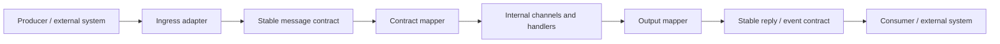

# Designing Stable Message Contracts When Flows Change

In Spring Integration, a flow can be refactored many times: switching channels, adding transformers, splitting handlers, moving from synchronous processing to polling or executors, or replacing adapters connecting external systems. If components depend directly on each other's internal structures, every flow change can force producers and consumers to change simultaneously.

A message contract is the agreement between the message producer and the message consumer. A good contract clearly describes data, semantics, metadata, versioning, and how both sides observe processing outcomes. When contracts stay stable at integration boundaries, downstream endpoints and channels can change with minimal impact on other components.

Within the scope of Spring Integration Runtime, a contract must be viewed more broadly than a Java class. A contract also includes message semantics, headers, correlation, replies, errors, retry capability, ordering, and the point at which the producer considers work handed off. Switching from `DirectChannel` to `QueueChannel` may keep the payload intact while changing the behavior observed by the producer; that too is a change that must be evaluated at the contract level.

## 1. What does a message contract contain?

A message contract should define at least six groups of information:

| Group | Questions to answer | Examples |
|---|---|---|
| Payload schema | What is the data structure, which fields are required, and what are the types and units? | `orderId`, `occurredAt`, `total`, `currency` |
| Semantics | Which intent or event does the message express? | `SubmitOrder` is a command; `OrderSubmitted` is an event |
| Headers | Which metadata serves routing, tracing, correlation, or sequencing? | correlation ID, tenant ID, content type |
| Versioning | How do producers and consumers recognize the version? | `schemaVersion: 1` |
| Processing behavior | Is the message sent synchronously, queued, or processed asynchronously? Can it be delivered redundantly or out of order? | Broker may redeliver depending on configuration |
| Reply and failure | What result does the producer receive, and how are errors represented and routed? | reply event, timeout, error code, retryable |

A contract must describe both what is guaranteed and what is not guaranteed. For instance, a channel may guarantee synchronous dispatch to a subscriber without guaranteeing data persistence across restarts. An executor may accept a task before the handler finishes. Consumers must know whether the producer is acknowledging receipt or confirming business success.

### Distinguishing contract from implementation

`Message<?>` is the envelope Spring Messaging uses to transport payload and headers. `MessageChannel` is the message-passing abstraction. `IntegrationFlow` wires endpoints and channels into a runtime topology.

Those components are execution mechanics. The contract is the meaning agreed upon by both sides. For example, a producer emitting an `order.submitted` event should not have to know whether the flow currently has three transformers, one router, and two service activators. If the topology changes while the event retains the same meaning and compatible structure, the producer needs no changes.

However, channels and endpoints can alter observable semantics. Therefore, the contract must specify both payload and delivery behavior at the boundary.

## 2. Keeping contract boundaries stable when refactoring flows

An easy-to-evolve organization divides a flow into three zones:

1. **Ingress boundary** accepts the message format from a producer or external system.
2. **Internal processing** converts data into internal commands/models and executes business logic.
3. **Egress boundary** converts internal results into a published reply or event contract.

Overview diagram:



The ingress adapter is responsible for validating messages, checking versions, converting data, and routing malformed-data errors to the proper error path. Internal processing can use domain objects, application commands, or internal data types. The egress boundary translates internal results into the consumer-facing contract.

When a flow changes, typically only mappers or internal wiring need updating. For example:

- Splitting a large handler into multiple smaller handlers.
- Adding an address-normalization step before persisting an order.
- Moving a branch from DirectChannel to ExecutorChannel.
- Moving a slow operation to QueueChannel and PollingConsumer.
- Replacing a database-access implementation with another service.

Such changes do not necessarily alter the payload contract. However, if completion acknowledgment, processing order, retry behavior, or response latency changes, re-evaluate the behavior contract and notify producers.

Do not treat internal channel names as a default public contract. If a channel receives direct sends from multiple modules or external systems, its channel name, payload type, and semantics have become an actual dependency boundary; manage it as a contract accordingly.

## 3. Designing payloads: semantic stability before type stability

The payload contains the business data a consumer needs to understand the message. Payload design should start with the question: what fact or intent does the consumer need to know to perform its work?

### Commands and events have different meanings

- **Command** expresses a request to perform an action, such as `SubmitOrder` or `CancelOrder`. A command typically targets a single component responsible for handling it.
- **Event** expresses a fact that has already happened, such as `OrderSubmitted` or `PaymentCaptured`. An event may be of interest to multiple independent consumers.

Do not name an event like a request that has not happened yet. `OrderSubmitted` means the order has been submitted/recorded according to the emitting system's business definition. If it is only a request for processing, it is a command or request.

Channel implementation does not itself determine whether a message is a command or an event. For instance, using `PublishSubscribeChannel` does not automatically make a payload an event; semantics must be defined by the contract.

### Use integration DTOs instead of exposing domain models

Do not send JPA entities or internal domain objects directly across integration boundaries. Those objects evolve with persistence and domain organization. They may contain lazy proxies, bidirectional relationships, sensitive data, or methods that make no sense when serialized.

Create DTOs dedicated to the contract:

```java
public record OrderSubmittedV1(
        int schemaVersion,
        String eventId,
        Instant occurredAt,
        String orderId,
        String customerId,
        List<OrderLine> lines,
        BigDecimal total,
        String currency
) {
}

public record OrderLine(
        String productId,
        int quantity,
        BigDecimal unitPrice
) {
}
```

The fields above have clear meanings:

- `schemaVersion` identifies the payload structure.
- `eventId` is the stable business identifier of the event.
- `occurredAt` is when the event occurred, with an explicit timezone or offset.
- `orderId` and `customerId` are identifiers, not internal object graphs.
- `total` must travel with `currency` to avoid misinterpreting monetary units.
- `lines` describes the line-item data the consumer actually needs.

When writing a JSON schema, clearly define required fields, nullability, defaults, date-time formats, numeric precision, and units of measurement. Do not rely on Java class names or field ordering in an object to convey meaning.

### Do not put all data into the payload

Include only the data the consumer needs to perform its task. If the consumer needs state as of when the event occurred, the event should carry the minimal required snapshot. Do not force consumers to call back to the producer to stitch together basic fields the contract could already provide.

Conversely, avoid sending entire object graphs or unnecessarily large data copies. Overly broad payloads increase coupling, serialization cost, and data exposure risk. Distinguish essential business data from transport-only metadata.

## 4. Designing headers: transport and orchestration metadata

Spring Integration places payload and headers inside `Message<?>`. Headers fit information that aids transport, routing, and coordinating processing. Data determining business meaning still belongs in the payload.

Some common metadata types:

| Metadata | Purpose | Notes |
|---|---|---|
| Message ID | Identifies a message envelope in Spring Messaging | Generated by framework; do not use in place of business event ID |
| Correlation ID | Links multiple messages belonging to a request or workflow | Must be preserved across steps requiring correlation |
| Sequence number / size | Tracks position and count of messages in a group | Useful with splitter/aggregator |
| Trace ID | Connects logs and traces across services | Typically originates from observability tooling |
| Tenant ID | Identifies the message's tenant | Must be authenticated; do not blindly trust producer-supplied values |
| Content type | Indicates how to interpret the payload | Must be compatible with serializers and adapters |
| Reply/error channel | Coordinates replies or errors at runtime | May hold internal object references; not serializable by default |

Spring Integration provides standard headers such as correlation ID and sequence metadata via `IntegrationMessageHeaderAccessor`. When using custom headers, namespace header names under your application prefix to prevent collisions:

```java
public final class OrderHeaders {

    public static final String EVENT_TYPE = "app.eventType";
    public static final String TENANT_ID = "app.tenantId";
    public static final String TRACE_ID = "app.traceId";

    private OrderHeaders() {
    }
}
```

Creating a message:

```java
Message<OrderSubmittedV1> message =
        MessageBuilder.withPayload(event)
                .setHeader(OrderHeaders.EVENT_TYPE, "order.submitted")
                .setHeader(OrderHeaders.TENANT_ID, tenantId)
                .setHeader(
                        IntegrationMessageHeaderAccessor.CORRELATION_ID,
                        correlationId
                )
                .setHeader(OrderHeaders.TRACE_ID, traceId)
                .build();
```

`MessageHeaders` is immutable once the message is created, but that does not make the payload object or objects stored inside custom headers immutable. Avoid placing mutable or implementation-dependent objects into headers shared across multiple threads.

### Do not turn internal headers into public contracts

Headers such as `replyChannel` and `errorChannel` may contain references to channel objects in the application context. They are useful for internal orchestration, not as a stable cross-process exchange format.

When sending messages over a broker or adapter, only a specific set of headers is mapped and transmitted. Header mappers can filter, rename, or convert header types. Do not assume every custom header in `Message<?>` automatically reaches external consumers.

Define an allowlist of headers that truly need to cross the boundary. Important details a consumer needs to understand business logic or deduplicate should live in the payload contract, or in explicitly specified and tested transport metadata.

## 5. Distinguishing message ID, event ID, and correlation ID

These three identifiers solve three different problems. Mixing them up makes retries, tracing, and deduplication hard to implement accurately.

| Identifier | Represents | Changes when creating a new message? |
|---|---|---|
| Message ID (`MessageHeaders.ID`) | A message envelope in Spring Messaging | Usually gets a new ID when a new envelope is created |
| Event ID | A business event that occurred | Remains unchanged when the event is retried, replayed, or re-wrapped |
| Correlation ID | A request or workflow spanning multiple messages | Preserved within the defined workflow scope |

For example, an `OrderSubmitted` event has event ID `evt-123`. When a broker redelivers that event or an adapter builds a new `Message<?>`, the Message ID may differ while the event ID remains `evt-123`. Consumers use event ID or an idempotency key to detect duplicate processing.

Correlation ID might be `checkout-456`, linking messages across a checkout flow. It is not necessarily unique per event and does not replace event ID.

To trace causal relationships, you can add `causationId` to indicate which event or command produced the current message. To enforce ordering within an aggregate, add `aggregateVersion` or a sequence number with clear semantics. Do not use timestamps for absolute ordering when multiple producers or nodes can emit messages concurrently.

## 6. Versioning and schema evolution

A stable contract does not mean the schema never changes. It means changes are managed so existing consumers still understand messages within the committed compatibility window.

### Usually compatible changes

The following changes are usually backward-compatible when producers and consumers follow schema discipline:

- Adding a new optional field.
- Adding a field with a clear default that older consumers can ignore.
- Adding metadata that does not alter the meaning of existing fields.
- Expanding descriptions or examples without changing semantics.

For example, adding `salesChannel` as an optional field to an order event. Older consumers ignore that field; newer consumers can use it when present.

### Changes that risk breaking the contract

| Change | Risk |
|---|---|
| Renaming or deleting a field | Older consumers cannot find the data |
| Changing type from `String` to number or vice versa | Deserialization or validation fails |
| Changing units of currency, weight, or time | Payload parses successfully yet is semantically wrong |
| Changing the meaning of an existing field | Consumers keep running while misinterpreting data |
| Adding an enum value unhandled by consumers | Consumers may fail during deserialization or switch statements |
| Turning an optional field into required | Older messages become invalid |
| Changing synchronous/asynchronous semantics | Producers misunderstand completion timing and error delivery |

A schema can be syntactically compatible yet semantically incompatible. For example, `total` stays a decimal but switches from pre-tax total to post-tax total. That is a semantic breaking change even though JSON still parses.

### Marking versions explicitly

You can use a `schemaVersion` field or a versioned event type such as `order.submitted.v1`. Pick a consistent convention, document it, and validate it right at ingress.

JSON example of the contract:

```json
{
  "eventType": "order.submitted",
  "schemaVersion": 1,
  "eventId": "evt-123",
  "occurredAt": "2026-11-21T10:15:30Z",
  "data": {
    "orderId": "ord-456",
    "customerId": "cus-789",
    "total": 125000.00,
    "currency": "VND"
  }
}
```

Do not infer version from serialized Java class names. Class names are implementation details; moving a package or refactoring a class should not accidentally alter a public schema. If using both event type and schema version, specify their relationship to avoid conflicting version combinations.

### The expand–migrate–contract process

When a breaking change is needed, roll it out in stages:

1. **Expand consumer:** update consumers to understand the new schema while still reading the old schema.
2. **Deploy producer:** start emitting the new schema once required consumers are ready. During transition, emit both forms in parallel if contract and infrastructure permit.
3. **Observe and drain:** monitor old/new message ratios, drain backlogs, retry queues, and data persisted under the old schema.
4. **Contract:** drop support for the old schema only after agreed compatibility windows, retention, and replay windows have elapsed.

Do not delete an old field the moment producers stop writing it. Old messages may still reside in queues, message stores, dead-letter queues, backups, or replay datasets.

### Upcasters and anti-corruption mappers

When supporting multiple schemas, ingress can translate each version into a stable internal model:

```java
@Component
class OrderContractMapper {

    SubmitOrder toCommand(OrderSubmittedV1 event) {
        return new SubmitOrder(
                event.orderId(),
                event.customerId(),
                event.total(),
                event.currency()
        );
    }

    SubmitOrder toCommand(OrderSubmittedV2 event) {
        return new SubmitOrder(
                event.orderId(),
                event.customer().id(),
                event.amount().value(),
                event.amount().currency()
        );
    }
}
```

`SubmitOrder` is the internal model used by the application service. The mapper keeps business logic from checking versions in every handler. It is also the right place to validate, normalize units, apply defaults, and reject invalid data.

For many versions or long-lived stored data, upcasters can upgrade older schemas into newer representations before processing. Translations must specify which fields can be inferred, which cannot be recovered, and which cases must route the message to an error flow.

## 7. Refactoring flows without leaking internal models

Example of a flow receiving `OrderSubmittedV1` per contract, then converting to an internal command before calling an application service:

```java
@Configuration
@EnableIntegration
class OrderIngressConfiguration {

    @Bean
    IntegrationFlow orderIngress(
            OrderContractMapper mapper,
            OrderApplicationService service
    ) {
        return IntegrationFlow.from("orders.v1.input")
                .transform(OrderSubmittedV1.class, mapper::toCommand)
                .handle(service, "submit")
                .get();
    }
}
```

Later, internal processing can be changed:

```java
@Bean
IntegrationFlow orderIngress(
        OrderContractMapper mapper,
        OrderApplicationService service,
        OrderRiskService riskService
) {
    return IntegrationFlow.from("orders.v1.input")
            .transform(OrderSubmittedV1.class, mapper::toCommand)
            .handle(riskService, "check")
            .handle(service, "submit")
            .get();
}
```

Assuming `OrderRiskService.check()` accepts and returns `SubmitOrder`, the input contract remains `OrderSubmittedV1`. Producers do not need to know a risk check was added. If the outcome or acknowledgment timing seen by the producer changes, the reply/acknowledgment contract must be evaluated separately.

A useful rule is never to let internal handlers accept multiple public schemas directly. Centralize version handling in the ingress adapter. Likewise, when emitting external events, an output mapper converts domain events into integration DTOs before sending.

### Do not let mappers hide data errors

Mappers should translate only well-understood differences. Do not silently replace missing values with `0`, empty strings, or the current timestamp if those values alter business meaning.

For instance, a missing `currency` cannot automatically be assumed to be VND unless the contract explicitly specifies that default. Without a valid default, the mapper must reject the message and supply a diagnosable error.

## 8. Preserving metadata across transformers and endpoints

In a flow, a transformer may replace the payload while still needing to retain metadata such as correlation ID or trace ID. When creating new messages in code, explicitly decide which headers are forwarded.

Example creating a new message with only the necessary metadata:

```java
Message<OrderCommand> commandMessage =
        MessageBuilder.withPayload(mapper.toCommand(input.getPayload()))
                .setHeader(
                        IntegrationMessageHeaderAccessor.CORRELATION_ID,
                        input.getHeaders().get(
                                IntegrationMessageHeaderAccessor.CORRELATION_ID
                        )
                )
                .setHeader(
                        OrderHeaders.TRACE_ID,
                        input.getHeaders().get(OrderHeaders.TRACE_ID)
                )
                .build();
```

This example expresses clear intent to preserve correlation and trace metadata. In real flows, standard transformer endpoints have header-forwarding mechanisms; when using custom transformers, message builders, or custom adapters, verify exactly which headers are retained, filtered, or type-converted.

Do not copy all headers unconditionally across external boundaries. An internal header may contain a channel reference, security object, temporary data, or metadata meaningful only inside one application context. When sending through a broker, use an appropriate header mapper and allowlist.

## 9. Serialization is part of the contract

When a message crosses a process boundary, the payload and selected headers must serialize into a format consumers can understand. At that point, the contract no longer relies on in-memory Java types.

Some guidelines:

- Choose a format with clear schema or rules such as JSON, Avro, or Protobuf based on system needs.
- Define how timestamps, timezones, decimals, enums, nulls, and binary data are represented.
- Do not rely on Java native serialization or class names as public schema identifiers if long-term compatibility is required.
- Specify content type and type mapping at adapters.
- Only transmit primitive headers or headers with explicit serializers.
- Validate payloads before admitting them into business flows.

Spring Integration provides adapters and message converters to connect systems; the framework does not define a universal schema registry or versioning policy for all applications. Those conventions must be established at the system or integration-platform level.

For inbound adapters, check header mapping to know which custom headers are converted into `MessageHeaders`. For outbound adapters, check which headers are exported to the transport. Do not treat a header's presence in an internal message as proof that the broker or target system will receive it.

## 10. Delivery semantics, retries, and idempotency also belong to the contract

Payloads may stay identical while delivery behavior changes when channels or endpoints change.

| Runtime boundary | Behavior to document |
|---|---|
| DirectChannel | Direct dispatch; handler typically runs on the sending thread and synchronous errors can propagate back to caller |
| QueueChannel | Message is stored in an internal queue; consumer retrieves via polling; default in-memory queue does not provide durability across restarts |
| ExecutorChannel | Task is handed off to an executor; handler runs on another thread and finishes after the send call returns |
| Broker-backed channel/adapter | Delivery, acknowledgment, redelivery, persistence, and ordering depend on the broker and adapter configuration |

Switching from DirectChannel to QueueChannel means the producer may see `send()` return before the handler completes. Switching to an executor means handler exceptions no longer propagate back up the producer's call stack. Such differences must be published as part of the behavior contract.

### Designing for duplicate delivery

In distributed systems, retries and redelivery can deliver the same business event to a consumer multiple times. Never rely on the assumption that every message is processed exactly once.

Consumers need an idempotency strategy:

1. Identify a stable business key, usually `eventId` or a producer-supplied idempotency key.
2. Record successful processing within the same transaction as the business state change whenever possible.
3. Upon receiving the same event ID again, detect the duplicate and return an appropriate result.
4. Mark completion only after the business operation has committed per the system's definition.

The framework-generated Message ID is not always a suitable idempotency key because new envelopes can get new IDs. Use a business identifier that persists across retries and replays.

### Message ordering

If consumers must process messages in order, the contract must specify the ordering scope: system-wide, per aggregate, per partition, or by a specific key. Timestamps alone do not guarantee processing order.

You can use `aggregateVersion` or sequence numbers to detect late, duplicate, or missing messages. Consumers must define how to handle version gaps: wait, retry, re-query state, or route to a reconciliation flow.

## 11. Replies, acknowledgments, and errors with explicit schemas

For request-reply, the contract must specify:

- What payload type does the reply have, and can it be absent?
- Which field or header ties correlation back to the request?
- From what point is timeout measured?
- Does the producer receive a business result or only an acceptance acknowledgment?
- If processed asynchronously, where will the completion event be published?

Do not treat `send()` returning `true` as proof that business processing completed. That result depends on channel semantics. For QueueChannel, it usually means the message entered the queue; for DirectChannel, synchronous dispatch may have finished before returning.

Internal errors in Spring Integration can be represented as `ErrorMessage` and routed to an error channel. However, Java exceptions, stack traces, or `MessagingException` objects should not become a public error schema.

Translate errors into a stable structure:

```java
public record IntegrationFailure(
        String code,
        String message,
        boolean retryable,
        String correlationId,
        String eventId
) {
}
```

Error contracts should distinguish:

- **Validation failure:** payload missing fields or malformed; usually not retryable unless the producer fixes the data.
- **Business rejection:** data is valid but violates business rules; should not automatically retry infinitely.
- **Transient failure:** timeout, temporarily unavailable resource; retryable per policy.
- **Permanent infrastructure/configuration failure:** configuration error or invalid dependency; requires alerting and operational intervention.

`retryable` is a contract-level policy hint, not a replacement for actual retry configuration. Consumers must still enforce attempt limits, backoff, dead-letter handling, or appropriate recovery mechanisms.

## 12. Testing contracts independently of topology

When contracts are tested independently, flows can be refactored without rewriting all producer and consumer tests.

Include the following test categories:

| Test | What to verify |
|---|---|
| Schema validation | Valid messages have required fields, types, formats, and versions |
| Compatibility | Current consumers read payloads from supported producer versions |
| Unknown fields | Consumers ignore or handle new fields properly per convention |
| Missing optional fields | Default values are applied accurately |
| Invalid payloads | Rejected messages produce clearly classified errors |
| Header mapping | Correlation, trace, and required metadata cross adapters |
| Idempotency | Delivering the same event ID multiple times produces no duplicate side effects |
| Ordering | Out-of-order messages are detected and handled per rules |
| Reply/error | Correlation, timeout, and error schema adhere to contract |
| Runtime behavior | Changing channel/executor does not silently alter semantics producers depend on |

Approved sample payloads can be stored as contract fixtures. Each schema change runs checks against old and new payloads. If replay is supported, include samples from versions still within the retention window.

Beyond unit tests for mappers, write integration tests verifying flow wiring: messages enter the right input channel, endpoints invoke the right handlers, critical headers survive, and errors reach the proper error path. Tests should not merely assert against implementation classes while ignoring observable behavior at the boundary.

## 13. Example of a safe contract change

Suppose V1 contract currently has `orderId`, `customerId`, `total`, and `currency` (along with business metadata such as `eventId`, `occurredAt`). New business requirements need the sales channel.

A compatible change can proceed as follows:

1. Add `salesChannel` as optional to the schema.
2. Update new consumers to use this field when present, and continue processing older messages when the field is absent.
3. Update producers to start emitting `salesChannel`.
4. Monitor old messages, new messages, and deserialization error rates.
5. Make the field required only in a new version once all producers are upgraded and consumers plan to support that version.

If the next change turns `total` into an `amount + currency` object, that can be a breaking change. You can emit `OrderSubmittedV2` or schema version 2, then use a mapper to translate both V1 and V2 into a single internal command. Only remove the V1 adapter after the V1 support window ends.

Throughout this process, internal flows can split handlers, change executors, or alter persistence. Contract mapping remains the single place controlling differences between external formats and internal models.

## 14. Checklist before publishing or changing a message contract

Before releasing a contract or refactoring a flow affecting producers/consumers, answer these questions:

- [ ] Is the message a command, event, or request-reply? Does the naming accurately reflect its intent?
- [ ] Does the payload have a dedicated DTO, decoupled from domain entities or persistence models?
- [ ] Are required, optional, nullable, default values, units, and timezones defined?
- [ ] Do Event ID, Message ID, correlation ID, and causation ID have distinct roles?
- [ ] Which headers are public metadata, and which are internal-runtime-only?
- [ ] Do header mappers and serializers transfer all required fields across adapters?
- [ ] Is versioning explicit and backed by a compatibility policy?
- [ ] Can older consumers handle new payloads during the compatibility window?
- [ ] Are rules defined for retries, duplicate delivery, ordering, and idempotency?
- [ ] Can producers distinguish between accepted, processed, and completed?
- [ ] Are reply, timeout, error codes, and retryability part of the contract?
- [ ] Does changing a channel or executor alter behavior that producers rely on?
- [ ] Have sample payloads, compatibility tests, and integration tests been updated?
- [ ] Have old schema support windows, backlogs, replays, and dead-letters been accounted for?

A stable message contract lets flows evolve more independently because it sets a clear boundary between published data and how the system processes it. When designing or refactoring, inspect all three layers together: **payload schema and semantics**, **message metadata and correlation**, and **runtime delivery behavior**. Keeping all three within committed boundaries allows changing topology, handlers, pollers, or executors without forcing every producer and consumer to change alongside.

## References

- [Spring Integration — Message](https://docs.spring.io/spring-integration/reference/message.html) — Message structure, payload, headers, and MessageBuilder.
- [Spring Integration — Message Channels](https://docs.spring.io/spring-integration/reference/channel.html) — channel abstraction and how channels pass messages.
- [Spring Integration — Message Channel Implementations](https://docs.spring.io/spring-integration/reference/channel/implementations.html) — semantics of DirectChannel, QueueChannel, PublishSubscribeChannel, and other implementations.
- [Spring Integration — Message Endpoints](https://docs.spring.io/spring-integration/reference/endpoint.html) — endpoints connecting channels to handlers.
- [Spring Integration — Message Transformers](https://docs.spring.io/spring-integration/reference/message-transformation.html) — transforming payloads and messages in flows.
- [Spring Integration — Error Handling](https://docs.spring.io/spring-integration/reference/error-handling.html) — ErrorMessage and error channels.

Specific configuration and APIs may vary by Spring Integration version. When implementing, verify documentation against the exact dependency version your application uses.
