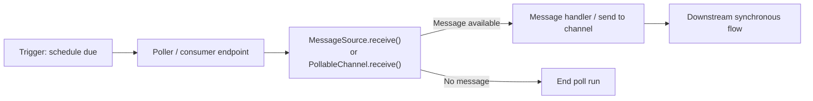
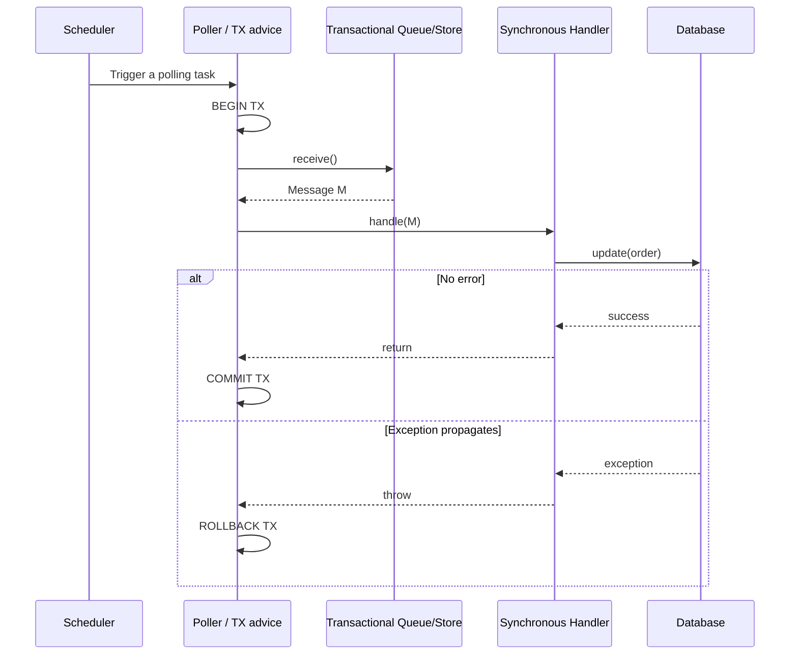
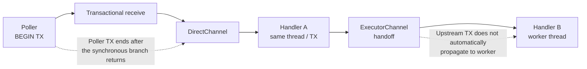

# Transaction Boundary at the Poller in Spring Integration Runtime

## 1. The problem: receiving a message and processing it in the same transaction

Imagine a system that receives orders from a queue, writes the order status to a database, and then passes the message to the next step. If the database reports an error, the system needs to know **whether the message just taken from the queue will return**. The answer depends on the transaction boundary location, the type of message source, the resources participating in the transaction, and the thread executing the flow.

In the **SPRING_INTEGRATION_RUNTIME** module, the poller is the component that triggers consumers that need to actively call `receive()` on a `PollableChannel` or `MessageSource`. Spring Integration allows placing transaction advice **around the polling operation**, so that taking the message and processing it synchronously afterward have the opportunity to belong to the same transactional unit.

Objectives after this lesson:

1. Draw and accurately explain the transaction boundary of a poller.
2. Distinguish between the poll schedule, a single poll run, the received message, and the actual created transaction.
3. Configure a poller to use `PlatformTransactionManager` via Java DSL or XML.
4. Explain when a rollback returns the message to a transactional store and when the message can be lost.
5. Analyze the impact of `DirectChannel`, `ExecutorChannel`, `QueueChannel`, and a subsequent poller on the transaction.
6. Diagnose transaction propagation, retry/recovery, error channels, synchronization, throughput, and duplicate processing risks.

This lesson is about **Transaction runtime**, focusing on the transaction boundary at the poller. It does not assume that every broker, channel, or endpoint supports transactions just because Spring Integration is running in an application that uses a database.

## 2. How does a poller work?

A polling consumer typically has the following components:

| Component | Role |
| --- | --- |
| `Trigger` | Decides when to invoke the poller: fixed delay, fixed rate, or cron. |
| `PollingConsumer` | A consumer endpoint that actively pulls messages from a `PollableChannel` and then invokes the handler. |
| `SourcePollingChannelAdapter` | An endpoint that calls `MessageSource.receive()` and sends the received message to an output channel. |
| `PollerMetadata` | Holds the trigger, `maxMessagesPerPoll`, `receiveTimeout`, advice, and other options. |
| `TransactionInterceptor` | Advice that opens/joins a transaction, executes the poll task, and commits/rolls back. |
| `PlatformTransactionManager` | Coordinates resource transactions (JDBC, JPA, JTA, etc.) according to the configuration. |

Not every inbound endpoint needs a poller. A JMS, AMQP, or HTTP listener usually has an **event-driven** mechanism provided by the adapter/container; transactions at the listener must be evaluated according to its own mechanism.



**Distinguish three units:**

- *Trigger firing* is when the trigger causes the polling task to run.
- *Receive attempt* is a single `receive()` call taking at most one message; the task can loop multiple times to fetch additional messages.
- *Transaction boundary* is the region wrapped by the transaction advice. It depends on where the advice is attached, transaction propagation, and the thread, and cannot be inferred solely from the fixed delay frequency.

`maxMessagesPerPoll` is the limit on the number of messages/attempts in a single poll run. For `PollingConsumer`, the default configuration and behavior may differ from `SourcePollingChannelAdapter`; for testability, this lesson sets **`maxMessagesPerPoll = 1`** so that one poll run processes at most one message. When increasing this number, you must verify the scope of `doPoll()`/advice and how many messages can pass through the same transaction on the running version.

## 3. Location of the transaction boundary

When configuring a transaction for a poller, Spring Integration uses transaction advice (typically `TransactionInterceptor`) wrapping the **polling task**. The transaction is opened **before** the message receive step; synchronous downstream components can participate in the same transaction until the call returns.



In the diagram above, removing the message from the store and updating the database **are only truly committed/rolled back together** if they use resources and a transaction manager capable of appropriate coordination. A `DataSourceTransactionManager` for database A does not automatically roll back message consumption in broker B.

### Three types of boundaries not to confuse

| Boundary | Where it starts | What can it cover? |
| --- | --- | --- |
| **Poller transaction** | Advice around `doPoll()` | Receiving the message and subsequent processing on the same thread, when the resources participate in the transaction. |
| **Service transaction** | Proxy/`@Transactional` on a service method | Method execution and synchronous calls within the service's transaction. |
| **Broker receive/ack transaction** | JMS session or transactional container/adapter | Ack/rollback/redelivery according to the broker's rules; does not automatically merge with JDBC. |

A flow can have **multiple independent transactions**. You need to know which transaction wraps *receive*, which transaction wraps *database update*, and who commits/acks the source message.

## 4. Configuring a transactional poller with Java DSL

The example below assumes Spring Integration Java DSL, a registered `PollableChannel` bean `ordersQueue`, a `PlatformTransactionManager` managing the relevant resource, and a service bean processing orders.

**`PollerTransactionConfiguration.java`**

```java
import java.time.Duration;
import org.springframework.context.annotation.Bean;
import org.springframework.context.annotation.Configuration;
import org.springframework.integration.dsl.IntegrationFlow;
import org.springframework.integration.dsl.Pollers;
import org.springframework.transaction.PlatformTransactionManager;

@Configuration
public class PollerTransactionConfiguration {

    @Bean
    public IntegrationFlow orderFlow(
            PlatformTransactionManager transactionManager,
            OrderService orderService) {

        return IntegrationFlow
                .from("ordersQueue", endpoint -> endpoint.poller(
                        Pollers.fixedDelay(Duration.ofSeconds(1))
                               .maxMessagesPerPoll(1)
                               .transactional(transactionManager)))
                .handle(orderService, "process")
                .get();
    }

    public interface OrderService {
        void process(String orderId);
    }
}
```

Meaning:

1. The poller is triggered on a fixed delay of about one second, with actual frequency also depending on processing time and the scheduler.
2. `maxMessagesPerPoll(1)` helps control the receive/work unit in the example.
3. `transactional(transactionManager)` adds transaction advice at the **poller**, before receiving the message.
4. The `process` handler runs synchronously in the execution path initiated by the poller; resources using the same transaction manager can join the open transaction.
5. Processing results must throw an exception out of the transaction boundary to trigger rollback according to rollback rules.

**This is a transaction boundary configuration, not a durable queue configuration.** If `ordersQueue` is `new QueueChannel()`, a JDBC rollback does not automatically put a message that was already pulled back into the in-memory queue. To test message receive rollback, you need a transactional source/store or a container that supports transactional acknowledgment.

### Configuration with `@ServiceActivator`

With endpoint annotations, a poller can be used:

```java
import org.springframework.integration.annotation.MessageEndpoint;
import org.springframework.integration.annotation.Poller;
import org.springframework.integration.annotation.ServiceActivator;
import org.springframework.messaging.Message;

@MessageEndpoint
public class OrderConsumer {

    @ServiceActivator(
            inputChannel = "ordersQueue",
            poller = @Poller(fixedDelay = "1000",
                             maxMessagesPerPoll = "1"))
    public void process(Message<String> message) {
        // This example configuration only creates a poll schedule; no TX advice is set yet.
        doBusinessWork(message.getPayload());
    }

    private void doBusinessWork(String orderId) {
        // Simulate business logic.
    }
}
```

`@Poller` as shown above **does not enable transactions yet**. To wrap `receive()` in a transaction, you need to configure a transactional poller/advice on the corresponding endpoint (for example, the Java DSL above, or XML in the next section). Simply placing `@Transactional` on the handler method is **not equivalent** to placing a transaction around the poller's message receive operation.

## 5. XML configuration demonstrating a transactional source

This is a sample configuration located **inside a Spring XML context with the Spring Integration namespace declared**:

```xml
<!-- Messages are stored in the declared JDBC channel message store. -->
<int:channel id="ordersQueue">
    <int:queue message-store="ordersStore"/>
</int:channel>

<!-- ordersStore: a JdbcChannelMessageStore bean configured
     with DataSource, query provider, and the right schema for the database. -->

<int:service-activator id="orderConsumer"
                       input-channel="ordersQueue"
                       ref="orderService"
                       method="process">
    <int:poller fixed-delay="1000"
                max-messages-per-poll="1"
                receive-timeout="100">
        <int:transactional transaction-manager="transactionManager"
                           propagation="REQUIRED"
                           isolation="READ_COMMITTED"
                           read-only="false"/>
    </int:poller>
</int:service-activator>
```

For this sample to actually work, the application needs:

- `ordersStore` as a `JdbcChannelMessageStore` configured with a `DataSource`, a database-appropriate `ChannelMessageStoreQueryProvider`, and tables matching the Spring Integration JDBC schema.
- `transactionManager` managing the same JDBC resource used for store operations; if business updates must commit together with the receive, those updates must also participate in an appropriately coordinated transaction.
- An `orderService` bean having a `process(...)` method with a compatible payload type.

If using XML `<int:transactional/>` together with `<int:advice-chain/>` on the **same poller**, you must follow the namespace configuration rules: to combine multiple advices and control ordering, put the transaction advice into the corresponding advice chain rather than declaring both mechanisms arbitrarily side by side.

## 6. When does rollback return a message to the queue?

This is the most important question in operations:

| Message source | Receive behavior | Outcome when DB transaction rolls back |
| --- | --- | --- |
| Default in-memory `QueueChannel` | Message is removed from the queue in RAM | **Does not automatically restore** the message via JDBC rollback. |
| `QueueChannel` + `JdbcChannelMessageStore` | Receives/deletes message via JDBC store | Can undo the pull operation if the store and poller share a valid JDBC transaction. |
| `PollableChannel` with another transactional message store | Depends on store capabilities | Must verify that the adapter/store actually enlists in the transaction and its rollback mechanism. |
| File inbound polling | Receiving a file is not a transactional DB operation | JDBC rollback **does not automatically restore the file to its previous state**; transaction synchronization can be used for post-processing. |
| JMS/AMQP queue via listener/adapter | Ack/nack/session managed by adapter/container/broker | Requires the source's transaction/redelivery policy; JDBC rollback does not automatically decide broker ack. |
| Kafka consumer | Offsets, consumer records, and broker transactions have their own mechanisms | JDBC rollback does not automatically roll back offsets; offset commits and idempotency must be designed. |

### 6.1. Scenario A: in-memory queue

```text
T0: QueueChannel(in-memory) holds M-101
T1: Poller BEGIN JDBC transaction
T2: queue.receive() takes M-101 out of RAM
T3: handler UPDATE orders ... then throws an error
T4: JDBC transaction ROLLBACK
T5: DB is rolled back, but the in-memory queue may no longer have M-101
```

You must not assume `ROLLBACK` will make the queue automatically return the message if the queue does not participate in the transaction. This test is why you must choose the message source based on data preservation requirements, rather than just adding `@Transactional`.

### 6.2. Scenario B: queue using a JDBC channel store

```text
T0: INT_CHANNEL_MESSAGE table contains M-101
T1: Poller BEGIN TX (matching DataSourceTransactionManager)
T2: JdbcChannelMessageStore retrieves/deletes M-101 inside TX
T3: handler updates orders inside TX
T4a: Handler succeeds → COMMIT → M-101 deleted + orders updated
T4b: Handler fails    → ROLLBACK → M-101 can still be received again
```

The rollback branch requires a transaction manager that actually uses the same appropriate resource and no mechanism outside the transaction already acknowledged the message. Even when receive rolls back safely, the consumer still needs **idempotency** because a connection drop after commit, upstream retry, or failover can cause duplicate message delivery.

JDBC-backed queues have trade-offs regarding lock contention, database load, throughput, and data cleanup. Spring Integration provides `JdbcChannelMessageStore` optimized for channels; you should not assume every database behaves identically under concurrent polling.

## 7. The thread determines how far the transaction remains in effect

Spring's imperative transaction context is usually bound to the executing **thread**. Therefore, channel topology directly affects the boundary:



| Flow segment | Does the poller's transaction reach here? | Reason |
| --- | --- | --- |
| Handler receiving directly via `DirectChannel` | Usually yes, unless propagation separates it | Subscriber is invoked on the sending thread; exceptions can propagate back. |
| Synchronous transformer/router on `DirectChannel` | Usually yes | Same call stack and thread-bound transaction. |
| Sending to `ExecutorChannel` | Upstream transaction only wraps a successful handoff step | Worker runs on another thread; errors after handoff do not automatically roll back the old transaction. |
| Sending to `QueueChannel` | Upstream transaction does not wrap the subsequent poll/consume | The new consumer needs a new poller/transaction if atomic receive is desired. |
| Async `PublishSubscribeChannel` with executor | Does not automatically propagate to worker subscribers | Subscribers are execution branches on different threads. |
| An `@Async` method or manually created `Thread` | Does not automatically propagate | Synchronous context is thread-bound, not a field on `Message`. |

Example:

```text
JDBC Queue → [Poller TX-1] → DirectChannel → validate → ExecutorChannel
                                                       |
                                                       v
                                         [worker, no longer TX-1]
                                               chargePayment()
```

If validation succeeds and the message is handed off to the executor, `TX-1` may commit **before** `chargePayment()` fails. You cannot wait for a worker-side error to automatically roll back an already-committed transaction. You need to design an error channel, compensation, reply flow, or a separate transaction for the worker.

### Poller `taskExecutor` vs. downstream `ExecutorChannel`

A poller can be configured to use a `TaskExecutor` to run the polling task. In that case, the poller's transaction advice executes **on the thread running the polling task**, depending on configuration. This differs from a message already received by the poller and then passed to an `ExecutorChannel`: the transaction **does not automatically cross** the downstream handoff to a worker.

Do not assume the transaction always runs on the original scheduler thread. Observe the thread executing `receive()`, the handler, the transaction interceptor, and intermediate channels when diagnosing.

## 8. Poller transaction and `@Transactional` on the service

Suppose the poller opens `TX-P` and the handler calls a business method annotated with `@Transactional`:

| Service propagation | Typical behavior | What to check |
| --- | --- | --- |
| `REQUIRED` | Joins `TX-P` if using a compatible transaction manager/resource | A thrown error may mark `TX-P` as rollback-only. |
| `REQUIRES_NEW` | Suspends the current transaction, opens an independent transaction | The service can commit even if `TX-P` rolls back; redelivery will re-run the business logic. |
| `NESTED` | Uses a savepoint if supported by the transaction manager/resource | Not equivalent to an independent transaction; not every manager supports it. |
| `NOT_SUPPORTED` | Suspends the current transaction within the service scope | Side effects performed outside `TX-P` are not rolled back with `TX-P`. |
| Method does not go through a Spring proxy | `@Transactional` may have no effect | Self-invocation or unproxied bean. |

**Rollback rules:** the transaction interceptor defaults to rolling back on `RuntimeException` and `Error`; checked exceptions may require configuring `rollbackFor`. When a handler catches an error and returns normally, the transaction can commit if it has not been marked rollback-only.

Example of a common mistake:

```java
@Transactional
public void process(String orderId) {
    try {
        repository.updateOrder(orderId);
    } catch (RuntimeException ex) {
        logError(ex);
        // Error is swallowed; caller/poller thinks the operation succeeded.
    }
}
```

If rolling back the source is required, you should normally **rethrow the exception** so the outer transaction boundary can observe it. If the contract forces handling the error inside the method, calling `TransactionAspectSupport.currentTransactionStatus().setRollbackOnly()` or an appropriate rollback-marking approach must be carefully considered; at the same time, you must determine whether the source truly participates in the transaction.

## 9. Advice chain, retry, and rollback scope

A poller allows multiple AOP advices. A typical example is transaction and retry; the order of application determines behavior:

```text
Option A — RETRY outside TX:
retry
  attempt 1 → begin TX-1 → receive/process → rollback TX-1
  attempt 2 → begin TX-2 → receive/process → commit TX-2

Option B — TX outside RETRY:
begin TX-OUTER
  retry attempt 1 → exception, TX may become rollback-only
  retry attempt 2 → method returns successfully
commit TX-OUTER? → may still fail
```

However, **retry placed on the poller** can retry the `receive()` step itself; retry placed on the **handler** can re-invoke the handler on the same message already pulled. The two places for retry **differ in scope**.

- For transient DB errors (deadlock, serialization failure), you usually want to retry **a whole new transaction**.
- Retrying a handler inside a transaction that is already rollback-only does not make that transaction healthy again; commit may throw `UnexpectedRollbackException`.
- If poller retry re-runs the receive step after rollback, the source/store must support receive rollback to return the message.
- When a recovery callback swallows the exception and returns normally, the outer transaction may commit **if** it is not rollback-only; the source may be considered done.
- A `RequestHandlerRetryAdvice` on the handler does not replace a transactional poller if `receive()` needs to be rolled back.

In production, you must know exactly **which advice is outer**, the number of attempts, backoff duration, transaction timeout, and the source's commit/ack policy. A long-lived transaction spanning backoff intervals can hold locks/connections, reducing throughput and increasing backlog.

## 10. Transaction synchronization at the poller

Not every source has a physical "rollback." For example, a file inbound adapter can read a file, yet a JDBC rollback does not make the filesystem automatically undo the operation. Spring Integration supports **transaction synchronization** to execute actions before/after commit or after rollback:

- `TransactionSynchronizationFactory`: creates synchronization bound to the polling context.
- `DefaultTransactionSynchronizationFactory`: an implementation that can use a processor for SpEL expressions.
- `ExpressionEvaluatingTransactionSynchronizationProcessor`: supports `beforeCommitExpression`, `afterCommitExpression`, and `afterRollbackExpression`.
- `PassThroughTransactionSynchronizationFactory`: maintains the polled message context to support error information in appropriate situations.

Illustrative XML configuration example:

```xml
<int:transaction-synchronization-factory id="syncFactory">
    <int:after-commit expression="payload" channel="committedChannel"/>
    <int:after-rollback expression="payload" channel="failedChannel"/>
</int:transaction-synchronization-factory>

<int-file:inbound-channel-adapter id="fileInput"
                                  directory="/data/in"
                                  channel="filesToProcess">
    <int:poller fixed-delay="2000"
                max-messages-per-poll="1">
        <int:transactional transaction-manager="transactionManager"
                           synchronization-factory="syncFactory"/>
    </int:poller>
</int-file:inbound-channel-adapter>
```

The XML snippet above illustrates the relevant components, assuming namespaces, beans, destination channels, and the file adapter are already configured in the application. The `payload` expression sends the payload to the channel after the transaction completes; moving/deleting/retrying the file must be designed specifically to suit the source.

**Limitation:** transaction synchronization **does not turn the file system, HTTP APIs, or email into transactional resources**. `afterCommit` only runs after commit, and if an error occurs while performing side effects at this stage, an already completed commit cannot be reversed. To guarantee event emission after a DB commit, consider outbox.

### 10.1. Pseudo transaction

`PseudoTransactionManager` allows using the before/after "commit/rollback" mechanism as a lifecycle callback when **there is no real transactional resource**. This is a way to coordinate file post-processing or actions of a similar nature.

It **does not** open a real JDBC transaction, does not undo external APIs, and does not guarantee atomicity across systems. Using the word "rollback" in a pseudo transaction should only be understood as triggering the failure-handling branch, not rolling back a resource.

## 11. Transaction failure and ErrorMessage at the poller

With a poller, exceptions can arise when:

1. `MessageSource.receive()` fails before obtaining a message.
2. The store returns a message, but the handler or synchronous dispatcher throws an exception.
3. The transaction manager commit fails, even though the handler returned normally.
4. A retry/recovery callback raises an error after multiple attempts.

In appropriate configurations, `MessagePublishingErrorHandler` converts errors into an `ErrorMessage` sent to `errorChannel`. Because an exception can occur **at commit**, checking only for handler "success" logs is not sufficient to conclude the transaction succeeded.

Spring Integration uses transaction synchronization attaching the polled message in the context. With built-in strategies and an appropriate `TransactionInterceptor`, errors after transaction advice can be wrapped into a `MessagingException` with `failedMessage` to retain the relevant message:

```java
import org.springframework.integration.annotation.MessageEndpoint;
import org.springframework.integration.annotation.ServiceActivator;
import org.springframework.messaging.Message;
import org.springframework.messaging.MessagingException;
import org.springframework.messaging.support.ErrorMessage;

@MessageEndpoint
public class PollerErrorConsumer {

    @ServiceActivator(inputChannel = "pollerErrors")
    public void handleError(ErrorMessage error) {
        Throwable cause = error.getPayload();
        Message<?> original = error.getOriginalMessage();
        Message<?> failed = cause instanceof MessagingException exception
                ? exception.getFailedMessage()
                : null;

        Object eventId = original != null
                ? original.getHeaders().get("eventId")
                : failed != null ? failed.getHeaders().get("eventId") : null;

        System.err.println("eventId=" + eventId
                + ", exception=" + cause.getClass().getSimpleName());

        // Production: classify error, metrics, alert, DLQ per policy.
    }
}
```

`pollerErrors` must actually be configured as an appropriate error destination; the annotation alone does not make every exception route there automatically. Both `originalMessage` and `failedMessage` can be `null` depending on where the error occurred and the strategy. Do not automatically put the original message back onto the queue in the error handler, as that easily creates an infinite retry loop or duplicate side effects.

## 12. Why can a message still be reprocessed after the transaction committed?

A poller transaction can solve **part** of the atomicity requirement, but it does not guarantee system-wide exactly-once processing:

```text
Transactional poller → UPDATE DB → publish event to broker
                                        |
                                        +-- broker does not share TX with DB
```

Some scenarios:

| Scenario | Consequence | Mitigation |
| --- | --- | --- |
| DB update commits, but producer crashes before writing outbound event | Missing event | Transactional outbox in the same DB transaction. |
| Database commits, but source ack fails | Source redelivers message | Idempotent consumer by business/event ID. |
| HTTP API publish succeeds then exception rolls back JDBC | API already had side effect, DB not committed | Idempotency key and compensating action. |
| Transaction fails at commit after method logged success | Misleading success log | Observe transaction completion, do not measure only handler return. |
| Error flow published error, but source still acked | Recovery swallowed error or source transaction did not roll back | Investigate recoverer, tx boundary, and acknowledgement config. |

**Safe pattern for DB + outbound event:**

1. Receive an event containing a stable `eventId`.
2. In the same local DB transaction, write business state, mark `eventId` as processed, and insert an outbox record.
3. Commit the database.
4. A separate publisher sends the outbox record to the broker, retrying on error.
5. Downstream consumers are also idempotent; the publisher marks the outbox record after sending per the chosen protocol.

Do not use `MessageHeaders.ID` of a single delivery as the sole idempotency key. A new message after retry, mapping, or redelivery can carry a different ID; use the event ID from the business contract.

## 13. Observing performance: where do transactional pollers bottleneck?

| Parameter/metric | Runtime impact | Interpretation |
| --- | --- | --- |
| `fixedDelay`/`fixedRate` | Poller invocation cadence | Fixed delay counts after the previous run; fixed rate targets a fixed frequency but remains subject to scheduler limits. |
| `receiveTimeout` | Can make the thread wait for a message | When TX opens before `receive()`, wait time can extend the TX span. |
| `maxMessagesPerPoll` | Maximum messages in a poll run | Setting 1 makes experiments easy to reason about; increasing it requires measuring throughput and TX scope. |
| Poller `taskExecutor` | Concurrent poll tasks | Can increase throughput but causes contention on the JDBC store and database. |
| Transaction timeout | Time limit for the transaction per the manager | Backoff, slow I/O, or queue wait can trigger timeouts. |
| Connection pool saturation | Poller waits for a connection | Easily causes backlog buildup and timeouts. |
| DB lock/wait/deadlock | Multiple pollers contending for rows | Check isolation, query/index, consumer count, and retry policy. |
| Queue depth + message age | Unfinished processing backlog | Monitor alongside commit rate and rollback/redelivery rate. |

With a JDBC-backed channel, multiple competing pollers can reduce throughput if the database lacks suitable concurrency/locking. Spring Integration documentation notes **MVCC** behavior and `JdbcChannelMessageStore` under concurrent polling; `usingIdCache` configuration also has database-specific caveats. Do not increase pool size without measuring lock contention first.

For long transactions, do not include slow HTTP calls, backoff waits, or sleeps inside the same TX unnecessarily. The longer a transaction lasts, the higher the risk of deadlock, lock holding, and connection pool saturation.

## 14. Evidence-based troubleshooting

| Symptom | Common cause | Check first |
| --- | --- | --- |
| Message lost after handler throws error | In-memory `QueueChannel`; non-transactional source; swallowed exception | Channel/message store type, TX scope, and exception path. |
| DB rolls back but message is not redelivered | Ack/receive not in the same TX or broker has another policy | Transaction manager, connection, and adapter acknowledgment. |
| Worker-side error does not roll back queue | `ExecutorChannel` or another `QueueChannel` splits threads | Use trace to find handoff point; design a separate TX for the worker. |
| Handler returns normally then reports `UnexpectedRollbackException` | Transaction was already marked rollback-only | Earlier exception logs, propagation, and advice order. |
| No error seen on `errorChannel` | Error went to caller, wrong error handler/channel, transaction failed at another boundary | Identify thread, poller error handler, `errorChannel` header. |
| Too many retries or taking too long | In-JVM retry plus broker redelivery; backoff inside TX | Count attempts across both layers, check timeout and locks. |
| Poller runs but receives no messages | Wrong input channel, poller stopped, backlog on another source, timeout, or store lock | Endpoint lifecycle, `receiveTimeout`, store query, and transaction logs. |
| Message received repeatedly forever | Poison message always causes rollback | Validation, retry cap, DLQ, idempotency, and error handling policy. |
| Downstream event lost despite DB commit | Publish not coordinated with DB transaction | Outbox or appropriate broker transaction mechanism. |
| Slow JDBC queue with multiple consumers | Lock contention, missing index, long transaction | DB execution plan, pooling, MVCC, queue metrics. |

### Sequential investigation procedure

1. **Draw the full flow** and mark `PollableChannel`, poller, `DirectChannel`, `ExecutorChannel`, handlers, and broker boundaries.
2. **Mark the actual transaction boundaries**: which transaction manager, whether it starts before or after `receive()`, and where commit/rollback occurs.
3. **Identify the message source** and whether it supports transactional receive; distinguish in-memory queue, JDBC store, file, and broker.
4. **Identify the threads** handling the poll task, `receive()`, handlers, and async handoffs.
5. **Read the cause chain and outcome**: handler exception, rollback-only, commit failure, error channel, broker ack/redelivery.
6. **Check transaction + business state**: whether DB rows committed, whether the message remains in the store, and whether outbox/event ID exists.
7. **Correlate the timeline** using traceId/eventId and transaction completion logs, avoiding newly generated message IDs as sole evidence.

You can capture the current transaction signal with:

```java
import org.springframework.transaction.support.TransactionSynchronizationManager;

boolean txActive =
        TransactionSynchronizationManager.isActualTransactionActive();
String thread = Thread.currentThread().getName();
System.out.println("thread=" + thread + ", txActive=" + txActive);
```

`txActive` only proves **a transaction is active on the current thread**; it does not prove that receive and DB update enlisted together, does not prove the transaction ultimately committed, and does not confirm the broker acked. You must observe transaction synchronization or logs from the transaction manager/DB/broker when verifying the final outcome.

## 15. Controlled hands-on exercises

### Exercise A — Compare in-memory and JDBC-backed queues

1. Configure an in-memory `QueueChannel`, a transactional poller as in section 4, and a handler that writes to the DB and then intentionally throws `RuntimeException`.
2. Observe the DB rollback and check whether the message is still in the queue.
3. Replace the queue with `JdbcChannelMessageStore` with the proper schema and `DataSourceTransactionManager`, keeping `maxMessagesPerPoll=1`.
4. Trigger the exact same exception; observe both the database rollback **and** the rollback of the message pull operation.
5. Let the handler succeed; verify the message is deleted and the business state is committed.

When testing async flows, use a latch or await with a finite timeout. Do not rely on `Thread.sleep` to infer that the transaction has finished.

### Exercise B — Splitting threads mid-flow

Experimental flow:

```text
JDBC Queue → Poller(TX) → DirectChannel → validate → ExecutorChannel → saveAudit
```

Cause an error in `validate`, then cause an independent error in `saveAudit`. Predict the outcome of the poller transaction and message source beforehand; then verify via DB, queue, error channel, and trace. Explain why an exception on the worker does not automatically reverse a commit that already happened before handoff.

### Exercise C — Retry and recovery

Try two structures:

```text
retry → transaction → receive + handle

transaction → retry → receive + handle
```

Inject a transient DB error on the first attempt and succeed on a later attempt; record the number of opened transactions, rollback-only state, number of receives, number of handler runs, and source state. Then exhaust all attempts and use an error recoverer; verify whether recovery inadvertently causes the outer transaction to commit.

### Self-check questions

1. Why can transaction advice on the poller roll back `receive()`, whereas `@Transactional` on a service activator usually does not wrap the preceding `receive()` call?
2. What conditions are required for rolling back a `JdbcChannelMessageStore`-backed queue to actually return the message?
3. Why can an in-memory `QueueChannel` lose a message even though the DB transaction rolls back?
4. At what point does `ExecutorChannel` change the transaction boundary?
5. What happens if you retry a handler inside a transaction that is already rollback-only?
6. Is `afterRollback` transaction synchronization a mechanism to undo all external resources?
7. Why is handler "success" not sufficient to confirm DB commit and broker ack?
8. When a poller has a large backlog, what metrics will you measure before increasing the worker count?

## 16. References

- [Spring Integration Reference — Transaction Support](https://docs.spring.io/spring-integration/reference/transactions.html)
- [Spring Integration Reference — Message Endpoints and Pollers](https://docs.spring.io/spring-integration/reference/endpoint.html)
- [Spring Integration Reference — Configuring Message Channels](https://docs.spring.io/spring-integration/reference/channel/configuration.html)
- [Spring Integration Reference — JDBC Message Store](https://docs.spring.io/spring-integration/reference/jdbc/message-store.html)
- [Spring Integration Reference — Error Handling](https://docs.spring.io/spring-integration/reference/error-handling.html)
- [Spring Framework Reference — Declarative Transaction Propagation](https://docs.spring.io/spring-framework/reference/data-access/transaction/declarative/tx-propagation.html)
- [Spring Framework Reference — Rolling Back a Transaction](https://docs.spring.io/spring-framework/reference/data-access/transaction/declarative/rolling-back.html)
