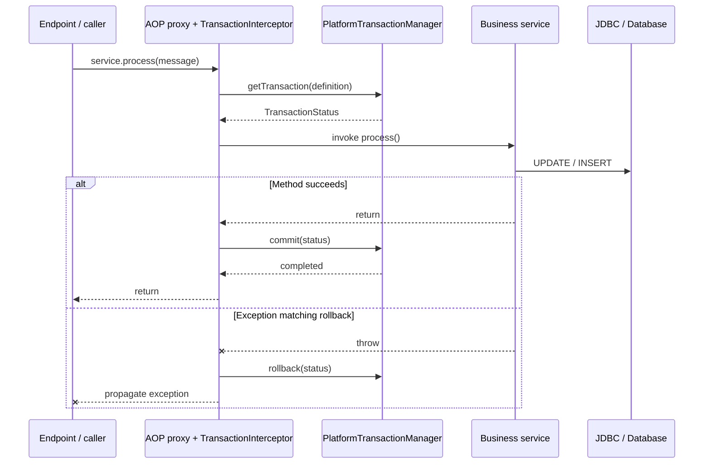
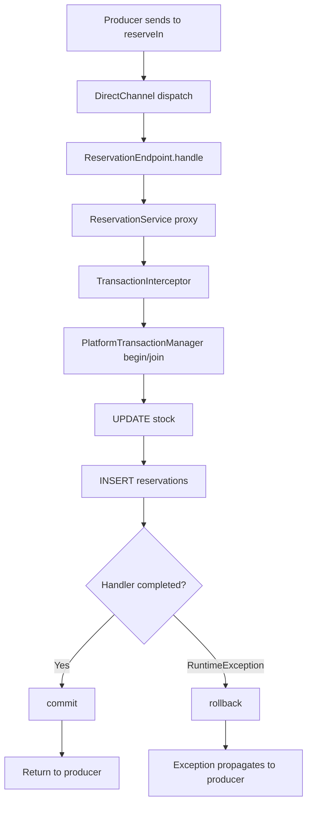
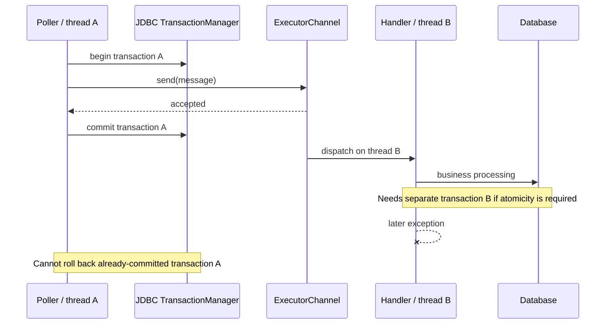

# TransactionInterceptor and PlatformTransactionManager in Spring Integration

## 1. Where does a transaction sit in a message flow?

In the `SPRING_INTEGRATION_RUNTIME` module, a message can pass through `MessageChannel`, handlers, consumers, pollers, and executors while performing changes in a database or message store. The critical questions are: **who starts the transaction, which part of the flow is covered by the transaction, and when does commit/rollback happen?**

Spring Integration uses Spring Framework's transaction infrastructure. The two foundational components of the **synchronous (imperative) transaction** mechanism are:

- **`TransactionInterceptor`**: AOP advice wrapping a configured invocation; it decides whether to start or join a transaction and handles commit/rollback after the invocation.
- **`PlatformTransactionManager`**: the interface that coordinates transactions with actual resources (JDBC, JPA, JTA, etc.), performing transaction acquisition, commit, or rollback.

The two components collaborate, yet they are not synonymous. The interceptor **defines the boundary and policy**; the manager **controls the transaction on the resource**. Spring Integration can only guarantee rollback for resources that actually participate in that transaction. Sending an email, calling an HTTP API, or handing off to another thread does not automatically become part of a database transaction.

**Running scenario:** message `ReserveStock(requestId, sku, quantity)` enters the `reserveIn` channel; the handler deducts inventory and writes a reservation record. Both JDBC statements must **either succeed together or roll back together**. If the flow hands off to an executor or a poller, we must determine which thread opens the transaction and whether it covers the message receive step.

After this lesson, you will be able to:

1. Explain the invocation flow `TransactionInterceptor → PlatformTransactionManager → business handler`.
2. Choose an appropriate transaction manager for the resource and verify that the transaction configuration actually takes effect.
3. Use `@Transactional`, Spring Integration handler advice, or a transactional poller within the proper scope.
4. Distinguish between a regular `TransactionInterceptor` and `TransactionHandleMessageAdvice`.
5. Predict rollback behavior under exceptions, retries, thread handoffs, and poller failures.
6. Investigate cases where an endpoint "has a transaction" yet data still commits unexpectedly.

## 2. Two roles: the interceptor coordinates, the manager executes

### 2.1. `PlatformTransactionManager` is the SPI for synchronous transactions

Spring Framework defines the interface:

```java
public interface PlatformTransactionManager extends TransactionManager {
    TransactionStatus getTransaction(TransactionDefinition definition)
            throws TransactionException;

    void commit(TransactionStatus status) throws TransactionException;

    void rollback(TransactionStatus status) throws TransactionException;
}
```

Where:

| Component | Meaning |
|---|---|
| `TransactionDefinition` | Policy: propagation, isolation, timeout, read-only, transaction name. |
| `TransactionStatus` | Transaction state obtained or created by the manager; can be marked rollback-only. |
| `getTransaction(...)` | Joins an existing transaction or creates a new one according to propagation. |
| `commit(status)` | Completes the transaction per status; may perform a rollback if marked rollback-only. |
| `rollback(status)` | Undoes changes belonging to the transaction controlled by the manager. |

Common implementations:

| Manager | Managed resource | Typical choice |
|---|---|---|
| `DataSourceTransactionManager` or `JdbcTransactionManager` | A JDBC `DataSource`; `JdbcTransactionManager` provides JDBC-model commit/rollback exception translation | `JdbcTemplate`/synchronous JDBC. |
| `JpaTransactionManager` | `EntityManager`/JPA persistence context, can coordinate JDBC on the same datasource when properly configured | Handlers calling JPA repositories. |
| `JtaTransactionManager` | Distributed transactions when the JTA platform and participating resources truly support them | Systems requiring JTA/XA; configuration, performance, and failure modes are more complex. |
| `PseudoTransactionManager` (Spring Integration) | Callback synchronization mechanism based on "commit/rollback" state, **with no real transactional resource** | File work or flows needing `afterCommit`/`afterRollback` hooks without a DB transaction. |

**Choosing the right manager is mandatory.** A `JdbcTemplate` updating datasource A while the transaction manager controls datasource B provides no atomic guarantee for A's data. With multiple transaction managers, select explicitly by name/qualifier; do not let Spring accidentally pick a different resource.

Note: `ReactiveTransactionManager` is a **different** model that binds transactions to the Reactor context for reactive pipelines. `PlatformTransactionManager` typically binds resources to the **current thread**; it does not automatically propagate to a new thread. This lesson focuses on synchronous JDBC/imperative flows.

### 2.2. `TransactionInterceptor` wraps the invocation

In Spring declarative transactions, `@Transactional` is **metadata**. When AOP support is enabled and the call passes through a **Spring proxy**, a `TransactionInterceptor` uses that metadata to apply the transaction.



Distinguish between the **transaction interceptor** (the call-control mechanism) and the **transaction manager** (the resource strategy). You do not need to hand-write `getTransaction/commit/rollback` for every handler if you use `@Transactional` or transaction advice properly.

### 2.3. Four conditions for a transaction to take effect

- An appropriate **transaction manager** is registered and properly selected.
- The method/endpoint has **transaction metadata or advice attached**.
- The invocation actually **passes through the proxy/interceptor**; calling `this.process()` from a method inside the same bean bypasses default Spring AOP proxying.
- The modified resource uses **the same transaction-bound resource** and runs within the active scope, usually on the same thread in the imperative model.

The mere presence of an annotation in source code is not enough to prove the database is participating in a transaction.

## 3. Propagation, isolation, timeout, and rollback rules

`TransactionInterceptor` uses `TransactionAttribute`, a form of `TransactionDefinition` with added rollback rules. Key attributes:

| Attribute | Example | Impact |
|---|---|---|
| `propagation` | `REQUIRED` (default), `REQUIRES_NEW`, `MANDATORY`, `NESTED` | Whether to join the current transaction or create a new one; `NESTED` requires savepoint/resource support. |
| `isolation` | `DEFAULT`, `READ_COMMITTED`, `REPEATABLE_READ`, `SERIALIZABLE` | Isolation level when creating a new transaction, depending on DB and manager; not a way to lock all resources. |
| `timeout` | 5 seconds | Transaction limit supported by the manager/resource; not a timer that automatically interrupts arbitrary Java code or HTTP calls. |
| `readOnly` | `true` | Optimization/execution hint for the manager and database; **not by default** a write-blocking barrier on every DB. |
| `rollbackFor`/`noRollbackFor` | Specific business exception | Determines whether an escaping exception causes the transaction to roll back. |

**Spring Framework default rule:** `RuntimeException` and `Error` trigger rollback; checked `Exception`s normally **do not** trigger rollback unless configured otherwise. If code catches an exception and returns normally, the interceptor sees a **successful** call and may commit.

Example:

```java
@Transactional(
        transactionManager = "transactionManager",
        propagation = Propagation.REQUIRED,
        isolation = Isolation.READ_COMMITTED,
        rollbackFor = IOException.class
)
public void importFile() throws IOException {
    // If IOException escapes the proxied call, roll back per rule.
}
```

The snippet above requires `org.springframework.transaction.annotation.Transactional`, `Propagation`, `Isolation`, and `java.io.IOException`.

**`REQUIRES_NEW` does not mean "redo the whole flow."** It suspends the current transaction (if any) and creates an independent transaction on the appropriate resource. For instance, an audit using `REQUIRES_NEW` can commit even when the outer business transaction rolls back. This is intentional, yet it easily causes inconsistent state if used carelessly.

## 4. Runnable example: one handler, two database operations, one transaction

The example uses Java 17+, Spring Integration, Spring JDBC, Spring transaction, and a `DataSource` configured to connect to PostgreSQL. Place the following Java types in the same `example.integration` package, with **each public class/record in its own file**. If the application already auto-configures a transaction manager/JdbcTemplate, use the existing beans instead of registering duplicates.

### 4.1. Schema and test data

```sql
CREATE TABLE stock (
    sku VARCHAR(80) PRIMARY KEY,
    available INTEGER NOT NULL CHECK (available >= 0)
);

CREATE TABLE reservations (
    request_id VARCHAR(100) PRIMARY KEY,
    sku VARCHAR(80) NOT NULL REFERENCES stock(sku),
    quantity INTEGER NOT NULL CHECK (quantity > 0)
);

INSERT INTO stock(sku, available) VALUES ('BOOK-1', 10);
```

Suppose message `ReserveStock("req-01", "BOOK-1", 3)`: after commit, `available` becomes 7 and one reservation appears. If writing the reservation fails, `available` must remain 10 for that processing attempt.

### 4.2. Configuring the channel and transaction manager

```java
package example.integration;

import javax.sql.DataSource;
import org.springframework.context.annotation.Bean;
import org.springframework.context.annotation.ComponentScan;
import org.springframework.context.annotation.Configuration;
import org.springframework.integration.channel.DirectChannel;
import org.springframework.integration.config.EnableIntegration;
import org.springframework.jdbc.core.JdbcTemplate;
import org.springframework.jdbc.support.JdbcTransactionManager;
import org.springframework.messaging.MessageChannel;
import org.springframework.transaction.PlatformTransactionManager;
import org.springframework.transaction.annotation.EnableTransactionManagement;

@Configuration
@EnableIntegration
@EnableTransactionManagement
@ComponentScan(basePackageClasses = {
        ReservationEndpoint.class, ReservationService.class
})
public class TransactionFlowConfig {

    @Bean("reserveIn")
    public MessageChannel reserveIn() {
        return new DirectChannel();
    }

    @Bean("transactionManager")
    public PlatformTransactionManager transactionManager(DataSource dataSource) {
        return new JdbcTransactionManager(dataSource);
    }

    @Bean
    public JdbcTemplate jdbcTemplate(DataSource dataSource) {
        return new JdbcTemplate(dataSource);
    }
}
```

`DirectChannel` is a synchronous channel, so exceptions can propagate back to the producer's `send()` call. `JdbcTransactionManager` coordinates the JDBC operations of `JdbcTemplate` because both beans use the same `DataSource`.

### 4.3. Data model and transactional service

```java
package example.integration;

public record ReserveStock(String requestId, String sku, int quantity) {}
```

```java
package example.integration;

import org.springframework.jdbc.core.JdbcTemplate;
import org.springframework.stereotype.Service;
import org.springframework.transaction.annotation.Transactional;

@Service
public class ReservationService {

    private final JdbcTemplate jdbc;

    public ReservationService(JdbcTemplate jdbc) {
        this.jdbc = jdbc;
    }

    @Transactional(transactionManager = "transactionManager")
    public void reserve(ReserveStock command) {
        if (command.quantity() <= 0) {
            throw new IllegalArgumentException("quantity must be positive");
        }

        int changed = jdbc.update(
                "UPDATE stock SET available = available - ? " +
                "WHERE sku = ? AND available >= ?",
                command.quantity(),
                command.sku(),
                command.quantity());

        if (changed != 1) {
            throw new IllegalStateException("not enough stock or unknown SKU");
        }

        jdbc.update(
                "INSERT INTO reservations(request_id, sku, quantity) " +
                "VALUES (?, ?, ?)",
                command.requestId(),
                command.sku(),
                command.quantity());
    }
}
```

If `INSERT` fails with a unique key error due to a duplicate `request_id`, the exception from `JdbcTemplate` is typically an unchecked `DataAccessException`. It escapes `reserve()`, causing **both UPDATE and INSERT to roll back**. This is atomicity for **a single database transaction**. Returning a valid state for duplicates (idempotency) is an additional business concern, not automatically solved by rollback alone.

### 4.4. Spring Integration endpoint calling the service through a proxy

```java
package example.integration;

import org.springframework.integration.annotation.MessageEndpoint;
import org.springframework.integration.annotation.ServiceActivator;

@MessageEndpoint
public class ReservationEndpoint {

    private final ReservationService service;

    public ReservationEndpoint(ReservationService service) {
        this.service = service;
    }

    @ServiceActivator(inputChannel = "reserveIn")
    public void handle(ReserveStock command) {
        service.reserve(command);
    }
}
```

Spring manages `ReservationService` and inserts transaction advice when `ReservationEndpoint` calls `service.reserve()`. The transaction scope is **the `reserve()` method**, covering both JDBC statements. Because the service is in a separate bean, the call from the endpoint goes through the Spring proxy; separating the beans like this also makes testing easier.

A producer sends a message from a Spring-managed component:

```java
import example.integration.ReserveStock;
import org.springframework.context.ApplicationContext;
import org.springframework.messaging.MessageChannel;
import org.springframework.messaging.support.MessageBuilder;

MessageChannel reserveIn =
        context.getBean("reserveIn", MessageChannel.class);

reserveIn.send(
        MessageBuilder.withPayload(
                new ReserveStock("req-01", "BOOK-1", 3))
                .build());
```

In the snippet above, `context` is an `ApplicationContext` already injected/provided by the application; the imports only illustrate the types. To verify:

```sql
SELECT available FROM stock WHERE sku = 'BOOK-1';
-- Expected: 7

SELECT request_id, sku, quantity
FROM reservations WHERE request_id = 'req-01';
-- Expected: exactly one row, quantity = 3
```

To test rollback, resend the same `requestId = "req-01"` after the first send has committed. The `UPDATE` step runs, but `INSERT` violates the primary key; the second transaction rolls back so `available` **remains 7**, rather than dropping to 4. This case demonstrates atomicity, **not** a duplicate-friendly API: the caller may receive an exception and still needs a business-layer idempotency/reply policy.

### 4.5. Runtime sequence of the example



A transaction here **does not** start when the `Message<?>` is created, nor does the channel named `reserveIn` know about transactions on its own. It starts when the call into the service is wrapped by the interceptor.

## 5. Using `TransactionInterceptor` directly: differences from `@Transactional`

`@Transactional` is convenient declarative syntax for the service layer, whereas **Spring Integration endpoint advice** lets you place the transaction at a handler/poller boundary. When controlling a pipeline via `adviceChain` or Java DSL, you can build a `TransactionInterceptor` bean through Spring Integration's `TransactionInterceptorBuilder`.

Example configuring an advice wrapping **all of `handleMessage()` and the subsequent synchronous dispatch**:

```java
import org.springframework.context.annotation.Bean;
import org.springframework.integration.transaction.TransactionInterceptorBuilder;
import org.springframework.transaction.PlatformTransactionManager;
import org.springframework.transaction.annotation.Isolation;
import org.springframework.transaction.annotation.Propagation;
import org.springframework.transaction.interceptor.TransactionInterceptor;

@Bean("wholeMessageTxAdvice")
public TransactionInterceptor wholeMessageTxAdvice(
        PlatformTransactionManager transactionManager) {
    return new TransactionInterceptorBuilder(true)
            .transactionManager(transactionManager)
            .propagation(Propagation.REQUIRED)
            .isolation(Isolation.READ_COMMITTED)
            .build();
}
```

This is **an alternative configuration option** to `@Transactional` in section 4; do not attach both to the same handler without explicit intent regarding propagation/ordering. If the configuration class injects by name to select a manager among multiple beans, add an appropriate qualifier.

You can reference this advice bean in a Spring Integration annotation, such as a transformer endpoint. Because the `@Transformer` annotation name collides with the `Transformer` interface name, the snippet uses full names for both types to avoid ambiguity:

```java
@Bean
@org.springframework.integration.annotation.Transformer(
        inputChannel = "transformIn",
        outputChannel = "transformOut",
        adviceChain = "wholeMessageTxAdvice")
public org.springframework.integration.transformer.Transformer passThrough() {
    return message -> message;
}
```

The transformer example only illustrates **how to attach advice to an endpoint**; the application must create the `transformIn`, `transformOut` channels and corresponding subscribers to run this snippet as a separate flow. In Java DSL, you can configure transactions on the endpoint using the `transactional(...)` method instead of manually creating an advice bean.

### 5.1. A subtle bug-prone difference: `TransactionHandleMessageAdvice`

For a **reply-producing handler** (service activator/transformer/outbound gateway), Spring Integration distinguishes:

| Advice | Wrapped portion | Consequence |
|---|---|---|
| Regular `TransactionInterceptor` attached in a request-handler advice chain | Usually wraps only the handler's `handleRequestMessage()` | Can commit **before** the reply is sent to `outputChannel` and synchronous downstream handlers run. |
| `TransactionHandleMessageAdvice` (extends `TransactionInterceptor`, implements `HandleMessageAdvice`) | Wraps `MessageHandler.handleMessage()` | When downstream continues on the **same thread**, sending the reply and downstream handlers can still remain inside the transaction. |

`TransactionInterceptorBuilder(true)` creates **`TransactionHandleMessageAdvice`**; the `true` argument is a meaningful choice. `false`/the regular constructor creates an interceptor without that expanded `handleMessage()` scope. This is a difference in Spring Integration's advice mechanism, not two types of transaction managers.

```text
Request -> [Regular TransactionInterceptor: handleRequestMessage()] -> COMMIT
        -> send reply -> DirectChannel -> downstream

Request -> [TransactionHandleMessageAdvice:
              handleRequestMessage() -> send reply
              -> DirectChannel -> downstream] -> COMMIT
```

The diagram only holds if downstream runs **synchronously on the same thread**. `ExecutorChannel`, `QueueChannel`, or a reactive component can cut off the transaction scope even when using `TransactionHandleMessageAdvice`. If the goal is simply to make two JDBC statements atomic in a service, the `@Transactional` approach in section 4 is simpler and easier to explain.

## 6. Transaction on a poller: covering the `receive()` step

A poller differs from a caller actively invoking a gateway or `MessageChannel.send(...)` in that **the poller initiates the flow on a schedule**. To start a transaction **before pulling a message from a transaction-capable source**, you can attach transaction advice to the poller. Then `receive()` and synchronous processing on the same thread can belong to one unit of work.

Spring Integration XML configuration example (an **alternative** flow to the annotation example; do not register simultaneously on the same input channel/consumer):

```xml
<int:service-activator
        input-channel="pendingReservations"
        ref="reservationWorker"
        method="reserve">
    <int:poller fixed-delay="1000" max-messages-per-poll="1">
        <int:transactional
                transaction-manager="transactionManager"
                propagation="REQUIRED"/>
    </int:poller>
</int:service-activator>
```

In a real configuration, you need the `int` namespace, the `reservationWorker` bean, and a pollable channel `pendingReservations` (`PollableChannel`). `reservationWorker.reserve(...)` is the handler method matching the payload. If the handler already has `@Transactional`, verify transaction joining under `REQUIRED` instead of assuming two independent units of work.

**The deciding factor is the message source:**

- If `receive()` works with a **transactional resource** (for example, a queue/message store managed by an appropriate transaction manager), rollback can restore/return the message per the source's contract.
- If using an **in-memory `QueueChannel`**, the poller's JDBC transaction **cannot automatically undo taking the message out of the in-memory queue**. DB changes may roll back, but that does not mean the message goes back to the queue.
- When the poller connects a `DirectChannel` to a service activator on the same thread, downstream exceptions can propagate back to the poller and cause rollback. When connected via `ExecutorChannel`, successful handoff can cause the poller to commit before the worker reports an error.

If the poller also uses retry, logging, or metrics advice, the order in the **advice chain** can determine whether retry attempts join one transaction or each attempt gets a new transaction. XML provides `<advice-chain>` to order advices; do not combine `<transactional>` and `<advice-chain>` on the same XML poller as if they were two independent configurations. To use multiple advices, put the transaction advice into the chain in the proper order.

## 7. Thread boundaries: why `ExecutorChannel` can commit too early

Imperative JDBC transactions are stored in the **current thread's** context via Spring transaction synchronization. The channel determines which thread continues processing the message:

| Component | Typical executing thread | Transaction impact |
|---|---|---|
| `DirectChannel` | Caller's thread during `send()` | Downstream synchronous handlers can join the current transaction. |
| `ExecutorChannel` | A `TaskExecutor` thread | The new thread **does not inherit** the caller's transaction by default. |
| `QueueChannel` | Producer sends to queue, polling consumer receives later | The receiving side usually opens its own transaction; does not keep the producer's transaction. |
| `PublishSubscribeChannel` without executor | Usually dispatches synchronously | Can share the transaction thread, though multiple subscribers and errors must be accounted for. |
| `PublishSubscribeChannel` with executor | Processes subscribers on other threads | Does not share a transaction with the caller by default. |



**Practical rule:** if crossing threads, place the transaction on the **consumer thread** for work that must be atomic; do not rely on the producer thread's transaction. If state must be preserved across a handoff, choose a queue/broker/message store that supports its own transaction, or outbox/inbox and idempotency as required.

Even though `DirectChannel` runs on the same thread, the transaction does not stay open forever: it ends when the wrapping interceptor/proxy returns control and finishes commit/rollback.

## 8. Exceptions, error flows, and rollback: ordering is everything

A transaction interceptor decides rollback solely based on **the invocation outcome it observes** and the rollback rules.

### 8.1. Exception thrown out of scope

```text
begin -> UPDATE -> INSERT error -> throw RuntimeException
      -> interceptor catches exception -> rollback
```

This is the expected behavior in the section 4 example.

### 8.2. Handler swallows exception and returns normally

```java
@Transactional
public void unsafeProcess() {
    try {
        performDatabaseUpdates();
    } catch (RuntimeException ex) {
        log.error("Cannot process", ex);
        // Not rethrown; interceptor may commit the modified changes.
    }
}
```

This snippet is an **anti-pattern**, not a template to copy. If you want rollback, let the exception escape, rethrow an appropriate exception, or intentionally **mark rollback-only**. For a transaction joined from a caller, rollback-only can lead to `UnexpectedRollbackException` when the caller commits; this is a signal to diagnose, not an exception to swallow.

### 8.3. Error channel and transaction do not serve the same role

`errorChannel` is where `ErrorMessage` is sent when a component catches and publishes an exception, especially during asynchronous processing. It **does not perform rollback by itself**. If an exception is caught by an advice/error handler and turned into a "successful" result **before escaping the transaction advice**, the transaction may commit.

Conversely, a synchronous exception from `DirectChannel` can propagate directly back to the caller; not every exception is automatically converted into an `ErrorMessage`. To understand the outcome, you need to know **which advice wraps which**, at which layer the exception is caught, and where the transaction began.

### 8.4. Retry outside or inside the transaction?

Compare two conceptual configurations:

```text
RetryAdvice(
    TransactionAdvice(
        handler attempt #1, #2, ...
    )
)
=> Each attempt can open a new transaction, rolling back before retry.

TransactionAdvice(
    RetryAdvice(
        handler attempt #1, #2, ...
    )
)
=> Multiple attempts can share the same transaction; one error may
   mark rollback-only, causing the final commit to fail.
```

With `RequestHandlerRetryAdvice`, advice order can alter the actual execution path (especially when `HandleMessageAdvice` is involved). You must **test the actual configuration** with intentional failures, rather than inferring transaction safety from bean name order in a snippet.

Handler retry and broker redelivery are two distinct mechanisms; if the DB commits yet ack fails, the message can still arrive again. An **idempotency key** protects business effects on redelivery; a transaction protects atomicity for **each processing attempt**.

## 9. Transactions do not replace message stores or external consistency

A JDBC manager can roll back SQL statements participating in the same transaction, but it cannot guarantee rollback for every operation in a flow:

| Operation | Rolled back by `JdbcTransactionManager`? | Design approach |
|---|---|---|
| Two `JdbcTemplate` statements on the same datasource/transaction | Yes, if resource and proxy are correct | `@Transactional` or appropriate advice. |
| Sending email directly inside handler | No | Outbox, send after commit, receiver-side idempotency. |
| Calling payment HTTP API and provider already processed it | No | Idempotency key, reconciliation, saga/compensation. |
| Sending to an in-memory `QueueChannel` | Not rolled back by JDBC | Transactional queue/message store or separate retry mechanism. |
| Writing to `JdbcMessageStore` with the same datasource/transaction | Possible, depending on store and actual transaction config | Ensure the same manager, connection, and boundary are used. |
| Sending message to an independent broker | Not by default | Broker transaction/ack or outbox/inbox; do not assume built-in XA. |

**Transaction synchronization** (e.g., `TransactionSynchronizationFactory` on a polling endpoint) can run `afterCommit`/`afterRollback` to move a file to a success/failure directory or emit a notification. That hook **does not turn renaming a file into a rollbackable transaction**. If the hook fails after commit, the database has already committed; separate retry/recovery is needed.

`PseudoTransactionManager` likewise only provides synchronization lifecycle callbacks when a real transactional resource is absent. Do not use it to claim JDBC/HTTP will be atomic.

For reactive flows (`Flux`/`Mono`), look at `ReactiveTransactionManager` and **Reactor context**; a thread-bound `PlatformTransactionManager` is not automatically turned into a reactive transaction by changing channel types.

## 10. Diagnosing transaction runtime

If logs show a handler has an annotation/advice yet the outcome is wrong, trace these six points:

1. **Where does the transaction start?** `@Transactional` on the service, advice on the handler, or advice on the poller? Identify which interceptor is actually invoked.
2. **Which manager is used?** Check the `transactionManager` bean, datasource/entity manager, and qualifiers; look for two different resources.
3. **Which thread runs the SQL?** Compare thread names on receive, handler entry, and JDBC call; locate `ExecutorChannel`/poller boundaries.
4. **Does the exception escape the interceptor?** Check `try/catch`, retry advice, error handler, checked exceptions, and rollback rules.
5. **Which resources are actually in the transaction?** DB, queue, broker, file, and HTTP are separate resources; do not treat one JDBC commit as proof that everything succeeded.
6. **When does the transaction end?** Compare timestamps of `begin`, `commit`/`rollback`, reply sending, and source ack/offset.

You can enable logging at an appropriate level for `org.springframework.transaction`, `org.springframework.jdbc`, and `org.springframework.integration` in a test environment; use controlled SQL logging to observe transaction start/end. In a short diagnostic snippet inside a service:

```java
import org.springframework.transaction.support.TransactionSynchronizationManager;

boolean active =
        TransactionSynchronizationManager.isActualTransactionActive();
String name = TransactionSynchronizationManager.getCurrentTransactionName();
```

`active == true` confirms an imperative transaction is currently active on the thread; it **does not prove** every other resource operation joined it. When logging, use correlation/business event IDs and avoid printing payloads or credentials.

| Symptom | Possibility | Check first |
|---|---|---|
| `@Transactional` does not roll back | Self-invocation, bean not going through Spring proxy, wrong manager, or caught exception. | Call path to bean; transaction logs; datasource. |
| Handler after `ExecutorChannel` fails yet earlier step committed | Handoff to another thread; producer transaction already completed. | Threads and timestamps of commit/dispatch. |
| DB rolls back yet message does not return to queue | In-memory queue is not transactional with JDBC manager. | `MessageStore`/broker type and ack/receive semantics. |
| `UnexpectedRollbackException` | Inner operation marked rollback-only, outer tried to commit. | Propagation and where the first exception occurred. |
| Retry runs multiple times then fails to commit | Retrying inside the same rollback-only transaction. | Advice order and transaction per attempt. |
| Error handler logs yet data committed | Error flow caught exception outside transaction or error happened after commit. | Error publisher location, advice scope, thread. |
| Runs "after commit" yet file did not move | Callback/file operation is non-transactional and failed separately. | `afterCommit` logs and file recovery mechanism. |

## 11. Self-verifiable hands-on exercises

Use the code from section 4 against a test database. At each step, verify **row counts, transaction outcome, and thread**, not just what `send()` returns:

1. **Commit:** send `req-01/BOOK-1/3`, verify stock drops from 10 to 7 and the reservation is created.
2. **Rollback:** resend `req-01/BOOK-1/3`, verify primary-key violation and that stock **remains 7** due to rollback of the second send.
3. **Proxy:** temporarily try calling the transactional method via `this.reserve(...)` inside the same service (in a separate variant) and compare with calling through the bean proxy. Restore the two-bean architecture after the test.
4. **Rollback rule:** create a checked exception thrown out of the service, comparing the default with an appropriate `rollbackFor`.
5. **Thread boundary:** replace `DirectChannel` with `ExecutorChannel` in a test variant; log thread/transaction and prove the caller's transaction does not automatically propagate to the worker. Keep the transaction on the service called by the worker.
6. **Poller:** build another polling flow with a transactional `MessageStore`; test failure and verify the source's requeue/rollback mechanism. Do the same with an in-memory `QueueChannel` and explain the difference.
7. **Advice scope:** use a reply-producing handler connected via `DirectChannel` to a second handler that intentionally throws an exception. Compare a regular transaction interceptor and `TransactionHandleMessageAdvice`.
8. **Retry:** simulate a transient DB error with bounded retry; observe whether each attempt gets a new transaction or reuses a rollback-only transaction.
9. **External side effect:** in a simulation, make a mock HTTP call before the DB transaction rolls back; observe that HTTP cannot be automatically rolled back, then propose an outbox or idempotency key.

For each case, record a results table:

| Field to observe | Value to record |
|---|---|
| `requestId` / business key | Does it stay the same across retry/redelivery? |
| Receiving and processing threads | Same thread or handed off via executor/poller? |
| Manager & transaction active | Correct datasource/transaction? |
| Advice/proxy boundary | Wraps method, handler, reply dispatch, or poller receive? |
| Exception & rollback rule | Thrown, caught, checked, or unchecked? |
| Transaction outcome | Commit, rollback, or rollback-only? |
| Source ack / message store | Can the message reappear? |

## 12. Summary of design rules

- `TransactionInterceptor` decides the transaction around the **intercepted invocation**; `PlatformTransactionManager` manages the transaction on **supported resources**.
- For straightforward JDBC business logic, isolating a Spring-managed service and putting `@Transactional` on a **public method called through a proxy** is easy to verify.
- With a **poller**, transaction advice can cover both `receive()` and synchronous downstream work, but rolling back the message depends on whether the source is transactional.
- `DirectChannel` usually keeps the same thread; `ExecutorChannel`/`QueueChannel` create boundaries that do not automatically propagate imperative transactions.
- With a Spring Integration reply-producing handler, distinguish between a **regular `TransactionInterceptor`** and **`TransactionHandleMessageAdvice`** when you want to cover dispatching the reply downstream as well.
- Transaction rollback, retry, error channels, idempotency, and source ack are related yet have separate contracts. Test where transactions start/end and the observable business consequences.

### Official references

- [Spring Integration Reference — Transaction Support](https://docs.spring.io/spring-integration/reference/transactions.html): transactional pollers, transaction boundaries, synchronization, and pseudo transactions.
- [Spring Integration Reference — TransactionHandleMessageAdvice](https://docs.spring.io/spring-integration/reference/handler-advice/tx-handle-message.html): advice scope difference between `handleRequestMessage()` and `handleMessage()`.
- [Spring Framework Reference — Understanding Declarative Transaction Implementation](https://docs.spring.io/spring-framework/reference/data-access/transaction/declarative/tx-decl-explained.html): AOP proxies and `TransactionInterceptor`.
- [Spring Framework Reference — Transaction Strategies](https://docs.spring.io/spring-framework/reference/data-access/transaction/strategies.html): the `PlatformTransactionManager` interface and choosing a transaction manager.
- [Spring Framework Reference — Rollback Rules](https://docs.spring.io/spring-framework/reference/data-access/transaction/declarative/rolling-back.html): exceptions and rollback conditions.
