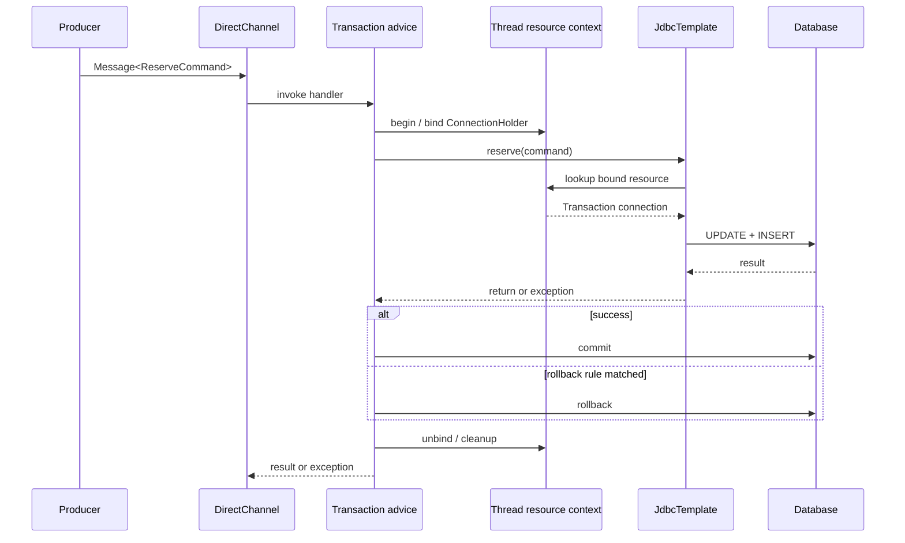
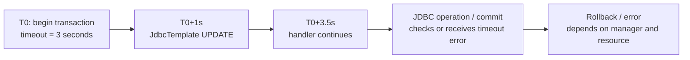
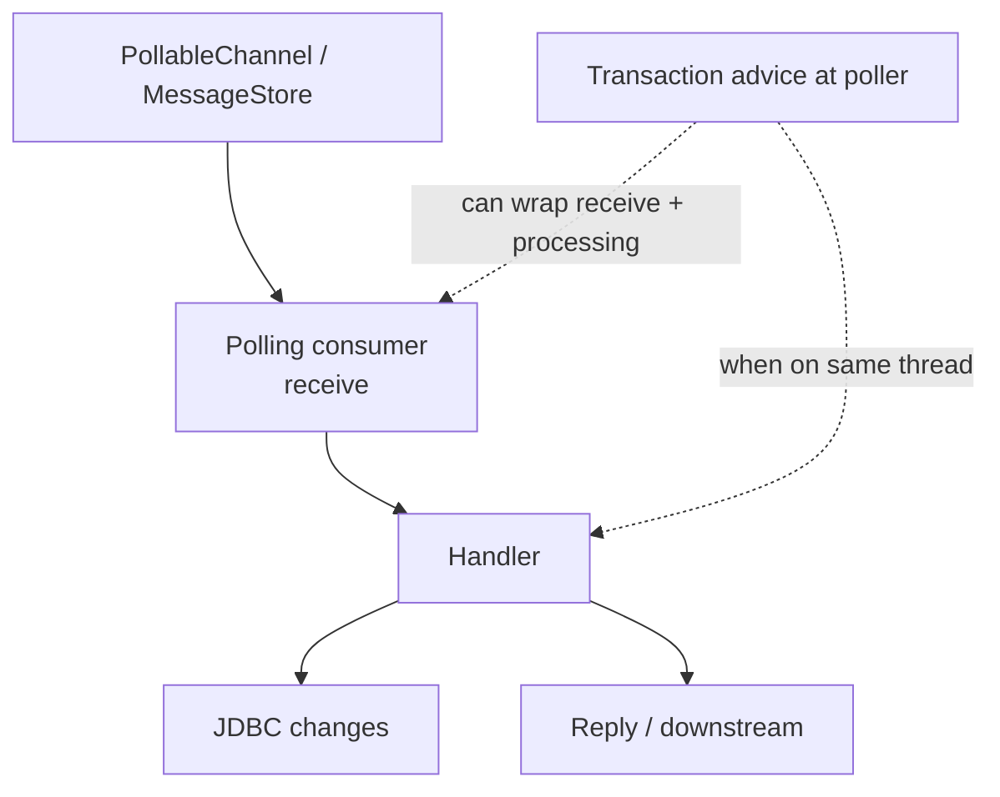
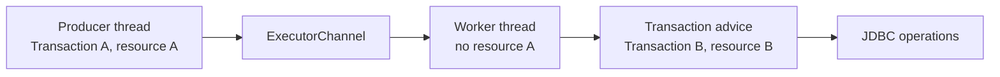

# Transaction Timeout and Resource Binding

## 1. Two questions that determine transaction behavior at runtime

In Spring Integration, a message travels through channels, consumer endpoints, pollers, and handlers. A handler can query a database, update a message store, call HTTP, or send a reply. When a step runs too long or an exception occurs, two questions usually arise:

1. **Where does the transaction time out?** Does a 3-second limit actually stop the handler after exactly 3 seconds, or is it only checked when a transaction-capable resource performs its next operation?
2. **Which thread is the resource bound to?** Does the handler's JDBC connection belong to the open transaction, and does it still belong to that transaction after the message crosses an `ExecutorChannel`?

The two questions are related. In Spring, common transaction managers such as `DataSourceTransactionManager` or `JdbcTransactionManager` typically use `TransactionSynchronizationManager` to bind transaction state and resource holders to the **current thread**. Resource timeout information is also managed in this context. A handler may look like it is running inside the same `IntegrationFlow`, yet end up using a non-transactional connection if the message switched to another thread before reaching the handler.

This lesson belongs to the **Transaction runtime** chapter of the **SPRING_INTEGRATION_RUNTIME** module, focusing on how channels, endpoints, consumers, pollers, and executors affect transactions, retries, error channels, message stores, correlation, and performance.

> **Core principle:** transaction timeout is a policy of the transaction manager and transactional resource; it is **not a timer that automatically interrupts arbitrary Java code**. Resource binding is tied to the executing thread; **messages do not automatically carry transaction context to another thread**.

## 2. Concepts to keep distinct

| Concept | Meaning | Not synonymous with |
| --- | --- | --- |
| **Transaction timeout** | Time budget granted by the transaction manager to a new transaction, when supported by the resource | Overall HTTP request deadline or executor task timeout |
| **Statement/query timeout** | Wait limit for a single SQL statement or operation enforced by the JDBC driver | Total processing time of the entire message flow |
| **Poll interval** | Cycle at which a poller checks a pollable source for messages | Timeout of the transaction currently processing a message |
| **Receive/send timeout** | Wait duration when sending/receiving on supporting channels/adapters | JDBC transaction timeout |
| **Resource binding** | Binding a `ConnectionHolder`/resource holder to a thread under a resource key | Attaching a connection to message headers to travel across the flow |
| **Propagation** | Rules for creating, joining, or suspending an existing transaction | Guaranteeing transactions across multiple threads and systems |

`TransactionDefinition.TIMEOUT_DEFAULT` means using the transaction manager's default; it does not mean "automatically time out after a fixed interval" in every application. `TransactionDefinition.PROPAGATION_REQUIRED` normally joins an existing transaction; the timeout attribute on a call joining an existing transaction **does not reset the deadline** of the outer transaction.

## 3. How does resource binding work?

Consider a consumer endpoint with transaction advice using `JdbcTemplate` connected to a `DataSource`. When the manager opens a new JDBC transaction, it typically acquires a connection and **binds** a `ConnectionHolder` to the thread. JDBC calls following Spring's transaction infrastructure, such as `JdbcTemplate` via `DataSourceUtils`, use that exact bound connection.



This is the conceptual model of a local JDBC transaction; details of when the connection is acquired can differ if `LazyConnectionDataSourceProxy` is present. When a transaction **joins an existing transaction**, the already-bound resource can be reused and the outer manager takes responsibility for the final commit/rollback.

### `TransactionSynchronizationManager`

Spring provides `org.springframework.transaction.support.TransactionSynchronizationManager` to observe thread-bound information:

```java
import javax.sql.DataSource;
import org.springframework.transaction.support.TransactionSynchronizationManager;

public void inspectCurrentThread(DataSource dataSource) {
    System.out.println(
        "activeTx=" +
        TransactionSynchronizationManager.isActualTransactionActive());

    System.out.println(
        "syncActive=" +
        TransactionSynchronizationManager.isSynchronizationActive());

    System.out.println(
        "resourceBound=" +
        TransactionSynchronizationManager.hasResource(dataSource));

    System.out.println(
        "txName=" +
        TransactionSynchronizationManager.getCurrentTransactionName());
}
```

Distinguishing the indicators:

- `isActualTransactionActive()` indicates the thread is marked as having an actual transaction under the corresponding Spring mechanism.
- `isSynchronizationActive()` indicates transaction synchronization is active; **not sufficient by itself** to conclude a real JDBC transaction exists.
- `hasResource(dataSource)` checks whether a resource is bound under the **specific DataSource key**. If the application uses a proxy/wrapper around DataSource, you must check the exact object used by the transaction manager.
- `getCurrentTransactionName()` can be `null`; the transaction name is not the message's correlation ID.

This is an API for **observing and supporting infrastructure**; you should not manually call `bindResource()`/`unbindResource()` inside a business handler just to "force" it into a transaction. The transaction manager must coordinate bind/unbind, commit, and cleanup. Leaking a resource holder on a pooled thread can cause subsequent messages to see stale state or exhaust connections.

## 4. Where is timeout set and how is it enforced?

Timeout can be declared via `@Transactional(timeout = 3)` on a Spring service invoked through a proxy, a `TransactionInterceptor` in an advice chain, or a poller's transaction advice. Regardless of where it is declared, you must know which transaction **is actually newly created**.

An illustrative timeline:



**Common point of confusion:** when a handler sleeps for 5 seconds in `Thread.sleep(5000)`, a 3-second timeout **does not necessarily interrupt the sleep**. With Spring JDBC, the remaining transaction time can be applied to the `Statement` via `JdbcTemplate` and `DataSourceUtils`. Once the deadline has expired, a subsequent JDBC call can throw `TransactionTimedOutException`; enforcement at operation/commit depends on the transaction manager, JDBC driver, and actual transaction integration.

Distinguish among:

- Spring's `TransactionTimedOutException` typically indicates the transaction deadline expired under the transaction infrastructure's mechanism.
- `QueryTimeoutException` or `SQLTimeoutException` can report a single SQL statement timeout; the overall transaction has not necessarily exceeded its deadline.
- Errors from lock waits, socket read timeouts, or database statement cancellation may have different exceptions and rollback policies.
- Timeouts on `WebClient`, HTTP clients, brokers, or gRPC are **separate mechanisms**; JDBC timeout does not automatically cancel those calls.

In workflows with blocking I/O, configure each client's timeout **and** a reasonable transaction timeout, while avoiding holding a database transaction open across long network waits.

## 5. Java DSL example: opening a transaction with timeout at the handler

Assume the application already configures Spring Integration, Spring JDBC, a `DataSource`, and a `PlatformTransactionManager` for the same database. The example manages inventory for reservation requests; each message contains a request ID, SKU, and quantity.

Create the test schema:

```sql
CREATE TABLE stock (
    sku VARCHAR(40) PRIMARY KEY,
    available INTEGER NOT NULL
);

CREATE TABLE reservation_log (
    request_id VARCHAR(60) PRIMARY KEY,
    sku VARCHAR(40) NOT NULL,
    quantity INTEGER NOT NULL
);

INSERT INTO stock (sku, available) VALUES ('SKU-01', 10);
```

Handler performing two JDBC operations inside a transaction:

```java
import javax.sql.DataSource;
import org.springframework.jdbc.core.JdbcTemplate;
import org.springframework.messaging.handler.annotation.Payload;
import org.springframework.transaction.support.TransactionSynchronizationManager;

record ReserveCommand(
    String requestId, String sku, int quantity, boolean failAfterWrite) {}

record ReserveReceipt(String requestId, String status) {}

public class StockReservationHandler {

    private final JdbcTemplate jdbc;
    private final DataSource dataSource;

    public StockReservationHandler(JdbcTemplate jdbc, DataSource dataSource) {
        this.jdbc = jdbc;
        this.dataSource = dataSource;
    }

    public ReserveReceipt reserve(@Payload ReserveCommand request) {
        System.out.printf(
            "thread=%s activeTx=%s boundConnection=%s%n",
            Thread.currentThread().getName(),
            TransactionSynchronizationManager.isActualTransactionActive(),
            TransactionSynchronizationManager.hasResource(dataSource));

        if (request.quantity() <= 0) {
            throw new IllegalArgumentException("Quantity must be positive");
        }

        int updated = jdbc.update(
            "UPDATE stock SET available = available - ? " +
            "WHERE sku = ? AND available >= ?",
            request.quantity(), request.sku(), request.quantity());

        if (updated != 1) {
            throw new IllegalStateException("Insufficient stock");
        }

        jdbc.update(
            "INSERT INTO reservation_log(request_id, sku, quantity) " +
            "VALUES (?, ?, ?)",
            request.requestId(), request.sku(), request.quantity());

        if (request.failAfterWrite()) {
            throw new IllegalStateException("Simulated failure");
        }

        return new ReserveReceipt(request.requestId(), "RESERVED");
    }
}
```

Register `TransactionInterceptor` with a 3-second timeout and attach it to the **consumer endpoint**:

```java
import javax.sql.DataSource;
import org.springframework.context.annotation.Bean;
import org.springframework.context.annotation.Configuration;
import org.springframework.integration.channel.DirectChannel;
import org.springframework.integration.channel.QueueChannel;
import org.springframework.integration.config.EnableIntegration;
import org.springframework.integration.dsl.IntegrationFlow;
import org.springframework.jdbc.core.JdbcTemplate;
import org.springframework.messaging.MessageChannel;
import org.springframework.messaging.PollableChannel;
import org.springframework.transaction.PlatformTransactionManager;
import org.springframework.transaction.TransactionDefinition;
import org.springframework.transaction.interceptor.DefaultTransactionAttribute;
import org.springframework.transaction.interceptor.TransactionInterceptor;

@Configuration
@EnableIntegration
public class StockFlowConfiguration {

    @Bean("stock.in")
    MessageChannel stockInput() {
        return new DirectChannel();
    }

    @Bean("stock.done")
    PollableChannel stockOutput() {
        return new QueueChannel(100);
    }

    @Bean
    StockReservationHandler stockReservationHandler(
            JdbcTemplate jdbc, DataSource dataSource) {
        return new StockReservationHandler(jdbc, dataSource);
    }

    @Bean
    TransactionInterceptor stockTxAdvice(
            PlatformTransactionManager transactionManager) {
        DefaultTransactionAttribute attr = new DefaultTransactionAttribute();
        attr.setPropagationBehavior(
            TransactionDefinition.PROPAGATION_REQUIRED);
        attr.setTimeout(3); // seconds
        return new TransactionInterceptor(transactionManager, attr);
    }

    @Bean
    IntegrationFlow stockFlow(
            StockReservationHandler handler,
            TransactionInterceptor stockTxAdvice) {
        return IntegrationFlow.from("stock.in")
            .handle(handler, "reserve",
                endpoint -> endpoint.advice(stockTxAdvice))
            .channel("stock.done")
            .get();
    }
}
```

`@EnableIntegration` enables Spring Integration infrastructure when needed; in some Spring Boot applications, auto-configuration already provides the appropriate infrastructure. The illustrative records require Java 16+, and can be replaced with POJOs on older Java versions.

**Why does this verify resource binding?** `stock.in` is a `DirectChannel`; the endpoint invokes the handler on the producer's thread, and `stockTxAdvice` wraps the handler call. When the transaction manager creates a new JDBC transaction for the `DataSource` that `JdbcTemplate` uses, logs inside `reserve()` normally show `activeTx=true` and `boundConnection=true`. If the output differs, inspect the transaction manager, DataSource proxy, and advice configuration; do not bind connections manually.

**Scope of guarantee:** rollback can undo `UPDATE` and `INSERT` on the same database within the actual JDBC transaction scope. Sending a reply to `stock.done`, calling HTTP, or writing logs outside the database does not automatically become a rollbackable resource.

## 6. Verifying rollback, timeout, and data state

After the application starts, you can send requests using the Spring Messaging API:

```java
import org.springframework.messaging.Message;
import org.springframework.messaging.MessageChannel;
import org.springframework.messaging.PollableChannel;
import org.springframework.messaging.support.GenericMessage;

MessageChannel input = context.getBean("stock.in", MessageChannel.class);
PollableChannel output = context.getBean("stock.done", PollableChannel.class);

input.send(new GenericMessage<>(
    new ReserveCommand("OK-1", "SKU-01", 2, false)));

Message<?> receipt = output.receive(1_000);
// ReserveReceipt("OK-1", "RESERVED")

try {
    input.send(new GenericMessage<>(
        new ReserveCommand("FAIL-1", "SKU-01", 3, true)));
} catch (RuntimeException ex) {
    // The messaging layer may wrap the handler's exception.
    System.out.println(ex.getClass().getName());
}
```

`context` is the running `ApplicationContext`. After these steps, if the database starts with `available = 10`, no other writer is competing, and the transaction is configured properly, the expected results are:

| Step | Remaining quantity | Business log rows |
| --- | ---: | --- |
| Initial | 10 | 0 |
| `OK-1` commits successfully, reserves 2 items | 8 | 1 |
| `FAIL-1` throws runtime exception after two SQL statements, rolls back | 8 | 1 |

You can verify with SQL:

```sql
SELECT available FROM stock WHERE sku = 'SKU-01';
SELECT request_id, quantity FROM reservation_log ORDER BY request_id;
```

This is **rollback verification**, not yet timeout verification. To test timeout, create a processing path with a controlled delay followed by another JDBC operation after the deadline expires, such as adding `Thread.sleep(3500)` between two SQL statements in a **test environment**. Handle `InterruptedException` properly and never put sleep in production logic. Observe the exception type, rollback values in both tables, and transaction trace; exact behavior depends on the transaction manager/driver.

**Do not assert** that merely sleeping past 3 seconds always causes Spring to throw a timeout exception right at the `sleep` line. That is precisely what the learner must verify.

## 7. `@Transactional`, `TransactionTemplate`, and `TransactionInterceptor`

Three ways of declaring transactions can share the same transaction manager while differing in where the scope starts:

| Usage | Typical scope | Notes |
| --- | --- | --- |
| `@Transactional(timeout = 3)` on a Spring service | Method invoked **via Spring proxy** | Self-invoking a method in the same bean normally bypasses the proxy by default. |
| `TransactionTemplate` | Code inside the template callback | Useful when controlling scope programmatically; timeout can be set on the template. |
| `TransactionInterceptor` in an endpoint advice chain | The invocation wrapped by the advice | Must verify advice is attached to the actual running endpoint; does not automatically wrap the whole flow. |
| Poller transaction advice | Polling/receive/handler scope managed by the poller | Whether receive rolls back also depends on the message store/adapter and transaction manager. |

Example of `TransactionTemplate` attaching a timeout to a callback:

```java
import org.springframework.transaction.support.TransactionTemplate;

TransactionTemplate template = new TransactionTemplate(transactionManager);
template.setTimeout(3);

ReserveReceipt receipt = template.execute(status ->
    stockReservationHandler.reserve(request));
```

This snippet assumes `transactionManager`, `stockReservationHandler`, and `request` are already available; it clarifies programmatic transaction boundaries. If executed inside an existing transaction with `REQUIRED` propagation, the new timeout does not reset the outer transaction's deadline either.

These approaches **should not be stacked unintentionally**. A handler might be wrapped by endpoint advice while also calling a `@Transactional` service; explicitly document each layer's propagation, which object owns the transaction, and when commit actually happens.

## 8. Poller, message store, and processing-cycle timeout

With `PollableChannel`, the poller is the component that actively calls `receive` to pull messages. If a transaction is placed **only around the handler**, taking the message from the queue may happen outside that transaction.



Example configuring a poller transaction in DSL (using existing beans):

```java
import java.time.Duration;
import org.springframework.integration.dsl.IntegrationFlow;
import org.springframework.integration.dsl.Pollers;
import org.springframework.messaging.PollableChannel;
import org.springframework.transaction.PlatformTransactionManager;

@Bean
IntegrationFlow pendingStockFlow(
        PollableChannel pendingStock,
        StockReservationHandler handler,
        PlatformTransactionManager txManager) {

    return IntegrationFlow.from(pendingStock,
        endpoint -> endpoint.poller(
            Pollers.fixedDelay(Duration.ofSeconds(1))
                .maxMessagesPerPoll(1)
                .transactional(txManager)))
        .handle(handler, "reserve")
        .get();
}
```

The example illustrates the **idea of a poller transaction**; `pendingStock` must be a channel with an appropriate receiver and configured separately. The poller's `.transactional(txManager)` configuration uses appropriate transaction advice to coordinate the poll cycle. Verify the actual timeout applied from the transaction definition/advice used by the poller; do not infer that `fixedDelay(1s)` is the transaction timeout.

Key points:

- An in-memory `QueueChannel` does not automatically become a persistent, transactional queue just because the poller has a transaction.
- When using a compatible JDBC message store, the poller transaction and JDBC transaction can coordinate so operations join the proper scope, though this must be verified on the specific implementation.
- If the poller uses an executor to process on another thread, resource binding on the polling thread does not automatically follow the message to the worker.
- If a broker adapter has its own ack/redelivery mechanism, a JDBC transaction does not implicitly roll back broker offsets/acks.

In systems requiring recovery, inspect three separate states: **whether the message left the source**, **whether the database committed**, and **whether the message was acked or will be redelivered**. A database transaction timeout only addresses part of that contract.

## 9. What happens when the flow changes threads?

Because transaction resources are bound to a thread, asynchronous boundaries require special attention:

| Message path | Executing thread | Resource binding |
| --- | --- | --- |
| `DirectChannel` → synchronous handler | Usually the thread calling `send` | Can see the producer's existing transaction; handler advice can open or join a transaction. |
| `ExecutorChannel` → handler | Executor worker | **Does not automatically inherit** the sending thread's transaction resources. Advice on the worker can open a separate transaction. |
| `QueueChannel` → polling consumer | Poller thread / poller worker | Can bind a transaction opened by the poller or handler advice on the executing thread itself. |
| `PublishSubscribeChannel` with executor | Subscriber dispatch worker | Do not assume all subscribers share the producer's transaction. |



**Scenario:** a producer is inside a `@Transactional` service and sends a message via `ExecutorChannel`. `send()` may return before the handler finishes processing. The handler on the worker does not automatically have the producer's JDBC connection/transaction. If the handler still must protect database writes, place transaction advice on the worker side (or a transactional service called through a proxy), then re-verify `isActualTransactionActive()`, `hasResource(dataSource)`, and rollback with real data.

Do not try to copy `ConnectionHolder` or transaction objects into message headers to "pass the transaction." Those objects are bound to threads/resources, are typically unsafe for cross-thread use, and do not solve two-phase commit across distinct systems.

## 10. Propagation, timeout, and retry: differences across attempts

Suppose a handler experiences a transient error and `RequestHandlerRetryAdvice` retries three times. When combined with transaction advice, wrapper ordering determines how the timeout is counted.

**Retry outside transaction (each attempt can have its own transaction):**

```text
RetryAdvice
  attempt 1 -> TransactionInterceptor(timeout=3s) -> handler -> rollback
  attempt 2 -> TransactionInterceptor(timeout=3s) -> handler -> rollback
  attempt 3 -> TransactionInterceptor(timeout=3s) -> handler -> commit
```

If there is **no outer transaction** and `PROPAGATION_REQUIRED` opens a new transaction per attempt, each attempt gets its own deadline. If the caller already carries a transaction and attempts all **join** it, the outcome differs: the original deadline still caps processing, and the transaction may already be marked rollback-only.

**Transaction outside retry (multiple attempts may share one transaction):**

```text
TransactionInterceptor(timeout=3s)
  RetryAdvice
    attempt 1 -> handler -> error
    backoff
    attempt 2 -> handler -> success
  commit / rollback
```

Backoff inside a transaction consumes timeout budget and holds connections/locks. After a database error, the transaction may no longer be fit for retry. In most workflows retrying JDBC due to transient errors, consider **retry wrapping a new transaction on each attempt**, with proper advice ordering and propagation.

**`REQUIRES_NEW`** can create an independent transaction even when the caller has one, yet typically must acquire an additional connection while the outer transaction holds one. With small thread pools and connection pools, this configuration increases the risk of connection exhaustion or resource deadlocks; use it only when independence is truly needed.

**Retry timeout differs from transaction timeout:** three attempts, each up to 3 seconds plus backoff, do not add up to a 3-second overall deadline. If the caller/gateway requires a 5-second SLA, you need a separate overall deadline and cancellation/recovery policy.

## 11. Timeout errors, rollback, and the error channel

An exception inside a transaction can follow different handling paths:

- **Synchronous `DirectChannel`:** an unhandled exception can return to the producer/gateway. Transaction advice rolls back per policy and resources are cleaned up after the transaction finishes.
- **`ExecutorChannel` or poller:** exceptions typically surface on the worker/poller. Configured error handling may create an `ErrorMessage` and send it to the appropriate `errorChannel`. Failure to publish a notification or an unsubscribed error channel is a secondary issue, distinct from database rollback.
- **Handler catches exception and returns a successful reply:** the interceptor may view the method as completing normally and commit, unless the transaction was already marked rollback-only or another policy applies. Do not equate logging an exception with having rolled back.

Note on rollback rules: by default Spring's transaction infrastructure usually rolls back when `RuntimeException` or `Error` escapes the advice scope; **checked exceptions** normally do not roll back automatically unless a rule is set. `TransactionTimedOutException` is a runtime exception in Spring, though the final policy must still be checked against the manager and actual error-handling path.

A message flowing through the pipeline can carry `correlationId`, `replyChannel`, `errorChannel`, or custom `traceId`. These headers help **trace** transaction timeouts, yet **do not propagate transactions**. Inspect `MessagingException.getFailedMessage()` when available, combining root cause and transaction trace to locate the failing message; do not log full sensitive payloads.

### Resource cleanup on error

The transaction manager is responsible for unbinding/cleaning up resources after commit/rollback under its managed lifecycle. If the connection pool drops in available connections after a wave of timeouts, do not jump to assuming `ThreadLocal` was not cleared; also investigate **running SQL**, connection leaks from manually managed code, driver query cancellation, lock-waiting transactions, and pool sizing. With uncancelled I/O, a worker can keep holding a resource even after the logical deadline has passed.

## 12. Runtime troubleshooting guide

| Symptom | Likely cause | Evidence to inspect |
| --- | --- | --- |
| `timeout=3` set yet handler runs over 3 seconds | Handler waiting on CPU/sleep/HTTP, resource has not checked deadline; timeout does not interrupt thread | Thread name, step durations, SQL/query timeout, and HTTP client timeout. |
| `TransactionTimedOutException` thrown on next SQL statement | Transaction deadline expired when `JdbcTemplate` applied remaining time | Stack trace, begin time, statement acquisition time, transaction trace. |
| `activeTx=false` inside handler | Advice not attached to endpoint, handler called outside proxy, or crossed a thread boundary | Endpoint config, thread before/after channel, transaction active flag. |
| `activeTx=true` yet `hasResource(dataSource)=false` | Transaction uses a different resource, different DataSource proxy/key, or resource not bound as expected | Active transaction manager, DataSource identity, resource type, lazy proxy config. |
| DB still commits even though handler logs error | Exception caught and ignored; rollback rule mismatch; DB called outside tx scope | Root cause, rollback-only state, post-error SQL state. |
| DB rolls back yet message does not return to queue | Receive/ack outside transaction scope or source does not support rollback | Poller advice, message store, ack mode, redelivery logs. |
| Continuous timeouts under load | Long pool/lock waits, overly wide transactions, backoff inside tx | JDBC active/idle pool, wait time, lock metrics, transaction duration. |
| Error appears only after switching to `ExecutorChannel` | Producer's transaction does not propagate to worker | Worker thread name, worker-side endpoint advice, resource binding check. |
| Retries multiple times yet still expires | Attempts share the same deadline or resource is in rollback-only state | Advice order, propagation, attempt count, transaction ID/logs. |
| Error flow receives error yet message is processed twice | Broker redelivery/retry after partial side effect outside tx | Idempotency key, commit/ack timing, outbox/DLQ policy. |

Short procedure when investigating an incident:

1. **Identify the message:** message ID, `correlationId`/`traceId`, endpoint, handler, receive timestamp.
2. **Identify the transaction scope:** which annotation/advice/poller was actually invoked, with what propagation and timeout.
3. **Check threads:** log thread before and after channels; compare `TransactionSynchronizationManager` state inside the handler.
4. **Check resources:** which `PlatformTransactionManager`, which `DataSource`, and whether `JdbcTemplate` participates in the same resource.
5. **Read the root cause:** distinguish transaction deadline, SQL timeout, lock wait, HTTP timeout, and message delivery error.
6. **Verify consequences:** check DB commit/rollback, queue/broker ack, redelivery, error handler, and retries. Do not infer outcomes solely from `send()` or a single log line.

## 13. Performance and risks of misconfigured timeouts

Suppose a handler spends 30 ms accessing the database, then calls an external API averaging 2 seconds, and finally writes more SQL. If a JDBC transaction is opened before the API call, connections/locks may be held throughout the network wait. Under high load, parallel requests increase connection pool pressure, lock contention, timeouts, and retries; retries in turn increase load.

Reasonable design approaches depending on the problem:

- **Narrow the transaction** to wrap only the database updates that need atomicity, avoiding heavy CPU work or long HTTP waits inside the transaction.
- **Set layered timeouts**: HTTP client timeout, JDBC statement/query timeout, transaction timeout, broker receive/ack, and request/reply gateway timeout.
- **Monitor resource pools**: active/idle connections, connection wait time, lock waits, thread pool queues, and message latency.
- **Coordinate retry and idempotency**: place retry outside the transaction when each attempt needs a fresh transaction; distinguish transient errors from validation errors.
- **Use an outbox or appropriate coordination mechanism** if events must be guaranteed after DB commit; a JDBC transaction does not automatically make an HTTP/broker call atomic with it.
- **Do not manually hack resource binding** to patch symptoms. Find mismatches across DataSource, transaction manager, and thread before changing infrastructure.

## 14. Practice exercises and self-check

**Exercise 1 — Prove resource binding.** Run the section 5 example over `DirectChannel`. Log thread name, `isActualTransactionActive()`, and `hasResource(dataSource)` inside the handler. Send one succeeding message and one message throwing an exception after writing SQL. Query the real data to confirm commit/rollback.

**Exercise 2 — Timeout is not an interrupt.** Keep timeout at 3 seconds; in a test environment, add a wait longer than the deadline before the second `JdbcTemplate.update()` call. Observe when the exception appears, the exception type, and the rollback outcome. Then add a separate timeout for a simulated I/O client and note the difference.

**Exercise 3 — Split threads.** Place an `ExecutorChannel` between the producer and the processing endpoint. If the producer already has its own transaction, compare `activeTx`/`hasResource` on both sides. Attach transaction advice to the handler on the worker and verify the new resource is bound on the right thread.

**Exercise 4 — Poller and message store.** Use a `QueueChannel` with a poller. Compare handler-only transactions with a poller transaction. To prove receive rollback, replace the in-memory queue with a transaction-capable store/adapter and check redelivery after an exception.

**Exercise 5 — Retry with timeout.** Add retry advice with three attempts and backoff for a transient error. Try both retry/transaction orderings; record transaction begin/rollback counts, total processing time, and signs of reusing a rollback-only transaction.

**Self-check questions:**

1. Why is `Thread.sleep(5000)` not necessarily interrupted when a transaction has a 3-second timeout?
2. What does `TransactionSynchronizationManager` bind resources to, and why does switching to `ExecutorChannel` change that?
3. How do `isSynchronizationActive()` and `isActualTransactionActive()` differ?
4. Why does setting a 2-second timeout on a `REQUIRED` method not necessarily override an outer transaction's deadline?
5. How does transaction advice on a handler differ from a transaction on a poller with respect to `receive`?
6. Why does a JDBC rollback not guarantee a broker message is redelivered?
7. When retrying, how do you ensure each attempt gets a fresh transaction while still enforcing an overall time limit?
8. Which metrics help distinguish transaction timeouts caused by lock holding, connection waiting, and slow network calls?

**Operational principle:** pinpoint where the transaction is created, which operations the timeout applies to, and which resource is bound to which thread before investigating rollback, retries, acknowledgements, and performance. Only when the **transaction boundary**, **thread boundary**, and **delivery boundary** are designed consistently can a flow recover from errors and operate reliably.
