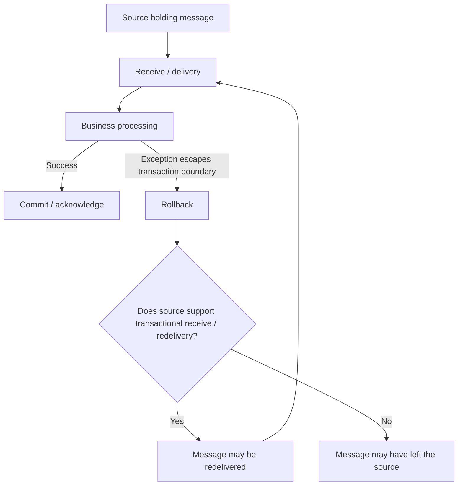
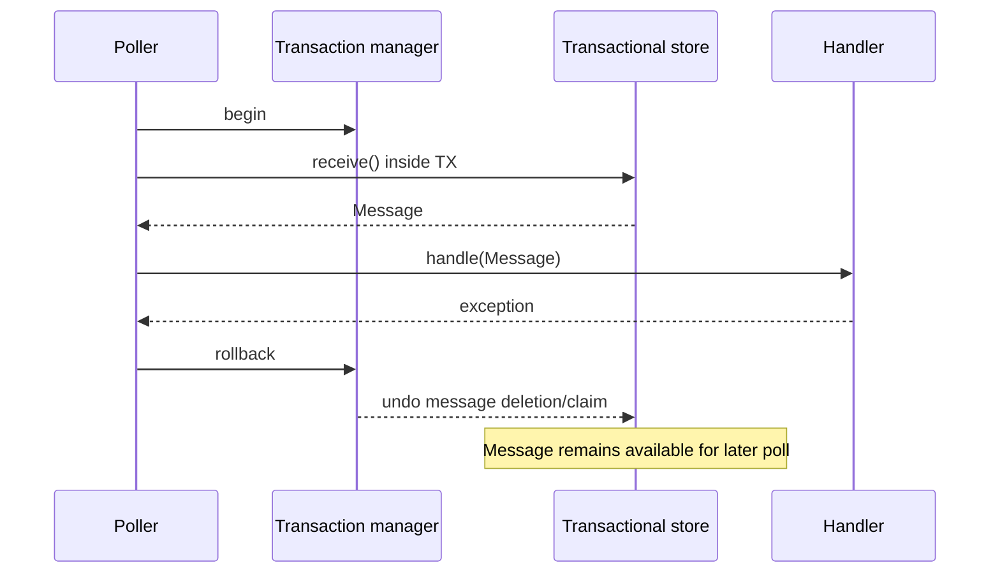
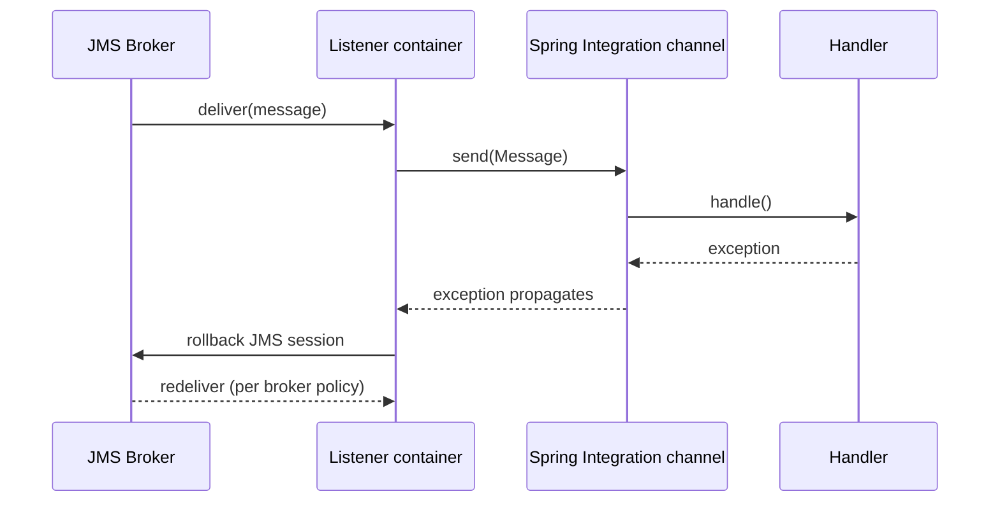
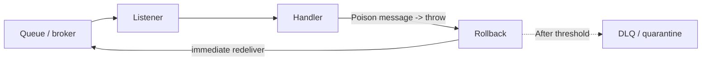
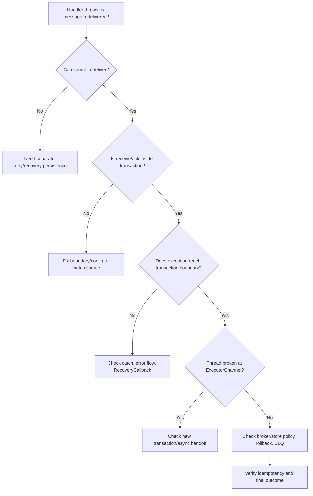

# Message Redelivery After Rollback

In **Spring Integration runtime**, a message can travel through channels, consumer endpoints, pollers, executors, and handlers before completing business processing. When a handler throws an exception, the transaction may **roll back**. Yet the critical question is: **will the message be redelivered after rollback?**

The answer depends on **the resource supplying the message**, **whether the receive/acknowledge operation belongs to the transaction**, **whether the exception actually reaches the transaction boundary**, and **whether the source supports redelivery**. Rolling back a database transaction in a handler does not automatically put the message back onto every kind of channel. This lesson belongs to the **Transaction runtime** chapter of the `SPRING_INTEGRATION_RUNTIME` module, clarifying this mechanism and how to design, test, and diagnose redelivery alongside retries, message stores, error flows, and correlation.

## 1. Distinguishing rollback, retry, and redelivery

Three concepts are often used interchangeably yet have different scopes:

| Concept | What happens? | Who coordinates it? |
| --- | --- | --- |
| **Rollback** | Undoes changes belonging to an uncommitted transaction | Transaction manager / broker transaction |
| **Retry** | Re-invokes processing after failure; may keep the same message within one invocation | `RetryTemplate`, advice, HTTP client, or application logic |
| **Redelivery** | Source delivers a message again that has not been successfully acknowledged or still remains in the store | Broker, transactional message store, source adapter |

**Example:** an HTTP handler re-invoked three times by `RequestHandlerRetryAdvice` on the same message is **handler retry**. If a JMS listener rolls back its session and the broker returns the message to a consumer, that is **redelivery from the source**. Both mechanisms can coexist and multiply the total handler invocation count beyond what you expect.



A redelivered message **is not synonymous** with *exactly once* processing. If the previous attempt caused non-rollbackable side effects (calling an API, sending an email, updating an external system), redelivery can make those side effects happen again. Therefore, idempotency and a permanent-error handling policy are mandatory parts of the design.

## 2. Four conditions for expecting redelivery after rollback

Check these questions in exact order:

1. **What is the source?** A JMS/AMQP broker, an in-memory `QueueChannel`, a JDBC-backed `QueueChannel`, a file adapter, or an HTTP inbound gateway have completely different semantics.
2. **Is receive/ack part of the rolling-back transaction?** The transaction must wrap the operation that pulls the message or confirms delivery; a transaction wrapping only the business `INSERT` is usually not enough.
3. **Does the error escape the transaction boundary?** If the handler, error flow, or recovery callback catches the exception and returns normally, the transaction may commit.
4. **What will the source do after rollback?** It may return the message to the queue, pick another consumer, apply a delay, increment a delivery count, or route it to a dead-letter queue per its own policy.

| Source / configuration | After handler fails | Redelivery expectation |
| --- | --- | --- |
| Default `QueueChannel` in RAM | Message has usually already been pulled from the queue by `receive()` | **Not automatic** just because DB rolls back |
| `QueueChannel` + transactional `JdbcChannelMessageStore`, poller with matching transaction | Removing the message from the store can roll back | Message remains in the store and can be polled again |
| JMS listener with **transacted session**, exception triggers rollback | Message receive session rolls back | Broker may redeliver per delivery policy |
| JMS listener handles error then completes normally | Session may commit | Usually no redelivery because the error was absorbed |
| HTTP inbound request | Caller already sent request; no broker storing it | Only a new request arrives if the client actively resends |
| File poller + `PseudoTransactionManager` | Provides status synchronization callbacks | Does not turn file reading into a real transaction |

These rows describe **typical** cases and do not replace inspecting the specific adapter/broker and transaction manager. With JMS, AMQP, Kafka, or JDBC stores, commit, ack, rollback, and requeue semantics are also affected by listener mode, container, and source configuration.

## 3. Transaction boundaries in a message flow

With a polling endpoint, a transaction can start **before calling `receive()`**. If the receiving source is a transactional resource and subsequent processing stays in the same transaction, a handler error can roll back pulling the message.



In Spring Integration, a poller supports transaction advice so each **receive-and-forward** operation runs inside an appropriate transaction boundary. However, Spring's transaction context is usually bound to the **current thread**. If the flow crosses an `ExecutorChannel`, moves to another pollable channel, or spawns a new thread, an exception after the async boundary may not reach the original transaction.

```text
Poller thread:
  BEGIN TX
  receive() -> synchronous handler -> exception
  ROLLBACK  (opportunity to restore receive)

Poller thread:
  BEGIN TX
  receive() -> ExecutorChannel.send() -> accepted
  COMMIT

Executor thread (later):
  handler -> exception
  // Does not automatically roll back the already-committed poller transaction.
```

**Implication:** for the exact same business exception, switching a channel from `DirectChannel` to `ExecutorChannel` can completely change the redelivery outcome. When inspecting failures, record the **thread**, `receive` timestamp, `commit/rollback` timestamp, and endpoint name.

## 4. Case without redelivery: in-memory QueueChannel

The default `QueueChannel` uses process memory for its queue. A consumer calling `receive()` immediately removes the message from the queue upon receipt. If the handler subsequently runs inside a database transaction and throws an exception, that transaction can only undo **the participating database operations**, not the dequeue from the RAM queue.

Minimal example:

```java
import org.springframework.integration.channel.QueueChannel;
import org.springframework.messaging.Message;
import org.springframework.messaging.support.MessageBuilder;

QueueChannel queue = new QueueChannel(10);
queue.send(MessageBuilder.withPayload("ORDER-42").build());

Message<?> received = queue.receive(0);  // Pulled from RAM queue

try {
    // Illustrative only. In a real app, the transaction lives on the service/poller.
    throw new IllegalStateException("DB update failed");
}
catch (IllegalStateException ex) {
    System.out.println("Business transaction may roll back: " + ex.getMessage());
}

System.out.println(queue.receive(0));  // null unless another producer sent one
```

In this example, no real transaction is opened in the Java code; it only clarifies that **pulling a message from a RAM queue is not automatically undone**. Even if you put `@Transactional` on the handler, that annotation alone still does not turn `QueueChannel` into a resource with transactional dequeue.

If you need protection against message loss when the application stops or a handler fails, use a **source/broker with redelivery semantics**, or a `QueueChannel` backed by a durable `ChannelMessageStore` **and** a transaction wrapping `receive()` as well.

## 5. Case where redelivery is possible: QueueChannel + JdbcChannelMessageStore

`JdbcChannelMessageStore` stores `QueueChannel` messages in a database. When a poller runs with an appropriate transaction, pulling a message from the store can be rolled back together with related database operations. The message therefore remains present to be received again on the next poll.

### 5.1. Illustrative configuration using Spring Integration XML

The example below is a **configuration fragment**, assuming the application already has `dataSource`, `orderHandler`, the `spring-integration-jdbc` library, a `PlatformTransactionManager` named `transactionManager`, and the store tables created from the corresponding JDBC schema. The `queryProvider` below uses PostgreSQL.

```xml
<!-- Channel using a JDBC store instead of a RAM queue -->
<int:channel id="ordersQueue">
    <int:queue message-store="channelStore"/>
</int:channel>

<bean id="queryProvider"
      class="org.springframework.integration.jdbc.store.channel.PostgresChannelMessageStoreQueryProvider"/>

<bean id="channelStore"
      class="org.springframework.integration.jdbc.store.JdbcChannelMessageStore">
    <property name="dataSource" ref="dataSource"/>
    <property name="channelMessageStoreQueryProvider" ref="queryProvider"/>
</bean>

<!-- Transaction must wrap poll/receive and synchronous handler -->
<int:service-activator input-channel="ordersQueue"
                       ref="orderHandler"
                       method="handle">
    <int:poller fixed-delay="250" max-messages-per-poll="1">
        <int:transactional transaction-manager="transactionManager"
                           propagation="REQUIRED"/>
    </int:poller>
</int:service-activator>
```

To place this fragment into a complete Spring XML file, declare the `beans`/`int` namespaces and corresponding schemas. `JdbcChannelMessageStore` also depends on tables and an SQL query provider matching the version/database; those tables do not appear automatically just from defining the bean. The configuration typically uses the same `DataSourceTransactionManager` as the `DataSource` so store operations and business operations **actually participate in the same transaction**, if rolling back both is desired.

Example of a handler with a one-time failure:

```java
import java.util.Set;
import java.util.concurrent.ConcurrentHashMap;
import org.springframework.jdbc.core.JdbcTemplate;

public class OrderHandler {
    private final JdbcTemplate jdbc;
    private final Set<String> failOnce = ConcurrentHashMap.newKeySet();

    public OrderHandler(JdbcTemplate jdbc) {
        this.jdbc = jdbc;
        this.failOnce.add("ORDER-42");
    }

    public void handle(String orderId) {
        jdbc.update(
                "INSERT INTO processed_orders(order_id) VALUES (?)",
                orderId);
        if (failOnce.remove(orderId)) {
            throw new IllegalStateException("Demo: fail only on first delivery");
        }
        System.out.println("Processed " + orderId);
    }
}
```

Assuming the `processed_orders` table has been created, this simulates a **transient** error. `failOnce` lives only in RAM for demonstration; it is not an idempotency or retry-state mechanism suitable for production.

### 5.2. Expected progression

| Time | Activity | JDBC state |
| --- | --- | --- |
| T0 | Producer sends `ORDER-42`; message is stored in JDBC `ordersQueue` | Message is in store |
| T1 | Poller opens transaction, pulls message, handler executes `INSERT` | Deletion from store and insert are uncommitted |
| T2 | Handler throws exception; exception escapes to transaction advice | Transaction rolls back; message deletion and insert are undone |
| T3 | Poller runs again, receives message still in store | Can redeliver `ORDER-42` |
| T4 | Handler succeeds, transaction commits | Store deletion and insert are committed |

**Key point:** re-invoking the handler is merely the observable result; redelivery capability comes from **rolling back the receive operation in the JDBC store**. If the transaction wraps only the handler and the receive operation committed separately, rollback does not recreate the message. If the store and business tables belong to two uncoordinated transaction sources, rollback may affect only one side.

In a multi-poller/multi-instance environment, a message after rollback may be picked up by **another** consumer; the same thread or node is not guaranteed. When using the JDBC store's lock/cache features, also verify database compatibility, isolation level, and operational configuration to avoid contention or duplicate receives.

## 6. JMS: session rollback and broker redelivery

With a **JMS message-driven channel adapter**, a JMS listener container can receive messages in a **transacted session**. If synchronous processing results in an exception propagating back to the container and rolling back the session, the broker has the right to redeliver the message per its redelivery policy. Spring Integration supports message-driven JMS inbound adapters, yet dispatching down channels and error handling must be evaluated as part of this boundary.



The following XML fragment illustrates a **listener container with `sessionTransacted=true`**. The `connectionFactory` and `orderHandler` beans, along with `int`/`int-jms` namespaces and appropriate schemas, are declared in the application configuration:

```xml
<bean id="jmsContainer"
      class="org.springframework.jms.listener.DefaultMessageListenerContainer">
    <property name="connectionFactory" ref="connectionFactory"/>
    <property name="destinationName" value="orders.in"/>
    <property name="sessionTransacted" value="true"/>
</bean>

<int:channel id="ordersFromJms"/>

<int-jms:message-driven-channel-adapter
        id="ordersInbound"
        container="jmsContainer"
        channel="ordersFromJms"/>

<int:service-activator input-channel="ordersFromJms"
                       ref="orderHandler"
                       method="handle"/>
```

In the example, `ordersFromJms` defaults to a synchronous channel whose subscriber is the handler. If the handler throws an exception and it is not swallowed by an error flow/advice, the container can roll back. If replaced by an `ExecutorChannel` and task submission succeeds, async processing can fail after JMS delivery has already been treated as successful and the session has committed.

### 6.1. Ack, delivery count, and broker policy

Redelivery may carry broker indicators such as `JMSRedelivered` and `JMSXDeliveryCount`, though support levels and counting semantics depend on the JMS provider. JMS headers can be mapped through the adapter, also depending on mapping configuration. Do not assume an arbitrary header named `retryCount` is automatically incremented by every broker.

Brokers usually configure maximum redelivery attempts, delay/backoff intervals, and a final destination such as a **dead-letter queue (DLQ)**. Once the limit is reached, the message may be moved off the main queue; continuing to throw exceptions in the handler will not guarantee infinite redeliveries.

**Note:** the listener's JMS transaction and a database transaction inside the handler can be **two separate local transactions**. `sessionTransacted=true` does not automatically create an atomic commit between JMS and JDBC. If strong coordination is required, consider XA/JTA or design appropriate outbox/inbox, deduplication, and recovery.

## 7. Does the exception escape the transaction boundary?

Redelivery usually requires a **real failure signal** reaching the transaction manager/container. A handler might throw an error while an outer layer catches it and returns normally:

```text
JMS / transactional poller
  -> handler throws
  -> error handler catches, sends ErrorMessage
  -> error handler returns normally
  -> outer transaction sees normal completion
  -> COMMIT may happen
```

In that case, do not expect the broker/store to redeliver the message. Conversely, if the error flow rethrows the exception or properly marks the transaction `rollback-only`, the transaction can roll back.

| Error-handling approach | Seen at transaction boundary | Possible impact |
| --- | --- | --- |
| Handler exception propagates out | Sees failure | Rollback; transactional source may redeliver |
| `catch` then only log | Sees normal completion | May commit and not redeliver |
| Retry advice succeeds within same invocation | Sees normal completion | Commits after retry succeeds |
| `RecoveryCallback` sends `ErrorMessage` then returns normally | Exception may no longer exist | May commit; message will not be resent by source |
| Recovery callback throws after retries exhausted | Sees failure | May roll back/redeliver per source |

This is why **error channels** and **transactional redelivery** must be designed together. With a JMS inbound adapter having an error channel, conversion/dispatch errors can be sent as an `ErrorMessage`; if the error flow finishes without throwing an exception, the container may commit instead of rolling back. You cannot merely see an "ERROR" log and conclude the broker will redeliver.

In Spring Transaction, default rollback rules usually apply to unchecked exceptions (`RuntimeException`/`Error`), while checked exceptions depend on rollback rules or transaction advice configuration. Inspect the final exception actually seen by the transaction interceptor, including wrapper cases.

## 8. Boundary between retry advice and source redelivery

`RequestHandlerRetryAdvice` can retry a handler multiple times **within a single delivery**. If all attempts fail and the exception continues up to the transactional source, the source may redeliver and start a fresh retry sequence.

```text
Delivery #1
  handler attempt 1 -> error
  handler attempt 2 -> error
  handler attempt 3 -> error
  rollback

Delivery #2
  handler attempt 1 -> error
  handler attempt 2 -> success
  commit
```

In the example above, the handler executes **5 times** across two deliveries of one task. If the broker allows up to 4 deliveries and each delivery uses 3 attempts, handler calls can reach **12** when every attempt fails, not counting retries in an HTTP client or downstream layer.

Therefore, clearly distinguish:

- **Attempt count**: how many times the handler method is invoked.
- **Delivery count**: how many times the source delivers the message.
- **Message ID/correlation**: how attempts/deliveries of the same work are linked.
- **Final outcome**: processed successfully, routed to DLQ, awaiting intervention, or permanently failed.

With `stateful retry`, retry context can be correlated across multiple deliveries using a stable key. Yet stateful retry does not guarantee broker redelivery by itself; the source must have proper rollback/redelivery behavior. Pay attention to retry context caches and message identity across restarts.

When using `ErrorMessageSendingRecoverer`, the callback may **swallow the final exception** after publishing the error. That can prevent source rollback. This can be the right choice when the recovery flow has durably saved the message or moved it to a DLQ, but it must be a deliberate decision.

## 9. Poison messages and infinite rollback loops

A message with an invalid schema, missing required fields, or triggering a programming bug that always fails is a **poison message**. If every rollback makes the source immediately redeliver, the system can create a **redelivery storm**:



Consequences include high CPU, repetitive logs, occupied pollers/executors, increased lock contention, and delayed valid messages. Do not merely increase thread counts when facing a poison message.

Designs usually need **bounded retries and redelivery at the right layer**:

| Error type | Usually appropriate handling | Reason |
| --- | --- | --- |
| Transient HTTP 503 | Bounded retry, backoff, then delayed redelivery if needed | Recoverable |
| Database deadlock | Retry transaction at the right scope | Transaction needs to re-run from a clean state |
| Invalid schema data | Quarantine or DLQ with reason | Resending unchanged is rarely useful |
| Permanent authorization/validation failure | Report error, block infinite retry | Will not heal by waiting |
| Unknown payment outcome | Query status/idempotency before replay | Avoid executing side effects twice |

DLQ or quarantine is not automatically built into every `QueueChannel`. With JMS/AMQP, queue names, retry counts, delay policies, and DLQ routing criteria are governed by the broker/adapter. With a custom JDBC store, you may need to design states/workflows to move messages from the hot queue to an error table.

## 10. Redelivery does not guarantee exactly-once

Suppose a handler performs:

```text
receive(OrderPaid)
  -> write order status to DB
  -> call payment gateway
  -> send confirmation email
  -> throw exception due to timeout
rollback
redelivery(OrderPaid)
```

DB rollback can erase the uncommitted DB change, yet it **does not undo** the sent email or the payment already accepted by the external API. When the message is redelivered and the handler runs again, duplicate effects can occur.

Mitigations:

1. **Business idempotency key:** a stable identifier like `orderId`/`paymentRequestId`; preserved across retry/redelivery rather than using an attempt index as the key.
2. **Unique constraint or inbox table:** record the message as successfully processed in the same transaction as the business DB update whenever possible.
3. **Outbox pattern:** record the intent to emit an event in the DB transaction, with a separate publisher sending it later; closes the gap between committing business data and publishing events.
4. **Downstream status check:** before replaying an operation with an uncertain outcome, call a lookup API to avoid duplication.
5. **"At least once + idempotency" design:** accept that the source can redeliver and ensure side effects are safe under repeated execution.

One DB-level implementation pattern:

```sql
-- Illustrative table: the same business message has only one successful row.
CREATE TABLE processed_message (
    business_key VARCHAR(128) PRIMARY KEY,
    processed_at TIMESTAMP NOT NULL
);

-- Inside the SAME transaction as the business update:
INSERT INTO processed_message (business_key, processed_at)
VALUES (:businessKey, CURRENT_TIMESTAMP);
```

**Do not rely solely on a `SELECT`-then-`INSERT` check** if multiple consumers compete. Use a unique constraint/UPSERT or appropriate locking, and explicitly design for transaction rollback: on rollback, the "processed" marker is also reverted so another delivery can reprocess it.

For side effects outside the DB transaction, downstream API idempotency or an explicit state workflow remains a separate requirement.

## 11. Correlation, ordering, and competing consumers

Redelivery can happen on a different thread, consumer, or node. Therefore:

- **Do not assume the same thread:** the earlier transaction ended; the next run is a new invocation.
- **Do not assume completion order:** a newer message may be processed before a rolling-back/redelivered message, depending on queue, broker, and concurrency.
- **Do not assume an immutable message ID:** adapters or transformation steps may create new message wrappers/IDs; business keys and correlation IDs should be preserved explicitly.
- **Do not assume the same consumer:** when running multiple listeners or instances, the source may redistribute deliveries.

| Identifier | What should it be used for? |
| --- | --- |
| `MessageHeaders.ID` | Tracing one Spring message within an observable scope |
| JMS `JMSMessageID` or broker ID | Tracing deliveries on the broker, depending on provider |
| `correlationId`/`traceId` | Linking logs across channels, threads, and endpoints |
| `businessKey` (`orderId`) | Idempotency, replay, business reconciliation |
| Delivery/attempt count | Distinguishing source redelivery from local retry |

If the application uses an aggregator or message groups, a `correlationId` alone does not guarantee ordering, deduplication, or single-consumer processing. Appropriate release strategies, message stores, and idempotency policies are required.

## 12. Observing redelivery at runtime

When a message "keeps reappearing," measure the exact boundaries:

| Layer | Logs/metrics to capture | What can it diagnose? |
| --- | --- | --- |
| Source | Broker delivery count, queue depth, DLQ count | Whether redelivery comes from the source |
| Poller / listener | Receive timestamp, thread, container transaction mode | Whether receive belongs to the transaction |
| Handler | Business key, attempt number, exception type | How many times logic executed |
| Transaction | Begin/commit/rollback, resource/manager | Whether rollback affects the right store |
| Advice / error flow | Retry exhausted, recovery outcome, error channel | Whether the exception was turned into false success |
| Downstream | Idempotency decision, API result, outbox status | Whether duplicate side effects occurred |

For JDBC, inspect rows in the store table after rollback or before the next poll (when safe to inspect); for JMS, inspect broker statistics and delivery headers via the adapter if provided. A single "handler failed" log is not enough to know whether the message still exists in the source.

### 12.1. Quick diagnostic flow



If the handler runs repeatedly yet the source does not increment delivery count, it is likely **retry advice inside a single delivery**. If the message is delivered again after an explicit commit/rollback at the listener, that is a strong indicator of **redelivery from the source**.

## 13. Intentional redelivery testing

To test a transactional flow, create a handler that intentionally fails **the first time**, then succeeds; use an observable source such as a JDBC-backed queue or JMS test broker.

1. Send a message with `businessKey=ORDER-42` and a stable `traceId`, while keeping separate counters for **delivery attempts** and **handler invocations**.
2. On the first delivery, the handler updates transactional data and then throws an exception; log thread and transaction state.
3. Verify transaction rollback: the DB update is gone; if received from a transactional JDBC store, the message remains; if received via transacted JMS, the broker reports rollback/redelivery.
4. Let the source redeliver: the handler succeeds on the next attempt; verify only one final business outcome is committed.
5. Switch the config to a RAM `QueueChannel` or insert an `ExecutorChannel` between source and handler; compare redelivery results without using hard-to-undo external side effects.
6. Make the handler always fail, configure redelivery limits/delays, and observe DLQ or quarantine routing conditions.

### 13.1. Expectation matrix for comparison

| Experiment | Expected after exception | What to verify |
| --- | --- | --- |
| RAM queue + DB `@Transactional` in handler | DB rolls back; dequeue is not restored | Queue is empty if only one message existed |
| JDBC store + poller transaction on same DB | Dequeue rolls back, can poll again | Store still holds message, transaction logs match |
| Transacted JMS + synchronous handler throws | Broker can redeliver | Redelivery count/policy and error reaching container |
| Transacted JMS + error flow swallows exception | May commit, no redelivery | Broker does not redeliver when listener finishes normally |
| Transactional source + async processing after handoff | Source may commit before downstream error | Prove thread/commit occurred before handler failure |
| Broker poison message with bounded policy | Routes to DLQ/recovery path after threshold | No infinite loop on the hot queue |

In tests, "the second time succeeded" is not enough to prove rollback: it could be because **the producer sent two identical messages** or because of internal handler retries. Check transaction logs, source delivery count, and the business key together to tell them apart.

## 14. Common misconceptions

| Misconception | Why it is wrong | How to fix |
| --- | --- | --- |
| Having `@Transactional` means rollback returns the message to the channel | A RAM channel is not a DB resource with transactional dequeue | Check source and receive boundary |
| Retry advice and broker redelivery are the same mechanism | Retry can execute multiple attempts within one delivery | Count attempts and deliveries separately |
| If `ErrorMessage` is logged, rollback definitely happened | Error flow might catch the error and complete normally | Verify the exception reaches container/transaction advice |
| `ExecutorChannel` still runs inside the poller transaction | Transactions are usually thread-bound; handoff can end early | Put a boundary on the worker or use an appropriate transactional source |
| JMS rollback automatically rolls back JDBC too | Two local transactions are two distinct resources | Use XA/JTA when genuinely required, or outbox/inbox + idempotency |
| A message after rollback definitely returns to the same consumer immediately | Broker/store has policies, delays, concurrency, and DLQ | Monitor scheduler and source policies |
| Redelivery automatically guarantees `exactly-once` | Side effects outside the transaction can still occur | Business idempotency and reconciliation |
| Messages with the same `correlationId` preserve order | Correlation is only metadata | Design explicit ordering/serialization |

## 15. Practice exercises and self-check questions

**Exercise 1 — Evaluate four flows.** Given four flows: (a) RAM `QueueChannel` + `@Transactional` handler, (b) JDBC `QueueChannel` + poller transaction, (c) transacted JMS + synchronous handler, (d) transacted JMS + `ExecutorChannel` then handler. Identify which flows can redeliver after rollback and what additional conditions are needed.

**Exercise 2 — Error flow trap.** Have the handler throw an exception while the error channel handler only logs and returns. Check transaction state and whether the broker redelivers. Modify the error flow so the error escapes the transaction boundary and observe the difference. Do not assume every adapter handles error channels identically.

**Exercise 3 — Two-layer retry.** Suppose handler retry runs at most three attempts and broker redelivery allows at most four deliveries. Calculate the maximum handler calls when every attempt fails, and verify with counters on the handler and broker. Then add backoff to prevent a hot loop.

**Exercise 4 — Idempotency after redelivery.** Design a `processed_message` table with a unique constraint and update the business DB in the same transaction. Simulate two consumers receiving the same business event on different deliveries, and verify the final business outcome does not double-count.

**Exercise 5 — Crash and replay.** Using a durable store/broker, stop the application after the source delivers a message but before the transaction commits, then restart. Observe whether the message is redelivered; compare with a RAM `QueueChannel` when the process terminates.

### Self-check questions

1. **Does rolling back a database transaction in a handler always return the message to a `QueueChannel`?** No; the source and dequeue operation must participate in the transaction.
2. **When can `JdbcChannelMessageStore` retain a message after rollback?** When the receive operation executes inside an appropriate poller transaction and that transaction rolls back.
3. **What can happen when a transacted JMS listener throws an exception to the container?** The session rolls back and the broker may redeliver the message per policy.
4. **If a recovery callback logs the error and returns normally, is redelivery guaranteed?** No; the outer transaction may treat it as successful and commit.
5. **Why must `ExecutorChannel` be examined carefully?** It switches threads and can cut off the original transaction boundary.
6. **Should a newly generated per-attempt message ID be used as the idempotency key?** No; use a stable business key.
7. **Does a redelivered message guarantee exactly-once processing?** No; idempotency and management of out-of-transaction side effects are needed.

## 16. References

- [Spring Integration — Transaction Support](https://docs.spring.io/spring-integration/reference/transactions.html): transaction boundaries, poller transactions, and thread handoff.
- [Spring Integration — Configuring Message Channels](https://docs.spring.io/spring-integration/reference/channel/configuration.html): `QueueChannel` and transactional `JdbcChannelMessageStore`.
- [Spring Integration — JMS Support](https://docs.spring.io/spring-integration/reference/jms.html): message-driven channel adapters, transacted sessions, and error-channel behavior.
- [Spring Integration — Message Endpoints](https://docs.spring.io/spring-integration/reference/endpoint.html): pollers, consumers, and transaction support.

**Remember:** **Rollback only leads to redelivery when receiving/acknowledging the message lies within a rollbackable transaction boundary of the corresponding source.** When analyzing a Spring Integration flow, trace **source → receive/ack → transaction → thread → handler → error flow → commit/rollback**. Only then decide retry, redelivery, DLQ, and idempotency so you neither lose messages nor duplicate business processing.
