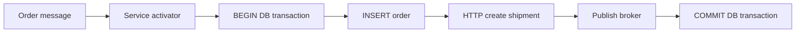
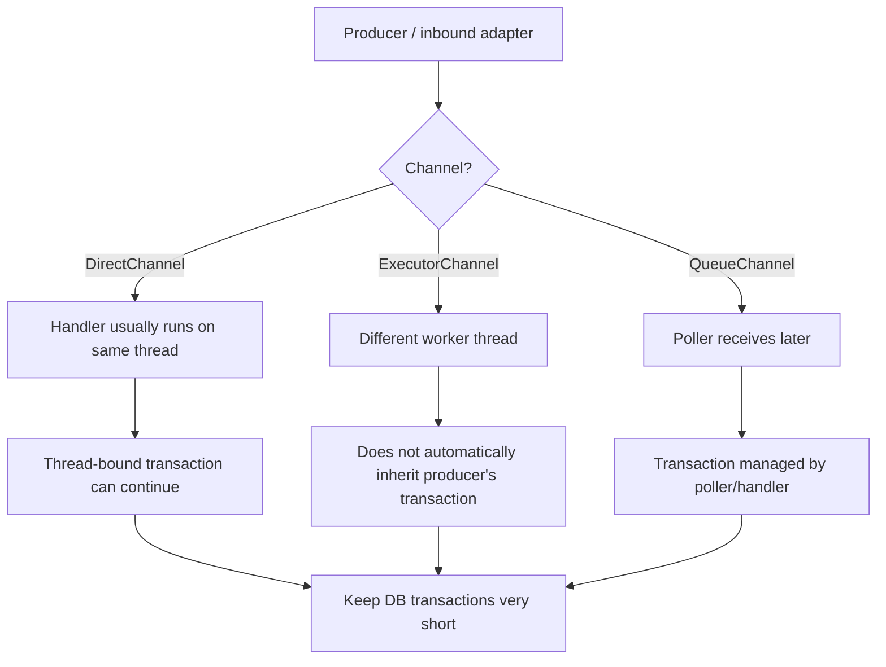
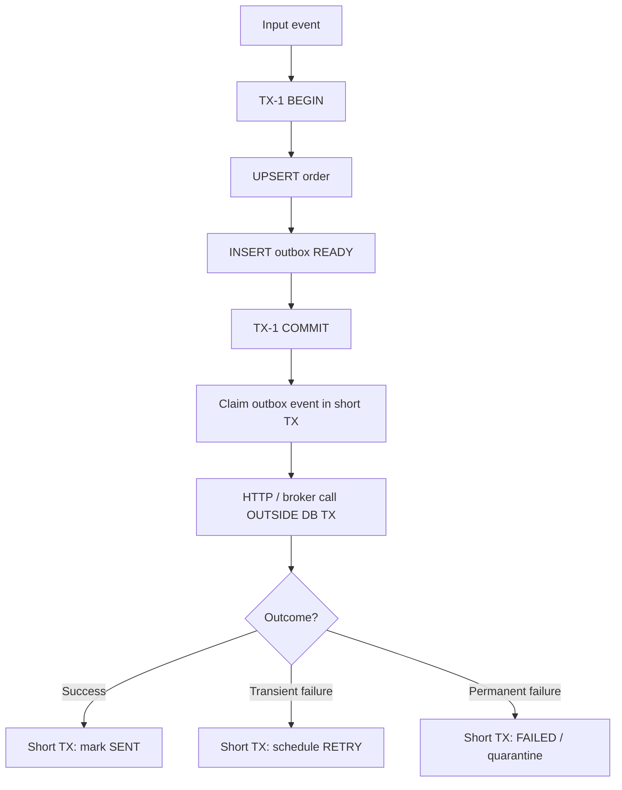
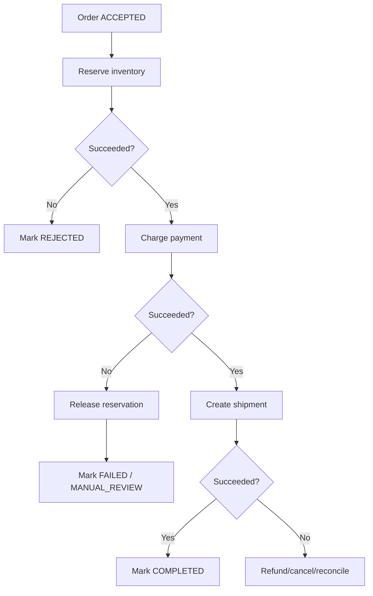

# Do Not Open Transactions Too Broadly Across External Systems in Spring Integration

## Objectives and context

The **SPRING_INTEGRATION_RUNTIME** module explores how Spring Integration coordinates messages across channels, endpoints, consumers, pollers, and executors; and manages transactions, retries, message stores, errors, and correlation. In the **Transaction runtime** chapter, this lesson focuses on a principle with direct impact on correctness and performance:

> **Keep a transaction strictly within the scope of resources that the transaction manager actually manages; prefer short transactions. Do not hold a DB transaction open while waiting on HTTP, payments, email, or external systems with independent side effects.**

After this lesson, you will be able to:

- Distinguish a local database transaction, broker transactions/acknowledgments, and remote calls that do not participate in a transaction.
- Identify transactions opened too broadly in a Spring Integration flow, including across `DirectChannel` and pollers.
- Design work handoffs to external systems with a **transactional outbox**, inbox, idempotency keys, and bounded retries.
- Determine transaction boundaries when using `@Transactional`, `TransactionTemplate`, request-handler advice, `ExecutorChannel`, and `QueueChannel`.
- Explain why a DB rollback cannot undo an HTTP call that has already succeeded.
- Write test scenarios for crashes, rollbacks, redeliveries, duplicate side effects, transaction timeouts, and connection pool pressure.

The examples use Java 17+ and Spring Framework/Spring Integration 6.x concepts. Repository interfaces, HTTP adapters, and outboxes are architectural examples that must be implemented and tested against your system's real database/broker.

## 1. Anti-pattern: one transaction spanning too many systems

Suppose a system receives an order-created event and needs to write to the DB, call a shipping service, and publish a notification:



Easy-to-write yet dangerous Java code:

```java
@ServiceActivator(inputChannel = "ordersIn")
@Transactional
public void handle(OrderPlaced event) {
    orderRepository.insert(event);
    shippingClient.createShipment(event);
    eventPublisher.publish(event);
}
```

This is an example of a **design to avoid** when `@Transactional` actually takes effect through a Spring proxy. The DB transaction stays open while the application waits for remote HTTP and the broker. A local DB transaction has no authority to roll back side effects already committed in a shipping service, email gateway, REST payment provider, or independent broker.

Suppose writing to the DB takes 40 ms, HTTP takes 3 seconds, and publishing to the broker takes 150 ms. The transaction lifetime can exceed 3.19 seconds even though database work only took 40 ms.

| Risk | Why does it happen? | Symptom |
|---|---|---|
| Connection pool exhaustion | Thread holds the transaction-bound connection while waiting on HTTP | `connection acquisition timeout`, active connections constantly high |
| Prolonged locks | Row locks, snapshots, or MVCC state are held until commit/rollback | Lock waits, deadlocks, high transaction age |
| Reduced throughput | Pollers/workers wait on I/O and backoff, DB resources stay held | Queue backlog, rising p95/p99 |
| Rollback does not revert remote | HTTP succeeded yet DB rolled back | Shipment/charge exists while local state does not |
| Retry duplicates side effects | Unclear whether remote already processed on client timeout | Duplicate shipments or duplicate payments |
| Stacked timeouts | DB, HTTP, gateway, and broker timeouts differ | DB rolls back after external side already committed |

**Long transactions** are a resource-holding problem; **transactions not covering remote systems** are a consistency problem. Simply increasing timeouts or pool sizes does not fix the second root cause.

### Hardest scenario: lost response after remote succeeds

```text
Application                     Remote service                 Database
BEGIN DB TRANSACTION                                          transaction active
UPDATE orders                                                    uncommitted
POST /shipments ----------------> CREATE shipment + COMMIT
       <---- TCP reset / timeout
ROLLBACK DB -------------------------------------------------> undo DB changes
```

When the message is redelivered, the system may resend the HTTP POST. The remote service already processed the first request, yet the application does not know. This is the foundation for requiring **idempotency** and durable progress tracking.

## 2. Three kinds of boundaries to distinguish

### 2.1. Local database transaction

`DataSourceTransactionManager` or `JdbcTransactionManager` coordinates JDBC operations using the same matching `DataSource` resource. `JpaTransactionManager` coordinates JPA resources. `@Transactional` typically works through a Spring proxy and the chosen transaction manager.

```java
@Transactional(transactionManager = "ordersTransactionManager")
public void persist(Order order) {
    orderRepository.insert(order);
    auditRepository.recordAccepted(order.id());
}
```

When both repositories operate on resources within the same transaction, they can commit/roll back together. Across two different databases, a single local transaction manager **does not automatically** turn both into an atomic transaction.

### 2.2. Broker transactions, offsets, and acknowledgments

JMS, AMQP/RabbitMQ, Kafka, and message sources have different semantics: local transactions, acknowledgments, offset commits, nacks, requeues, redeliveries, or dead-letter queues. They do not automatically become part of a DB transaction just because a flow has `@Transactional`.

With XA/JTA-capable resources, some transactions can coordinate via two-phase commit; cost and limitations depend on participants. Standard HTTP APIs are not XA resources. Kafka transactions solve certain publish/consume scopes within Kafka, and do not make arbitrary HTTP/DB calls atomic with Kafka.

### 2.3. External side effects

HTTP payments, shipment creation, sending emails, webhooks, or SaaS APIs are systems with their own state. Once a call succeeds, rolling back the DB at the source **does not** revert the external outcome.

If business logic needs to correct an error, you must use one of these approaches: idempotent requests, status lookups/queries, compensating actions (refund/cancel), reconciliation, and explicit stateful workflows.

| Mechanism | Primary guarantee | What it does not guarantee |
|---|---|---|
| Local DB transaction | Atomic update of properly enlisted DB resources | Undoing HTTP or uncoordinated broker publishes |
| JMS/XA and DB/XA | Coordinated commit across enlisted XA resources | Standard HTTP or universal broker/driver support |
| Transactional outbox | Atomicity between DB changes and intent to send events in the **same DB** | Exactly-once delivery to remote |
| Inbox + unique constraint | Avoids reprocessing already-committed business events | Does not prevent all duplicate external network requests |
| Remote-side idempotency | Same key does not duplicate business effects if remote supports it properly | Does not shorten the caller's transaction |
| Saga/compensation | Multi-step coordination and compensation on partial failure | Instant atomic rollback across all services |

## 3. How do transactions travel through Spring Integration?

In Spring Integration, you must follow **threads, endpoints, and advice scopes** to tell whether a transaction is still open.



| Runtime component | Impact on transaction | What to verify |
|---|---|---|
| `DirectChannel` | Usually invokes consumer synchronously on sender's thread | Does an upstream gateway/service transaction cover the entire flow? |
| `PublishSubscribeChannel` without executor | Usually dispatches synchronously to subscribers | A slow subscriber can prolong the sender's transaction |
| `ExecutorChannel` | Switches threads; thread-local transaction does not follow automatically | Does the worker have its own transaction when accessing the DB? |
| `QueueChannel` | Separates send time from poller receive time | A successful send does not mean business state committed |
| `Poller` | Can attach transaction advice around appropriate polling/processing | Is the transaction held across a remote handler in the same poll cycle? |
| `@Transactional` on a service bean | Transaction via proxy/weaving and propagation | Invoked through proxy or self-invocation? |
| `RequestHandlerRetryAdvice` | Repeats handler invocations | Are retries/backoffs running inside a long DB transaction? |

### Caller-layer transaction example

```java
@Transactional
public void submit(OrderPlaced event) {
    orderGateway.send(event); // DirectChannel flow may run on the same thread.
}
```

If the gateway triggers a synchronous handler that calls a REST API for several seconds, `submit`'s transaction can remain open until the gateway call finishes. Moving the annotation to an inner DB method is not enough if an outer transaction still has `REQUIRED` propagation.

### Poller with transaction advice

```text
Poller BEGIN transaction
    receive message
    transform payload
    update database
    call remote system
    retry with backoff
Poller COMMIT / ROLLBACK transaction
```

Actual scope depends on the endpoint, transaction advice, and channel. A transactional poller can make total sense for pulling and updating records in the DB, yet it should not drag the transaction across HTTP calls and backoff waits. With sources supporting claim/ack, you may need to split "receive and record processing intent" into its own transaction before the remote call.

### What `@Transactional` does not do automatically

- Does not make HTTP part of a DB transaction.
- Does not guarantee a transaction propagates across an `ExecutorChannel` or manually spawned thread.
- Does not create a transaction when a method is called via `this.someMethod()` through self-invocation in default proxy mode.
- Does not guarantee all checked exceptions trigger rollback; default rules usually roll back on `RuntimeException`/`Error`, requiring `rollbackFor` if business rules differ.
- Does not guarantee broker acknowledgment occurs after DB commit unless the adapter/container is properly configured.

Therefore, inspect the whole flow and transaction manager rather than merely counting annotations.

## 4. Proper design practice: DB + outbox, then call remote

A common solution is the **transactional outbox**. Inside a short DB transaction, the application stores business data alongside a durable "intent to send." After commit, another worker performs the HTTP/broker side effect and then updates the outbox status in a fresh transaction.



This creates **eventual consistency**: the remote system may update later than the database. In return, DB connections/locks are not held during network waits and recovery is possible after restarts.

### 4.1. Handler only calls a service that persists to the DB

```java
@ServiceActivator(inputChannel = "ordersIn")
public void acceptOrder(OrderPlaced event) {
    orderIntakeService.record(event);
}
```

```java
@Service
public class OrderIntakeService {

    private final OrderRepository orders;
    private final OutboxRepository outbox;

    public OrderIntakeService(
            OrderRepository orders,
            OutboxRepository outbox) {
        this.orders = orders;
        this.outbox = outbox;
    }

    @Transactional(transactionManager = "ordersTransactionManager")
    public void record(OrderPlaced event) {
        orders.insertIfAbsent(event.orderId(), event);
        outbox.insertIfAbsent(
                event.eventId(),
                "SHIPMENT_REQUESTED",
                event.payloadForShipment());
    }
}
```

`OrderPlaced`, `OrderRepository`, `OutboxRepository`, and their corresponding methods are application contracts to define. Both repositories must operate in the **same DB transaction** for synchronized commit/rollback.

Key point: `OrderIntakeService.record` is invoked through **another Spring bean** with an appropriate transaction proxy. If an outer transaction wraps `acceptOrder`, `record` with default `REQUIRED` propagation can join that outer transaction. Ensure the handler/caller does not open a broader transaction.

### 4.2. Illustrative outbox table

```sql
CREATE TABLE integration_outbox (
    event_id           VARCHAR(64) PRIMARY KEY,
    aggregate_id       VARCHAR(64) NOT NULL,
    event_type         VARCHAR(80) NOT NULL,
    payload_json       TEXT NOT NULL,
    status             VARCHAR(20) NOT NULL,
    attempts           INT NOT NULL DEFAULT 0,
    next_attempt_at    TIMESTAMP NULL,
    lease_owner        VARCHAR(80) NULL,
    lease_until        TIMESTAMP NULL,
    created_at         TIMESTAMP NOT NULL,
    updated_at         TIMESTAMP NOT NULL
);
```

The example uses generic SQL; data types, indexes, timestamps, locking, and claim statements depend on the RDBMS. `event_id` must be stable for the same business event. Use unique constraints to prevent duplicate inserts when the source redelivers.

When multiple workers poll the outbox concurrently:

- Claim inside a short DB transaction, using `SELECT ... FOR UPDATE SKIP LOCKED` if supported by the DB, or a conditional atomic update.
- Assign a lease/owner/token; only the worker still holding a valid lease may update the outcome.
- Leases have an expiry to resume after crashes, though expiry means an event could be resent.
- Bound batch sizes, index `status`/`next_attempt_at`, and establish retention and cleanup policies for old events.

Never run a plain `SELECT` and send immediately: two workers can read the same unclaimed row and trigger duplicate side effects.

### 4.3. Outbox operations API with short transactions

```java
@Service
public class OutboxOperations {

    private final OutboxRepository repository;

    public OutboxOperations(OutboxRepository repository) {
        this.repository = repository;
    }

    @Transactional(transactionManager = "ordersTransactionManager")
    public Optional<ClaimedEvent> claimNext() {
        return repository.claimNextReadyAtomically();
    }

    @Transactional(transactionManager = "ordersTransactionManager")
    public void markSent(String eventId, String leaseToken) {
        repository.markSentIfOwned(eventId, leaseToken);
    }

    @Transactional(transactionManager = "ordersTransactionManager")
    public void reschedule(
            String eventId, String leaseToken, Instant nextAttempt) {
        repository.scheduleRetryIfOwned(
                eventId, leaseToken, nextAttempt);
    }
}
```

`Optional` is in `java.util`; `Instant` is in `java.time`. These classes and repository methods are outlines requiring DB locking implementation and updated-row count checks. If an update affects 0 rows because the lease expired, do not silently treat it as marked sent.

### 4.4. Dispatcher calling remote outside the transaction

```java
@Component
public class ShipmentDispatcher {

    private final OutboxOperations outbox;
    private final ShippingClient shipping;

    public ShipmentDispatcher(
            OutboxOperations outbox, ShippingClient shipping) {
        this.outbox = outbox;
        this.shipping = shipping;
    }

    @Scheduled(fixedDelay = 500L)
    public void dispatchOnce() {
        Optional<ClaimedEvent> claimed = outbox.claimNext();
        if (claimed.isEmpty()) {
            return;
        }

        ClaimedEvent event = claimed.get();
        try {
            // OutboxOperations.claimNext() has already committed.
            // dispatchOnce() has NO @Transactional:
            shipping.createShipment(
                    event.payload(), event.eventId());

            outbox.markSent(event.eventId(), event.leaseToken());
        } catch (TransientRemoteException ex) {
            outbox.reschedule(
                    event.eventId(),
                    event.leaseToken(),
                    Instant.now().plusSeconds(30));
        } catch (PermanentRemoteException ex) {
            // Record FAILED/quarantine and alert in a short transaction.
            handlePermanentFailure(event, ex);
        }
    }
}
```

The code above presents **architecture and boundaries**, not a standalone buildable program: you must define `ClaimedEvent`, `ShippingClient`, exception classes, `handlePermanentFailure`, the schema, and queries; enable `@EnableScheduling` when needed. In production flows, the scheduled poller can be replaced with a message-driven outbox dispatcher/CDC.

**Result to verify:** the HTTP call truly executes after `claimNext()` has committed. An outer transaction manager wrapping `dispatchOnce()` defeats the boundary separation, so verify this with an integration test.

If HTTP succeeds yet `markSent` fails, the event will be reclaimed/retried. The remote side must accept `event.eventId()` as an idempotency key or support querying whether the shipment was already created.

### 4.5. Why don't post-commit callbacks replace an outbox?

`@TransactionalEventListener(phase = AFTER_COMMIT)` or `TransactionSynchronization` can trigger work after commit, yet the callback runs in-process:

```text
DB COMMIT succeeds
    ↓
JVM crashes before callback sends HTTP
    ↓
Remote receives nothing
```

Without a committed record of the intent to send, the task can be permanently lost. A post-commit callback should only be viewed as a way to wake the dispatcher faster; a **durable outbox** lets the dispatcher recover after crashes/restarts.

## 5. Inbox and idempotency: pairing with outbox

The outbox solves the DB → remote direction. On the inbound broker → DB side, a message can be redelivered if a crash happens after DB commit but before acknowledgment. Therefore, a stable business key and deduplication are needed.

```sql
CREATE TABLE processed_event (
    event_id       VARCHAR(64) PRIMARY KEY,
    processed_at   TIMESTAMP NOT NULL
);
```

Inside the same DB transaction:

```text
BEGIN
    INSERT processed_event(eventId) if not present
    if eventId was already processed, do not perform DB side effects again
    INSERT/UPDATE order
    INSERT outbox event
COMMIT
```

Key failure points to handle:

| Failure point | DB state | Remote | Required mechanism |
|---|---|---|---|
| Before order + outbox commit | Both roll back | Not called yet | Source can redeliver; no lost business event |
| After commit, before inbound ack | Order/outbox recorded | May not be called yet | Inbox/unique key prevents duplicate DB writes |
| After commit, before dispatcher | Durable `READY` outbox | Not called yet | Dispatcher sends when running again |
| After claim, before HTTP | Outbox `IN_PROGRESS` | Not called yet | Lease expires then reclaimed |
| HTTP timeout with unknown result | Outbox needs retry/reconcile | May have executed | Stable remote idempotency key |
| HTTP succeeds, before marking `SENT` | Outbox not yet `SENT` | Executed | Safe retry and idempotency |
| Compensation fails | Workflow incomplete | Partial success | Bounded retry/manual intervention |

An **idempotency key** must remain stable across all attempts and redeliveries of an operation. `MessageHeaders.ID` usually identifies a specific message instance, which can change after an adapter recreates the message. A business `orderId` or `eventId` is better when the source contract guarantees its semantics.

`correlationId` serves tracing/message correlation, yet by itself does not prevent duplicate processing. Never use a retry attempt ID as an idempotency key because that ID changes on every try.

## 6. Transactions and retry advice

Spring Integration's `RequestHandlerRetryAdvice` re-invokes handlers according to `RetryPolicy`, `BackOffPolicy`, and recovery. If a transaction wraps retries, wait times can hold DB resources longer.

### Transaction outside retry

```text
TransactionAdvice BEGIN
    RetryAdvice
        HTTP attempt 1 -> error
        backoff 1s
        HTTP attempt 2 -> error
        backoff 2s
        HTTP attempt 3 -> success
TransactionAdvice COMMIT
```

The transaction stays alive across all attempts and sleep intervals. If an error marked rollback-only, a succeeding final attempt does not guarantee commit.

### Retry outside transaction

```text
RetryAdvice
    TransactionAdvice BEGIN -> DB attempt 1 -> ROLLBACK
    backoff 1s (no transaction held)
    TransactionAdvice BEGIN -> DB attempt 2 -> COMMIT
```

This is usually appropriate for retryable DB errors, provided each attempt does not perform non-idempotent external side effects. Advice ordering affects transaction opening scope, though it also depends on advice and handler types (request-handler advice vs. `HandleMessageAdvice`).

**Recommendation:** Split DB work, external calls, and DB status updates into clear steps. Retry DB work in short transactions; retry remote calls **outside DB transactions**; retry exhaustion routes to DLQ/quarantine or business compensation.

### Retry and broker redelivery can multiply execution counts

If handler advice allows up to 3 attempts/delivery while the broker redelivers 5 times, a prolonged error can generate up to:

```text
3 attempts × 5 deliveries = 15 handler calls
```

This is a theoretical maximum depending on policies and how exceptions/acks are handled. When a recovery callback swallows an exception after logging, the broker may treat the message as successfully processed and ack it even though business work is unfinished. Explicitly define when the source should ack, redeliver, or route to DLQ.

### Transaction timeout differs from HTTP timeout

`@Transactional(timeout = 30)` does not replace HTTP connect/read timeouts. A call to an external service may already have completed while the client timed out before receiving the response. Even if the DB rolls back, the remote side may keep its side effect. Configure separate timeouts and a **total retry budget** based on SLOs.

## 7. Why isn't REQUIRES_NEW a quick fix?

`@Transactional(propagation = Propagation.REQUIRES_NEW)` starts a new transaction and suspends the current one when appropriate; **the outer transaction may still hold its connection/locks** while suspended. Creating a new transaction also increases demand for connections from the pool.

`Propagation.NOT_SUPPORTED` can suspend a transaction for a block of code, yet it does not make external systems join an atomic commit, nor does it guarantee releasing all resources of the outer transaction.

The root fix is usually:

1. Do not open a transaction on the gateway/controller/handler wrapping the whole flow.
2. Open transactions only in services that actually perform DB work.
3. Commit before waiting on external I/O.
4. Write an outbox record if remote work must survive crashes.
5. Use idempotency, leases/retries, reconciliation, and compensation to handle uncertain outcomes.

### The self-invocation problem

`@Transactional` applied via Spring proxies may not activate when a method inside a bean calls `this.save()`. Hence, a `@ServiceActivator` method directly calling a transactional method in the same class can behave contrary to expectations. Place boundaries on separate Spring service beans or use `TransactionTemplate` in the right spot, then verify the active transaction manager.

## 8. Message stores, correlation, and lifecycle

A `QueueChannel`, `JdbcMessageStore`, or aggregator with a message group store does not automatically put all downstream side effects into one transaction. Even if the source store and business tables share the same DB, you still must configure the right transaction manager and read/write scope.

Example:

```text
JDBC message store (DB-A)
     ↓
poller reads message
     ↓
aggregator saves group state
     ↓
handler calls HTTP
     ↓
writes DB-B
```

Questions to answer:

- Which DB does the queue/aggregator store use? Does the transaction manager cover that resource?
- Does the poller delete/ack the message before or after business state is persisted?
- When the group release strategy emits output, does group state commit before the remote call?
- If the HTTP handler fails, can the message be replayed from a durable store?
- Across an `ExecutorChannel` boundary, does the poller's transaction terminate before the worker?
- When `IntegrationFlow` stops, are there unprocessed messages/events left in the outbox or store?

If an aggregator holds DB locks on a group while calling HTTP, it easily creates contention among messages sharing the same correlation key. Separate updating group state in a short transaction, persist an event or durable workflow state, and let a remote handler execute the next step.

### Distinguishing IDs in logs

```text
orderId       : order/aggregate identifier
eventId       : identifier of one business event, used for dedup/idempotency
correlationId : links multiple messages within the same workflow
attemptId     : a single try, changes on every retry
messageId     : ID of the current Spring message
```

Do not create metric tags for individual eventIds/orderIds if cardinality can grow unbounded; place those IDs in logs/traces instead. Component name, endpoint ID, and outcome are much safer tags.

## 9. With multiple remote services: sagas and compensation

For an inventory-reserve → charge-payment → create-shipment chain, a single DB transaction cannot roll back all external parties. When a later step fails, workflow state and business compensation are needed.



`refund` or `release reservation` are new business commands that can themselves fail or be retried. Do not call them atomic rollbacks. Each state transition should commit quickly to the database and trigger the next step via an outbox/worker.

| State | Meaning | Next step |
|---|---|---|
| `ACCEPTED` | Order accepted in DB | Send inventory reservation request |
| `INVENTORY_RESERVED` | Remote reserved inventory | Request payment capture |
| `PAYMENT_CONFIRMED` | Remote confirmed payment | Create shipment |
| `COMPENSATING` | A later step failed | Send compensation command and wait for result |
| `MANUAL_REVIEW` | Cannot compensate automatically | Alert/operator intervention |
| `COMPLETED` | All business steps succeeded | Close workflow |

If a synchronous reply to the caller is required, you can return `PENDING` after the first commit and provide a status-lookup API; there is no need to hold a DB transaction open until every service finishes.

## 10. Performance: an intuitive calculation

Suppose a system receives **50 messages/second**, each needing 20 ms of DB work and 2 seconds waiting on a remote call. By Little's Law, average concurrency in steady state is approximately `L = λ × W`.

If the DB transaction is held across the remote call:

```text
50 messages/s × (0.020 + 2.000) s ≈ 101 concurrent transactions
```

If the local DB transaction lasts only 20 ms and closes:

```text
50 messages/s × 0.020 s ≈ 1 concurrent DB transaction
```

This is an **illustrative theoretical estimate**, not an exact measurement or capacity guarantee; locks, pool size, concurrency levels, transaction isolation, batching, and traffic bursts all affect actual behavior. The point is that remote latency can massively multiply connection pool demand when transactions are opened too broadly.

### Metrics to monitor

| Component | Metrics and diagnostic questions |
|---|---|
| Connection pool | Active/idle connections, acquire wait; are connections held while waiting on HTTP? |
| Database | Transaction age, lock waits, deadlocks, slow queries; are transactions failing to commit? |
| Remote | Timeouts, 429/503, p95/p99; are client retries and backoff appropriate? |
| Poller/executor | Active worker threads, queue backlog, polling delay; does backoff block workers? |
| Outbox | `READY`/`IN_PROGRESS`/`RETRY_WAIT`, oldest event age, lease expiry |
| Reliability | Duplicate calls, idempotency hits, DLQ, compensation, reconciliation |
| Transaction | Commit/rollback counts, rollback-only, transaction timeouts |

Do not increase `@Transactional(timeout=...)` or pool size as your first fix. Doing so can mask symptoms and increase the number of long-lived transactions/locks.

## 11. Debugging transaction boundaries in practice

Start from the flow, not only the stack trace:

1. Diagram inbound adapter → channel → consumer endpoint → handler → service → DB/HTTP/broker.
2. Mark `@Transactional` methods, `TransactionTemplate`, poller advice, and thread-switch points.
3. Inspect the selected transaction manager and which resources are enlisted.
4. Measure begin/commit/rollback times; compare against HTTP/publish durations.
5. Inspect connection pool, DB lock waits, and thread dumps to see whether workers wait on the network while a transaction is open.
6. Distinguish DB, remote, gateway, and retry-budget timeouts.
7. Check whether the remote call succeeded before the error/rollback, and whether the source redelivered.
8. Replace the boundary with short transactions + an outbox, then test failures at every crash point.

### API to check active transactions on the thread

```java
import org.springframework.transaction.support.TransactionSynchronizationManager;

boolean active =
        TransactionSynchronizationManager.isActualTransactionActive();
System.out.println("TX active here = " + active);
```

Place this check right before external calls in integration tests:

- With the anti-pattern of one `@Transactional` method wrapping DB + HTTP, you usually see `true` if the annotation is active.
- Inside `ShipmentDispatcher.dispatchOnce` (not wrapped by outer transaction advice) after `claimNext` returns, expect `false`.
- If it is still `true`, look for an outer transaction or unexpected configuration.

This result only reflects transactions **on the current thread**; it does not prove a broker transaction or remote service committed.

### Common issues

| Symptom | Causes to examine | Action |
|---|---|---|
| DB pool runs out of connections when remote is slow | Transaction holds connection across HTTP | Move call outside DB transaction; outbox |
| DB rolls back yet payment still exists | Remote committed independently | Idempotency, reconciliation, refund/compensation |
| Final retry succeeds yet DB does not commit | Transaction already rollback-only | Check retry/transaction advice order and propagation |
| Message lost after commit | Wrong ack, in-memory after-commit callback | Inbox/outbox and crash testing |
| Two workers send the same event | Non-atomic outbox claim or lease race | Atomic claim, lease token, remote idempotency |
| Outbox backlog grows | Dispatcher cannot keep up or remote errors | Indexes, worker capacity, backoff, DLQ |
| Transaction annotation does not run | Self-invocation, manually instantiated bean, wrong manager | Extract Spring service bean and run integration test |
| Poller stalls on remote timeout | Poller transaction or retry wraps I/O | End transaction before remote call; separate worker |
| DB has multiple resource sources | Resources do not share a transaction | Design appropriate coordination/outbox/inbox |

## 12. Exercises to test boundaries and crashes

To trust the design, test both the **happy path** and **failure points**.

### Exercise 1 — Compare two handlers

1. Write a `@Transactional` handler that both saves to the DB and calls a fake shipping client with a 1-second delay.
2. Measure active DB connections and transaction duration.
3. Split into `OrderIntakeService.record` saving DB + outbox, with a dispatcher calling the shipping client after commit.
4. Verify the fake client method sees `TransactionSynchronizationManager.isActualTransactionActive() == false`.
5. Compare transaction latency, waiting threads/connections, and throughput as concurrency increases.

### Exercise 2 — Crash points that must be recoverable

| Where to inject failure? | Result that must be observed |
|---|---|
| Before order + outbox commit | Both roll back; nothing sent to remote |
| After DB commit, before dispatch | Outbox remains `READY` after restart |
| After claim, before HTTP | Lease expires and event is reclaimed |
| Remote succeeds, response lost | Retry with same key does not create a second shipment |
| Remote succeeds, updating `SENT` fails | Event can retry yet business effect happens only once |
| Source redelivers same event after DB commit | Inbox/unique key prevents duplicate DB write |
| Error flow fails to write DLQ | Alert and state requiring intervention, never false success |

### Suggested assertions

```java
// Pseudocode: use real Spring beans and a spy ShippingClient.
// when(shippingClient.createShipment(any(), any()))
//     .thenAnswer(invocation -> {
//         assertThat(TransactionSynchronizationManager
//             .isActualTransactionActive()).isFalse();
//         return remoteResult;
//     });
//
// sendInboundMessage(orderEvent);
// assertThat(orderRepository.exists(orderId)).isTrue();
// assertThat(outboxRepository.findByEventId(eventId)).isPresent();
// dispatchOne();
// verify(shippingClient).createShipment(any(), eq(eventId));
```

If the test class or test method itself is annotated with `@Transactional`, it can accidentally open an outer transaction and mask the boundary under test. For concurrency/lease/rollback, use a real integration database or Testcontainers rather than mocking repositories alone. For broker acknowledgments, test against the real adapter/container.

### Exercise 3 — Outbox with two workers

1. Create a `READY` event and run two dispatchers concurrently.
2. Ensure only one dispatcher can claim the event at a time.
3. Stop the worker that claimed it, wait for the lease to expire; the other worker reclaims it.
4. Simulate the old worker waking up and attempting `markSent`: it must be rejected if the lease token is no longer valid.
5. Verify the remote side stays idempotent if two HTTP attempts for the same event overlap.

## 13. When is it still acceptable to keep a transaction across a call?

Not every operation outside the current method must be split out:

- JDBC operations against the exact database being managed are normal parts of a local transaction.
- Pure CPU computation that is very short and has no side effects can run inside the transaction if it does not noticeably prolong locks.
- In an architecture genuinely using XA, two enlistable resources can coordinate transactions within a designed scope; prove it via integration tests and accept the operational overhead.
- A remote **read-only call** without side effects still adds latency and can block the transaction; if possible, read before the transaction and validate consistency conditions in the DB on commit.

The practical workflow should be:

1. Prepare data outside the transaction when sensible.
2. Open a short DB transaction to validate conditions, write business data, and write the outbox.
3. Commit before calling external systems.
4. Call remote systems with clear timeouts/idempotency/retries.
5. Record the outcome in a separate short transaction and trigger compensation when needed.

## 14. Production checklist

- [ ] Explicitly identify the transaction manager and which resources are actually protected.
- [ ] Do not wrap HTTP, email, payment APIs, webhooks, or normal broker publishes inside long DB transactions.
- [ ] With `DirectChannel` and pollers, verify transactions do not accidentally extend across downstream I/O.
- [ ] With `ExecutorChannel`/`QueueChannel`, declare transactions at the appropriate worker/poller; do not assume thread-locals propagate.
- [ ] Use Spring-managed services with proper proxies; avoid self-invocation and unintended outer transactions.
- [ ] Write business DB data and outbox records in the same local transaction.
- [ ] Outbox has unique event IDs, atomic claims, leases, retries, retention, and backlog metrics.
- [ ] Remote endpoints receive stable idempotency keys; source redelivery is guarded by inbox or unique constraints.
- [ ] HTTP and transaction timeouts are defined separately; retry budgets are finite, with backoff/jitter when needed.
- [ ] Transaction/retry advice ordering, rollback-only, error channels, and recovery are verified.
- [ ] Source acknowledgments/offset commits align with real business boundaries.
- [ ] Message stores, aggregators, and correlation groups do not hold locks across remote calls.
- [ ] Post-restart recovery, reconciliation, and compensation exist for partial failures.
- [ ] Crash tests cover boundaries between commit, dispatch, remote success, and outbox status updates.
- [ ] Monitor DB pools, lock times, worker queues, outbox lag, duplicate rates, and DLQs.

## References

- [Spring Integration Reference — Transaction Support](https://docs.spring.io/spring-integration/reference/transactions.html).
- [Spring Integration Reference — Message Channels](https://docs.spring.io/spring-integration/reference/channel.html).
- [Spring Integration Reference — Handler Advice](https://docs.spring.io/spring-integration/reference/handler-advice.html).
- [Spring Integration Reference — Poller](https://docs.spring.io/spring-integration/reference/endpoint.html).
- [Spring Framework Reference — Declarative Transactions](https://docs.spring.io/spring-framework/reference/data-access/transaction/declarative.html).
- [Spring Framework Reference — Transaction Propagation](https://docs.spring.io/spring-framework/reference/data-access/transaction/declarative/tx-propagation.html).
- [Spring Framework Javadoc — TransactionSynchronizationManager](https://docs.spring.io/spring-framework/docs/6.2.x/javadoc-api/org/springframework/transaction/support/TransactionSynchronizationManager.html).

**Remember:** A transaction in Spring Integration must be analyzed by **resource, thread, endpoint, and advice boundary**. A DB rollback does not automatically revert independent HTTP/broker outcomes. Keep local DB transactions short, persist intent to process via an outbox, use an inbox and idempotency to tolerate redelivery, and track recovery state to handle unavoidable failure points.
