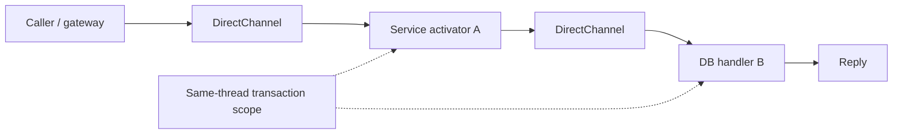
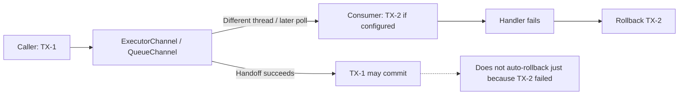
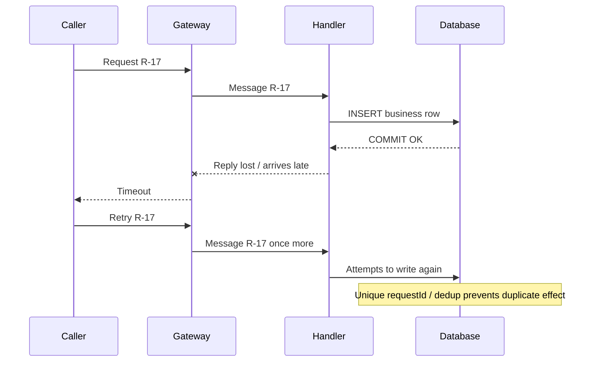

# Testing Commit, Rollback, and Recovery in Spring Integration

## 1. Goal: proving what actually gets committed?

A *message flow* in Spring Integration can pass through gateways, `MessageChannel`s, endpoints, service activators, pollers, executors, message stores, and external systems. When business logic fails, the testing question is not only "was an exception thrown?" but also:

- Which database operations **committed**? Which data **rolled back**?
- Was the message **removed from the source**? Can it be read again after rollback?
- How many times did retry run, and which transaction was each attempt inside?
- Did recovery route the message to an error/dead-letter channel, or inadvertently report success?
- If the caller timed out yet the transaction committed, will a duplicate send create duplicate side effects?
- What happens when the flow crosses an `ExecutorChannel` or `QueueChannel` and switches threads?

The lesson **Testing commit, rollback, and recovery** belongs to the **Transaction runtime** chapter of the `SPRING_INTEGRATION_RUNTIME` module. The focus is verifying the real runtime impact of transactions in Spring Integration, while tying together flow orchestration, transaction managers, error handling, message stores, correlation, threading, and performance.

**Learning outcome:** you will design test suites that assert durable post-transaction state, distinguish business transactions from poller/message-source transactions, test rollback and redelivery, and catch retry/recovery configurations that alter commit semantics.

> **Reference versions:** Spring Integration 6.5, Spring Framework 6.x, Java 17+, JUnit 5, and Spring Boot 3.x. Examples use H2/JDBC for easy reproduction; with Kafka, JMS, JDBC Message Store, or multiple resources, transactional contracts must be verified specifically for each adapter and transaction manager.

## 2. Transaction model of a message flow

### 2.1. A transaction is a concrete scope

Standard Spring transactions are managed by `PlatformTransactionManager` and bind context to the **current thread**. With a purely synchronous flow across `DirectChannel`, the same thread can traverse multiple endpoints and participate in one transaction if the transaction scope wraps them.



Conversely, `ExecutorChannel` hands the handler call off to an executor thread; `QueueChannel` passes the message to a polling consumer running at a different time. The sender thread's transaction **does not automatically transfer** to the consumer thread.



Even though an `ExecutorChannel` configured with an executor may occasionally run a task on the caller thread under a rejection policy, **you must never rely on that exceptional behavior** to assume transactions propagate across an executor.

### 2.2. Handler transactions and poller transactions are different

| Where transaction starts | Typical scope | Not automatically included |
|---|---|---|
| `@Transactional` on a service method | DB operations executed by the method and same-transaction calls inside it | Sending the reply after the method/transaction ends; other threads; unenlisted network operations. |
| Transaction opened around gateway/caller (e.g., `TransactionTemplate`) | Synchronous steps on the same thread using the same transaction manager | Work after an executor/pollable boundary; independent remote services. |
| Transactional poller | Can include `receive()` on a transaction-capable source and synchronous downstream flow right after the poll | Consumers on other threads; sources without rollback support or in-memory message stores. |
| JMS/JDBC inbound adapter's own transaction | Receive/ack or resources managed within adapter scope | Another DB unless coordinated; remote API calls cannot be rolled back. |

**Do not infer "transactional poller" = "every message is guaranteed to be redelivered on error."** Message recovery depends on the nature of the source: a JDBC message store can roll back a remove operation; an in-memory queue has usually already removed the message even if the DB transaction rolls back; brokers also depend on acks, containers, and session transactions.

### 2.3. Commit/rollback does not equal caller success/failure

A handler can insert into the DB and commit, yet sending the reply back to the gateway fails. The caller sees a timeout, **and cannot infer the DB rolled back**. Conversely, a handler can return a response before an outer transaction commits, and then the commit fails.

Distinguish three outcomes:

1. **Invocation outcome:** did the handler return or throw an exception?
2. **Transaction outcome:** did the transaction manager commit or roll back resources?
3. **Delivery outcome:** did the message/reply/ack reach its destination?

Good tests must verify all three whenever they affect the business contract.

## 3. Suite of scenarios to test

| Scenario | Expected DB data | Expected message/flow | Key assertion |
|---|---|---|---|
| Business succeeds, transaction commits | New record or updated state exists | Reply/ack per contract | Query DB in a separate transaction/connection after the call. |
| Throw `RuntimeException` inside transaction | DB changes in transaction are rolled back | Exception/error flow receives error | No row present, matching error cause. |
| Throw checked exception by default | May commit if `rollbackFor` is not configured | Caller may still receive exception | Verify rollback policy, do not rely on exception name. |
| Catch exception then return normally | Usually commits if not marked rollback-only | Flow treats processing as successful | Prove swallowing the exception changed semantics. |
| Async worker fails after sender hands off | Sender transaction may already have committed | Worker error follows its own error path | Do not expect sender transaction to roll back. |
| Poller pulls from persistent transactional store then handler throws | DB write rolls back; message removal rolls back | Message remains for retry/redelivery | Query store/queue after error; observe attempt count. |
| Poller pulls from in-memory queue then handler throws | DB write may roll back | Message may already be removed from queue | Do not infer redelivery from DB rollback. |
| Retry fails twice, succeeds on third attempt | Depends on retry/tx advice order; expect one final result | Attempt count = 3 | Check number of committed side effects and notifications. |
| Retries exhausted and recovery handles it | Depends on callback and transaction boundary | DLQ/recovery event once per policy | Verify durable error record and source state. |
| Timeout then caller resends same request ID | At most one business effect if designed idempotently | May have multiple attempts | Unique key/idempotency and consistent returned result. |

Separate **unit tests of calculations/handlers** from **real transaction integration tests**. Mockito can verify a method was called, but cannot prove JDBC commit/rollback, broker ack, or SQL transaction isolation.

## 4. Setting up a genuinely testable JDBC experiment

This is a minimal example: a client invokes a `@MessagingGateway`, the request passes through a `DirectChannel` to a service activator; the handler method has `@Transactional` and writes to H2 using `JdbcTemplate`.

### 4.1. Dependencies and schema

Spring Boot Gradle project example; manage versions with your active Spring Boot BOM/plugin:

```groovy
dependencies {
    implementation 'org.springframework.boot:spring-boot-starter-integration'
    implementation 'org.springframework.boot:spring-boot-starter-jdbc'

    testImplementation 'org.springframework.boot:spring-boot-starter-test'
    testRuntimeOnly 'com.h2database:h2'
}
```

Create the test schema (for example, place the SQL below in `src/test/resources/schema.sql` when implementing):

```sql
CREATE TABLE tx_job (
    request_id VARCHAR(100) PRIMARY KEY,
    state VARCHAR(32) NOT NULL
);
```

To have Boot initialize the schema in the test environment, set `spring.sql.init.mode=always` if required by your datasource configuration or environment. With in-memory H2, ensure the schema exists before tests begin. The `tx_job` table has a primary key to support testing duplicate operations.

### 4.2. Gateway and synchronous channel

```java
import org.springframework.boot.SpringApplication;
import org.springframework.boot.autoconfigure.SpringBootApplication;
import org.springframework.context.annotation.Bean;
import org.springframework.integration.annotation.IntegrationComponentScan;
import org.springframework.integration.annotation.MessagingGateway;
import org.springframework.integration.channel.DirectChannel;
import org.springframework.integration.config.EnableIntegration;
import org.springframework.messaging.MessageChannel;

@SpringBootApplication
@EnableIntegration
@IntegrationComponentScan
public class TransactionDemoApplication {
    public static void main(String[] args) {
        SpringApplication.run(TransactionDemoApplication.class, args);
    }

    @Bean("tx.requests")
    MessageChannel txRequests() {
        return new DirectChannel();
    }
}

// Place the gateway interface in the same package or a scanned package.
@MessagingGateway(defaultRequestChannel = "tx.requests")
interface TxGateway {
    String submit(String requestId);
}
```

Do not add another competing consumer on `tx.requests` in this experiment. To keep the example simple, the gateway call and service activator run synchronously on the same thread; the gateway manages its temporary reply channel automatically.

### 4.3. Service activator writing to DB

```java
import org.springframework.integration.annotation.ServiceActivator;
import org.springframework.jdbc.core.JdbcTemplate;
import org.springframework.stereotype.Component;
import org.springframework.transaction.annotation.Transactional;

@Component
public class TxJobHandler {
    private final JdbcTemplate jdbc;

    public TxJobHandler(JdbcTemplate jdbc) {
        this.jdbc = jdbc;
    }

    @Transactional
    @ServiceActivator(inputChannel = "tx.requests", requiresReply = "true")
    public String submit(String requestId) {
        jdbc.update(
                "INSERT INTO tx_job (request_id, state) VALUES (?, ?)",
                requestId, "DONE");

        if (requestId.startsWith("FAIL-")) {
            throw new IllegalStateException("Force rollback: " + requestId);
        }

        return "ACK:" + requestId;
    }
}
```

**Why does this example test rollback?**

- `@Transactional` creates/joins a transaction when the method is invoked through a Spring AOP proxy. `JdbcTemplate` uses the same Spring-managed `DataSource` and transaction manager.
- If the method returns normally, the transaction interceptor commits the insert.
- If `IllegalStateException` escapes the method, Spring rolls back by default for unchecked exceptions.
- The reply `"ACK:..."` is sent by the endpoint after the handler returns; **do not assume sending the reply is part of the transaction around the method**.

If the transaction interceptor fails to run due to self-invocation, an unproxied bean, the wrong transaction manager, or a different `DataSource`, the outcome can differ. Hence you must test against a real DB rather than only checking `@Transactional` logs.

### 4.4. Testing commit and rollback with JUnit 5

```java
import static org.junit.jupiter.api.Assertions.*;

import org.junit.jupiter.api.BeforeEach;
import org.junit.jupiter.api.Test;
import org.springframework.beans.factory.annotation.Autowired;
import org.springframework.boot.test.context.SpringBootTest;
import org.springframework.jdbc.core.JdbcTemplate;

@SpringBootTest(classes = TransactionDemoApplication.class)
class TxJobIntegrationTest {

    @Autowired TxGateway gateway;
    @Autowired JdbcTemplate jdbc;

    @BeforeEach
    void clearTable() {
        jdbc.update("DELETE FROM tx_job");
    }

    private int count(String id) {
        Integer result = jdbc.queryForObject(
                "SELECT COUNT(*) FROM tx_job WHERE request_id = ?",
                Integer.class, id);
        return result == null ? 0 : result;
    }

    private Throwable deepestCause(Throwable error) {
        Throwable current = error;
        while (current.getCause() != null) {
            current = current.getCause();
        }
        return current;
    }

    @Test
    void commitsAfterSuccessfulHandler() {
        String reply = gateway.submit("OK-1");

        assertEquals("ACK:OK-1", reply);
        assertEquals(1, count("OK-1")); // Read after the call has completed.
    }

    @Test
    void rollsBackWhenUncheckedExceptionEscapes() {
        RuntimeException thrown = assertThrows(
                RuntimeException.class,
                () -> gateway.submit("FAIL-2"));

        assertInstanceOf(IllegalStateException.class, deepestCause(thrown));
        assertEquals(0, count("FAIL-2"));
    }
}
```

**Key testing rule:** do not put `@Transactional` on the test class/method. Spring's TestContext defaults to rolling back transactions opened by the **test**, which can hide whether the handler actually committed. In the example, every assertion queries the database **after** the gateway returns/throws with no wrapping test-managed transaction.

With JPA, watch out for `flush` and the first-level cache: to verify committed state, query outside the processing transaction, clear/refresh the persistence context, or use another JDBC connection. With in-memory H2 when running multiple tests in parallel, isolate databases/test contexts so tests do not wipe each other's tables.

### 4.5. Testing "reply received" does not prove commit

Try changing the handler to call another downstream handler after replying or add an output channel that can fail. Check:

- Which transaction contains the `INSERT` statement?
- At **what moment** does that transaction commit relative to sending the reply?
- If the reply channel fails after the method returns, does the DB row still exist?

The case where the DB commits yet the reply fails is a real-world incident: the caller may retry; to prevent duplicate writes, design idempotency using `requestId` and a unique constraint.

## 5. Testing Spring's rollback rules

Spring `@Transactional` usually rolls back on `RuntimeException` and `Error`, while checked exceptions **do not trigger rollback by default** under traditional configuration. Newer Spring Framework versions may have a customized global policy; always verify the actual configuration.

| How the method finishes | Common default rollback | What to test |
|---|---|---|
| Returns a value normally | No | Did insert/update commit when the method finished? |
| Throws `IllegalStateException` | Yes | Was the row rolled back? |
| Throws checked exception | No, unless a rollback rule applies | Did the row commit even though caller got an exception? |
| Throws checked exception + `rollbackFor` | Yes | Was the row rolled back? |
| Catches exception then returns `"OK"` | No, unless marked rollback-only | Was there an unintended commit? |
| Nested call `REQUIRES_NEW` | Independent inner transaction | Did inner transaction commit even though outer rolled back? |

### 5.1. Checked exceptions: declare `rollbackFor` when needed

```java
class PaymentRejectedException extends Exception {
    PaymentRejectedException(String message) {
        super(message);
    }
}

@Transactional(rollbackFor = PaymentRejectedException.class)
public void writeAndCheck(String id) throws PaymentRejectedException {
    jdbc.update("INSERT INTO tx_job (request_id, state) VALUES (?, ?)",
            id, "PENDING");
    throw new PaymentRejectedException("Rejected by business rule");
}
```

In integration tests, the call must go through the **Spring proxy** of the bean containing the method. With this configuration, `PaymentRejectedException` rolls back the transaction. If you remove `rollbackFor`, many default Spring transaction setups will commit even though the method throws a checked exception; this is why you assert DB state, not only the exception.

### 5.2. Swallowing exceptions and rollback-only

```java
@Transactional
public void dangerous(String id) {
    jdbc.update("INSERT INTO tx_job (request_id, state) VALUES (?, ?)",
            id, "DONE");
    try {
        callUnreliableService();
    }
    catch (RuntimeException ex) {
        // Not rethrown, and not marked rollback-only.
        // When the method finishes, the INSERT may commit.
    }
}
```

If you want the transaction to roll back despite handling the error locally, you can mark rollback-only inside the active transaction scope:

```java
import org.springframework.transaction.interceptor.TransactionAspectSupport;

TransactionAspectSupport.currentTransactionStatus().setRollbackOnly();
```

However, when an inner transaction was marked rollback-only by another block, an outer caller can receive `UnexpectedRollbackException` on commit. Do not use rollback-only as a substitute for an explicit error contract without testing the return path.

### 5.3. `REQUIRES_NEW` and transactions not as independent as imagined

When bean A opens transaction T1 and calls **via proxy** into bean B annotated with `@Transactional(propagation = REQUIRES_NEW)`, B runs in an independent T2. If B commits and later A rolls back, B's row can still persist.

A test needs two assertions after outer failure:

```text
record_in_outer_tx: ABSENT    (T1 rolled back)
record_in_requires_new_tx: PRESENT  (T2 already committed)
```

If B is called via `this.methodB()` inside the same bean, the proxy is typically bypassed; you may not get a real T2. With JDBC, holding two open transactions concurrently can require extra connections; the pool must have sufficient capacity. Do not overuse `REQUIRES_NEW` just to "make sure logs are written": consider audit/outbox and isolation.

## 6. Poller transactions: testing message receipt as well

### 6.1. Why does a poller need a transaction before `receive()`?

For a `PollingConsumer`, the processing cycle is essentially:

```text
Poller tick
   -> start transaction (if configured)
   -> PollableChannel.receive() / MessageSource.receive()
   -> synchronous handler/flow
   -> commit on success, rollback if error escapes
   -> after-commit / after-rollback callbacks
```

Difference compared to placing `@Transactional` only on a service method: a poller transaction can cover **pulling the message from a transactional source**. If only the method has a transaction, the prior message pull may already have completed irreversibly.

### 6.2. Java DSL: transactional poller

```java
import java.time.Duration;

import org.springframework.context.annotation.Bean;
import org.springframework.integration.channel.QueueChannel;
import org.springframework.integration.dsl.IntegrationFlow;
import org.springframework.integration.dsl.Pollers;
import org.springframework.messaging.PollableChannel;
import org.springframework.transaction.PlatformTransactionManager;

@Bean("work.queue")
PollableChannel workQueue() {
    return new QueueChannel();
}

@Bean
IntegrationFlow workFlow(WorkProcessor processor,
                         PlatformTransactionManager transactionManager) {

    return IntegrationFlow.from("work.queue")
            .handle(processor, "process",
                    endpoint -> endpoint.poller(
                            Pollers.fixedDelay(Duration.ofMillis(200))
                                   .maxMessagesPerPoll(1)
                                   .transactional(transactionManager)))
            .get();
}
```

The snippet above illustrates *how to configure a poller transaction*; `WorkProcessor` is an application-provided processing bean. **The in-memory `QueueChannel` in this example does not guarantee requeuing when the transaction rolls back.** A transactional poller does not turn an `ArrayBlockingQueue` into a rollbackable resource.

To test **message redelivery after rollback**, use a truly transactional source such as a JDBC-backed `QueueChannel` with `JdbcChannelMessageStore`, or a JMS listener/poller using an appropriate transacted session. With a JDBC store, Spring Integration's schema and `ChannelMessageStoreQueryProvider` must match the database.

### 6.3. What does a persistent message store change?

In `JdbcChannelMessageStore`, pulling a message can involve a transactional SQL `DELETE`. If the handler throws before commit and the exception rolls back the transaction, the store's message deletion also rolls back: the message **remains present** for the next poll.

```mermaid
sequenceDiagram
    participant P as Poller
    participant S as JDBC Channel Message Store
    participant H as Handler
    participant D as Business DB
    P->>S: BEGIN TX; receive/remove message M
    S-->>P: M
    P->>H: handle(M)
    H->>D: UPDATE/INSERT
    H--xP: throw exception
    P->>S: ROLLBACK TX
    Note over S,D: If sharing resource/transaction, remove and DB write roll back
    P->>S: Next poll can receive M
```

**Critical requirement:** the store and business DB must actually share the configured transaction/resource or be properly coordinated; if two independent data sources/transaction managers are used, rolling back one does not guarantee rolling back the other. When multiple pollers read the same store concurrently, consider locks/isolation, message ID caching, and race conditions.

### 6.4. How to test redelivery in a controlled way

Do not run an infinite poller and hope the message "comes back by itself" in a test. A reliable test design:

1. Insert a message with `requestId=M-1` into the JDBC queue, and commit the publish.
2. Start the transactional poller with `maxMessagesPerPoll=1`; have the handler intentionally throw on the first run.
3. Verify the first run's DB write rolled back; observe the rollback event/counter with a thread-safe latch/queue.
4. Allow another poll to read the same `requestId=M-1`; this time the handler succeeds.
5. Verify the DB has only **one** final result, handler invocation count is 2, and the store no longer holds the message after commit.
6. Stop the endpoint/poller before ending the test so unintended retries do not run between assertions.

You can use `OnlyOnceTrigger` from `spring-integration-test-support` to explicitly bound poll runs in tests; or use `@SpringIntegrationTest(noAutoStartup = {...})` and `MockIntegrationContext` to swap sources/triggers. For retry/redelivery, explicitly reset triggers or control poll runs and synchronize with latches rather than using fixed `Thread.sleep()` calls to assert success.

**Distinction:** broker/transactional-store message redelivery is not the same as `RequestHandlerRetryAdvice` re-invoking a method within the same receive. Both mechanisms can combine, yielding more total attempts than expected.

## 7. Testing recovery after retries fail

### 7.1. Define recovery before writing tests

"Successful recovery" must have an observable meaning, for example:

- A transient error is retried and eventually **commits**.
- A permanent error is routed to a **dead-letter queue/store**, tagged with request ID, cause, and attempt count; the source loses the message **only when** the dead-letter record has been durably persisted.
- An operation has a compensating action; state is updated to `FAILED` and can be queried.
- A transaction rolls back and the message remains at the source for redelivery after a backoff period.

A `catch (Exception) { log.warn(...); }` block does not constitute recovery on its own. It can cause the transaction to commit and lose the error signal.

### 7.2. Retry advice vs. transaction advice

Suppose you have `RequestHandlerRetryAdvice` and `TransactionInterceptor`:

```text
Option A: RetryAdvice (outer)
  -> TransactionAdvice (inner)
      -> Handler
  Each retry can enter its own transaction; failed attempts roll back.

Option B: TransactionAdvice (outer)
  -> RetryAdvice (inner)
      -> Handler
  Multiple attempts execute inside the same overall transaction.
```

Actual behavior varies with proxy creation, propagation, transaction manager, and which exception escapes. If retry sits inside the transaction, a DB call that marked the transaction rollback-only can prevent the final result from committing even when the final attempt returns normally.

**Practical takeaway:** when you want each attempt to roll back and try again, you usually need retry wrapping a transaction scope opened fresh for each attempt. Test invocation counts, DB state after each attempt, and state after final recovery. With a poller, advice order around the polling task can also affect whether `receive()` is re-executed.

### 7.3. Controlled failure injection

Instead of relying on flaky network errors, create a fake collaborator that fails on a deterministic schedule:

```java
import java.util.concurrent.atomic.AtomicInteger;

final class FailTwiceThenSucceed {
    private final AtomicInteger calls = new AtomicInteger();

    String call(String requestId) {
        int attempt = calls.incrementAndGet();
        if (attempt <= 2) {
            throw new IllegalStateException("transient attempt " + attempt);
        }
        return "DONE:" + requestId;
    }

    int attempts() {
        return calls.get();
    }
}
```

In an integration test, place this collaborator **inside** the handler carrying retry advice; if the retry policy allows up to 3 attempts, expected assertions are:

```text
attempts == 3
final_result == "DONE:<requestId>"
committed_business_rows == 1
recovery_or_DLQ_rows == 0
```

Know which exception types the retry policy retries and the backoff interval. If the handler writes to the DB **before** the collaborator throws, the test will reveal whether attempts actually roll back or leave duplicate data.

### 7.4. Recovery callbacks and the risk of swallowing errors

A recovery callback might send an `ErrorMessage` and return `null`. If outer advice treats the operation as handled, the transaction may commit message receive/deletion without a durable dead-letter record. Therefore, verify both states as **a pair**:

| Recovery strategy | Condition allowing "done" confirmation | Failure test |
|---|---|---|
| Throw after retries exhausted | Transaction rolls back or source retains message per contract | Message remains for redelivery; business write rolls back. |
| Persist DLQ/FAILED record then acknowledge | DLQ durably written before source is acked/committed | If DLQ write fails, source does not lose message (or reconciliation exists). |
| Return fallback reply | Fallback reflects business state and does not hide uncertain side effects | Caller sees retry-safe status; DB has no duplicates. |
| Compensation/saga | Compensation step recorded and state can recover if compensation fails | Post-incident data matches state machine. |

A system using a JDBC store and a DLQ table in the same database can execute both in one transaction. With a broker + separate-resource database, you need at-least-once policies with idempotency/outbox or separately managed distributed transactions.

## 8. Testing transaction synchronization callbacks

Spring Integration supports `TransactionSynchronizationFactory` and `TransactionSynchronizationProcessor` around pollers, with three hooks:

- `beforeCommit`: before commit; errors here can roll back the transaction.
- `afterCommit`: after successful commit; good for post-commit signals, yet **failures here do not automatically roll back an already-completed commit**.
- `afterRollback`: runs after rollback is confirmed.

You can configure SpEL expressions on the original message to route post-processing. XML example for a file inbound adapter:

```xml
<int-file:inbound-channel-adapter id="files" channel="files.in"
                                  directory="/incoming">
  <int:poller fixed-delay="1000">
    <int:transactional transaction-manager="transactionManager"
                       synchronization-factory="syncFactory"/>
  </int:poller>
</int-file:inbound-channel-adapter>

<int:transaction-synchronization-factory id="syncFactory">
  <int:after-commit expression="payload"
                    channel="files.committed"/>
  <int:after-rollback expression="payload"
                      channel="files.rolledback"/>
</int:transaction-synchronization-factory>
```

You must declare the corresponding XML namespaces, channels, transaction manager, and consumers to run it. In these callbacks, `payload` is the payload of the polled message; the expression result is sent to the channel. **Moving a file** after commit or rollback is only an action synchronized with the transaction; it does not turn the file system into an ACID resource.

### 8.1. A test verifying afterCommit does not run after rollback

With a Spring transaction manager, you can use callbacks to count events in a test. Inside a service running in a transaction:

```java
import org.springframework.transaction.support.TransactionSynchronization;
import org.springframework.transaction.support.TransactionSynchronizationManager;
import java.util.concurrent.atomic.AtomicInteger;

final class TxSignals {
    final AtomicInteger commits = new AtomicInteger();
    final AtomicInteger rollbacks = new AtomicInteger();
}

// Place inside a method with an active transaction:
TransactionSynchronizationManager.registerSynchronization(
    new TransactionSynchronization() {
        @Override
        public void afterCommit() {
            signals.commits.incrementAndGet();
        }

        @Override
        public void afterCompletion(int status) {
            if (status == TransactionSynchronization.STATUS_ROLLED_BACK) {
                signals.rollbacks.incrementAndGet();
            }
        }
    });
```

**Expectation:** success test: `commits=1, rollbacks=0`; throwing test: `commits=0, rollbacks=1`. At the same time, verify DB row commit/rollback, because in-memory counters are not proof that data survived durably across crashes. When using `TransactionSynchronizationManager`, register only if synchronization is active; the example requires the method to run inside a real transaction.

## 9. Testing idempotency when reply/ack fails

### 9.1. Classic incident: commit then timeout



To avoid applying the effect twice, you need a business key or idempotency key that the caller preserves across retries. With the `tx_job(request_id PRIMARY KEY, ...)` table above, a resent request violates the constraint instead of inserting two rows. Yet **returning an SQL duplicate exception** is not a complete idempotent API: the system should read the prior state/result and return an appropriate response when a request repeats with the same content.

### 9.2. Recommended assertions

Allow running twice with the same `requestId`, including concurrently if supported by the business:

1. Total business rows after all attempts equals 1.
2. Final state of the order/transaction matches the contract.
3. No second side effect is sent to a non-idempotent external system.
4. If the first reply was lost, caller retries receive the previous result or see `PROCESSING` status.
5. If the key is the same yet the payload differs, emit a conflict error instead of silently reusing the result.

If events must be published to another system after DB commit, a transactional outbox writes **business state + outbox record** in the same local transaction. The publisher may send duplicates, so consumers must still be idempotent. Do not confuse an outbox with end-to-end exactly-once delivery.

## 10. Testing threading boundaries and runtime state

### 10.1. DirectChannel and ExecutorChannel produce different results

| Flow | What to prove with tests |
|---|---|
| `TransactionTemplate -> DirectChannel -> Handler A -> DirectChannel -> Handler B` | When B throws before outer commit, DB updates from A/B in the same transaction can roll back if sharing the manager and errors propagate. |
| `TransactionTemplate -> ExecutorChannel -> Handler B` | Sender transaction may commit after handoff; B throwing does not roll back A. B needs its own transaction/error path. |
| `TransactionTemplate -> QueueChannel -> PollingConsumer -> Handler B` | Sending and receiving occur at different times; sender and poller transactions are independent without coordination. |
| Transactional poller on persistent store | Exception before commit can restore store removal; verify redelivery. |
| Handler running async with retry | Gateway timeout may happen before retries finish; check late replies and idempotency. |

Tests must **await completion milestones properly**, such as `CountDownLatch.await(timeout, unit)` or deadline-bounded condition polling, and then assert data. Never use `Thread.sleep(1000)` as proof a transaction committed; schedulers and CI can be slower or faster than expected.

### 10.2. Observing active transactions

You can log diagnostics inside a service:

```java
import org.springframework.transaction.support.TransactionSynchronizationManager;

boolean active =
        TransactionSynchronizationManager.isActualTransactionActive();
String threadName = Thread.currentThread().getName();
```

This only confirms the current thread has an active transaction; it **does not** prove that transaction manages the right `DataSource`/message store. In tests, verify actual resource state, active transaction manager, isolation/propagation, and thread name.

### 10.3. Error channel does not automatically roll back transactions

An `ErrorMessage` appearing on the global `errorChannel` or a poller's error channel does not prove rollback occurred. What matters is **whether the exception escaped through the transaction boundary before commit**, or whether an error handler caught and swallowed it.

If the error flow itself writes to the DB, determine whether it runs **inside** the failed transaction or in a new one. Usually you want to write failure/recovery state in an independent transaction, or after rollback, so error records are not accidentally lost when the business transaction rolls back.

### 10.4. Endpoint stop/start when testing recovery

For flows registered dynamically via `IntegrationFlowContext` or pollers that can stop/start, test:

- After `stop()`, the endpoint stops pulling new messages; is the backlog preserved?
- After `start()`, are unprocessed messages resumed per the store's contract?
- On shutdown mid-processing, how do transactions and acks complete?
- Are any messages reprocessed after restart? Is the consumer idempotent?

Do not take the existence of `IntegrationFlowRegistration` as proof the consumer is running; inspect endpoint lifecycle and the real state of channels/pollers.

## 11. Common mistakes in transaction tests

| Symptom | Possible cause | How to distinguish/fix |
|---|---|---|
| "Rollback" test always passes even without `@Transactional` on handler | Test method has `@Transactional` and rolls itself back | Remove `@Transactional` from the test or verify in another transaction. |
| Has `@Transactional` yet DB still commits after throw | Proxy bypassed, self-invocation, wrong transaction manager/data source, caught exception | Verify proxy and `TransactionSynchronizationManager`; query DB after call. |
| Handler throws yet queued message disappears | In-memory `QueueChannel` is not transactional | Use `JdbcChannelMessageStore`/transacted broker and assert store state. |
| Handler retries 3 times yet leaves 3 DB rows | Wrong transaction advice order or side effect outside transaction | Log attempt IDs, query rows after each failure, fix tx scope/idempotency. |
| Recoverer sends to DLQ yet source still retries | DLQ and ack/commit not coordinated, recoverer throws | Design ack-after-persist/transaction, observe both source and DLQ. |
| Retries once then throws `UnexpectedRollbackException` | Inner call marked transaction rollback-only | Check propagation, separate transactions per attempt if needed. |
| Gateway times out yet DB has the row | Commit already occurred, reply lost or arrived late | Idempotency, check `replyChannel`, caller timeout, and transaction order. |
| `afterCommit` event does not arrive | No real tx, callback not registered, or channel failed | Log transaction status, callback, and channel; test after commit. |
| No `errorChannel` log when handler throws | Exception caught before error boundary or synchronous caller received it directly | Trace exception propagation and thread. |
| CI flakes in poller tests | Race conditions, sleeping, pollers running concurrently across tests | Control lifecycle/triggers, use latches, isolate stores and test contexts. |

## 12. Minimum testing workflow for production systems

**Step 1 — Draw the transaction boundary.** Identify who opens the transaction: gateway caller, service method, poller, or broker listener. Note threads/channels with handoff boundaries.

**Step 2 — Use real resources.** For DB use H2/PostgreSQL test databases; for brokers use test brokers; for JDBC message stores use real schemas/stores. Mock only dependencies that do not affect the transaction semantics under test.

**Step 3 — Test the happy path.** Send a message with a stable request ID; verify response/ack, DB row, transaction sync, and that the message was removed per contract.

**Step 4 — Inject failure before commit.** Throw an unchecked exception after writing to the DB; verify rollback by querying outside the processing transaction and check whether the source message is redelivered.

**Step 5 — Inject failure after commit or at reply send.** Prove the "DB committed yet caller failed" state; test resending with the same idempotency key without duplicate side effects.

**Step 6 — Inject transient and permanent failures.** For transient failures, verify retry count/backoff/transaction per attempt; for permanent failures, verify DLQ/recovery state and that the source does not unintentionally lose the message.

**Step 7 — Switch threads intentionally.** Try `DirectChannel` then `ExecutorChannel`/poller; verify transaction context and error paths with real evidence, never guessing from channel names.

**Step 8 — Test restart and concurrency.** Stop/start endpoints, re-read persistent stores, send concurrent duplicate requests, verify unique constraints/correlation, and inspect final state after recovery.

### Sample acceptance criteria

```text
[PASS] success -> DB state COMMITTED, valid reply
[PASS] failure before commit -> DB state ROLLED_BACK
[PASS] transactional store -> message retained/requeued after rollback
[PASS] terminal recovery -> durable DLQ/state, no message loss
[PASS] retry -> exact attempt count, business effect at most once
[PASS] timeout after commit -> retry with same requestId creates no duplicate transaction
[PASS] async boundary -> no cross-thread rollback expected
[PASS] restart -> remaining messages processed or traceable
```

## 13. Self-check exercises

**Question 1.** A `@Transactional` handler writes to the DB then throws `IllegalStateException`. The test asserts the exception and finds no row. Is that enough to prove production rollback?

**Answer:** Not necessarily if the test also has `@Transactional`, because the test-managed transaction rolls back on its own. Test without a wrapping transaction and query the DB after the handler call finishes, while verifying the real method is invoked through a Spring proxy with the right transaction manager.

**Question 2.** A transactional poller reads from an in-memory `QueueChannel`, the handler throws; the DB write rolls back. Will the message definitely return to the queue?

**Answer:** No. An in-memory queue does not support rolling back the remove operation. To test redelivery, you need a transactional source such as a JDBC channel message store or appropriate JMS.

**Question 3.** A flow has an `ExecutorChannel`; upstream commits after sending the message and downstream throws. Should upstream be expected to roll back automatically?

**Answer:** No. The thread boundary splits the transaction; downstream needs its own transaction and error-handling/compensation design.

**Question 4.** Retry advice wraps outside transaction advice with max 3 attempts; the first two throw and the third succeeds. What should be tested besides attempt count?

**Answer:** Verify that each failing attempt actually rolled back, final data committed exactly once, no external side effects repeated, and recovery was not invoked when the final attempt succeeded.

**Question 5.** A handler throws a checked exception after `INSERT`; the database still has the row. Is this definitely a Spring Integration bug?

**Answer:** No. Default rollback rules usually exclude checked exceptions; declare `rollbackFor` or adjust the policy, then retest.

**Question 6.** An `afterCommit` callback ran yet publishing to the broker failed. Can the DB transaction be rolled back?

**Answer:** You cannot roll back an already-completed commit merely by throwing in `afterCommit`. If message publishing must be guaranteed, use a transactional outbox or a separate recoverable publisher mechanism.

**Question 7.** The gateway times out after business commit and the caller retries. How do you test there are no duplicates?

**Answer:** Resend the same `requestId`, including concurrently; assert unique business effect, final state, and consistent result/idempotency conflict contract.

**Question 8.** The global `errorChannel` receives an `ErrorMessage`; can we conclude the transaction rolled back?

**Answer:** No. Error publishing is part of error handling; check whether the exception escaped the transaction interceptor, whether an error handler swallowed it, and verify the database/message store after completion.

## 14. Official references

1. [Spring Integration 6.5 — Transaction Support](https://docs.spring.io/spring-integration/reference/6.5/transactions.html): transactional pollers, thread boundaries, synchronization, pseudo transactions.
2. [Spring Integration 6.5 — Message Endpoints](https://springframework.org/spring-integration/reference/6.5/endpoint.html): pollers, advice chains, transaction support.
3. [Spring Integration — Configuring Message Channels](https://docs.spring.io/spring-integration/reference/channel/configuration.html): `QueueChannel`, persistent stores, and rollback behavior.
4. [Spring Integration — JDBC Message Store](https://docs.spring.io/spring-integration/reference/jdbc/message-store.html): `JdbcChannelMessageStore`, query providers, database schemas, and concurrency.
5. [Spring Integration 6.5 — Testing Support](https://docs.spring.io/spring-integration/reference/6.5/testing.html): `@SpringIntegrationTest`, `MockIntegrationContext`, `OnlyOnceTrigger`, and test helpers.
6. [Spring Framework — Transaction Management](https://docs.spring.io/spring-framework/reference/data-access/transaction/declarative/rolling-back.html): rollback rules and propagation.
7. [Spring Framework — Integration Testing and Transactions](https://docs.spring.io/spring-framework/reference/testing/testcontext-framework/tx.html): test-managed transactions, default rollback.
