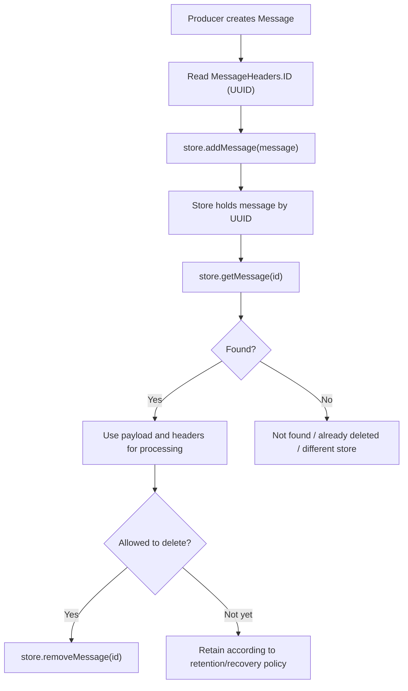
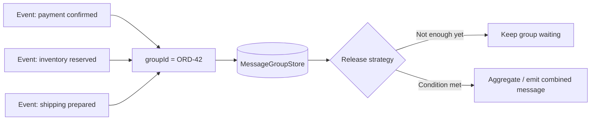
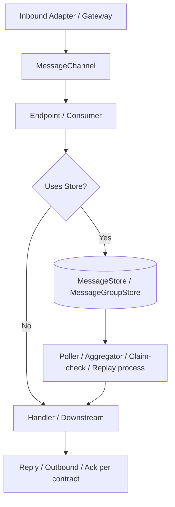
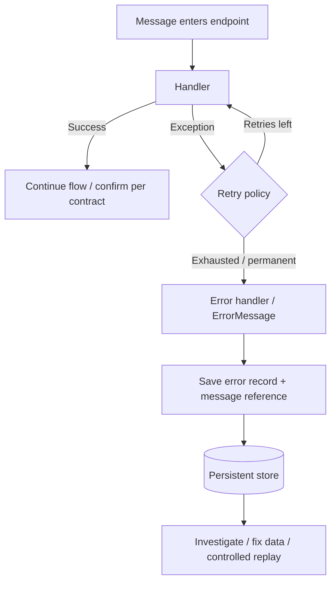

# MessageStore and Storing Messages by Key in Spring Integration

## Learning Objectives

In Spring Integration, messages flow through `MessageChannel`s and endpoints such as transformers, routers, service activators, aggregators, or consumers. Many flows only pass messages in memory, but there are situations where you need to **retain messages for lookup, aggregation, replay, or resumed processing after a delay**. `MessageStore` is an abstraction that helps manage the lifecycle of stored messages by identifier; variants that store *message groups* provide the additional ability to aggregate multiple messages under a group key.

The lesson **MessageStore and Storing Messages by Key** belongs to the **Message store** chapter of the **SPRING_INTEGRATION_RUNTIME** module. This lesson places message storage in its proper runtime context: channels, endpoints, consumers, pollers, executors, transactions, retries, errors, and correlation. The word "key" in the title has at least two meanings to distinguish: **message ID**, used to look up a single message in a `MessageStore`, and **group ID/business key**, used to group or look up related messages in a `MessageGroupStore` or business repository.

After this lesson, you will be able to:

- Explain `Message<T>`, `MessageHeaders.ID`, `MessageStore`, `MessageGroupStore`, and the types of keys they use.
- Write, read, and delete messages by UUID; store multiple messages in a group by `orderId`/correlation key.
- Choose between an in-memory store and a persistent store, and understand the limitations across restarts or multiple instances.
- Determine storage and deletion points suited to synchronous flows, asynchronous flows, transactions, retries, and error flows.
- Analyze consistency, duplication risks, idempotency, serialization, capacity, and performance.
- Diagnose why a message is not found, why a group is incomplete, or why a store has a record while downstream has not processed it.

## 1. Which Key Is a Message Stored By?

A Spring Messaging message consists of a **payload** and **headers**. The `id` header is typically generated as a `UUID` when the message is created.

```text
Message<OrderCreated>
  payload = OrderCreated(orderId="ORD-42", amount=120000)
  headers:
    id            = 7f...-...         <- identifier of the message instance
    timestamp     = ...
    correlationId = "flow-42"        <- links steps in the flow
    businessKey   = "ORD-42"         <- business order identifier
```

**A basic `MessageStore` looks up messages by `MessageHeaders.ID` (UUID)**. It does not automatically index by `businessKey`, `correlationId`, or payload `orderId`. If you need to find all messages belonging to an order, you need a **grouping** mechanism or a dedicated business index.

### 1.1. Distinguishing Keys and Their Purposes

| Concept | Example | Owner | Meaning |
| --- | --- | --- | --- |
| Message ID | UUID generated by `MessageHeaders` | Spring Messaging/message producer | Look up a single message instance via the `getMessage(UUID)` API |
| Correlation ID | `corr-42` | Application or Spring Integration correlation component | Correlate messages/branches of the same process |
| Business key | `ORD-42` | Business contract | Prevent duplicate processing and reconcile order state |
| Message group ID | `ORD-42` or correlation key | Grouping component/application | Group related messages in `MessageGroupStore` |
| Physical storage key | Primary key, Redis key, DB row... | Store implementation | Internal storage detail; not identical to the business key |

There can be **multiple message IDs for the same business key**: a request, reply, confirmation event, payload transformation, or redelivery from a source can each create a different message instance. Therefore, do not use `MessageHeaders.ID` as the sole business key if the goal is idempotency or looking up information across restarts/replays.

### 1.2. MessageStore Is Not an Arbitrary Map<String, Message<?>>

Basic API calls clearly show the intended usage (these illustrate usage, not exact interface signature declarations):

```java
store.addMessage(message);             // store by message ID
Message<?> loaded = store.getMessage(id); // read by UUID
store.removeMessage(id);               // delete by UUID
```

When you need "`put("ORD-42", message)`", do not assume `MessageStore` provides that method. If the goal is to hold **multiple** messages sharing one key, use `MessageGroupStore`. If the goal is to map **a single business state record** by `orderId`, consider a dedicated business table or key-value store with an appropriate unique key.

> In the illustrative code that follows, we invoke real methods on a `MessageStore` bean; exact method order and details may vary by implementation/version, but `getMessage(UUID)` and `removeMessage(UUID)` express the lookup model by message ID.

## 2. The Lifecycle of Storing, Reading, and Deleting a Message



### 2.1. API Example with SimpleMessageStore

`SimpleMessageStore` is an **in-memory** implementation, suitable for exploring the API and writing simple tests. Standalone example:

```java
import java.math.BigDecimal;
import java.util.UUID;

import org.springframework.integration.store.MessageStore;
import org.springframework.integration.store.SimpleMessageStore;
import org.springframework.messaging.Message;
import org.springframework.messaging.support.MessageBuilder;

public class MessageStoreDemo {

    record OrderCreated(String orderId, BigDecimal amount) {}

    public static void main(String[] args) {
        MessageStore store = new SimpleMessageStore();

        Message<OrderCreated> original = MessageBuilder
                .withPayload(new OrderCreated(
                        "ORD-42", new BigDecimal("120000")))
                .setHeader("businessKey", "ORD-42")
                .setHeader("correlationId", "corr-42")
                .build();

        // The lookup key for this message is its UUID.
        UUID messageId = original.getHeaders().getId();

        // Store the message in the store.
        store.addMessage(original);

        Message<?> loaded = store.getMessage(messageId);
        if (loaded == null) {
            throw new IllegalStateException("Message not found: " + messageId);
        }

        OrderCreated order = (OrderCreated) loaded.getPayload();
        System.out.println(order.orderId()); // ORD-42
        System.out.println(loaded.getHeaders().get("correlationId")); // corr-42

        // Only delete when business policy allows.
        store.removeMessage(messageId);

        System.out.println(store.getMessage(messageId)); // null
    }
}
```

To run the example, the project needs Spring Integration and Spring Messaging dependencies. `SimpleMessageStore` is not a durable data store: once the application stops, data existing only in RAM is lost.

**Key takeaways:**

1. `MessageBuilder` creates a message with an `id` and `timestamp`.
2. `addMessage(original)` stores the message managed by the store under `id`.
3. `getMessage(messageId)` retrieves the stored message if it still exists and the right store is queried.
4. `removeMessage(messageId)` removes the message from the store; this operation is independent of whether downstream handlers have actually succeeded.

The code snippets use `Message<?> loaded` because a store can hold multiple payload types. If the application knows the contract, perform `instanceof` checks and validation before casting the DTO. A `MessageStore` does not guarantee payload schema conformance on its own.

### 2.2. When getMessage Returns null

This can happen in one of the following cases:

- The message was never added via `addMessage` to the exact store being queried.
- The ID used for lookup is the ID of a **different** message (for example, a newly created message after a transformer has a different UUID).
- The message was already deleted via `removeMessage` by another consumer or a cleanup step.
- The application restarted while using an in-memory store.
- Two instances are using **two different stores** or differ in namespace/storage configuration.
- Application retention/expiration or a cleanup job removed the message according to policy.

Do not fix this by fabricating a new UUID and looking it up again; identify **where the original ID was stored, when, by which component, and whether it still belongs to that namespace**.

### 2.3. Why Not Delete Immediately After Reading?

Reading a message **does not mean processing succeeded**. If you call `removeMessage` right after `getMessage`, and then the handler fails an API call or the process crashes, you may lose the opportunity for recovery. Conversely, keeping every message forever will fill up the store.

A safe design must define the deletion point: after transaction commit, after source acknowledgment, after recording completion state, or after persisting durable recovery information. With multiple competing consumers, a separate "read then delete" operation also does not automatically create an exclusive **claim/lease** mechanism.

## 3. Storing Multiple Messages by Business Key with MessageGroupStore

When business logic requires grouping multiple related messages, `MessageGroupStore` provides an API to manage *message groups* by `groupId`, which is an `Object` defined by the application or component.

For example, an order has three events:

```text
groupId = "ORD-42"
    ├── Message<PaymentConfirmed>    id = UUID-A
    ├── Message<InventoryReserved>   id = UUID-B
    └── Message<ShippingPrepared>    id = UUID-C
```

The three distinct messages still have their own IDs; they share the group `ORD-42`. The group ID **does not have to match** the `correlationId` or `businessKey` header, though using a consistent convention is recommended.

### 3.1. Example: Grouping Messages by orderId

```java
import org.springframework.integration.store.MessageGroup;
import org.springframework.integration.store.MessageGroupStore;
import org.springframework.integration.store.SimpleMessageStore;
import org.springframework.messaging.Message;
import org.springframework.messaging.support.MessageBuilder;

public class GroupByOrderDemo {

    public static void main(String[] args) {
        MessageGroupStore groups = new SimpleMessageStore();

        String orderId = "ORD-42";

        Message<String> payment = MessageBuilder
                .withPayload("PAYMENT_CONFIRMED")
                .setHeader("businessKey", orderId)
                .build();

        Message<String> inventory = MessageBuilder
                .withPayload("INVENTORY_RESERVED")
                .setHeader("businessKey", orderId)
                .build();

        // Use the business group ID as the group key.
        groups.addMessageToGroup(orderId, payment);
        groups.addMessageToGroup(orderId, inventory);

        MessageGroup group = groups.getMessageGroup(orderId);

        System.out.println(group.size()); // 2

        for (Message<?> item : group.getMessages()) {
            System.out.println(item.getPayload());
        }
    }
}
```

With `MessageGroupStore`, the lookup key in `getMessageGroup(orderId)` is the **group ID**. Do not confuse this with `MessageStore.getMessage(UUID)`. Each message in the group is still a `Message<?>` with its own `id` header.

Comparison table between operations:

| Need | Appropriate API/Model | Key | Result |
| --- | --- | --- | --- |
| Store and retrieve **one** specific message | `MessageStore.addMessage` / `getMessage` | UUID of `MessageHeaders.ID` | One message or `null` |
| Group **multiple** related messages | `MessageGroupStore.addMessageToGroup` / `getMessageGroup` | `groupId`, e.g. `ORD-42` | A message group |
| Find a single order state | Business repository/table or dedicated key-value store | `orderId` | One record with unique constraint |
| Store key → **small metadata** value | `MetadataStore` suited for metadata, not arbitrary message payloads | Metadata key | Metadata value |

### 3.2. Grouping Does Not Automatically Know When Enough Messages Have Arrived

Calling `addMessageToGroup` only creates or updates the group. It does not carry the business meaning "order complete". When waiting for all parts, Spring Integration typically uses an **aggregator** with a correlation strategy and a release strategy:



In an aggregator, the correlation strategy decides which messages belong to the same group; the release strategy decides when the group is allowed to emit a result. Group cleanup, group expiration, handling partial results, and persisting completion state are separate decisions. **Do not assume every message group has ordering, exactly-once guarantees, or automatic expiration**.

If you only want to look up a single message by `orderId`, using a group is a viable option, but you must handle the possibility of multiple messages under the same key, duplicates, and choosing which message to pick. Do not rely on the ordering of the returned collection unless there is an explicit ordering contract.

## 4. How Does MessageStore Participate in Runtime Flow?

`MessageStore` is not a `MessageChannel`. A message can pass through many channels without ever being stored, or be saved by an endpoint/adapter at a specific point.



Common patterns:

| Component/Pattern | Role of Store | Runtime Notes |
| --- | --- | --- |
| **Claim check** | Stores large message/payload in store, forwards claim token reference | Must control checkout timing, deletion, and handling missing claim tokens |
| **Aggregator / resequencer** | Holds messages in a group until release conditions are met | Prone to incomplete, expired, or leftover groups |
| **Persistent queue/channel** | A compatible store implementation can back a message queue | Requires the right store/adapter type; cannot just pass any `MessageStore` into `QueueChannel` |
| **Error/recovery** | Stores failed messages or reference records for reprocessing | Store is not automatically a DLQ nor does it provide a retry schedule |
| **Custom tracking** | Records messages by UUID for later lookup | Must independently define retention, security, indexing, and ownership |

`MessageStore` **does not replace** a broker (JMS, RabbitMQ, Kafka), retry queue, inbound adapter, or transaction manager. Those components govern when messages are delivered to consumers, when they are acknowledged, and when redelivery occurs.

### 4.1. Claim-Check: Store the Content, Pass the Key

The claim-check pattern is used when you want to avoid passing large payloads across many components:

```text
Message<LargePayload>
    -> Claim-check in: store message in store
    -> Message<ClaimToken>
    -> Routing / transport
    -> Claim-check out: use token to retrieve stored message
    -> Message<LargePayload> continues processing
```

The token must be stable enough to locate the right record in a shared store. If one side uses process A's in-memory `SimpleMessageStore` while the other runs in process B, checkout may fail to find the record. If deletion happens right upon checkout, an error in a handler **after** checkout can make recovering the payload difficult; storage/ack policies must be designed accordingly.

Only use claim-check after weighing serialization cost, storage round-trips, and token lifecycle. Passing a small reference around the flow does not mean the payload data has been processed or durably delivered.

### 4.2. Aggregator and Correlation

An aggregator can hold branches of the same request inside a message group:

```text
Split order ORD-42 -> [item-1, item-2, item-3]
        |
        v
    correlationId = ORD-42
        |
        v
  MessageGroupStore[ORD-42]
        |
        v
 Release when all 3 results arrive
        |
        v
  Aggregated message
```

In real applications, correlation can use standard headers or a custom strategy. Note that a group being released/aggregated is different from all side effects of subsequent handlers having committed. If the group is not cleaned up according to policy, a redelivered message might enter an old group or be treated as a late arrival.

## 5. In-Memory vs Persistent MessageStore

### 5.1. What Is SimpleMessageStore For?

`SimpleMessageStore` stores data in the process's memory. It is suitable for demos, tests, short-lived caches, or flows where data loss on restart is acceptable by contract.

**Do not** use an in-memory store as the durable source of truth for critical workflows if the system must recover after a restart. You cannot assume state automatically synchronizes across multiple instances.

### 5.2. Persistent Implementations

Spring Integration provides implementations connecting to external backends such as `JdbcMessageStore` and corresponding options depending on the integration/backend module (such as Redis or MongoDB). Each implementation has its own requirements for dependencies, schema, serializer, transactions, and level of support for messages/groups/channels.

Example JDBC bean configuration:

```java
import javax.sql.DataSource;

import org.springframework.context.annotation.Bean;
import org.springframework.context.annotation.Configuration;
import org.springframework.integration.jdbc.store.JdbcMessageStore;
import org.springframework.integration.store.MessageStore;

@Configuration
class JdbcStoreConfiguration {

    @Bean
    MessageStore orderMessageStore(DataSource dataSource) {
        return new JdbcMessageStore(dataSource);
    }
}
```

This configuration requires the Spring Integration JDBC dependency, a valid `DataSource`, **version-compatible message/group storage table schemas**, and any necessary serialization/transaction settings. Creating a `JdbcMessageStore` bean does not mean the database is already initialized or that data will survive every kind of restart as expected.

Questions to settle before choosing a backend:

- Is the backend shared by every replica handling the same claim token/group ID?
- Are the transaction manager and commit boundaries properly configured?
- Can payloads and headers be serialized/deserialized after deploying a new version?
- Are there cleanup, retention, indexing, backup, and capacity-limit mechanisms?
- When the backend temporarily loses connectivity, will the application retry, roll back, return an error, or enter degraded mode?
- Is there a duplicate risk due to adapter redelivery or two consumers reading the same record?

### 5.3. A Decision Table

| Criterion | In-memory (`SimpleMessageStore`) | Persistent (e.g. JDBC) |
| --- | --- | --- |
| After process restart | Data in RAM is lost | Committed data can survive if the backend stays operational |
| Use across multiple replicas | Each process has separate state | Can be shared with same backend/namespace and proper concurrency policy |
| I/O cost | Low, RAM access | Network/DB I/O, serialization, and contention |
| Durable transactions | Does not provide durability itself | Depends on transaction manager/DB and write approach |
| Payload schema/version | Easy to overlook in demos | Must be designed to read back older data |
| Backup/retention | Mainly tied to process lifecycle | Requires clear operational and cleanup strategy |
| Best suited for | Demos, tests, disposable state | Recovery, long-running workflows, processing that must survive restarts |

Persistent storage only means **a record can survive a restart** if properly committed. It does not guarantee exactly-once processing, automatic source acknowledgment, duplicate resolution, or safe handler re-execution.

## 6. Transactions: Are Message Storage and Business Processing Atomic?

Suppose a producer receives an order, stores the message, and then calls downstream:

```text
Receive order
  -> store.addMessage(orderMessage)
  -> handler.reserveInventory()
  -> send confirmation
```

There are at least three operations with distinct success/failure states. If `addMessage` commits but the API fails, the store keeps the message awaiting recovery. If the handler succeeds but the app crashes before recording completion state, the message may be replayed causing duplicate side effects. If the store and business data live in two different systems, a standard single-`DataSource` transaction **does not automatically span** both.

### 6.1. Failure Windows

| Failure Point | Possible State | Risk |
| --- | --- | --- |
| Before `addMessage` | No record in store yet | Message may be lost if source already acked early |
| After save, before processing | Unprocessed record exists | Needs scheduler/worker or recovery process to handle |
| Inside handler | Partial side effects may exist | Retry/redelivery may duplicate business actions |
| After handler, before status update | Business action succeeded but store still pending | Replay may re-execute the operation |
| During delete/cleanup | Message may remain or be deleted | Must check actual outcome instead of guessing from logs |

For critical workflows, explicitly document the sequence **save → process → mark complete/ack → delete**, the involved transactions, and the policy when each step fails. Do not rely on a successful `addMessage` call to conclude that the request has been processed.

### 6.2. Thread and Transaction Boundaries

- **`DirectChannel`** typically runs the handler synchronously on the sender's thread, so a caller transaction can include the processing step if compatible resources participate.
- **`ExecutorChannel`** hands the handler off to another thread; a transaction bound to the caller thread normally **does not automatically propagate to the worker**. A store write before the executor and a DB write inside the worker may occur in two separate transactions.
- **Poller** can open a transaction per poll; commit/rollback depends on the source and participating resources. Reading a message from a source/queue is not automatically identical to `store.removeMessage`.
- **Message-driven adapter** can ack, nack, or redeliver according to the broker, container, and thrown exception contract. A store alone does not control that behavior.

When using a JDBC store and a business DB, you can design them to share a transaction manager **if they use the same datasource and the boundary truly fits**. If a handler makes an external HTTP call, that call does not automatically belong to the JDBC transaction. Consider a transactional outbox, idempotency keys, or compensating workflows when synchronizing with external systems.

## 7. Retries, Error Flows, and Storing Failed Messages

`MessageStore` is useful in recovery, but simply adding a store does not mean errors are automatically saved.



In a synchronous flow, exceptions usually propagate back to the caller; obtaining an `ErrorMessage` requires an appropriate error publisher/recovery mechanism. In an executor/poller flow, an error handler at the asynchronous boundary can publish an `ErrorMessage` to the error channel. In both cases, **saving to `MessageStore` is an action that must be explicitly configured in the error flow or recovery component**.

### 7.1. Where Does ErrorMessage Hold the Original Message?

`ErrorMessage` has a `Throwable` payload. The source message can be retrieved from `getOriginalMessage()` or `MessagingException.getFailedMessage()` if present; the two values may differ or be `null`.

```java
import org.springframework.integration.store.MessageStore;
import org.springframework.messaging.Message;
import org.springframework.messaging.MessagingException;
import org.springframework.messaging.support.ErrorMessage;

class ErrorArchive {

    private final MessageStore store;

    ErrorArchive(MessageStore store) {
        this.store = store;
    }

    void archive(ErrorMessage error) {
        Throwable failure = error.getPayload();

        Message<?> failed = error.getOriginalMessage();
        if (failed == null && failure instanceof MessagingException messaging) {
            failed = messaging.getFailedMessage();
        }

        if (failed == null) {
            // Insufficient context to save original message; use a separate error record.
            throw new IllegalStateException(
                    "Original message unavailable", failure);
        }

        // Illustrates saving the message; production needs error metadata and status.
        store.addMessage(failed);
    }
}
```

This snippet uses `MessageStore` to illustrate saving a failed message by ID. In production, an **error record** usually also needs `businessKey`, `correlationId`, endpoint, exception class/cause, timestamp, attempt/delivery count, recovery status, and retention. Saving the original message **does not automatically store sufficient error history** and does not inherently provide broker-like DLQ semantics.

Decide clearly whether to store the raw message, a normalized snapshot, or only a reference to the payload. Do not push secrets, tokens, or personal data into a store without proper retention/encryption/access control.

### 7.2. Error Store and Message Replay

A reliable replay process:

1. Select failed records by **business key** and status; verify the root cause has been fixed or downstream has recovered.
2. Use the UUID/claim key to read the original message back from the store.
3. Validate payload/schema version and current business state.
4. Resend the message through a flow with an idempotency contract; carry along correlation and replay attempt metadata.
5. Only mark as processed and clean up the record after the outcome is committed/recorded per policy.

Do not treat "send the message again" as exactly-once. If the consumer already processed it before crashing, replay can run it a second time. A unique business key or idempotency key is a critical safeguard.

## 8. Concurrency: Multiple Consumers Reading the Same Key

A `getMessage(id)` API is a **lookup**, not an automatic exclusive right for one worker to process it. Two threads or two processes can see the same message simultaneously and both call downstream if the orchestration lacks a claim/lock mechanism.

```text
Worker A: getMessage(UUID-1) -> found -> calls API
Worker B: getMessage(UUID-1) -> found -> calls API
Worker A: removeMessage(UUID-1)
Worker B: removeMessage(UUID-1) -> may already be gone
```

This behavior **is not solved** by changing the UUID. If only one worker should have the right to process a key, design conditional status transitions in the DB (`PENDING -> CLAIMED -> DONE`), locks/leases, optimistic concurrency, a queue/broker with ack semantics, or an atomic claim mechanism provided by the backend.

### 8.1. Mutable Payloads and Snapshots

`MessageHeaders` cannot be modified directly through the API, but the payload can be a mutable `ArrayList` or DTO. An in-memory store may hold a reference to the object within the same process; code authors should not expect an immutable snapshot to appear automatically just because `addMessage` was called.

Prefer immutable DTOs/records, immutable collections, and consistent serializers. With persistent stores, measure payload sizes and verify that records read back after a restart accurately reflect the data needed for recovery.

### 8.2. Correlation and Concurrent Message Groups

When an aggregator receives the same `groupId` from multiple threads, the store implementation, correlation strategy, release strategy, and lock registry (if configured) all affect consistency. Successfully saving two messages into the same group does not guarantee that release is invoked exactly once or that the business output won't be reprocessed. Test duplicate, late arrival, and concurrent release cases.

## 9. Serialization and Persistent Data Lifecycle

In a persistent store, payloads and headers must be converted into a format the backend can store and reconstruct. A `Message<T>` in Java may carry:

- Custom DTOs matching the current code version.
- `replyChannel` or `errorChannel` headers containing a `MessageChannel` object or a channel name string.
- Non-serializable objects or references to beans in the Spring context.
- Schema/correlation metadata that must survive restarts.

This leads to several scenarios:

| Scenario | Problem | Handling Suggestion |
| --- | --- | --- |
| DTO changes package/class name | Old records may fail to deserialize | Maintain schema versioning and stable data formats |
| Header contains runtime object | Unsupported by serializer or meaningless after restart | Store required names/identifiers; avoid storing beans directly |
| Payload too large | Increases I/O, GC, DB size, and recovery time | Claim-check, reference payloads, or size limits |
| Old data has no TTL | Store grows indefinitely | Measured retention and cleanup jobs |
| Header contains secrets/PII | Data exposure risk and hard deletion | Masking, encryption, authorization, and purge policies |
| Schema changes while records are pending | Replay fails after new deployment | Migration or compatibility mapping |

Do not rely indiscriminately on native Java serialization for long-lived workflows without compatibility controls. JSON/Avro/Protobuf formats or specialized serializers must be chosen based on requirements and the capabilities of the backend in use.

## 10. Observing and Diagnosing MessageStore at Runtime

A message written to the store **does not prove** downstream completed. When observing a flow, distinguish four events:

```text
received != stored != delivered != business-committed
```

You should instrument each stage:

| Signal | Why Needed | Question Answered |
| --- | --- | --- |
| `store.add.success/failure` | Storage capability | Was the message recorded? |
| `store.get.hit/miss` | Key/retention correctness | Why was the UUID not found? |
| `store.remove.success/failure` | Cleanup/recovery | Was the message deleted too early? |
| `store.message.count` | Capacity and retention | Is the store growing uncontrollably? |
| `group.pending.count` / `group.age` | Aggregator stuck waiting indefinitely | Which group is incomplete/not releasing? |
| `store.operation.latency` | DB/Redis bottleneck | Is the store slowing down pollers/consumers? |
| `error.archive.count` / `replay.count` | Recovery | Are errors being lost or replayed repeatedly? |
| `duplicate.businessKey` | Idempotency | How many times was the same business action processed? |

Metric names are **instrumentation suggestions**, not claims that they appear by default in Spring Integration. Also monitor connection pools, DB locks, row counts, transaction rollbacks, thread pools, queue depth, and application poller lag. Avoid using `messageId` or `correlationId` as high-cardinality metric labels; record them in logs/tracing with appropriate retention.

### 10.1. Symptom-Based Diagnostic Table

| Symptom | Possible Cause | What to Check |
| --- | --- | --- |
| `getMessage(id)` returns `null` | Wrong UUID, already cleaned up, different store instance | ID at save time, backend, namespace, deletion time |
| Message visible in store but handler never ran | Only stored with no consumer/replay worker | Endpoint, poller, queue, schedule, and status |
| Restart loses all messages | Using in-memory store | `SimpleMessageStore` or persistent implementation? |
| Aggregator waits forever | Missing branch, wrong correlation, release strategy not met | Group ID, group size, sequence, timeout |
| One order processed twice | Redelivery, replay, two consumers reading same key | Business key, idempotency, claim/lease, transaction |
| JDBC store cannot read back old DTO | Serialization/version mismatch | Schema version, class mapping, serializer |
| Queue backed up despite fast handler | Slow store I/O or contention | Query latency, locks, transactions, connection pool |
| Error flow logs but does not save message | Archival not actually configured, write failed | Error consumer, durable write, retry on store failure |
| Newly saved message disappeared | Cleanup/expiration or consumer deleted too early | Retention/ack/commit/delete policy |
| Group key `ORD-42` not found via `getMessage` | Confused String group ID with UUID message ID | Use `getMessageGroup(groupId)` on the right group store |

### 10.2. Investigation Sequence for a "Missing" Message

1. Obtain the **business key** and **correlation ID** from the business request.
2. Find the message ID (UUID) logged during `addMessage`, and identify the store bean/backend/namespace.
3. Check commit status, transactions, and cleanup/remove events.
4. If part of a group, verify the group ID, message count, correlation strategy, release strategy, and timeout/expiration state.
5. Inspect executors, pollers, adapters, and runtime threads to see if a consumer picked up the message.
6. If retries/redelivery occurred, count per layer and search for duplicate replays by business key.
7. Cross-check durable business state before deciding to replay, repair data, or delete the message.

## 11. Hands-On Practice with Realistic Scenarios

### Exercise A — Store and Retrieve a Message by UUID

Create a `SimpleMessageStore`, build a `Message<OrderCreated>` with `businessKey` and `correlationId`; save it with `addMessage`, retrieve `messageId` from headers, call `getMessage(id)`, read the payload, and delete with `removeMessage(id)`.

**Expected result:** message is retrieved when using the exact UUID; after removal, `getMessage(id)` returns `null`. Try calling `getMessage` with a random UUID and verify no message is returned.

### Exercise B — Multiple Messages with the Same Business Key

Create three messages `PAYMENT_CONFIRMED`, `INVENTORY_RESERVED`, `SHIPPING_PREPARED` all sharing `businessKey=ORD-42`, but with three different UUIDs. Store them using `MessageGroupStore.addMessageToGroup("ORD-42", ...)`, then call `getMessageGroup("ORD-42")` and inspect the group size.

**Expected result:** the group contains three messages; sharing a business key does not merge them into one message ID. Define a release condition yourself and handle the case where one message is missing.

### Exercise C — Restart and Recovery

Repeat Exercise A with an in-memory store and a properly configured persistent JDBC store. Write a message, restart the application, and try reading it back using the previous UUID. Also test upgrading the DTO version to check compatibility.

**Expected result:** the in-memory store loses data across restarts; the persistent store can read back **committed** records if the serializer/schema are compatible and the backend still holds the data.

### Exercise D — Failure Right After Save and Failure After Processing

Design the flow `save -> call API -> mark DONE -> cleanup`. Simulate a crash at each point; note whether the message remains in the store, whether the API was called, and the conditions for replay. Enable idempotency by `orderId`, then demonstrate that replay produces no additional side effects.

**Expected result:** the distinction between "message saved" and "business action committed" is proven through actual state, not just logs.

### Exercise E — Two Workers Looking Up the Same UUID

Have two workers concurrently call `getMessage(id)` and then call a mock API. Record the number of API calls. Next, add a claim/lease or optimistic update backed by a business store and rerun.

**Expected result:** reading by UUID does not automatically guarantee exclusivity; a claim mechanism or idempotency prevents two workers from causing duplicate side effects.

### Exercise F — Observing an Aggregator with an Incomplete Group

Simulate three branches of an order but only send two into the group. Observe the group ID, group size, and release condition. Send the final branch after a delay, then test a duplicate event and an event arriving after expiration.

**Expected result:** incomplete groups, late arrivals, duplicates, expiration, and cleanup must be explicitly decided; business state cannot be inferred solely from the presence of messages in a group.

## 12. Self-Check Questions

1. Which key type does `MessageStore.getMessage(...)` use? Why does `businessKey="ORD-42"` not automatically enable lookup by that string?
2. Must two messages with the same `correlationId` have the same `MessageHeaders.ID`?
3. How does `MessageGroupStore.getMessageGroup(groupId)` differ from `MessageStore.getMessage(UUID)` in return object and purpose?
4. Why is `SimpleMessageStore` unsuitable as the sole recovery store for a critical workflow across restarts?
5. Does successfully saving a message prove that the consumer processed it successfully? Why or why not?
6. When two workers call `getMessage(id)`, which API automatically turns that read into an exclusive claim?
7. Why are transactions/idempotency needed when an external API call follows `store.addMessage`?
8. In an error flow, is `ErrorMessage.getPayload()` the original payload that should be saved to the store?
9. What happens when a DTO or header fails to deserialize after a new deployment?
10. Which signals help determine whether a missing message was caused by a wrong UUID, cleanup, transaction, missing consumer, or store error?
11. Why is a group holding all three messages still insufficient to conclude that an order is complete?
12. Do a message store, retry queue, and dead-letter queue share the same operational contract?

**Takeaway:** `MessageStore` helps hold and look up **a single message by its message ID UUID**; `MessageGroupStore` allows managing **multiple messages by a group key** such as a correlation/business key. For storage to be reliable at runtime, you must properly define **where to store, where to read, transactions, deletion points, concurrency, serializer, retention, retry/replay, and idempotency**. A record existing in the store is a technical state; business outcomes must be verified separately.
