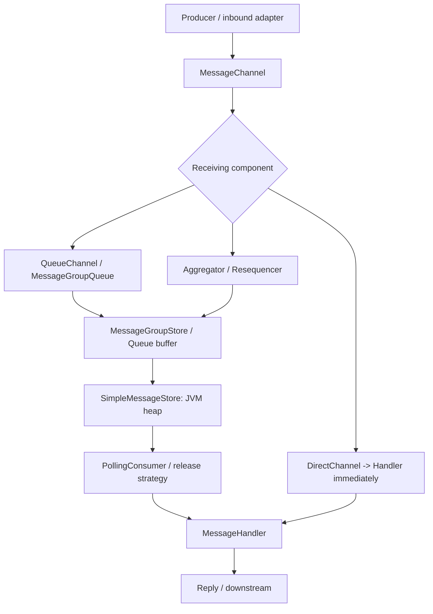
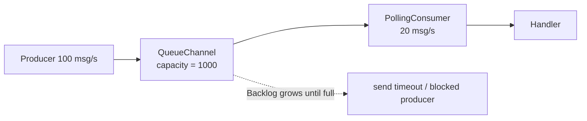
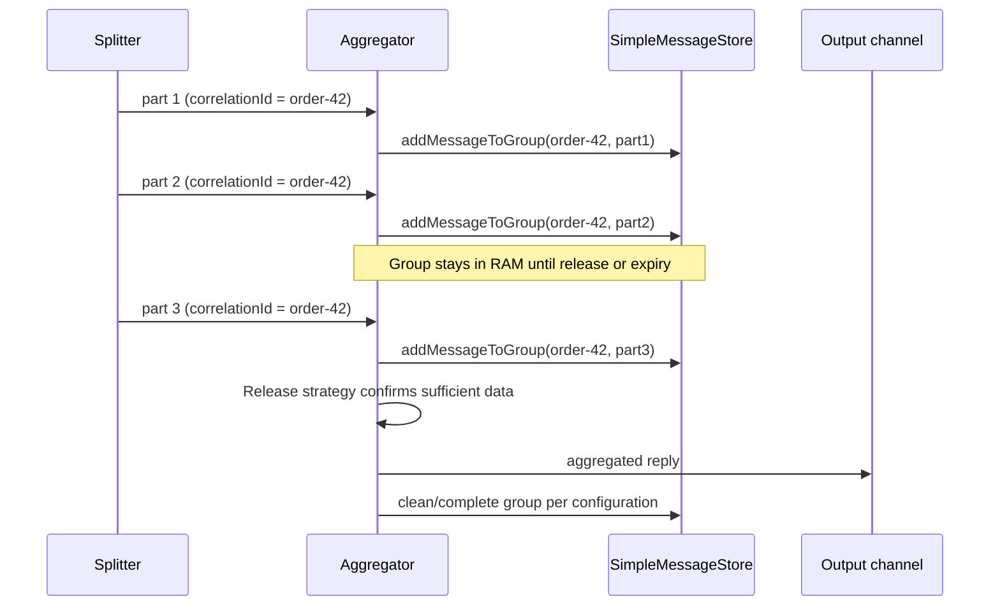

# SimpleMessageStore and Memory Limits in Spring Integration

## 1. The Role of SimpleMessageStore in Spring Integration Runtime

Spring Integration transports `Message<?>` across channels, consumer endpoints, handlers, pollers, and executors. Some components process messages **immediately upon receipt**; others need to **retain messages** because the consumer is not ready, because a correlation group must be assembled, or because processing must wait until a later point in time.

`SimpleMessageStore` is Spring Integration's **JVM in-memory message store** implementation. It is especially useful for learning, prototyping, or running low-load flows where losing unprocessed data when the process stops is acceptable. Storing messages in RAM introduces two risks:

- **Data disappears when the JVM/container stops or restarts.** There is no durability guarantee simply because a message was placed in the store.
- **Data still referenced in the heap will not be reclaimed by GC**, which can grow the heap, cause GC pauses, and eventually trigger `OutOfMemoryError`.

The lesson **SimpleMessageStore and Memory Limits**, part of the **Message store** chapter of `SPRING_INTEGRATION_RUNTIME`, explains how to set storage limits, which limits are actually enforced, why capping message count is not enough to cap RAM usage, and how to operate the store in flows involving queues, aggregators, retries, transactions, correlation, and dynamic lifecycles.

**Learning outcomes:**

1. Recognize the `MessageStore`, `MessageGroupStore`, and `ChannelMessageStore` interfaces.
2. Understand `SimpleMessageStore` constructors and how individual vs. group capacities are bounded separately.
3. Write a Java demo to add, retrieve, and remove messages; simulate capacity overflow.
4. Distinguish between a `QueueChannel` buffer, a `MessageGroupQueue`, and an aggregator's message group.
5. Design monitoring, TTL/expiry, backpressure, persistent stores, and recovery strategies suitable for production.

The APIs/examples target **Spring Integration 6.x** (verified against API 6.5), **Java 17+**, and `spring-integration-core`.

## 2. Where Does the Store Sit in Runtime?

### 2.1. Two Common Places Messages Are Stored



There are two common storage models here:

- **Messages stored individually by ID:** stored and retrieved via `MessageStore.addMessage()`, `getMessage(UUID)`, `removeMessage(UUID)`.
- **Messages belonging to a group:** stored by `groupId` via `MessageGroupStore.addMessageToGroup()`, retrieved via `getMessageGroup()`; useful for aggregators, resequencers, and store-backed queues.

For example, an `Aggregator` receives parts of an order. It must keep the `MessageGroup` for the same `correlationId` until `sequenceSize` parts arrive, a timeout fires, or a release strategy signals that the result can be emitted. If groups are not deleted/expired properly, both payloads and headers continue occupying heap.

### 2.2. Comparing the Interfaces

| Interface / Type | Primary Responsibility | Examples |
|---|---|---|
| `MessageStore` | Store/look up messages by `UUID` | `addMessage`, `getMessage`, `removeMessage` |
| `BasicMessageGroupStore` | Store and read message groups by key | `addMessageToGroup`, `getMessageGroup` |
| `MessageGroupStore` | Operate message groups with metadata, complete/expire, callbacks... | Aggregator, resequencer |
| `ChannelMessageStore` | Store contract optimized/capable for `QueueChannel` | `SimpleMessageStore`, corresponding channel stores |
| `MessageGroupQueue` | `BlockingQueue<Message<?>>` adapter built on a group store | Used with `QueueChannel(Queue<Message<?>>)` |
| `SimpleMessageStore` | In-RAM implementation of `MessageStore` and `MessageGroupStore` | Demos/temporary message storage |

`SimpleMessageStore` uses in-memory map-based structures and implements `MessageStore`, `MessageGroupStore`, and `ChannelMessageStore`. It is not JDBC, Redis, MongoDB, or a durable broker.

**Not every default buffer creates a `SimpleMessageStore` bean.** For instance, `new QueueChannel()` has a default in-RAM queue; a standard aggregator has an in-memory message store. The key point is that **all of them hold references in the heap**, even though the underlying data structures differ.

## 3. Constructors and Three Capacity Concepts

### 3.1. Key Constructors

```java
SimpleMessageStore unlimited = new SimpleMessageStore();

SimpleMessageStore both100 = new SimpleMessageStore(100);

SimpleMessageStore separate =
        new SimpleMessageStore(500, 20);

SimpleMessageStore withWait =
        new SimpleMessageStore(500, 20, 200L);
```

| Constructor | Meaning in Spring Integration 6.5 |
|---|---|
| `SimpleMessageStore()` | Unbounded capacity by message counter |
| `SimpleMessageStore(int capacity)` | Same capacity value for individually stored messages and **each group** |
| `SimpleMessageStore(int individualCapacity, int groupCapacity)` | Sets separate limits for the two storage modes; values less than 1 mean unlimited for that part |
| `SimpleMessageStore(int individualCapacity, int groupCapacity, long upperBoundTimeout)` | Adds wait time (milliseconds) when waiting for space upon hitting the limit |
| Constructor accepting `LockRegistry` | Allows configuring a lock mechanism for concurrent group operations |

**Crucial distinction:** `individualCapacity` and `groupCapacity` are **independent**.

- `individualCapacity = 500`: limits the number of messages stored via the `addMessage(message)` path.
- `groupCapacity = 20`: limits the number of messages in **each message group**, when stored via `addMessageToGroup(groupId, message)`.
- They are **not** combined limits on the total number of messages across the entire store.
- If there are thousands of groups, each holding up to 20 messages, the total number of grouped messages can still become huge.

Example `new SimpleMessageStore(100, 10)`:

| Situation | Can Continue Storing? |
|---|---|
| 99 individual messages stored, adding the 100th | Yes, barring ID conflicts or other conditions |
| 100 individual messages stored, adding the 101st | Exceeds `individualCapacity` |
| Group A has 9 messages, adding 1 more | Yes |
| Group A has 10 messages, adding 1 more | Exceeds Group A's `groupCapacity` |
| Group A is full at 10 messages, Group B has 2 | Can still add to Group B |
| 50,000 different groups, 1 message each | No hard limit on **total number of groups** from `groupCapacity=10` alone |

### 3.2. Capacity Counts Messages, Not Bytes

`individualCapacity = 100` only limits **element count**, not "under 100 MB". A payload can be:

- A small `String` of a few dozen bytes.
- An image or file as a multi-MB `byte[]`.
- A large object graph still referencing caches, collections, or framework resources.
- A message with many headers or tracing metadata.

Rough estimation model:

```text
Memory retained ~
  numberOfMessages * (payload retained size + headers + object/index overhead)
  + numberOfGroups * group metadata
  + queue/map/cache overhead
  + data still referenced in handlers, executors, logs, retries...
```

This is only an estimation model, not an exact heap formula; object sharing, compressed pointers, GC, and payload types cause actual cost to vary significantly.

For example, **20,000 groups × 50 messages/group × 2 KB payload** equals roughly **2 GB in payload data alone** before object overhead. Even with `groupCapacity=50`, the store still risks OOM if the number of groups is unbounded.

### 3.3. What Happens When Full?

When capacity is reached and code tries to store another message beyond the limit, the store **does not evict old messages**, **does not route messages to a DLQ**, and **does not spill to disk**. Depending on the constructor and slot availability:

- If waiting is disabled or waiting does not free space, the store operation may **throw an exception**.
- With `upperBoundTimeout`, the call may block waiting for space up to the configured timeout.
- If consumers are not removing messages from the store or groups never release, increasing the timeout merely makes threads wait longer.

Do not assume every call site throws the exact same outermost exception. `MessageStore` may fail at the store level; when routed through `QueueChannel`, poller, or handler, the framework may wrap it in a `MessagingException` or route to an error branch. When debugging, inspect the **root cause** and the buffer's full condition.

**Slot-wait timeout differs from channel and poller timeouts**: `upperBoundTimeout` belongs to the store constructor; `MessageChannel.send(message, timeout)` belongs to the channel; `PollableChannel.receive(timeout)` belongs to the consumer; gateway `replyTimeout` belongs to the caller waiting for a reply.

## 4. Lab 1: Individually Stored Messages by ID

This small example only uses `spring-integration-core` and `spring-messaging` on the classpath. It does not require an ApplicationContext or a poller.

```java
import org.springframework.integration.store.SimpleMessageStore;
import org.springframework.messaging.Message;
import org.springframework.messaging.support.MessageBuilder;

public class IndividualStoreDemo {

    public static void main(String[] args) {
        // 2 individual messages; max 2 messages per group.
        SimpleMessageStore store = new SimpleMessageStore(2, 2);

        Message<String> first =
                MessageBuilder.withPayload("order-A").build();
        Message<String> second =
                MessageBuilder.withPayload("order-B").build();
        Message<String> third =
                MessageBuilder.withPayload("order-C").build();

        store.addMessage(first);
        store.addMessage(second);

        System.out.println(store.getMessageCount()); // 2
        System.out.println(store.getMessage(
                first.getHeaders().getId()).getPayload()); // order-A

        // Attempt to add a 3rd message exceeding individualCapacity=2.
        try {
            store.addMessage(third);
            throw new AssertionError("Expected capacity failure");
        }
        catch (RuntimeException capacityFailure) {
            System.out.println("Cannot add third message: "
                    + capacityFailure.getClass().getSimpleName());
        }

        // Remove one message to free a slot.
        store.removeMessage(first.getHeaders().getId());
        store.addMessage(third);

        System.out.println(store.getMessageCount()); // 2
        System.out.println(store.getMessage(
                third.getHeaders().getId()).getPayload()); // order-C
    }
}
```

**How to read this:**

1. `MessageBuilder` creates three `Message<String>` instances with distinct IDs.
2. `addMessage` puts the first two messages into the in-RAM map.
3. The third add exceeds `individualCapacity`, so it is rejected when no slot is free.
4. `removeMessage(id)` removes a message by ID; the slot is freed and subsequent adds succeed.
5. `getMessageCount()` on `SimpleMessageStore` reports the count of individually stored messages; to count messages in groups, inspect group metrics separately.

`MessageStore.addMessage()` follows the contract that storing **the exact same message ID** multiple times is a no-op; it is not a command to re-enqueue the same ID repeatedly. If business logic genuinely requires replay, create a new message with explicit identity and an idempotency strategy.

The demo uses `catch (RuntimeException)` solely to show **overflow behavior** while learning the API; production code should classify specific exceptions per framework version and context, never lumping every runtime exception into "queue full".

## 5. Lab 2: groupCapacity Applies Per Group

`SimpleMessageStore` is also a `MessageGroupStore`. A group has a business key, such as `"batch-42"`, and holds multiple correlated `Message<?>` instances.

```java
import org.springframework.integration.store.SimpleMessageStore;
import org.springframework.messaging.Message;
import org.springframework.messaging.support.MessageBuilder;

public class GroupCapacityDemo {

    static Message<String> part(String text) {
        return MessageBuilder.withPayload(text).build();
    }

    public static void main(String[] args) {
        // addMessage path has capacity 1,
        // each individual group has capacity 2.
        SimpleMessageStore store = new SimpleMessageStore(1, 2);

        store.addMessageToGroup("batch-42", part("part-1"));
        store.addMessageToGroup("batch-42", part("part-2"));

        System.out.println(store.messageGroupSize("batch-42")); // 2

        try {
            store.addMessageToGroup("batch-42", part("part-3"));
            throw new AssertionError("Expected group capacity failure");
        }
        catch (RuntimeException capacityFailure) {
            System.out.println("Group full: "
                    + capacityFailure.getClass().getSimpleName());
        }

        // A different group has its OWN limit of 2 and still accepts messages.
        store.addMessageToGroup("batch-43", part("other-1"));
        System.out.println(store.messageGroupSize("batch-43")); // 1

        // End of test: clean up messages/groups no longer needed.
        store.removeMessageGroup("batch-42");
        store.removeMessageGroup("batch-43");
    }
}
```

Group A being full does not block Group B. This matters greatly when an aggregator uses a distinct `correlationId` per request: **`groupCapacity` only prevents a single group from growing too large, it does not cap the number of new groups**. If senders generate unbounded new `correlationId`s or a missing release strategy keeps groups from completing, the heap still grows.

`MessageGroup` also retains metadata such as group ID, timestamps, completeness, and collection/index structures. Even a group with few payloads can leave overhead behind if not cleaned up per lifecycle. Do not watch only `messageGroupSize` for one key and forget **total system group count**.

## 6. QueueChannel: Queue Limits Differ from SimpleMessageStore Limits

### 6.1. Bounded QueueChannel Without SimpleMessageStore

This is the quickest way to create an in-RAM queue bounded by message count:

```java
import org.springframework.integration.channel.QueueChannel;
import org.springframework.messaging.Message;
import org.springframework.messaging.support.MessageBuilder;

QueueChannel orders = new QueueChannel(2);

Message<String> first =
        MessageBuilder.withPayload("A").build();
Message<String> second =
        MessageBuilder.withPayload("B").build();
Message<String> third =
        MessageBuilder.withPayload("C").build();

System.out.println(orders.send(first, 0));  // true
System.out.println(orders.send(second, 0)); // true
System.out.println(orders.send(third, 0));  // false: queue is full

System.out.println(orders.receive(0).getPayload()); // A
System.out.println(orders.send(third, 0));  // true: slot available
```

`QueueChannel(2)` creates an in-RAM queue with capacity 2. Using `send(message, 0)` avoids **blocking** when full and returns `false`; `send(message)` by default may block until space opens. The demo assumes no other consumer is contending for the queue.

Bounding a queue does not prevent OOM if each message is huge or if the system also has many queues, message groups, HTTP buffers, and executor tasks occupying heap.

### 6.2. QueueChannel Backed by MessageGroupQueue

A `QueueChannel` can use a queue backed by a `MessageGroupStore` via `MessageGroupQueue`:

```java
import org.springframework.integration.channel.QueueChannel;
import org.springframework.integration.store.MessageGroupQueue;
import org.springframework.integration.store.SimpleMessageStore;
import org.springframework.messaging.Message;
import org.springframework.messaging.support.MessageBuilder;

SimpleMessageStore memoryStore =
        new SimpleMessageStore(100, 3);

QueueChannel queued =
        new QueueChannel(new MessageGroupQueue(
                memoryStore, "orders.queue", 3));

queued.send(MessageBuilder.withPayload("ORD-1").build(), 0);
queued.send(MessageBuilder.withPayload("ORD-2").build(), 0);

Message<?> consumed = queued.receive(0);
System.out.println(consumed.getPayload()); // ORD-1
```

The purpose of `MessageGroupQueue` is to map queue operations onto **a group with a stable ID**; both the queue's capacity parameter and the store's `groupCapacity` must be understood when enforcing limits. `MessageGroupQueue` works with durable or in-memory stores; **passing `SimpleMessageStore` still creates an in-RAM queue**.

In XML configuration, `QueueChannel` can declare `message-store` instead of setting capacity directly:

```xml
<int:channel id="ordersQueue">
    <int:queue message-store="ordersStore"/>
</int:channel>

<bean id="ordersStore"
      class="org.springframework.integration.store.SimpleMessageStore">
    <constructor-arg value="100"/>
</bean>
```

This XML snippet requires Spring Integration and Spring Beans namespaces; it is a configuration fragment, not a complete XML file. When specifying `message-store`, do not also set the `capacity` attribute on the same `<int:queue>`; corresponding capacity must be controlled by the store/queue implementation and actual configuration.

### 6.3. Poller Governs Consumption Rate

`QueueChannel` is a `PollableChannel`; downstream consumers need a poller to trigger the handler. A bounded queue with a fast producer and a slow poller will fill up.



If arrival rate `λ` exceeds processing rate `μ` for long enough, backlog grows. In the example with 100 msg/s arriving and only 20 msg/s drained, the queue grows by about **80 messages per second** unless there is a drop/throttle/scaling mechanism. Capacity limits only make **overload observable**, they do not fix a sustained rate mismatch on their own.

**Design an overload path:** apply backpressure, pause producers, reduce burst size, scale consumer concurrency within resource limits, or switch to a broker/persistent store according to reliability needs.

## 7. Aggregator, Correlation, and Message Group Lifecycle

### 7.1. How Messages Are Held by Group

An aggregator typically holds messages sharing a `correlationId` until a release condition is satisfied—such as receiving all `sequenceSize` parts from a splitter.



Until a result is emitted, each group retains its messages and metadata. `groupCapacity` protects **each group from bloating**, but if a splitter generates hundreds of thousands of distinct keys that never receive enough messages to release, every group can stay alive in the heap.

**Sources of abnormal group growth:**

- Correlation strategy uses an unstable identifier, giving each message a new key.
- Some chunks are lost or arrive late, so the release strategy waits forever.
- Wrong `sequenceSize`, making the completion condition unreachable.
- Group timeout/expiry is unconfigured or configured only to mark rather than clean up as expected.
- Unrelated messages fail to correlate because headers were altered, mis-mapped, or correlation was not propagated.
- Completed groups are retained due to aggregator cleanup/tombstone policies.

### 7.2. Capacity Is Not TTL

`SimpleMessageStore(100, 10)` does **not** mean each group is kept for 10 seconds, deleted after 10 messages, or expired after 100 requests. The two parameters are **message counts**, not lifetimes.

Differences among the three concepts:

| Concept | Question Answered | Responsible Component |
|---|---|---|
| `groupCapacity` | Maximum messages in **one** group? | `SimpleMessageStore` |
| Release strategy | Does the group satisfy emission criteria yet? | Aggregator/resequencer |
| Expiry/cleanup | When does a group expire and get deleted or emit a partial result? | Endpoint, message-group expiry/reaper, and configured callbacks |

`MessageGroupStoreReaper` is a utility that inspects and expires groups over time via registered group expiry callbacks. Configure frequency and expiry behavior appropriate to the component type; **do not assume every group is automatically deleted simply because a `SimpleMessageStore` bean exists**.

For example, when processing orders with up to five parts: setting `groupCapacity=5` still does not solve **one million `orderId`s**, each having only one part. You need group timeouts, cleanup, and an application-level bound on open groups.

### 7.3. Release Does Not Always Mean Immediate Full Deletion

An aggregator can be configured to mark a group completed, emit partial results on timeout, remove the group upon release, or keep metadata to guard late-arrival logic. Behavior depends on `expireGroupsUponCompletion`, `groupTimeout`, `sendPartialResultOnExpiry`, `discardChannel`, and the actual endpoint's release strategy.

Do not manually call `removeMessageGroup(groupId)` on a group actively managed by an aggregator: it can cause data loss or race conditions. Define lifecycle from the **group's consumer**, then use monitoring to confirm message/group counts drop after release or expiry.

## 8. Why Can OutOfMemoryError Still Happen Even With Capacity Set?

### 8.1. Sources of Heap Retention

`SimpleMessageStore` holds references to `Message<?>`; each message holds a payload and headers. Heap consumption is not simply element count multiplied by payload size:

- **Payload:** `byte[]`, JSON object graphs, collections, binary data, or DTOs with child references.
- **Headers:** correlation, reply/error channel references, tracing, and other metadata.
- **Overhead:** `Message`, map entries, group objects, indexes, locks, and collection structures.
- **Number of groups:** each group has fewer messages individually but adds its own metadata.
- **Copies/intermediates:** transformers, serializers, logging, retry contexts, pending executor tasks.
- **External references:** if another handler/cache/queue still holds the payload, removing from the store may not free the object graph.

A Java message is immutable at the message wrapper level, but the payload inside can be a mutable object. Mutating the payload from elsewhere while the store still references it can lead to unpredictable results and thread-safety issues. Do not use an in-memory buffer as an uncontrolled shared space for mutable objects.

### 8.2. Budgeting With Overall Limits

Projected example:

```text
Max individually stored messages:          1,000
Max open groups (enforced by system):      5,000
Max messages/group:                           10
Max retainable messages:                 ~51,000

Average retained payload:                   4 KB
Estimated payload cost:                  ~204 MB
+ headers, index, metadata, duplicate references, GC headroom
```

In this example, **`SimpleMessageStore` only enforces 1,000 individual messages and 10 messages/group**. The **5,000 group** cap must come from **external rules/monitoring**. If the group count rises to 50,000, the RAM budget multiplies even though the constructor did not change.

To choose safe limits:

1. Measure retained payload size via profiling/heap analysis under realistic load; do not use `String.length()` as RAM byte count.
2. Calculate p95/p99 payload sizes, not just the average.
3. Estimate pending messages at peak load and acceptable backlog duration.
4. Set queue/group capacities and max open groups to fit the heap budget.
5. Reserve memory headroom for the application, class metadata, HTTP buffers, executor tasks, and GC.
6. Run load/soak tests and observe retained heap after the backlog drains.

**Do not calculate capacity by dividing total `-Xmx` by payload size.** The garbage collector and the rest of the JVM also need memory; when running in containers, consider the container memory limit rather than heap max alone.

### 8.3. Signs of Message Retention Leaks

If messages have already been processed yet post-full-GC heap continues rising over time, possible causes include:

- Groups were never released or expired.
- Completed groups/metadata are not being cleaned up.
- A `QueueChannel` has a stopped consumer or a poller that is not running.
- Another handler/flow retains references to the message, payload, or headers.
- Retries/replays keep generating new messages with new correlations.
- The process dynamically registers too many `IntegrationFlow` instances without unregistering beans/stores.

Inspect **group count**, **messages per group**, and **queue backlog** alongside heap dumps/dominator trees. Do not conclude a memory leak solely from GC observations before references are actually released.

## 9. Concurrency, LockRegistry, and copyOnGet

### 9.1. When Multiple Consumers Operate on a Group

Two threads may concurrently add messages to a group, or one thread may release while another sends the next part. `SimpleMessageStore` supports group synchronization through the message group store locking mechanism; certain constructors accept a custom `LockRegistry`.

Example:

```java
import org.springframework.integration.store.SimpleMessageStore;
import org.springframework.integration.support.locks.DefaultLockRegistry;

SimpleMessageStore store =
        new SimpleMessageStore(
                100,                        // individualCapacity
                20,                         // groupCapacity
                100L,                       // upperBoundTimeout (ms)
                new DefaultLockRegistry()); // group operation lock registry
```

With an in-memory `SimpleMessageStore`, locks only coordinate **threads sharing the same instance/registry**. They do not turn the store into a distributed store and do not preserve messages across restarts. When scaling across multiple replicas, each JVM has its own memory store; sharing the same `groupId` **does not automatically gather messages across pods**.

### 9.2. copyOnGet and the Risk of Mutating MessageGroup Externally

Since Spring Integration 4.1, `SimpleMessageStore.setCopyOnGet(false)` is the default. `getMessageGroup(groupId)` generally returns a reference to the live group used by the aggregator rather than making a large copy, reducing time and allocation overhead on large groups.

Trade-offs:

- Reading a group reference from monitoring code and **mutating it directly** can corrupt the state the aggregator relies on.
- Iterating over the collection from multiple threads while the group changes can produce inconsistent results.
- Enabling `setCopyOnGet(true)` can reduce accidental mutation of live groups, at the cost of extra copying overhead; it is no substitute for proper lifecycle/thread-safety design.

```java
SimpleMessageStore store = new SimpleMessageStore(100, 20);
store.setCopyOnGet(true); // only enable with a measurable reason

// When monitoring, prefer read-only APIs:
// store.messageGroupSize(groupId)
// store.getMessageGroupCount()
```

Do not let application code read a group and arbitrarily remove messages via the collection reference. Modify groups through store APIs respecting endpoint ownership; avoid concurrent access violating component contracts.

### 9.3. Lazy-Load Does Not Make Memory "Infinite"

`setLazyLoadMessageGroups(boolean)` is an API related to `PersistentMessageGroup` representation and lazy loading. Do not mistakenly assume enabling lazy-load spills payloads from RAM to disk when over capacity. For `SimpleMessageStore`, data remains inside the JVM; lazy proxies do not make data persistent.

## 10. Transactions, Retries, and Data Durability

### 10.1. Memory Store Has No Transaction Durability

While a message sits in `SimpleMessageStore`, it resides solely in heap. Even if a flow uses `@Transactional` or poller transaction advice, **a database rollback cannot recover messages lost to a process crash**. A memory store does not become a transactional durable store merely by running inside a transaction.

Distinguish clearly:

| Event | `SimpleMessageStore` | Properly Configured Durable/Transactional Store |
|---|---|---|
| JVM restart | In-RAM messages vanish | Committed messages can be recovered |
| Consumer takes message then fails | Depends on callbacks/flow, no durable rollback guarantee | Retrieval from store can be rolled back |
| Message processed twice due to retry | Still possible | Still possible if not idempotent |
| Message added to store but caller times out | Message may remain or not yet be stored | Must query store and transaction state |
| Sudden heap exhaustion | Risks losing backlog | External store can recover, depending on consistency/ACK |

Spring Integration supports multiple persistent implementations such as `JdbcMessageStore`, `JdbcChannelMessageStore`, and Redis/MongoDB message stores. With a `QueueChannel` backed by a transactional message group store and poller transactions, a retrieved message can **return to the queue on rollback**; this behavior depends on the actual store and transaction boundaries, not every store by default.

### 10.2. Choosing a Store by Pattern

- **Aggregator, resequencer, delayer:** usually require an appropriate `MessageGroupStore`, correlation, release strategy, expiry, and lock coordination.
- **QueueChannel:** requires a store supporting queue semantics (`ChannelMessageStore`/`MessageGroupQueue`), such as `JdbcChannelMessageStore` or a compatible implementation.
- **Individual messages:** `MessageStore` saves/reads by ID when the use case calls for it.
- **High throughput/event streaming:** brokers like Kafka/RabbitMQ have their own persistence/acknowledgment mechanisms; do not assume a `SimpleMessageStore` bean can directly substitute for them.

**Simply dropping a durable store into a flow is not enough:** you must also verify serialization, transaction boundaries, cluster locking, cleanup, throughput, and monitoring.

### 10.3. replyChannel Header When Moving to Persistence

Messages carrying `replyChannel`/`errorChannel` as Java objects may not serialize/deserialize back to the same instance when using JDBC/Redis/MongoDB. For example, a gateway creates a temporary reply channel; after persisting the message to a database and restarting, the old reply channel object is no longer valid.

When request-reply across a persistent queue is needed:

1. Determine whether synchronous reply across a restart boundary is genuinely needed.
2. Use named channels/`HeaderChannelRegistry` and header enrichers per Spring Integration guidance if return addresses must be preserved.
3. Configure appropriate timeouts, dead-letter/correlation handling, and delayed response mechanisms.
4. Test restarting while messages are still waiting in the store.

Do not rely on preserving in-memory header object references to guarantee replies return to the caller after a restart.

## 11. Lifecycle and Operational Impact on IntegrationFlow

`SimpleMessageStore` is a bean or object used by endpoints; it does not accept new messages on its own, poll itself, or start/stop flows. Orchestration is handled by channels, endpoints, pollers, executors, and `IntegrationFlowContext`/`SmartLifecycle`.

### 11.1. When Stopping an Endpoint

When a polling consumer stops:

- Producers can still send messages to `QueueChannel` if the channel remains active.
- Queue backlog grows toward capacity.
- If a bounded queue fills up, `send()` may block or fail on timeout.
- If using an unbounded memory buffer, heap can grow uncontrollably.
- Restarting the consumer drains the backlog, though processing rate is not guaranteed to catch up with producers.

For an aggregator missing parts, groups can continue occupying heap even after producers stop. Inspect expiry/correlation and group cleanup, not just consumer status.

### 11.2. Dynamic IntegrationFlow and Store Beans

When dynamically registering and destroying `IntegrationFlow`s, define the store's lifetime:

- A singleton store shared across multiple flows can retain state after one flow is unregistered.
- Creating a new store when re-registering a flow loses previous RAM state unless another reference holds the store.
- Reusing group IDs/queue IDs across flows can cause leftover state to be misinterpreted.
- If multiple components read/delete from the same group store, define clear ownership and cleanup.

Do not mistake course metadata `status` or a channel name for runtime storage state; inspect the actual bean and groups.

## 12. Monitoring: What to Measure to Control Memory?

Basic APIs to read state:

```java
SimpleMessageStore store = ...;

long individuallyStored = store.getMessageCount();
int groups = store.getMessageGroupCount();
int groupedMessages = store.getMessageCountForAllMessageGroups();
int orderGroupSize = store.messageGroupSize("order-42");

System.out.printf(
        "individual=%d, groups=%d, grouped=%d, order42=%d%n",
        individuallyStored, groups, groupedMessages, orderGroupSize);
```

In this example, these calls can be used for application instrumentation; when switching to another store, some metrics on the interfaces are marked **optional** and may throw `UnsupportedOperationException`. Do not write generic monitoring assuming every backend supports identical metrics.

| Metric | Meaning | Warning Sign |
|---|---|---|
| `getMessageCount()` | Messages stored by ID in store | Growing steadily because code fails to delete |
| `getMessageGroupCount()` | Number of groups in group store | Many groups never releasing/expiring |
| `getMessageCountForAllMessageGroups()` | Total messages across all groups | Growing aggregator/resequencer backlog |
| `messageGroupSize(key)` | Size of a single group | Specific group nearing capacity |
| `QueueChannel.getQueueSize()` | Messages waiting in queue | Poller falling behind or stopped |
| `getRemainingCapacity()` | Free slots in bounded queue | Persistently near 0 |
| Heap used after GC, allocation rate | Retained memory and allocation rate | Rising retained heap, lengthening GC pauses |
| Consumer lag, poll count, processing latency | Consumption rate and processing time | Arrival rate exceeding drain rate |
| Error-channel, retry, rejected send | Capacity overflow or downstream errors | Repeated errors, upstream retry storms |

**Measure in combination, not in isolation.** Rising heap with stable message count may indicate growing payload sizes or other buffers. Rising message count with little heap change may reflect small payloads or object sharing. Both heap dumps and queue/group metrics are needed to identify which object graphs retain memory.

### 12.1. Alerts and Capacity Planning

A simple alert set can be based on:

- Queue utilization above 70–80% for several minutes, or low estimated time-to-full.
- Group count rising steadily even after traffic drops.
- Group age p95/p99 exceeding business SLA.
- Post-GC heap increasing without dropping after the backlog drains.
- Rapid rise in rejections/send timeouts or `MessageStoreException`.
- Unplanned consumer/poller stops or executor saturation.

Thresholds are starting points to tune against real traffic. If message payloads spike in size, a queue at just 50% capacity can still consume excessive heap.

## 13. Troubleshooting Table

| Symptom | Likely Cause | Verification / Action |
|---|---|---|
| OOM despite setting `groupCapacity` | Too many groups; individual groups haven't hit limit | Measure group count, group age, correlation strategy |
| OOM with only 100 messages | Payloads/headers too large, or extra copies retained | Profile retained size, take heap dump |
| `addMessage` rejected | Exhausted `individualCapacity` | Check message count and ID deletion path |
| `addMessageToGroup` fails for one group | Specific group hit `groupCapacity` | Inspect group ID, release strategy, threshold config |
| Store fills up while consumer is running | Processing rate slower than arrival rate; slow poller/retry | Measure send/receive rates, queue depth, backoff |
| `send()` blocks for a long time | Bounded queue/store full, producer waiting for slot | Use send timeouts, thread dumps, and metrics |
| All messages disappear after restart | Store lives in RAM | Switch to durable store if reliability is required |
| Completed groups exist but RAM doesn't drop | Groups/metadata retained, expiry not cleaning as expected | Check cleanup policy and reaper callbacks |
| Group A never releases | Wrong correlation/sequence, missing part | Log group ID, size, expected sequence, timeout |
| Multiple pods collect incomplete groups | Each pod has its own `SimpleMessageStore` | Distributed store or clear affinity/partitioning contract |
| After switching to JDBC, replies don't reach gateway | Temporary reply channel header doesn't survive persistence | `HeaderChannelRegistry`/named reply channel |
| Poller has transaction yet RAM store still loses data | Transactions do not make memory durable | Verify actual store and transaction configuration |
| Low CPU yet requests time out | Threads waiting for slots, queue backlog, stopped poller | Thread dump, queue latency, lifecycle |
| Inspecting groups from monitoring causes unexpected errors | Mutating live group collection when `copyOnGet=false` | Read-only access or snapshot, never mutate |

**Practical investigation steps:**

1. Identify **which component holds the messages**: `QueueChannel`, aggregator, resequencer, delayer, or custom store.
2. Locate the actual injected `SimpleMessageStore` instance; avoid inspecting the wrong bean.
3. Measure message count, group count, size/age of large groups, and queue depth.
4. Compare arrival/drain rates, endpoint lifecycle, poller schedules, and retry/backoff settings.
5. Confirm the error cause: capacity overflow, timeout, business error, or backend store exception.
6. If memory is abnormal, capture a heap dump and inspect **dominators/retained references**.
7. Act on the root cause: release/expire groups, throttle sources, shrink payloads, scale consumers appropriately, cap group counts, or migrate to a durable backend.

## 14. Hands-On Exercises

### Exercise 1 — Individual Capacity

Starting from Section 4's example, replace `SimpleMessageStore(2, 2)` with `SimpleMessageStore(3, 1)`. Predict when individual message storage fails, then call `removeMessage(id)` to free a slot.

**Question:** Why does changing `groupCapacity` have no effect on `addMessage` in this exercise?

### Exercise 2 — Many Small Groups

Starting from Section 5, create 1,000 groups with one message each, despite `groupCapacity=2`. Observe group count and memory. Explain why heap grows even though no single group is full. At the end, call `removeMessageGroup` for all created keys.

### Exercise 3 — Full QueueChannel and Send Timeout

Create `new QueueChannel(2)`, send 3 consecutive messages using `send(message, 0)` and record the return values. Have a consumer call `receive(0)` to take one message, then send again. Compare with `send(message, 200)` when no consumer exists; observe blocking duration and boolean return value.

### Exercise 4 — Misconfigured Correlation

Simulate 100 messages meant to form 10 groups, but give each message a distinct `correlationId`. Predict the group size/total group count. Then fix the correlation strategy to group properly by request and configure suitable timeout/release behavior.

### Exercise 5 — Expiry and Cleanup

Create an incomplete group and stop sending further messages. Configure `groupTimeout`/`MessageGroupStoreReaper` policies and check whether the group is released, discarded, emits a partial result, or is deleted after timeout. Observe the group count afterward.

### Exercise 6 — Restart and Transactions

Use `SimpleMessageStore` to hold messages, restart the process, and observe state loss. Switch to a transaction-capable durable `MessageGroupStore`; trigger a poller rollback followed by redelivery, confirming messages only reappear when transaction boundaries are properly configured.

### Exercise 7 — Performance Measurement and Heap Limits

Measure memory with 1,000 messages carrying 1 KB payloads, then with 1,000 messages carrying 1 MB payloads; compare post-GC heap and GC pause behavior. Do not run large-payload experiments in production or on a JVM with a very low heap limit.

## 15. Principles to Remember

1. **`SimpleMessageStore` is an in-memory store.** It provides no guarantee that data survives restarts.
2. **The no-arg constructor is unbounded** by message count; proactively set appropriate bounds.
3. **`individualCapacity` and `groupCapacity` apply independently**; `groupCapacity` is a **per-group** limit.
4. **Capacity is message count, not bytes.** Also enforce payload size, group count, and lifetime bounds.
5. **Reaching capacity requires a backpressure/error/recovery strategy.** Never assume the store auto-evicts or auto-retries.
6. **Queues and groups have different lifecycles.** Queues need consumers/pollers; aggregators need correlation, release, and expiry.
7. **Do not mutate a `MessageGroup` via a retrieved reference** when `copyOnGet=false` without ensuring locking/ownership.
8. **Transactions do not turn RAM into a durable store.** Choose an appropriate backend if rollback/persistence across crashes is required.
9. **Monitor heap alongside message/group metrics** and inspect retained references when OOM occurs.
10. **In multi-replica deployments**, memory stores do not share state; design partitioning, routing, or a distributed store.

With `SPRING_INTEGRATION_RUNTIME`, the goal is not merely "keep the queue from filling up," but knowing **where messages are held, who frees them, what happens when memory runs out, and how to recover after failures**. That is essential for message flows to operate reliably as load changes.

## 16. Official Spring Documentation

- [Spring Integration 6.5 – SimpleMessageStore Javadoc](https://docs.spring.io/spring-integration/docs/6.5.0/api/org/springframework/integration/store/SimpleMessageStore.html): constructors, `individualCapacity`/`groupCapacity` limits, `copyOnGet`.
- [Spring Integration 6.5 – Message Store](https://docs.spring.io/spring-integration/reference/6.5/message-store.html): message buffering, persistent implementations, warnings regarding `SimpleMessageStore` and header serialization.
- [Spring Integration 6.5 – QueueChannel Javadoc](https://docs.spring.io/spring-integration/docs/6.5.0/api/org/springframework/integration/channel/QueueChannel.html): bounded queue, `send`/`receive`, queue size.
- [Spring Integration 6.5 – MessageGroupQueue Javadoc](https://docs.spring.io/spring-integration/docs/6.5.0/api/org/springframework/integration/store/MessageGroupQueue.html): queue backed by `BasicMessageGroupStore` and group ID.
- [Spring Integration 6.5 – MessageGroupStore Javadoc](https://docs.spring.io/spring-integration/docs/6.5.0/api/org/springframework/integration/store/MessageGroupStore.html): group metadata, group counts, and expiry.
- [Spring Integration 6.5 – Configuring Message Channels](https://docs.spring.io/spring-integration/reference/6.5/channel/configuration.html): `QueueChannel` capacity and persistent message-store configuration.
- [Spring Integration 6.5 – Aggregator](https://docs.spring.io/spring-integration/reference/6.5/aggregator.html): correlation, release, group timeout/expiry, and partial results.
