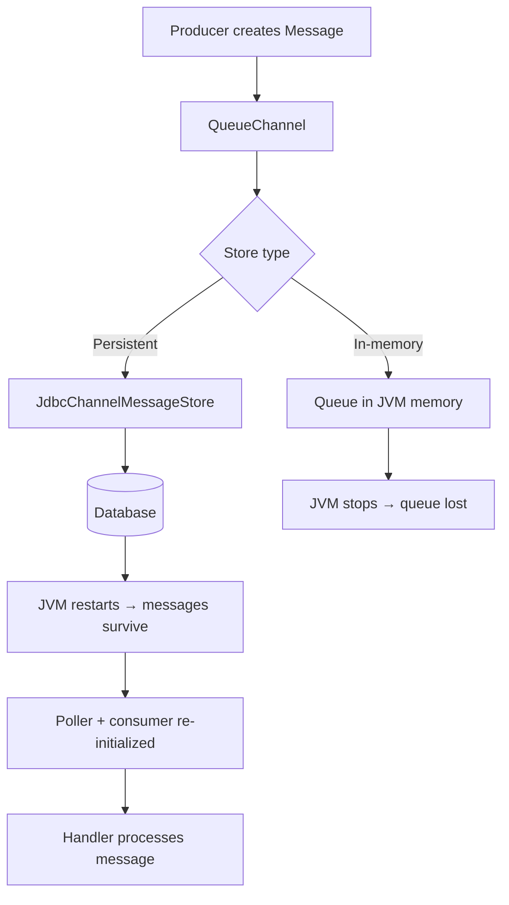
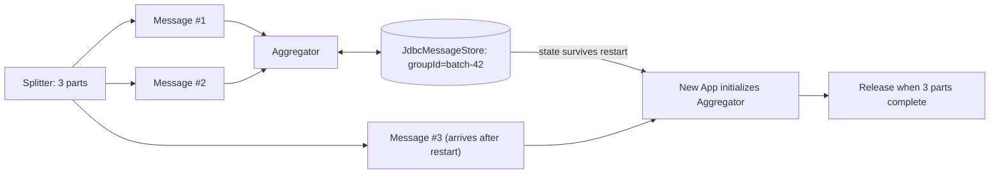

# Persistent MessageStore for Restarts in Spring Integration

## 1. Why Is the Default Message Store Insufficient When a Process Stops?

In Spring Integration, a message travels through multiple components: **channels** receive and transport messages, **endpoints/consumers** execute business logic, **pollers** pull messages from pollable channels, and **executors** determine which thread runs the processing. Some components must hold messages longer than a single method call: `QueueChannel` holds unprocessed work; an **aggregator** holds parts not yet ready to combine; a **resequencer** holds parts that cannot yet be emitted in order.

If that state is stored only in JVM memory, pending state disappears when the application restarts:

- Messages already placed into a `QueueChannel` that have not reached a consumer yet.
- A `MessageGroup` that has received 2 of 3 parts, while the final part arrives later.
- A resequencer group that has received sequences `1` and `3` without `2` yet.
- An error handler holding failed messages for investigation/replay after retries are exhausted.

A **Persistent MessageStore** uses a durable storage backend such as a relational database or Redis/MongoDB configured for appropriate durability, retaining messages or message groups across process lifecycles. In the **SPRING_INTEGRATION_RUNTIME** module, this is a core design concern when addressing `IntegrationFlow` lifecycle, transactions, retries, correlation, polling, and runtime recovery.

> **Key point:** A persistent store protects **data that has been written and committed to the store**. It does not automatically recreate beans, dynamic `IntegrationFlow`s, threads, open transaction state, TCP connections, or side effects outside the store. "The message survives a restart" and "business logic executes exactly once" are two separate guarantees.

### Illustration: Same Queue, Two Storage Approaches



The diagram assumes the message write **committed successfully** before the JVM stopped and that the database remains operational. If the application stops before commit or the DB also loses unflushed data, recovery cannot be promised.

## 2. Three Store Types to Distinguish

Spring Integration offers several interfaces and implementations for retaining messages.

| Interface / Type | Serves Component | Data Stored | Example Implementations |
| --- | --- | --- | --- |
| `MessageStore` | Store/retrieve individual messages, claim-check, and certain mechanisms | Message by identifier | `SimpleMessageStore`, `JdbcMessageStore` |
| `MessageGroupStore` | Aggregator, resequencer, and components needing message groups | Group key, members, group state | `SimpleMessageStore` / `JdbcMessageStore` depending on config |
| `ChannelMessageStore` | Store-backed queue channels | Messages queued per queue/channel, enqueue/dequeue operations | `JdbcChannelMessageStore` |
| Application-defined error store | Audit, dead-letter, controlled replay | Business payload, cause, attempts, status | `failed_messages` table or broker DLQ |

Some implementations may support multiple interfaces, but **just because two classes have "MessageStore" in their name does not mean they are interchangeable**. Typical examples:

- For a **persistent `QueueChannel` on JDBC**, use `JdbcChannelMessageStore`, which is optimized for channel enqueue/dequeue operations.
- For an **aggregator/resequencer needing persistent groups**, use `JdbcMessageStore`, which supports storing and querying `MessageGroup`s.
- For a **default `QueueChannel`**, messages reside in memory. A bean named `messageStore` that is not wired into the channel **provides no recovery**.

Verify the channel name, region/group ID, store configuration, and dependencies: creating a store bean while endpoints still fall back to a default in-memory store is a very common configuration mistake.

### Durability Is a Property of the Entire Path

Think in terms of three layers of guarantees:

1. **Storage durability:** committed messages survive application or host restarts according to the storage backend.
2. **Processing reliability:** failed messages are retried/rolled back/requeued according to policy.
3. **Business correctness:** replay does not create duplicate invoices, duplicate payments, or out-of-order updates.

A persistent store primarily addresses the first layer. The remaining two layers require transaction boundaries, acknowledgments, idempotency, correlation, and runtime observability.

## 3. Realistic Scenario: An Invoice Queue Surviving Restarts

Suppose a service receives invoice creation requests. The HTTP handler simply puts a `CreateInvoiceCommand` onto a durable-backed channel; a worker polls periodically and writes the invoice to the database.

```text
HTTP / Gateway
     |
     v
  MessageChannel.send()
     |
     v
  QueueChannel: durableInvoiceCommands
     |
     | enqueue into JdbcChannelMessageStore → commit
     v
  Database: persistent channel rows
     |
     | polling (transactional if configured)
     v
  Service Activator
     |
     v
  invoiceService.createInvoice(command)
```

If the process restarts before the worker polls, committed messages remain in the store. Once the Spring `ApplicationContext` is rebuilt, channels and consumers are registered, and the poller starts running, those messages can be retrieved and processed.

Recovery preconditions include:

- **Database and schema** remain intact with valid connections.
- The new app uses the exact channel name, region, and store configuration matching stored rows.
- Payloads/headers can be deserialized by the new version's code/serializer.
- The poller is actually active; the endpoint is not stopped due to `autoStartup=false` or missing registration.
- No other instance already consumed the message under a competing-consumer setup.

Messages can sit in the DB **unprocessed** if any of the consumer/poller initialization conditions are not met.

## 4. Configuring a Persistent QueueChannel with JDBC

Spring Integration provides `JdbcChannelMessageStore` in the `spring-integration-jdbc` module. The clearest illustration is declaring the channel and store via XML namespace. The snippet below focuses on bean relationships; the application must include the corresponding XML namespaces/schemas and `dataSource` bean.

```xml
<!-- Snippet inside a Spring context with the int namespace:
     xmlns:int="http://www.springframework.org/schema/integration" -->

<bean id="invoiceChannelStore"
      class="org.springframework.integration.jdbc.store.JdbcChannelMessageStore">
    <constructor-arg ref="dataSource"/>

    <!-- Choose the SQL provider matching the actual DB, here PostgreSQL -->
    <property name="channelMessageStoreQueryProvider">
        <bean class=
          "org.springframework.integration.jdbc.store.channel.PostgresChannelMessageStoreQueryProvider"/>
    </property>

    <!-- Keep fixed across restarts to read back the existing data region -->
    <property name="region" value="INVOICES_V1"/>
</bean>

<int:channel id="durableInvoiceCommands">
    <int:queue message-store="invoiceChannelStore"/>
</int:channel>
```

If configuring in Java rather than XML, check exact APIs and method names against the project's Spring Integration version; the structure remains: `DataSource` → `JdbcChannelMessageStore` → `QueueChannel` → poller.

**Prerequisites before running:**

1. `spring-integration-core` and `spring-integration-jdbc` dependencies, plus a JDBC driver matching the database.
2. Table schemas and indexes created using **DDL supplied by the exact Spring Integration JDBC version**. Never guess table schemas from bean names alone.
3. A `dataSource` bean with read/write permissions and a connection pool sized for actual load.
4. A corresponding `PlatformTransactionManager` for pollers/business writes when transactions are needed.
5. A query provider matching the SQL dialect. The PostgreSQL provider above cannot be used unchanged on Oracle, SQL Server, or MySQL.

**Do not specify both `capacity` and `message-store` on the same `<int:queue>`.** A queue backed by an external message store does not use an in-memory capacity bound like a plain in-RAM queue. Control pressure via backlog monitoring, storage quotas, rate limiting, alerts, and operational policies.

### Why Must Region and Channel Name Stay Fixed?

Stores typically use channel/group identity and **region** to partition data. If a new deployment renames `durableInvoiceCommands` to `invoiceCommandsV2` or changes `INVOICES_V1` to a new value, old messages may still sit in the DB while the new version's consumers no longer see them.

Plan migrations before renaming beans/channels, prefixes, or regions; never "fix missing messages" by changing the region arbitrarily at startup.

## 5. Pollers and Transactions Determine Whether a Message Is Deleted Before Processing Finishes

`QueueChannel` is a `PollableChannel`: producers send messages, but processing requires a **polling consumer**. A basic snippet:

```java
import org.springframework.integration.annotation.MessageEndpoint;
import org.springframework.integration.annotation.Poller;
import org.springframework.integration.annotation.ServiceActivator;

@MessageEndpoint
public class InvoiceWorker {

    private final InvoiceService invoiceService;

    public InvoiceWorker(InvoiceService invoiceService) {
        this.invoiceService = invoiceService;
    }

    @ServiceActivator(
        inputChannel = "durableInvoiceCommands",
        poller = @Poller(fixedDelay = "1000", maxMessagesPerPoll = "5"))
    public void createInvoice(CreateInvoiceCommand command) {
        invoiceService.create(command);
    }
}
```

`InvoiceService` is an application-provided business service. This example **does not yet declare a transaction for the poller**. `@ServiceActivator` only defines the endpoint reading the queue; do not assume by default that dequeue, invoice persistence, retries, and acknowledgment are wrapped in a single transaction.

In XML configuration, transaction advice can be attached to the poller:

```xml
<!-- Alternative to @ServiceActivator in the example above;
     do not register both consumers unless competing consumption is intentional. -->

<int:service-activator
        input-channel="durableInvoiceCommands"
        ref="invoiceWorker"
        method="createInvoice">
    <int:poller fixed-delay="1000" max-messages-per-poll="5">
        <int:transactional transaction-manager="transactionManager"/>
    </int:poller>
</int:service-activator>
```

With a valid transactional configuration:

- The poller starts a transaction, retrieves a message from the channel store, and invokes the handler.
- If an exception **escapes the transaction boundary** causing a rollback, the DB dequeue operation can roll back so the message remains for the next poll.
- If the handler succeeds and the transaction commits, the message removal is persisted.
- If the handler **catches the exception and returns normally** or a recovery advice absorbs the error, the transaction may commit; the message is treated as processed at the queue layer even though business logic failed. This is only safe if recovery persisted state/DLQ as required.

Coordination depends on the transaction manager, how the store uses connections, advice scope, and the datasource. With a single DB shared by the channel store and business tables, both can participate in the same local transaction. With multiple DBs or external HTTP/broker calls, there is no automatic atomic guarantee.

### Distinguishing Timeouts

| Property | Meaning |
| --- | --- |
| `fixedDelay`, `fixedRate` | Poll cadence; not an execution timeout for a running handler |
| `maxMessagesPerPoll` | Maximum messages fetched in a single poll cycle |
| Poller transaction timeout | Transaction time limit if supported by the transaction manager |
| `receiveTimeout` / poll receive timeout | Wait duration when fetching a message per endpoint/channel config |
| Handler retry backoff | Delay between retry attempts; does not make messages durable |
| Queue retention | Retention window before processing/cleanup by operational design; stores do not have a universal default TTL |

Do not turn a `QueueChannel` into a "delay scheduler" merely by increasing `fixedDelay`: if messages must be processed at a specific time or expire, design explicit deadlines/timestamps and choose the right scheduling, filtering, or reaper mechanism.

## 6. Analyzing Crash Windows

A persistent store for restarts only helps when you explicitly analyze **when a process crashes** relative to commit points.

| Crash Timing | With Properly Configured JDBC Queue + Transaction | What to Verify |
| --- | --- | --- |
| Before enqueue commits | Message may not exist in store | Does the producer retry/confirm? |
| After enqueue commits, before poll | Message remains in DB | Does the new app read the right channel/region? |
| After poll but before dequeue commits | Rollback can revert message retrieval to unconsumed state | Is dequeue inside the transaction? |
| Business logic produced an external side effect, then poll rolled back | Message may be redelivered and side effect executed twice | Do idempotency keys protect side effects? |
| Dequeue committed, app dies before recording full completion trace | Message has already been removed from queue | Are transaction boundaries and outbox/inbox suitable? |
| Multiple instances polling concurrently | Each message must be claimed/consumed per DB mechanism | Query provider, locking, concurrency, and duplicates |

These guarantees are conditional: **the message store must actually participate in the transaction** and the database must retain data across crashes. A durable queue alone cannot provide an "end-to-end exactly-once" claim when a flow involves independent HTTP calls, brokers, and databases.

### Idempotency Is a Mandatory Safeguard for Side Effects

Suppose a payment has business key `paymentRequestId=PAY-123`. The consumer must record processing state with a unique constraint or enforce idempotency at the payment receiver so that even if the message is redelivered, money is not deducted twice.

```sql
-- Simplified example in the business database,
-- not Spring Integration's internal schema.
CREATE TABLE processed_commands (
    command_id VARCHAR(100) PRIMARY KEY,
    processed_at TIMESTAMP NOT NULL
);
```

Merely running a `SELECT` before processing without an atomic/unique claim still leaves a race condition when two workers receive the message simultaneously. In flows with multiple side effects, enforce clear idempotency rules at **each target system**, optionally combined with a transactional outbox.

## 7. Persistent MessageGroupStore for Aggregators and Resequencers

`QueueChannel` only solves queuing. Aggregators and resequencers maintain their own **group** state: they collect messages by `correlationId` and wait for a `release strategy` to decide when to emit output.

With an in-memory store, a restart loses pending parts. With `JdbcMessageStore` or another persistent `MessageGroupStore`, the framework stores groups and their members across process restarts.



Conceptual Java DSL example:

```java
import javax.sql.DataSource;
import org.springframework.context.annotation.Bean;
import org.springframework.integration.dsl.IntegrationFlow;
import org.springframework.integration.jdbc.store.JdbcMessageStore;

@Bean
JdbcMessageStore aggregateStore(DataSource dataSource) {
    return new JdbcMessageStore(dataSource);
}

@Bean
IntegrationFlow aggregateParts(JdbcMessageStore aggregateStore) {
    return IntegrationFlow.from("incomingParts")
            .aggregate(spec -> spec.messageStore(aggregateStore))
            .channel("aggregatedResults")
            .get();
}
```

In this example, the upstream source must supply **consistent sequence headers**; when using a splitter, the framework normally attaches `correlationId`, `sequenceNumber`, and `sequenceSize` to the sequence. Given three parts sharing a correlation ID and sequence size 3, the aggregator typically releases once the group satisfies the release strategy.

**Do not store payload alone:** proper release also depends on correlation headers, sequence metadata, group metadata, release/expiry policies, and business code. If a new version changes the correlation key, the old group may never receive its final message. If `sequenceSize` is wrong, the group may wait forever even though the database persisted everything fine.

### Resequencers and Aggregators Do Not Produce the Same Output

- An **Aggregator** typically produces **one** output message per release, such as the sum of 3 line items.
- A **Resequencer** emits **individual messages** ordered by `sequenceNumber`, such as 1 → 2 → 3.

Both can use `MessageGroupStore`, but their release strategies, group retention/removal, late-arrival handling, and output semantics differ. Do not reuse the same group namespace across different endpoint types if correlation keys might collide.

## 8. Restarting With Incomplete Groups: What Recovers and What Does Not?

Suppose `batch-42` has `sequenceSize=3` and only received `#1` and `#2` before shutdown.

1. The aggregator persists `#1` and `#2` along with group metadata to the persistent `MessageGroupStore`.
2. The application stops. In-memory Java state is lost, but committed records stay in the database.
3. The new application recreates the aggregator bean with a **compatible store and correlation strategy**.
4. `#3` arrives with the same correlation ID; the aggregator loads the existing group, adds `#3`, and evaluates release.
5. If the release condition is met, output is emitted and group state is updated/cleaned up per configuration.

**A group still sitting in the database does not mean it automatically releases at startup.** Normally, a new arriving message triggers group evaluation; if timeouts/expiry must act on "orphaned" groups after a restart, configure scheduled reaper/expiry tasks or suitable group-timeout handling and verify the actual behavior. An in-memory timer/scheduled task running before restart is not a durable job automatically restored on startup.

### MessageGroupStoreReaper and Timeouts

`MessageGroupStoreReaper` can help scan and expire overdue groups in a `MessageGroupStore`. However, **expiry does not always mean emitting a partial result**:

- It can be configured simply to discard the group.
- It can emit a partial result depending on business requirements and the release strategy.
- It can retain completed group metadata to detect late-arriving messages.
- Separate cleanup may be needed to prevent expired groups from accumulating.

Define behavior for missing parts, late arrivals, replays, duplicates, and partial groups before enabling a reaper. A timeout that "just lets it proceed" can corrupt business results if downstream treats a partial result as complete.

### Note on the replyChannel Header

A message may carry a `replyChannel`/`errorChannel` pointing to a temporary channel object, callback, anonymous reply channel, or in-memory connection. Across a restart, that object may not be serializable or may no longer exist; **a persistent message does not mean the reply path survives**.

For long-running workflows, use stable destination names, business correlation IDs, and an appropriate asynchronous result mechanism (status table, webhook, event); do not expect old responses to automatically route back to a disconnected HTTP caller.

## 9. IntegrationFlow Lifecycle and Persistent State

Spring Integration allows starting/stopping endpoints and managing flows in the application context. If you use `IntegrationFlowContext` to register dynamic flows at runtime, storing messages in a DB **does not automatically persist the code/configuration of registered flows**.

After a restart, you must:

- Recreate beans/channels/endpoints with stable identifiers.
- Re-register dynamic flows from application-managed metadata/configuration.
- Ensure stores are initialized and schema migrations finish before pollers start consuming.
- Control startup order/`autoStartup` so polling does not begin before dependencies are ready.
- If multiple app versions run concurrently, maintain payload format compatibility during rolling deployments.

Suppose a `QueueChannel` still has 500 messages in the database; a new deploy accidentally renames the channel. Those 500 messages **are still there**, yet the new channel's queue metric reads 0. That is an identity/migration bug, not a durability failure.

### Graceful Shutdown and Abrupt Restarts

Graceful shutdown typically stops producers from accepting new work, waits within a bound for workers to finish, and commits/rolls back transactions. Regardless, you must still test **killing the process mid-handler**, because power loss, OOM, or container kills do not follow normal shutdown sequences.

To write a true restart integration test, run at least two separate application context/process startups sharing a real database; a unit test creating new `SimpleMessageStore` objects inside the same JVM does not prove persistence.

## 10. Multi-Instance: Sharing a Store Does Not Automatically Guarantee Exactly-Once

When multiple instances read from the same persistent queue, the system must coordinate so two consumers do not process the same message beyond the chosen delivery semantics. `JdbcChannelMessageStore` relies on database queries/providers and transactions; contention behavior across pollers depends on isolation, locking, SQL dialect, and actual configuration.

For aggregators/resequencers, two nodes can concurrently add parts to the same `MessageGroup` or simultaneously evaluate release conditions. Alongside a persistent store, a multi-node `LockRegistry` (such as JDBC-backed) may be needed to coordinate operations on the same group key. `DefaultLockRegistry` only manages locks within a single JVM and provides no cross-process synchronization.

| Scenario | Risk | Solution / Check |
| --- | --- | --- |
| Two pollers reading the same DB queue | Duplicate claims or contention | Use DB-appropriate query provider and transactions; test two-instance contention |
| Two aggregators on the same group | Lost updates, double release | Distributed `LockRegistry`, consistent group keys, idempotent output |
| Instance crashes while holding an in-flight message | Redelivery | Transaction rollback + idempotency |
| Rolling deploy changes payload class | Deserialization error | Schema versioning, migration, backward compatibility |
| One instance changes region | Fails to see existing backlog | Keep region/channel identity fixed and plan migrations |
| One node stops running its poller | Growing backlog looking like "lost messages" | Liveness checks, endpoint running state, last poll timestamp |

**Never rely on local in-memory locks** to claim cluster-wide transaction safety. Even with distributed locks, the business layer still needs duplicate protection wherever side effects occur.

## 11. Serialization and Schema Evolution

A persistent store must convert a `Message<?>` from JVM objects into storable data. Common issues during version upgrades include:

- Payloads are Java domain objects whose fields/classes/packages changed so old records fail to deserialize.
- Headers contain non-serializable runtime objects such as temporary channels, sessions, or service beans.
- Messages from an older version have a different schema version without migration logic in new code.
- Sensitive data gets saved into headers or payloads and persists longer than intended.

A recovery-friendly design uses **immutable, explicitly versioned command payloads**:

```java
public record CreateInvoiceCommand(
        String commandId,
        String invoiceId,
        String customerId,
        int schemaVersion
) implements java.io.Serializable {}
```

This record only illustrates data shape; implementing `Serializable` does not automatically yield a permanently compatible format. For systems undergoing rolling deployments or long retention, consider JSON/Avro/Protobuf with controlled schemas/versions and codecs, and test reading **old-version data with new-version code** before every rollout.

For sensitive data, apply encryption at rest, restrict DB access, enforce retention, and avoid putting tokens/PII in message headers. A persistent store turns transient objects into longer-lived records, so security and deletion policies must adapt accordingly.

## 12. Retries, Error Channels, and Where Failed Messages Are Saved

With `ExecutorChannel`, exceptions usually occur on worker threads and are published by the framework as `ErrorMessage`s to the appropriate error channel. With synchronous `DirectChannel`, exceptions usually propagate back to the caller. With a poller configured with an error handler, exceptions may be sent to an error channel via the poller's mechanism.

However:

- **The default `errorChannel` is not a persistent DLQ.** A `PublishSubscribeChannel` with a logging subscriber does not persist messages across restarts.
- **Retry advice** only controls how many times a handler is re-invoked; it does not automatically place the handler's message into a persistent queue.
- **A recovery callback** can forward an `ErrorMessage` to a dedicated recovery channel; if that consumer merely logs and returns, the system may treat the error as handled without any durable record.
- **A DB-backed `QueueChannel`** can store error records, but normalize them into a stable failure-record schema instead of trying to serialize arbitrary `Throwable`s.

Example record for a dead letter:

```java
public record FailedCommand(
        String failureId,
        String commandId,
        String sourceFlow,
        String errorCode,
        String errorSummary,
        String correlationId,
        int attemptCount,
        String failedAt,
        int payloadSchemaVersion
) implements java.io.Serializable {}
```

If replay is desired, the record needs enough of the **original business command** or a durable reference to retrieve the payload; keeping only an exception class and error summary is insufficient to resubmit the request.

Once a handler pulls a message from a persistent queue and the transaction commits because recovery "succeeded", the original message may be gone. Ensure the failure-record write **commits safely before or together with source acknowledgment**, or design an idempotent outbox/reconciliation across systems.

## 13. Capacity, Performance, and Tuning

A persistent store shifts part of the pressure from RAM to the DB, without eliminating system capacity limits. It adds serialization, network, transaction log, row lock, and index lookup latency.

### Metrics to Monitor

| Metric | What Question Does It Answer? |
| --- | --- |
| Queue backlog / group count | How many messages/groups are waiting? |
| Oldest message age | Is any message stuck longer than SLA? |
| Enqueue/dequeue duration (p50/p95/p99) | Is the store or DB becoming a bottleneck? |
| Poll rate, empty polls, and poll lag | Is the poller keeping up with producers? |
| Consumer success/failure/retry rate | Are errors causing loops or redeliveries? |
| DB pool usage, lock wait, deadlocks | Is there transaction contention across instances? |
| Store row count/bytes and retention | Is the DB growing endlessly without cleanup? |
| Deserialization failures | Did rolling deploys/schema evolution break older records? |
| Group expiry, late messages, and partial releases | Could the aggregator mis-merge or retain groups forever? |
| Duplicate business key rate | Are duplicate side effects occurring after retries/restarts? |

Rough capacity estimate for a queue: `pending messages × average serialized payload size`, plus metadata, indexes, and database overhead. For an aggregator: `open groups × average retained parts × message size`, plus group metadata. Actual capacity should be measured with production-like data and retention plans, not formulas alone.

### Operational Trade-offs

- Polling too fast can generate many empty queries; polling too slowly grows backlog.
- `maxMessagesPerPoll` too large with long transactions increases lock duration; too small increases overhead.
- A persistent store reduces message-loss risk but lowers throughput compared to an in-memory queue; load test accordingly.
- Uncontrolled cleanup can delete messages needed for replay; keeping every message forever grows the DB unboundedly.
- Multiple nodes reading the same group/store require distinguishing **throughput scaling** from **contention on the same correlation key**.

Do not use a durable queue as a total substitute for flow control: producers pushing faster than consumers for days will still fill the DB, even though every message is "persistent".

## 14. Practical Restart Testing Procedure

A strong lab should use a **real database with the official schema** and two separate application runs or two separate application contexts pointing to the same store.

### Lab A: Messages Remaining in Queue Across Restart

1. Configure `durableInvoiceCommands` with `JdbcChannelMessageStore`, keeping `region` and channel ID fixed.
2. Have a producer send `commandId=INV-001`; ensure the enqueue operation commits.
3. **Stop the poller/consumer** (do not call `receive()` to "peek", because that consumes the message).
4. Restart the entire application process without wiping the DB.
5. Restart the poller and verify the handler receives `INV-001`.
6. Verify execution count per business key and confirm backlog returns to the expected post-commit state.

Expectation: **committed messages survive restart and are eventually processed**, provided the store and worker are properly restored.

### Lab B: Crash Mid-Processing

1. Send `INV-002` into the persistent queue.
2. Enable a transactional poller and make the handler deliberately throw an exception after reading the message.
3. Kill the app before commit, restart it, and observe whether the message is redelivered.
4. Repeat the lab with a side effect calling an external non-transactional API; verify idempotency when the message is redelivered.

Expectation: rollback protects store operations inside the transaction. **Do not expect** external API side effects to roll back automatically.

### Lab C: Aggregator Persisting Groups Across Restarts

1. Create three messages with `correlationId=BATCH-7`, `sequenceSize=3`.
2. Send parts `#1` and `#2` and verify the group was saved/committed.
3. Restart the app reusing the same persistent `MessageGroupStore` and correlation strategy.
4. Send part `#3`; confirm the aggregator releases the single combined group as expected.
5. Send an additional late or duplicate message; verify completion/expiry policies do not mis-group it.

Expectation: groups can complete after restart; do not expect an old in-memory scheduled timeout to revive automatically.

### Lab D: Migration and Multi-Instance

1. Store messages using application version A; read them with version B after changing a domain class.
2. Send concurrent load to two instances sharing the store, each running a poller; inspect duplicates and locking behavior.
3. Rename the channel/region in a test environment; observe that the old backlog is no longer referenced, and plan migrations before touching production.
4. Make the DB unavailable during send/poll; verify exceptions, transaction rollbacks, and error/alert paths behave as designed.

### Measurements to Record for Each Lab

- Message count before/after restart in the store.
- Handler invocation count vs. actually committed business operations.
- Correlation key, command ID, delivery/attempt count, timestamps.
- Endpoint/poller state after startup.
- Enqueue/dequeue latency, queue age, retries, and rollbacks.
- Deserialization errors, missing headers, connection errors, reaper/expiry state.

## 15. Common Troubleshooting Table

| Symptom | Common Cause | How to Find the Root Cause |
| --- | --- | --- |
| Queue empty after restart | Still using in-memory queue, wrong channel/region, enqueue uncommitted | Inspect channel beans, actual store, DB rows, and transactions |
| DB has rows but handler doesn't run | Poller not started, dynamic flow not re-registered, no consumer | Check `SmartLifecycle`, `autoStartup`, endpoint status, poll logs |
| Deserialization error after deploy | Incompatible payload class/schema/serializer | Test reading old rows with new codec in staging |
| One message creates two invoices | Crash/rollback/redelivery after side effect | Trace business key; add unique constraint/idempotency |
| Aggregator doesn't release despite stored group | Missing part, wrong `sequenceSize`/correlation, changed strategy | Inspect message group state and headers |
| Group doesn't expire after restart | Missing reaper or scheduler not configured/re-initialized | Check lifecycle and expiry schedule |
| Unstable multi-instance processing | Lock/store/transaction not cluster-safe | Run contention tests; inspect distributed locks and DB provider |
| Error flow logs but no error record saved | `errorChannel` only logs, recovery sink not persistent | Check DLQ routing and commit durability |
| Store backlog grows rapidly | Producer faster than consumer, slow poller, DB locks, or downstream errors | Monitor queue age, throughput, DB waits, and retry rates |
| Changing region "loses" backlog | Old rows still belong to old region/channel | Compare store keys before/after deploy; run migration |

A key operational question: **"After a restart, where is the data located, who is responsible for picking it up, and what event proves processing committed?"** Only when all three are answered can recovery be properly evaluated.

## 16. Pre-Production Design Checklist

- **Right store:** `JdbcChannelMessageStore` for queues; `JdbcMessageStore`/`MessageGroupStore` for aggregators or resequencers; avoid in-memory defaults.
- **Stable identity:** channel names, regions, and group/correlation strategies remain stable across deployments.
- **Schema and compatibility:** version-matched DDL, controlled codecs/schema versions, tested rolling deployments.
- **Transactions:** define enqueue/dequeue/handler boundaries and rollback behavior; verify separate DBs and brokers.
- **Idempotency:** business keys and unique handling for messages subject to redelivery.
- **Lifecycle:** endpoints, pollers, dynamic flows, and schedulers/reapers are re-initialized.
- **Error/recovery path:** store write errors, deserialization failures, exhausted retries, and DLQs are observed, persisted, or alerted appropriately.
- **Capacity plan:** backlog, oldest age, retention, storage, lock contention, and load tests.
- **Real crash tests:** kill process mid-transaction, restart DB/app, two competing instances.
- **Runbook:** locate pending records, restart pollers, perform controlled replay, avoid consuming messages just to debug.

## 17. Conclusion

A persistent `MessageStore` is the foundation that enables Spring Integration to recover **pending messages** and **incomplete message groups** after a process stops. For JDBC queues, `JdbcChannelMessageStore` persists data for `QueueChannel`; for aggregators/resequencers, `JdbcMessageStore` provides group persistence. The two recovery scenarios differ in state structure and release conditions.

Safe restart design must place persistence within the full runtime picture: **channel → poller/endpoint → consumer → transaction → retry/error flow**. The store only guarantees what is actually written and committed. To prevent lost work, duplicate processing, and stuck groups, combine it with stable identifiers, flow re-initialization, schema compatibility, multi-instance locking, idempotency, and crash testing against a real database.

## References

- [Spring Integration Reference — JDBC Message Store](https://docs.spring.io/spring-integration/reference/jdbc/message-store.html)
- [Spring Integration Reference — Configuring Message Channels](https://docs.spring.io/spring-integration/reference/channel/configuration.html)
- [Spring Integration Reference — Aggregator](https://docs.spring.io/spring-integration/reference/aggregator.html)
- [Spring Integration Reference — Resequencer](https://docs.spring.io/spring-integration/reference/resequencer.html)
- [Spring Integration Reference — Transaction Support](https://docs.spring.io/spring-integration/reference/transactions.html)
