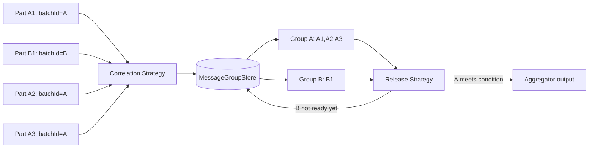
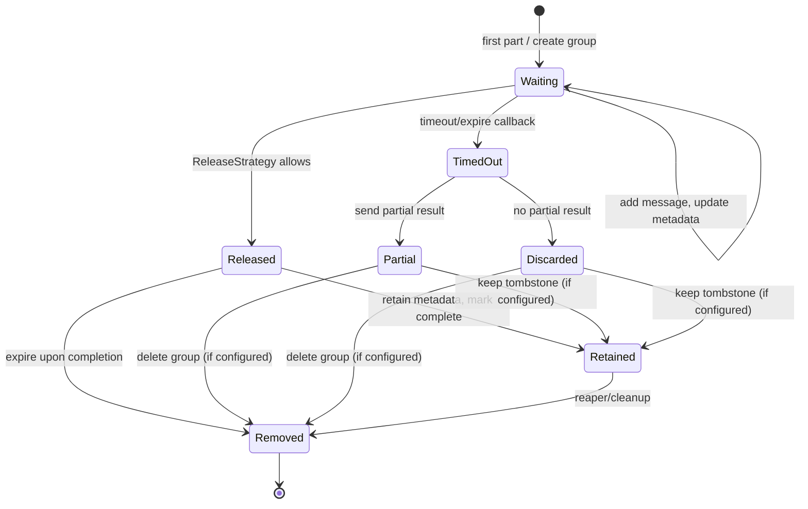
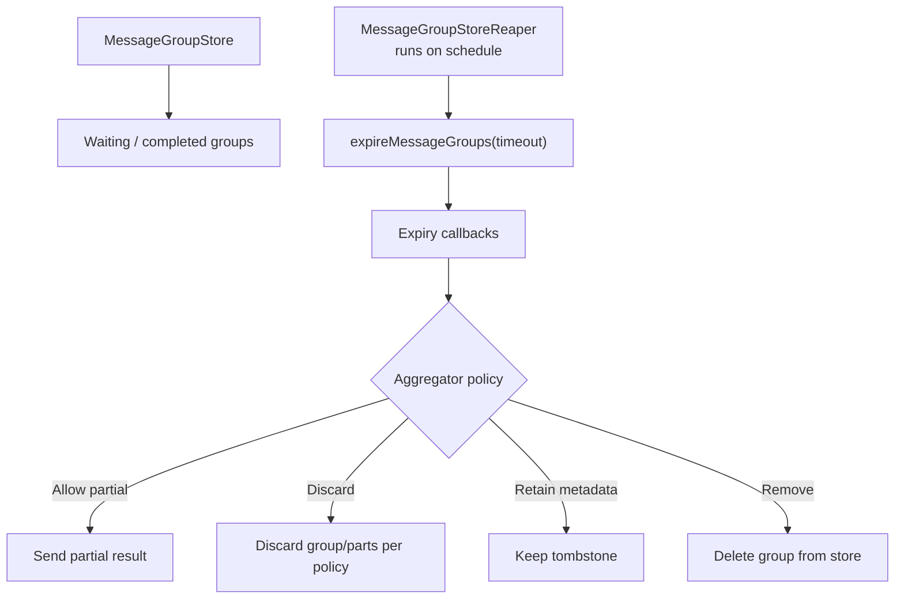

# MessageGroupStore and Group State in Spring Integration Runtime

## 1. When Does a Message Flow Need to Store Group State?

Imagine an order request split into three messages to check pricing, inventory, and shipping. These messages may traverse different channels, executors, or consumers, arrive out of order, and be separated by several seconds. The application must remember **which message belongs to which order**, how many parts have arrived, whether conditions are met to combine them, and what to do with late arrivals.

In the **SPRING_INTEGRATION_RUNTIME** module, stateful endpoints such as **aggregator** and **resequencer** solve this problem using a group state store: `MessageGroupStore`. This store holds `MessageGroup`s until the flow can release, discard, or expire them according to policy. Message grouping is part of the runtime: it is affected by channels, endpoints, consumers, transactions, retries, message stores, correlation keys, threads, and recovery after restarts.

After this lesson, you will be able to:

1. Distinguish `MessageStore`, `MessageGroupStore`, `ChannelMessageStore`, and `MessageGroup`.
2. Understand group metadata: group ID, size, creation time, last modified, complete flag, sequence size, last released sequence, and condition.
3. Distinguish **release** from **complete**, **retain metadata**, **expire**, and **remove**.
4. Write examples reading/writing state with `SimpleMessageStore` and configure an aggregator using `JdbcMessageStore`.
5. Choose how to handle timeouts, incomplete groups, and late-arriving messages.
6. Diagnose concurrency, persistence, serialization, transactions, retries, throughput, and group state in production.

This topic belongs to the **Message store** chapter, focusing directly on **MessageGroupStore and Group State**. Examples target Spring Integration 6.x as a guide; some APIs/configurations may vary across minor versions, so verify against your project's actual version.

## 2. Data Model: A Group Carries Both Messages and Metadata

`MessageGroupStore` is not just a collection. It associates messages by **group ID** and stores metadata so endpoints can make decisions across multiple arrivals.



Conceptually:

```text
MessageGroupStore
 ├── groupId = "A"
 │    ├── messages = [A1, A2, A3]
 │    └── metadata = {createdAt, lastModified, complete, condition, ...}
 └── groupId = "B"
      ├── messages = [B1]
      └── metadata = {createdAt, lastModified, complete, condition, ...}
```

| Concept | Role |
| --- | --- |
| `Message<?>` | A unit of data and headers moving through the flow. |
| `groupId` | Key linking messages that must be processed in the same context, typically taken from a correlation header or custom strategy. |
| `MessageGroup` | A group holding unreleased messages along with the group's metadata. |
| `MessageGroupStore` | Interface for storing/retrieving groups and managing their lifecycle. |
| `CorrelationStrategy` | Determines which group an incoming message enters; the strategy itself does not replace the store. |
| `ReleaseStrategy` | Decides when a group is eligible for release. |
| `MessageGroupProcessor` | Aggregates released messages into a business result. |

**Correlation example:** three messages with `headers["orderId"] = "SO-42"` can share group `"SO-42"`. If a sender accidentally uses a `UUID` on one branch and a `String` on another, the group IDs may not be equal even though they print identically in logs. A correlation contract must specify both **header name and value type**.

## 3. How Does `MessageGroupStore` Differ from Other Message Stores?

Spring Integration provides multiple abstractions because holding a single message and holding a **group** have different constraints.

| Interface / Implementation | Primary Scope | Use Case |
| --- | --- | --- |
| `MessageStore` | Store/retrieve individual `Message<?>` by message ID | Claim check or mechanisms needing independent message storage. |
| `MessageGroupStore` | Store messages by group ID, group metadata, complete/expire operations | Aggregator, resequencer, and stateful correlation endpoints. |
| `BasicMessageGroupStore` | Minimal group API, including add/get/remove group and size | Foundation for other specialized contracts. |
| `ChannelMessageStore` | Store messages for pollable queue-style channels | `QueueChannel` with a message store. |
| `SimpleMessageStore` | In-memory store implementing the interfaces above | Demos, tests, and workloads not needing restart durability. |
| `JdbcMessageStore` | General-purpose JDBC store supporting messages and message groups | Aggregator/resequencer requiring persistence. |
| `JdbcChannelMessageStore` | JDBC store optimized for channel polling | JDBC-backed queues with specific ordering/receive behavior. |

Do not swap `JdbcMessageStore` for `JdbcChannelMessageStore` in an aggregator just because both are called "JDBC store". Spring Integration distinguishes **generic group persistence** from **channel-oriented polling storage**. See [JDBC Message Store](https://docs.spring.io/spring-integration/reference/jdbc/message-store.html).

In `SimpleMessageStore`, data lives in application memory; a restart loses unpersisted groups. `JdbcMessageStore` persists groups in a database, though durability also depends on schema, serializer, transactions, endpoint restoration, and duplicate-message handling.

## 4. Properties That Make Up `MessageGroup` State

The `org.springframework.integration.store.MessageGroup` API provides commonly used information:

| API | Meaning | Practical Value |
| --- | --- | --- |
| `getGroupId()` | The group's correlation key | Finding groups, tracing, sharding, and locking. |
| `size()` | Number of messages currently held in the group | Measuring backlog or evaluating release conditions. |
| `getMessages()` | Collection of current messages | Building output from payloads; may incur I/O on persistent stores. |
| `getTimestamp()` | Group creation time in epoch milliseconds | Analyzing group age. |
| `getLastModified()` | Most recent group update timestamp | Detecting stalled groups. |
| `isComplete()` | Whether the group has been marked complete | Detecting late arrivals; does not imply data was deleted. |
| `getSequenceSize()` | Expected number of parts if sequence info exists; `0` if undetermined | Used in some release strategies. |
| `getLastReleasedMessageSequenceNumber()` | Last sequence number released | Primarily for resequencers/partial sequences. |
| `getCondition()` | Optional condition string, may be `null` | Optimizing release decisions under custom contracts. |

These values reflect **state at read time**. With multiple consumers or multiple JVMs accessing the store, values can change immediately after being read; avoid checking `size()` and then acting separately without synchronization when atomicity is required.

### 4.1. `complete` Does Not Mean `size() == 0`

A group can be:

- Waiting for more messages with `isComplete() == false`.
- Eligible for release, yet output dispatch has not succeeded.
- Released with messages removed from the group, **while metadata remains** to block late-arriving messages.
- Completely deleted from the store, leaving no marker that "this group ever completed".

Thus, **"empty group"**, **"completed group"**, and **"non-existent group"** are three distinct states.

### 4.2. `condition` Is Metadata, Not a Rule Engine on Its Own

Since Spring Integration 5.5, a group can hold a **`String` condition**. `MessageGroupStore.setGroupCondition(groupId, condition)` sets that metadata; an application-configured `ReleaseStrategy` or processor decides how to interpret it.

For example, a condition `"expected=3"` may describe how many parts are expected, but the framework does not automatically parse that string to release the group. If you want the condition to update dynamically as messages arrive, correlation handlers provide `setGroupConditionSupplier(...)` in supported versions; design how updates behave when multiple messages arrive concurrently.

## 5. Lifecycle of a Group: waiting → release/complete → retain/expire

A helpful model for observing the lifecycle:



*Waiting, Released, Retained, TimedOut* in the diagram are **business-explanatory state names**, **not enum values** in the `MessageGroup` API. The actual API exposes `isComplete()`, message collections, and other metadata; releasing is an action performed by the endpoint.

### 5.1. Release: The Group Qualifies to Emit Output

`ReleaseStrategy.canRelease(MessageGroup group)` returns `true` when existing messages satisfy the condition:

```java
import org.springframework.integration.aggregator.ReleaseStrategy;
import org.springframework.integration.store.MessageGroup;

public class ThreePartReleaseStrategy implements ReleaseStrategy {
    @Override
    public boolean canRelease(MessageGroup group) {
        return group.size() >= 3;
    }
}
```

This is a simple strategy when each group expects three valid messages. In production, guard against duplicates and verify that **the exact required parts** arrived; merely counting three messages can release prematurely if one part was sent twice.

For messages from a splitter, `sequenceNumber` and `sequenceSize` headers support the default release strategy (when upstream supplies full sequence metadata). `getSequenceSize()` equal to `0` indicates an unknown sequence size, so the required part count cannot be inferred from it alone.

### 5.2. Complete: Marking No Further Arrivals Accepted

After all required parts are processed, the endpoint can mark the group **complete**. When calling the store API directly, `completeGroup(groupId)` updates the completion state; it **does not invoke a processor, emit an output message, or substitute for an aggregator**.

An aggregator can retain a completed group after removing released messages, creating **empty group metadata/tombstones** to detect late-arriving messages carrying the same group ID.

### 5.3. Remove / Expire: Removing Both Data and Group Trace

`removeMessageGroup(groupId)` deletes the group from the store according to the implementation's semantics. Thereafter, if a message with the same correlation key arrives, the aggregator may create a **new group** because it no longer knows the old group finished.

When late arrivals must be blocked, deleting immediately upon completion can be a business bug. Conversely, retaining tombstones forever causes unbounded store growth.

## 6. Java Example: Creating, Inspecting, and Closing a Group

The snippet below uses `SimpleMessageStore` to inspect group state **without initializing a Spring `ApplicationContext`**. It demonstrates the store API; business release and output emission are shown via an aggregator in the next section.

```java
import org.springframework.integration.store.MessageGroup;
import org.springframework.integration.store.MessageGroupStore;
import org.springframework.integration.store.SimpleMessageStore;
import org.springframework.messaging.Message;
import org.springframework.messaging.support.MessageBuilder;

public final class GroupStateDemo {

    public static void main(String[] args) {
        MessageGroupStore store = new SimpleMessageStore();
        String groupId = "SO-42";

        Message<String> pricing = MessageBuilder.withPayload("pricing-ok")
                .setHeader("orderId", groupId)
                .setHeader("partName", "pricing")
                .build();

        Message<String> inventory = MessageBuilder.withPayload("inventory-ok")
                .setHeader("orderId", groupId)
                .setHeader("partName", "inventory")
                .build();

        store.addMessageToGroup(groupId, pricing);
        store.addMessageToGroup(groupId, inventory);
        store.setGroupCondition(groupId, "expected=3");

        MessageGroup group = store.getMessageGroup(groupId);
        System.out.println("id=" + group.getGroupId());
        System.out.println("size=" + group.size());          // 2
        System.out.println("complete=" + group.isComplete()); // false
        System.out.println("condition=" + group.getCondition());
        System.out.println("created=" + group.getTimestamp());
        System.out.println("modified=" + group.getLastModified());

        Message<String> shipping = MessageBuilder.withPayload("shipping-ok")
                .setHeader("orderId", groupId)
                .setHeader("partName", "shipping")
                .build();

        store.addMessageToGroup(groupId, shipping);
        System.out.println("size-after=" + store.messageGroupSize(groupId)); // 3

        // Only marks store state; does not produce aggregator output.
        store.completeGroup(groupId);
        System.out.println("complete-after="
                + store.getMessageGroup(groupId).isComplete()); // true

        // Manual cleanup once the application determines deletion is safe.
        store.removeMessageGroup(groupId);
    }
}
```

Here `groupId` is passed directly to the store. In a real flow, `CorrelationStrategy` derives that ID from the message, such as the `"orderId"` header. Once complete, **do not add new messages to the group** simply because an old reference to `MessageGroup` is still around.

**Mutability warning:** `SimpleMessageStore` defaults to `copyOnGet = false`. `getMessageGroup(...)` can return a direct reference to the internal group. Manually modifying the group with `group.add(...)` or `group.clear()` outside the flow can corrupt aggregator state. Prefer going through the `MessageGroupStore` API and letting the endpoint manage lifecycle. See [Message Store](https://docs.spring.io/spring-integration/reference/message-store.html).

## 7. Aggregator Example: Group Store Coordinating Release and Late Messages

The XML example below assumes the application declares Spring Integration namespaces `int` and `int-jdbc` and has a `dataSource` bean. Every message must carry an `orderId` header; three distinct parts of an order are combined once all three arrive.

```xml
<int:channel id="partsIn"/>
<int:channel id="ordersOut"/>

<int-jdbc:message-store id="groupStore"
                        data-source="dataSource"/>

<int:aggregator id="orderAggregator"
                input-channel="partsIn"
                output-channel="ordersOut"
                message-store="groupStore"
                correlation-strategy-expression="headers['orderId']"
                release-strategy-expression="size() >= 3"
                expire-groups-upon-completion="false"
                group-timeout="15000"
                send-partial-result-on-expiry="false"
                expire-groups-upon-timeout="true"/>
```

**What happens?**

1. Message `pricing(orderId=SO-42)` creates group `SO-42` in `groupStore`.
2. Message `inventory(orderId=SO-42)` grows that group to two parts.
3. Message `shipping(orderId=SO-42)` brings the group to three parts and `ReleaseStrategy` allows processing.
4. The aggregator builds output according to the processor/default aggregation strategy and sends it to `ordersOut`. Output content depends on the strategy (by default typically aggregating payloads).
5. Because `expire-groups-upon-completion="false"`, the framework can **retain completed group metadata** so a late `SO-42` message is discarded per policy.
6. If the group remains incomplete after the configured timeout, the timeout branch executes according to `send-partial-result-on-expiry` and `expire-groups-upon-timeout`. In this example, an incomplete group emits no partial result and is then expired; a subsequent message with the same key can start a new group.

**This configuration only illustrates policy** and is not yet production-ready: you must create version-matched JDBC schemas, configure serializers/transaction managers, correlation contracts, business processors, discard/error channels, and test duplicates/timeouts.

In this example, the release condition only counts messages. If `pricing` arrives twice and `inventory` once, size is three without `shipping`. Use per-part business identities or sequence metadata combined with a stricter `ReleaseStrategy`.

### Default Correlation and Default Release Strategy

If no `correlation-strategy-expression` is supplied, the aggregator typically uses `IntegrationMessageHeaderAccessor.CORRELATION_ID`. When a splitter adds proper sequence headers, the framework can rely on `sequenceSize` and `sequenceNumber` to decide release.

If an upstream filter drops one part of the sequence, a strategy waiting for the full sequence may **never release**. In that case, you need a timeout policy, compensating messages, or a custom release strategy.

## 8. What Is Retained Group Metadata Used For After Release?

Suppose an order requires three results and all three arrive:

```text
10:00:00 Group SO-42: [pricing]                 waiting
10:00:02 Group SO-42: [pricing, inventory]      waiting
10:00:04 Group SO-42: [pricing, inventory, ship] release
10:00:04 Group SO-42: [] + complete=true        retain metadata
10:00:06 Duplicate pricing part (same groupId)   discard late arrival
```

If you choose to **remove the group immediately** after release:

```text
10:00:04 Group SO-42: removed
10:00:06 Late pricing part arrives -> new SO-42 group created
```

The consequence is an "orphaned" group that may hang forever or emit unexpected duplicate outputs if other messages are redelivered. The decision to retain tombstones should be based on the **late-arrival window** and group ID reuse policy.

### Two Easily Confused Flags

| Aggregator Flag | Effect | Default Reference in 6.x |
| --- | --- | --- |
| `expireGroupsUponCompletion` | Whether to delete the group after **normal completion** or retain complete metadata to block late arrivals | `false` (retain metadata). |
| `expireGroupsUponTimeout` | Whether to delete the group when forced to complete/expire on timeout while release strategy still refuses release | `true` (delete group). |

Evaluation order on timeout matters: the framework may re-evaluate the release strategy one more time before deciding on partial release/discard. If the release strategy allows normal release at that moment, the completion-control flag applies with its corresponding semantics. See [Aggregator](https://docs.spring.io/spring-integration/reference/aggregator.html).

**Do not reuse the same correlation key across multiple independent business runs** unless you explicitly design a version/epoch. For example, `"orderId"` may need to be paired with `"attemptGroupVersion"` if an order is processed in multiple batches over several days.

## 9. Timeouts, Reaper, and Cleaning Up Stale Groups

A group can live forever if enough messages never arrive. `MessageGroupStore` provides `expireMessageGroups(timeout)` to find expired groups and invoke **registered expiry callbacks**. Whether to complete, discard, release partially, or delete is decided by those callbacks and endpoint settings, not an unconditional delete.

`MessageGroupStoreReaper` is a component that can be scheduled to trigger expiration periodically.



### 9.1. Java Reaper Configuration Example

```java
import org.springframework.context.annotation.Bean;
import org.springframework.context.annotation.Configuration;
import org.springframework.integration.store.MessageGroupStore;
import org.springframework.integration.store.MessageGroupStoreReaper;

@Configuration
public class GroupExpiryConfiguration {

    @Bean
    public MessageGroupStoreReaper groupReaper(MessageGroupStore groupStore) {
        MessageGroupStoreReaper reaper = new MessageGroupStoreReaper(groupStore);
        reaper.setTimeout(60_000); // 60 seconds; approximate expiration time
        return reaper;
    }
}
```

`MessageGroupStoreReaper` has a `run()` method. You must **schedule calls to `run()`** (for example via `@Scheduled` or a Spring scheduler) if you want periodic scans; merely instantiating the bean does not make a scheduler invoke it at your desired interval.

Expiration timing is **not millisecond-exact**: if the timeout is 60 seconds but the reaper runs every 5 minutes, groups can linger much longer before being swept. Also distinguish per-group `groupTimeout` on an aggregator from a scheduled reaper scanning many groups.

### 9.2. Do Not Arbitrarily Share One Store Across Multiple Aggregators

An `AbstractCorrelatingMessageHandler` can register expiry callbacks on its store. If multiple aggregators/resequencers **share a single store instance** and a reaper expires groups, a callback from one endpoint may be applied to groups belonging to another endpoint. The framework includes safeguards/scoping in supported versions, but a safer design is usually to **isolate stores/logical regions by each stateful endpoint's lifecycle** or manage routing/expiry explicitly.

### 9.3. Cleaning Up Completed Groups

To block late arrivals, many flows keep empty completed groups and clean them up after a sufficiently long window. Consider configuring `minimumTimeoutForEmptyGroups`/`empty-group-min-timeout` depending on your version and endpoint, or a controlled cleanup mechanism. Deleting tombstones too early lets old duplicates start a new group. Never deleting them causes group counts to rise even when pending message count is 0.

Measure **active group count** and **empty complete group count** separately if monitoring allows, rather than checking total message count alone.

## 10. Persistence: `SimpleMessageStore` vs `JdbcMessageStore`

### 10.1. Choosing a Store by Runtime Characteristics

| Characteristic | `SimpleMessageStore` | `JdbcMessageStore` |
| --- | --- | --- |
| Storage location | JVM memory | Relational database. |
| Across restarts | Normally loses state | Can restore state if properly configured. |
| Baseline latency | Low, local | Includes I/O, serialization, DB network round-trips. |
| Multiple JVMs sharing | Not shared automatically | Can share DB access, requires locking and concurrency control. |
| Transactions | Does not provide DB rollback | Can participate in JDBC transactions with compatible resource/manager. |
| Large group capacity | Bounded by heap | Bounded by DB, indexes, serializer, and query cost. |
| Use case | Demos, tests, non-durable workloads | Long-running aggregation, restart recovery, durability needs. |

**JDBC does not automatically yield exactly-once.** Suppose an aggregator successfully sends output to a broker, and then the transaction updating group state rolls back or the caller retries. The group may be released again, creating duplicate output. Outputs should carry business/event IDs, with idempotent downstream handlers and proper transaction/outbox design.

### 10.2. Schema and Serialization

`JdbcMessageStore` requires tables/indexes matching the Spring Integration schema for your database and version. The library ships sample initialization scripts. By default, message payloads/headers must be **serializable** per the store's strategy; non-serializable headers can cause errors or be dropped.

Watch out for headers carrying local Java objects like `replyChannel` and `errorChannel`, non-serializable objects, classes changing across deployments, oversized payloads, and sensitive data. For internal reply channels, `HeaderChannelRegistry`/channel-name mapping may be needed depending on architecture; a local channel reference does not survive restarts or cross instances on its own.

When possible, store only stable business data with minimal coupling to Java class implementation details. Offload large blobs to object storage or a dedicated service, and store a controlled reference in the payload/group.

### 10.3. Lazy-Load and Metadata-Only Access

Persistent group stores can load messages **lazily**; calling `getMessageGroup(groupId)` to check metadata often differs from accessing `group.getMessages()`, which may load every message. When only `groupId`, size, completion flag, and timestamps are needed, consider `getGroupMetadata(groupId)` if the implementation supports it efficiently.

This matters when a group contains 100,000 messages: a strategy checking `size()` can be far lighter than a strategy repeatedly scanning every payload on each arrival.

## 11. Concurrency: Multiple Correlated Messages Arriving Simultaneously

If two consumers concurrently add messages to group `SO-42`, you must protect the operation:

```text
Worker-1: read group size=2
Worker-2: read group size=2
Worker-1: add part P3 → size=3
Worker-2: add part P4 → size=4
```

If release/check/update steps are not properly synchronized, output may be emitted twice or metadata may drift. Spring Integration uses **`LockRegistry`** to coordinate group processing by correlation key in compatible correlation handlers:

- On a single JVM, a local registry can synchronize threads sharing the same group.
- Across multiple JVMs sharing a persistent store, a suitable **shared/distributed lock registry** is required, combined with backend transactions and concurrency controls.
- Group locks do not replace unique constraints, idempotency, or atomic updates at the database/broker.
- Timeout/forceComplete running concurrently with arriving messages must also go through state synchronization.

Modern versions of `AbstractMessageGroupStore` support configuring a `LockRegistry` for group metadata operations; check the API for your version. See [Message Store](https://docs.spring.io/spring-integration/reference/message-store.html).

### `copyOnGet` and Mutating Groups Externally

With `SimpleMessageStore`, the default `copyOnGet=false` avoids copying large groups, but also means a group read from the store may be the exact instance used by the aggregator. **Never call `MessageGroup.add/remove/clear` directly in monitoring code**. When state must be modified, use store APIs or official processing flows, ensuring proper concurrency/locking.

## 12. Combining Transactions, Retries, and Error Handling

`MessageGroupStore` stores state; it **does not open transactions, retry, or send `ErrorMessage`s on its own**. Those runtime mechanisms must be configured on surrounding endpoints and backends.

### 12.1. When Updating a Group Fails

Suppose a message reaches the aggregator:

```text
Receive M-3 → find group SO-42 → save M-3 → check ReleaseStrategy
         ├── DB/store exception
         ├── ReleaseStrategy exception
         └── Processor / output send exception
```

These failures occur at **different stages**. Sometimes the message is persisted while output is never sent; other times output is sent before the DB commit finishes. Thus, consumer-level retries differ from broker redeliveries, and replays can feed duplicates into a group.

**Questions you must answer:**

1. Are saving to the group and acknowledging the source message in the same transaction?
2. Is emitting release output in the same transaction as updating group state?
3. Are errors propagated synchronously to the caller or sent via `errorChannel` on an executor/poller?
4. Does retry advice wrap the **handler**, **aggregator**, or **poller**; does each retry re-receive the message?
5. When workers restart, must orphaned groups be rebuilt or expired?

### 12.2. Thread Boundaries

`DirectChannel` usually invokes subscribers on the sender's thread. If a transaction is opened before sending, synchronous downstream steps can join that transaction when compatible resources/propagation are used.

`ExecutorChannel` switches execution to another thread; upstream transactions normally do not propagate to workers. `QueueChannel` with a poller also decouples send from consume. When an aggregator sits behind an async boundary, examine the **consumer worker's** transaction rather than assuming it shares the producer's transaction.

### 12.3. Recovery and Late Messages

If one part is dead-lettered after retries are exhausted, the group may miss that part forever. You need timeout/partial-release policies, compensating messages, or cleanup. When errors are recovered via replay, ensure a stable **part ID** to deduplicate and decide whether late arrivals are accepted.

Do not treat a successfully sent `ErrorMessage` as proof that the group committed or the source was acknowledged. Monitor error flows and transaction completion separately.

## 13. Resequencers Also Rely on Group State

Aggregators and resequencers both need correlation, but with different goals:

| Endpoint | Group-Based Decision | Meaning of State |
| --- | --- | --- |
| Aggregator | Wait for enough messages, then produce one combined result | Group holds parts not yet processed together. |
| Resequencer | Wait for messages in sequence order before releasing sequentially | Tracks sequence size, last released sequence number, and gaps. |

`MessageGroup.getLastReleasedMessageSequenceNumber()` and `MessageGroupStore.setLastReleasedSequenceNumberForGroup(...)` serve resequencer scenarios. They are **not** retry counters or counts of aggregator releases.

A resequencer can release contiguous sequences already received before the entire sequence finishes (depending on configuration), whereas an aggregator builds a combined result from the group. When persisting state, account for both remaining messages and last-released metadata so restarts do not re-emit out of order.

## 14. Observability: Metrics to Monitor

| Metric/Concept | Meaning | Risk If Viewed in Isolation |
| --- | --- | --- |
| Existing group count | Number of correlation contexts in store | May include many empty completed groups. |
| Total stored messages | Backlog of incomplete groups | May look low even as tombstones grow. |
| Group size percentiles | Largest group, p95, p99 | Huge groups may stem from missing release conditions or duplicates. |
| Group age / last modified age | How long groups wait and time since last part arrived | Must distinguish waiting groups from tombstones. |
| Complete vs incomplete count | Lifecycle status | Complete does not mean downstream committed output. |
| Timeout/expired group rate | Groups failing to release in time | May indicate missing source parts or backpressure. |
| Late arrival/discard rate | Messages arriving after group completion | Spikes may signal retries/redeliveries, network lag, or overly short timeouts. |
| Store query latency / bytes loaded | JDBC/Redis/Mongo cost | Large groups make lazy loads or full scans expensive. |
| Group lock wait / contention | Multiple workers contending on the same correlation key | Adding executor threads may not raise throughput. |

Methods such as `getMessageGroupCount()` and `getMessageCountForAllMessageGroups()` may not be supported by every implementation (some APIs are marked optional). Never assume every metric is available everywhere. With JDBC, you can build dashboards using safe queries against supported schemas under read-only policies.

### Safe Log Format Example

```text
groupId=SO-42 endpoint=orderAggregator state=waiting
  size=2 expected=3 lastModifiedAgeMs=9500

groupId=SO-42 endpoint=orderAggregator event=release
  size=3 durationMs=10850

groupId=SO-42 endpoint=orderAggregator event=late-discard
  partId=pricing-1
```

This is a **recommended instrumentation format**, not logs automatically emitted by the framework. Avoid logging full group payloads/headers, especially personal data or tokens.

## 15. Group State Diagnostic Table

| Symptom | Possible Cause | Check and Action |
| --- | --- | --- |
| Group never releases | Missing part; wrong sequence size; release strategy never satisfied | Compare expected parts/sequence against actual messages; add timeout/compensation. |
| Group releases too early | Release strategy only checks size; duplicate parts | Validate part IDs and business predicates before releasing. |
| Same order creates multiple groups | Correlation key differs in name/type or altered by mapper | Standardize correlation ID; verify header types at adapter boundaries. |
| Late messages discarded | Group already completed and retained metadata | Check `expireGroupsUponCompletion`, expected latency, and late-arrival policy. |
| Late messages start a new group | Old group was removed/expired | Review timeout, reaper, group ID reuse, and idempotency. |
| Message groups vanish after restart | Using `SimpleMessageStore`/non-durable store | Switch to persistent store and verify restore/serializer. |
| Persistent groups fail to read after deploy | Class/serializer/payload schema changed | Design versioning, migration, and deserialization compatibility. |
| Many empty groups yet few messages | Completed metadata retained too long | Track tombstone counts; tune cleanup to match the late-arrival window. |
| Duplicate output after retry | Store transaction and output outside the same atomic boundary | Use outbox/idempotency; trace retry/ack timelines. |
| Larger executor pool does not raise throughput | Lock contention per group ID or slow DB store | Measure lock waits, query latency, and correlation key distribution. |
| Reaper sweeps groups of wrong endpoint | Sharing one store across multiple stateful handlers with callbacks | Separate stores/regions or configure dedicated expiry. |
| Group expires with no partial output | `sendPartialResultOnExpiry=false` or missing scheduler/callback | Check `groupTimeout`, reaper, release strategy, and discard channel. |

### Investigation Steps

1. **Identify the group ID** of the failing message and the endpoint it entered.
2. **Read group metadata**: `size`, `complete`, `timestamp`, `lastModified`, `condition`, and sequence info.
3. **Verify the release strategy** against actual part IDs, not message counts alone.
4. **Check timeouts and cleanup**: group timeout, reaper, callbacks, expire-on-completion/timeout flags.
5. **Inspect the actual store**: in-memory/JDBC, serialization, lazy load, transactions, and post-restart lifecycle.
6. **Check concurrency and threads**: lock registry, JVM instances, `ExecutorChannel`, pollers, backend contention.
7. **Review retries/redeliveries and output**: whether the group released once or multiple times, where ack/commit occurred, and whether idempotency keys exist.

## 16. Hands-On Practice

### Exercise A — Direct Store Operations

1. Run `GroupStateDemo` from Section 6 and observe `size`, `condition`, and `isComplete`.
2. Call `getGroupMetadata(groupId)` and compare it with `getMessageGroup(groupId)`.
3. Mark the group complete, then try adding another message with the same group ID. Observe the implementation's actual behavior rather than assuming mutation is always allowed.
4. Remove the group and read its state again. Explain how deleting differs from retaining a tombstone.

### Exercise B — Comparing Group Release and Timeouts

1. Configure an aggregator expecting three parts; send A/B/C to `SO-42` and only A/B to `SO-43`.
2. Send part A again to `SO-42` after completion. Verify whether the late message is discarded when metadata is retained.
3. Set `groupTimeout` on `SO-43` with `sendPartialResultOnExpiry=false`, then switch to `true` and observe output/discard behavior.
4. Toggle `expireGroupsUponTimeout` on/off and explain when a message with the same correlation key starts a new group.

### Exercise C — Restarts, Concurrency, and Retries

1. Using `SimpleMessageStore`, send two parts and restart the app: determine whether state survives or is lost.
2. Replace with `JdbcMessageStore` and the proper schema; send two parts, restart, and send the third part.
3. Have two workers concurrently send messages with the same correlation key; inspect output and lock latency.
4. Trigger an error right after the aggregator emits output; use a stable `eventId`/idempotent consumer to prevent downstream duplicates.
5. Compare existing group count with stored message count after creating hundreds of completed groups.

### Self-Check Questions

1. Why can a `MessageGroup` have `isComplete() == true` and `size() == 0` while still existing in the store?
2. How do `ReleaseStrategy` and `MessageGroupStore.completeGroup(...)` differ?
3. If group metadata is deleted immediately upon release, why can a duplicate message create a new group?
4. Which endpoint is `getLastReleasedMessageSequenceNumber()` typically associated with?
5. Why is `JdbcChannelMessageStore` not the default choice for a JDBC-backed aggregator?
6. Does a `String` `condition` get interpreted automatically by the framework as a release policy?
7. What else is needed so a group survives restarts without emitting duplicate outputs?
8. Why is a local `LockRegistry` insufficient when multiple JVMs share a persistent group store?

## 17. References

- [Spring Integration Reference — Message Store](https://docs.spring.io/spring-integration/reference/message-store.html)
- [Spring Integration Reference — Aggregator and Managing State](https://docs.spring.io/spring-integration/reference/aggregator.html)
- [Spring Integration Reference — JDBC Message Store](https://docs.spring.io/spring-integration/reference/jdbc/message-store.html)
- [Spring Integration API — MessageGroupStore (6.4.x)](https://docs.spring.io/spring-integration/docs/6.4.x/api/org/springframework/integration/store/MessageGroupStore.html)
- [Spring Integration API — MessageGroup (6.4.x)](https://docs.spring.io/spring-integration/docs/6.4.x/api/org/springframework/integration/store/MessageGroup.html)
- [Spring Integration API — SimpleMessageStore (6.4.x)](https://docs.spring.io/spring-integration/docs/6.4.x/api/org/springframework/integration/store/SimpleMessageStore.html)
- [Spring Integration API — MessageGroupStoreReaper (6.4.x)](https://docs.spring.io/spring-integration/docs/6.4.x/api/org/springframework/integration/store/MessageGroupStoreReaper.html)
