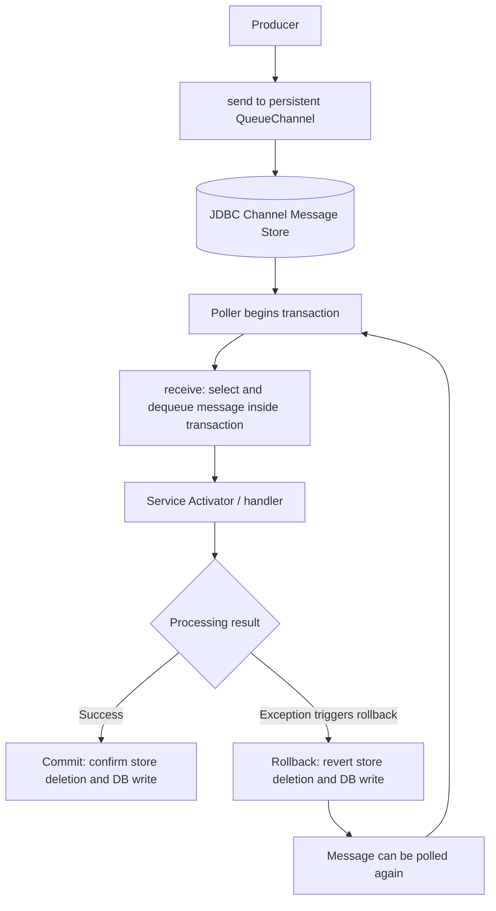
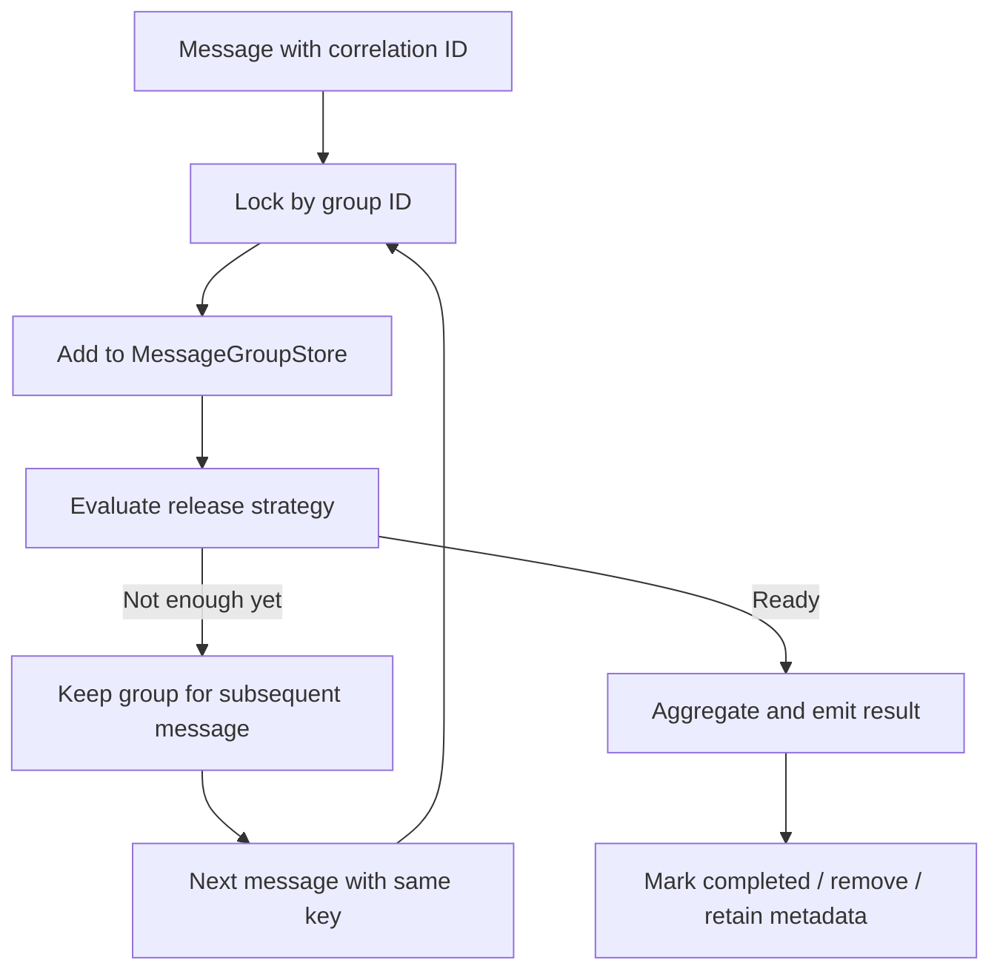
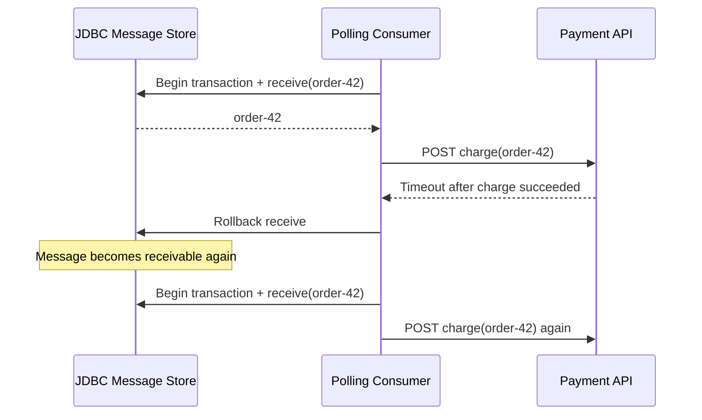

# Store Transactions and Consistency in Spring Integration Runtime

## 1. The Problem: Persistent Message Storage Does Not Mean Consistent Processing

A `MessageChannel` can accept messages before a consumer is ready. For instance, `QueueChannel` holds messages for a `PollingConsumer` to pick up later. An aggregator holds a **message group** until conditions are met to combine them. If a process stops abruptly while data sits in memory, messages can vanish. A **message store** is the mechanism for moving retained state from memory into storage such as a database or another datastore.

Yet choosing a persistent store only solves **survival across restarts**. For a flow to behave accurately under failures, two more concepts matter:

- **Transaction:** multiple operations on *resources participating in the same transaction* commit or roll back as one unit. With a JDBC queue, a transaction can cover **removing the message from the store** and updating business data.
- **Consistency:** business invariants and state remain accurate across concurrency, retries, rollbacks, crashes, redeliveries, schema changes, and multiple instances. For example, a single `orderId` must record payment only once.

The topic **Store Transactions and Consistency** belongs to the **Message store** chapter of the **SPRING_INTEGRATION_RUNTIME** module. It connects directly to the execution path channel → consumer → poller/executor, transactions, retry/recovery, correlation, and runtime performance/state diagnostics.

> **Limitation to remember:** a persistent message store does not by itself provide *end-to-end exactly-once*. It only offers guarantees aligned with the **store implementation**, transaction config, database, sources/targets, and idempotency logic. You must trace explicitly who commits, who rolls back, and whether external actions sit outside the transaction.

After this lesson, you will be able to analyze a send/receive/process chain under failures, configure a JDBC `QueueChannel` with a transactional poller, test rollback/redelivery, handle contention on `MessageGroupStore`, and assess message loss/duplication risks.

## 2. Distinguishing Stores and Their Scope

| Component | What Is It For? | Consistency Considerations |
| --- | --- | --- |
| `SimpleMessageStore` | In-memory store for individual messages and message groups. | Does not survive restarts. Never assume a JDBC transaction can roll back in-RAM state. |
| `MessageStore` | Contract to store and retrieve messages by ID (e.g. claim-check). | Storing a message differs from guaranteeing one-time delivery. |
| `MessageGroupStore` | Stores groups by group ID for aggregators, resequencers, delayers, and stateful components. | Synchronization on add/remove, release decisions, expiry, and late arrivals. |
| `ChannelMessageStore` | Contract optimized for queued channels. | Requires examining add, poll, locking, and implementation-specific transactions. |
| `JdbcMessageStore` | General-purpose JDBC store suited for aggregators/claim-check. | Tied to `DataSource`, serialization, tables, and transactions. |
| `JdbcChannelMessageStore` | JDBC store optimized for `QueueChannel` or `PriorityChannel`. | Requires DB-specific SQL query provider, poller transactions, concurrency, and indexes. |
| Redis/MongoDB/Hazelcast message stores | Stores backed by non-relational datastores. | Atomicity/transaction/durability semantics differ from JDBC; do not apply JDBC assumptions blindly. |

In Spring Integration 6.5 documentation, `JdbcMessageStore` is recommended for aggregators and claim-checks, while `JdbcChannelMessageStore` is meant for channels. Do not choose a store merely because class names look similar. `MessageGroupQueue` is a queue backed by `BasicMessageGroupStore`; `QueueChannel` has a constructor taking a `Queue<Message<?>>`, so `MessageGroupQueue` can serve as its backing queue.

**Distinguish three events:**

1. Producer calls `send(message)`: the message is accepted into the channel/store; if the write sits inside an uncommitted transaction, durable persistence is not yet committed.
2. Consumer calls `receive()`: the message is pulled from the queue/store. With a JDBC transactional store, removal can belong to the current transaction.
3. Consumer finishes processing and the transaction **commits**: removal from the queue becomes final. If rollback applies properly to the same resource, the message can be received again.

## 3. Transaction Boundaries in a Message Flow



The diagram illustrates when **the JDBC store and business updates participate in the same transaction**. Message data can still be processed multiple times if an earlier transaction rolled back or an external outcome was ambiguous.

### 3.1. Why Must the Transaction Start Before `receive()`?

If a poller pulls a message from a transaction-capable store without a transaction wrapping `receive()`, the delete may commit immediately. A handler throwing an exception afterward does not automatically restore the deleted message. Conversely, when the poller begins a transaction *before* `receive()` using a `DataSourceTransactionManager` on the same `DataSource`, rollback can revert the message deletion.

Spring Integration provides transactional pollers to bound **receive + subsequent synchronous processing**. Spring transactions bind to the **executing thread**:

- With `DirectChannel`, dispatching continues on the same thread, so downstream steps can join the open transaction when resources and propagation match.
- With `ExecutorChannel`, another pollable channel, or a spawned thread, a thread boundary can end the current transaction before downstream completes.
- Transaction advice wrapping only the handler **does not ensure** `receive()` ran inside the transaction. Verify whether the transaction is configured on the **poller** or on the handler.
- If the transaction manager uses a different `DataSource` than `JdbcChannelMessageStore`, you cannot assume store deletions roll back with business transactions.

### 3.2. Commit/Rollback State Table

Suppose `ordersIn` is backed by a JDBC store and `orders_processed` is a business table in **the same DataSource**:

| Moment | Row in Store | Row in `orders_processed` | Result |
| --- | --- | --- | --- |
| Message sent and committed | Present | Absent | Awaiting consumer. |
| Poller called `receive()` but transaction uncommitted | Being processed/deleted in transaction; visibility depends on isolation | May be absent | Cannot consider processing done yet. |
| Handler writes DB then transaction commits | Deleted | Present | One processing transaction completed. |
| Handler throws exception and transaction rolls back | Deletion reverted | Write reverted | Can be received again and retried. |
| Handler calls external HTTP successfully but DB rolls back | Message may return | JDBC write rolled back | HTTP action **does not roll back automatically**; requires idempotency/reconciliation. |

In PostgreSQL under MVCC, transaction isolation affects how other consumers see rows being polled. Never run a `SELECT COUNT(*)` from a separate connection to conclude a message is "permanently gone" while a transaction is still in flight.

## 4. Java Configuration Example: Transactional PostgreSQL-Backed QueueChannel

This example uses **Spring Integration 6.5.x**, PostgreSQL, `spring-integration-jdbc`, and a preconfigured `DataSource`. Before running, you must **create the Spring Integration tables** using the PostgreSQL DDL supplied by the JDBC module, plus any custom business tables; this example does not auto-create schemas.

```java
import java.time.Duration;
import javax.sql.DataSource;

import org.springframework.context.annotation.Bean;
import org.springframework.context.annotation.Configuration;
import org.springframework.integration.annotation.EnableIntegration;
import org.springframework.integration.channel.QueueChannel;
import org.springframework.integration.dsl.IntegrationFlow;
import org.springframework.integration.dsl.Pollers;
import org.springframework.integration.jdbc.store.JdbcChannelMessageStore;
import org.springframework.integration.jdbc.store.channel.PostgresChannelMessageStoreQueryProvider;
import org.springframework.integration.store.MessageGroupQueue;
import org.springframework.jdbc.datasource.DataSourceTransactionManager;
import org.springframework.messaging.PollableChannel;
import org.springframework.transaction.PlatformTransactionManager;

@Configuration
@EnableIntegration
class OrderQueueConfiguration {

    @Bean
    JdbcChannelMessageStore orderChannelStore(DataSource dataSource) {
        JdbcChannelMessageStore store = new JdbcChannelMessageStore(dataSource);
        store.setChannelMessageStoreQueryProvider(
                new PostgresChannelMessageStoreQueryProvider());
        store.setRegion("ORDERS_APP_V1");
        return store;
    }

    @Bean
    PollableChannel ordersIn(JdbcChannelMessageStore orderChannelStore) {
        // Keep group ID stable across restarts to read the same logical queue.
        return new QueueChannel(
                new MessageGroupQueue(orderChannelStore, "orders.in.v1"));
    }

    @Bean
    PlatformTransactionManager orderTransactionManager(DataSource dataSource) {
        return new DataSourceTransactionManager(dataSource);
    }

    @Bean
    IntegrationFlow orderWorkerFlow(
            PollableChannel ordersIn,
            OrderProcessor orderProcessor,
            PlatformTransactionManager orderTransactionManager) {
        return IntegrationFlow.from(ordersIn)
                .handle(orderProcessor, "process",
                        endpoint -> endpoint.poller(
                                Pollers.fixedDelay(Duration.ofMillis(500))
                                        .maxMessagesPerPoll(1)
                                        .transactional(orderTransactionManager)))
                .get();
    }
}
```

Assume `OrderProcessor` is a bean with `public void process(String orderId)`. `OrderProcessor` can write data via `JdbcTemplate` **sharing the same DataSource**, for example:

```java
import org.springframework.jdbc.core.JdbcTemplate;
import org.springframework.stereotype.Component;

@Component
class OrderProcessor {
    private final JdbcTemplate jdbc;

    OrderProcessor(JdbcTemplate jdbc) {
        this.jdbc = jdbc;
    }

    public void process(String orderId) {
        jdbc.update(
                "INSERT INTO orders_processed (order_id) VALUES (?)",
                orderId);
        if (orderId.startsWith("fail-")) {
            throw new IllegalStateException("Simulated failure after DB write");
        }
    }
}
```

The `orders_processed` table must be created separately, such as `order_id VARCHAR(100) PRIMARY KEY`; the unique key also helps guard against duplicate writes. Sending payload `"fail-42"` causes the handler to execute `INSERT` and then throw. With proper poller transactions:

1. Pulling the message from the store and `INSERT` execute inside the same JDBC transaction.
2. The exception propagates to the poller, causing a rollback: the row in `orders_processed` is not committed, and message deletion is reverted.
3. The message can be polled again. Because the payload always starts with `fail-`, this is a **poison message**; you need retry policies, backoff, quarantine/dead-letter routing, and attempt limits to prevent infinite looping.

**Explicit scope:** the example configures poller transactions, not recovery design. Do not assume `RetryTemplate` governs retries without attaching retry advice. In real applications, `OrderProcessor` needs idempotency and business error classification. If you need a test setup where you manually control `receive()` timing, run a configuration **without an active poller** to avoid two consumers racing for the same queue.

### 4.1. Two Critical Identifiers: `region` and `groupId`

`JdbcChannelMessageStore` uses `region` to isolate data partitions; `MessageGroupQueue` uses a dedicated group ID for the logical queue. When multiple services/nodes share tables and stores, both must be chosen deliberately. Group ID must stay **stable across restarts** for the same queue, yet never accidentally collide with an unrelated queue. Changing `region`/`groupId` across deployments can leave old messages **sitting in the table while the new queue never reads them**.

`JdbcChannelMessageStore` uses database-specific SQL; you must select the matching `ChannelMessageStoreQueryProvider`. For PostgreSQL, since 6.2 the poll query uses a `DELETE ... RETURNING` statement according to docs. Other databases have different locking strategies/capabilities and performance profiles.

## 5. Testing Store Rollback and Commit in a Controlled Way

To verify the most important property—*rolling back a receive returns the message to the store*—write an integration test against a real database or compatible test database and **do not run a concurrent poller during this test**. The test uses `TransactionTemplate`, a `PollableChannel` backed by `JdbcChannelMessageStore`, and the matching `PlatformTransactionManager` for that `DataSource`.

The snippet below is a test method inside a Spring context configured with `ordersIn` and `orderTransactionManager` as in Section 4. Inject the proper beans and ensure a clean test database with no other poller competing on the queue:

```java
import org.junit.jupiter.api.Test;
import org.springframework.beans.factory.annotation.Autowired;
import org.springframework.beans.factory.annotation.Qualifier;
import org.springframework.messaging.Message;
import org.springframework.messaging.PollableChannel;
import org.springframework.messaging.support.GenericMessage;
import org.springframework.transaction.PlatformTransactionManager;
import org.springframework.transaction.support.TransactionTemplate;

import static org.junit.jupiter.api.Assertions.*;

class StoreTransactionTest {
    @Autowired
    @Qualifier("ordersIn")
    PollableChannel queue;

    @Autowired
    @Qualifier("orderTransactionManager")
    PlatformTransactionManager transactionManager;

    @Test
    void rolledBackReceiveReturnsMessageToStore() {
        assertTrue(queue.send(new GenericMessage<>("order-42")));

        TransactionTemplate tx = new TransactionTemplate(transactionManager);

        assertThrows(IllegalStateException.class, () ->
                tx.execute(status -> {
                    Message<?> received = queue.receive(1_000);
                    assertNotNull(received);
                    assertEquals("order-42", received.getPayload());
                    throw new IllegalStateException("Force rollback");
                }));

        // The previous transaction rolled back the deletion from the store.
        Message<?> redelivered = tx.execute(status -> queue.receive(1_000));
        assertNotNull(redelivered);
        assertEquals("order-42", redelivered.getPayload());

        // The second receive commits when tx.execute() completes normally.
        assertNull(tx.execute(status -> queue.receive(0)));
    }
}
```

This is a **behavioral verification pattern**, not an in-memory list proof. When running in practice:

- DDL for the store must exist; in Spring Integration 6.2+, the JDBC store bean can check table existence at startup and fail fast if missing.
- Before each test, isolate `region`/`groupId` or clean test data, and disable/omit polling consumers on this queue.
- For each test, ensure the database version and query provider match; a passing H2 test does not prove PostgreSQL/MySQL share identical locking/performance.
- Do not assert only `receive() != null`; verify payload, business key, and that the queue is genuinely empty after commit.
- On the same `DataSource`, add a `JdbcTemplate.update(...)` inside the transaction block to verify **message receive and business update roll back/commit together**.

### 5.1. Mandatory Transaction Scenarios to Test

| Simulated Action | Expected Outcome | Invariant to Preserve |
| --- | --- | --- |
| Producer sends message, store write transaction rolls back | Message is not committed into the store. | Never consume a message whose producer transaction aborted. |
| Poller receives message, handler succeeds, commits | Message is deleted and business data commits. | No reprocessing absent another duplicate source. |
| Poller receives message, handler fails, rolls back | Message remains/is restored in store; JDBC updates roll back. | Can be redelivered and retried. |
| Consumer crashes **before** commit | Database rolls back uncommitted transaction. | Message can be received again after restart, depending on driver/store and actual transaction. |
| Consumer crashes **after** commit | Message is already removed from store. | If business side effects share the same JDBC transaction, those results committed too. |
| No transaction wrapping `receive()` | Receive may commit on its own. | Risk of message loss if handler fails after deletion. |

When testing retries/redelivery, avoid asserting that the handler is always called exactly once. With transactional stores, **at-least-once** processing is normal under failures; the goal is eventual consistency of business data.

## 6. Consistency When Multiple Threads or Instances Share a Store

Two consumers pulling from the same queue create two kinds of contention:

1. **Claiming a message:** two workers must not receive the same already-claimed record per the store's contract. This relies on SQL, row locks, isolation, and the specific implementation.
2. **Updating related state:** two workers receiving two different messages can still concurrently update the same business key or the same message group. Database constraints, transactions, and lock registries must protect final invariants.

A `QueueChannel` has point-to-point semantics, yet that does not mean the system guarantees **single lifetime execution**: transaction rollbacks, timeouts, or duplicate upstream emissions can redeliver the same business event.

### 6.1. Locking, Isolation, and JDBC Message Retrieval Mechanics

Per Spring Integration JDBC 6.5 documentation:

- `JdbcChannelMessageStore` uses a database-specific query provider. For PostgreSQL, the poll query since Spring Integration 6.2 uses a single `DELETE ... RETURNING` statement.
- During concurrent transactional polling, databases with strong **MVCC** support generally fit better; databases lacking it can suffer severe lock contention.
- For certain non-MVCC databases, `usingIdCache=true` can be configured on `JdbcChannelMessageStore` as needed, releasing IDs from the cache via transaction synchronization after **commit and rollback**. Enabling `usingIdCache` without managing cache lifecycle can skip messages or stall processing.
- Measure actual behavior when raising poller concurrency; adding threads does not guarantee linear throughput due to DB lock contention, JDBC connection waits, and I/O.

With multiple processes sharing a database, never assume a single-JVM lock protects across applications. Choose concurrency and isolation strategies appropriate to the store, then test with **multiple connections/multiple instances**. When enforcing business invariants, treat unique constraints on business IDs as a mandatory safeguard.

### 6.2. Aggregator/Resequencer Consistency

`MessageGroupStore` holds not only message lists, but also metadata: group ID, completion state, modification timestamps, release conditions, and related info. For aggregators:



If two nodes process the same `correlationId` while using only a local `DefaultLockRegistry`, each JVM may believe it holds an exclusive lock, causing release races or corrupted group state. Configure a **shared LockRegistry across nodes** when sharing a persistent `MessageGroupStore`. Since Spring Integration 6.5, `AbstractMessageGroupStore` uses locks for metadata operations by group ID; the default remains a local lock, so cross-node coordination still requires explicit setup.

**Aggregator invariants:**

- Messages belonging to one group must share a correlation key with stable semantics.
- A group must release only when true conditions are met; test duplicates, missing sequences, and varying arrival orders.
- For late messages after completion, configuration can retain completed metadata to discard/redirect late arrivals. Deleting metadata too early can let late messages form a bogus new group.
- Expiry or `MessageGroupStoreReaper` can drop incomplete groups unless partial-result/discard policies are clearly defined.
- If *group release + writing business results* must be atomic, verify all operations share the same transactional resource/boundary; if output crosses another transport, design additional guarantees.

**Realistic example:** an order needs three events: `reserved`, `charged`, and `packed`. Two instances concurrently receive `charged` and `packed`. If each node only holds a local lock, both may evaluate release conditions on stale views of state. A shared lock protects group manipulation, while unique constraints/idempotency at the result sink remain necessary in case messages replay after rollbacks.

## 7. Serialization, Headers, and Consistency After Restart

A message consists of **payload and headers**. A persistent store must serialize/deserialize all necessary data, so test **round-trips**, not just whether `send()` succeeds.

Common failure points:

- Under `JdbcMessageStore`'s default mechanism, data must support appropriate serialization (often `Serializable`-based). Non-serializable headers may be dropped before saving.
- Headers added by HTTP/JMS/FTP or other adapters can hold framework objects or beans unfit for serialization.
- `replyChannel` and `errorChannel` sometimes hold direct references to channels or a gateway's temporary channel. Restoring from the database after a restart **does not automatically recreate a temporary channel** from the old process. You can use `HeaderChannelRegistry` and header enrichers to replace references with resolvable names/strings, while managing registry lifecycles.
- Payload classes/packages can change between deployments; data serialized by an older version may fail to deserialize.
- If a stable JSON/binary schema is needed, manage serializers/deserializers/mappers fitting your store implementation; never assume all stores share one codec.

### 7.1. Round-Trip Testing

A proper persistence test should:

1. Send a message with `businessKey`, `correlationId`, `contentType`, and a serializer-compatible payload; commit to store.
2. Close/restart the application context or launch a consumer using **the exact same database, table prefix, region, and group ID**.
3. Receive the message and verify payload and all headers actually required by business logic.
4. Confirm reply/error routing remains valid via registry/names, avoiding reliance on old temporary channels.
5. Inject non-serializable payloads/headers and observe whether the store rejects them or strips headers per contract.

Changing `region`, `groupId`, or table prefix in a restart test can mimic message loss even though rows still sit in the old partition. Record these values alongside schema/database versions during testing.

## 8. Consistency Between the Message Store and External Systems

Suppose a consumer takes a `charge(orderId)` command from a JDBC queue and calls a payment service over HTTP:



Even with flawless JDBC rollback, the external HTTP request **is outside the JDBC transaction**. The outcome can be a double charge if the API lacks idempotency. This creates a major gap between **local transactional consistency** and **end-to-end consistency**.

### 8.1. Guarantees to Describe Accurately

| Guarantee Level | Practical Meaning | Conditions / Limits |
| --- | --- | --- |
| **Durable after commit** | Committed data can survive restarts/crashes. | Depends on DB, durability/replication/backup policies, and serializers. |
| **Atomicity within one JDBC transaction** | `receive()` and business table updates commit/roll back together. | Same `DataSource` and transaction manager, same thread/boundary; does not cover HTTP. |
| **At-least-once processing/delivery** | Messages can be re-received after failure/rollback so work is not lost. | May process duplicates; poison messages need limits and DLQs. |
| **Effectively-once business effect** | Multiple attempts yield exactly one valid business outcome. | Requires idempotency keys, unique constraints, transaction/inbox, or receiver-side dedup. |
| **End-to-end exactly-once** | One event has strictly one effect across the entire distributed system. | Cannot be inferred solely from using a persistent `MessageStore`; requires specialized contracts and end-to-end verification. |

**Inbox/Deduplication pattern:** place a unique constraint on `business_event_id`; inside the same JDBC transaction, the consumer inserts the ID into the inbox and updates the business row. If the same ID arrives again, skip it or return the stored result. Note that unique constraints only work if both steps share the same transaction and duplicate-key errors are handled intentionally.

**Transactional Outbox:** the producer writes business state and an outbox row in **the same transaction**. A separate post-commit process publishes events from the outbox; because publishers can retry, receivers still need idempotency. Outbox closes the gap between DB updates and event emission without automatically creating downstream exactly-once.

**Reconciliation:** for external HTTP actions that cannot roll back, persist a state like `PENDING_CONFIRMATION` with a business key and query the remote system's real outcome before deciding to resend.

### 8.2. Transaction Synchronization Does Not Replace Distributed Transactions

Spring Integration offers `TransactionSynchronizationFactory` to run actions before/after poller commit/rollback. For example, post-commit you might publish a notification or move a file. Yet an `afterCommit` callback **does not make** operations on another resource atomic with the JDBC transaction: if the process dies right after commit and before the callback sends, the notification can be lost. High-reliability scenarios typically use an outbox or durable queue/broker with replay workflows.

## 9. How Do Retries, Recovery, and "Poison Messages" Affect the Store?

A handler can fail deterministically due to bad data or code bugs. If the poller rolls back every time, the exact same message can be polled endlessly:

```text
poll -> error -> rollback -> poll again -> error -> rollback -> ...
```

Rollback prevents **losing messages**, but provides no strategy for **when to stop**. Distinguish:

- Transient errors: timeouts, recoverable deadlocks, downstream overload. Can use bounded retries with backoff/jitter.
- Permanent data errors: broken schema, business validation errors. Route to quarantine or dead-letter so workers are not tied up endlessly.
- Ambiguous system failures: external side effects may have occurred. Perform reconciliation/idempotency checks before resending.

In Spring Integration, retries can be placed in `RequestHandlerRetryAdvice` or in the source's redelivery mechanism. If advice **swallows exceptions** via a recovery callback and returns normally, the poller transaction may **commit and delete the message**. That is valid if recovery truly persisted the failure reliably and business processes continue from there; it is wrong if recovery merely logged and dropped it.

| Recovery Design | What Can Happen With a JDBC Queue | What to Verify |
| --- | --- | --- |
| Handler fails and exception reaches poller | Rolls back `receive()`; message can be re-polled. | Redelivery count, delay, transaction state. |
| Handler advice retries and still throws | Eventually poller rolls back. | Total attempts = internal retries × redeliveries (if both are not bounded coherently). |
| Recovery callback emits error event and returns `null` | Poller may commit and delete input message. | Was the recovery event persisted durably with required business key and payload? |
| Recovery writes to quarantine table inside same JDBC transaction | Can commit both quarantine write and queue deletion together. | Single transaction, unique keys, no duplicate quarantine rows. |
| Recovery calls HTTP to report error | HTTP does not participate in JDBC transaction. | Retry/idempotency of error reporting channel and crash between steps. |

**Attempt limits:** `RetryTemplate.maxAttempts(3)` typically counts the initial attempt too; broker redeliveries and poller rollbacks form another layer. If a message is redelivered 5 times and the handler retries 3 times per delivery, total invocations can reach **15**. When designing policies, account for both layers and total timeout budgets.

## 10. Choosing Isolation, Locking, and Performance Limits

Choose based on invariants, throughput, and your actual DB:

| Decision | Benefit | Cost / Risk |
| --- | --- | --- |
| `READ_COMMITTED` with suitable poll SQL | Often lowers contention and fits many queue workloads. | Does not prevent all races in business tables on its own. |
| Higher isolation | Reduces certain read/write anomalies. | Can increase blocking, deadlocks, and transaction retries. |
| Multiple poller threads | Raises throughput when I/O or handlers are the bottleneck. | Increases DB lock contention, connection pool pressure, and wasted retries; not guaranteed linear. |
| Proper indexes on region/group/priority/sequence | Speeds finding the next message. | Adds write overhead, storage, and maintenance cost. |
| Backoff on transient failures | Relieves downstream pressure. | Can tie up poller threads and lengthen transactions if placed poorly. |
| Shared lock registry for message groups | Prevents cross-instance races updating groups. | Adds round-trips/lock contention; requires expiry/renewal. |
| Bounded backlog/DLQ | Caps impact of poison messages. | Requires operations, alerting, and replay procedures. |

### 10.1. When Should You Avoid JDBC as a Primary Queue?

Spring Integration notes that a relational database should not be the default choice for high-throughput queuing systems. For high throughput, many consumers, and complex redelivery, a dedicated JMS/AMQP broker may fit better. A JDBC queue remains useful for moderate message volumes, when keeping messages and business writes inside one DB transaction, or to keep infrastructure simple.

When using `JdbcChannelMessageStore`:

- Provision schemas matching the running version; avoid mid-flight migrations that break compatibility with older messages.
- Monitor table/index growth and pending counts; partition or purge old data by contract, never arbitrarily deleting unacknowledged messages.
- Size database connection pools for poller concurrency plus other JDBC work; measure `connection wait time`.
- Measure `send()`, `receive()`, commit, rollback, lock wait, serialization, business handlers, and backlog per region/group ID.
- If schemas/serializers must change, test reading messages written by the prior version; prepare drain, migration, or data conversion plans.

### 10.2. Metrics That Reveal Runtime Health

| Metric / Trace | Warning Sign |
| --- | --- |
| Message backlog and oldest message age | Consumers falling behind or poison messages cycling repeatedly. |
| Rollback/redelivery count by business key | Permanent errors, misconfigured transactions, or unstable downstream. |
| Poll/commit/lock wait durations | Database contention, missing indexes, or unsuitable isolation level. |
| Active pollers / executor queue / connection pool | Thread or connection bottlenecks. |
| Open aggregator groups and group age | Missing correlated parts, poor release/expiry policies. |
| Serialization/deserialization failures | Incompatible headers/payloads or changed class versions. |
| Recovery/DLQ/quarantine rate | Data errors or retry design causing continuous loops. |

Do not use `correlationId` or unique message IDs as **metric labels** due to high cardinality. Put them in controlled logs/traces for tracing individual flows; aggregate metrics by endpoint, error category, source, and schema version.

## 11. Diagnosing "Missing Messages", "Duplicates", or "Stuck Groups"

When incidents occur, follow an ordered path to pinpoint the layer:

1. **Confirm whether the message committed to the store:** check sender transactions, `send()` errors, table/region/group ID, and commit timing. The message may never have been persisted durably.
2. **Identify the actual consumer:** which poller, endpoint ID, node/thread count; check for two consumers sharing a group ID or using the wrong region.
3. **Inspect poller transactions:** did the transaction start **before** `receive()`, which transaction manager/`DataSource` is used, and does an `ExecutorChannel` introduce a thread boundary?
4. **Examine exceptions and recovery:** did failures reach the poller to trigger rollback, or were they swallowed by handler advice/recovery callbacks? Are retries stacked across multiple layers?
5. **Reconcile DB state and side effects:** did business rows commit, did remote HTTP calls succeed, and are unique business keys/inboxes present?
6. **If using an aggregator:** inspect correlation IDs, group sizes, release strategies, expiry/reaper, shared lock registries, and late arrivals.
7. **Check persistence formats:** did payloads/headers serialize and deserialize cleanly; are reply/error channels still valid after restart?
8. **Review performance stats:** backlog, message age, DB locks, connection pools, poller concurrency, message table indexes, and schema errors.

### Quick Symptom Reference

| Symptom | Likely Cause | Action |
| --- | --- | --- |
| Handler fails and message is gone from JDBC queue | No transaction around `receive()`, or recovery returned success. | Attach transaction to poller; verify error/recovery path. |
| One event processed twice | Rollback/redelivery or duplicate producer send. | Use idempotency keys, unique constraints/inbox; trace attempts. |
| Old messages not picked up after restart | Wrong `region`/`groupId`/table prefix or payload fails deserialization. | Compare configuration and storage format against previous version. |
| Gateway reply times out behind durable queue | Temporary `replyChannel` lost or mis-serialized. | Use channel registry/named channels and design restart-safe request-reply. |
| Poller running yet backlog grows | Lock contention, slow handler, exhausted connection pool, poison message. | Analyze DB, throughput, and retry/backoff. |
| Aggregator releases twice or stalls | JVM-local lock only, wrong correlation key, expiry/late arrivals. | Shared `LockRegistry`, multi-node tests, release strategy, and late-message handling. |
| Business data written while queue rolled back | Out-of-transaction side effect or wrong `DataSource`/TM. | Align transaction boundaries and guard with idempotency/reconciliation. |
| Startup fails due to store tables | Missing/wrong DDL prefix/schema or DB not ready. | Provision matching migrations before starting workers. |

## 12. Tiered Hands-On Exercises

**Exercise 1 — Comparing RAM and JDBC stores:** run a default `QueueChannel` and a queue backed by `JdbcChannelMessageStore`, send identical messages, and restart the context. Observe which messages survive, and verify messages must **commit before restart**.

**Exercise 2 — Poller transactions:** create a handler writing to `orders_processed` and deliberately throwing an error. Compare the flow with and without `.transactional(transactionManager)` on the poller; inspect committed row counts and message redelivery.

**Exercise 3 — Distinguishing pre/post-commit failures:** use `TransactionTemplate` to force rollback on `receive()` as in Section 5; then receive and commit normally. Also test a sender rollback to verify no new message enters the store.

**Exercise 4 — Idempotency:** simulate an HTTP charge succeeding while the response times out. Have the consumer retry the same `orderId`; use an inbox table or unique business key to prove only one charge is recorded, and write a reconciliation procedure for uncertain remote outcomes.

**Exercise 5 — Multiple consumers:** run two workers on the same region/group ID against the same database and query provider. Send 100 distinct business keys, verify zero lost keys, inspect actual execution counts, and check uniqueness of final results. Inject mid-processing failures to observe redelivery.

**Exercise 6 — Aggregator consistency:** emit three messages with the same `correlationId` from two threads/nodes. Enable a shared `LockRegistry`, verify single release and late-message handling. Disable the shared lock in a test environment to observe the risks firsthand.

**Exercise 7 — Serialization and upgrades:** send a message with a serializable payload and headers, restart the context, and verify round-trip; then change the class version or add a header holding a Spring bean and observe the failure. Design an appropriate schema version or serializer.

**Exercise 8 — Reliable recovery:** create a non-retryable poison message, move it to a quarantine table **inside the same JDBC transaction**, and commit deletion from the queue. Test crashes/rollbacks before commit: either both actions commit, or both roll back.

### Self-Check Questions

1. Why is a persistent store insufficient to claim exactly-once processing?
2. Why must a transaction wrap `receive()` on a transactional JDBC queue?
3. What happens when an `ExecutorChannel` sits between a poller transaction and a business handler?
4. When using `JdbcChannelMessageStore`, what roles do `region` and `groupId` play across restarts?
5. Why do two aggregators in two JVMs need a shared `LockRegistry` when sharing a group store?
6. Why can a temporary `replyChannel` header break request-reply even though the payload survives in the DB?
7. When a recovery callback swallows an exception, what risk does the poller transaction face?
8. What gap do inbox/outbox patterns and idempotency fill that JDBC transactions alone do not cover?

## 13. Official Documentation

- Spring Integration 6.5 — [Message Store](https://docs.spring.io/spring-integration/reference/6.5/message-store.html): message groups, serialization, `MessageGroupStore`, and `LockRegistry`.
- Spring Integration 6.5 — [JDBC Message Store](https://docs.spring.io/spring-integration/reference/6.5/jdbc/message-store.html): `JdbcMessageStore`, `JdbcChannelMessageStore`, query providers, concurrency, and ID cache.
- Spring Integration 6.5 — [Configuring Message Channels](https://docs.spring.io/spring-integration/reference/6.5/channel/configuration.html): persistent `QueueChannel` and transactional receive.
- Spring Integration 6.5 — [Transaction Support](https://docs.spring.io/spring-integration/reference/6.5/transactions.html): poller transactions, thread boundaries, and transaction synchronization.
- Spring Integration 6.5 — [Aggregator](https://docs.spring.io/spring-integration/reference/6.5/aggregator.html): correlation, release strategy, group expiry, and locking.
- Spring Integration 6.5 API — [`MessageGroupQueue`](https://docs.spring.io/spring-integration/docs/6.5.0/api/org/springframework/integration/store/MessageGroupQueue.html) and [`QueueChannel`](https://docs.spring.io/spring-integration/docs/6.5.0/api/org/springframework/integration/channel/QueueChannel.html).
- Spring Integration 6.5 API — [`PollerSpec`](https://docs.spring.io/spring-integration/docs/6.5.0/api/org/springframework/integration/dsl/PollerSpec.html).
