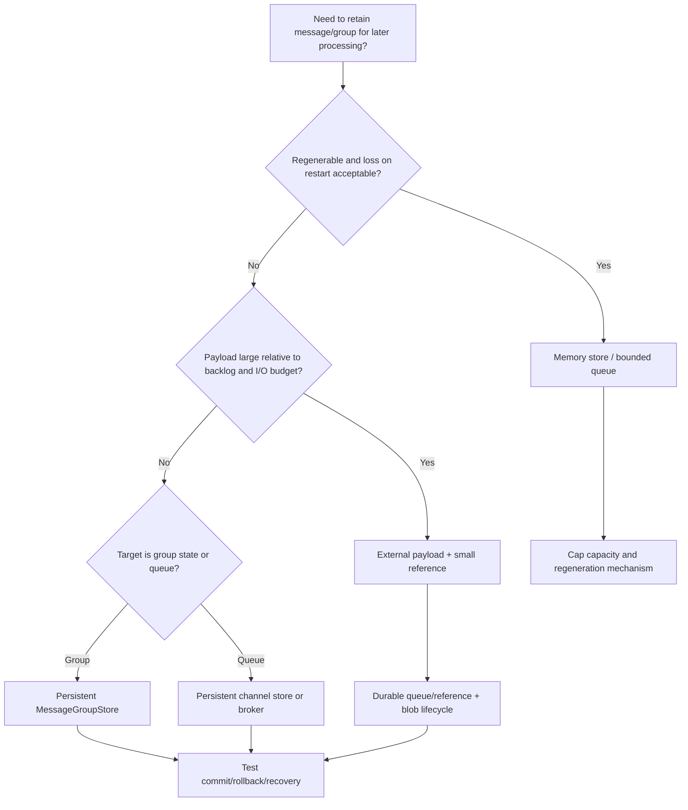
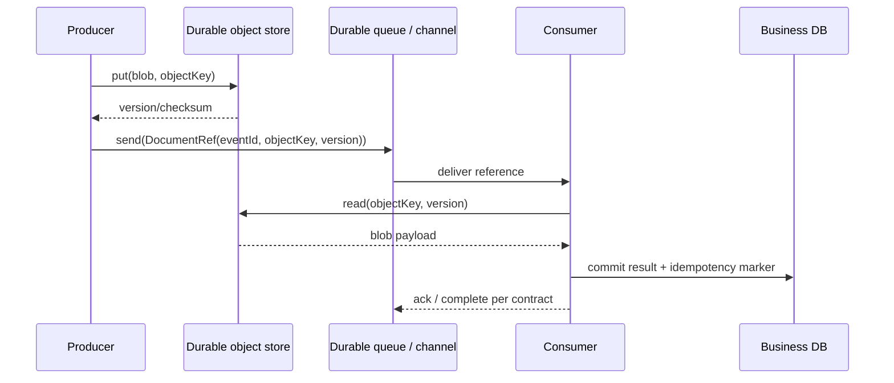
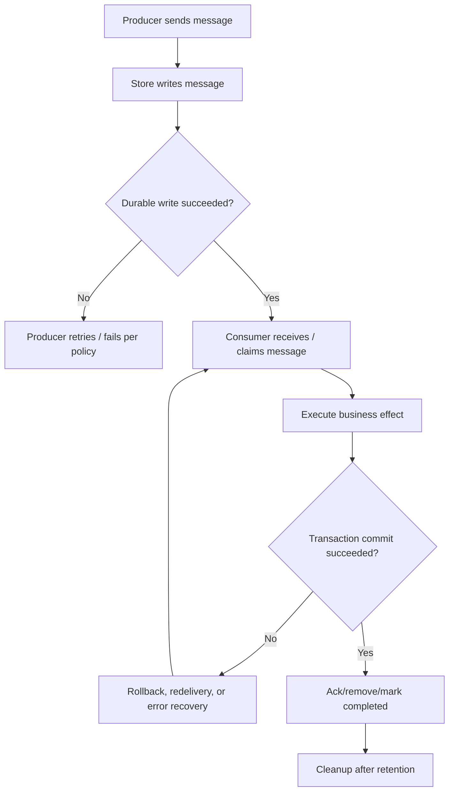

# Choosing a Store by Message Size and Recoverability in Spring Integration

## 1. Why Must Message Size and Recoverability Be Evaluated Together?

In the `SPRING_INTEGRATION_RUNTIME` module, messages move through channels, endpoints, consumers, pollers, and executors; depending on design, messages are also held in queues, message groups, or claim-check stores. Under normal traffic, many storage options appear sufficient. Differences become stark when **messages grow large, backlogs build up, applications restart, or consumers crash mid-flight**.

Consider an invoice-processing service: each small message carries `invoiceId` and routing info, yet occasionally embeds an 8 MiB PDF file. Suppose 30,000 messages are waiting:

- If only a reference to the PDF is stored, queued data stays relatively small.
- If every PDF sits inside an in-memory queue, raw payloads alone consume roughly **240 GiB**; actual heap usage also includes Java object overhead, headers, and copies.
- If every PDF goes into database rows, you trade heap exhaustion for heavy read/write pressure, transaction logs, backups, and database recovery time.
- If the queue lives only in memory, a process restart can wipe out every unprocessed message, even tiny ones.

Thus, choosing a `MessageStore` is not just picking an API. You must decide **what data to store**, **how long to keep it**, **acceptable loss tolerances**, **how to replay after incidents**, and **how messages cross transactions**.

After this lesson, you will be able to:

1. Distinguish message stores, message group stores, channel stores, and metadata stores.
2. Estimate storage costs from payload size, pending message count, and backlog duration.
3. Build a decision matrix across in-memory, JDBC-backed stores, or **external payload + reference message** models.
4. Design recovery for restarts, mid-processing crashes, retries/redeliveries, and store outages.
5. Verify choices via configuration code, fault injection, metrics, and load testing.

## 2. Understanding Store Roles at Runtime

Spring Integration provides several abstractions for storing messages. They address **different contracts**:

| Role | Stored Content | When Used | What to Verify |
|---|---|---|---|
| `MessageStore` | Individual message identified by message ID with payload/headers per store mechanism | Save and retrieve individual messages, claim-check | Can it serialize/deserialize back after restart? |
| `MessageGroupStore` | Messages grouped together plus group metadata | Aggregator, resequencer, group-managing components | Are group ID/correlation, timeouts, completion, and cleanup durable? |
| Store backing `QueueChannel`, e.g. `JdbcChannelMessageStore` | Pending messages in a channel/queue | Polling consumers needing durable queues | How do dequeue, commit/rollback, and competing consumers behave? |
| `MetadataStore` | Key/value metadata such as offsets, markers, checkpoints | Idempotent receivers, poller metadata, locks/checkpoints | Is metadata enough to recover, or is the payload still missing? |
| External sources like brokers/object stores | Messages or payloads per that system's contract | Multi-service integration, large messages, long retention | Delivery guarantees, retention, acks, and real retrieval behavior |

**Do not substitute these concepts just because they share the word "store".** `JdbcMessageStore` persists individual messages and message groups; `JdbcChannelMessageStore` is specialized for durable queue channels. `SimpleMessageStore` stays in-process—useful for speed when losing data on restart is acceptable. `MetadataStore` only holds metadata and cannot reconstruct payloads if the payload origin is gone.

Distinguish further:

- **Channel** governs transport mechanics. `DirectChannel` dispatches synchronously and normally holds no backlog; `QueueChannel` buffers temporarily for polling consumers; `ExecutorChannel` hands work to an executor queue, which **does not automatically become a durable message store**.
- **Store** governs retention and retrieval; **poller** governs when messages are fetched; **transaction/ack** governs when a message counts as successfully processed.
- **Persistence** means data is written to durable storage per contract; **recovery** also covers finding messages, handling in-flight items, restoring consumers, and preventing duplicate business side effects.

## 3. How Should Message Size Be Measured?

Do not simply read `payload.length` and use that number to size a store. A real message carries at least three layers of cost:

```text
Message = payload + headers + representation/serialization overhead
Store   = serialized message + index/metadata + transaction log/replication/backup
Runtime = object graph + queue references + deserialization buffers + concurrent copies
```

With JSON payloads, Java string character count differs from actual UTF-8 byte count. With complex DTOs, serializers may expand or shrink the representation relative to the original object. With `byte[]`, raw size is easier to measure, though headers and transformation copies still count. With message groups, correlation/group metadata adds further overhead.

### 3.1. Estimating Backlog Before Choosing a Store

Let:

- `λ`: average message arrival rate (messages/second).
- `μ`: completed processing rate (messages/second).
- `T`: duration the system may need to buffer backlog (seconds).
- `S`: average message size *after serialization* (bytes).
- `B`: peak pending message count to design for.

An estimate when sustained ingress exceeds processing capacity:

\[
B \approx \max(0,\lambda-\mu)\times T
\]

And raw backlog data volume:

\[
D_{\text{raw}}\approx B\times S
\]

Both expressions are **initial estimates only**. Real workloads have bursts, size skew, retried failing messages, transaction logs, indexes, object overhead, and replication copies. When sizing capacity, also measure **p95/p99 message sizes** and add headroom.

**Example 1 — small messages:** 50,000 messages × 20 KiB ≈ 977 MiB raw data. Inside the Java heap, required heap can be substantially larger due to object/header/queue overhead. Inside JDBC, account for indexes, WAL/transaction logs, backups, and queue scan time.

**Example 2 — large payloads:** 50,000 messages × 8 MiB ≈ 391 GiB raw data. Instead of embedding payloads in every message, store the PDF in object storage and pass a far smaller `DocumentRef`.

### 3.2. Do Not Mistake Size Tables for Framework Defaults

The ranges below are **design starting points** for real systems, **not limits or default recommendations of Spring Integration**:

| Reference Size Range | Primary Focus | Why |
|---|---|---|
| A few KiB to tens of KiB/message | Bounded memory queue if losing queued work on restart is allowed; JDBC store if restart recovery is required | Small payloads; serialization and database costs remain manageable. |
| Hundreds of KiB to around MiB/message | Measure JDBC/broker throughput, batch size, heap, network, and row/LOB overhead | Under heavy backlogs, byte volume matters more than message count. |
| Multiple MiB to tens of MiB or more | Dedicated payload storage + message carrying reference/claim-check | Reduces pressure on channels, JDBC transaction logs, networks, and GC. |

A 5 MiB message may be fine in a low-throughput pipeline; a 20 KiB message can still overwhelm a system if millions accumulate. Always decide by **size × backlog × SLA × recoverability**.

## 4. "Recoverable" Must Be Defined by Failure Scenarios

Before selecting a store, list the exact failures the system must survive:

| Failure | Question to Answer | Memory-Only | Properly Configured Durable JDBC/Broker |
|---|---|---|---|
| Consumer throws exception | Does the message remain for retry? | Depends on buffer and retry logic; not guaranteed | Can roll back/requeue if receive, transaction, and ack align |
| Controlled application restart | Do queued backlog items survive? | Typically lost with process | Recoverable from committed records |
| Process killed mid-processing | Do in-flight messages reappear? | Not guaranteed | Depends on transactions, claim/visibility, and receive mechanics |
| Host/container lost | Can another instance still reach the store? | No | Yes if data resides in durable shared storage that stays available |
| Database or broker outage | Can ingress continue or must backpressure apply? | Very limited temporary buffering; lost on crash | Requires retry policies, failover, and store outage monitoring |
| Restoring an old backup | Do queue and business state stay consistent? | N/A unless memory was backed up | Must define RPO, restore points, and reconciliation with business DB |

Two vital targets:

- **RPO (Recovery Point Objective):** what is the maximum data/event loss tolerable during recovery? Achieving RPO = 0 for acknowledged messages demands aligned commit/ack and storage design; calling a store "durable" alone is not enough.
- **RTO (Recovery Time Objective):** how quickly must the system drain the backlog after an incident? A store may preserve 10 million messages, yet if rebuilding indexes or scanning the queue takes hours, RTO may still be missed.

Also define the **replay window**: how long afterward can events be replayed (hours, days, weeks)? Retention across the message store, object store, and idempotency ledger must span that same contract.

## 5. Store Selection Matrix

| Option | Suitable Size / Backlog | Restart Recovery | Key Cost / Limit | When to Choose |
|---|---|---|---|---|
| In-memory `SimpleMessageStore`, `QueueChannel` | Small, bounded, pending work loss acceptable | Not guaranteed across restarts | Heap, GC, OOM risk, lost on crash | Demos, caches, transient work easily regenerated |
| `JdbcMessageStore` for message groups | Small/medium, group state must survive restarts | Yes, with durable DB/schema and proper group lifecycle | DB reads/writes, locks, serialization, group cleanup | Aggregator/resequencer needing group recovery |
| `JdbcChannelMessageStore` for queues | Small/medium, backlog must persist | Yes, depends on commits/transactions/consumers | DB contention, polling, logs, indexes, cleanup | JDBC work queues matching RPO/RTO |
| Other distributed stores supported by Spring Integration for that role | Depends on adapter, config, and size | Depends on real persistence/replication/retention | Consistency, failover config, external dependencies | Shared storage already exists and state must span instances |
| Durable broker + small messages | Many producers/consumers, high throughput, or cross-service | Yes per broker policy, acks, and retention | Broker operations, ordering, redelivery, DLQ | Event transport/service integration, cross-process queues |
| Object/blob store for payload + durable reference message | Large payloads; long backlogs | Yes if **both reference and blob** are durable with aligned lifecycles | Blob lifecycle, orphans, access security, retries | PDFs, images, log files, large binary payloads |

**Warning on the "Restart recovery" column:** this represents **achievable capability when properly configured and tested**, not an unconditional default. For example, a JDBC store holds durable rows, yet a process can still lose a dequeued message if the poller/ack falls outside the transaction. A broker can redeliver a message and invoke a handler multiple times; that is where idempotency is required.

### Quick Decision Flow



## 6. Example A: In-Memory Queue When Work Is Regenerable

For work that can be regenerated from a source of truth and needs no pending queue persistence across restarts, use a bounded in-memory `QueueChannel`:

```xml
<int:channel id="previewQueue">
    <int:queue capacity="500"/>
</int:channel>
```

This configuration uses the **Spring Integration XML namespace** (requires declaring the `int` namespace and supporting application wiring). The channel accepts messages and a polling consumer fetches them later; `capacity` bounds message count, **not bytes**. If each message suddenly jumps from 10 KiB to 10 MiB, a 500-message cap can still put severe pressure on the heap.

Companion design points:

- When full, `send()` may block until timeout or fail depending on send mode; define backpressure and producer retries.
- Restarts/crashes normally lose unprocessed messages in an in-memory queue. If the source supports replay, track source watermarks/cursors to regenerate; if the source cannot replay, this option fails durability requirements.
- `SimpleMessageStore` holding messages/groups in memory shares this risk class: **never conclude a message is durable just because it was put into a "store"**.
- If work can execute immediately on the same call stack, `DirectChannel` is simpler than a queue, though it does not buffer backlogs.

**Good fit:** cache invalidation notices, regenerable previews, or test data. **Poor fit:** payments, unique invoices, or unreplayable events that must not be lost across restarts.

## 7. Example B: QueueChannel With JDBC Store for Backlog Recovery

When messages are small/medium and pending work must survive restarts, one approach is pairing `JdbcChannelMessageStore` with `QueueChannel`.

Illustrative XML example:

```xml
<bean id="jdbcChannelStore"
      class="org.springframework.integration.jdbc.store.JdbcChannelMessageStore">
    <constructor-arg ref="dataSource"/>
</bean>

<int:channel id="durableWorkQueue">
    <int:queue message-store="jdbcChannelStore"/>
</int:channel>

<int:service-activator input-channel="durableWorkQueue"
                       ref="workHandler"
                       method="process">
    <int:poller fixed-delay="500" max-messages-per-poll="1">
        <int:transactional transaction-manager="transactionManager"/>
    </int:poller>
</int:service-activator>
```

**Prerequisites to apply this example:**

1. The project declares the Spring Integration XML namespace, `dataSource`, `transactionManager`, and a `workHandler` bean with a payload-compatible `process(...)` method.
2. JDBC schemas for Spring Integration message stores must be created matching **your exact version and database engine** (typically via scripts shipped with the library/migration tool); never hand-roll approximate tables.
3. The poller begins the transaction **before `receive()`**; synchronous processing on the poller thread can participate in that transaction when resources/managers match.
4. For business JDBC operations that must be atomic with message retrieval, ensure they share **the same datasource and transaction**. If business state lives in another resource, a single JDBC transaction manager cannot roll back everything.
5. If `workHandler` forwards work onto an `ExecutorChannel` and returns immediately, the poller transaction may commit **before the worker finishes**; worker failures will not roll back the already-committed receive.

In this example, dequeuing from the durable queue and updating the database can share one transaction. If the handler throws an unchecked exception and the transaction rolls back, removing the message from the JDBC store **can be reverted**, allowing a future poll to pick it up again. Verify exact store semantics, polling advice, schema, and app version behavior with real crash/restart tests.

### 7.1. A Simple Worker With Idempotency

Suppose the message carries only a reference instead of a huge payload:

```java
package example.integration;

public record WorkRef(String eventId, String objectKey, long sizeBytes) {}
```

A handler can use the `eventId` business key to prevent duplicate side effects upon redelivery:

```java
package example.integration;

import org.springframework.jdbc.core.JdbcTemplate;

public class WorkHandler {

    private final JdbcTemplate jdbc;

    public WorkHandler(JdbcTemplate jdbc) {
        this.jdbc = jdbc;
    }

    public void process(WorkRef work) {
        if (work.eventId() == null || work.eventId().isBlank()) {
            throw new IllegalArgumentException("eventId is required");
        }
        jdbc.update(
            "INSERT INTO completed_work(event_id, object_key) " +
            "VALUES (?, ?) ON CONFLICT DO NOTHING",
            work.eventId(), work.objectKey());
    }
}
```

This snippet uses PostgreSQL's `ON CONFLICT DO NOTHING` and assumes `completed_work` has a unique/primary key constraint on `event_id`. Register `WorkHandler` as `workHandler` and inject `JdbcTemplate` from the same datasource if using Section 7's XML; `WorkRef` does not read the blob from object storage unless you also implement the blob client.

`ON CONFLICT DO NOTHING` only guards duplicate inserts on the shown table; if the handler also sends emails, calls HTTP, or debits accounts, **every other side effect must be made idempotent separately**. One transaction does not automatically yield end-to-end exactly-once.

### 7.2. Scenarios to Test Yourself

| Failure Point | What to Observe |
|---|---|
| After producer sends successfully, before consumer receives | Was the message durably saved? Does it survive restart? |
| Consumer takes message then throws exception before commit | Does poller rollback make the message reappear? |
| Consumer committed, then process dies before upstream learns outcome | Does upstream resend? Does the idempotency ledger enforce a single business effect? |
| Database loses connectivity mid-poll | Does the poller back off/recover? Does backlog grow? |
| Two instances poll the same queue | Any contention, starvation, or reordering? Any false assumption of strict global FIFO? |

**Ordering note:** a durable queue does not mean strict global FIFO under multiple consumers, retries, or transaction rollbacks. Enforce ordering at the **business layer** if processing by `customerId`/`aggregateId` order is required.

## 8. Example C: Message Groups Must Recover Along With Correlation State

An aggregator collects multiple messages by `correlationId` until count, timeout, or release criteria are met. If group state lives only in RAM, a restart loses messages that arrived for an incomplete group.

```text
Message A1 (correlationId=ORDER-7, sequenceNumber=1)
Message A2 (correlationId=ORDER-7, sequenceNumber=2)
... restart ...
Message A3 (correlationId=ORDER-7, sequenceNumber=3)
```

If an in-memory store loses A1 and A2, A3 cannot rebuild the group alone. For recoverability, use a persistent `MessageGroupStore` (such as `JdbcMessageStore` configured as a group store) along with policies for:

- **Correlation/release:** group keys remain consistent across redeliveries and restarts; completion conditions are deterministic.
- **Timeout:** after restart, prior in-memory scheduled tasks may be gone; verify how the framework sweeps/restarts group expiry/release.
- **State volume:** a single group can accumulate many messages, growing byte size rapidly even when each payload is small.
- **Cleanup:** does group completion delete messages and metadata, or retain metadata for duplicate detection? Deleting too early lets late arrivals start a duplicate group.
- **Transactions:** align group state updates and message consumption with retry/replay behavior.

**Never treat `JdbcChannelMessageStore` as a drop-in `MessageGroupStore` for arbitrary aggregators**; wire the exact store contract the endpoint requires. Conversely, do not blindly use plain `JdbcMessageStore` as a channel queue store while bypassing channel-queue optimizations.

## 9. Example D: Large Payloads — Store Blobs Separately and Pass References

When payloads span multiple MiB, a far more durable and scalable design places **payloads in a blob/object store**, while channels carry only **keys and metadata sufficient to retrieve them**.

Two related approaches:

1. Spring Integration's **Claim-check pattern**: uses a message store to stash payloads/messages and passes a claim-check ticket downstream; a later step redeems the ticket to retrieve data. Spring Integration's claim-check transformers support this pattern.
2. **External object reference**: the producer writes the file/binary to object storage and emits a tiny `DocumentRef` carrying `objectKey`/version/checksum; the consumer reads the payload from object storage.

Whether called claim-check or external reference, **the payload store must also satisfy durability, retention, and cleanup requirements**. If claim-check uses an in-memory store, a ticket surviving a restart is useless once the payload is gone.



**Crucial detail:** if the producer saves the blob but fails before sending the message, you get an **orphan blob**. If the message goes out before the blob is ready, the consumer hits a **dangling reference**. Two writes across separate systems are not automatically atomic. Use outboxes/transactional producers, `PENDING/READY` states, retention grace periods, and periodic reconciliation to clean up/recover safely.

### 9.1. Reference Message Structure

Java example:

```java
public record DocumentRef(
        String eventId,
        String objectKey,
        String objectVersion,
        String sha256,
        long lengthBytes
) {}
```

Build the message while preserving useful headers:

```java
import org.springframework.messaging.Message;
import org.springframework.messaging.support.MessageBuilder;

Message<DocumentRef> toReference(
        Message<byte[]> input,
        DocumentRef reference) {
    return MessageBuilder.withPayload(reference)
            .copyHeaders(input.getHeaders())
            .setHeader("payloadStorage", "object-store")
            .build();
}
```

This step only **converts an existing payload into a reference**; it does not upload the blob to object storage itself. In production, upload/verify the blob first, then publish `DocumentRef` under your producer protocol.

**Do not treat headers carrying `replyChannel` or `errorChannel` as indefinitely serializable addresses.** If a header holds a live `MessageChannel` object, long-term persistence or cross-process transport can fail or fail to resolve. When needed, translate channel headers to lifecycle-managed string names/registries or design stable reply/error destinations.

### 9.2. Blob Retention Differs from Message Retention

Suppose the queue retains messages for 3 days while blobs expire after 24 hours. The message still exists and recovers from the queue, yet **no payload remains to process**. Design rule:

```text
retention(payload) >= duration the message may be reprocessed
                    + retry/replay/DLQ/reconciliation window
```

Account for object versioning/immutable keys, read permissions, checksums, encryption, backup restores, and post-processing blob lifecycles. Deleting a blob immediately after one consumer finishes can break replicas or other messages referencing the same object.

### 9.3. Why Not Put Blobs in Headers?

Headers travel with every message across endpoints, adapters, and logs. Placing a large `byte[]` in headers increases transport/storage costs, breaks serialization easily, and clutters observability. Keep only **references, essential metadata, and correlation IDs** in messages; fetch payloads when processing requires them.

## 10. Comparing Recovery: "Stored" Message vs "Completed" Message

A transactional timeline highlights the difference:



There are at least three distinct milestones:

- **Durably accepted:** storage confirmed persistence under its durability contract.
- **Business completed:** associated business changes committed successfully.
- **Delivery completed:** the source/queue received ack or removed the message from pending state per its contract.

Crashes can occur between milestones. If business state committed while the ack was lost, redelivery can still happen. Thus, maintain a stable **idempotency key** across deliveries and combine markers with effects atomically whenever possible. Recovering "without losing messages" trades off with "messages may arrive more than once"; both properties coexist.

**Do not aim for end-to-end exactly-once merely by choosing a JDBC store.** Sources, stores, handlers, transaction managers, external APIs, and error/retry flows all shape the final effect.

## 11. Transactions, Retries, and Pollers Must Match Store Type

| Component | Required Alignment | Common Mistakes |
|---|---|---|
| `MessageStore` / `ChannelMessageStore` | Match exact interface, serializer, and schema | Wrong store type; fails to recover groups or queues |
| `PlatformTransactionManager` | Manage exact datasource/resource holding messages and business state | DB A's transaction cannot protect DB B or a broker |
| Poller | Begin transaction before `receive()` when transactional polling is needed | Dequeueing outside transaction so business failures lose the message |
| Retry advice | Bound attempts and backoff; align transaction per attempt | Retrying inside an already rollback-only transaction or infinite loops |
| `errorChannel`/DLQ | Separate transient errors from terminal failures | Poison messages clogging queues indefinitely without operator tooling |
| Idempotency ledger | Keep one key per logical event across restarts | Replays re-executing duplicate side effects |
| Executor/channel handoff | Understand thread boundaries before claiming atomicity | Poller transaction commits before executor worker runs |

**Example:** a polling consumer reads from a `QueueChannel` backed by `JdbcChannelMessageStore` and runs a JDBC handler on the same datasource in the poller thread. With proper poller transaction advice, if the handler throws an unchecked exception, the transaction can roll back both message retrieval and business updates. If instead the handler hands off to an `ExecutorChannel` and returns, the poller transaction can commit right upon dispatch while business logic has not run yet. In that case, place transactions and retries on the **worker**, or adjust topology to match atomicity requirements.

With `SimpleMessageStore`/in-memory queues, attaching `JdbcTransactionManager` to the poller **does not turn in-RAM dequeueing into a rollbackable JDBC operation**. That is a common misconception when evaluating durability.

## 12. Serialization, Schemas, and Data Security

A durable store only helps if **messages restore into the right data types** when the application runs a newer version. Check:

1. **Payload types:** Java DTOs, records, JSON, Avro/Protobuf, or binary; does the serializer preserve compatibility across code versions?
2. **Headers:** which headers must cross the store, which values are non-serializable objects, and should they be filtered or converted to Strings?
3. **Schema/database:** JDBC stores need DDL/indexes matching the Spring Integration version and DBMS; use controlled migrations rather than letting two app versions mutate schemas arbitrarily.
4. **Message size limits:** DB column/LOB/packet limits, driver buffers, broker max message sizes, and network/API caps; test with realistic payloads.
5. **Security:** table/bucket access controls, encryption in transit/at rest, PII protection, and avoiding logging sensitive payloads.
6. **Data retention:** message/group/metadata purge policies, backups, and restores; old accumulated rows slow store queries even at steady message rates.

**Do not treat Java serialization as a long-term storage protocol across application versions.** When retaining messages across upgrades or sharing across systems, prefer explicitly versioned/schema-governed formats and test compatibility pre/post-deploy. Also test what happens on deserialization failure: stuck messages, error channel, DLQ, or manual intervention?

## 13. Sizing, Performance, and Observability by Store Type

### 13.1. Metrics to Collect

| Metric | Memory Queue | JDBC Store | External Payload / Reference |
|---|---|---|---|
| Backlog count and age (oldest message) | Yes | Yes | Yes on the reference queue |
| Serialized message size p50/p95/p99 | Yes | Yes | Separate reference size and blob size |
| Heap / GC pauses | Critical | Still monitor buffers/deserialization | Usually eases large-payload pressure on channels |
| Insert/receive/ack latency | Usually low; depends on locks/consumers | Critical; depends on DB I/O/locks/indexes | Adds blob put/get latency |
| Disk / transaction log / replication lag | N/A for RAM queues | Critical | Critical for both queue and object storage |
| Retries, duplicates, DLQ, poison messages | Important | Important | Important |
| Recovery backlog drain time | Regenerated from source | Measure after restart | Measure queue recovery and blob fetch throughput |

Track **ingress rate**, **egress rate**, and **oldest message age** together. A steady queue count does not mean health if a subset of messages has been stuck for hours.

### 13.2. Capacity Planning: Test Both Peaks and Recovery

A realistic test suite should cover:

- **Normal load:** measure throughput, p95 latency, CPU, heap, and storage I/O.
- **Burst:** raise ingress long enough to build target backlog; verify backpressure.
- **Long outage:** stop consumers, continue controlled sends, and measure storage/I/O growth.
- **Cold restart:** restart the app with queued messages/groups present; verify surviving counts and recovery time.
- **Crash mid-processing:** kill consumers before/after business commits; verify redelivery and idempotency.
- **Schema/serializer upgrade:** write messages with old version, start new version, and deserialize/replay.
- **Store outage/failover:** test producer behavior, retry/backoff, and alerting.

For databases, test lock contention, cleanup/vacuum, index bloat, and replica lag under large backlogs. For object storage, test blob retrieval under constrained networks and lifecycle policies.

### 13.3. Backpressure and Byte Limits

`QueueChannel` limits are typically expressed as **message counts**. That does not cap total bytes when message sizes vary widely. Enforce ingress payload size limits, isolate large-blob flows, cap concurrent processing, rate-limit producers, and add byte quotas separately.

For instance, relying solely on `capacity=500`, a queue of 500 2 KiB messages is worlds apart from 500 20 MiB messages. Capacity planning must account for **bytes, count, and retention time**, never a single dimension.

## 14. Diagnostic Playbook When the Store Fails to Recover Properly

| Symptom | Likely Causes | First Checks |
|---|---|---|
| Queue empty after restart | Used in-memory queue/store; persistent writes uncommitted | Actual store bean, `message-store` wiring, commit state |
| DB has rows yet consumer receives nothing | Poller not started, mismatched store query/schema, deserialization error | Poller logs, SQL, schema version, converter exceptions |
| DB rolls back yet message is lost | Receive and business work not in same transaction; in-memory queue | Transaction manager, datasource, threads, and channel type |
| Message processed twice after crash | Business commit before ack, or source redelivery | Commit/ack timeline, idempotency key, and ledger |
| Aggregator misses messages after restart | Message group kept in memory; wrong correlation/timeout/cleanup | `MessageGroupStore`, group IDs, expired/released state |
| High CPU/GC as backlog grows | Oversized payloads in heap, excessive copying/serialization | Size p99, heap histogram, queue byte estimate |
| DB logs and backups grow too fast | Large blob payloads or long row retention, frequent retries | Stored bytes, indexes/logs, retention, and claim-check |
| Consumer receives reference but blob is missing | Blob deleted early, upload uncommitted/unavailable, changed key/version | Object lifecycle, checksums, producer publish order |
| Data restore succeeds yet messages fail to read | Incompatible DTO/serializer/schema version | Deserialization logs, compatibility migrations |
| Poison message retries forever | Unbounded retries, no DLQ/quarantine | Error flow, retry policy, dedup, and operator tooling |

When investigating, build a timeline for the **same business event ID**:

```text
produced_at -> stored_at -> enqueued_at -> received_at
            -> business_committed_at -> acked_at -> cleaned_at
```

These timestamps are concepts to instrument, not headers Spring Integration automatically populates. Combine them with thread names, poller IDs, correlation IDs, transaction outcomes, and store record IDs to pinpoint where data was lost or processed twice.

## 15. Scenario-Based Store Decision Practice

Work through these scenarios, specifying **store type, recovery approach, metrics, and remaining limits**:

1. **Cache invalidation:** 1,000 small messages, source can replay everything, losing pending queue items on restart is acceptable. Pick a bounded memory queue and describe backpressure.
2. **Orders:** 200,000 small events, cannot lose unprocessed messages on restart, JDBC consumers need retries. Pick a durable queue/broker, defining transactions/acks and idempotency.
3. **PDF processing:** 10,000 files, 8 MiB each, must support retries for 7 days. Pick an object store + durable reference, calculate roughly 80 GiB raw volume, and design retention.
4. **Aggregator:** receives three parts per `correlationId`, groups can live for hours, and the app deploys frequently. Pick a persistent `MessageGroupStore`, checking timeouts/correlation/completion.
5. **20-minute DB outage:** producers still send toward a JDBC queue. Decide whether to apply backpressure/fail with retry or divert to another durable source; never assume the queue accepts sends while the database is disconnected.
6. **Crash between commit and ack:** design a process-kill test verifying reprocessing does not create duplicate invoices/emails/charges.
7. **Version upgrade:** write messages with old version, deploy new version, and test deserialization plus backlog draining.
8. **Cleanup:** define when queue rows, group state, blobs, idempotency ledgers, and DLQs may be purged; test replaying a message later than expected.

Sample decision matrix template:

| Decision | Required Answer |
|---|---|
| Message contract | Does payload live inside the message or as a reference? |
| Size/backlog | p50/p95/p99 bytes, peak count, age, growth rate? |
| Store API/type | Queue, group, metadata, or payload store? |
| Durability/RPO/RTO | Which failures must it survive? |
| Transaction/ack | When is a message considered received and completed? |
| Retry/idempotency | Do duplicate messages cause duplicate side effects? |
| Lifecycle | After how long is data purged and who owns cleanup? |
| Observability | What metrics prove recovery meets requirements? |

## 16. Pre-Operations Architecture Checklist

- Pick the right **store contract**: queue, group, payload/claim-check, or metadata.
- Estimate **serialized bytes × peak backlog** with p95/p99 size distributions; add replication, indexes, transaction logs, and memory overhead.
- Specify target failures to survive, **RPO/RTO**, and replay windows; verify via real restart/crash tests.
- For JDBC queues, ensure **schema, transaction manager, poller, receive, and business work** align; never assume transactions cross executors.
- For large payloads, store blobs in dedicated storage, carry tiny references on channels, and manage **upload, checksums, retention, cleanup, and orphans**.
- Prepare for **retries/redeliveries** with stable idempotency keys; durable storage does not guarantee business exactly-once on its own.
- Cap backlog/backpressure, monitor queue age/size/I/O, and maintain tested DLQ/replay/restore procedures.

### Official Reference Documentation

- [Spring Integration Reference — Message Store](https://docs.spring.io/spring-integration/reference/message-store.html): message and message group storage concepts, in-memory/persistent implementations.
- [Spring Integration Reference — Message Channels](https://docs.spring.io/spring-integration/reference/channel.html): channels, queues, and message-delivery options.
- [Spring Integration Reference — JDBC Message Store](https://docs.spring.io/spring-integration/reference/jdbc/message-store.html): JDBC message store configuration and related schemas.
- [Spring Integration Reference — Claim Check](https://docs.spring.io/spring-integration/reference/claim-check.html): storing payloads separately and passing claim-check tickets.
- [Spring Integration Reference — Transaction Support](https://docs.spring.io/spring-integration/reference/transactions.html): polling consumer transactions and processing boundaries.
- [Spring Integration Reference — Aggregator](https://docs.spring.io/spring-integration/reference/aggregator.html): managing message groups, correlation, release, and state.
