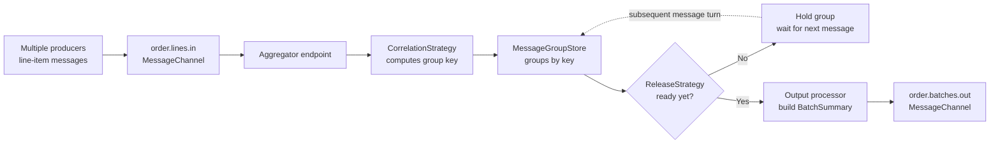
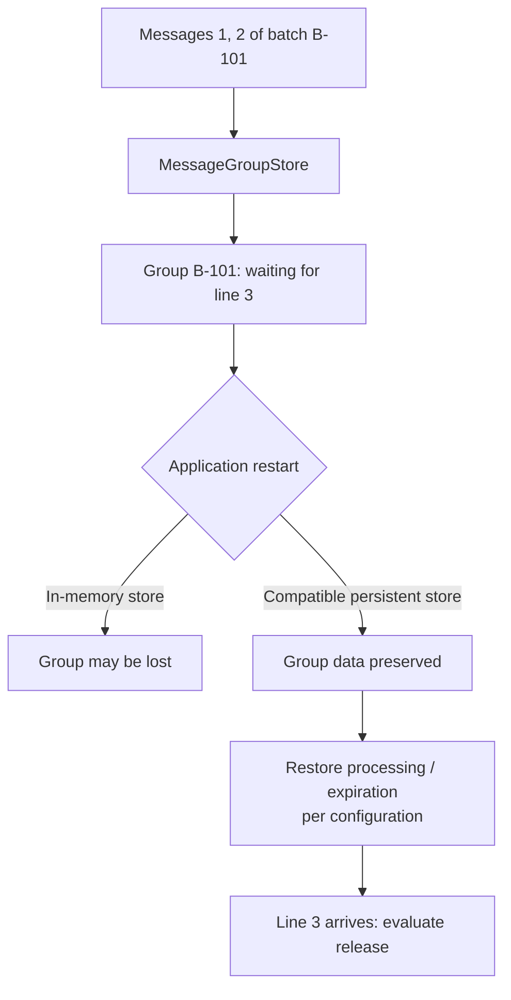

# CorrelationStrategy and Correlation Keys

## 1. Why does the runtime need correlation?

In Spring Integration, a `Message<?>` has a payload and headers, and is passed through a channel to an endpoint/consumer. A simple handler can process each message independently. However, components such as **aggregators** and **resequencers** must receive multiple different messages, recognize **which messages belong to the same group**, and then store state until the conditions for processing or reordering are met.

For example, a system receives three line items of an inbound shipment batch: line numbers 1, 2, and 3 may arrive out of order. When two batches are sent onto the same channel, the aggregator needs to place each batch's lines into the right group. **`CorrelationStrategy`** determines the group identifier key, while **`ReleaseStrategy`** determines when the group can be released to emit a result.

In the **SPRING_INTEGRATION_RUNTIME** module, this lesson connects message grouping with orchestration across channels, endpoints, consumers, pollers, and executors; `MessageGroupStore` state, `IntegrationFlow` lifecycle, transactions, retries, error channels, and threading and performance observability.

Practical objectives:

1. Understand the difference between message ID, correlation ID, correlation key, and trace ID.
2. Choose a stable `CorrelationStrategy` to group messages accurately.
3. Combine correlation with release, timeout, and group storage.
4. Diagnose stuck groups, groups mixing wrong data, late-arriving messages, duplicates, or loss after restart.

> **Key principle:** the correlation key only answers the question **“which group does this message belong to?”**. It does not by itself answer **“is the group complete yet?”**, nor does it guarantee ordering, uniqueness, durability, or exactly-once processing.

## 2. Message path through a correlating endpoint



Each message entering an aggregator typically goes through these logical operations:

1. The aggregator receives a `Message<?>` on its input channel.
2. `CorrelationStrategy.getCorrelationKey(Message<?>)` produces an **object used as the group key**.
3. `MessageGroupStore` locates or creates the `MessageGroup` corresponding to that key.
4. The message is recorded in the group, potentially requiring synchronized access to the group if multiple threads send concurrently.
5. `ReleaseStrategy` checks whether the group satisfies the condition to emit a result.
6. If satisfied, the output processor combines the payloads and sends the reply downstream; the group is marked complete or removed according to policy.
7. If not yet satisfied, the group retains state while waiting for other messages; a separate timeout/expiration mechanism may apply.

**`CorrelationStrategy` does not directly send replies** and does not control polling schedules. It only computes the key; group management, release decisions, and dispatching are handled by the correlating handler together with the channel/endpoint.

## 3. Distinguishing easily confused identifiers

| Concept | What is it used for? | Should it be used as a correlation key? |
| --- | --- | --- |
| `MessageHeaders.ID` / `id` | Identifier of a specific message generated by the framework | Usually **no**, because each line has its own message ID; a splitter may use the root message's ID to generate the correlation ID for child messages. |
| `correlationId` | Header commonly used to indicate a group of related messages | **Yes**, if all messages belonging to the group carry the same stable, properly scoped value. |
| **Correlation key** | Value returned by `CorrelationStrategy` to identify a `MessageGroup` | This is the actual key of the group; it can be extracted from headers or computed from payload and metadata. |
| `sequenceNumber` | Position of a message within a sequence | Used for ordering/missing-element checks; **not** a general group key. |
| `sequenceSize` | Expected number of elements in a sequence | Used when evaluating the release condition; **not** a group key. |
| `traceId` | Tracing a request across multiple services | Only use as a key if it matches business grouping rules; a single trace may contain multiple groups. |
| `replyChannel` / `errorChannel` | Address for replies or error handling | Not a group key. |
| `orderId`, `batchId`, `tenantId` | Business identifier or tenant scope | Can be used, but collisions, reuse, and durability across restarts must be evaluated. |

**The same character string does not necessarily mean the same thing.** For example, `orderId=42` in tenant A and tenant B must not be merged if the system shares a message store. Or an order might be processed twice with the same `orderId` but different `batchId`: grouping by `orderId` would mix results from two runs.

Design the correlation key based on the **unit of work to be aggregated**: a request, a lot, a batch/window, or a set of fragments. If keys are reused, clearly specify when the old group ends and how to handle late-arriving messages.

## 4. `CorrelationStrategy` in Spring Integration

The core interface:

```java
import org.springframework.integration.aggregator.CorrelationStrategy;
import org.springframework.messaging.Message;

CorrelationStrategy byBatch =
    (Message<?> message) -> message.getHeaders().get("batchId");
```

`CorrelationStrategy` has the method `getCorrelationKey(Message<?> message)`; the result is the object used to identify the group. In many correlating handler configurations, the default strategy is based on the `correlationId` header. You must **inspect the actual inbound messages**; do not assume every inbound adapter or producer populates that header automatically.

Three strategy patterns can be chosen:

### A. Based on the `correlationId` header

When messages are produced by a splitter or a producer that has consistently set the correlation ID, you can use the default rule or specify it explicitly:

```java
import org.springframework.integration.aggregator.CorrelationStrategy;
import org.springframework.integration.IntegrationMessageHeaderAccessor;

CorrelationStrategy fromCorrelationHeader = message ->
    message.getHeaders().get(IntegrationMessageHeaderAccessor.CORRELATION_ID);
```

Use this approach if the correlation header already carries the exact identifier of the **group to be combined**. If all messages are missing the header, the group may be unidentifiable or fail according to the active mechanism; do not treat `null` as a valid business key.

### B. Based on a business key

```java
CorrelationStrategy byBusinessBatch = message -> {
    Object key = message.getHeaders().get("batchId");
    if (!(key instanceof String batchId) || batchId.isBlank()) {
        throw new IllegalArgumentException("Missing batchId");
    }
    return batchId;
};
```

This approach fits when messages are generated independently from multiple sources yet belong to the same batch. Validate at the inbound boundary so missing-key errors surface early; avoid using a default like `unknown` because it can mix all erroneous messages into a single group.

### C. Composite key accounting for tenant or version

```java
import java.io.Serializable;

record BatchKey(String tenantId, String batchId)
        implements Serializable {}

CorrelationStrategy byTenantAndBatch = message -> {
    String tenantId = message.getHeaders().get("tenantId", String.class);
    String batchId = message.getHeaders().get("batchId", String.class);

    if (tenantId == null || tenantId.isBlank() ||
        batchId == null || batchId.isBlank()) {
        throw new IllegalArgumentException("Missing tenantId or batchId");
    }

    return new BatchKey(tenantId, batchId);
};
```

With a `record`, `equals`/`hashCode` are based on component values. A composite key avoids collisions between two tenants. When using a persistent message store or clustering, verify serialization requirements, key storage types, and version compatibility; `implements Serializable` in the example is only part of that check.

**Do not use:** mutable objects whose `equals/hashCode` change while the group exists, random values generated per message, or time-based counters inconsistent across producers. Those choices cause messages in the same batch to be split across multiple groups.

## 5. Java DSL example: aggregating three line items into a batch

Suppose each batch receives exactly **three line items**, which may arrive out of order. A producer sends a consistent `batchId` header on each message. We use a `CorrelationStrategy` reading `batchId`, a `ReleaseStrategy` emitting a result when the group has three messages, and an `outputProcessor` sorting lines by `lineNumber`.

Example using Spring Integration Java DSL and Java `record` (Java 16+):

```java
import java.util.Comparator;
import java.util.List;
import java.util.stream.Collectors;

import org.springframework.context.annotation.Bean;
import org.springframework.context.annotation.Configuration;
import org.springframework.integration.channel.DirectChannel;
import org.springframework.integration.channel.QueueChannel;
import org.springframework.integration.config.EnableIntegration;
import org.springframework.integration.dsl.IntegrationFlow;
import org.springframework.messaging.MessageChannel;
import org.springframework.messaging.PollableChannel;

@Configuration
@EnableIntegration
public class BatchCorrelationConfiguration {

    public record OrderLine(int lineNumber, String sku, int quantity) {}

    public record BatchSummary(String batchId, List<OrderLine> lines) {}

    @Bean("order.lines.in")
    MessageChannel inputLines() {
        return new DirectChannel();
    }

    @Bean("order.batches.out")
    PollableChannel outputBatches() {
        // In-memory queue solely for receiving results during practice.
        return new QueueChannel(100);
    }

    @Bean
    IntegrationFlow combineLines() {
        return IntegrationFlow.from("order.lines.in")
            .aggregate(spec -> spec
                .correlationStrategy(message -> {
                    Object key = message.getHeaders().get("batchId");
                    if (!(key instanceof String batchId)
                            || batchId.isBlank()) {
                        throw new IllegalArgumentException("Missing batchId");
                    }
                    return batchId;
                })
                // Demo scenario assumes fixed three items per batch.
                .releaseStrategy(group -> group.size() == 3)
                .outputProcessor(group -> {
                    List<OrderLine> sorted = group.getMessages().stream()
                        .map(message -> (OrderLine) message.getPayload())
                        .sorted(Comparator.comparingInt(OrderLine::lineNumber))
                        .collect(Collectors.toList());

                    return new BatchSummary(
                        String.valueOf(group.getGroupId()), sorted);
                })
                .expireGroupsUponCompletion(true))
            .channel("order.batches.out")
            .get();
    }
}
```

**Reading the code in runtime order:**

1. `order.lines.in` is a `DirectChannel`; with the default setup, each `send()` call dispatches into the aggregator on the producer thread.
2. `correlationStrategy` reads `batchId` and validates that the key is non-blank.
3. The aggregator updates the group for the batch, holding state between messages. Because `releaseStrategy` only returns `true` at size 3, the first two messages produce no output.
4. The third message satisfies the group condition. `outputProcessor` transforms the `OrderLine` payloads into a sorted list and returns `BatchSummary`.
5. The reply is sent to `order.batches.out`; here `QueueChannel` serves for calling `receive()` in the example.
6. `expireGroupsUponCompletion(true)` removes the group after completion according to the handler/store policy. This has consequences when a late message arrives with the same key; we examine that later.

**Intentional limitation of the example:** the condition `group.size() == 3` is only accurate if each batch has exactly three **distinct** messages and no duplicates. In production, you must check `expectedCount`/sequence and detect duplicate `lineNumber` values or identical business keys; otherwise two copies of one line could cause the group to emit a result missing the remaining line.

### Interleaving two batches and checking output

```java
import org.springframework.messaging.Message;
import org.springframework.messaging.MessageChannel;
import org.springframework.messaging.PollableChannel;
import org.springframework.messaging.support.MessageBuilder;

MessageChannel input =
    context.getBean("order.lines.in", MessageChannel.class);
PollableChannel output =
    context.getBean("order.batches.out", PollableChannel.class);

input.send(MessageBuilder
    .withPayload(new BatchCorrelationConfiguration.OrderLine(
        2, "SKU-B", 1))
    .setHeader("batchId", "B-101")
    .setHeader("traceId", "trace-7")
    .build());

input.send(MessageBuilder
    .withPayload(new BatchCorrelationConfiguration.OrderLine(
        1, "SKU-X", 4))
    .setHeader("batchId", "B-202")
    .build());

input.send(MessageBuilder
    .withPayload(new BatchCorrelationConfiguration.OrderLine(
        1, "SKU-A", 2))
    .setHeader("batchId", "B-101")
    .build());

// B-101 has two lines, B-202 has one line: neither batch is complete yet.
Message<?> early = output.receive(100); // null if queue is still empty

input.send(MessageBuilder
    .withPayload(new BatchCorrelationConfiguration.OrderLine(
        3, "SKU-C", 1))
    .setHeader("batchId", "B-101")
    .build());

Message<?> done = output.receive(1_000);
BatchCorrelationConfiguration.BatchSummary summary =
    (BatchCorrelationConfiguration.BatchSummary) done.getPayload();

// summary.batchId() == "B-101"
// summary.lines().size() == 3
// lineNumber values are 1, 2, 3 in order
```

In this example, `context` is the running `ApplicationContext`. Batch `B-202` remains waiting; messages from B-202 do not “count toward” B-101 because they have different correlation keys.

When writing tests, add assertions that `early == null` and `done != null`; if sending messages asynchronously or using a message store that already contains prior data, reset the test environment so results are deterministic.

## 6. Distinguishing `CorrelationStrategy`, `ReleaseStrategy`, and `MessageGroupProcessor`

These are three independent responsibilities:

| Component | Input | Output | Question resolved |
| --- | --- | --- | --- |
| `CorrelationStrategy` | Individual `Message<?>` | Correlation key object | Which group does the message belong to? |
| `MessageGroupStore` | Key and messages | `MessageGroup`/group state | Which messages have arrived, and which groups are waiting? |
| `ReleaseStrategy` | `MessageGroup` | Boolean | Is the group ready to emit a result? |
| `MessageGroupProcessor` / output processor | Released group | Result payload or message | How should the output be built from the group's members? |

Suppose three messages share the same `batchId`, `CorrelationStrategy` grouped them properly, yet the system still emits no output. The bug may lie in the **release condition**, not correlation. Conversely, if release appears right but data from two tenants is mixed, the cause may be an **overly broad group key**.

### Systems with `sequenceNumber` and `sequenceSize`

When a splitter breaks one message into multiple parts, Spring Integration typically attaches related headers such as `correlationId`, `sequenceNumber`, and `sequenceSize` when sequence size is determinable and configuration supports it. An aggregator can use that sequence information along with an appropriate release strategy to decide whether a group is complete.

Things to keep in mind:

- `sequenceSize` may be absent or unknown in some streaming/splitting sources; do not assume the group will automatically emit when it is “business-complete”.
- `sequenceNumber` reflects logical order within the sequence, whereas **arrival order** depends on threads, queues, network, and retries.
- A correlation ID generated by a splitter is typically suitable for reassembling **one split of a root message**; it is not automatically identical to a business `orderId`.
- If independent producers send messages, declare an explicit `expectedCount` rule. When batches vary in item count, do not use the demo's `group.size() == 3` in production.

If you need to emit only when all distinct sequence numbers are present, use a `ReleaseStrategy` that checks completeness and handles duplicates explicitly; comparing raw size is not sufficient to guarantee this.

## 7. Choosing a correlation key: stability, scope, and lifecycle

A good key should meet the following criteria:

1. **Same group → same key:** every fragment belonging to a batch must compute the same value, even after passing through transformers or being sent by different producers.
2. **Different groups → different keys:** at least for as long as the group remains alive or late messages might return. If there are multiple tenants, versions, or runs, the key must reflect that.
3. **Stable value:** do not rely on mutable objects, continuously changing time-based hashes, request-local counters, or newly generated message IDs after each transform.
4. **Comparable and storable:** proper `equals/hashCode`; if using a persistent `MessageGroupStore`, consider serialization and cross-version compatibility across restarts.
5. **Diagnosable:** logs/metrics should suffice to identify the group without exposing sensitive data; if the key contains personal information, consider hashing/partial masking.

Bad example:

```java
// BAD: each message generates a random key, so three lines of the same batch never meet.
CorrelationStrategy bad = message -> java.util.UUID.randomUUID();
```

Another example: using only `orderId` in a multi-tenant system, causing two users with the same order code to be mixed. Use a composite key like `BatchKey(tenantId, batchId)`.

**Namespace/run identifier design:** even if `batchId` is unique within a single day, replaying old data days later may encounter a batch with the same ID. If the processing policy permits ID reuse, add a `runId`/version or an explicit deduplication mechanism.

## 8. MessageGroupStore, persistence, and recovery after restart

An aggregator is a **stateful endpoint**: it must remember messages already received that have not yet met the release condition. By default, many configurations use an in-memory message store; stopping/restarting can lose incomplete groups if no corresponding persistent store is configured.



Using `JdbcMessageStore` or a suitable persistent `MessageGroupStore` can retain group data across restarts, but you must check:

- Serializers for payloads, headers, and group keys; key objects that are hard to serialize or change class structure across versions can cause recovery to fail.
- Whether multiple instances accessing the same message store need a distributed lock/`LockRegistry`; a shared database **does not automatically solve** every race condition on group release.
- Whether group metadata, completion markers, expiry, and retention policies remain compatible when deploying a new application version.
- Transactions across storing the group, receiving messages from a broker/queue, and publishing output may not share the same transaction; appropriate ack/retry/idempotency is required.
- Whether a scheduler/reaper needs to be started to process expired groups after a restart.

Do not equate a **persistent message store** with **exactly-once processing**. If an inbound message is redelivered by the broker after a crash, a duplicate message may be stored or counted again, depending on the identifier key and duplicate policy.

## 9. Group timeout, expiration, and late-arriving messages

Some groups never reach `expectedCount` because a producer disconnects or a fragment fails. Without an expiration policy, the message store can accumulate groups indefinitely.

Mechanisms to distinguish:

| Mechanism | Meaning | Operational decision required |
| --- | --- | --- |
| Group timeout | Triggers group processing/evaluation when the configured wait interval elapses | Release partial results or only expire? Is scheduling configured appropriately? |
| `sendPartialResultOnExpiry` | May emit an incomplete group when the group expires, per configuration | Can the business tolerate batches with missing data? |
| `expireGroupsUponCompletion` | Governs removal of completed groups | How will reused keys and late-arriving messages be handled? |
| Group store reaper/expiration | Scans or processes stale groups according to policy | How long to retain groups, mark completion, and clean up resources? |
| Discard/error channel | Routes failed/expired messages to an appropriate observation branch | Should incomplete fragments be logged/traced and stored? |

**Do not set a timeout and assume it is safe.** If sending partial results is enabled, downstream may receive an order missing lines without realizing it. If partial results are not sent, the business may need an alerting or recovery branch to avoid losing information.

**Late-arriving messages after group completion:** a closed group may be marked completed in the store, or removed if configured. A subsequent message with the same key may be rejected/ignored, or create a **new group** once the old group has been cleaned up. Exact behavior depends on completion/expiry options and framework version; test empirically with the exact configuration.

Therefore, the demo's `expireGroupsUponCompletion(true)` is only suitable when each `batchId` is unique and producers do not resend elements after completion. In production with redelivery, combine a **dedupe key**, reasonable retention, and a late-arrival policy. Do not delete group metadata early if doing so creates a duplicate loophole.

## 10. Concurrency, executors, and message ordering

`CorrelationStrategy` is invoked when a message enters the correlating handler; it does not serialize producers or guarantee input ordering.

| Dispatch path | Concurrency likelihood | Consequence for aggregator |
| --- | --- | --- |
| Single thread sending via `DirectChannel` | Sequential `send` calls usually preserve order on that thread | Easy to observe, but not representative of multi-producer production. |
| Multiple producers sharing `DirectChannel` | Multiple threads may enter the endpoint simultaneously | Group store/locking must handle contention on the same key. |
| `ExecutorChannel` before aggregator | Workers may process messages out of send order | Correlation still follows the key, but release and output must tolerate nondeterministic order. |
| `QueueChannel` and multi-worker poller | Polling/concurrent processing depends on configuration | Must understand consumer count, store locking/transactions, and ordering. |

For example, three lines `lineNumber = 3, 1, 2` can arrive in any order. `CorrelationStrategy` puts them in the same group, but **does not sort payloads**. In the demo, the output processor sorts by `lineNumber`. If the application needs to track missing lines, inspect the logical sequence numbers rather than relying on arrival time.

When horizontally scaling multiple aggregator instances sharing a persistent message store, preventing two workers from releasing the same group simultaneously requires appropriate synchronization and proper group key configuration. Neither a persistent store nor a business key automatically guarantees cross-instance transactions or atomic release.

## 11. Retries, transactions, errors, and duplicate processing

A group can encounter several failure scenarios:

- `CorrelationStrategy` fails to compute the key due to missing headers or an invalid payload.
- Saving the message to `MessageGroupStore` fails due to database/network issues.
- `ReleaseStrategy` throws an exception or returns an incorrect state.
- `outputProcessor` fails while combining payloads.
- The group is released, but sending the reply downstream fails.
- The producer/broker redelivers a message after a timeout, rollback, or lost acknowledgement.

These scenarios **do not share the same retry point**. If a retry wraps group storage, you must understand whether a re-execution inserts a duplicate message into the group. If output has already been sent to an external system and an error occurs before acknowledging input, reprocessing may produce duplicate output.

### What can a transaction cover?

On a synchronous path through `DirectChannel`, an active transaction on the thread can be joined by compatible `MessageGroupStore` operations using the same transaction manager. If the message traverses an `ExecutorChannel`, the transaction context bound to the producer thread typically does not propagate automatically to the worker. An in-memory `QueueChannel` does not become a transactional source merely because the handler is annotated with `@Transactional`.

Inspect the boundary **receive → store group → release → publish reply → acknowledge**. With a database message store, some operations can share a transaction; with a broker or HTTP on the output, a JDBC transaction cannot automatically undo external side effects. Design idempotency/outbox or another transaction coordination approach if stronger guarantees are needed.

### Error channels and correlation after failure

With synchronous `DirectChannel`, unhandled exceptions can propagate back to `send()`/gateway. With pollers, executors, or asynchronous adapters, errors can be wrapped into an `ErrorMessage` per the configured error handler. If `ErrorMessage` contains `MessagingException.failedMessage`, inspect the original message to extract `batchId`, `correlationId`, `traceId`, and the failure site.

Do not assume `ErrorMessage` automatically carries all business headers; the group's correlation key is also not the routing address of the error channel. Some errors occur before the message is written to the store, while others happen after the group is already marked completed, so check the actual state.

## 12. Runtime observability and diagnosing stuck groups

### Metrics to monitor

- **Open group count**, waiting message count, oldest group age, and group size distribution.
- **Completion rate** and elapsed time from the first message to release.
- **Expired/partial group rate**, late-arriving messages, duplicates, and discarded groups.
- **Queue depth**, thread pool saturation, lock wait, and `MessageGroupStore` read/write latency.
- **Correlation/release/output processor error counts** and retry/redelivery counts.
- **Store growth** and cleanup rate of group metadata after completion.

A capacity estimation example: if there is an average of **50 batches/second**, each batch has **4 messages**, and the final message typically arrives after **30 seconds**, the average number of waiting groups is around `50 × 30 = 1,500` groups. If each waiting group holds an average of 3 messages, the message store retains roughly `4,500` messages, excluding headers, serialization overhead, indexes, and retention. This is only an operational estimate, not a performance guarantee; measure on your actual workload.

### Diagnostic table

| Symptom | Primary suspect | How to verify |
| --- | --- | --- |
| Two batches merged into one | Group key too broad, missing tenant/run ID | Log the correlation key per message and compare payloads/headers. |
| Each message lands in its own group | Using `message.id` or a random key instead of batch ID | Compare keys of three messages from the same batch. |
| No output despite having enough messages | `ReleaseStrategy` not satisfied, missing `sequenceSize`, duplicates, or output dispatch error | Inspect `group.size`, sequence values, and output processor logs. |
| Output has wrong line order | Relying on arrival order instead of sequence | Sort in output processor or use a resequencer as required. |
| Groups grow indefinitely | Missing timeout/expiry, lost final message, misconfigured store cleanup | Monitor group age and scheduler/reaper. |
| Groups lost after restart | Using an in-memory store | Verify store implementation, durable data, and recovery setup. |
| Duplicates trigger early release | Relying solely on `group.size` without deduplication | Compare business item IDs/`sequenceNumber` inside the group. |
| Late message creates a new batch | Old group already expired and key was reused | Inspect completion markers, late-arrival policy, and TTL/dedupe. |
| Errors only under higher concurrency | Race conditions, lock registry, or store transactions | Check same-key handling across threads/instances, lock wait, duplicate output. |
| Correlation key readable but reply lost | Missing reply channel/header, no downstream consumer | Inspect outputChannel, replyChannel, errorChannel, and exception dispatch. |
| System slows down as group count rises | Store queries/indexes, serialization, lock contention | Measure store latency, open group count, DB pool, and heap. |

Procedure to investigate a waiting message:

1. Record the **message ID**, computed correlation key, `correlationId` header, sequence, and business ID.
2. Inspect the exact group in `MessageGroupStore`: group ID, size, creation/update timestamps, completed status.
3. Verify the `ReleaseStrategy` condition and actual expected item count; do not infer from producer `send()` call counts.
4. Correlate thread/poller/executor timestamps, retried errors, message redeliveries, and store writes.
5. Check timeout/expiry, output channel, error channel, and reply delivery capability.
6. Verify downstream results, including duplicates and partial results, before modifying production logic.

## 13. Hands-on exercises: designing keys, release, and lifecycle

**Exercise 1 — Two interleaved batches.** Run the Section 5 example with `B-101` and `B-202`. Add all three lines for B-202. Confirm both `BatchSummary` outputs have the right lines, in the right order, without mixing.

**Exercise 2 — Missing key.** Send an `OrderLine` without the `batchId` header. Predict where `IllegalArgumentException` surfaces on the `DirectChannel` path; then try placing an `ExecutorChannel` before the aggregator and inspect error handling on the worker.

**Exercise 3 — Tenant collision.** Have two tenants send `batchId=B-101`. Observe the risk of using only `batchId`, then switch to a `BatchKey(tenantId, batchId)` key. Record the group ID type and value.

**Exercise 4 — Duplicates and faulty release.** Send line 1 twice, then line 2 for the same batch. With `group.size()==3`, predict the output; add uniqueness checks by `lineNumber` or business event ID and design duplicate rejection.

**Exercise 5 — Group lifespan.** In a test environment, create a batch with only two lines. Configure timeout/expiration with policies that either accept or reject partial results. Monitor group state and test a third message arriving **after** expiry.

**Exercise 6 — Recovery and retries.** Test with an appropriate persistent `MessageGroupStore`, send two items, then restart the application. Verify the group persists and completes when the remaining item is sent. Then inject an error in the output processor, measure retries, and check for duplicate messages before applying the configuration in production.

### Self-check questions

1. What does a correlation strategy decide, and why does it not replace a release strategy?
2. Why is `MessageHeaders.ID` usually unsuitable for grouping multiple messages sent by independent producers?
3. How does a splitter-generated `correlationId` header differ from a business `batchId`?
4. When do you need a `(tenantId, batchId, runId)` key instead of a single `orderId` string?
5. Why might a group containing three messages not necessarily contain three **distinct** line items?
6. When switching to `ExecutorChannel`, how do message ordering and the producer thread's transaction change?
7. Why is a persistent `MessageGroupStore` still insufficient to guarantee no duplicate output after a crash?
8. How can a completed group affect a late-arriving message with the same key?
9. Which metrics help distinguish “group has too few messages” from “enough messages but release failed”?
10. How would you design timeouts, partial results, and duplicate handling if the business cannot tolerate even a single missing line?

**Operational principle:** use `CorrelationStrategy` to define group boundaries accurately by business unit and tenant; use `ReleaseStrategy` to define completion criteria; use `MessageGroupStore`, timeouts, synchronization, and observability to manage state. Finally, design retries, transactions, error channels, and idempotency around the reality that messages can **arrive late, repeat, arrive out of order, or be replayed after a restart**.
