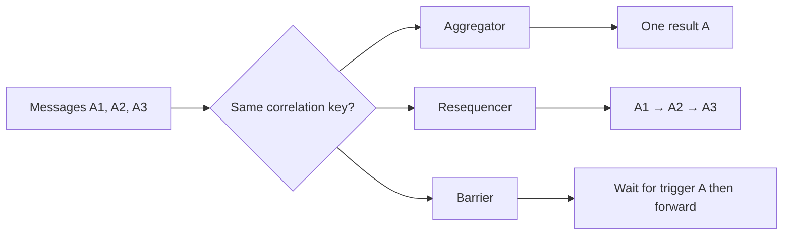
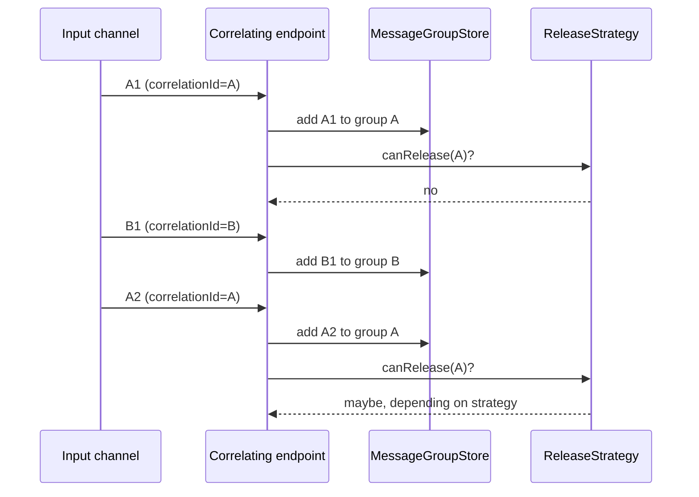
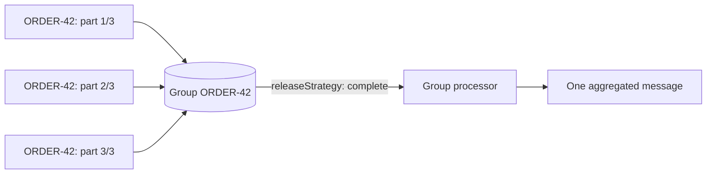
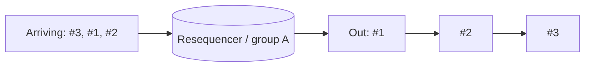
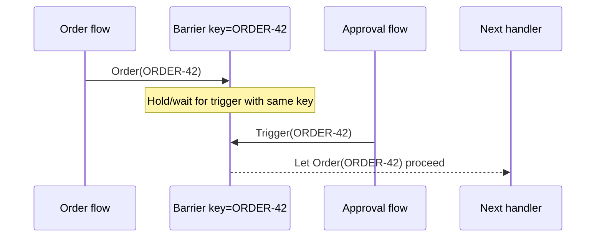
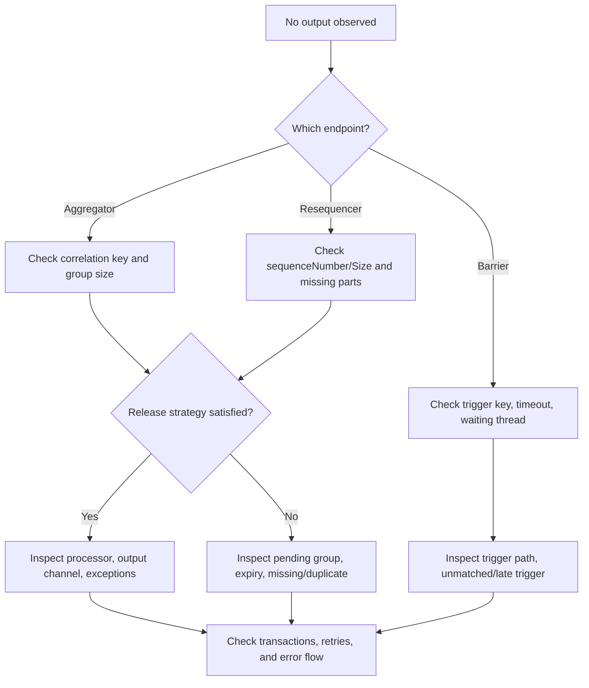

# Correlation in Aggregator, Resequencer, and Barrier

In the **Spring Integration runtime**, messages can arrive from various channels, consumers, pollers, and executors; arrival order does not necessarily match business order. When a task is split into multiple messages, the system needs to know **which messages belong to the same unit of work**, **whether all of them have arrived**, and **when processing is allowed to proceed**. The **correlation** mechanism provides the key that links messages together, though each endpoint uses that key differently.

This lesson belongs to the **Correlation runtime** chapter of the `SPRING_INTEGRATION_RUNTIME` module and dives into three easily confused components: the **aggregator**, which combines messages into a single result; the **resequencer**, which orders messages according to sequence order; and the **barrier**, which holds a processing flow until a corresponding release signal arrives. Beyond basic configuration, the lesson covers message group lifecycles, message stores, timeouts, duplicates, transactions, retries, threading, errors, and runtime diagnostic signals.

## 1. What is correlation and how does it differ from Message ID?

A message in Spring Integration consists of a payload and headers. `MessageHeaders.ID` identifies **a specific message**; a correlation key links **multiple messages belonging to the same group or processing session**.

Suppose order `ORDER-42` is split into three parts, each executed on a separate worker:

| Message | `id` | `correlationId` | `sequenceNumber` | `sequenceSize` |
| --- | --- | --- | --- | --- |
| Part A | `m-101` | `ORDER-42` | 1 | 3 |
| Part B | `m-102` | `ORDER-42` | 2 | 3 |
| Part C | `m-103` | `ORDER-42` | 3 | 3 |

*The values `m-101`, `m-102`, and `m-103` are illustrative identifiers only; actual Spring Messaging `id` headers typically use UUIDs.*

The three messages have different IDs but share the same `correlationId`. If another order `ORDER-43` also has three parts, messages from the two orders **must not be mixed into the same group**.

### 1.1. Headers to recognize

| Header / value | Meaning | Is it a runtime guarantee? |
| --- | --- | --- |
| `id` | Identifier of an individual message | Not a default business group key |
| `correlationId` | Key linking messages in the same group | Does not by itself guarantee ordering, durability, or system-wide uniqueness |
| `sequenceNumber` | Position of a message in a sequence, typically starting at 1 | Must be attached accurately and consistently to resequence |
| `sequenceSize` | Total expected parts in the sequence, when known in advance | If missing or wrong, the release condition may never be satisfied |
| `traceId` / business key | Used for tracing or business identification | May differ from the correlation key used by an endpoint |

In Spring Integration, standard correlation/sequence keys can be accessed via `IntegrationMessageHeaderAccessor.CORRELATION_ID`, `SEQUENCE_NUMBER`, and `SEQUENCE_SIZE`. With `@Header`, the key names are typically `"correlationId"`, `"sequenceNumber"`, and `"sequenceSize"`.

**Note:** Do not automatically treat `traceId`, `correlationId`, and `orderId` as three names for the same thing. A single trace may encompass multiple groups; a single order may require multiple separate aggregation phases. The correlation key must be chosen to match the **group boundary of each endpoint**.

## 2. Three components: same correlation, different behavior



| Component | How does it use correlation? | Typical output | Continuation condition |
| --- | --- | --- | --- |
| **Aggregator** | Collects messages with the same key into a `MessageGroup` | One result message from the group | `ReleaseStrategy` determines readiness |
| **Resequencer** | Partitions messages into separate sequences for reordering | Multiple messages, in sequence order | Sequence data and release strategy |
| **Barrier** | Matches a waiting message with a trigger sharing the same key | The waiting message is allowed to proceed | Matching trigger arrives or wait times out |

**Common confusion:** aggregator and resequencer can both use a message group store, but an aggregator **combines** messages into a single result whereas a resequencer mainly **orders and emits each message individually**. A barrier neither collects `N` parts nor sorts by sequence; it is a **signal-based synchronization** mechanism.

## 3. The message group model at runtime

For an aggregator/resequencer, each correlation key maps conceptually to a `MessageGroup` in `MessageGroupStore`:

```text
MessageGroupStore
  group "ORDER-42"
    message A1: sequenceNumber=1, sequenceSize=3
    message A3: sequenceNumber=3, sequenceSize=3
    status: waiting for A2

  group "ORDER-43"
    message B1: sequenceNumber=1, sequenceSize=2
    message B2: sequenceNumber=2, sequenceSize=2
    status: ready to release
```

A correlating endpoint typically involves these decisions:

1. **CorrelationStrategy**: computes the group key for each message.
2. **MessageGroupStore**: retains messages and group metadata across receives.
3. **ReleaseStrategy**: determines the condition under which the group emits its result.
4. **MessageGroupProcessor** (for aggregators): builds the output payload/message from the released group.
5. **Expiry / discard / completion policy**: decides what to do with incomplete groups, late-arriving messages, or completed groups.



This is a conceptual model. Storage mechanics, group locking, transactions, and when the release strategy is invoked depend on the Spring Integration version and endpoint configuration. Correlation **does not automatically create a transaction** across messages.

## 4. Aggregator: combining messages with the same key

An **aggregator** is used when a consolidated result is needed: three line items into one invoice, multiple service responses into one report, or multiple calculations into one outcome.



### 4.1. Default correlation and release

In a common `splitter → aggregator` flow, the splitter can generate child messages and attach `correlationId`, `sequenceNumber`, and `sequenceSize` (when sequence headers apply). The default aggregator typically uses the **correlation ID in the header** to select the group and **sequence size information** to know when the group is complete.

For example, a payload like `List.of("A", "B", "C")` is split by a splitter into three messages. If each message shares the same key and has `sequenceSize=3`, the aggregator can emit the result once all parts have arrived.

**Do not infer that every message automatically carries a correlation header.** If an external producer sends individual messages directly without setting the header or configuring a correlation strategy, the aggregator cannot guess which messages belong to the same group. Similarly, `sequenceSize` must reflect the truly expected part count; a wrong size can leave a group stuck forever or release it at the wrong time.

### 4.2. Java DSL example: split then aggregate

The example below illustrates a Java 17+ flow with `spring-integration-core` and `@EnableIntegration`. The producer sends a collection, the splitter divides the message, and the aggregator recombines them. The trailing `QueueChannel` allows checking the result via `receive()`.

```java
import java.util.List;
import org.springframework.beans.factory.annotation.Qualifier;
import org.springframework.context.annotation.Bean;
import org.springframework.context.annotation.Configuration;
import org.springframework.integration.annotation.EnableIntegration;
import org.springframework.integration.channel.DirectChannel;
import org.springframework.integration.channel.QueueChannel;
import org.springframework.integration.dsl.IntegrationFlow;
import org.springframework.messaging.Message;
import org.springframework.messaging.MessageChannel;
import org.springframework.messaging.PollableChannel;
import org.springframework.messaging.support.MessageBuilder;

@Configuration
@EnableIntegration
class BatchAggregationConfig {
    @Bean
    MessageChannel batchRequests() {
        return new DirectChannel();
    }

    @Bean
    QueueChannel batchResults() {
        return new QueueChannel();
    }

    @Bean
    IntegrationFlow batchAggregationFlow() {
        return IntegrationFlow.from("batchRequests")
                .split()
                .aggregate()
                .channel("batchResults")
                .get();
    }
}

// Example producer call after the Spring context starts:
void sendBatch(MessageChannel batchRequests, PollableChannel batchResults) {
    batchRequests.send(MessageBuilder
            .withPayload(List.of("item-A", "item-B", "item-C"))
            .build());

    Message<?> result = batchResults.receive(2_000);
    if (result == null) {
        throw new IllegalStateException("No aggregated result before timeout");
    }
    System.out.println(result.getPayload());
}
```

`sendBatch(...)` is an illustrative method invoked using injected beans (e.g., `@Qualifier("batchRequests")` and `@Qualifier("batchResults")`); it is not automatically invoked by Spring unless registered via a runner. In this flow, the splitter generates sequence headers under standard configuration; the default aggregator aggregates the part payloads. The exact output payload type should be verified by tests for the configured processor/version, rather than blindly casting to a DTO without checking.

### 4.3. Customizing correlation by business key

When receiving independent messages from multiple sources, you can choose a key other than the default `correlationId`, such as `batchId`:

```java
// Illustrates the Java DSL aggregator configuration inside an IntegrationFlow:
.aggregate(spec -> spec
        .correlationStrategy(
                message -> message.getHeaders().get("batchId"))
        .releaseStrategy(group -> group.size() >= 3))
```

This is a **DSL fragment**, not a standalone Java statement. If you use this approach, producers must set `batchId` consistently on every part of a batch, and the number `3` must match the business contract. In production applications, also handle `null`/missing keys, duplicates, invalid members, and batches with dynamic part counts.

A `ReleaseStrategy` that only checks `group.size() >= 3` **does not prove** that the three intended parts appeared: three messages with duplicated content or sequence numbers can satisfy the size check while holding incorrect data. When duplicates are possible, combine member keys, sequence validation, and idempotency before or during group aggregation.

## 5. When can an aggregator fail to complete?

Group `ORDER-42` expects three parts but only receives `1/3` and `3/3`. Without a timeout/expiry policy, the group can remain in the store and continue consuming memory/resources.

| Symptom | Common cause | What to inspect |
| --- | --- | --- |
| No output seen even though messages were sent | Not enough parts per release strategy | Check group size, expected sequenceSize |
| Two orders merged together | Correlation key is not specific enough | Log correlation key and business key |
| Group stays in store for a very long time | Missing message, unsuitable timeout or expiry policy | Monitor group age and pending group count |
| Output contains repeated items | Producer redelivery/duplicate, missing dedup | Inspect message IDs and member keys |
| Messages arriving after group completion are dropped/regrouped | Completed group retention/expiry and late-arrival policy | Check completion/expiry and discard configuration |

Spring Integration supports options such as `groupTimeout`, policies for emitting incomplete results upon expiry, discard channels, and message group cleanup mechanisms (such as `MessageGroupStoreReaper` where appropriate). **Timeout does not automatically mean “send partial group”.** Depending on configuration, the group may be dropped, routed to a discard flow, or emit a partial result. The business flow must explicitly define behavior for missing data.

### 5.1. Group lifecycle after release

After the aggregator emits a result, the store may retain completed group information for a period or delete the group depending on configuration. This affects **late-arriving messages** and **correlation key reuse**:

- If the same `batchId` is reused for a new run, messages may be treated as members of the old group or rejected depending on policy.
- If all trace of a completed group is deleted immediately, redelivered old messages may start a new group and emit duplicate results.
- If completed groups are retained forever, backlog growth can increase continuously.

Therefore, define the **lifecycle of the correlation key**: mint a fresh key per business batch, retain dedup markers long enough, and apply an appropriate expiry/reaper policy.

## 6. Resequencer: keeping messages separate while emitting in order

A **resequencer** solves the problem of messages in the same sequence arriving out of order—for example, network delays or multiple executors delivering `3/3` before `1/3`. It uses the correlation key to avoid mixing two sequences and `sequenceNumber` metadata to determine emission order.



Unlike an aggregator, a resequencer **does not aim to merge three payloads into one DTO**. It typically returns each input message in proper order; relevant headers may be preserved/propagated per endpoint rules.

### 6.1. Prerequisites for resequencing

1. Every message in the sequence has the **same correlation key**.
2. `sequenceNumber` is a valid number, starting from 1 in standard usage and consistent within the group.
3. `sequenceSize` or the end-of-sequence detection policy must be reliable.
4. The flow must define policies for **missing messages**, **late-arriving messages**, **duplicate sequence numbers**, and **timeouts**.
5. Downstream must have accurate ordering expectations: “emitted in order” does not automatically guarantee **business completion in order** if followed by a parallel `ExecutorChannel`.

### 6.2. Java DSL example: resequencing out-of-order messages

```java
import org.springframework.context.annotation.Bean;
import org.springframework.context.annotation.Configuration;
import org.springframework.integration.annotation.EnableIntegration;
import org.springframework.integration.channel.DirectChannel;
import org.springframework.integration.channel.QueueChannel;
import org.springframework.integration.dsl.IntegrationFlow;
import org.springframework.messaging.MessageChannel;
import org.springframework.messaging.PollableChannel;
import org.springframework.messaging.support.MessageBuilder;

@Configuration
@EnableIntegration
class ResequenceConfig {
    @Bean
    MessageChannel outOfOrder() {
        return new DirectChannel();
    }

    @Bean
    QueueChannel inSequence() {
        return new QueueChannel();
    }

    @Bean
    IntegrationFlow resequencingFlow() {
        return IntegrationFlow.from("outOfOrder")
                .resequence()
                .channel("inSequence")
                .get();
    }
}

// Illustrative producer: sends in order 3, 1, 2 with the same group key.
void sendOutOfOrder(MessageChannel outOfOrder, PollableChannel inSequence) {
    for (int seq : new int[]{3, 1, 2}) {
        outOfOrder.send(MessageBuilder.withPayload("part-" + seq)
                .setHeader("correlationId", "batch-9")
                .setHeader("sequenceNumber", seq)
                .setHeader("sequenceSize", 3)
                .build());
    }

    for (int i = 0; i < 3; i++) {
        var next = inSequence.receive(2_000);
        System.out.println(next == null ? "missing" : next.getPayload());
    }
}
```

When the sequence is complete and the release strategy allows, the **expected** output order is `part-1`, `part-2`, `part-3`. This example is independent of the aggregator flow above. Configuring partial-release/expiry policies can alter when outputs are emitted; therefore verify both ordering **and part count** rather than waiting for just a single message to appear.

Do not treat a resequencer as a “synchronization lock” for all subsequent handlers. When downstream processes asynchronously or uses multiple consumers, messages may **start in order** yet **finish out of order**. To guarantee commit/side-effect ordering, design serial processing or partitioning by business key.

## 7. Aggregator vs. resequencer: comparing storage and release

| Question | Aggregator | Resequencer |
| --- | --- | --- |
| Grouped by what? | Correlation key from header or strategy | Correlation key of the sequence |
| Relies on ordering? | Not necessarily; processor/strategy may require ordering | Yes, requires accurate sequence numbers |
| Waits how long? | Until release strategy is satisfied or timeout/expiry applies | Until emittable per policy and sequence data |
| How many output messages? | Usually one aggregated message per release | Usually multiple messages in sequence |
| Risk when parts are missing? | Never releases or emits incomplete partial result | Stuck waiting for missing number, potentially stalling the sequence |
| Needs a message store? | Yes, to hold groups across processing turns | May need to hold messages not yet ready to emit |
| Preserves downstream order? | Depends on processor and subsequent channel | Not guaranteed across a parallel processing boundary |

The “same group key” model does not mean two endpoints automatically share the same group. Each endpoint can have its own store/region and lifecycle. If sharing one physical store, configure appropriate namespace/region isolation so aggregator groups do not collide with resequencer groups.

## 8. Barrier: correlation for waiting and releasing

A **barrier** differs from the two components above: an in-flight message must **wait for a corresponding signal**, for example:

- An order has been created but needs approval before warehouse dispatch.
- An operation has sent a request to an external system and is awaiting a confirmation callback.
- A workflow reaches a step that must wait for an external event before continuing.

In Spring Integration, the barrier endpoint is represented by `BarrierMessageHandler`. This component pairs a **waiting message** with a **trigger message** having a matching correlation key. It supports a timeout, and in synchronous designs care is needed because the processing flow may block while waiting.



### 8.1. Two message types in a barrier scenario

| Message | Purpose | Key to match |
| --- | --- | --- |
| **Waiting message** | The business message paused before the next step | For example `orderId=ORDER-42` |
| **Trigger message** | Signals that the condition to release is met | Also `orderId=ORDER-42` |

Trigger `ORDER-43` must never open the barrier for `ORDER-42`. The correlation strategy must compute the **same kind of key** for both the waiting message and the trigger; merely sharing the same `traceId` is insufficient if the strategy actually extracts `orderId`.

### 8.2. Connecting the trigger conceptually

With a configured barrier named `approvalBarrier`, the integration logic can be sketched as:

```text
ordersWaitingForApproval
  -> approvalBarrier.handleMessage(orderMessage)
     (waits for trigger / until timeout)
  -> approvedOrders

approvalEvents
  -> triggerAdapter
  -> approvalBarrier.trigger(approvalMessage)
```

This is an **API diagram**, not a complete Spring configuration. When implementing, create the `BarrierMessageHandler`, choose a correlation strategy, register the endpoint for the primary message, and route the trigger to the trigger method according to the API/version in use. Do not simply send the trigger into the same input channel as the waiting message and expect the framework to recognize it as a trigger automatically.

**Important:** a barrier is not a two-message aggregator emitting a paired payload. The trigger is an **unlock condition**, not automatically a member added to a `MessageGroup` like an aggregator.

### 8.3. Timeouts and the cost of holding threads

When a barrier waits on a processing thread, several consequences must be considered:

- With `DirectChannel`, the producer call may block until the trigger arrives or the timeout expires.
- If the trigger needs to be produced **on the very thread that is waiting**, the application risks deadlock; ensure the trigger flow has an independent execution path.
- If many requests wait inside a small executor pool, threads can be exhausted even while CPU usage is low.
- Define timeout/exception/discard behavior per the barrier configuration and handle late-arriving triggers.
- A waiting thread **is not durable workflow state across restarts**. If waiting spans hours/days or must survive crashes, a state machine/workflow or persistent store is usually preferable to holding a thread.

Whether a trigger arriving before the waiting message, repeated triggers, or triggers after timeout work as expected must be **tested against the specific implementation and configuration**. Do not assume an early signal is remembered indefinitely or automatically opens a subsequent wait on the barrier.

## 9. Choosing the right correlation key for each mechanism

Suppose a system has the following identifiers:

```text
traceId     = trace-993
orderId     = ORDER-42
shipmentId  = SHIPMENT-42-1
batchId     = PICK-BATCH-2026-11-22-01
```

You can choose:

- Aggregator collecting warehouse responses for **one shipment**: use `shipmentId`.
- Resequencer ordering progress updates of **one picking batch**: use `batchId` combined with `sequenceNumber`.
- Barrier waiting for shipment approval of **one order**: use `orderId` if that is the approved scope.
- Cross-system logging/tracing: keep `traceId` separate; do not automatically substitute it for the group key.

| Key selection criterion | Why is it needed? |
| --- | --- |
| Stable across retries/redeliveries | The same unit of work is not split into multiple groups on error |
| Sufficiently specific | Prevents mixing two different orders/runs |
| Consistent value type | `"42"` (String) is not automatically equal to `42` (Integer) |
| Clear lifecycle | Prevents reusing an old key before the completed group is cleaned up |
| Storable/serializable if using a persistent store | Enables recovering message groups after restart |
| Free of unnecessary sensitive data | Avoids leaking tokens/PII through logs/metrics |

If a key is missing or `null`, treat it as a validation error to be handled intentionally rather than silently funneling all keyless messages into a single “null” group. For untrusted input, validating headers before the correlating endpoint is a safe choice.

## 10. Duplicates, late arrivals, and out-of-order messages

A correlation key solves **grouping**; it does not by itself solve **exactly-once** or **completion ordering**.

### 10.1. Duplicates with the same correlation ID

Suppose a producer sends `part-2` twice due to a timeout:

```text
Group ORDER-42:
  part-1
  part-2 (first delivery)
  part-2 (redelivery)
  part-3
```

If the release strategy only counts size and lacks per-member deduplication, the group may release while data is still missing or produce incorrect output. Choose a stable **member key** (e.g., `orderId + lineId` or `batchId + sequenceNumber`), check for duplicates, and decide explicitly whether to ignore, record, or throw an error.

### 10.2. Messages arriving after group completion

Late-arriving messages may encounter an already released group, an expired group, or a reused key:

- An aggregator needs a late-arrival strategy aligned with its completed-groups policy.
- A resequencer must decide whether to still accept old `sequenceNumber` values and avoid duplicate emission.
- A barrier must determine whether an overdue trigger is still valid and whether the waiting state still exists.

In every case, inspect **business key**, `correlationId`, member/sequence ID, and group/trigger state. A new message ID does not prove that the business event is new.

### 10.3. No exactly-once guarantee from MessageGroupStore alone

A JDBC/Redis/Mongo message group store keeps state outside RAM, but does not automatically guarantee an atomic commit across:

1. Receiving a message from a broker;
2. Storing the message in the group;
3. Releasing output;
4. Sending output to another broker;
5. Persisting business updates.

If the process crashes between steps, messages may be redelivered or output emitted again. Transaction boundaries, idempotency, deduplication, and sometimes outbox/inbox patterns are required according to consistency needs.

## 11. MessageStore and group lifecycle

By default, correlating endpoints typically use an **in-memory message group store** if no persistent store is configured. This is simple for learning but has consequences:

- Waiting groups can be lost when the application restarts.
- Multiple instances do not automatically share group state.
- Incomplete groups consume memory until released/expired/cleaned up.
- Messages landing on different instances can split into incomplete local groups.

When durability is required, use an appropriate `MessageGroupStore`, such as `JdbcMessageStore`; **this differs from** `JdbcChannelMessageStore`, which is typically used for queue channels. Configuring persistence requires checking schemas, serializers, transaction managers, and upgrade compatibility.

| Storage strategy | Advantages | What to monitor |
| --- | --- | --- |
| In-memory group store | Minimal dependencies, low latency | Memory usage, state loss on restart |
| JDBC message group store | Can persist groups in DB and share state when properly configured | Lock contention, transactions, cleanup, slow queries |
| Suitable distributed store | Can support multiple nodes | Serialization, consistency, TTL, network latency |

Merely sharing a database does not guarantee that two endpoints maintain valid group state. Each aggregator/resequencer needs a clear **store/region identifier or group scope** to prevent correlation keys from colliding across flows.

### 11.1. Group expiry does not mean business completion

A group expiring because members are missing **does not mean the business operation succeeded**. Define one of these terminal states:

- `COMPLETED`: complete data received and valid result emitted.
- `PARTIAL`: emit incomplete result only when the business allows it, with a clear status flag.
- `TIMED_OUT`: write an error record awaiting intervention.
- `DISCARDED`: intentionally dropped per policy, with auditing.

If emitting a partial result, downstream must recognize it is incomplete rather than mistaking a 2/3 set for a full set. If discarding the group, determine whether DLQ/quarantine or re-fetching the missing parts is required.

## 12. Threading, pollers, and executors

Correlation mechanisms are easily misjudged by looking at when `send()` returns rather than at group and worker state.

| Context | Runtime characteristics | Risk |
| --- | --- | --- |
| `DirectChannel` + aggregator | May run on sender thread; group waits in store | Producer finishes sending yet sees no output because parts are incomplete |
| `QueueChannel` + polling endpoint | Poller pulls messages on schedule, slowly or in batches | Backlog before the group increases completion latency |
| `ExecutorChannel` before resequencer | Messages reach endpoint in nondeterministic order | Requires accurate sequence headers |
| `ExecutorChannel` after resequencer | Output is emitted in order at the boundary, downstream runs concurrently | Completion order is no longer guaranteed |
| Barrier on a bounded pool | A worker may be held waiting for a trigger | Starvation, timeouts, and difficulty shutting down the service |

A correlation strategy does not lock a `business key` system-wide. Even when `MessageGroupStore` synchronizes at the group level, operations outside the store (database updates, HTTP requests) still need transactions/idempotency and appropriate concurrency limits.

With multiple pollers/executors, separate **message sequence** from **side-effect commit order**. A downstream handler that takes longer on `part-1` than on `part-2` can still finish later even if inputs were properly resequenced.

## 13. Retries, transactions, and error channels

### 13.1. Retries within a group

If an aggregator currently holds `part-1` and `part-2`, retrying `part-2` must not turn one business part into two distinct members. Retry advice can re-invoke the handler multiple times; source redelivery can also generate a new message ID. Use a member key/idempotency check to distinguish a retry from a new element.

If saving to the group participates in a transaction that rolls back, the message may need source redelivery to retry; this depends on the broker, message store, poller transaction, and advice order. Do not assume retry always re-reads from a `QueueChannel`.

### 13.2. Errors in release strategy or output processor

An exception can occur during:

1. Computing the correlation key (missing header, wrong type);
2. Writing to `MessageGroupStore` (DB error, serialization error);
3. Evaluating the release strategy;
4. Aggregating payloads;
5. Sending the result message to the output channel.

Failures at each step have different consequences. If the group has already been marked completed or output was sent before the transaction failed, retrying can cause duplicate output. Check transaction boundaries and idempotency on both **input and output**.

### 13.3. ErrorMessage and group state

An error channel can receive an `ErrorMessage` when an exception is published by the framework per context; for synchronous flows via `DirectChannel`, the exception may also propagate straight back to the caller. Logging an `ErrorMessage` **does not delete the group**, **does not automatically retry**, and **does not guarantee rollback** of the message store.

When a group times out or a barrier expires, design clear error-reporting and recovery paths: which messages need replay, which group keys are affected, what state remains in the store, and how late triggers may arrive.

## 14. Diagnosing a group that emits no output

When no data comes out of an aggregator/resequencer or a barrier fails to open, investigate starting from the **exact key**:



### 14.1. Signals to observe

| Signal | Helpful for answering |
| --- | --- |
| `correlationId` + business key | Does the message belong to the right group? |
| `messageId` and member key | Are there duplicates or redeliveries? |
| `sequenceNumber` / `sequenceSize` | Are parts missing or sequence numbers invalid? |
| Group size, age, completed status | Is the group full, waiting too long, or already expired? |
| Store size / pending group count | Is there a group leak or backlog? |
| Release/expiry/discard counts | Why is no output appearing? |
| Thread name, queue depth, poller delay | Has the message reached the correlating endpoint? |
| Trigger received / timeout / wait duration | Was the barrier opened with the right key? |
| Output message ID and correlation | Was the result built and dispatched? |

Avoid logging full payloads or sensitive headers; use minimal IDs and error codes. With distributed stores, group counts or status queries on dashboards may lag; combine metrics with endpoint and store logs when needed.

## 15. Hands-on exercises

### Exercise 1 — Two interleaved groups

Create two batches `A` and `B`, each with three messages. Send in order `A1, B1, A3, B2, A2, B3`. Verify the aggregator produces **two** outputs without mixing payloads. Change the correlation key of `B2` to `A` to observe the grouping bug and explain why valid sequence metadata cannot rescue a wrong key.

### Exercise 2 — A missing part

With `A` expecting three parts, send only `A1` and `A3`. Observe the pending group count; configure timeout/expiry and pick **one** explicit policy: raise an error, discard with audit, or emit a status-marked partial result. Explain why a timeout does not automatically mean completion.

### Exercise 3 — Resequence before and after an executor

Send three parts of a batch in order `3, 1, 2`. Confirm the resequencer emits `1, 2, 3`; then place an `ExecutorChannel` with handlers of varying latency **after the resequencer**. Record start and completion order to prove that output ordering at one boundary does not guarantee downstream commit order.

### Exercise 4 — Duplicates and redelivery

Send the same `part A2` twice with different message IDs but the same business member key. Test the aggregator's group release and pinpoint where deduplication is needed. When using a broker with redelivery, distinguish the number of deliveries from the source from the actual number of business parts.

### Exercise 5 — Barrier with matching key, mismatched key, and timeout

Create two messages requiring approval: `ORDER-42` and `ORDER-43`. Send the trigger for `ORDER-43` first, verify it does not release `ORDER-42`; then send the trigger with the matching key. Test a trigger arriving after timeout and inspect the state. In implementation, ensure the trigger has an independent thread path to prevent deadlocks.

### Exercise 6 — Crashes and group state

Compare an in-memory group store against a persistent `MessageGroupStore`. Send half a batch, restart, then send the remaining part. Monitor release behavior and remaining messages in the store. Add retries/redelivery to verify idempotency and completed-group policy.

## 16. Common design mistakes

| Mistake | Consequence | How to fix |
| --- | --- | --- |
| Using `MessageHeaders.ID` instead of a shared correlation key | Every message forms its own group | Use a consistent business key/correlation ID |
| Setting only `correlationId` while omitting sequence headers for resequencer | Insufficient data to reorder | Attach reliable sequence numbers and sequence size |
| Counting `group.size()` without duplicate checks | Premature release or wrong result emitted | Use member keys, dedup, and validation |
| Designing no expiry for incomplete groups | Memory/store leak, stalled output | Group timeout, cleanup, and recovery policy |
| Assuming aggregator and resequencer produce the same output shape | Downstream receives wrong type or wrong message count | Define each endpoint's output contract |
| Assuming barrier remembers early triggers or survives restarts | Lost signals / waiting forever | Test races, timeouts, and use a durable workflow if needed |
| Waiting for triggers in a small pool that triggers also use | Worker starvation/deadlock | Separate the trigger execution path |
| Using the same correlation key across flows without store/region isolation | Group collisions | Configure separate scopes/regions |
| Measuring emission order at resequencer and assuming downstream commit order | Side effects can become out of order | Use serial/partitioned processing when required |
| Believing a durable store alone guarantees exactly-once | Duplicate output after crash/retry | Idempotency, transaction/outbox, and failure testing |

## 17. Self-check questions

1. **What does an aggregator use correlation for?** To group messages belonging to the same `MessageGroup` and release a combined result when its strategy allows.
2. **How does a resequencer differ from an aggregator in output?** It orders and emits messages by sequence rather than necessarily combining them into a single payload.
3. **What releases a barrier?** A trigger matching the correlation key, per the configured mechanism and timeout.
4. **Does `correlationId` replace `sequenceNumber`?** No. The group key and position within the group are two distinct pieces of information.
5. **Does an incomplete group automatically complete on timeout?** You cannot assume that; it depends on timeout, expiry, and release/discard policies.
6. **Does a resequencer guarantee parallel downstream handlers commit in order?** No.
7. **Does an in-memory message group store preserve groups across restarts?** No.
8. **Can `traceId` replace the correlation key for every endpoint?** Only when the trace truly aligns with the exact group scope; usually a separate business/group key is needed.
9. **Why can redelivery break an aggregator?** Duplicates can inflate member counts or cause duplicate outputs if dedup/completion policies are missing.
10. **What should you check first when diagnosing a barrier that won't open?** The correlation keys of the waiting message and trigger, the trigger path, the timeout, and the waiting thread.

## 18. Summary

**Correlation is how endpoints relate messages, not a delivery guarantee.** An aggregator uses the key to **combine**, a resequencer uses the key and sequence to **order**, and a barrier uses the key to **match a trigger and release a waiting flow**. For reliable runtime behavior, choose properly scoped keys, validate sequences/duplicates, manage group lifecycles and timeouts, understand thread/transaction boundaries, and observe message stores, error flows, retries, and idempotency.

When expected output fails to appear, do not stop at checking “did `send()` succeed?”. Ask next: **did the message reach the endpoint, which group is it in, what is still missing, is the release condition met, did a trigger with the right key arrive, and how did transactions/error flows affect state?** That is the core workflow for diagnosing correlation in the Spring Integration runtime.
