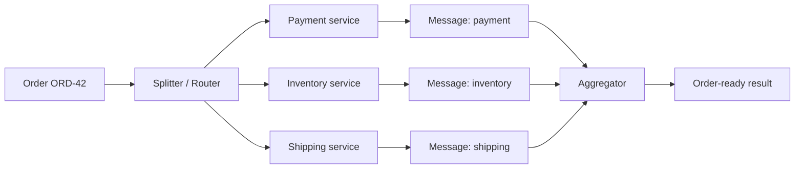
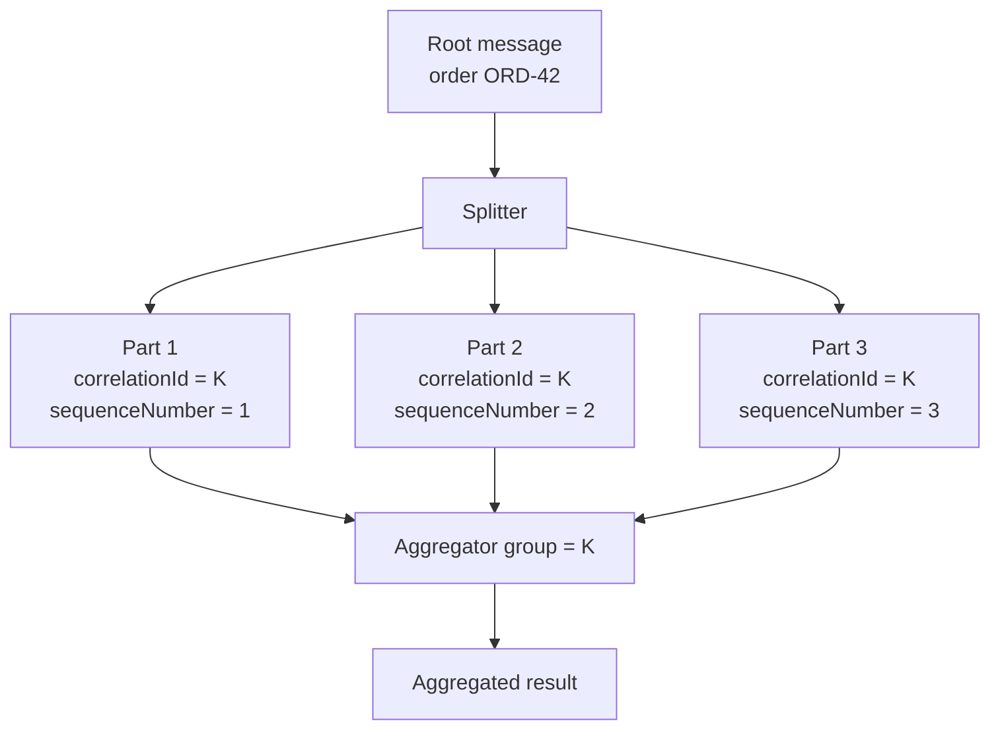

# Correlation ID Headers and Expressions in Spring Integration

## Learning Objectives

A message may pass through multiple channels, transformers, routers, executors, pollers, and handlers before producing a final outcome. When a request is split into multiple branches, the system must answer the question: **which messages belong to the same request or the same business group?** Spring Integration uses *correlation* metadata and correlation key strategies to answer this question.

This lesson, **Correlation ID Headers and Expressions**, belongs to the **Correlation runtime** chapter of the **SPRING_INTEGRATION_RUNTIME** module. Its focus is distinguishing the `correlationId` header from message IDs, understanding how expressions (typically SpEL) select keys, and observing the consequences of misconfigured keys when flows use splitters, aggregators, message stores, retries, error handling, transactions, and executors.

After this lesson, you will be able to:

- Read and set the `correlationId` header on a `Message`, distinguishing it from `id`, `sequenceNumber`, `sequenceSize`, business keys, and trace IDs.
- Write expressions that extract correlation keys from `headers` or `payload`; understand that **computing a key** and **setting a header** are two different actions.
- Use Java DSL to enrich headers or supply a `CorrelationStrategy` to an aggregator.
- Explain how splitter/aggregator components group messages, when a group ID collides, and why message count alone may not suffice to release.
- Preserve correlation across transformers, executors, pollers, retries, and error flows; diagnose misplaced messages, stuck groups, or mixed results across requests.
- Design test scenarios involving multiple tenants, multiple threads, duplicate messages, and late-arriving messages.

## 1. What problem does correlation solve at runtime?

Suppose an order `ORD-42` requires three parallel outcomes: payment confirmed, inventory reserved, and shipping quoted. Each branch has its own message, potentially arriving from different endpoints and threads:



The aggregator must know that the `payment`, `inventory`, and `shipping` messages of `ORD-42` are allowed to be combined together, while **never merging** with a message from `ORD-43`. That is the job of the correlation key. If the chosen key is too broad, results from different orders can be mixed; if the key is too narrow or unstable, parts of the same order are split into separate groups and wait forever.

A message might carry headers such as:

```text
payload:
  kind          = "PAYMENT_CONFIRMED"
  orderId       = "ORD-42"

headers:
  id            = UUID specific to the PAYMENT_CONFIRMED message
  correlationId = "tenant-a:ORD-42"
  sequenceNumber = 1
  sequenceSize   = 3
  businessKey    = "ORD-42"
```

These fields are not synonymous. `correlationId` serves to connect messages within a scope defined by the flow/application, whereas the message ID identifies each individual message.

## 2. Easily confused identifiers

| Field or concept | Who creates or manages it? | What is it used for? | Must it stay identical when creating a new message? |
| --- | --- | --- | --- |
| `MessageHeaders.ID` (`id`) | Typically generated by Spring Messaging per message instance | Identifying a specific message, lookup by UUID in a `MessageStore` | No; a new message typically gets a new ID |
| `IntegrationMessageHeaderAccessor.CORRELATION_ID` (`correlationId`) | Splitter/integration component or application, depending on the flow | Linking messages of the same process/group | Yes when required by contract, though this must be actively verified |
| `sequenceNumber` | Typically generated by a sequence-producing component like a splitter | Position of an element within a sequence/group | Preserved when release/grouping relies on it |
| `sequenceSize` | Typically generated by a sequence-producing component | Expected number of elements in the group, when known | Not synonymous with the number of messages received so far |
| `businessKey`, `orderId` | Application | Business identification, idempotency, lookup | Typically needed across the business lifecycle |
| `traceId` / `spanId` | Tracing/observability | Linking logs, spans, and distributed requests | Follows trace propagation mechanisms; does not replace correlation strategy |
| `MessageGroupStore` group ID | Endpoint's correlation strategy | Key storing a message group in the store | May equal the `correlationId` header or come from another expression |

**Key point:** Spring Integration defines a standard header named `correlationId`, yet **the presence of a header does not automatically create a group**. Only when a component (such as an aggregator) reads this header or uses a matching `CorrelationStrategy` does it become the group key during processing.

Conversely, an aggregator can compute the group ID directly from `payload.orderId` **without needing to add** a `correlationId` header to the message beforehand. When investigating bugs, distinguish “what headers does the message carry?” from “which key does the endpoint actually select?”.

### 2.1. A correlation ID is not necessarily a UUID

A correlation value can be a `String`, `UUID`, number, or an object used as a group key, depending on the producer and component. Therefore:

```text
UUID("...")             differs from String("...")
String("42")            differs from Integer(42)
"tenant-a:ORD-42"       differs from "tenant-b:ORD-42"
```

Two values that look identical in logs are not guaranteed to be equal when compared with `equals()`. If one branch sends a `UUID` while another sends a string representation of that UUID, the aggregator may create two separate groups. Defining a **fixed key type and format** is part of the message contract.

### 2.2. Correlation ID and trace ID

`correlationId` typically represents a business message group or an aggregation round. A trace ID represents an observability chain in distributed tracing. One trace may contain multiple orders, and one order may span multiple traces across retries/replays. Do not use a trace ID as a business key unless the contract truly guarantees that relationship.

## 3. Reading and setting the correlationId header on a Message

Spring Integration defines the header name via `IntegrationMessageHeaderAccessor.CORRELATION_ID`. You can use this constant to avoid mistyping the string `"correlationId"`.

Example creating two independent messages with the same correlation ID:

```java
import org.springframework.integration.IntegrationMessageHeaderAccessor;
import org.springframework.messaging.Message;
import org.springframework.messaging.support.MessageBuilder;

Message<String> payment = MessageBuilder
        .withPayload("PAYMENT_CONFIRMED")
        .setHeader(IntegrationMessageHeaderAccessor.CORRELATION_ID,
                "tenant-a:ORD-42")
        .setHeader("businessKey", "ORD-42")
        .build();

Message<String> inventory = MessageBuilder
        .withPayload("INVENTORY_RESERVED")
        .setHeader(IntegrationMessageHeaderAccessor.CORRELATION_ID,
                "tenant-a:ORD-42")
        .setHeader("businessKey", "ORD-42")
        .build();

Object paymentCorrelation =
        payment.getHeaders().get(IntegrationMessageHeaderAccessor.CORRELATION_ID);
Object inventoryCorrelation =
        inventory.getHeaders().get(IntegrationMessageHeaderAccessor.CORRELATION_ID);

System.out.println(paymentCorrelation.equals(inventoryCorrelation)); // true
System.out.println(payment.getHeaders().getId()
        .equals(inventory.getHeaders().getId()));                  // false
```

Two messages with the same correlation key can be grouped **if** they enter the same endpoint/grouping policy; they still retain distinct message IDs. In practice, do not rely on UUID collision probability to build business invariants; what needs testing is that messages receive distinct IDs and correlation is preserved according to the contract.

### 3.1. Preserving headers when constructing a new payload

Transformers or handlers often build a new message after transforming data. Propagate correlation explicitly whenever that is the application's responsibility:

```java
import org.springframework.integration.IntegrationMessageHeaderAccessor;
import org.springframework.messaging.Message;
import org.springframework.messaging.support.MessageBuilder;

record InventoryResult(String orderId, boolean reserved) {}

Message<InventoryResult> toResult(Message<String> input) {
    Object key = input.getHeaders()
            .get(IntegrationMessageHeaderAccessor.CORRELATION_ID);

    if (key == null) {
        throw new IllegalArgumentException("Missing correlationId");
    }

    return MessageBuilder
            .withPayload(new InventoryResult("ORD-42", true))
            .setHeader(IntegrationMessageHeaderAccessor.CORRELATION_ID, key)
            .setHeader("businessKey", input.getHeaders().get("businessKey"))
            .build();
}
```

When you return only a payload from a Spring Integration transformer, the framework generally follows a policy of copying headers from the input message to the output message. However, if you build `Message<?>` manually, apply interceptors that mutate headers, pass through external adapters, or use message converters, **verify which headers actually survive**. Do not rely on an assumption that every channel/adapter automatically preserves correlation.

A `MessageHeaders` instance cannot be mutated directly via its API, though a new message can have a different set of headers. Use `MessageBuilder` or a header enricher instead of attempting to call `put()` on `getHeaders()`.

### 3.2. When should the correlation ID be set?

Two moments are commonly used:

1. **At the request ingress boundary:** set a durable key such as `tenantId:orderId`, so all subsequent processing branches reference the same identifier.
2. **At the grouping boundary:** a splitter or aggregator can assign/compute correlation from the parent message, request ID, or a dedicated expression. This suits message groups with a local lifecycle.

When set in both places, define **precedence and override policy**. A splitter may attach correlation/sequence headers for the group it generates; do not assume the producer's original correlation value always remains unchanged after every splitter.

## 4. What is a correlation key expression?

Spring Integration supports **Spring Expression Language (SpEL)** across many endpoints and strategies. For correlation, an expression is typically evaluated against a message to return a **stable, comparable key**. Common expressions include:

| Expression | Meaning | Precondition |
| --- | --- | --- |
| `headers['correlationId']` | Read the standard correlation header | Header has a value |
| `headers['businessKey']` | Group by a business header | Header is attached and kept stable |
| `payload['orderId']` | Read order ID from a `Map` payload | Payload is a Map containing key `orderId` |
| `payload.orderId` | Read JavaBean property `orderId` | Payload exposes a getter/property accessible to SpEL |
| `headers['tenantId'] + ':' + headers['orderId']` | Build a composite tenant + order key | Both fields exist with consistent types/formats |
| `headers['correlationId'] ?: headers['businessKey']` | Use correlation if present, fall back to business key | Must handle the case where both are missing |

In the expression examples above, the root object is set to `Message` per the context of the **correlation strategy / header enricher being used**. Do not copy an expression to a different component without checking that component's root object and evaluation context; some places evaluate expressions against `MessageGroup` or payload instead of `Message`.

### 4.1. Computing a key differs from setting a header

These two configurations do not have the same effect:

- **Correlation strategy:** evaluates `headers['correlationId']` or `payload['orderId']`, then uses the returned value as the aggregator's **group ID**. It does not necessarily rewrite message headers.
- **Header enricher:** evaluates an expression on the message to **set a header** on the output message. It does not by itself create a group in `MessageGroupStore`.

For example, given a message with `payload.orderId=ORD-42` and no correlation header:

```text
Strategy expression: payload.orderId
    -> group ID = "ORD-42" when the aggregator receives the message
    -> the original message may still lack a correlationId header

Header enricher expression: payload.orderId
    -> the new message gets header correlationId = "ORD-42"
    -> still requires an aggregator/correlation strategy that uses that header
```

This is the core distinction of **Correlation ID headers and expressions**: an expression can either **extract a key** or **produce metadata**, depending on which component it is attached to.

## 5. Header Enricher: generating correlationId from an expression

In a flow receiving messages with a `Map` payload, we want every message sharing the same tenant and order to receive a stable correlation key.

```java
import org.springframework.context.annotation.Bean;
import org.springframework.context.annotation.Configuration;
import org.springframework.integration.IntegrationMessageHeaderAccessor;
import org.springframework.integration.channel.DirectChannel;
import org.springframework.integration.config.EnableIntegration;
import org.springframework.integration.dsl.IntegrationFlow;
import org.springframework.messaging.Message;
import org.springframework.messaging.MessageChannel;
import org.springframework.messaging.MessageHandler;

@Configuration
@EnableIntegration
class CorrelationFlowConfig {

    @Bean("ordersInput")
    MessageChannel ordersInput() {
        return new DirectChannel();
    }

    @Bean
    IntegrationFlow enrichCorrelationFlow() {
        MessageHandler sink = message -> {
            Object key = message.getHeaders()
                    .get(IntegrationMessageHeaderAccessor.CORRELATION_ID);
            System.out.println("Correlation=" + key
                    + ", thread=" + Thread.currentThread().getName());
        };

        return IntegrationFlow.from("ordersInput")
                .enrichHeaders(headers -> headers.headerExpression(
                        IntegrationMessageHeaderAccessor.CORRELATION_ID,
                        "payload['tenantId'] + ':' + payload['orderId']"))
                .handle(sink)
                .get();
    }
}
```

A producer can send:

```java
import java.util.Map;
import org.springframework.messaging.Message;
import org.springframework.messaging.MessageChannel;
import org.springframework.messaging.support.MessageBuilder;

// ordersInput is injected from the Spring context.
Message<Map<String, String>> incoming = MessageBuilder
        .withPayload(Map.of(
                "tenantId", "tenant-a",
                "orderId", "ORD-42",
                "event", "PAYMENT_CONFIRMED"))
        .build();

ordersInput.send(incoming);
```

When the expression executes successfully, the `correlationId` header is evaluated to `"tenant-a:ORD-42"`. Because the input in this example does not yet have this header, no overwrite conflict occurs. In production, specify explicitly whether the header enricher may overwrite an existing `correlationId` header; configure override behavior accordingly and test it in practice.

**What to verify:** `payload['tenantId']` and `payload['orderId']` must exist and return the expected string types. If a field is missing, the expression may produce an invalid key or throw an exception depending on data/configuration. Validate input before enriching, normalize tenant ID/order ID, and forbid empty keys.

### 5.1. Why is a composite tenant + order key safer?

If only `orderId="42"` is used, two tenants may create the same order ID. An aggregator using key `42` could accidentally combine data across tenant A and tenant B, leading to business errors and data-isolation risks. Using an appropriate namespace such as `tenant-a:42` ensures groups from two different scopes remain separated.

Keys should be stable and clearly structured. If fields can contain the delimiter `:`, use length-prefixed encoding, a canonical format, or a key object with proper `equals/hashCode` instead of arbitrary string concatenation. All producers must agree on casing, Unicode normalization, and data types.

## 6. CorrelationStrategy and how an aggregator picks a group ID

When a message arrives at an aggregator, a `CorrelationStrategy` determines the **group ID**. Spring Integration provides header-based and expression-based strategies. Example with `ExpressionEvaluatingCorrelationStrategy`:

```java
import org.springframework.integration.aggregator.CorrelationStrategy;
import org.springframework.integration.aggregator.ExpressionEvaluatingCorrelationStrategy;
import org.springframework.messaging.Message;

CorrelationStrategy strategy =
        new ExpressionEvaluatingCorrelationStrategy(
                "headers['correlationId']");

Object groupKey = strategy.getCorrelationKey(incomingMessage);
System.out.println("groupId=" + groupKey);
```

This is an illustrative snippet for an `incomingMessage` already constructed in the flow. The strategy **reads the message to return a key**; there is no `setHeader` operation here.

### 6.1. Using the strategy in an IntegrationFlow

Example configuring an aggregator that receives event parts belonging to the same order and releases when three messages are present:

```java
import org.springframework.context.annotation.Bean;
import org.springframework.integration.aggregator.ExpressionEvaluatingCorrelationStrategy;
import org.springframework.integration.dsl.IntegrationFlow;
import org.springframework.messaging.Message;
import org.springframework.messaging.MessageHandler;

@Bean
IntegrationFlow groupOrderPartsFlow() {
    MessageHandler sink = message -> {
        System.out.println("Aggregated payload=" + message.getPayload());
    };

    return IntegrationFlow.from("orderParts")
            .aggregate(spec -> spec
                    .correlationStrategy(
                            new ExpressionEvaluatingCorrelationStrategy(
                                    "headers['correlationId']"))
                    .releaseStrategy(group -> group.size() >= 3))
            .handle(sink)
            .get();
}
```

The example's `group.size() >= 3` **only illustrates a release strategy** when every order is guaranteed to have exactly three valid parts. In real systems, a duplicated message can cause the group to reach size 3 while an event type is still missing. You need a release strategy that checks **all required result types** and manages duplicates/late arrivals and timeouts. If a splitter produces parts with `sequenceSize`, you can apply the corresponding sequence-based release strategy, though you still need to know whether the source guarantees a complete sequence.

If parts entering an aggregator already carry an appropriate `correlationId` header, you can also use that component's default header-based correlation strategy. Explicitly configuring an expression is useful when switching to `businessKey`, a composite tenant/order key, or a custom rule—not to magically make messages “have correlation”.

### 6.2. Message groups and keys

```text
Aggregator / CorrelationStrategy
             |
             v
getCorrelationKey(message) -> "tenant-a:ORD-42"
             |
             v
MessageGroupStore[groupId="tenant-a:ORD-42"]
             ├── Message<PaymentConfirmed>    id=UUID-A
             ├── Message<InventoryReserved>   id=UUID-B
             └── Message<ShippingQuoted>      id=UUID-C
             |
             v
ReleaseStrategy -> aggregate / publish output
```

A `MessageGroupStore` manages groups by `groupId`. Conversely, `MessageStore.getMessage(UUID)` looks up an individual message by message ID. You cannot pass a string `groupId` into `MessageStore.getMessage(UUID)` and expect it to return the whole group.

**Critical rule:** the group ID must maintain the same type and value across every message intended to be combined together. If `correlationId` changes inside a transformer or each branch generates a new UUID as its correlation, the group will split apart.

## 7. Splitter, sequence headers, and branch correlation

A splitter receives an input message and emits multiple parts. Many Spring Integration splitter configurations can attach sequence metadata including `correlationId`, `sequenceNumber`, and `sequenceSize` to support reassembly.



In a sequence-aware splitter, `K` is typically related to the root message identifier or a correlation context established by the splitter. **Do not automatically equate K with `orderId` from the payload**. If the flow needs to group by a business key, configure an explicit correlation strategy on the aggregator or attach a dedicated business header with stable rules.

| Header | Meaning within a sequence | Misconception to avoid |
| --- | --- | --- |
| `correlationId` | Group identifier of the parts | Not necessarily the order ID |
| `sequenceNumber` | Position/order label of the part | Does not guarantee messages are delivered in order |
| `sequenceSize` | Total part count declared/estimated by the sequence generator | Does not by itself guarantee all parts arrive |
| `id` | Identifier of each part message | Do not use as group key when each part has its own ID |

A message with `sequenceNumber=3` can arrive before `sequenceNumber=1` when traversing executors, brokers, or thread pools. The aggregator must handle out-of-order delivery and include proper mechanisms for duplicates and late arrivals.

### 7.1. Building parts manually

When constructing messages manually for each branch, you can attach correlation and sequence headers explicitly:

```java
import org.springframework.integration.IntegrationMessageHeaderAccessor;
import org.springframework.messaging.Message;
import org.springframework.messaging.support.MessageBuilder;

Message<String> part1 = MessageBuilder
        .withPayload("PAYMENT_CONFIRMED")
        .setHeader(IntegrationMessageHeaderAccessor.CORRELATION_ID,
                "tenant-a:ORD-42")
        .setHeader(IntegrationMessageHeaderAccessor.SEQUENCE_NUMBER, 1)
        .setHeader(IntegrationMessageHeaderAccessor.SEQUENCE_SIZE, 3)
        .build();

Message<String> part2 = MessageBuilder
        .withPayload("INVENTORY_RESERVED")
        .setHeader(IntegrationMessageHeaderAccessor.CORRELATION_ID,
                "tenant-a:ORD-42")
        .setHeader(IntegrationMessageHeaderAccessor.SEQUENCE_NUMBER, 2)
        .setHeader(IntegrationMessageHeaderAccessor.SEQUENCE_SIZE, 3)
        .build();
```

These are two of the three expected parts; they are not yet sufficient to release under `sequenceSize=3`. When implementing, ensure sequence metadata reflects the actual part count and is not accidentally overwritten downstream.

## 8. Correlation key selection expressions: edge cases to consider

### 8.1. Missing header or null value

With the expression `headers['correlationId']`, a message lacking the header may fail to produce a valid key for grouping. Exact behavior depends on the evaluator/endpoint; you should not allow multiple keyless messages to inadvertently collect into a “null group” or be silently ignored.

Safer strategy:

1. Validate the correlation header right at the aggregator entry boundary.
2. If it can be derived from a business key, use a fallback expression **defined in the contract**; do not pick an arbitrary fallback.
3. If a valid key is still absent, route to a validation/error flow with a reason record.
4. Track missing-correlation metrics and fail early instead of letting groups linger indefinitely.

Fallback expression example:

```spel
headers['correlationId'] ?: headers['businessKey']
```

In a multi-tenant flow, only fall back to `businessKey` if the business key already includes the tenant/namespace. Otherwise, use an expression such as `headers['tenantId'] + ':' + headers['businessKey']`.

### 8.2. Keys that can change between steps

If an expression uses `payload.status` or the current timestamp to compute the key, the same order may split into two different groups when its status changes. The correlation key should be derived from a **stable identifier**, not a field that mutates as processing progresses.

In particular, when transforming `Message<Order>` into `Message<PaymentResult>`, `payload.orderId` might no longer be a valid property. Extracting the key from a normalized business header is usually more resilient than an expression coupled to every payload schema.

### 8.3. Differing key types or inconsistent formatting

`42` (Integer), `"42"` (String), `"042"`, and `" 42 "` must not be assumed to form one key merely because they look similar when printed. Define a canonical representation at the producer or in a normalization step before the aggregator, then test with realistic data.

### 8.4. Key collisions between two independent runs

Two requests at different times may share the same `orderId`, such as a reprocessing run or a new workflow for the same order. If `orderId` alone is used as the group ID, messages from an older run may enter the new group or be treated as late arrivals.

You can include `workflowId`/version/generation in the key when the business contract requires separating two processing runs. However, if you intend to retry **the same** workflow, do not mint a new key on every attempt; otherwise parts of one request will scatter across groups.

### 8.5. Expressions controlled by external users

SpEL can access properties, methods, and advanced features. Expressions used in configuration should be **trusted application code**, never accepting arbitrary expressions directly from payloads or untrusted users. When selecting keys from external data, accept **values** such as `orderId`, validate them, and apply a static expression or a controlled normalization function.

## 9. Correlation across channels, executors, pollers, and transactions

Correlation is metadata **carried with the message**, whereas threads and transactions belong to the **execution context**. Keep these two categories distinct:

| Runtime component | What happens to execution | What happens to correlation |
| --- | --- | --- |
| `DirectChannel` | Handler typically runs on the sender's thread | Headers travel with the message; no new key created automatically |
| `ExecutorChannel` | Hands handler off to a worker thread; caller may return earlier | Message transferred to worker retains headers; MDC/ThreadLocal propagation is not automatically guaranteed |
| `QueueChannel` and polling consumer | Message waits in queue then is fetched by poller | Correlation stays in message unless replaced; ordering may change with multiple workers |
| Transformer | Transforms payload, may create a new message | Must check header propagation and new identifiers |
| Splitter | Creates multiple part messages | May set dedicated correlation/sequence metadata for the split group |
| Aggregator | Groups messages by correlation strategy | Uses expression/strategy result as group ID, stores group, releases per policy |
| Outbound adapter/broker | Message may be serialized and sent to another process | Must map/serialize needed headers; do not assume every adapter preserves arbitrary object headers |

### 9.1. ThreadLocal, MDC, and trace context

Some applications store `correlationId` in MDC or `ThreadLocal` for logging. After an `ExecutorChannel`, the thread changes so MDC usually **does not propagate accurately** unless task decorators or tracing context propagation are configured. Yet `message.getHeaders().get("correlationId")` remains readable on the worker as long as the message kept the header.

Therefore, use message headers as the source of truth for business correlation, and populate logging context from them within the appropriate processing scope. Never treat a `ThreadLocal` on the HTTP producer thread as the sole source for an aggregator to group messages.

### 9.2. Transactions and where correlation is persisted

A transaction can roll back database writes, but a correlation header on an already constructed message does not automatically become durable storage. With `ExecutorChannel`, the caller's transaction ordinarily does not cross to the worker thread. If `MessageGroupStore` uses JDBC, know which transaction governs group writes and when commits/rollbacks occur.

If a process crashes after handling one branch but before the aggregator releases, messages may be redelivered. Stable correlation helps locate the right group, yet **does not by itself provide exactly-once processing**. Idempotency by business key and duplicate-handling rules are still necessary.

## 10. Correlation in retries, recovery, and error flows

When a handler throws an exception, you need to trace back to the source message and its correlation to know which group failed. In Spring Integration:

- Failures in a synchronous flow typically propagate back to the caller along the call stack.
- Failures after an executor/poller can be published by an error handler as an `ErrorMessage`.
- `ErrorMessage` carries the `Throwable` as its payload; the original business message is not the error message's payload.
- During retries/redeliveries, a new invocation may use a new message instance; record a **stable business key/correlation ID** and attempt number separately.

Example extracting correlation from an error message:

```java
import org.springframework.integration.IntegrationMessageHeaderAccessor;
import org.springframework.messaging.Message;
import org.springframework.messaging.MessagingException;
import org.springframework.messaging.support.ErrorMessage;

void logError(ErrorMessage error) {
    Throwable failure = error.getPayload();

    Message<?> failed = error.getOriginalMessage();
    if (failed == null && failure instanceof MessagingException messaging) {
        failed = messaging.getFailedMessage();
    }

    Object correlation = failed == null
            ? "missing"
            : failed.getHeaders().get(
                    IntegrationMessageHeaderAccessor.CORRELATION_ID);

    System.err.printf("correlation=%s cause=%s%n",
            correlation, failure.getClass().getName());
}
```

`getOriginalMessage()` or `getFailedMessage()` may be `null`, or contain a message from various stages of the flow. If exceptions are wrapped in multiple layers, walk the cause chain carefully to locate the relevant `MessagingException`. An error flow can also fail; verify where error records are stored when replay is needed.

### 10.1. Retries must not mint a new correlation ID per attempt

Suppose order `ORD-42` is retried three times. If each attempt generates a random correlation UUID, logs and groups for a single workflow fragment apart. Keep the workflow's `businessKey` and `correlationId` stable across normal retries; record `attempt`/delivery count separately.

If an operation **intentionally starts a new business workflow**, a new `workflowRunId` can separate groups while retaining `orderId` for cross-referencing. This must be explicit in the contract, never done silently inside a retry handler.

### 10.2. Error records and replay

An error record should capture `businessKey`, `correlationId`, `workflowRunId` when applicable, message ID, endpoint, exception type, timestamp, attempt, delivery count, group ID, and replay status. Avoid storing full sensitive payloads in logs; use an error store with appropriate retention and permissions.

Replaying an old message carrying its old correlation ID may send it into an already released group or another waiting group. Before replaying, inspect the group's lifecycle and apply duplicate/late-arrival policies. Do not treat a matching correlation key as sufficient guarantee for a safe replay.

## 11. MessageGroupStore, timeouts, and stuck groups

An aggregator typically uses a `MessageGroupStore` to retain parts that have not yet met the release condition. `SimpleMessageStore` keeps state in memory; a suitable persistent store can retain message groups across restarts when serialization, schema, and transactions are properly configured.

```text
groupId = tenant-a:ORD-42
received:
  PAYMENT_CONFIRMED
  INVENTORY_RESERVED
missing:
  SHIPPING_QUOTED

status:
  pending / waiting
```

If `SHIPPING_QUOTED` never arrives due to a failure in one branch, the group can linger indefinitely. If the expression in the shipping branch computes key `ORD-42` instead of `tenant-a:ORD-42`, the incomplete group will never complete even though downstream actually sent the message.

Policies are needed for:

- **Group timeout/expiration:** how long to wait, release a partial group, or raise an error?
- **Partial results:** does the business accept missing branches or not?
- **Late arrival:** how are messages arriving after group release/expiry handled?
- **Duplicates:** does sending the same result type twice count as two parts?
- **Release and cleanup:** when to delete messages/groups, and when to retain completion markers?
- **Persistent store:** do headers, payloads, and keys serialize reliably across restarts and multiple instances?

A group holding three messages **does not guarantee** that three distinct result types are present. Releasing on `group.size()` suits demos; production should validate part types or an appropriate correlation/sequence contract, then design idempotency for the aggregated output step.

## 12. Observability, metrics, and diagnosing correlation runtime

To investigate a stuck order, monitor at minimum:

| Data | Where to collect | Purpose |
| --- | --- | --- |
| `messageId` | Every point creating a new message | Know which message instance traversed which step |
| `correlationId` | Ingress, transformer, branches, aggregator, error flow | Connect events belonging to one workflow |
| `businessKey` / `tenantId` | Business boundary and error records | Avoid confusing two customers or two orders |
| Actual `groupId` | Correlation strategy/aggregator | Confirm the key the expression actually returned |
| `sequenceNumber` / `sequenceSize` | After splitter and before aggregator | Check for missing parts or out-of-order sequences |
| `endpointId` / `threadName` | Each key handler | Identify thread boundaries and failure locations |
| `attempt` / delivery count | Retry advice, adapter/broker | Distinguish handler retries from broker redeliveries |
| `group.size`, `group.age`, timeout | Aggregator/store | Detect groups failing to release |
| `errorType`, `cause` | Error flow | Identify expression/schema errors and downstream failures |

These field names are instrumentation suggestions; they do not imply Spring Integration emits all of these metrics out of the box. To avoid high cardinality, put correlation IDs/message IDs into structured logs or controlled traces rather than turning every value into a metric label.

### 12.1. Common symptom reference table

| Symptom | Possible cause | First check |
| --- | --- | --- |
| Aggregator never releases despite all three business events | Events entered **different group IDs**, or keys have different types | Log `getCorrelationKey(message)` output across all branches |
| Two orders merged together | Key too broad or missing tenant namespace | Compare tenant/order/workflow keys and expressions |
| Correlation header present at ingress but lost after transform | Built new `Message` without copying headers, or adapter filtered headers | Diff headers before and after the endpoint |
| Correlation looks identical in logs yet forms separate groups | `UUID` vs `String`, differing case/whitespace/format | Log both value and `getClass().getName()` |
| Group consistently missing one branch | Downstream error, wrong group key, or late message | Trace the branch by business key and group ID |
| Group releases prematurely on duplicate messages | Releasing by `size()` without dedup/part-type checks | Check sequence/part types and idempotency |
| Expression fails accessing `payload.orderId` | Transformer changed payload schema or payload is null/wrong type | Inspect payload type at the endpoint evaluating the expression |
| Correlation missing in worker logs | Used MDC/ThreadLocal only on producer thread | Read message header directly on worker, configure context propagation |
| Error flow cannot find correlation | `ErrorMessage` only carries exception; original/failed message missing | Inspect `originalMessage`, `failedMessage`, and cause chain |
| Group state lost after restart | In-memory store | Check store bean, backend, and transactions |
| Retries spawn multiple groups | Generating a new correlation ID per attempt | Keep workflow correlation stable; separate attempt metadata |
| Groups accumulate indefinitely | Missing suitable timeout/expiration/release policy | Check group age, pending count, and error rate |

### 12.2. Investigation sequence when a message lands in the wrong group

1. Pick one `businessKey` (e.g., `ORD-42`) and locate the message at ingress.
2. Record `id`, `correlationId`, tenant, payload type, and the receiving endpoint.
3. Follow each branch through splitter/transformer/executor; note new message IDs and propagated headers.
4. At the aggregator, log the **actual result of the correlation strategy** along with its Java type, not just the header you assume it reads.
5. Look up the corresponding group ID in `MessageGroupStore`; inspect group size, sequence metadata, release condition, timeout, and late arrivals.
6. Inspect exceptions/retries/error flows on the missing branch; distinguish a message that never arrived from one that landed in the wrong group.
7. Verify durable business state and idempotency before replaying part or all of a workflow.

## 13. Guided hands-on exercises

### Exercise A — One workflow, multiple message IDs

Create three messages `PAYMENT_CONFIRMED`, `INVENTORY_RESERVED`, `SHIPPING_QUOTED`, each with its own UUID yet sharing `correlationId="tenant-a:ORD-42"`. Log `id`, `correlationId`, and `businessKey`.

**Expected result:** IDs differ; correlations match; when sent into an aggregator using strategy `headers['correlationId']`, all three are assigned to a single group ID.

### Exercise B — Header enricher with SpEL

Given a `Map` payload containing `tenantId`, `orderId`, and `event`, use the `headerExpression` from Section 5 to construct `correlationId`. Test valid input, input missing `orderId`, input already carrying a different correlation value, and input where `orderId` is numeric.

**Expected result:** establish validation, normalization, and overwrite policies; every branch yields keys of identical type and format, while input missing identifiers routes to an observable error.

### Exercise C — Comparing correlation strategies

Run three strategies: `headers['correlationId']`, `headers['businessKey']`, and `headers['tenantId'] + ':' + headers['businessKey']`. Send messages from two tenants sharing `orderId=42`.

**Expected result:** the strategy using only the business key can mix the two tenants; the composite key keeps the groups separated. Inspect group IDs directly in the store rather than trusting code by inspection alone.

### Exercise D — Splitter/aggregator and out-of-order messages

Create three parts with `sequenceNumber=1/2/3`, `sequenceSize=3`, and the same correlation key. Send in order 3, 1, 2; then send a duplicate of part 2 and compare the demo's release strategy against a policy that checks all required result types.

**Expected result:** arrival order does not change correlation; duplicates can cause faulty release if counting `size()` alone; part-type/sequence checks and deduplication are needed.

### Exercise E — Executor, error flow, and log correlation

Move part of the flow onto an `ExecutorChannel` and have one branch handler throw an exception. Observe `threadName`, headers on the worker, `ErrorMessage`, `originalMessage`/`failedMessage`, and caller logs.

**Expected result:** thread switches do not necessarily drop correlation headers, though MDC is not automatically propagated; the error flow must explicitly locate the source message to log correlation.

### Exercise F — Group persistence and replay

Use a store capable of durable group persistence, send two of three parts, then simulate a restart. Verify the group can be read back if committed and serializers are valid. Send the missing part, then replay an already received part to test late-arrival/duplicate behavior.

**Expected result:** stable correlation supports recovering the right group, though persistence and idempotency remain distinct mechanisms; already released messages are not automatically safe to replay without an explicit policy.

## 14. Self-check questions

1. How do `MessageHeaders.ID` and `correlationId` differ in lifecycle and purpose?
2. When does `headers['correlationId']` return a group key, and when is that expression merely extracting a header value?
3. Does a header enricher evaluating `payload['orderId']` automatically create a `MessageGroupStore`?
4. Why can key `ORD-42` be insufficient in a multi-tenant system?
5. A splitter emits three messages with distinct `sequenceNumber` values; why must they still share the same correlation key for an aggregator to recombine them?
6. What happens if a correlation strategy returns a `UUID` in branch A but a `String` in branch B?
7. Why can an aggregator using `group.size() >= 3` release with incomplete data upon receiving duplicates?
8. Why can the correlation header still be read after an `ExecutorChannel` while MDC is missing?
9. If a transformer replaces `Order` with `PaymentResult`, is the expression `payload.orderId` still guaranteed to work?
10. Why should retries not mint a new correlation ID for each attempt of the same workflow?
11. How do `MessageStore.getMessage(UUID)` and `MessageGroupStore.getMessageGroup(groupId)` differ?
12. Does a group still present in a persistent store prove that the order's business transaction committed successfully?
13. How do you distinguish a message that never reached the aggregator from one that arrived in the wrong group?
14. When an expression encounters a missing header or produces an invalid key, how should the flow record and handle it?

**Key takeaway:** `correlationId` is **message-linking metadata**, while the **correlation expression/strategy** determines the key the endpoint actually uses for grouping. Standardize **key type and scope**, preserve the key across runtime boundaries, design sequence/release/timeout handling, and verify group IDs at the aggregator. Correlation aids tracing and aggregation; **transactions, persistence, retries, and idempotency** must still be designed separately to protect business outcomes.
