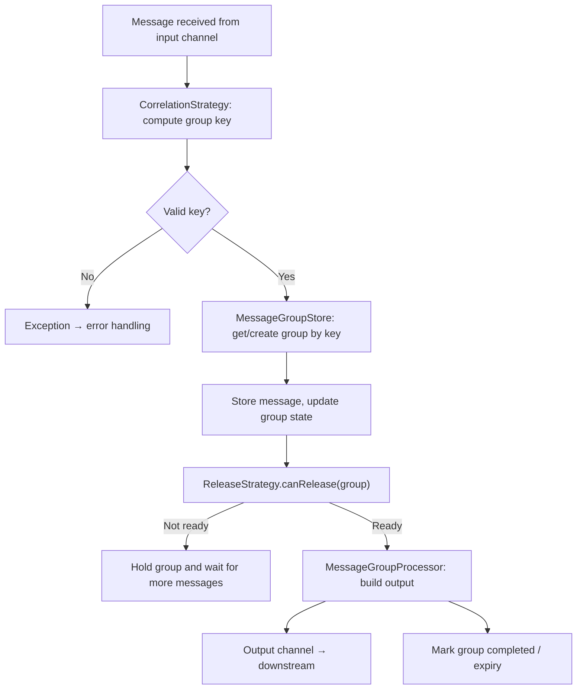

# Custom CorrelationStrategy in Spring Integration

## 1. Why define custom correlation?

In Spring Integration, **correlation** is the mechanism that identifies messages belonging to the same **logical group** (*message group*). When a system splits a request into multiple parts, receives parallel results from multiple sources, or collects events by transaction ID, the runtime must decide which group a new message belongs to before deciding whether that group can be released downstream.

This lesson belongs to the **Correlation runtime** chapter in the `SPRING_INTEGRATION_RUNTIME` module. Its content directly connects to flow orchestration across channels, endpoints, consumers, pollers, and executors; `IntegrationFlow` lifecycle management, transactions, retries, message stores, errors, correlation, and runtime state diagnosis.

A **custom `CorrelationStrategy`** is needed when the default grouping rule based on the `correlationId` header cannot express the business key. For example:

- Grouping multiple lines of the same **inbound shipment batch** by `tenantId + batchId`, even when each message arrives from a different request.
- Grouping fragments sent by multiple adapters under the same **orderId**, without standard correlation headers from a `Splitter`.
- Ensuring two tenants that both have batch code `B-17` remain in **two separate groups**.
- Combining parallel computation results by `jobId + runId`, without mixing retries/reruns of the same job.
- Using the corresponding group for a resequencer, while keeping `sequenceNumber` ordering separate.

Lesson goals: understand the interface contract accurately; build safe, stable keys; configure an aggregator with Java DSL/annotations; distinguish correlation, release, and output; test groups independently; and handle timeouts, late messages, concurrency, and persistent stores.

> **Limitation:** `CorrelationStrategy` only **determines the group key** for a correlating handler such as an `Aggregator` or `Resequencer`. It does not automatically generate a new `correlationId` in headers, does not decide when enough messages have arrived, and does not replace gateway/broker request–reply correlation.

## 2. Correlation, release, and processing are three distinct decisions

A typical aggregator has three extension points:

| Component | Question answered | Related API |
|---|---|---|
| **CorrelationStrategy** | Which group does this message belong to? | `getCorrelationKey(Message<?>)` |
| **ReleaseStrategy** | Is this group ready to emit a result? | `canRelease(MessageGroup)` |
| **MessageGroupProcessor** | Once ready, how are the messages combined into a value? | `processMessageGroup(MessageGroup)` |



**Example:** Six messages arrive across two batches:

| Message | tenantId | batchId | partId | Key |
|---|---|---|---|---|
| M1 | shop-a | B-17 | P1 | (shop-a, B-17) |
| M2 | shop-b | B-17 | Q1 | (shop-b, B-17) |
| M3 | shop-a | B-17 | P2 | (shop-a, B-17) |
| M4 | shop-a | B-17 | P3 | (shop-a, B-17) |
| M5 | shop-b | B-17 | Q2 | (shop-b, B-17) |
| M6 | shop-b | B-17 | Q3 | (shop-b, B-17) |

When `ReleaseStrategy` sets `group.size() >= 3`:

- Group `(shop-a, B-17)` is released when M4 arrives.
- Group `(shop-b, B-17)` is released when M6 arrives.
- Each output contains three parts from **one tenant**, even though messages arrived interleaved.

If only `batchId` were used as the key, the two tenants would inadvertently merge into one group. If `MessageHeaders.ID` were used as the key, virtually every message would form its own group and never reach the expected size.

### Correlation is not release

By default, an aggregator typically reads the key from `IntegrationMessageHeaderAccessor.CORRELATION_ID` and uses sequence-size release. After replacing **only** the correlation strategy, the default release strategy still operates on the message's sequence metadata; it **does not** infer from `batchId` that a batch has three parts.

If messages are emitted by a standard `Splitter`, the `CORRELATION_ID`, `SEQUENCE_NUMBER`, and `SEQUENCE_SIZE` headers are usually already populated. If messages come from independent sources, you must define the release condition explicitly using an expected count, end marker, deadline, or business rule.

## 3. Contract of the `CorrelationStrategy` interface

Spring Integration 6.5 API:

```java
package org.springframework.integration.aggregator;

import org.springframework.messaging.Message;

@FunctionalInterface
public interface CorrelationStrategy {
    Object getCorrelationKey(Message<?> message);
}
```

The return value is an `Object` used as the **group ID**; it does not have to be a `String`. However, the key object **must** satisfy the `Map` key contract: stable `equals()` and `hashCode()` that properly distinguish groups that belong apart. The API documentation requires: if no key can be determined, **throw an exception**—never return `null`.

### 3.1. Invariants to preserve

1. **Non-null:** do not use an empty/unknown key as a shared “unknown” bucket for all erroneous messages.
2. **Deterministic:** identical business metadata must produce the same group ID, even after retries, redeliveries, or restarts.
3. **Properly scoped:** include tenant, run version, event type, or namespace when needed to avoid mixing unrelated groups.
4. **Immutable:** the key object must not mutate fields participating in `equals()/hashCode()` after being placed in the store.
5. **Store-compatible:** with persistent stores, the key needs a serialization format/codec stable across versions and compatible with store configuration.
6. **Side-effect free:** computing the key should not call network APIs, update a DB, or depend on global counters.
7. **Fast and thread-safe:** the strategy may be called concurrently by multiple consumers/threads for different messages.

**Typical mistakes:**

```java
// BAD: every time the same order arrives, a different key is created.
CorrelationStrategy wrong = message -> UUID.randomUUID().toString();

// BAD: all messages missing a batch ID pile into a single group.
CorrelationStrategy alsoWrong =
        message -> message.getHeaders().getOrDefault("batchId", "UNKNOWN");

// BAD: key can be null, violating the contract.
CorrelationStrategy nullable =
        message -> message.getHeaders().get("batchId");
```

Another mistake is using a mutable class containing fields involved in hashing. If a field changes after the key has been stored, subsequent lookups fail to find the existing group or unexpectedly create a new group.

### 3.2. Why is a record a good key type?

```java
import java.io.Serializable;

public record BatchKey(String tenantId, String batchId)
        implements Serializable {
}
```

A Java `record` generates `equals()` and `hashCode()` from its components, has no setters, and is easy to compare and test. Adding `Serializable` is an option when deploying a store supporting Java serialization, though it **does not guarantee** compatibility with every persistent store: check serializers, schema/codecs, and version upgrade policies.

Using a `String` like `tenant + ":" + batch` can also work if collision-free encoding is guaranteed. For example, `("a:b", "c")` and `("a", "b:c")` produce the same `"a:b:c"`; a record/composite key avoids that bug. For SQL-backed group stores requiring `String`, use an unambiguous encoding such as length-prefixed parts or normalized namespace hashes.

## 4. Built-in ways to configure correlation

Before writing a custom class, assess how complex the grouping rule is.

| Key selection approach | When to use | Example |
|---|---|---|
| Default via `CORRELATION_ID` | `Splitter`/gateway already created accurate correlation headers | No extra configuration needed |
| `HeaderAttributeCorrelationStrategy` | Using a custom header that is sufficiently unique | `new HeaderAttributeCorrelationStrategy("batchId")` |
| `correlationExpression(...)` | Key from payload/header with simple SpEL | `"payload.batchId"` |
| Lambda/`CorrelationStrategy` bean | Composite key, validation, normalization, testable logic | `message -> new BatchKey(...)` |
| POJO method + `@CorrelationStrategy` | Using an annotation-driven aggregator with a marked method | `public String correlateBy(Part p)` |

Spring Integration documentation covers `ExpressionEvaluatingCorrelationStrategy` and `MethodInvokingCorrelationStrategy`; Java DSL provides overloads such as `correlationStrategy(CorrelationStrategy)`, `correlationStrategy(target, methodName)`, and `correlationExpression(String)`.

**Example reading a single header:**

```java
import org.springframework.integration.aggregator.HeaderAttributeCorrelationStrategy;

// Safe only when batchId is already unique across all tenants and runs.
var strategy = new HeaderAttributeCorrelationStrategy("batchId");
```

**SpEL example using payload:**

```java
.aggregate(spec -> spec
        .correlationExpression("payload.batchId")
        .releaseStrategy(group -> group.size() >= 3))
```

In this example, nothing enforces multi-tenant isolation, so only use it when `batchId` is already globally unique. For composite keys and validation, an explicit `CorrelationStrategy` class is usually easier to review and test.

## 5. Complete example: grouping three parts by tenant and batch

Let us build a flow that receives `BatchPart` messages from multiple producers and aggregates them into a `List<BatchPart>` once **three** messages arrive in the same group. The example uses Spring Integration 6.5, Java 17, and Spring Boot with `spring-boot-starter-integration`. This is a **fixed-group-count exercise**; production must handle duplicates, missing parts, and explicit expected-count metadata.

### 5.1. Defining the payload and composite key

```java
import java.io.Serializable;

public record BatchPart(
        String tenantId,
        String batchId,
        String partId,
        long amount
) {
}

public record BatchKey(String tenantId, String batchId)
        implements Serializable {
}
```

With this schema:

- `tenantId`: boundary between customers/tenants.
- `batchId`: one processing batch for a tenant.
- `partId`: identity of an individual part, used for business duplicate checks.
- `amount`: sample data to aggregate.

Do not group by `partId`, because each part has a distinct ID. Also do not include `amount` in the key, because it is not part of the group's identity.

### 5.2. Implementing `CorrelationStrategy`

```java
import org.springframework.integration.aggregator.CorrelationStrategy;
import org.springframework.messaging.Message;
import org.springframework.stereotype.Component;

@Component
public final class BatchCorrelationStrategy implements CorrelationStrategy {

    @Override
    public Object getCorrelationKey(Message<?> message) {
        if (!(message.getPayload() instanceof BatchPart part)) {
            throw new IllegalArgumentException(
                    "Expected BatchPart payload");
        }

        return new BatchKey(
                requireNonBlank(part.tenantId(), "tenantId"),
                requireNonBlank(part.batchId(), "batchId")
        );
    }

    private static String requireNonBlank(String value, String field) {
        if (value == null || value.isBlank()) {
            throw new IllegalArgumentException(
                    "Missing required correlation field: " + field);
        }
        return value.strip();
    }
}
```

**Notable points:**

- Wrong payload type or missing key → exception **at the correlation boundary**, avoiding phantom groups.
- `strip()` handles leading/trailing whitespace consistently. Do not automatically change letter casing if the business domain treats `Batch-A` as distinct from `batch-a`.
- Logic does not depend on current time, message UUID, arrival order, or external state.
- Each message belongs to a fixed group by `tenantId + batchId`; even if payloads arrive from an `ExecutorChannel` on different threads, matching keys still group together.

**Design check:** In a system that allows reusing the same `batchId` periodically, add `runId` or `batchVersion` to the key. Otherwise, late messages from an older run can merge into a new run after the old group is removed.

### 5.3. Declaring the Java DSL flow

```java
import java.util.Comparator;

import org.springframework.context.annotation.Bean;
import org.springframework.context.annotation.Configuration;
import org.springframework.integration.channel.DirectChannel;
import org.springframework.integration.channel.QueueChannel;
import org.springframework.integration.dsl.IntegrationFlow;
import org.springframework.messaging.MessageChannel;
import org.springframework.messaging.PollableChannel;

@Configuration
public class BatchFlowConfig {

    @Bean("parts.in")
    MessageChannel partsIn() {
        return new DirectChannel();
    }

    @Bean("parts.completed")
    PollableChannel partsCompleted() {
        return new QueueChannel();
    }

    @Bean
    IntegrationFlow batchFlow(BatchCorrelationStrategy correlationStrategy) {
        return IntegrationFlow.from("parts.in")
                .aggregate(spec -> spec
                        .correlationStrategy(correlationStrategy)
                        .releaseStrategy(group -> group.size() >= 3)
                        .outputProcessor(group -> group.getMessages()
                                .stream()
                                .map(m -> (BatchPart) m.getPayload())
                                .sorted(Comparator.comparing(BatchPart::partId))
                                .toList())
                        .expireGroupsUponCompletion(false))
                .channel("parts.completed")
                .get();
    }
}
```

**Runtime explanation:**

1. A producer sends a `Message<BatchPart>` to `parts.in` (`DirectChannel`).
2. The aggregator endpoint calls `BatchCorrelationStrategy.getCorrelationKey(...)`.
3. The default `MessageGroupStore` stores the part in the group keyed by `BatchKey(tenantId, batchId)`.
4. After each message, `ReleaseStrategy` checks `group.size() >= 3`.
5. Once the group holds three messages, `MessageGroupProcessor` builds a list of `BatchPart` sorted by `partId`; the output is placed on `parts.completed` (`QueueChannel`).
6. `expireGroupsUponCompletion(false)` retains completed group metadata so the framework can recognize late-arriving messages instead of immediately creating a new group. Metadata lifespan must be managed for long-running services.

An output `QueueChannel` lets tests receive messages with `receive()`. In a real application, replace it with a channel leading to a service activator, outbound adapter, or downstream flow. Do not use an in-memory `QueueChannel` as durable storage across restarts.

**Example limitation:** `group.size() >= 3` *counts messages*, not three unique `partId` values. If a producer sends the same `partId` twice with different message IDs, the group may release prematurely. Production designs need deduplication/unique-part checks and exact completion rules.

### 5.4. Enabling Spring Integration infrastructure

In Spring Boot, annotation infrastructure is typically auto-configured when the starter is on the classpath, though the example can enable it explicitly:

```java
import org.springframework.boot.SpringApplication;
import org.springframework.boot.autoconfigure.SpringBootApplication;
import org.springframework.integration.config.EnableIntegration;

@SpringBootApplication
@EnableIntegration
public class CorrelationDemoApplication {

    public static void main(String[] args) {
        SpringApplication.run(CorrelationDemoApplication.class, args);
    }
}
```

Place the classes in the same package or scanned subpackages. With Spring Boot, the input/output channel and integration flow configuration above suffices for the example; do not register another aggregator listening to the same `parts.in` unless competition is intentional.

## 6. Testing custom correlation with JUnit 5

### 6.1. Unit tests verifying key properties

Before testing the flow, verify that the key satisfies invariants:

```java
import static org.junit.jupiter.api.Assertions.*;

import org.junit.jupiter.api.Test;
import org.springframework.messaging.support.MessageBuilder;

class BatchCorrelationStrategyTest {

    private final BatchCorrelationStrategy strategy =
            new BatchCorrelationStrategy();

    private Object key(String tenant, String batch, String part) {
        return strategy.getCorrelationKey(
                MessageBuilder.withPayload(
                        new BatchPart(tenant, batch, part, 10L))
                        .build());
    }

    @Test
    void sameTenantAndBatchShareAKey() {
        Object first = key("shop-a", "B-17", "P1");
        Object second = key("shop-a", "B-17", "P2");

        assertEquals(first, second);
        assertEquals(first.hashCode(), second.hashCode());
    }

    @Test
    void tenantAndBatchBothPartitionGroups() {
        Object first = key("shop-a", "B-17", "P1");

        assertNotEquals(first, key("shop-b", "B-17", "P1"));
        assertNotEquals(first, key("shop-a", "B-18", "P1"));
    }

    @Test
    void rejectsMissingCorrelationIdentity() {
        assertThrows(IllegalArgumentException.class,
                () -> key("shop-a", " ", "P1"));
    }
}
```

This test requires no Spring context. It proves: two parts of the same batch group together; two tenants do not mix; invalid keys are rejected. Do not assert `==` (same object instance), because two distinct records can be equal by value.

### 6.2. Integration test sending interleaved messages

```java
import static org.junit.jupiter.api.Assertions.*;

import java.util.List;
import java.util.Set;
import java.util.stream.Collectors;

import org.junit.jupiter.api.Test;
import org.springframework.beans.factory.annotation.Autowired;
import org.springframework.beans.factory.annotation.Qualifier;
import org.springframework.boot.test.context.SpringBootTest;
import org.springframework.messaging.Message;
import org.springframework.messaging.MessageChannel;
import org.springframework.messaging.PollableChannel;
import org.springframework.messaging.support.MessageBuilder;

@SpringBootTest(classes = CorrelationDemoApplication.class)
class BatchFlowIntegrationTest {

    @Autowired
    @Qualifier("parts.in")
    MessageChannel input;

    @Autowired
    @Qualifier("parts.completed")
    PollableChannel output;

    void send(String tenant, String batch, String part) {
        assertTrue(input.send(MessageBuilder.withPayload(
                new BatchPart(tenant, batch, part, 1L)).build()));
    }

    @Test
    void groupsByTenantAndBatchEvenWhenInterleaved() {
        send("shop-a", "B-17", "A1");
        send("shop-b", "B-17", "B1");
        send("shop-a", "B-17", "A2");

        assertNull(output.receive(0)); // Neither group has three parts yet.

        send("shop-a", "B-17", "A3");
        Message<?> aResult = output.receive(1_000);

        assertNotNull(aResult);
        @SuppressWarnings("unchecked")
        List<BatchPart> aParts =
                (List<BatchPart>) aResult.getPayload();

        assertEquals(
                Set.of("A1", "A2", "A3"),
                aParts.stream()
                        .map(BatchPart::partId)
                        .collect(Collectors.toSet()));
        assertTrue(aParts.stream()
                .allMatch(p -> p.tenantId().equals("shop-a")));

        send("shop-b", "B-17", "B2");
        send("shop-b", "B-17", "B3");

        Message<?> bResult = output.receive(1_000);
        assertNotNull(bResult);

        @SuppressWarnings("unchecked")
        List<BatchPart> bParts =
                (List<BatchPart>) bResult.getPayload();

        assertEquals(
                Set.of("B1", "B2", "B3"),
                bParts.stream()
                        .map(BatchPart::partId)
                        .collect(Collectors.toSet()));
        assertTrue(bParts.stream()
                .allMatch(p -> p.tenantId().equals("shop-b")));
    }
}
```

**Why is this test meaningful?** Two groups with the same `batchId` are sent interleaved. With a buggy strategy using only `batchId`, the first output would mix two tenants and fail the assertions. With the proper strategy, group A releases on the fourth message and group B on the sixth.

This is a direct test via in-memory `DirectChannel` and `QueueChannel`; no broker, poller, or persistent store is involved. When writing multiple tests in one context, use unique batch IDs or isolate context/store; do not leave leftover output from an earlier test in `QueueChannel`. In CI, `receive(1_000)` is a test-safety timeout, not a production SLA.

### 6.3. What additional cases should be tested?

| Test | Input | Result to verify |
|---|---|---|
| Wrong payload type | Payload other than `BatchPart` | Strategy throws exception; message does not silently land in an unknown-key group. |
| Missing tenant | `tenantId=""` or `null` | No `UNKNOWN` group created; error flow receives failure per channel/thread semantics. |
| Different batch, same tenant | `B-17` and `B-18` | No cross-release. |
| Late message after completion | Send extra `A4` for an already released group | Verify discard/metadata per policy; no duplicate batch emitted. |
| Duplicate part | Send `P1, P1, P2` | Does not falsely release if business requires three **unique** parts; requires additional dedup. |
| Same batch across restart | Persistent store holds two parts, send third after restart | Resumes with right group ID/serializer, no lost or mixed messages. |
| Concurrent messages | Two threads send to the same key | No lost messages; group releases once per contract and lock setup. |
| Retry/redelivery | Receive same business part ID again | Final side effect is idempotent; no bogus group created. |

## 7. ReleaseStrategy: conditions for completing a group

Even a correct `CorrelationStrategy` can leave a group unemitted if `ReleaseStrategy` is mismatched.

### 7.1. Default sequence release

In a `split() -> aggregate()` flow, the splitter typically attaches sequence headers. Default release relies on the expected part count. However, if custom correlation merges messages from **two different splitter invocations** into one group, sequence headers may no longer align. Do not blindly retain default release after changing group identity.

### 7.2. Release by expected count

When each batch has a varying part count, one approach is for messages to carry `expectedCount` and release once all valid parts arrive. Verify `expectedCount` consistency across messages in the same group rather than blindly trusting the first one.

Illustrative example checking a group where each payload also has an `expectedCount()` method:

```java
ReleaseStrategy ready = group -> {
    var parts = group.getMessages().stream()
            .map(m -> (CountedPart) m.getPayload())
            .toList();

    if (parts.isEmpty()) {
        return false;
    }

    int expected = parts.get(0).expectedCount();

    boolean consistentCount = parts.stream()
            .allMatch(p -> p.expectedCount() == expected);

    long distinctParts = parts.stream()
            .map(CountedPart::partId)
            .distinct()
            .count();

    return expected > 0
            && consistentCount
            && distinctParts == expected;
};
```

In this snippet, `CountedPart` is an illustrative DTO distinct from `BatchPart` in the earlier exercise. It exposes `expectedCount()` and `partId()`. The logic returns `false` when incomplete, yet **does not automatically purge duplicates from the store**: an idempotent filter step or suitable group processor design is still required.

When messages are large and groups are big, recomputing `distinct()` every time consumes CPU/memory; consider controlled group condition/metadata updates. If the receiver only knows “an end marker arrived”, you can release when the marker arrives and required parts are present rather than relying on a hardcoded count.

### 7.3. Output processor differs from correlation key

After release, the default output is typically a collection of message payloads from the group. A custom output processor can construct a DTO:

```java
public record BatchSummary(
        String tenantId,
        String batchId,
        int partCount,
        long totalAmount
) {
}
```

```java
MessageGroupProcessor summarize = group -> {
    var parts = group.getMessages().stream()
            .map(m -> (BatchPart) m.getPayload())
            .toList();

    if (parts.isEmpty()) {
        throw new IllegalStateException("Empty released group");
    }

    BatchPart first = parts.get(0);
    long total = parts.stream().mapToLong(BatchPart::amount).sum();

    return new BatchSummary(
            first.tenantId(), first.batchId(), parts.size(), total);
};
```

Verify that every part in the group shares the same tenant/batch. The key ensures proper grouping when the strategy is correct, yet does not replace business validation or protect against corrupted data/stores.

## 8. Message stores and group lifecycle

Aggregators and resequencers are stateful endpoints. `CorrelationStrategy` determines the **group ID**, while `MessageGroupStore` holds messages and metadata under that group ID.

### 8.1. In-memory vs. persistent stores

| Store type | Characteristics | Risks |
|---|---|---|
| In-memory `SimpleMessageStore` | Easy to test, fast inside JVM | Restarts lose waiting groups; multiple instances hold separate state. |
| JDBC-backed `JdbcMessageStore` | Groups and messages can persist in DB | Requires schema, transaction manager, serialization/codec, locking, and cleanup. |
| Redis/Mongo or other supported stores | Shares state across processes when properly configured | Requires synchronization/atomicity policy, connectivity, and version compatibility. |

A `BatchKey` record works in memory, but when persisted to a database you must verify group ID storage format, serializer/codec, and schema compatibility. If you change `equals()/hashCode()` implementations or key encoding across deployments, new messages may **fail to locate** groups left by the previous version.

For a store shared across multiple aggregators/resequencers, design group ID namespaces or separate storage regions. Two independent handlers sharing the same group ID in the same store can interfere with each other. The Spring Integration reference warns against sharing **the same MessageGroupStore instance** across multiple correlating handlers, especially with expiry callbacks; merely prefixing keys does not resolve every callback issue.

### 8.2. Late messages after release

A completed group does not mean its metadata disappears immediately.

- When `expireGroupsUponCompletion(false)`, completed group metadata is retained to detect and discard late-arriving messages according to aggregator mechanics.
- When `expireGroupsUponCompletion(true)`, the group is removed. A new message with the same key can initialize a **new group**.
- Unreleased groups may wait forever if parts are missing; timeout/expiry/discard policies are needed.
- Removing metadata too early causes duplicates or late events to be mistaken for a fresh batch; keeping metadata forever causes steady message store growth.

If a batch is legitimately reprocessed multiple times, do not hastily set `expireGroupsUponCompletion(true)` just to “make reruns work”. Add `runId` or `batchVersion` to the correlation key to distinguish intentional runs.

### 8.3. Group timeout vs. orphan group cleanup

`groupTimeout` acts on a group when a time condition is met. Post-timeout behavior depends on configuration: force completion, `sendPartialResultOnExpiry`, discard channel, `expireGroupsUponTimeout`, task scheduler, and so on.

`MessageGroupStoreReaper` and options such as `expireTimeout`/`expireDuration` clean up stale inactive groups, including orphaned groups in persistent stores. Do not treat these mechanisms as the same timer.

**Business example:** A 3-part batch receives only P1 and P2. After 60 seconds, instead of holding the group indefinitely:

1. Log the timeout reason with the composite key and received parts.
2. Apply a policy: emit a partial response, route to discard/DLQ, or hold for controlled redelivery.
3. Clean up the group per retention policy so state is not kept forever.
4. Handle P3 arriving after timeout: never silently merge it into a new batch of a different version.

If relying on an incomplete group to answer a request–reply gateway, the gateway may time out before the group timeout; caller retries then increase duplicate risk. Align deadlines on both sides.

## 9. Correlation in Splitter, Aggregator, and Resequencer

### 9.1. Splitter then aggregator

With a standard `Splitter`, fragments from the same split typically carry `CORRELATION_ID`, `SEQUENCE_NUMBER`, and `SEQUENCE_SIZE` headers. If the goal is simply reassembling split parts, **default correlation** is usually appropriate.

A custom strategy helps when parts arrive from multiple independent systems, or when the logical group does not correspond to a single split. Keep `sequenceNumber` and `sequenceSize` meaningful for the **new group itself** if you still intend to use sequence release.

### 9.2. Resequencer

`Resequencer` also builds on the correlating handler mechanism to know which messages belong to the same sequence. However, **CorrelationStrategy does not sort messages**; ordering relies on sequence headers and resequencer policy.

If two runs share the same `jobId` with sequence numbers both starting at 1, correlating only on `jobId` merges the two sequences, causing duplicate positions or endless waiting. The key should include `jobId + runId`.

### 9.3. Gateway request–reply and correlation

An in-JVM gateway typically uses a temporary reply channel to receive the response for each invocation. A custom `CorrelationStrategy` on an aggregator **does not alter the request's `replyChannel` header** and does not guarantee a group's reply returns to the right caller when **multiple callers** are waiting.

If an aggregator combines data from multiple requests, explicitly design who the final recipient is, the return type, deadlines, and reply/error header propagation. For long-running async jobs, returning a job ID and polling status or subscribing to completion events is usually simpler than holding multiple gateway invocations open.

### 9.4. Broker correlation IDs

JMS/AMQP/Kafka or HTTP have distinct correlation headers/protocols. Spring Integration's group key is a concept **inside the correlating endpoint**; it does not automatically set `JMSCorrelationID` or a remote client's reply-to destination.

Translate business IDs into wire headers/message formats at network boundaries, verify serialization, and establish explicit mappings. Never serialize a Java `MessageChannel`/temporary gateway reply channel directly and expect it to work in another process.

## 10. Threading, locking, and transactions

### 10.1. Concurrent arrivals for the same key

Multiple producers may send parts of the same group simultaneously. Spring Integration uses a `LockRegistry` keyed by group ID to protect group operations in `AbstractCorrelatingMessageHandler`. Within one JVM, `DefaultLockRegistry` uses in-memory locks; when multiple applications access a persistent store, a suitable distributed lock registry aligned with the store is required.

**What to test:** 20 threads concurrently send messages into a group, each with a unique part ID. Even when arriving out of order, output must release per rule without losing parts or creating unintended duplicate outputs. If production runs multiple nodes, test across multiple processes/shared stores; a single-JVM test passing does not prove distributed locking is sound.

### 10.2. Choosing keys that avoid “hot groups”

If every malformed/tenant-less message falls back to the same `"UNKNOWN"` key, all error traffic funnels into a single group: contention, memory growth, noisy logs, and potential cross-tenant data mixing.

Even with valid keys, an oversized batch causes many consumers to contend on the same lock. Measure queue wait and group processing time; consider partitioning batches by partition/size to avoid hotspots while honoring the contract.

### 10.3. Transaction boundaries

| Configuration | Meaning for correlation |
|---|---|
| `DirectChannel` to aggregator | Logic typically runs on the sender thread; exceptions can propagate back if synchronous. |
| `ExecutorChannel` to aggregator | Another thread executes; transaction/thread-local context does not transfer automatically. |
| `QueueChannel` + poller | Message waits to be polled; group update occurs after receive, tied to poller lifecycle. |
| Persistent message store with transactions | Group updates can persist and roll back with a compatible transaction manager and source. |
| Retry advice | May re-invoke handler/aggregation with the same message; needs idempotency or dedup to prevent group bloat. |

When `CorrelationStrategy.getCorrelationKey()` throws before adding the message to a group, it normally creates no new group for that message. However, if upstream side effects occurred before dispatch, a correlation exception does not automatically roll back side effects outside the transaction.

**Do not use retries to fix a missing key.** That is a data/contract error; retrying will not magically make `tenantId=null` appear. Route invalid messages to an error flow or dead-letter queue carrying the request ID and failure reason.

## 11. Error handling and runtime observability

### 11.1. Symptoms to distinguish

| Symptom | Possible cause | How to diagnose |
|---|---|---|
| No output despite sending all parts | Parts produced different keys; release rule unsatisfied; endpoint stopped | Log each message's key, group count, and `ReleaseStrategy` state. |
| Output mixes two tenants | Key used only `batchId`, or tenant dropped in a transformer branch | Compare `(tenantId,batchId)` tuple against actual group ID. |
| Every message forms its own group | Key derived from message ID/UUID/timestamp | Remove per-message varying data from correlation. |
| All messages collapse into one group | `UNKNOWN` fallback or constant key | Throw on missing key; add needed identity dimensions. |
| Groups linger forever | Missing message, wrong expected count, no timeout/reaper | Inspect backlog/group age/expiry/discard policy. |
| Duplicate output after restart | Non-durable store, completed group deleted too early, at-least-once redelivery | Test restarts + idempotency + retention policy. |
| Multi-node races/group corruption | In-JVM lock only, shared store lacking distributed synchronization | Check `LockRegistry`, store locking/transactions, and group IDs. |
| Exception before aggregator | Payload missing field, serializer error, or strategy throw | Inspect root cause, failedMessage, and input schema. |
| Aggregator releases properly but gateway times out | Reply channel lost or group completed past deadline | Trace reply routing and end-to-end latency. |
| CPU spikes as groups grow | ReleaseStrategy scans entire group on every message | Use maintained group metadata/conditions, expected counts, and profiling. |

### 11.2. Useful logs without sensitive data

In strategy code, when debugging is needed you can log:

```text
event=correlation_resolved
flow=batchFlow
tenant=shop-a
batch=B-17
groupKey=BatchKey(shop-a,B-17)
messageId=<technical-message-id>
thread=task-executor-3
```

In production, log normalized IDs that are safe to persist; never dump payloads containing PII/secrets. If volume is high, apply sampling or metrics. For messages failing due to missing keys, log error type, source, and request ID for triage rather than raw payload data.

Metrics worth collecting:

- Open group count; maximum group age and size.
- Inbound message rate vs. group release rate.
- Timed-out, partial-release, discarded, and duplicate counts.
- Latency from a group's first message to release.
- Group lock hold time, executor/poller backlog, retry/redelivery counts.
- Key-resolution error rate, serializer errors, and store/transaction errors.

Management/metrics availability depends on the Spring Integration version and Micrometer/observation setup. Do not assume every metric exists out of the box: values such as group age or “correlation miss” may require application-level instrumentation.

### 11.3. Steps to troubleshoot a stuck group

1. Pick a specific `requestId` or `BatchKey` from logs; avoid starting with “the whole system is slow”.
2. Confirm the input channel and consumer/poller are running and messages actually reach the aggregator.
3. Log the computed keys per message; compare tenant, batch, run, normalization, and payload version.
4. Inspect the message group in the store by actual ID, count, and sequence headers.
5. Check `ReleaseStrategy`: expected count, end marker, duplicates, and which messages are missing.
6. Check group timeout, reaper, discard channel, and error handling on the task scheduler.
7. Check locking/transactions under multiple threads/nodes; check gateway timeouts and downstream reply routes.
8. After fixing, validate with tests covering interleaved groups, retries, restarts, and late messages.

## 12. Design mistakes to avoid

**Using `null` as a key:** violates the contract and makes failures harder to pinpoint. Throw an exception naming the missing field and route the message to a monitored error flow.

**Deriving keys from a single non-unique field:** `batchId` can collide across tenants/runs. Design keys around business boundaries and storage expectations.

**Using mutable objects:** mutating `equals/hashCode` breaks store/map lookups. Prefer immutable records/value objects.

**Confusing release with grouping:** custom correlation does not mean part count or ordering is resolved. Configure release to fit the message source.

**Relying on group size while ignoring duplicates:** redelivery creates another technical message even with the same business part ID. Add dedup and idempotency, especially before or inside the aggregator.

**Letting incomplete groups live forever:** causes memory/store leaks. Configure expiry and appropriate partial/discard policies.

**Expiring metadata too soon:** late events inadvertently spawn a second group after the first has finished. Review `expireGroupsUponCompletion` and retention.

**Sharing one store instance across multiple aggregators:** risks collisions and cross-handler expiry callbacks. Consider separate stores/regions and how expiry is handled.

**Assuming group ID is gateway reply correlation:** correlation keys belong to the aggregator; they do not automatically route replies back to the right gateway invocation or broker client.

**Skipping concurrency/restart tests:** passing single-threaded locally is insufficient to prove multi-instance or persistent deployment correctness.

## 13. Extended hands-on exercises

### Exercise A — Key collision

Key calculation:

```java
return tenantId + ":" + batchId;
```

The pairs `("org:a", "job-1")` and `("org", "a:job-1")` produce the same string.

**Task:** Write a test that exposes the collision. Fix it using an immutable `BatchKey` or unambiguous encoding and test that the two pairs yield distinct keys.

### Exercise B — Group not releasing

Three messages share the same key, but default release relies on misassigned sequence headers:

```text
M1 sequenceNumber=1 sequenceSize=4
M2 sequenceNumber=2 sequenceSize=4
M3 sequenceNumber=3 sequenceSize=4
```

**Question:** Why has the group not emitted even though the business only expects three parts?

**Answer:** Correlation only groups; release is waiting for sequence size 4. Fix the source metadata or replace `ReleaseStrategy` to match the business contract rather than arbitrarily changing the correlation key.

### Exercise C — Concurrent tenants

Two producers send interleaved data for `tenant A` and `tenant B`, each with batch ID `B-1`.

**Task:** Concurrently send 50 parts per tenant with unique `partId`s; verify no output mixes tenants, each batch releases per rule, and no messages are lost. If running multiple nodes, use a shared store + appropriate distributed locking.

### Exercise D — Duplicate after retry

M1 is processed, the producer times out and resends M1 with a **new message ID**, then M2 arrives.

**Question:** Why can `group.size() >= 3` release prematurely?

**Answer:** The technical message count reaches three (M1, M1-duplicate, M2), yet only two distinct business parts exist. Deduplicate by business part ID or release based on unique `partId` count.

### Exercise E — Reused batch ID

Both this month and next month use `tenantId="a"`, `batchId="month-end"`. After old group metadata is deleted, a late message from last month can mix into next month.

**Task:** Add `runId` or business period to `BatchKey`; test late messages across two separate runs.

### Exercise F — Missing key

`BatchPart(tenantId=null, batchId="B-3", ...)`.

**Task:** Verify the custom strategy throws before storing a group, log the correlation failure safely, and route the message to the error/recovery mechanism suited to the active channel/adapter. Retries must not turn invalid messages into an `UNKNOWN` group.

## 14. Self-check questions

**1.** How does Spring Integration pick the group ID for an aggregator by default?  
**Answer:** Typically via the `IntegrationMessageHeaderAccessor.CORRELATION_ID` header using `HeaderAttributeCorrelationStrategy`.

**2.** Can `CorrelationStrategy.getCorrelationKey()` return `null` to indicate an ungrouped message?  
**Answer:** No. Per the API contract, it must throw an exception if no key can be determined.

**3.** Why can `String key = batchId` be wrong in a multi-tenant system?  
**Answer:** Two tenants can use the same batch code; a composite key containing tenant and any other distinguishing dimensions is needed.

**4.** Does changing the correlation strategy automatically inform the framework that a group needs 3 messages?  
**Answer:** No. `ReleaseStrategy` is an independent responsibility; it can rely on sequence size, expected count, a marker, or another rule.

**5.** What happens if `MessageHeaders.ID` is used as the correlation key?  
**Answer:** Almost every message gets its own unique key; fragments belonging to the same batch never combine.

**6.** When `expireGroupsUponCompletion(true)`, what can happen to a late message with the same key?  
**Answer:** The group has been deleted; the new message can start another group with the same ID, risking duplicate results if retention/idempotency are inadequate.

**7.** Why does a passing single-JVM test not prove multi-node correctness?  
**Answer:** `DefaultLockRegistry` only protects within a single JVM; a shared persistent store requires proper cross-instance locking, transactions, and serialization.

**8.** Does a correlation key automatically solve gateway timeouts?  
**Answer:** No. Gateways need proper reply routing and deadlines; aggregators only group messages. The caller can time out before the group completes.

**9.** Can a stuck group have a correct key yet a wrong release condition?  
**Answer:** Yes. For example, release waiting on sequenceSize 4 when only three parts exist; inspect both group ID and release policy.

**10.** Why should you unit test `equals()` and `hashCode()` of a composite key?  
**Answer:** Because the group key acts as a Map key/store ID; if two logically equal keys have inconsistent hashes or the key is mutable, lookups can fail.

## 15. References

1. [Spring Integration Reference — Aggregator](https://docs.spring.io/spring-integration/reference/aggregator.html): correlation, release strategy, group lifecycle, expiry, and Java DSL.
2. [Spring Integration 6.5 API — CorrelationStrategy](https://docs.spring.io/spring-integration/docs/6.5.0/api/org/springframework/integration/aggregator/CorrelationStrategy.html): `getCorrelationKey(Message<?>)` method, non-null requirement.
3. [Spring Integration 6.5 API — HeaderAttributeCorrelationStrategy](https://docs.spring.io/spring-integration/docs/6.5.0/api/org/springframework/integration/aggregator/HeaderAttributeCorrelationStrategy.html): correlation from a header.
4. [Spring Integration 6.5 API — CorrelationHandlerSpec](https://docs.spring.io/spring-integration/docs/6.5.0/api/org/springframework/integration/dsl/CorrelationHandlerSpec.html): `correlationStrategy`, `correlationExpression`, `releaseStrategy`, and group timeout.
5. [Spring Integration 6.5 API — AggregatorSpec](https://docs.spring.io/spring-integration/docs/6.5.0/api/org/springframework/integration/dsl/AggregatorSpec.html): `outputProcessor`, `expireGroupsUponCompletion`.
6. [Spring Integration 6.5 API — AbstractCorrelatingMessageHandler](https://docs.spring.io/spring-integration/docs/6.5.0/api/org/springframework/integration/aggregator/AbstractCorrelatingMessageHandler.html): group management, lock registry, expiry, and store.
7. [Spring Integration Reference — Message Store](https://docs.spring.io/spring-integration/reference/message-store.html): persistent group storage, locking, conditions, and store implementations.
8. [Spring Integration Reference — Error Handling](https://docs.spring.io/spring-integration/reference/error-handling.html): synchronous/asynchronous errors and `errorChannel`.
