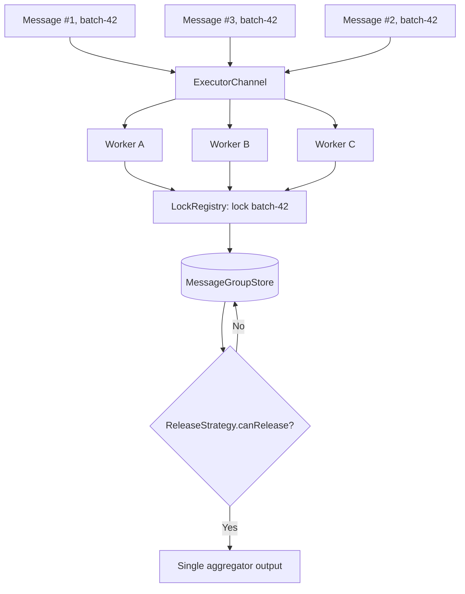
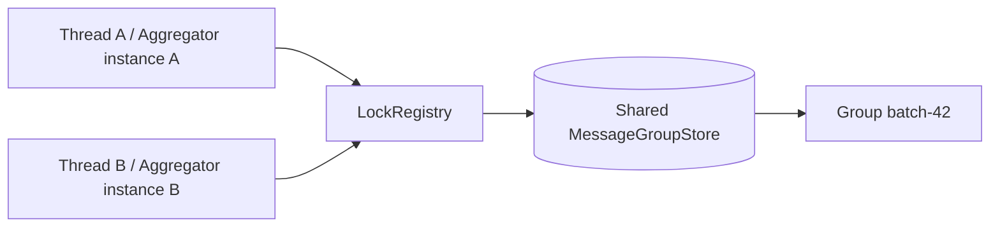
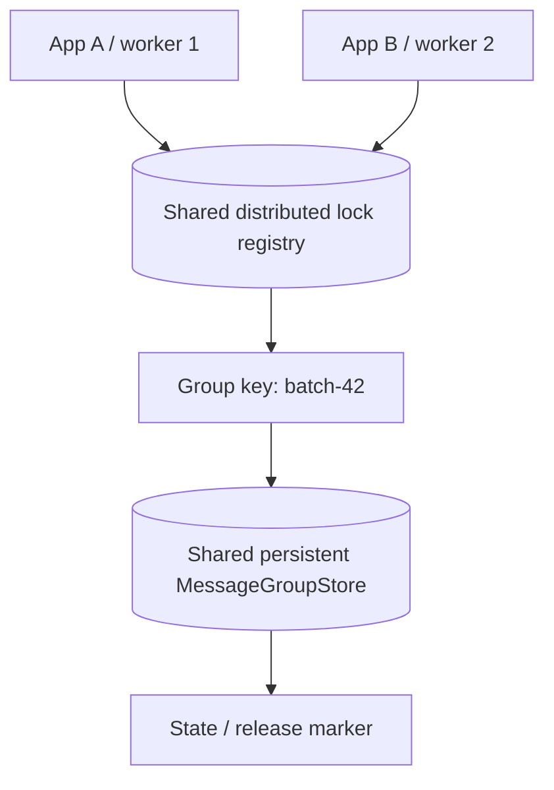
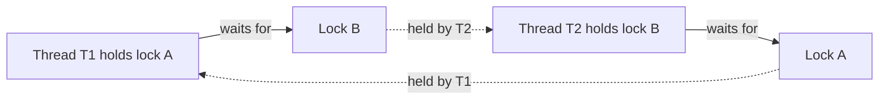

# Group State Under Concurrent Thread Updates in Spring Integration

## 1. The problem: one group receiving messages concurrently from multiple threads

In Spring Integration, an **aggregator** or **resequencer** must remember messages that arrive at different times. A splitter can generate 3 messages sharing a `correlationId`; those messages are dispatched through an `ExecutorChannel` and processed concurrently. Results may return at the same time, while a poller or group-expiration task can also operate on the state.

For example, a shipment batch `batch-42` has three parts. Thread A receives part 1, B receives part 3, and C receives part 2. If all of them update the same `MessageGroup` without coordination, the following issues can appear:

- **Lost update**: two workers both read size 1, add their own part, and overwrite each other's state.
- **Double release**: two workers both see the group as ready and each emits a result.
- **Incomplete release**: a timeout and the final message race, producing an unexpected partial result.
- **Inconsistent state read**: `ReleaseStrategy` evaluates before another write finishes.
- **Deadlock or lock contention**: a thread holds the lock on one group while waiting for an operation requiring another group's lock.
- **Business error despite valid state**: a message redelivered after a retry produces a duplicate side effect, or group IDs collide across runs.

This is the lesson **“Group State Under Concurrent Thread Updates”** in the **Correlation runtime** chapter of the **SPRING_INTEGRATION_RUNTIME** module. The goal is to understand message group lifecycles, locking, and transactions when channels, endpoints, consumers, pollers, and executors participate together, and then learn how to diagnose performance and runtime failures.

> **Scope of guarantee:** With a standard aggregator configuration, Spring Integration already locks around group updates by correlation key. We need to understand and configure locking properly—especially across **multiple instances**—rather than manually synchronizing payload lists outside the framework.

## 2. What state is a MessageGroup?

Aggregators and resequencers are **correlating message handlers**. They receive a message, resolve its group key, add the message to a `MessageGroupStore`, evaluate `ReleaseStrategy`, and potentially emit output.



A message group typically holds the following state:

| State component | Role | If concurrent updates go wrong |
| --- | --- | --- |
| **Group ID / correlation key** | Identifies messages belonging to the same group | Mixed groups or wrong group created |
| List/set of messages | Unreleased messages | Lost updates, accepted duplicates |
| Completion marker / released state | Distinguishes completed groups from open groups | Double release, improper handling of late messages |
| Timestamps: created/updated | Used for timeouts, expiry/reaper, monitoring | Group expires too early or lingers too long |
| `condition` (if used) | State/condition string supporting release, since Spring Integration 5.5 | Custom strategy makes wrong decisions |
| Per-message sequence headers | `correlationId`, `sequenceNumber`, `sequenceSize` | Wrong release condition or wrong order |

Do not treat `MessageGroup` as an ordinary Java `List` freely mutated by multiple workers. It is data managed by the framework via `MessageGroupStore` and the correlating handler's locking mechanism.

### Relationship between correlation and groups

With a typical splitter, three headers matter:

- `IntegrationMessageHeaderAccessor.CORRELATION_ID`: key used to locate a group.
- `IntegrationMessageHeaderAccessor.SEQUENCE_NUMBER`: message position within the sequence.
- `IntegrationMessageHeaderAccessor.SEQUENCE_SIZE`: total expected part count.

Example:

```text
Message       correlationId    sequenceNumber    sequenceSize
part-A        batch-42         1                 3
part-C        batch-42         3                 3
part-B        batch-42         2                 3
other-X       batch-43         1                 2
```

The three messages of `batch-42` act on the **same group**; `other-X` uses a different group and can run in parallel with them. When each group ID is independent, throughput can scale with the number of active groups. If 90% of messages share a single correlation key, threads may spend more time waiting on locks even with a huge pool.

## 3. How does receiving a message mutate group state?

You can picture the logical path of `AggregatingMessageHandler`:

```text
1. Consumer receives Message<?> from channel.
2. CorrelationStrategy determines groupId.
3. LockRegistry obtains the lock corresponding to groupId.
4. MessageGroupStore looks up/creates the group and adds the message.
5. Updates group metadata/condition if configured.
6. ReleaseStrategy.canRelease(group) evaluates the group.
7. If released: build output, update/mark/remove released messages.
8. Handle completion/expiry/discard per configuration.
9. Release the lock at the appropriate point; output is dispatched.
```

This list is a **conceptual model**; the exact ordering of `send`, lock release, and cleanup depends on version, handler, and configuration flags. What must be protected is that reading/mutating the group and deciding on release must observe consistent state.

Timeline table with three workers entering the same group:

| Time | Worker A | Worker B | Worker C | Observable state |
| --- | --- | --- | --- | --- |
| t0 | Receives #1, acquires `batch-42` lock | Receives #3, waits for lock | Receives #2, waits for lock | Group does not exist yet |
| t1 | Stores #1 → no release | Waits | Waits | `{1}` |
| t2 | Releases lock | Acquires lock, stores #3 | Waits | `{1,3}` |
| t3 | — | No release, releases lock | Acquires lock, stores #2 | `{1,3}` |
| t4 | — | — | Has #1,#2,#3 → release | Group completes |
| t5 | — | — | Finishes post-release policy | One expected output |

Lock acquisition order does not necessarily match channel send order. `LockRegistry` ensures mutual exclusion for the given key; it **does not promise fairness or business ordering**.

### Aggregator and resequencer do not emit the same output

- Aggregators usually emit **one result message** once the group qualifies.
- Resequencers hold messages to emit **individual member messages in sequence order**.

Both have group state and locking, yet their release semantics differ. If downstream requires ordering, do not assume a collection returned from an aggregator is automatically sorted by `sequenceNumber`; sort explicitly or place a resequencer where appropriate.

## 4. LockRegistry: why are multiple threads safe within one JVM?

Spring Integration uses `LockRegistry` to acquire locks by correlation key. A default aggregator uses an internal `DefaultLockRegistry`, serializing operations on the same group **within the scope of that application/registry**.

```java
// Illustrates how the locking API is used.
// Spring Integration's aggregator manages locking itself;
// do not manually wrap the entire handler unnecessarily.
import java.util.concurrent.locks.Lock;
import org.springframework.integration.support.locks.LockRegistry;

Lock lock = lockRegistry.obtain("batch-42");
lock.lock();
try {
    // Critical section related to group batch-42.
} finally {
    lock.unlock();
}
```

Key takeaways:

1. **Same key → same lock context:** two workers handling `batch-42` cannot mutate the same group concurrently when both use a compatible locking mechanism.
2. **Different keys → can run in parallel:** `batch-42` and `batch-43` can proceed independently, though internal implementations may stripe over a finite set of locks or hit other contention.
3. **Locking works only where used:** reading `MessageGroupStore` directly and mutating metadata from code outside the handler while bypassing the compatible lock can break safety assumptions.
4. **Locking does not guarantee persistence:** `DefaultLockRegistry` lives in memory and provides no protection across JVMs on two machines.
5. **Locking is not a transaction:** a worker may lock properly yet fail a DB write, roll back, or crash; final state also depends on the store and transactions.

According to Spring Integration documentation, since **version 6.5**, `AbstractMessageGroupStore` also has locking for group metadata operations. This does not replace the need to configure cross-instance synchronization when sharing a persistent store.

## 5. Java DSL example: multiple workers updating one aggregator

The example below uses a **single JVM** and lets the framework lock by group key. `SimpleMessageStore` is an in-memory store suitable for labs. For restarts or multiple instances, Section 8 swaps in a persistent store and distributed lock.

```java
import org.springframework.context.annotation.Bean;
import org.springframework.context.annotation.Configuration;
import org.springframework.core.task.TaskExecutor;
import org.springframework.integration.config.EnableIntegration;
import org.springframework.integration.dsl.IntegrationFlow;
import org.springframework.integration.dsl.MessageChannels;
import org.springframework.integration.store.MessageGroupStore;
import org.springframework.integration.store.SimpleMessageStore;
import org.springframework.integration.support.locks.DefaultLockRegistry;
import org.springframework.integration.support.locks.LockRegistry;
import org.springframework.scheduling.concurrent.ThreadPoolTaskExecutor;

@Configuration
@EnableIntegration
public class CorrelationFlowConfig {

    @Bean
    public MessageGroupStore groupStore() {
        return new SimpleMessageStore();
    }

    @Bean
    public LockRegistry aggregatorLockRegistry() {
        return new DefaultLockRegistry();
    }

    @Bean
    public TaskExecutor aggregationWorkers() {
        ThreadPoolTaskExecutor pool = new ThreadPoolTaskExecutor();
        pool.setCorePoolSize(4);
        pool.setMaxPoolSize(8);
        pool.setQueueCapacity(100);
        pool.setThreadNamePrefix("aggregate-worker-");
        return pool; // Spring manages the bean's lifecycle.
    }

    @Bean
    public IntegrationFlow concurrentAggregation(
            TaskExecutor aggregationWorkers,
            MessageGroupStore groupStore,
            LockRegistry aggregatorLockRegistry) {

        return IntegrationFlow.from("partsIn")
                .channel(MessageChannels.executor(aggregationWorkers))
                .aggregate(a -> a
                        .messageStore(groupStore)
                        .lockRegistry(aggregatorLockRegistry)
                        .expireGroupsUponCompletion(false))
                .channel("groupResults")
                .get();
    }
}
```

Here:

- `partsIn` is the input channel; once messages enter the `ExecutorChannel`, downstream processing may execute on a different worker thread than the `send()` caller.
- `.aggregate(...)` builds an aggregator with group locking; the application-supplied `LockRegistry` makes the synchronization scope explicit.
- `.expireGroupsUponCompletion(false)` retains completed group metadata to handle **late arrivals** per aggregator policy. This is also a common default, written explicitly for clarity.
- `groupResults` receives the aggregator's default output, typically containing a collection payload; if you need a business result, configure an output processor or `@Aggregator` method.

This example is **part of an application**: a consumer or suitable poller must subscribe to `groupResults` to observe output. If the output channel is a `DirectChannel` with no subscriber, dispatch will fail upon release.

### Sending three messages concurrently

The snippet below is an illustrative excerpt running inside an application context that already defines `partsIn`:

```java
import java.util.List;
import java.util.concurrent.CompletableFuture;
import java.util.concurrent.ExecutorService;
import java.util.concurrent.Executors;

import org.springframework.integration.IntegrationMessageHeaderAccessor;
import org.springframework.messaging.MessageChannel;
import org.springframework.messaging.support.MessageBuilder;

MessageChannel channel =
        applicationContext.getBean("partsIn", MessageChannel.class);

ExecutorService senders = Executors.newFixedThreadPool(3);

try {
    String batchId = "batch-42";

    var sends = List.of(1, 3, 2).stream()
            .map(number -> CompletableFuture.runAsync(() -> {
                channel.send(MessageBuilder
                        .withPayload("part-" + number)
                        .setHeader(
                                IntegrationMessageHeaderAccessor.CORRELATION_ID,
                                batchId)
                        .setHeader(
                                IntegrationMessageHeaderAccessor.SEQUENCE_NUMBER,
                                number)
                        .setHeader(
                                IntegrationMessageHeaderAccessor.SEQUENCE_SIZE,
                                3)
                        .build());
            }, senders))
            .toArray(CompletableFuture[]::new);

    CompletableFuture.allOf(sends).join();
} finally {
    senders.shutdown();
}
```

Three `send` calls are initiated from multiple sender threads; after the `ExecutorChannel`, there is also a worker pool. **Waiting for all producer futures to finish does not guarantee the aggregator output has been processed yet**. When writing tests, use an output `QueueChannel` with a timeout or a `CountDownLatch` in an output consumer to verify results, avoiding arbitrary `Thread.sleep` calls.

Expected outcome: if all three messages carry valid headers without duplicates/errors, the aggregator produces one output for `batch-42`. Do not assert collection element order unless you explicitly defined ordering.

## 6. Relationship between `MessageGroupStore` and locking

The group store holds state; the lock registry coordinates operations. These two responsibilities are distinct:



Within a single JVM, `SimpleMessageStore` + `DefaultLockRegistry` is usually sufficient for multiple workers sharing one aggregator. Across multiple JVMs, if both nodes have their own `DefaultLockRegistry`, they can **concurrently acquire locks of the same name on two machines**; logically those two locks are unrelated.

| Scope | Store | Lock | Assessment |
| --- | --- | --- | --- |
| Single JVM, single aggregator | Memory store | `DefaultLockRegistry` | Suitable for labs/single instance |
| Single JVM, multiple workers | Memory/persistent store | Same aggregator registry | Same correlation key protected inside the JVM |
| Two JVMs, shared JDBC store | Persistent `MessageGroupStore` | Two separate `DefaultLockRegistry` instances | **Insufficient** for cross-instance coordination |
| Two JVMs, shared JDBC store | Persistent store | Shared/distributed `LockRegistry` | Proper foundation for serializing group operations |
| Two independent aggregators | Separate store/group namespaces | Appropriately namespaced registries | Reduces contention and avoids hard-to-control nested locks |

**Do not confuse a thread-safe collection with a transaction:** switching an `ArrayList` to a `ConcurrentHashMap` does not solve the atomicity of *read group → add message → check release → write completion state*.

### Locking in the handler vs. locking in the store

In recent versions, both the correlating handler and `AbstractMessageGroupStore` can participate in locking to protect different operational layers. When using a custom store or lock registry, consult the exact version's API documentation on handler and store locking so that no update path bypasses locks and two lock registries do not guard mismatched group identities.

For **a** correlating handler, do not wrap your output processor in `synchronized(group)` and assume multi-instance safety is solved: `group` objects in two JVMs are never the same reference anyway.

## 7. Critical race condition: final message arrives at the same time as timeout

A group `batch-42` expects three parts. Two parts have arrived; right at timeout, part 3 arrives from another worker.

```text
t0: group has {#1,#2}, sequenceSize=3.
t1: scheduler triggers expiry/group timeout.
t1: worker processes #3 and wants to add it to the group.
t2: one task acquires the group lock first; the other waits.
t3: depending on actual execution order:
    - The group completes normally with #3 included.
    - The group expires/force-releases per config with only 2 parts;
      #3 becomes a late arrival/discard or starts a new group per policy.
```

Locking prevents group mutation steps from overlapping uncontrollably, **but does not replace a business policy** on what constitutes a valid outcome upon timeout.

For example, if generating an invoice requires all three lines, a partial release must **not** be treated as a complete invoice. If the business allows partial results, the output must carry a `partial=true` flag, missing part count, and correlation key so downstream knows.

Mechanisms to distinguish:

| Mechanism | When does it run? | What must be defined |
| --- | --- | --- |
| `ReleaseStrategy.canRelease(group)` | When the group is updated/evaluated | Sufficient condition to release |
| `groupTimeout` / expression | Per configured timeout | Will an incomplete group partial-release or discard? |
| `MessageGroupStoreReaper` | Scheduled task scanning stale groups | Expiry timing and how callbacks behave |
| `sendPartialResultOnExpiry` | When expiry runs under matching config | Whether to emit partial output |
| `expireGroupsUponCompletion` | Once the group completes | Keep metadata to reject late arrivals or delete so keys can be reused |
| Discard/error channel | When messages arrive late or cannot be handled | Whether traces and alerts are recorded |

Per documentation, the reaper scans on a schedule so timeouts are **approximate**: a group is examined on the next scan pass. Do not treat it as a millisecond-accurate timer.

### What to do with late-arriving messages?

A common configuration retains completed group metadata after release to detect late arrivals. If `expireGroupsUponCompletion(true)` is enabled, the group can be deleted completely; a subsequent message with the old correlation key can start a **new** group, which is dangerous when keys are reusable order codes.

For workflows with retries/replays, distinguish `orderId` from a `groupId` with an explicit lifecycle (e.g., `orderId + revision + processingRunId`). You can retain business status tables or idempotency records longer than group metadata lives.

## 8. Group state across multiple instances: distributed LockRegistry

When a system runs two or more application instances sharing a `JdbcMessageStore`, per-JVM local locks are insufficient. Spring Integration offers distributed lock options such as **JDBC**, **Redis**, **ZooKeeper**, and other integrations depending on ecosystem/version.

Diagram:



A Java DSL configuration example accepting preconfigured store and registry beans:

```java
import org.springframework.context.annotation.Bean;
import org.springframework.integration.dsl.IntegrationFlow;
import org.springframework.integration.store.MessageGroupStore;
import org.springframework.integration.support.locks.LockRegistry;

@Bean
IntegrationFlow sharedAggregateFlow(
        MessageGroupStore persistentGroupStore,
        LockRegistry distributedLockRegistry) {

    return IntegrationFlow.from("remoteResults")
            .aggregate(a -> a
                    .messageStore(persistentGroupStore)
                    .lockRegistry(distributedLockRegistry)
                    .expireGroupsUponCompletion(false))
            .channel("completedBatches")
            .get();
}
```

This is **wiring only**, not a complete DB/Redis/ZooKeeper setup. In production, configure precisely:

1. All instances share **the same** persistent group store or compatible partitions.
2. All instances use a shared distributed lock service/namespace for **the same aggregator logic**.
3. All instances agree on correlation strategy, release strategy, store region, group key format, and serializer.
4. Appropriate DB transactions/isolation and retry handling for optimistic lock conflicts or distributed lock timeouts.
5. Distributed lock TTL/lease covers the critical section; on network partitions or crashes, define lease expiration, retry, and recovery mechanics.

Starting in Spring Integration **7.0**, distributed lock APIs add dedicated TTL operations and `LockRegistry` introduces interface-level generics. Cross-check these configuration sections against the exact Spring Integration API and registry implementation in your project when migrating between 6.x and 7.x.

### One shared lock does not make every component safe

A distributed lock protects a group ID **only when every actor mutating that group uses the exact same registry/namespace**. A batch job querying group tables directly, a script deleting rows, or an instance configured with a different registry can still corrupt state.

Conversely, sharing **one registry/key namespace between two distinct aggregators** can create needless lock contention or deadlocks when aggregator 1 synchronously dispatches output into aggregator 2.

## 9. Deadlock: two aggregators holding locks while sending output

Suppose the flow is:

```text
... → aggregator A → DirectChannel → aggregator B → output
```

At some instant, thread T1 holds group A's lock and sends its result via `DirectChannel` into B. Simultaneously, T2 holds lock B and, due to some route/response, needs lock A. A circular wait occurs:



The official Spring Integration reference warns of deadlocks when two aggregators are chained together and share a lock registry under multithreading.

Options to mitigate the risk:

- **Separate lock registries/namespaces per aggregator** when the two aggregators have distinct logic/group IDs; each registry can still be shared/distributed across instances of the **same** aggregator.
- **Insert an async boundary** such as an `ExecutorChannel` or `QueueChannel` between the two aggregators so downstream output does not execute inside the call stack holding upstream's lock. With `QueueChannel`, configure an appropriate poller and review durability.
- **Configure `releaseLockBeforeSend=true`** on the aggregator in supported versions (since 5.1.1) to unlock before dispatching output. Verify the correctness of late-message/release-metadata handling for your specific business workflow.

These options are not automatically equivalent. For instance, adding an `ExecutorChannel` alters threads, error routing, and transaction boundaries; retest errors, retries, commit timing, and output order accordingly.

**Observing deadlocks:** Thread dumps may show `java.util.concurrent.locks.ReentrantLock` with two threads waiting on each other; active executor threads stay high while throughput drops to 0 and queue backlog grows. Do not increase pool size to “fix” a deadlock, as that only lets more threads pile into the freeze.

## 10. ReleaseStrategy may be called repeatedly

Each arriving message can re-trigger `ReleaseStrategy`. For groups containing thousands of messages, repeatedly copying payloads to evaluate release or running external queries can incur high cost.

```java
import org.springframework.integration.aggregator.ReleaseStrategy;
import org.springframework.integration.store.MessageGroup;

public final class ExpectedCountReleaseStrategy implements ReleaseStrategy {

    private final int expectedCount;

    public ExpectedCountReleaseStrategy(int expectedCount) {
        this.expectedCount = expectedCount;
    }

    @Override
    public boolean canRelease(MessageGroup group) {
        return group.size() >= expectedCount;
    }
}
```

This is a **simple example** for a lab with a single fixed-size group and no duplicates. In reality, `group.size() >= expectedCount` does not prove all `sequenceNumber` values arrived if duplicate messages occurred or another part is missing. For standard split sequences, let the framework apply its default sequence-header strategy, or build a strategy that checks valid part identities.

A sound custom strategy should:

- **Never add more messages to the same group inside `canRelease()`**; it is a decision function, not a place for side effects.
- Avoid remote calls or slow queries while holding the group lock.
- Not rely on non-thread-safe mutable fields to count arrived parts. State must be derived from `MessageGroup`/store or coordinated data.
- Not assume every group releases once completely if partial release, timeouts, or replays are enabled.
- Be tested under concurrent arrivals and service restarts.

### Group conditions to avoid excessive message scanning

Since Spring Integration 5.5, `MessageGroup` has a `condition` property (a string), and `MessageGroupStore` provides `setGroupCondition(groupId, condition)`. A correlating handler can use a condition supplier to update group state, and `ReleaseStrategy` then reads the condition when deciding release.

For instance, a file splitter application can record the **expected line count** when the end marker arrives, avoiding iterating over every message each time. Under concurrent updates, atomicity across messages, metadata, and conditions must still be maintained via the framework's locking/store mechanisms. Never turn `condition` into an uncoordinated global variable outside transactions.

## 11. Duplicates, retries, and colliding correlation keys

**Locks do not stop all duplicates**. They prevent two concurrent updates; if upstream redelivers the same message at t2 after an earlier attempt committed, t2 can be perfectly valid from a locking standpoint yet invalid from a business standpoint.

Sources of duplicates can include:

- A worker receives the message again after a transaction rollback or broker redelivery.
- Retry advice invokes the same handler multiple times after an exception.
- A user resubmits a request with the same business key.
- A timeout triggers a partial release, and the delayed part is later redelivered.
- Two systems emit messages sharing the same `correlationId` for two distinct business runs.

For example, with `sequenceSize=3`, messages arrive as `#1, #2, #2`. If a custom release strategy only counts messages without checking sequence or business fragment identifiers, it can release before `#3` ever arrives.

**Anti-duplication design should be layered:**

| Layer | Responsibility |
| --- | --- |
| Correlation key | Distinguish orders, revisions, processing runs/attempts |
| Message identity | Recognize redelivered messages vs. new messages |
| Fragment/business key | Ensure each independent part appears at most once |
| Release strategy | Release only when all valid parts are present |
| Output idempotency | Prevent duplicate side effects if output is redelivered |
| Group completion metadata | Reject late messages within the configured window |

Usually an appropriate key looks like `tenantId + batchId + revision + runId` rather than `batchId` alone. Do not put long/high-cardinality variable keys into metric labels; record them in controlled logs/traces for analysis.

## 12. Persistent message stores, transactions, and crashes

If groups live for several seconds or must survive restarts, use a suitable persistent `MessageGroupStore` such as `JdbcMessageStore`. Yet database persistence does not solve every race condition on its own:

| Failure point | What can happen | Required design |
| --- | --- | --- |
| Worker adds message before DB commits | Restart loses uncommitted update | Proper transaction boundaries |
| Worker commits full group before sending output | After restart, hard to tell whether output was sent | Idempotent output/outbox or reconciliation |
| Output sent but completion marker not committed | May re-release/resend after rollback | Consumer/output idempotency |
| Two nodes share one JDBC store with local locks | Both nodes decide to release | Shared distributed lock |
| Distributed lock lease expires mid-critical section | Another node acquires lock while old node is still running | Appropriate TTL, failover, fencing/idempotency as needed |
| Group deleted immediately upon completion | Late message with same key creates a new group | Metadata retention policy or run-scoped keys |
| Group never receives all parts | State occupies storage indefinitely | Expiry/reaper and partial/discard policy |

Do not equate `transaction commit` with `unlock`. Locks control update ordering; transactions determine what persists or rolls back. With both a DB and a broker in one flow, transaction boundaries may span two separate resources.

### Error flows must also protect terminal state

If the output processor or sending to the output channel throws an exception, the aggregator may retain or alter group state depending on where the exception occurred and transaction/configuration settings. Do not infer “on error, the group definitely stays unchanged”. Check:

- Whether the handler runs via `DirectChannel` or `ExecutorChannel` / poller.
- Whether `MessageGroupStore` is persistent or in-memory.
- Whether a transaction spans add/release/send.
- Whether release/expiry strategies handle partial results.
- Whether the error handler/retry rethrows the exception or recovers and returns normally.

Outputs should carry `correlationId`/business outcomes to trace back to the source group. An `ErrorMessage` on an async error channel may include `failedMessage` without automatically capturing the entire group and all attempts. For critical batches, record business events at the commit/release boundary.

## 13. When MessageGroupStoreReaper runs concurrently with consumers

`MessageGroupStoreReaper` runs on a scheduler to expire overly old groups per configuration. This task can overlap in time with a worker adding a message.

Explicitly test:

1. Worker holds the group lock while the reaper is about to expire the group.
2. Reaper expires first; worker arrives afterward.
3. Worker adds the final part first; reaper runs afterward.
4. A message is redelivered right after the group completes.
5. The application restarts while a group still has two parts; the newly started reaper finds the stale group.

Whether the reaper emits partial output, discards individual messages, or sends the entire group to a discard channel depends on configuration properties and version. Starting in Spring Integration 6.5, an option exists to discard the whole group as a single message upon expiry without emitting partials in certain scenarios; verify against your actual version.

**Note on shared stores:** Do not casually share **the same `MessageGroupStore` instance across two different aggregators** when expiry is needed. Each correlating handler registers an expiry callback; without namespace separation, expiry may invoke the wrong handler. Use separate stores/regions or proper partitioning per framework guidance.

### Do not mechanically set reaper timeout equal to SLA

If the SLA is 30 seconds while the reaper only scans every 5 minutes, groups can be processed much later than expected. If you pick a timeout shorter than the average latency of the slowest branch, partial/discard rates rise even when the system is “healthy”.

Measure the distribution of **time from first message to last message** (p50/p95/p99), accounting for retries/backoff and executor queue wait, before setting timeouts and reaper intervals.

## 14. Threading and performance: locking solves correctness at a cost

A classic phenomenon in correlation flows is the **hot group**: many messages sharing one key force workers to wait on one another.

| Symptom | Possible cause | Where to inspect |
| --- | --- | --- |
| Low CPU yet dropping throughput | Threads waiting on the same group lock | Thread dumps, blocked/waited time |
| Growing executor queue | Fast producers, slow aggregator, or lock contention | Queue depth, active threads, task rejections |
| Long-running DB transactions | Lock held during slow queries/processors/output | DB lock wait, transaction duration |
| One massive group | Missing release condition or overly broad group key | Group size, age, message count |
| Most small groups stay fast | Contention concentrated on one hot key | Group ID in logs (do not put in metric tags) |
| Deadlock between aggregators | Nested locks and synchronous downstream dispatch | Thread dump showing circular lock wait |
| More outputs released than expected | Late/replay/duplicate, group completion cleanup | Audit by business key and release events |
| Continuously rising memory | Completed group metadata never cleaned up | Completed group count, reaper policy |

### Designing for throughput

1. **Reduce hot keys:** partition batches by a meaningful business key when possible without changing grouping semantics.
2. **Keep critical sections short:** avoid unnecessary I/O inside release strategies; consider releasing locks before output dispatch if logic permits.
3. **Do not blindly enlarge thread pools:** adding more workers does not allow the same group to be updated in parallel.
4. **Place async boundaries deliberately:** after the aggregator, an `ExecutorChannel` can isolate slow downstream work, while redesigning error/transaction handling.
5. **Monitor group age and release latency:** rising queue depth alongside rising group age signals something is failing to release.
6. **Across multiple instances:** measure lock acquisition latency, lease failures, and DB waits; horizontal scaling only helps when many independent groups exist.

### On metric cardinality

Use low-cardinality tags such as `flow`, `endpoint`, `outcome`, and `exceptionType`. Per-request values like `correlationId`, `batchId`, and `tenantId` usually have high cardinality; record them in controlled logs/traces rather than attaching them directly to every timer/counter.

Useful metrics: open group count, oldest group age, completed, expired, and partial/rejected group counts, time from first part to release, lock wait duration, lock timeout counts, executor backlog, and committed output counts.

## 15. Hands-on lab: testing concurrency in one JVM

Set up `concurrentAggregation` from Section 5 together with a test output channel capable of awaiting results.

**Scenario A: many parts per group**

1. Generate 100 distinct group IDs; each group has 3 parts with `sequenceNumber=1,2,3`.
2. Use multiple sender threads to send all parts in randomized order.
3. For each group, await output within a timeout and verify **exactly one result** containing all three parts.
4. Verify `groupStore` retains no unreleased messages per the chosen policy.
5. Repeat multiple runs with worker jitter to increase the chance of exposing races.

**Scenario B: group with duplicates**

1. Send `#1, #2, #2` without `#3`.
2. Observe the active release strategy; do not assume it automatically strips duplicate business fragments.
3. Send `#3`; confirm the result is produced only when valid conditions are satisfied.
4. Design idempotency/dedup at the proper layer if the application must guarantee no repeats.

**Scenario C: timeout racing the final part**

1. Create an incomplete group; pick a small `groupTimeout` that is still manageable for the lab.
2. Have a final thread send the last message right as the scheduler handles timeout.
3. Verify at most one terminal outcome per policy: full result, partial result, or discard.
4. Log `groupId`, outcome, and timestamps to see which thread won the race; the same thread need not win every run.

**Scenario D: hot-key pressure**

1. Send thousands of parts sharing one correlation key using a release strategy tailored for the test.
2. Compare lock wait time/throughput against the same number of parts spread across many groups.
3. Try increasing worker count; if lock contention is the bottleneck, hot-key throughput will barely budge.
4. If huge groups appear, measure `ReleaseStrategy` evaluation cost and lock hold duration.

### Meaningful PASS criteria

| Aspect | Expectation |
| --- | --- |
| Correctness | No lost parts, no cross-key mixing, no double terminal business results |
| Ordering | Resequencer preserves order; aggregator applies explicit ordering rules if needed |
| Concurrency | Independent groups execute concurrently; same group never corrupts |
| Failure | Retries/replays cause no duplicate side effects |
| Timeout | Full/partial/discard matches policy, with trace |
| Capacity | Group count, age, lock wait, and queue depth stay bounded |

Never rely on a “sleep 500 ms then assert queue empty” test to declare concurrency correct. Use latches, futures, bounded polls, and assertions on group/business outcomes.

## 16. Testing when two applications share a store

You need an integration test with **two JVMs or two application instances** against a real store and lock backend to prove multi-instance configuration. A unit test creating two `DefaultLockRegistry` instances in one JVM **does not substitute** for testing distributed locks.

Recommended scenarios:

1. Run two application instances sharing `JdbcMessageStore` and a distributed `LockRegistry`, with consistent lock namespace settings.
2. Push messages sharing the same correlation key through both instances concurrently.
3. Write a release audit keyed by business key with a unique constraint; reject any second terminal result.
4. Restart one instance mid-group update; verify the surviving instance continues cleanly without losing committed updates.
5. Make the lock backend temporarily unavailable or force a lease expiration in the lab; confirm errors are observed and transactions roll back/retry per policy.
6. Perform a rolling deploy of new code changing a release strategy or serializer; verify groups left by the old code can still complete.

If external outputs must occur strictly once, implement **idempotency or a transactional outbox**. Distributed locks only arbitrate group update rights at a moment in time; they do not make HTTP calls, emails, or broker commits atomic with the group store.

## 17. Runtime failure diagnostic checklist

When an aggregator appears “stuck”, drops output, or produces duplicates, trace this chain:

- **Input:** Do messages carry `correlationId`, `sequenceNumber`, `sequenceSize`? Are keys reused across runs?
- **Channel:** Do messages arrive via `DirectChannel`, `ExecutorChannel`, or `QueueChannel`? Is the poller running? Are thread pools rejecting tasks?
- **Endpoint:** Is only one aggregator receiving this group? Is another handler unintentionally sharing the same store/region?
- **Lock:** How many threads are waiting on the lock? Is the lock registry local or distributed? Are there lease/timeout errors?
- **Store:** How many parts, what condition/metadata, and what completion status does the group have? Did the transaction commit?
- **Release:** Can the strategy release? Once completed, was the group deleted too early so late messages started a new group?
- **Expiry:** Are timeout/reaper running? Are partials/discards emitted per policy? Is the scheduler failing?
- **Output:** Is downstream slow, lacking subscribers, or throwing exceptions? Is output idempotent?
- **Error:** Are exceptions propagated to the caller or turned into `ErrorMessage`? Did recovery swallow an error?
- **Observability:** Can you correlate traces by correlation ID and version/run ID from ingress through release/expiry?

Thread dumps or profilers help identify lock waits; cross-reference group store timestamps and logs to reconstruct races. Never run manual `MessageGroupStore.removeMessageGroup()` in production just to “unblock” a hot key without assessing data loss and re-release consequences.

## 18. Conclusion

When multiple threads update a `MessageGroup`, the core problem is **consistent state mutation and release decisions per correlation key**. Spring Integration provides `LockRegistry` inside correlating handlers to serialize same-group operations within one JVM. When sharing a persistent `MessageGroupStore` across multiple instances, **distributed locks**, proper transactions, and consistent group identity strategies are required.

Locking is part of correctness, but not enough on its own: you must also handle **duplicates, timeouts, expiry, crashes, retries, error flows, and non-transactional side effects**. To keep flows both safe and fast, separate independent groups that can run concurrently from hot groups that must serialize, measure contention, and test real races among workers, reapers, and outputs.

## References

- [Spring Integration Reference — Aggregator: Lock Registry, State, Deadlocks](https://docs.spring.io/spring-integration/reference/aggregator.html)
- [Spring Integration Reference — Message Store: LockRegistry and Group Condition](https://docs.spring.io/spring-integration/reference/message-store.html)
- [Spring Integration Reference — Distributed Locks](https://docs.spring.io/spring-integration/reference/distributed-locks.html)
- [Spring Integration Reference — Resequencer](https://docs.spring.io/spring-integration/reference/resequencer.html)
- [Spring Integration API — AggregatorSpec](https://docs.spring.io/spring-integration/api/org/springframework/integration/dsl/AggregatorSpec.html)
