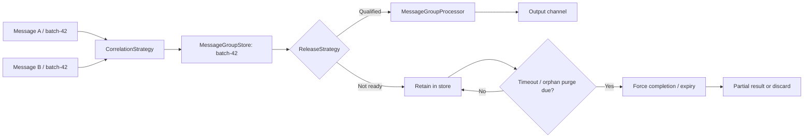
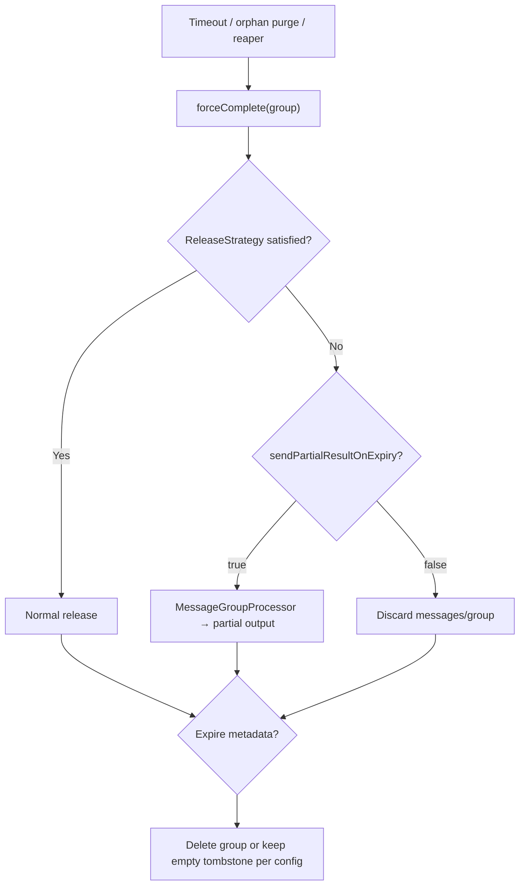
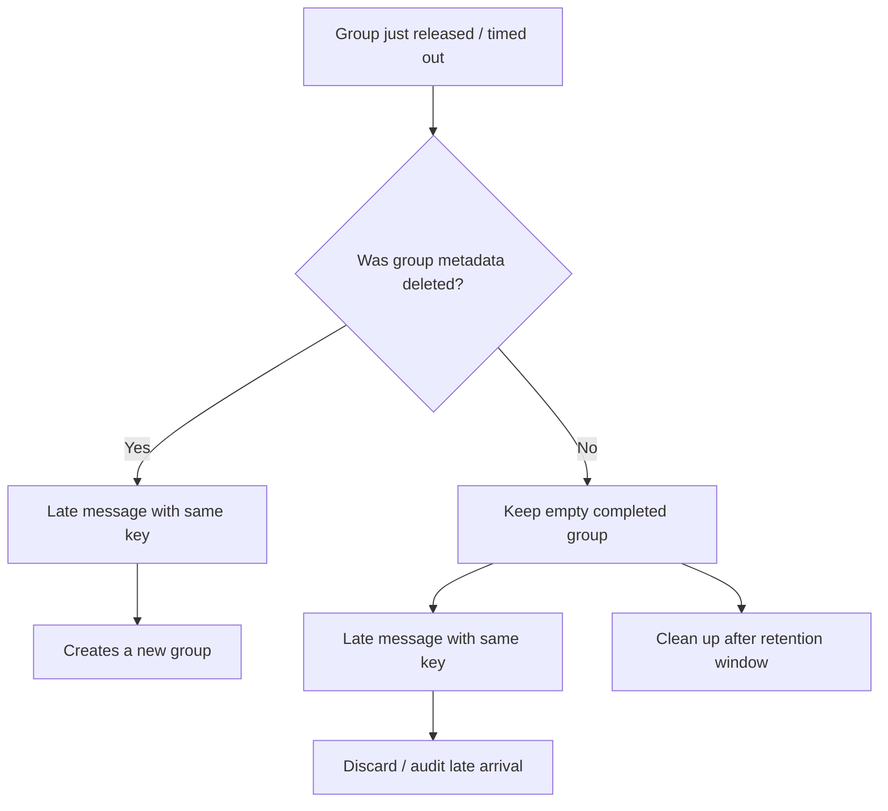
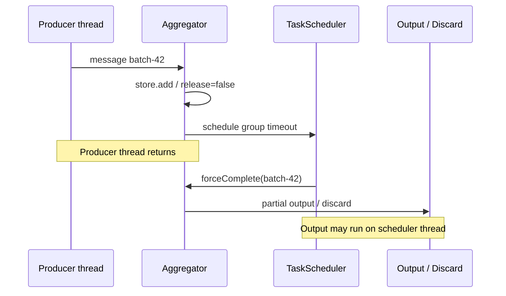

# Orphaned Message Groups and Timeouts in Spring Integration

## Objectives and Context

In the **SPRING_INTEGRATION_RUNTIME** module, message orchestration does not end once a consumer receives a message. With an **Aggregator** or **Resequencer**, the runtime must also hold multiple messages sharing a correlation key in a `MessageGroupStore`, wait until the `ReleaseStrategy` condition is satisfied, and only then continue the flow. If part of the data is lost, a source stops sending, a consumer stops, or the application restarts, a group can sit around for a very long time without being released.

This lesson belongs to the **Correlation runtime** chapter and focuses on **orphaned message groups** (groups left behind with no remaining chance of completing normally) and **timeout/expiration** mechanisms. Concerns around channels, endpoints, pollers, executors, transactions, retries, message stores, errors, and performance are explained wherever they alter a group's runtime behavior.

After this lesson, you will be able to:

- Distinguish a **validly waiting** group, an **incomplete** group, an **orphaned** group, and **empty group metadata** retained after completion.
- Explain the roles of `CorrelationStrategy`, `ReleaseStrategy`, `MessageGroupStore`, and `AbstractCorrelatingMessageHandler`.
- Use `groupTimeout`, `groupTimeoutExpression`, `expireTimeout`, `expireDuration`, and `MessageGroupStoreReaper` in the right scenarios.
- Decide on **partial release**, discard, retaining state to reject late arrivals, and group deletion deadlines.
- Design stable correlation keys and manage late-arriving messages and restarts with persistent stores.
- Diagnose stuck groups, non-running schedulers, errors in the expiry branch, transactions, group locking, and duplicate-output risks.
- Write integration tests for complete, incomplete, timeout, late arrival, post-restart recovery, and concurrent execution.

Primary examples target **Spring Integration 6.5.x, Spring Framework 6.x, and Java 17+**. APIs/configurations can vary across versions; the code accurately demonstrates each component's responsibilities and notes where additional adapters or stores are needed.

## 1. How is a message group created and released?

An aggregator has three core questions:

1. **Where does it belong?** `CorrelationStrategy` computes a group key from the message, typically based on the `correlationId` header. It can be configured to use a business key such as `orderId` or `batchId`.
2. **Is it ready to emit a result?** `ReleaseStrategy` decides when the group can release. For messages tagged with complete sequence headers by a splitter, the default is usually `SimpleSequenceSizeReleaseStrategy`.
3. **Where are results and state handled?** `MessageGroupStore` holds the messages and metadata; `MessageGroupProcessor` builds the output; the endpoint dispatches the output or handles expiry/discard per configuration.



Point to remember: a channel accepting a message **does not mean** the group is complete. If the release strategy is waiting for three parts and only two arrive, they remain in the store until another condition forces processing.

### Four easily confused states

| State | Nature | Appropriate handling |
|---|---|---|
| **Open group** | Not yet released; still waiting for subsequent parts | Retain group in store; define clear timeout or SLA |
| **Incomplete group** | Missing one or more parts relative to the release condition | Time out, then partial-release or discard per business rules |
| **Orphaned group** | Group remains in store, yet events/triggers to complete it may never occur, often after restart | Use controlled purge/reaper or recovery tooling |
| **Empty completed group** | Messages already released, yet group metadata is kept to recognize late arrivals | Retain for the late-arrival window, then purge metadata |

An `Orphan` is not a Java exception or a state flagged by the framework for every group. It is an **operational condition**: a group that is no longer making expected progress. A group remaining open for several seconds can be completely normal if the SLA permits several minutes.

## 2. Causes of orphaned groups

### Missing message in a sequence

A splitter divides data into 4 parts; downstream only receives parts 1, 2, and 4:

```text
correlationId = batch-42
sequenceSize  = 4

seq=1   → group batch-42
seq=2   → group batch-42
seq=3   → lost on upstream error / filtered out / sent to wrong channel
seq=4   → group batch-42

ReleaseStrategy requires all 4 parts → group waits forever without a timeout.
```

You cannot fix this merely by increasing poller concurrency. You must find where the third message was lost, whether it can be redelivered, and whether the business accepts an incomplete result.

### Faulty correlation or release strategy

For instance, two flows both write `batchId=42` into a shared store even though they represent two unrelated jobs. Messages mix into the same group; `ReleaseStrategy` miscounts or waits on an incompatible sequence size.

Conversely, if `CorrelationStrategy` uses a continuously changing message ID, each part creates a separate group, so **no group** ever satisfies release.

### Restarts with a persistent store

A JDBC/MongoDB store can retain groups from before a restart, yet the per-group `ScheduledFuture` timers created inside the previous process for `groupTimeout` **are not objects persisted alongside the message group**. If no new message arrives for that group after restart, the old timer does not resume automatically.

Since Spring Integration 5.4, correlating handlers support cleaning up orphaned groups in persistent stores via `expireTimeout`, `purgeOrphanedGroups()`, and an `expireDuration` schedule. This is an important reason to distinguish **in-flight runtime timeouts** from **post-restart sweepers**.

### Other runtime causes

- Consumer endpoint or poller was stopped; messages no longer reach the aggregator.
- Filter/transformer dropped or mutated `correlationId`, `sequenceNumber`, or `sequenceSize`.
- Failure before message persistence, message store rollback, or improper redelivery handling.
- Group contains messages from multiple tenants/flows because keys lack namespacing.
- A publisher failed and the source does not redeliver; or a message exceeded size limits.
- Unsuitable store/transaction/lock concurrency delaying message insertion or release.
- Fresh messages continually arrive before timeout, causing an *inactivity* timeout to keep rescheduling.

## 3. Different timeout mechanisms

There are three main mechanisms, with distinct meanings for timing and triggers:

| Mechanism | When does it check? | Targets | Limitations |
|---|---|---|---|
| `groupTimeout(long)` or `groupTimeoutExpression(...)` | Scheduled individually after a group receives a message without releasing | An open group receiving no new messages during the wait period | In-process timer; may not survive restarts |
| `expireTimeout(long)` + `expireDuration(Duration)` | Scans old groups from store on startup and periodically if duration is set | Orphaned groups in persistent stores that receive no further triggers | Latency depends on scan interval; requires dedicated per-handler store |
| `MessageGroupStoreReaper` | Scheduler invokes `run()` on schedule, using `MessageGroupStore.expireMessageGroups(...)` | Aged groups in the store, including cleaning up empty groups | Does not run unless scheduled; latency may exceed timeout |

**Do not configure all three as three uncoordinated, conflicting policies**. A system may use `groupTimeout` for active message groups and orphan purge for restarts, but partial/discard/retention policies must align.

### 3.1. `groupTimeout` is an inactivity timeout

Suppose the group timeout is 10 seconds:

```text
t = 00s: part #1 arrives; schedule timer for t=10s
t = 07s: part #2 arrives; cancel old timer; schedule timer for t=17s
t = 16s: part #3 arrives; cancel old timer; schedule timer for t=26s
t = 26s: no new part arrives → force completion (if not yet released)
```

Whenever a new message arrives, any remaining `ScheduledFuture` for the group is canceled and a new schedule is created if `ReleaseStrategy` still does not release. This is an elapsed wait **since the latest arrival**, not an absolute deadline measured from the first part.

In flows where heartbeats/progress updates arrive steadily while a mandatory part is missing, an inactivity timeout may never fire. If you want a deadline measured from group creation, use an expression based on `MessageGroup.getTimestamp()` or a business timestamp, and understand how group timestamps are updated/retained.

### 3.2. `groupTimeoutExpression` for dynamic deadlines

The expression is evaluated against `MessageGroup`:

```java
// Java DSL: expire 10 seconds after the group was created.
.groupTimeoutExpression(
        "new java.util.Date(timestamp + 10000)")
```

When using `Date` as an absolute instant, the deadline is anchored to the group's timestamp. Since Spring Integration 5.5, `groupTimeoutExpression` can evaluate to a `java.util.Date`, alongside numeric interval values.

You can return `null` to skip scheduling under a condition, or compute durations from group size/headers. Be careful with zero and negative values, as they can trigger immediate force-completion or skip scheduling depending on API/expression type; do not use them as an implicit way to disable timeouts everywhere.

### 3.3. `expireTimeout` is the age threshold for orphan purge

`expireTimeout(300_000L)` and `expireDuration(Duration.ofMinutes(1))` can scan for groups older than roughly 5 minutes on a 1-minute cycle (in addition to an initial scan on startup). Purge invokes **forceComplete** logic and follows the corresponding partial/discard/expiration settings.

When interpreting group age, check the store in use and the timestamps maintained by `MessageGroup`/the store. This checks group age/state in the store; it does not mean every message with a business event time older than 5 minutes gets discarded.

If the application has a 30-second SLA while the scan interval is 10 minutes, an orphan can outlive the SLA. Conversely, setting purge too short can prematurely evict valid slow-arriving groups.

## 4. On timeout: partial release or discard?

When the timeout task runs, Spring Integration may re-query `ReleaseStrategy`. If still unreleased, expiry proceeds according to policy:



| Option | Meaning | When appropriate |
|---|---|---|
| `sendPartialResultOnExpiry(true)` | Emits whatever parts arrived as the aggregator result upon expiry | Reports where missing parts remain useful when marked partial |
| `sendPartialResultOnExpiry(false)` | Default: emits no partial output; may send dropped parts to discard channel | Payments, reconciliation, or tasks requiring complete data |
| `discardChannel(...)` | Destination for messages dropped or arriving late per configuration | Quarantine, audit, alerting, controlled replay |
| `discardIndividuallyOnExpiry(false)` | Since 6.5: can send the entire expired group as one message holding a list of messages | Need to record a single failure event for the whole group (effective only when partial=false and a discard channel is set) |
| `expireGroupsUponTimeout(true)` | **Aggregator** default: complete due to timeout then delete the whole group | Acceptable if later messages may start a new group |
| `expireGroupsUponTimeout(false)` | Retain completed group metadata so late arrivals are rejected for the retention window | Do not want an old group accidentally starting a new cycle |
| `expireGroupsUponCompletion(false)` | Aggregator default on normal completion: keep empty group | Prevent late arrivals from recreating results after normal release |
| `minimumTimeoutForEmptyGroups(long)` | Retains empty groups longer before reaper/cleanup deletes them | Need a bounded anti-late-arrival window |

**“Expired” and “completed” are not synonyms.** Once a group is deleted entirely, the store no longer remembers the completed key. A subsequent message with the same key can create a new group. When completed metadata is retained, late messages can be discarded per the aggregator contract.

**Receiving partial output does not mean business success.** Downstream needs to know what is missing—for example, a group expected 5 parts and received only 3. Default aggregator output does not automatically carry a `partial=true` flag per application contract; if that status matters, design a custom payload/header or output processor and test it.

### Business decision table

| Business domain | When parts are missing | Recommendation |
|---|---|---|
| Per-minute statistical report | Data missing a few sources is still useful | Partial release, tagged with quality/completeness level |
| Multi-event payment | Missing one step can misstate amounts | Discard/quarantine; recover via transaction/workflow |
| Aggregating multiple API responses | Allowed to return partial, but must state which service did not answer | Partial with diagnostics and explicit upstream timeouts |
| Inventory state synchronization | Cannot build a snapshot from incomplete data | Do not emit a faulty snapshot; store missing events for retry/reconcile |
| Gateway request/reply aggregation | Caller has a deadline | Align gateway timeout and error/partial response path to avoid hanging |

## 5. Hands-on example: timeout and late-arriving messages

The example below uses Spring Integration Java DSL with input and output channels, plus a separate queue receiving discarded messages. The goal is observing *inactivity timeout* and retaining group metadata to reject late arrivals.

```java
import org.springframework.context.annotation.AnnotationConfigApplicationContext;
import org.springframework.context.annotation.Bean;
import org.springframework.context.annotation.Configuration;
import org.springframework.integration.channel.DirectChannel;
import org.springframework.integration.channel.QueueChannel;
import org.springframework.integration.config.EnableIntegration;
import org.springframework.integration.dsl.IntegrationFlow;
import org.springframework.messaging.Message;
import org.springframework.messaging.MessageChannel;
import org.springframework.messaging.PollableChannel;
import org.springframework.messaging.support.MessageBuilder;

@Configuration
@EnableIntegration
public class CorrelationTimeoutDemo {

    @Bean
    public MessageChannel batchParts() {
        return new DirectChannel();
    }

    @Bean
    public PollableChannel aggregatedBatches() {
        return new QueueChannel();
    }

    @Bean
    public PollableChannel discardedParts() {
        return new QueueChannel();
    }

    @Bean
    public IntegrationFlow aggregateBatches() {
        return IntegrationFlow.from("batchParts")
                .aggregate(spec -> spec
                        .correlationExpression("headers['batchId']")
                        .releaseStrategy(group -> group.size() >= 3)
                        .groupTimeout(800L)
                        .sendPartialResultOnExpiry(true)
                        .expireGroupsUponCompletion(false)
                        .expireGroupsUponTimeout(false)
                        .discardChannel("discardedParts"))
                .channel("aggregatedBatches")
                .get();
    }

    public static void main(String[] args) {
        try (var ctx = new AnnotationConfigApplicationContext(
                CorrelationTimeoutDemo.class)) {

            MessageChannel input =
                    ctx.getBean("batchParts", MessageChannel.class);
            PollableChannel output =
                    ctx.getBean("aggregatedBatches", PollableChannel.class);
            PollableChannel discard =
                    ctx.getBean("discardedParts", PollableChannel.class);

            sendPart(input, "order-42", "A");
            sendPart(input, "order-42", "B");

            // No part C: after ~800 ms with no new message,
            // the group is force-completed and returns partial output.
            Message<?> partial = output.receive(4_000);
            System.out.println(
                    partial == null ? "no result" : partial.getPayload());

            // Group is complete yet metadata remains, because
            // expireGroupsUponTimeout(false).
            sendPart(input, "order-42", "C");
            Message<?> late = discard.receive(1_000);
            System.out.println(
                    late == null ? "no late message"
                            : "late=" + late.getPayload());
        }
    }

    private static void sendPart(
            MessageChannel input, String batchId, String part) {
        input.send(MessageBuilder.withPayload(part)
                .setHeader("batchId", batchId)
                .build());
    }
}
```

Expected runtime result when not overloaded:

- Messages `A` and `B` are held in the same group `order-42`.
- Because `releaseStrategy(group -> group.size() >= 3)` is not yet met, the timer force-completes the group after roughly 800 ms with no new messages.
- `sendPartialResultOnExpiry(true)` emits a payload containing two parts. Collection structure and order depend on the output processor/store; do not assert that output is ordered `A` then `B` without configured ordering.
- `expireGroupsUponTimeout(false)` keeps group metadata; `C` arriving afterward is treated as a late arrival and goes to `discardedParts`.
- Because the example has **no reaper**, completed metadata may stay in memory until the context closes. In production, configure a cleanup policy.

This example is illustrative rather than a Gradle test suite executed in STEP 4. Real data should carry clear ordering/sequence metadata and business IDs to detect missing parts.

### Suppressing partial output

Change to:

```java
.sendPartialResultOnExpiry(false)
.expireGroupsUponTimeout(false)
.discardChannel("discardedParts")
```

Incomplete groups will not emit aggregated results to `aggregatedBatches`; stale messages follow the discard policy if a discard channel is configured. If you need to receive **a single event containing the whole group rather than individual messages**, since Spring Integration 6.5 you can add:

```java
.discardIndividuallyOnExpiry(false)
```

Verify the actual payload type in the discard consumer, because when discarding as a whole group, the payload is a list of messages rather than a single part's payload.

### Testing normal release

Send `A`, `B`, `C` fast enough (before timeout). `releaseStrategy` completes the group normally and emits one output message. With `expireGroupsUponCompletion(false)`, metadata is retained to detect a late fourth message.

In real systems, relying only on `group.size() >= 3` does not verify that the three parts have distinct `sequenceNumber` values; duplicate events may occur. When the source provides reliable sequence headers, use a sequence-based release strategy combined with idempotency/deduplication if redelivery occurs.

## 6. Persistent MessageGroupStore and orphans after restart

An aggregator can hold state in memory (such as `SimpleMessageStore`) or in a persistent `MessageGroupStore` (such as `JdbcMessageStore`/MongoDB). When groups must survive restarts, an in-memory store is insufficient.

```text
Before restart:
  Group batch-99 (2/3) in JDBC store
  groupTimeout timer inside JVM
  ↓ JVM stops unexpectedly
After restart:
  Group batch-99 remains in JDBC store
  Old ScheduledFuture timer is gone
  No new messages arrive for batch-99
  ↓
  Group risks becoming orphaned without purge/reaper
```

### Configuring orphan purge on the aggregator

Inside a Java DSL aggregator configured with `messageStore(store)`, you can add:

```java
// store is a MessageGroupStore dedicated solely to this aggregator.
.aggregate(spec -> spec
        .messageStore(store)
        .groupTimeout(30_000L)
        .sendPartialResultOnExpiry(false)
        .discardChannel("expiredParts")
        .expireTimeout(300_000L)
        .expireDuration(java.time.Duration.ofMinutes(1)))
```

Meaning:

- `groupTimeout(30_000)`: active groups with no new messages for 30 seconds are scheduled for force-completion.
- `expireTimeout(300_000)`: groups in the store aged around 5 minutes become eligible for purge.
- `expireDuration(Duration.ofMinutes(1))`: runs periodic scans; purge may also run when the correlation handler starts.
- `sendPartialResultOnExpiry(false)`: groups failing to qualify for release are discarded per the configured policy.
- The store still needs the corresponding **database schema, transaction manager, serialization setup, and connection pool** if using JDBC; the snippet only demonstrates TTL settings.

Evaluate scan durations, schedules, and updates arriving near expiration. `expireTimeout` does not replace database retention policies for audit/recovery records.

### Why not share one MessageGroupStore across multiple aggregators?

`AbstractCorrelatingMessageHandler` registers an expiry callback bound to the handler. If two different aggregators share the same store **instance** and both rely on expiry scans, one handler's callback may attempt to release/discard a group created by the other handler.

Spring Integration added checks starting in 5.0.10 to prevent certain unsafe store-sharing cases, yet good design remains:

- Give each correlating endpoint its own **logically separate MessageGroupStore**.
- If sharing one physical DB, use appropriate implementation-level regions/tables/collections, and namespace group keys by flow/tenant.
- Across multiple application instances, use strong lock synchronization so two instances never mutate the same group simultaneously.
- Test recovery and purge during scale up/down or rolling restarts.

Do not generate `batchId` keys from an ephemeral local counter: after a restart it can collide with an old group. Use a unique business ID or a key incorporating namespace, tenant, flow, and batch version.

## 7. MessageGroupStoreReaper: scheduled scanning of aged groups

`org.springframework.integration.store.MessageGroupStoreReaper` is a `Runnable` taking a `MessageGroupStore`. When `run()` is called, it uses its timeout to ask the store for aged groups and trigger callbacks.

```java
import org.springframework.context.annotation.Bean;
import org.springframework.integration.store.MessageGroupStore;
import org.springframework.integration.store.MessageGroupStoreReaper;

@Bean
public MessageGroupStoreReaper orphanGroupReaper(
        MessageGroupStore aggregationStore) {

    MessageGroupStoreReaper reaper =
            new MessageGroupStoreReaper(aggregationStore);
    reaper.setTimeout(60_000L); // Groups older than roughly 60 seconds.
    reaper.setExpireOnDestroy(false);
    return reaper;
}
```

**Creating the bean is not enough**: the reaper must be invoked on a schedule, such as a `@Scheduled(fixedDelay = 10_000L)` referencing `orphanGroupReaper`, or an equivalent scheduler setup. Running periodically means a 60-second timeout will not fire at exactly the 60th second; actual latency depends on the next run and scheduler responsiveness.

Schedule example:

```java
@Component
public class ReaperSchedule {

    private final MessageGroupStoreReaper reaper;

    public ReaperSchedule(MessageGroupStoreReaper orphanGroupReaper) {
        this.reaper = orphanGroupReaper;
    }

    @Scheduled(fixedDelay = 10_000L)
    public void purge() {
        reaper.run();
    }
}
```

This requires `@EnableScheduling` or equivalent configuration; the application must have a suitable store and the aggregator must use that exact store. Reaper schedules, group timeouts, and error publishing must also be lifecycle-managed.

### `expireTimeout` or reaper?

- Prefer **`expireTimeout` + `expireDuration`** when you want the aggregator itself to proactively clean up its aged groups, especially after restarts.
- Use **`MessageGroupStoreReaper`** when you need an explicit store-scanning schedule, cleanup of empty groups, or separate expiry job control.
- When combining both, avoid conflicting thresholds that process a group before its business deadline.
- For large stores, measure query/scan cost; index expiration fields and bound scan frequency to avoid overloading the DB.

**Watch out during shutdown:** expiry callbacks can trigger during lifecycle shutdown. If `sendPartialResultOnExpiry(true)` is set and downstream dispatchers/endpoints have already stopped, emitting partial output during shutdown may fail. Inspect `setExpireOnDestroy(...)`, lifecycle phases, and whether shutdown should try emitting partial results or preserve groups durably for recovery.

## 8. Late-arriving messages and retaining empty-group metadata

There are two distinct policies:



**Aggregator defaults:**

- Normal completion: `expireGroupsUponCompletion(false)`, keeping metadata to remember the group completed.
- Force-completed by timeout: `expireGroupsUponTimeout(true)`, typically deleting the group.
- Thus the same late message may be treated **differently** depending on how the original group finished.

If the business forbids generating a new output for an already aggregated order, consider `expireGroupsUponTimeout(false)`. Yet keeping tombstones forever grows the store. Choose a retention period based on sources, worst-case redelivery, and SLAs.

### Setting retention duration for empty groups

`minimumTimeoutForEmptyGroups(...)` keeps empty group metadata for an extra period before the reaper or cleanup deletes it. For example, if downstream can deliver delayed messages up to 5 minutes late, keep metadata at least across that window, then clean up to prevent unbounded memory/DB growth.

Once old group metadata is eventually deleted, a late message **can recreate the group**, so if permanent deduplication is required, dedup must live in business storage or a durable inbox/idempotency key, not solely in aggregator metadata.

### Do not equate discard with error

Discarded messages may reflect a valid policy (arrived late, incomplete group), whereas exceptions indicate technical failures. You can separate channels:

```text
aggregatedResults   → valid or partial downstream output (per contract)
expiredParts        → expired / quarantined data
lateArrivals        → audit, duplication checks
errorChannel        → scheduler/store/handler errors raising exceptions
```

If you need to distinguish timeout discards from late-arrival discards, add metadata/context in a custom handler or use separate endpoints/processors as supported by the flow; do not assume all discard messages come pre-tagged with the same reason header.

## 9. How group timeouts relate to threads, transactions, and error flows

`groupTimeout` and orphan purge execute on a `TaskScheduler`/scanner job—a **different thread** from new messages arriving on a `DirectChannel` in normal cases.



Consequences:

- A transaction bound to the producer thread **does not propagate** to the expiry task scheduler.
- If a downstream output handler runs synchronously and slowly, it can block the scheduler and delay timeouts for other groups.
- When a JDBC store needs a transaction for `forceComplete`, configure a **forceReleaseAdvice**/transaction advice dedicated to expiry; this advice is distinct from normal inbound message advice.
- If the group lock stays held while sending output, a downstream flow calling back into the aggregator or a correlated flow can deadlock. Consider `releaseLockBeforeSend(true)` if suitable after verifying races/concurrency.
- With multiple application instances sharing a store, use an appropriate shared `LockRegistry`, or partitioning/single-owner routing, so one group is never force-released twice.

### Where do errors in the expiry branch go?

If the scheduler triggers force-completion and downstream throws an exception, the caller that sent earlier part messages **cannot catch that error from `send()`**. Verify that the `TaskScheduler` has a `MessagePublishingErrorHandler` or suitable error handler to route failures to `errorChannel`, when supported by the adapter/framework.

Warning signs:

| Sign | Possible cause |
|---|---|
| Timeout scheduled yet no output | Scheduler not running, task canceled by a new message, or `sendPartialResultOnExpiry(false)` |
| Expiry output fails, only scheduler logs appear | Scheduler's error handler does not publish to the expected error flow |
| Group releases multiple times | Faulty lock/transaction/retry, metadata deleted allowing late arrival to spawn a new group |
| Group store locked for a long time | Synchronous downstream I/O executing while holding the group lock |
| Groups remain after shutdown | Persistent store with cleanup unconfigured/not yet run; behavior may be intentional for recovery |

If expiry must invoke a remote API, offload delivery to a queue/outbox or worker so the group lock and store transaction are not held across network calls. Idempotency matters because new messages, timeout timers, and post-restart replays can race.

## 10. Message stores, transactions, retries, and processing guarantees

Putting group state in a persistent store only helps survival across restarts; it does not create exactly-once processing.

For instance, a source sends part #2 twice due to a delayed ack while part #3 never arrives. If the release strategy relies solely on `group.size()`, duplicate messages with distinct IDs can make the group look “full” without ever receiving #3's data.

A sturdier design:

1. Use a business `batchId`/`orderId` as a stable correlation key.
2. Attach a `partId` or `sequenceNumber` uniquely identifying each part.
3. Validate `sequenceSize` or expected count from a trusted source.
4. Use an appropriate release strategy; if deduplication is needed, implement it with an inbox/unique constraints or idempotent filter.
5. Define TTL/replay windows and expiration rules.
6. After timeout, persist business status `PARTIAL`/`EXPIRED`/`RECONCILIATION_REQUIRED` outside the ephemeral group if durable auditing is required.
7. Make external outputs or side effects idempotent by group version/event ID.

### Where transactions apply

| Location | Impact |
|---|---|
| Inbound/poller transaction | Can cover part receipt and store update when sharing thread and compatible resources |
| `ExecutorChannel` before aggregator | Introduces a thread boundary; producer's transaction does not transfer to worker |
| `MessageGroupStore` transaction | Ensures group updates are consistent per resource when configured properly |
| `forceReleaseAdvice` on timeout | Establishes a dedicated transaction for forced-release work |
| Downstream HTTP/DB after aggregation | Not automatically part of the original transaction; needs its own boundary and retry/idempotency |

If the message source acks before a part is durably stored, a crash can lose the part. If the part is stored before the source acks, redelivery can create a duplicate. Test both failure points with your real adapters and broker.

### When are retries useful?

- Transient error saving the group to a JDBC store: bounded retry aligned with DB policy and transaction boundaries.
- Timeout caused by a **missing message**: retrying a handler will not conjure the missing message into existence. Inspect the source, request a resend, or decide partial/discard.
- Error emitting output because downstream is unavailable: retrying can make sense, provided release and side effects are idempotent.
- Error in scheduled expiry: requires dedicated retry/recovery without leaving the group in a half-baked state.

## 11. Observing orphaned groups and performance

A group holding many large payloads over a long period can consume more memory/disk than ordinary unprocessed messages. Monitor **group count, age, and fullness**, not just messages arriving at the endpoint.

| Metric | Operational question |
|---|---|
| Open group count | How many batches remain incomplete? |
| `oldestOpenGroupAge` | How long has the oldest batch been waiting relative to SLA? |
| Messages per group, `expectedCount` | How many parts are missing? |
| Timeout and orphan purge counts | Are groups closing by time rather than full data? |
| Partial output and discard counts | How much data is the business losing? |
| Late arrival count | Is upstream delivering late or redelivering heavily? |
| MessageGroupStore size and DB latency | Is the store bloating or hitting lock contention? |
| Scheduler backlog/delay | Is actual expiry lagging behind TTL? |
| Release/forceComplete error rate | Are outputs failing due to transactions or downstream? |

**Be cautious with metric tags:** correlation keys/`batchId` have huge cardinality; put them in controlled logs/traces/audits, never as metric tags that spawn unbounded series. Metric tags should use low-cardinality fields like endpoint ID, component type, outcome, and error category.

### Simple capacity calculation

Suppose throughput is 100 groups/minute, each group lives 30 minutes, and each holds an average of 8 messages x 5 KB:

```text
Approximate groups: 100 groups/min × 30 min = 3,000 groups
Raw payload:        3,000 × 8 × 5 KB        = 120,000 KB (~117 MiB)
```

This is merely a Little's Law illustration assuming stable average retention; it excludes headers, serialization overhead, indexes, object overhead, and tombstones. If timeouts/reapers stop running, retention grows without bound and storage can swell steadily.

### Diagnostic questions when a group fails to release

1. Which store holds the group? Is it persistent? How many messages and what timestamps exist?
2. Which header does the correlation strategy use, and was it altered or stripped by a transformer/router?
3. What `sequenceSize`/expectedCount does the release strategy demand?
4. Are duplicate parts skewing `group.size()`?
5. Is `groupTimeout` configured? Are new messages continually resetting the timer?
6. After restarts, are orphan purge or the reaper actually running?
7. How are `sendPartialResultOnExpiry` and `discardChannel` configured?
8. Is group metadata deleted on timeout? Are late messages creating new groups?
9. Are the scheduler, lock registry, or store transactions failing or blocked?
10. Do output/error channels have active subscribers, queue capacity, and running consumers?

## 12. Testing key scenarios

### 12.1. Complete group

Send three messages sharing `batchId` before the deadline. Verify:

- `ReleaseStrategy` returns true and emits one output per contract.
- No unintended partial/discard occurs.
- Group metadata is kept or deleted accurately according to `expireGroupsUponCompletion`.
- A subsequent message with the same key follows the late-arrival policy.

### 12.2. Incomplete group and inactivity timeout

Send only two messages when three are required. Receive output/discard with a generous test timeout, confirming no early release. Send the second part within less than `groupTimeout` of the first to verify the timer resets.

With the `CorrelationTimeoutDemo` example, `PollableChannel.receive(4_000)` is a bounded wait; avoid unbounded `Thread.sleep` or asserting millisecond timer precision on CI.

### 12.3. Post-restart timeout

Using a persistent `MessageGroupStore` with a real schema:

1. Start the application, create an incomplete group, and confirm the row/group exists.
2. Stop the process or simulate a crash **before timeout**.
3. Restart without sending any further messages to the group.
4. Confirm `expireTimeout`/`expireDuration` or the reaper handles the orphan after the configured age.
5. Check partial/discard behavior and downstream idempotency; confirm no double release.

Restart scenarios cannot be fully verified with an in-memory `SimpleMessageStore` alone.

### 12.4. Late arrivals and tombstones

- Set `expireGroupsUponTimeout(false)`, send a late part: confirm discard.
- Wait for cleanup to remove metadata, send the same key: observe that a new group can be created.
- If business rules forbid duplicate processing post-cleanup, prove an inbox/unique business key still blocks it.
- Measure growth of empty groups when no cleanup policy is configured.

### 12.5. Concurrency, transactions, and error channels

- Two producers concurrently send messages for one group; verify no duplicate release and proper lock registry operation.
- Multiple app instances share a persistent store; verify distributed locking/ownership.
- Simulate a JDBC lock timeout during `forceComplete` and observe the scheduler error handler.
- Make downstream slow or throw exceptions during partial release; check for held locks or lost events.
- Verify the inbound adapter does not acknowledge a part before store persistence is guaranteed per contract.

### Test expectation table

| Scenario | Expectation |
|---|---|
| 3/3 parts before timeout | Normal release |
| 2/3 parts, partial=true | Partial output after timeout |
| 2/3 parts, partial=false | Discard/quarantine per configuration |
| New part arrives before inactivity timeout | Old timer canceled/rescheduled |
| Restart with group in persistent store | Group preserved; orphan purge handles it when due |
| Late part while tombstone remains | Discarded; no new group created |
| Late part after tombstone deletion | Can create a new group; external dedup protects business logic |
| Scheduler fails or stops | Timeouts delay or stop running; alerts must trigger |
| Concurrent send + expire | At most one valid business outcome per locking/idempotency; no duplicate side effects |

## 13. Production checklist

- [ ] Correlation keys are unique per flow/tenant/batch/version and stable across retries/restarts.
- [ ] Release strategy reflects true part/sequence counts, with dedup on redelivery.
- [ ] A clear message-wait SLA exists, explicitly choosing inactivity timeout vs. absolute deadline.
- [ ] Partial release/discard matches the business contract, never silently treating partial as success.
- [ ] A discard channel and replay/quarantine process exist for late or expired messages.
- [ ] A persistent `MessageGroupStore` is used if groups must survive restarts.
- [ ] Orphan cleanup via `expireTimeout/expireDuration` or a genuinely scheduled reaper is configured.
- [ ] The same `MessageGroupStore` instance is not shared across multiple correlating endpoints with expiry callbacks.
- [ ] `expireGroupsUponTimeout` and `expireGroupsUponCompletion` are chosen to fit late-arrival policy.
- [ ] Tombstones are retained long enough while bounded by cleanup and storage capacity.
- [ ] Scheduler/`forceComplete` has appropriate error handler, transaction, and lock semantics.
- [ ] Slow remote calls are kept out of group store locks and transactions.
- [ ] Multi-instance deployments use distributed locking/partitioning to avoid double releases.
- [ ] Outbound side effects are idempotent by business group/event ID.
- [ ] Open groups, oldest age, partials, discards, late arrivals, storage size, and scheduler delays are monitored.
- [ ] Tests cover complete, timeout, restart, late arrivals, concurrency, and recovery failures.

## References

- [Spring Integration Reference — Aggregator](https://docs.spring.io/spring-integration/reference/aggregator.html): release configuration, group timeout, expiry, orphan purge, MessageGroupStoreReaper, and late arrivals.
- [Spring Integration 6.5.x Javadoc — AbstractCorrelatingMessageHandler](https://docs.spring.io/spring-integration/docs/6.5.1/api/org/springframework/integration/aggregator/AbstractCorrelatingMessageHandler.html): `setGroupTimeoutExpression`, `setExpireTimeout`, `purgeOrphanedGroups`, `setSendPartialResultOnExpiry`, lock management.
- [Spring Integration 6.5.x Javadoc — CorrelationHandlerSpec](https://docs.spring.io/spring-integration/docs/6.5.0/api/org/springframework/integration/dsl/CorrelationHandlerSpec.html): Java DSL for timeout, expiry, discard, lock registry.
- [Spring Integration 6.5.x Javadoc — AggregatorSpec](https://docs.spring.io/spring-integration/docs/6.5.0/api/org/springframework/integration/dsl/AggregatorSpec.html): Aggregator configuration and `expireGroupsUponCompletion`.
- [Spring Integration Javadoc — MessageGroupStoreReaper](https://docs.spring.io/spring-integration/docs/6.5.0/api/org/springframework/integration/store/MessageGroupStoreReaper.html): scheduled store scanning mechanism.
- [Spring Integration Reference — Message Store](https://docs.spring.io/spring-integration/reference/message-store.html): choosing between in-memory and persistent stores.
- [Spring Integration Reference — Error Handling](https://docs.spring.io/spring-integration/reference/error-handling.html): scheduler errors, errorChannel, and recovery.

**Key takeaway:** An incomplete group may be delayed data, a missing part, or an orphan left after a restart. `groupTimeout` handles active groups, `expireTimeout/expireDuration` and `MessageGroupStoreReaper` sweep stale state, `sendPartialResultOnExpiry` chooses partial vs. discard, and metadata retention/deletion settings govern whether late arrivals start a new group. For a stable runtime, design **correlation keys, release criteria, timeouts, persistence, late arrivals, locks, error flows, and idempotency** together.
