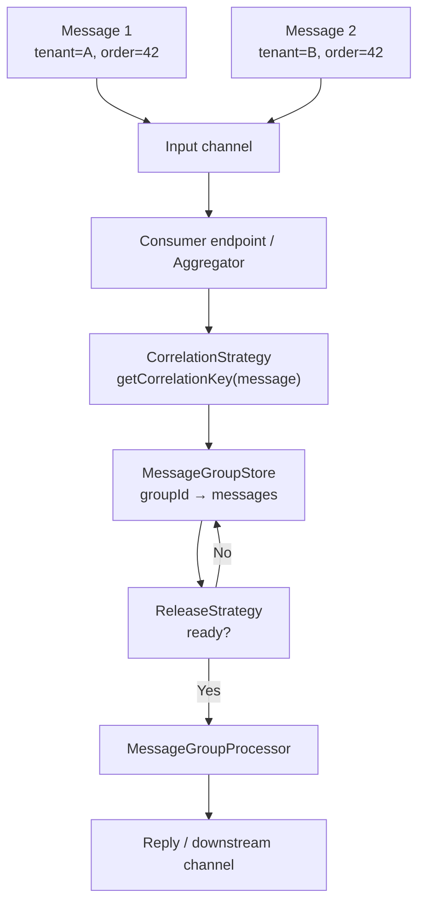
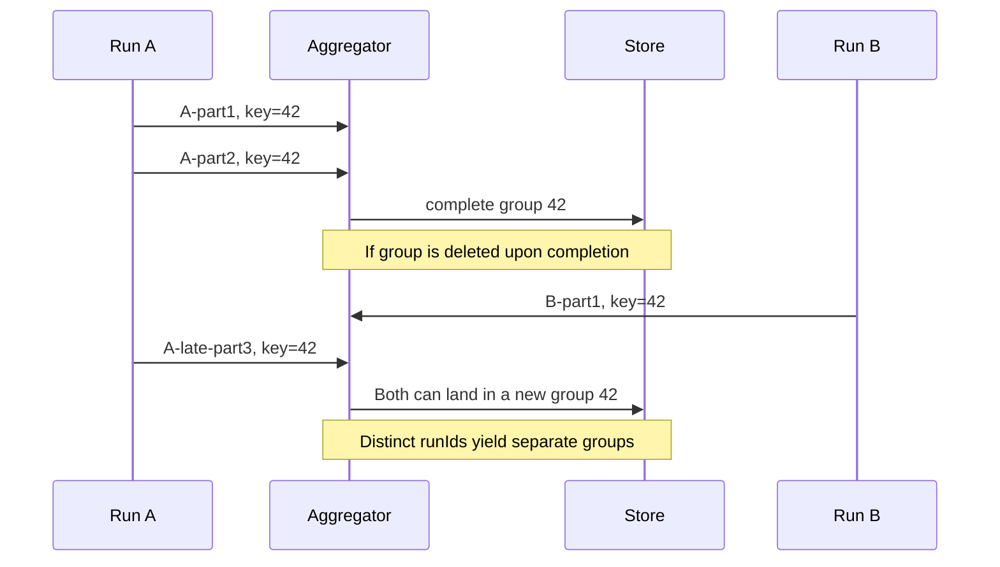
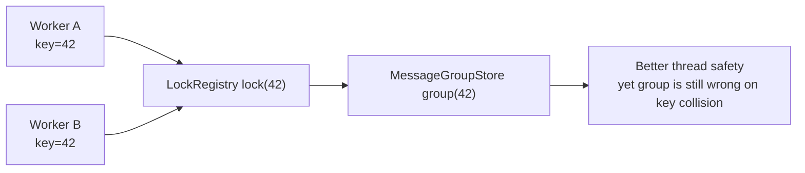

# Correlation Key Collision in Spring Integration Runtime

## 1. The problem: same correlation key, different business units

In **Spring Integration Runtime**, some endpoints process messages independently, whereas components such as **aggregator**, **resequencer**, or **delayer** must hold state to join multiple messages belonging to the same task. Spring Integration uses a **correlation key** to select the `MessageGroup` that a message must join.

**Correlation key collision** occurs when **two tasks that should be independent map to the same group key** within the same storage scope. For example, two tenants both have `orderId = "ORD-42"`; if an aggregator groups only by `orderId`, parts of tenant A's order can merge with tenant B's. This can lead to faulty aggregation, premature replies, loss of incomplete parts, cross-customer data leakage, permanently lingering groups, or bugs that are hard to reproduce under high load.

This lesson, **Correlation Key Collision**, belongs to the **Correlation runtime** chapter of the `SPRING_INTEGRATION_RUNTIME` module. Its scope covers how Spring Integration runs message flows through `MessageChannel`, endpoints, consumers, pollers, and executors; and how to manage `IntegrationFlow` lifecycle, transactions, retries, message stores, error handling, correlation, threading, performance, and operational state when collisions occur.

**After this lesson, you will be able to:**

1. Distinguish **business-semantic** collisions, **reused-ID** collisions, and **technical hashCode** collisions.
2. Understand the contracts of `CorrelationStrategy`, `ReleaseStrategy`, `MessageGroupStore`, and late-arrival handling rules.
3. Run a Java example reproducing two tenants with the same `orderId` being grouped incorrectly.
4. Design explicit group keys scoped by tenant, flow, and batch/generation; avoid key serialization pitfalls.
5. Diagnose mixed groups, early releases, dropped late messages, deadlocks/lock contention, and heap growth.
6. Understand the consequences of retries, redeliveries, shared message stores, distributed locking, and gateway reply paths.

Examples use **Spring Integration 6.x** (cross-referenced with 6.5 docs), Java 17+, and `spring-integration-core`. Some timeout, expiry, and store settings vary by version or endpoint type; check actual APIs before applying to production.

## 2. Correlation in the runtime architecture

### 2.1. Correlation differs from routing and message ID

| Component | Question answered | Example |
|---|---|---|
| `MessageHeaders.ID` | Which message instance is this? | A UUID attached to the message |
| `IntegrationMessageHeaderAccessor.CORRELATION_ID` | Which **group** does this message belong to? | ID of the split round or business batch |
| `SEQUENCE_NUMBER` / `SEQUENCE_SIZE` | Which part is this and how many parts are expected? | Part 2/3 |
| `replyChannel` | Where to send the **result**? | Gateway's temporary channel |
| `errorChannel` | Where to send **errors**? | `errorChannel` or a dedicated channel |
| Business key (`tenantId`, `orderId`) | Which entity does the task relate to? | tenant A, order 42 |
| Processing run/batch ID | Which **processing run** of the business key is this? | `run-2026-11-22-A` |

A `Message` may share the same `orderId` with many other messages; yet that **does not automatically allow** them into the same `MessageGroup`. If the business reprocesses an order in multiple waves, each wave needs a distinct group key despite sharing the same order ID.

`replyChannel` is not a correlation key either. A gateway can issue a temporary reply channel to return the response to each caller, yet an aggregator still needs an appropriate key to **group the right** messages and release complete groups. Wrong correlation can send a reply to an unexpected caller or cause callers to time out.

### 2.2. Path of a key in an aggregator



With `AggregatingMessageHandler`, `CorrelationStrategy` determines the key; `MessageGroupStore` holds messages sharing that key; `ReleaseStrategy` decides when the group is ready to produce output.

Spring Integration defaults to `HeaderAttributeCorrelationStrategy` reading `IntegrationMessageHeaderAccessor.CORRELATION_ID`. The modern default release strategy uses `SimpleSequenceSizeReleaseStrategy` based on sequence headers. These defaults fit the classic splitter-aggregator pattern where the splitter attaches correlation/sequence headers per sequence; they **do not automatically guarantee** a custom business key will separate tenants/runs.

### 2.3. The `CorrelationStrategy` contract

```java
package org.springframework.integration.aggregator;

@FunctionalInterface
public interface CorrelationStrategy {
    Object getCorrelationKey(Message<?> message);
}
```

The returned key:

- **Must be non-`null`**. When a key cannot be determined, the strategy should throw an exception early.
- Needs proper `equals()` and `hashCode()` when used as a map key. For custom objects, choose an **immutable** type.
- Must maintain **identical value and meaning** for all messages belonging to one logical group.
- Must **differ** between two logical groups that must stay separate within the active `MessageGroupStore`/namespace scope.

Crucial point: **two values with the same `hashCode()` whose `equals()` returns `false` do not automatically collapse into the same group in a standard `HashMap`**. When this lesson speaks of collision, the primary problem is **two independent tasks actually yielding the same correlation key (by `equals()`)**, or failing to preserve key identity across storage boundaries.

## 3. Where do collisions come from?

### 3.1. Common sources

| Source | Example | Consequence |
|---|---|---|
| Using only a local ID | `orderId="42"` exists in tenants A and B | Two tenants get merged |
| Reusing keys across runs | Order 42 runs morning and evening batches | Old and new parts mix, or the new run gets dropped |
| Overly coarse key | Using `country="VN"` for all orders | One group absorbs massive message volume |
| Key truncation | Keeping only the first 8 characters of a UUID | Multiple distinct keys collapse to the same string |
| Faulty normalization | Lowercasing/trimming all IDs when IDs are case-sensitive | Distinct entities collapse to the same key |
| Using time as key | `LocalDate.now()` or timestamp minute | All messages in the same time window merge into one group |
| Overwritten header | Transformer/enricher copies `correlationId` from an unrelated request | Semantically wrong grouping |
| Missing namespace | Two aggregators share a store and both use `"42"` | State from two stages can overlap |
| Mutable key object | Mutating a field after use as a map key | Group cannot be found or splits unexpectedly |
| Different serializer/representation | Same ID encoded as `"00042"` vs. `42L` | Parts meant for one group split; reverse mapping can also mis-merge |
| Retry/replay without run ID | Retry of an old job meets a new job with the same business key | Messages mix across two processing generations |

**Terminology note:** collision is not synonymous with duplicate message. Two messages belonging to **two different tasks** yet having **equal keys** is a collision; two deliveries of **the same logical message** via broker redelivery is a duplicate/retry requiring idempotency. Both problems can occur simultaneously.

### 3.2. Why is this bug hard to spot?

In dev environments, there is only one tenant and each `orderId` is processed once, so short keys still “work fine”. In production, two message sources concurrently spawn distinct semantic groups with the same key, and arrival order dictates which group releases first.

An “occasionally returns mixed data” bug tends to surface when:

- Using `ExecutorChannel` or multiple poller consumers so arrival order varies.
- Reading/writing groups across a shared persistent store from multiple pods.
- An old group is still waiting for missing parts while a new group reuses the key.
- Callback retries or DLQ replays inject late messages into a group with a colliding key.
- Group cleanup is configured differently across environments.

Adding thread locks makes group operations thread-safe, **but cannot fix broken grouping**.

## 4. Demonstrating collision via MessageGroupStore

Before building an aggregator flow, you can simply prove that the group store only sees a **groupId** and the added messages; the store has no idea which tenant “should” be allowed in the same group.

```java
import org.springframework.integration.store.SimpleMessageStore;
import org.springframework.messaging.Message;
import org.springframework.messaging.support.MessageBuilder;

public class CollisionInStoreDemo {

    static Message<String> part(String tenant, String order, String step) {
        return MessageBuilder.withPayload(tenant + ":" + order + ":" + step)
                .setHeader("tenantId", tenant)
                .setHeader("orderId", order)
                .build();
    }

    public static void main(String[] args) {
        SimpleMessageStore store = new SimpleMessageStore();

        Message<String> a = part("A", "42", "validate");
        Message<String> b = part("B", "42", "charge");

        // BUG: using only orderId; both A and B produce groupId "42".
        String keyA = (String) a.getHeaders().get("orderId");
        String keyB = (String) b.getHeaders().get("orderId");
        store.addMessageToGroup(keyA, a);
        store.addMessageToGroup(keyB, b);

        System.out.println(keyA.equals(keyB)); // true
        System.out.println(store.getMessageGroupCount()); // 1
        System.out.println(store.messageGroupSize("42")); // 2
        System.out.println(store.getMessagesForGroup("42"));
    }
}
```

**Observation:** the store contains one group holding two messages from two tenants. No exception is thrown: as far as the `MessageGroupStore` API is concerned, you explicitly asked it to place both messages into group ID `"42"`.

This is only a **group storage** test, without `ReleaseStrategy` or reply handling. Yet it explains the root cause of the real bug: if the aggregator builds keys the same way, `getMessageGroup("42")` holds the wrong parts.

**Fixing it right in the test:**

```java
String keyA = "orders|tenant=A|order=42|run=1";
String keyB = "orders|tenant=B|order=42|run=1";

store.addMessageToGroup(keyA, a);
store.addMessageToGroup(keyB, b);

System.out.println(store.messageGroupSize(keyA)); // 1
System.out.println(store.messageGroupSize(keyB)); // 1
```

This snippet illustrates separating keys. With free-form data containing `|` or `=` characters, delimiter concatenation can introduce ambiguity; production should use unambiguous encoding, an immutable composite key type, or a pre-allocated group ID per processing run.

## 5. Practical exercise: aggregator mis-grouping two tenants

### 5.1. Creating a flow with a correlation bug

The example below uses Spring Integration 6.x Java DSL. `releaseStrategy(group -> group.size() == 2)` is solely for demonstration: two messages entering the same group emit one reply. `expireGroupsUponCompletion(true)` is set so the test can accept a new group ID after completion; in production, evaluate late arrivals carefully (Section 8).

```java
import org.springframework.beans.factory.annotation.Qualifier;
import org.springframework.context.annotation.Bean;
import org.springframework.context.annotation.Configuration;
import org.springframework.integration.channel.DirectChannel;
import org.springframework.integration.channel.QueueChannel;
import org.springframework.integration.config.EnableIntegration;
import org.springframework.integration.dsl.IntegrationFlow;
import org.springframework.integration.store.MessageGroupStore;
import org.springframework.integration.store.SimpleMessageStore;
import org.springframework.messaging.MessageChannel;
import org.springframework.messaging.PollableChannel;

@Configuration
@EnableIntegration
public class CollisionFlowConfig {

    @Bean("collision.input")
    MessageChannel input() {
        return new DirectChannel();
    }

    @Bean("collision.output")
    PollableChannel output() {
        return new QueueChannel();
    }

    @Bean("collision.store")
    MessageGroupStore store() {
        return new SimpleMessageStore();
    }

    @Bean
    IntegrationFlow collisionFlow(
            @Qualifier("collision.store") MessageGroupStore store) {

        return IntegrationFlow.from("collision.input")
                .aggregate(a -> a
                        // BUG: "orderId" has no tenant/run namespace.
                        .correlationStrategy(
                                m -> m.getHeaders().get("orderId"))
                        .releaseStrategy(group -> group.size() == 2)
                        .messageStore(store)
                        .expireGroupsUponCompletion(true))
                .channel("collision.output")
                .get();
    }
}
```

`CorrelationStrategy` returns the `orderId` header. If two tenants share ID `"42"`, they get the same group key. Because the release strategy merely counts messages, **two parts from two different tenants make the group ready to emit**.

### 5.2. Sending two messages and observing the mixed reply

```java
import java.util.Collection;
import org.springframework.context.annotation.AnnotationConfigApplicationContext;
import org.springframework.integration.channel.QueueChannel;
import org.springframework.messaging.Message;
import org.springframework.messaging.MessageChannel;
import org.springframework.messaging.support.MessageBuilder;

public class CollisionFlowDemo {

    static Message<String> part(String tenant, String order, String step) {
        return MessageBuilder.withPayload(tenant + ":" + step)
                .setHeader("tenantId", tenant)
                .setHeader("orderId", order)
                .build();
    }

    public static void main(String[] args) {
        try (var context = new AnnotationConfigApplicationContext(
                CollisionFlowConfig.class)) {

            MessageChannel input =
                    context.getBean("collision.input", MessageChannel.class);
            QueueChannel output =
                    context.getBean("collision.output", QueueChannel.class);

            input.send(part("A", "42", "inventory"));
            input.send(part("B", "42", "payment"));

            Message<?> reply = output.receive(1_000);
            if (reply == null) {
                throw new IllegalStateException("Expected aggregated reply");
            }

            Collection<?> values = (Collection<?>) reply.getPayload();

            System.out.println(values);
            System.out.println(values.contains("A:inventory")); // true
            System.out.println(values.contains("B:payment"));   // true
        }
    }
}
```

**Result:** a single reply contains parts from both A and B. Do not rely on fixed ordering of the two items in the collection; message processing order can vary by store/processor and thread.

**This is a logic bug**, even though no method threw an exception. If the business uses the group to issue invoices or charge money, this can be a severe incident. Hunting for bugs solely via exception logs will miss it.

### 5.3. Fixing the correlation strategy right at group creation

A quick fix is using a composite key with all necessary distinguishing dimensions:

```java
.aggregate(a -> a
        .correlationStrategy(m -> {
            String tenant = CorrelationKeys.requireHeader(m, "tenantId");
            String order = CorrelationKeys.requireHeader(m, "orderId");
            String run = CorrelationKeys.requireHeader(m, "processingRunId");
            return new CorrelationKey("orders-aggregate", tenant, order, run);
        })
        .releaseStrategy(group -> group.size() == 2)
        .messageStore(store)
        .expireGroupsUponCompletion(true))
```

With the helpers:

```java
import java.io.Serializable;
import org.springframework.messaging.Message;

record CorrelationKey(
        String stage,
        String tenantId,
        String orderId,
        String processingRunId) implements Serializable {}

final class CorrelationKeys {
    private CorrelationKeys() {}

    static String requireHeader(Message<?> message, String name) {
        Object value = message.getHeaders().get(name);
        if (!(value instanceof String text) || text.isBlank()) {
            throw new IllegalArgumentException(
                    "Missing or invalid correlation header: " + name);
        }
        return text;
    }
}
```

`CorrelationKey` as a `record` derives `equals()`/`hashCode()` from all four fields, is immutable, and has no delimiter ambiguity. It distinguishes:

- `orders-aggregate / A / 42 / run-1`
- `orders-aggregate / B / 42 / run-1`
- `orders-aggregate / A / 42 / run-2`

**Mandatory contract:** upstream must attach `processingRunId` **once when starting a logical run**, then keep it unchanged across all parts. Generating a new UUID on **each split part** prevents messages from ever joining. Always using `"run-1"` across all waves brings back collisions.

Example sending the fixed part:

```java
Message<String> part = MessageBuilder.withPayload("A:inventory")
        .setHeader("tenantId", "A")
        .setHeader("orderId", "42")
        .setHeader("processingRunId", "run-1")
        .build();
```

When using a **persistent store**, a Java `record` might not fit how the store/serializer persists group keys. Check the backend's key contract and serialization strategy. You can use a stably structured string encoding or a minted UUID/batch ID persisted in the domain; never arbitrarily alter key formats across deploys while in-flight groups remain.

## 6. Designing collision-free correlation keys

### 6.1. Distinguishing a business entity from a processing run

An invoice, account, or order can be processed multiple times. An **entity ID** is not always a safe **correlation ID**.

Key design should answer four questions:

| Question | Representative field | Why it is needed |
|---|---|---|
| Which flow/stage does the group belong to? | `flowId` or `stage` | Prevents two aggregators sharing a store from colliding on group IDs |
| Whose data is it? | `tenantId`, organization namespace | Prevents local IDs from mixing across tenants |
| Which task is it? | `orderId`, `invoiceId`, `requestId` | Identifies the business object or workflow |
| Which processing run is it? | `processingRunId`, `batchId`, `generation` | Separates old runs, retries, replays, and fresh executions |

Not every system needs all four fields: if your system mints a cluster-wide unique `requestId` for **each logical run** and each aggregator owns a dedicated store, that single ID may suffice. **What matters is enforcing the invariant “one logical group ↔ one key within store scope”** rather than padding extra fields for length.

Build an entity table to decide:

| Message | Tenant | Order | Run | Stage | Safe key |
|---|---|---|---|---|---|
| A/part 1 | A | 42 | r1 | calculate | calculate/A/42/r1 |
| A/part 2 | A | 42 | r1 | calculate | calculate/A/42/r1 |
| B/part 1 | B | 42 | r1 | calculate | calculate/B/42/r1 |
| A/part 1 rerun | A | 42 | r2 | calculate | calculate/A/42/r2 |
| A/part 1 downstream | A | 42 | r1 | settle | settle/A/42/r1 |

In this example, only two parts from the **same tenant, order, run, and stage** share an equal key.

### 6.2. Where `processingRunId` is minted

`processingRunId` must be issued by a component that **knows the logical run boundary**, typically an inbound coordinator, workflow service, or a pre-splitter step.

- **Right:** generate one UUID when order processing begins; every split part and every retry of **the same run** keeps that ID.
- **Wrong:** generate a new UUID every time a part arrives; one logical run shatters into multiple incomplete groups.
- **Wrong:** reuse `orderId` as the run ID for every processing wave; generations of messages can collide.
- **Domain-dependent:** a DLQ replay may resume **the same run** or start a **new run**. Decide based on whether old state is still open or cleanly closed, and record it in metadata.

If a splitter automatically sets `correlationId` from the input message ID and attaches sequence headers, preserve those headers downstream unless there is a reason to replace them. If upstream explicitly sets a custom `correlationId`, ensure no intermediate transform/enrich step overwrites it.

### 6.3. Composite keys must have stable equals/hashCode

Custom keys must remain immutable and stable for the lifetime of the group. In Java 17, a `record` works well in an in-memory store:

```java
record GroupKey(
        String flow,
        String tenantId,
        String workflowId,
        String runId) {}
```

Two records with equal field values form the same key; differing in any field yields a different key. Never use mutable objects with setters on fields participating in `hashCode()` once used as a group ID.

A commonly misunderstood detail:

```java
System.out.println("FB".hashCode() == "Ea".hashCode()); // true
System.out.println("FB".equals("Ea"));                  // false
```

In a standard `HashMap`, those two `String`s do **not** merge into one group merely because their hashes match. Business collision occurs when messages yield **keys equal under `equals()`** despite not belonging to the same task.

With persistent stores, consider group ID format/serializers, post-restart data types, encoding, versioning, and rolling-deploy compatibility. A Java record with `implements Serializable` does not automatically guarantee all JDBC/Redis/MongoDB implementations use the same representation; test it explicitly.

### 6.4. Reject missing or invalid keys up front

Avoid overly broad fallbacks:

```java
// BAD: every request missing tenantId collapses into "public".
String tenant = (String) headers.getOrDefault("tenantId", "public");
```

With multi-tenant data, a default value causes faulty messages **to collide into the same group**. Throw an explicit error, route to an error channel/quarantine, and fix the header source:

```java
Object tenant = message.getHeaders().get("tenantId");
if (!(tenant instanceof String t) || t.isBlank()) {
    throw new IllegalArgumentException("Missing tenantId");
}
```

Never stuff secrets, tokens, or raw customer emails into group keys to compensate for lacking a unique ID. Keys can appear in logs, metrics, or group storage databases; define safe identifiers.

## 7. How do collisions affect the release strategy?

Collisions do not merely “mis-group”. They can corrupt the **completion condition** as well.

### 7.1. Early release from cross-counted parts

Suppose two orders each expect 3 parts:

```text
Group key in use: orderId = 42

A: part-1 (seq=1/3) ---+
B: part-2 (seq=2/3) ---+--> group "42"
A: part-3 (seq=3/3) ---+

ReleaseStrategy sees size = 3 and may release.
Result mixes A and B; A lacks part-2, B lacks part-1/3.
```

When using `group.size() >= 3` or releasing purely by message count, this bug happens easily. With the default `SimpleSequenceSizeReleaseStrategy` since Spring Integration 5.0, the library inspects sequence metadata; **do not assume all duplicate sequence numbers are detected and rejected** the way older strategies might have done. Test against your exact version.

Tenant B's `seq=2` cannot “stand in” for tenant A's `seq=2` merely because they share a sequence number.

### 7.2. Groups that never qualify

Other collisions cause groups to wait forever:

- `sequenceSize` differs between two runs; release logic does not know which expectation is right.
- A custom release strategy looks for a unique marker, yet one run's marker mixes with another run's data.
- Two messages with the same sequence index are recorded as duplicates while release logic still lacks a different part.
- Messages arrive after expiry and collect into a new group missing its beginning/end.

That creates a **message group backlog**, grows `MessageStore` memory, raises open group counts, and can lead to `OutOfMemoryError`. `groupCapacity` does not fix broken identity; it only caps messages per group, not total group count.

### 7.3. Guarding group validity at release time

A release strategy can add consistency checks, such as verifying all messages share the same tenant/run per convention:

```java
import org.springframework.integration.aggregator.ReleaseStrategy;
import org.springframework.integration.store.MessageGroup;
import org.springframework.messaging.Message;

ReleaseStrategy strictRelease = group -> {
    if (group.size() != 3) {
        return false;
    }

    Object tenant = null;
    Object run = null;
    for (Message<?> item : group.getMessages()) {
        Object t = item.getHeaders().get("tenantId");
        Object r = item.getHeaders().get("processingRunId");
        if (t == null || r == null) {
            throw new IllegalStateException("Missing identity header");
        }
        if (tenant != null && !tenant.equals(t)) {
            throw new IllegalStateException("Mixed tenant group");
        }
        if (run != null && !run.equals(r)) {
            throw new IllegalStateException("Mixed run group");
        }
        tenant = t;
        run = r;
    }
    return true;
};
```

This is an **early-detection guardrail**, not a substitute for a proper correlation strategy. If a group is already mixed, throwing an exception requires clear error handling: record the group key, quarantine messages, prevent replay loops, and keep the group from stalling forever. Do not treat `return false` as error handling, because that holds bad messages indefinitely.

## 8. Completed groups, late arrivals, and key reuse

One of the trickiest sources of collision is **a previously valid key reused after the group completes**.

### 8.1. Same key after release

In an aggregator, when a group releases, unreleased messages are processed and cleared from the group; if completed, the store can retain **completed group metadata**. In Spring Integration 6.x, `expireGroupsUponCompletion` defaults to `false`.

Two settings yield opposite consequences:

| Configuration | Group after completion | Late message / same key |
|---|---|---|
| `expireGroupsUponCompletion(false)` (default) | Can retain completed group metadata to detect late arrivals | Message with same group ID is discarded per configuration |
| `expireGroupsUponCompletion(true)` | Deletes completed group from store | New message with same key can **start a new group** |
| Group expired/reaped after a delay | Metadata is gone | Very late old message can start a new group |

Thus:

- Keeping tombstones protects against late messages from a completed run, yet **a valid new run reusing that key may get discarded**.
- Deleting tombstones allows reusing keys, yet **late messages from the old run can mix into the new run**.
- Toggling expiry flags alone cannot fix key design; **keys must include a run ID when the business has multiple generations**.



### 8.2. Group timeouts and reapers

`groupTimeout` and `MessageGroupStoreReaper` help handle incomplete groups. Depending on configuration, timeout can:

- Allow emitting a partial result.
- Route messages in the group to the discard path.
- Mark the group completed or delete it.
- Leave metadata/tombstones for a window to recognize late arrivals.

Design a **late-arrival policy aligned with SLA**. For instance, if parts may arrive up to 30 minutes late, keep tombstones for at least that window before cleaning up state. If producers can still retry after 24 hours, relying on a 30-minute timeout alone cannot prevent stale data from being mis-grouped: you need **run IDs/versions** and rules for overdue messages.

Every expiry policy impacts heap/DB. Retaining metadata too long increases group counts; deleting too soon blurs late arrivals. Choose retention from business SLAs and measure `group age`, late message rate, discard count, and expiry count.

### 8.3. Discard does not mean business work is done

When an aggregator discards a message arriving for an already completed group, it may go to `discardChannel` if configured. Without a recovery consumer, that data may go unprocessed from a business perspective. Provide audit/quarantine/DLQ paths, business keys, and safe replay procedures.

If the aggregator branch emits no reply because a group hangs or discards critical data, an upstream gateway may time out. A gateway timeout does not prove the message was canceled; the group may still be alive or release later.

## 9. Shared message stores and namespacing across endpoints

### 9.1. Sharing a store can cause cross-flow collisions

If two aggregators share a `MessageGroupStore`, both can access group ID `"order-42"`. With matching key formats yet different purposes:

```text
Flow 1: order-42 -> check inventory
Flow 2: order-42 -> aggregate invoice

Shared MessageGroupStore:
    groupId = order-42
    messages = inventory parts + invoice parts  <-- cross-stage mixing
```

Even though the two flows are distinct endpoints, sharing one store and group ID lets state collide. Design explicit namespaces such as `"inventory/<runId>"` and `"invoice/<runId>"`, or use independent message stores when lifecycles do not need to share storage.

**There is no collision between identical group IDs in two completely separate stores** just because their string IDs match. What matters is the **scope of the message store/aggregator**, not unconditional global uniqueness across the universe.

### 9.2. LockRegistry solves races, not identity

Spring Integration uses `LockRegistry` to lock group operations by group ID. In a multithreaded aggregator, locking prevents two threads from corrupting a group simultaneously. By default, `DefaultLockRegistry` operates inside the JVM; when a shared persistent store spans multiple processes, use an appropriate **distributed lock** per store guidelines.

However:

- If two logical runs return the same key, locking merely **serializes two flows into the same wrong group**.
- A distributed lock does not automatically inject `tenantId`, `runId`, or a namespace.
- When multiple aggregators/stages share one lock registry, monitor lock wait, contention, and lock acquisition order to prevent deadlocks.
- Never use a constant key like `"all"` system-wide: all requests serialize on one group lock, tanking throughput even when few distinct groups exist.



### 9.3. Per-pod stores still require careful design

If each pod uses its own `SimpleMessageStore`, the same group key on two pods **does not merge across pods**; instead, parts of **the same logical group** scatter across pods and **never assemble completely**. That is a **partitioning/affinity** bug, not a “two runs sharing one group” collision.

To scale properly, pick one of these strategies:

- Key-based routing ensuring all parts of one logical group reach the same instance.
- A shared durable `MessageGroupStore` with suitable distributed locking.
- Aggregation performed consistently at the backend/broker layer.
- Partitioning by a stable correlation ID when the transport supports key partitioning.

Adding a distributed lock while still using **per-pod in-memory stores** does not magically merge scattered groups.

## 10. Retries, redeliveries, transactions, and threading

### 10.1. Retries do not fix a colliding key

Suppose a part was saved by the aggregator under `key=42`, then downstream throws an exception. Retry advice may re-invoke part of the flow; the broker may redeliver the message, or an operator may replay from a DLQ. If the key is wrong, the retried message still lands in **the same wrong group** or a new group reusing the key.

Distinguish clearly:

| Case | Desired identity | Measure |
|---|---|---|
| Retry of **the same logical part** after transient error | Keep same `runId` and logical part ID | Dedup/idempotency, retry policy |
| Broker redelivery of a message already saved in group | Still same run/part | Prevent duplicate contribution, proper transaction/ACK |
| DLQ replay of an **old run** whose group remains | Decide whether to resume old group or quarantine | Inspect group state before replaying |
| **Fresh business rerun** | Usually use a new `processingRunId` | Mint new generation/run; do not overlap old state |
| Message arriving after completed group | May be a late duplicate or a genuinely new part | Tombstone, expiry, audit/discard logic |

`MessageHeaders.ID` typically changes whenever a new message is built; hence using `MessageHeaders.ID` alone to dedup a **logical event** may fail if upstream rebuilds the same business event into a new message. Deduplication requires a business event ID or stable part ID.

### 10.2. Sequence headers do not fix colliding keys

A `@Splitter` can attach `correlationId`, `sequenceNumber`, and `sequenceSize`. These headers organize a single sequence created by that split.

If a processor downstream of the splitter **replaces `correlationId` with an overly broad business ID**, sequence numbers from two independent sequences can mix. Do not rely on “valid” sequence headers to mask a broken correlation strategy; the key must identify the right group first.

### 10.3. Transactions and ACKs

Some flows place an aggregator right after a `QueueChannel` with a polling consumer and `TransactionInterceptor`. The transaction boundary can cover persistent store writes, reply emission, and transport acknowledgements if configured resources/transaction managers support them. Yet never assume all transports and stores share one transaction automatically.

Two situations can occur:

1. A message is written to `MessageGroupStore`, then the consumer transaction rolls back; the message may be redelivered. Know whether the store is truly transactional.
2. A group releases and downstream produces a side effect, yet the caller never receives the reply; the caller retries, creating a new run or resending the old run. Without idempotency, the system can process twice.

**An accurate correlation key is necessary, not sufficient, for exactly-once guarantees.** Protect business idempotency, define transaction boundaries, and check each adapter's semantics.

### 10.4. Executors alter arrival order

`ExecutorChannel` and poller concurrency can deliver messages to the aggregator out of `sequenceNumber` order. If the release strategy relies on `sequenceSize` and all parts arrive, it can typically release without needing parts to arrive in order. However:

- Collisions can make a group emit early using parts from another run.
- Duplicate or missing parts can prevent release or satisfy the wrong condition.
- All threads sharing a key contend on its lock, raising latency even with low CPU.
- A reply arriving late after a gateway timeout may be dropped at the caller while the group/downstream already ran.

To debug, log `messageId`, `correlationId`, `processingRunId`, `sequenceNumber`, `sequenceSize`, endpoint name, thread name, and timestamp in one trace—not just the payload.

## 11. Real-world scenario: two systems sharing an order code

A multi-tenant merchant receives two transactions:

```text
tenant: shop-A
order: ORD-42
run:   payment-r001
parts: reserve-inventory, debit-payment, confirm-delivery

tenant: shop-B
order: ORD-42
run:   payment-r089
parts: reserve-inventory, debit-payment, confirm-delivery
```

If the system groups solely by `orderId`, six parts land under `groupId="ORD-42"`. A custom release strategy receiving the first three parts might think the group is complete even though the result mixes parts from two shops. Remaining parts may be discarded if a tombstone remains, or spawn a new group if the group expired.

To fix **at the source**, the coordinator issues a stable `processingRunId` per transaction; every part uses a key:

```text
payments.v1|shop-A|ORD-42|payment-r001
payments.v1|shop-B|ORD-42|payment-r089
```

When picking a `String` key, do not naively join client-supplied values with `|`; use a canonical format with version/escaping/length-prefixing or an opaque unique group ID minted and stored alongside metadata. If metadata requires cross-checking, maintain a `groupId → tenantId, orderId, runId` mapping and verify before release.

Recovery procedure once a mixed group is detected:

1. **Stop producers/consumers or pause affected flows** to stem new broken groups; bound the blast radius.
2. Capture key, message IDs, tenant/run IDs, message sources, and timestamps of suspect groups.
3. Avoid auto-releasing or deleting mixed groups before capturing audit/replay records; protect sensitive data.
4. Check downstream side effects (e.g., whether payment was debited) by business ID; never infer from reply counts.
5. Fix the correlation strategy and run-ID generation, building migration mappings for older events if needed.
6. Reprocess idempotently following ACK/transaction contracts; avoid uncontrolled bulk replays.

Note: **never “fix” a production group by editing its group ID directly in the store while the aggregator is running**. Group metadata, locks, sequence state, expiry callbacks, and completion flags can fall out of sync. Any migration must be designed as a structured data change with endpoints properly stopped/coordinated.

## 12. Diagnosing correlation key collisions at runtime

### 12.1. Symptoms and causes

| Symptom | Likely cause | Evidence to look for |
|---|---|---|
| Reply contains data from two tenants | Key omits `tenantId`, using local order ID | A single group holding different tenant headers |
| Reply emitted before all parts of one run arrive | Group mixes parts from multiple runs | Multiple `processingRunId` values inside one group |
| Many parts arrive yet no reply | Key for the same run is unstable; group splits | One run ID appearing across multiple group IDs |
| Messages discarded even for a new job | Completed tombstone with old key; key reuse | `isComplete`/metadata, discard events |
| New group contains stale data | `expireGroupsUponCompletion=true` or reaper removed tombstone too early | Timestamps of old and new runs sharing key |
| Group count and heap rise | Many groups waiting on missing parts or overly granular correlation | Group age, count, release rate |
| One massive group, low throughput | Overly coarse key like `"all"` or tenant-only | Size, lock wait, queue depth |
| Fails only with multiple pods | Shared store lacks distributed lock, or split parts scatter across stores | Store backend, pod ID, LockRegistry |
| Gateway times out yet aggregator released | Reply routing/correlation confused or downstream slow | `replyChannel`, group output, and timeline |
| Bug surfaces after DLQ replay | Run ID reused; old group never cleaned up | Replay metadata, group completion/expiry |
| Data fails to release when sequence is full | Duplicate/missing sequence, faulty custom release | `sequenceNumber`, `sequenceSize`, release decision |
| Exception due to null correlation key | Missing header or custom strategy returned null | Input headers and stack trace in correlation strategy |

### 12.2. Step-by-step investigation procedure

1. **Identify where state lives:** which aggregator/resequencer is handling it, which `MessageGroupStore` bean is injected, and which strategy produces the group ID.
2. **Inspect actual keys:** right before the aggregator, log the **resolved key**, scope (stage/store), tenant, business ID, and run ID, masking sensitive fields.
3. **Snapshot the group:** message IDs, timestamps, identity headers, sequence numbers, and completion/expiry metadata.
4. **Check invariants:** are multiple tenants, runs, or stages inside one group? Is one run split across multiple keys?
5. **Compare release and cleanup:** was the group released before all parts arrived, completed, discarded, or expired?
6. **Correlate concurrency:** thread names, pods, lock registry, in-memory/shared store; spot lock contention/races or scattered parts.
7. **Check downstream:** replyChannel, business side effects, transactions/ACKs, retries, and DLQ replays.
8. **Separate logic bugs from infrastructure symptoms:** collisions often throw no exceptions; memory/timeout errors are just downstream effects.
9. **Choose remediation:** fix key generator, version namespace/run ID, safely clean up stale groups, add validation and regression tests.

### 12.3. Cost-bounded observability

`SimpleMessageStore` can be queried about groups:

```java
import org.springframework.integration.store.SimpleMessageStore;
import org.springframework.integration.store.MessageGroup;

SimpleMessageStore store = ...;

System.out.println(store.getMessageGroupCount());
System.out.println(store.getMessageCountForAllMessageGroups());

Object suspectKey = "42";
MessageGroup group = store.getMessageGroup(suspectKey);

System.out.println(group.size());
System.out.println(group.isComplete());
System.out.println(group.getGroupId());
```

With shared persistent backends, some counters are **optional** and can throw `UnsupportedOperationException`; loading an entire huge group into memory for debugging can also strain resources. Prefer lightweight metrics/snapshots, metadata APIs, and bounded queries.

Useful metrics:

| Metric | Investigation hint |
|---|---|
| Active group count / completed tombstone count | Many unreleased groups or long-lived tombstones |
| Group age p95/p99 | Groups waiting past SLA |
| Messages per group p95/p99/max | Overly coarse key or missing release |
| Late arrival/discard count | Key reuse, premature expiry, or slow upstream |
| Correlation key missing/invalid count | Header production/propagation failures |
| Group identity mismatch count | Actual collisions detected |
| Correlation lock wait time | Hot keys, concurrency bottlenecks |
| Retry/redelivery/replay count | Duplicate parts or new runs using old keys |
| Gateway reply timeout | Stalled groups or broken reply routing |

**Never log raw keys if they contain sensitive data**, and never use every `groupId` as a Prometheus/Micrometer label since cardinality will explode. Use aggregate counts, bounded stage/tenant classes, and trace IDs in logs when investigating.

## 13. Testing to protect the correlation strategy

A system with only single-tenant happy-path tests can still suffer collisions. Add cases **isolating multiple tenants, runs, and stages**.

### 13.1. Minimum test matrix

| Test case | Expectation |
|---|---|
| Same tenant/order/run/stage, two parts | **Same key**, exactly one group |
| Different tenant, same order/run/stage | **Different keys** |
| Same tenant/order, different run | **Different keys** |
| Same tenant/order/run, different aggregator stage | **Different keys** when sharing a store |
| Missing tenant/run header | Early exception and proper error path |
| Wrong-type/blank header | Does not fall back to a shared key |
| Messages of same run arriving out of order | Still assemble into the right group |
| Concurrent parts with same key | No lost/corrupt groups; consistent release |
| Retry/redelivery of same logical event | Produces no duplicate side effects |
| Old part arriving after group completion | Never mixes with a new run |
| Rolling restart with persistent store | Keys and serializers remain compatible |
| Multiple pods / same correlation | Parts route to the right shared store/partition |

### 13.2. Unit testing composite keys without a Spring Context

You can isolate key construction as a pure Java function and assert invariants. Example assuming `CorrelationKey` from Section 5:

```java
public class CorrelationKeyAssertions {

    static CorrelationKey key(
            String stage, String tenant, String order, String run) {
        return new CorrelationKey(stage, tenant, order, run);
    }

    public static void main(String[] args) {
        var a1 = key("orders-aggregate", "A", "42", "r1");
        var a2 = key("orders-aggregate", "A", "42", "r1");
        var b1 = key("orders-aggregate", "B", "42", "r1");
        var aNextRun = key("orders-aggregate", "A", "42", "r2");
        var aOtherStage = key("orders-settlement", "A", "42", "r1");

        assert a1.equals(a2);
        assert a1.hashCode() == a2.hashCode();
        assert !a1.equals(b1);
        assert !a1.equals(aNextRun);
        assert !a1.equals(aOtherStage);

        // Or use if / AssertionError when JVM -ea flag is disabled.
    }
}
```

In real projects, use JUnit/AssertJ and property-based tests when supporting many ID formats. **Do not rely on Java `assert` when the JVM runs without `-ea`**; use a reliable assertion library in CI.

### 13.3. Integration test with two tenants sharing an orderId

Using `CollisionFlowConfig` from Section 5, send `A:inventory` and `B:payment`; confirm the result **mixes** in the broken flow to prove the test catches the bug. Then switch the correlation strategy to the composite key and supply both parts for each tenant:

```text
A/r1: inventory, payment  -> output contains only A
B/r1: inventory, payment  -> output contains only B
```

If keeping `releaseStrategy(group -> group.size() == 2)`, ensure each run sends its two distinct parts. Assert **two separate replies**, not just a total of four payloads. With a `QueueChannel` receiving replies, cross-run reply order must not be treated as a contract when using executors/pollers; match by group/business metadata.

Add a late-message test: after one group completes, send a late part of the old run and the first part of a new run. Results must not mix. This is a vital test to distinguish “composite key is sufficiently unique” from “just flipping `expireGroupsUponCompletion`”.

## 14. Production checklist

- **Define group scope:** include stage, tenant, workflow ID, and processing run as needed.
- **Stable key across all parts/retries of a run:** mint ID once and preserve across splitters/transformers.
- **Distinct keys for independent runs:** never reuse overly coarse business keys.
- **Fail fast on missing identity headers:** never funnel errors into `"unknown"` or `"default"`.
- **Persistent store compatibility:** verify serialization, key format/version, shared store namespacing, and distributed locking.
- **Protect release:** check size, sequence, and run consistency; raise exceptions/audit on mixed groups instead of waiting forever.
- **Late-arrival policy:** pick `expireGroupsUponCompletion`, reaper/timeout, and discard path based on SLA.
- **Keep idempotency and transaction/ACKs explicit:** correlation does not eliminate retry duplicates.
- **Monitor groups/locks/backlogs:** track group count, age, identity mismatches, discards, gateway timeouts, and heap.
- **Test multi-tenant + multi-run + concurrency + replay:** avoid testing only a single happy sequence.

With **Correlation key collision**, the paramount goal is preserving this invariant: **messages belonging to one logical run group together; independent logical runs remain strictly separated within their state store scope**. Only when this invariant holds can release strategies, expiry, locking, transactions, and reply flows operate reliably.

## 15. Official reference documentation

- [Spring Integration Reference – Aggregator](https://docs.spring.io/spring-integration/reference/6.5/aggregator.html): default `CORRELATION_ID`, `SimpleSequenceSizeReleaseStrategy`, `CorrelationStrategy`, group completion, late arrivals, locking, and expiry.
- [Spring Integration Reference – Java DSL Aggregators and Resequencers](https://docs.spring.io/spring-integration/reference/dsl/java-aggregators.html): `.aggregate(a -> a.correlationStrategy(...).releaseStrategy(...))` examples.
- [Spring Integration 6.5 – CorrelationStrategy Javadoc](https://docs.spring.io/spring-integration/docs/6.5.0/api/org/springframework/integration/aggregator/CorrelationStrategy.html): `getCorrelationKey(Message<?>)` contract, null key handling.
- [Spring Integration Reference – Message Store](https://docs.spring.io/spring-integration/reference/message-store.html): group state, storage, locking, and metadata.
- [Spring Integration 6.5 – SimpleMessageStore Javadoc](https://docs.spring.io/spring-integration/docs/6.5.0/api/org/springframework/integration/store/SimpleMessageStore.html): `getMessageGroup`/`messageGroupSize` methods and memory limits.
- [Spring Integration 6.5 – MessageGroupStore Javadoc](https://docs.spring.io/spring-integration/docs/6.5.0/api/org/springframework/integration/store/MessageGroupStore.html): group metadata, counts, and expiry.
- [Spring Integration Reference – Error Handling](https://docs.spring.io/spring-integration/reference/error-handling.html): error channels and exception handling when correlation/release fails.
