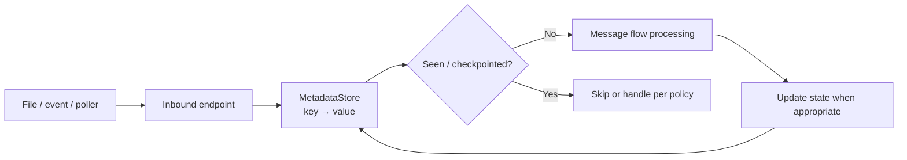
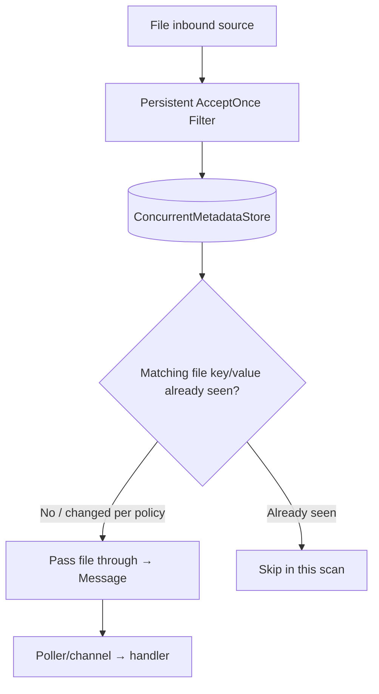
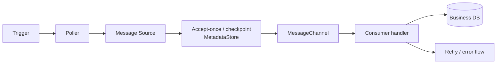

# MetadataStore and Small Persistent State in Spring Integration

## 1. Why Does a Message Flow Need to Remember a Small Amount of State?

Suppose a file inbound adapter scans the `/data/orders` directory every minute. It has processed `orders-42.csv`, but the application restarts mid-shift. If the filter only remembers seen files using an in-memory `Set`, after a restart the application might pick up that same file again and create duplicate orders. Similarly, a message consumer must remember processed `eventId` values, or a data source needs to remember a **checkpoint** to resume from the latest position.

In **Spring Integration Runtime**, `MetadataStore` is the abstraction that stores **`String key → String value`** pairs to serve precisely those requirements. It is particularly well suited for small control data: seen-file markers, source checkpoints, version values, recorded event IDs, or coordination attributes across runs. When you choose a durable implementation, state can survive endpoint stop/restart cycles or JVM restarts.

Lesson objectives:

1. Understand the `MetadataStore` and `ConcurrentMetadataStore` contracts and the `get`, `put`, `remove`, `putIfAbsent`, and `replace` operations.
2. Choose the right store for in-memory, properties-file, JDBC, or shared-backend state.
3. Apply a metadata store to a persistent accept-once filter, checkpointing, and an idempotent receiver.
4. Accurately analyze transaction, threading, retry, redelivery, and crash window boundaries.
5. Design keys, namespaces, cleanup, concurrency, monitoring, and troubleshooting procedures.

This lesson belongs to the **Metadata store** chapter of the `SPRING_INTEGRATION_RUNTIME` module. The sections on channels, endpoints, consumers, pollers, executors, errors, and correlation are used to explain **when** state is read/written and **what happens if processing is interrupted**.

## 2. What Is MetadataStore and What Is It Not?

### 2.1. The Data Contract

The `org.springframework.integration.metadata.MetadataStore` interface has three basic operations:

```java
public interface MetadataStore {
    String get(String key);
    void put(String key, String value);
    String remove(String key);
}
```

- `get(key)` returns a `String` value or `null` if the key does not exist.
- `put(key, value)` writes or updates a value; this is **not** a write-only-if-absent operation.
- `remove(key)` deletes the key and returns the old value, if any.

The store persists **string metadata**; by default it does not store entire `Message<?>` instances, message groups, Java objects, or transactional snapshots. Nor is it synonymous with a cache that has an automatic TTL. Size limits, durability, consistency, and speed depend on the implementation/backend.



The diagram is for logical illustration only. **When the marker is written** depends on each component. Do not assume every adapter always writes the marker *after* the business handler succeeds.

### 2.2. Distinguishing Three Common Abstractions

| Abstraction | Data Stored | Use When |
| --- | --- | --- |
| `MetadataStore` | Small string key/value pairs | Remember-once, checkpointing, processing markers, technical state. |
| `MessageStore` | `Message<?>` and payload/headers by message ID | Claim check or when the message itself must be retained. |
| `MessageGroupStore` | Messages by correlation group and group metadata | Aggregator, resequencer, release/complete state. |

For example: `"source:sftp:lastSeen" → "2026-11-22T01:00:00Z"` is appropriate metadata. A set of 5,000 messages waiting for a complete sequence to aggregate belongs in a `MessageGroupStore`; an entire multi-MB JSON order is likewise not suitable content for a metadata entry.

### 2.3. MetadataStore Is Not an Exactly-Once Mechanism

A marker `"event:E-123" → "processed"` only describes what the application **believes** happened. If writing the marker and updating the business database are not in the same atomic transaction, a power loss between the two operations can leave the marker and the actual outcome out of sync.

Therefore, `MetadataStore` supports **remembering state and coordination**, but does not by itself provide exactly-once guarantees, cross-system atomic commits, or broker acknowledgment rollbacks.

## 3. ConcurrentMetadataStore: Safe Updates Under Concurrent Consumers

In a runtime with multiple threads, executors, pollers, or multiple instances, two consumers can read the same key almost simultaneously:

```text
Consumer A: get("event:E-123") -> null
Consumer B: get("event:E-123") -> null
Consumer A: executes side effect
Consumer B: also executes side effect
Consumer A: put("event:E-123", "done")
Consumer B: put("event:E-123", "done")
```

Separate `get()` followed by `put()` calls are **not atomic**. `ConcurrentMetadataStore` extends `MetadataStore` with conditional operations:

```java
public interface ConcurrentMetadataStore extends MetadataStore {
    String putIfAbsent(String key, String value);
    boolean replace(String key, String oldValue, String newValue);
}
```

| Operation | Meaning | Used For |
| --- | --- | --- |
| `putIfAbsent(key, value)` | Writes only if the key does not yet exist; returns `null` if newly written, otherwise returns the existing value | Claiming/marking as seen while avoiding races within the store's atomic scope. |
| `replace(key, oldValue, newValue)` | Changes only if the current value equals `oldValue`; returns `boolean` | Compare-and-set to prevent overwriting state just updated by another consumer. |
| `remove(key)` | Removes the entry by key | Requires ownership design because removal is not value-conditional in the base interface. |

**Important note:** Atomicity only has meaning within **the shared scope of the implementation**. A `SimpleMetadataStore` backed by `ConcurrentHashMap` can coordinate threads within **a single JVM**, but two replicas each with its own store instance can still both claim an event. Use a shared backend that supports appropriate CAS/locking when multiple JVMs process the data source concurrently.

### 3.1. Short Java Example: Keys and Compare-and-Set

```java
import org.springframework.integration.metadata.ConcurrentMetadataStore;
import org.springframework.integration.metadata.SimpleMetadataStore;

public class MetadataStoreDemo {
    public static void main(String[] args) {
        // Demo within a single JVM; state is lost on restart.
        ConcurrentMetadataStore store = new SimpleMetadataStore();

        String key = "orders-source:checkpoint";
        store.put(key, "offset-100");

        String previous = store.get(key);
        boolean advanced = store.replace(key, previous, "offset-101");

        System.out.println(advanced);       // true if nobody changed the key
        System.out.println(store.get(key));  // offset-101

        String eventKey = "orders:event:E-123";
        String first = store.putIfAbsent(eventKey, "claimed");
        String second = store.putIfAbsent(eventKey, "claimed");

        System.out.println(first == null);      // true: first claim
        System.out.println(second);              // claimed: duplicate claim
        System.out.println(store.replace(
                eventKey, "claimed", "completed")); // true
    }
}
```

In this example, `SimpleMetadataStore` supports concurrent operations according to the contract in the current JVM. Returning `true` from `replace` is evidence of the **metadata value**, not proof that external business data committed successfully.

If a checkpoint needs to advance from `offset-100` to `offset-101` across multiple workers, use an optimistic concurrency loop when `replace` fails, while also enforcing ordering rules and source partitioning. Never automatically move backward to an older offset or "win" by calling unconditional `put`.

## 4. Choosing an Implementation Matched to the Runtime Lifecycle

| Implementation | Storage Location | Advantages | Limits to Manage |
| --- | --- | --- | --- |
| `SimpleMetadataStore` | Memory within one JVM | Lightweight, easy to test, no external infrastructure needed | Lost on restart; not shared across replicas. |
| `PropertiesPersistingMetadataStore` | Java properties/file | Can persist key/value pairs on disk | Need to understand `flush` behavior, filesystem, and concurrent writes; not multi-node safe by default. |
| `JdbcMetadataStore` | Relational database | Durability, can share DB and an appropriate transaction manager | Requires schema, connections, transactions, contention handling, and region management. |
| `RedisMetadataStore` | Redis | Fast access from multiple instances against a shared backend | Depends on Redis persistence, failover, and eviction/persistence policies. |
| Other implementations supported in the version in use | Specific backend | Can align with existing infrastructure | Must verify atomic CAS, persistence, and cleanup contracts. |

You should not describe a store with a single label like "persistent" and ignore configuration. For instance, Redis can be configured with eviction or lose unpersisted data in certain scenarios; a properties file might not have been flushed; JDBC might commit separately from the order-update transaction.

### 4.1. When to Use Which Store?

- **Unit tests/demos:** `SimpleMetadataStore` to focus on verifying key/logic behavior.
- **Single-instance app, small state, low write rate:** a properties file can suffice, provided flushing and backups are ensured.
- **Multiple replicas, durable state needed, and already using JDBC:** `JdbcMetadataStore` is a common choice, especially when coordinating with business data in the DB.
- **Shared infrastructure focused on low latency:** Redis can fit, but durability and consistency must be verified against requirements.

### 4.2. Distinguishing Persistence from Transactional Atomicity

**Persistence** means an entry survives a restart according to the backend configuration. **Transactional atomicity** means the metadata update and another operation commit or roll back together as a single unit.

For example, if `JdbcMetadataStore` and the business tables use the same `DataSourceTransactionManager`, the same resource, and an appropriate transaction boundary, they can commit together. If metadata lives in Redis while business data lives in PostgreSQL, those two updates do not automatically form a transaction. Do not assume Spring automatically provides XA/distributed transactions when you pass two different stores to two components.

## 5. JDBC Example: Persisting Checkpoints Durably

`JdbcMetadataStore` is a suitable choice when key/value pairs must survive restarts, multiple consumers share data, and a JDBC backend is already operated.

**Java configuration:**

```java
import javax.sql.DataSource;
import org.springframework.context.annotation.Bean;
import org.springframework.context.annotation.Configuration;
import org.springframework.integration.jdbc.metadata.JdbcMetadataStore;
import org.springframework.integration.metadata.ConcurrentMetadataStore;

@Configuration
public class MetadataConfiguration {
    @Bean
    public ConcurrentMetadataStore ordersMetadataStore(DataSource dataSource) {
        JdbcMetadataStore store = new JdbcMetadataStore(dataSource);
        store.setRegion("orders-ingest");
        return store;
    }
}
```

The snippet above assumes the database already has the `INT_METADATA_STORE` table schema (or configured prefix/schema) created using the script for the exact Spring Integration version. `setRegion(...)` allows logical partitioning among features sharing the same store backend; keys within each region still need clear naming. Creating the bean does not automatically create the database table for you.

**Using a checkpoint to resume polling after restart:**

```java
import org.springframework.integration.metadata.ConcurrentMetadataStore;

public final class CursorRepository {
    private static final String KEY = "orders-feed:last-committed-offset";
    private final ConcurrentMetadataStore metadataStore;

    public CursorRepository(ConcurrentMetadataStore metadataStore) {
        this.metadataStore = metadataStore;
    }

    public String lastCommittedOffset() {
        return metadataStore.get(KEY); // null if no checkpoint exists yet
    }

    public void saveCheckpoint(String offset) {
        metadataStore.put(KEY, offset);
    }
}
```

This is a state-storage API, **not** an automatic broker offset synchronization solution. `saveCheckpoint` must only be called at the exact point where the application determines all items prior to that offset have been successfully processed; with multiple consumers, add monotonicity checks and CAS logic so the checkpoint never moves backward.

### 5.1. Checkpoints Must Carry Clear Semantics

| Key/Value Design | Issue |
| --- | --- |
| `"orders:lastOffset" → "1042"` | If the source has multiple partitions, one global offset cannot represent every partition. |
| `"orders:partition-2:lastOffset" → "1042"` | Usable when each partition has an independent checkpoint; commit semantics must still align. |
| `"orders:lastSeenTime" → "2026-11-22T01:00:00Z"` | Identical timestamps can cause missed records if there is no tie-breaker. |
| `"orders:lastId" → "E-123"` | Must know whether the source guarantees ordering/uniqueness by ID. |

A good cursor must describe **completed progress**, not merely the latest message seen. When reading by timestamp, you typically need to combine the timestamp with a unique source ID to handle concurrent events at the same instant, or use a watermark with an overlap window and idempotency.

## 6. Persistent Accept-Once: Remembering Files Already Received

This is a classic application of a metadata store in file polling. A *persistent accept-once* filter records metadata for files that have passed the filter so subsequent scans and restarts can avoid re-accepting them according to the filter's filename/modified-time characteristics.

### 6.1. Processing Flow



Example bean connecting the filter to the store:

```java
import org.springframework.context.annotation.Bean;
import org.springframework.context.annotation.Configuration;
import org.springframework.integration.file.filters.FileSystemPersistentAcceptOnceFileListFilter;
import org.springframework.integration.metadata.ConcurrentMetadataStore;

@Configuration
public class FileFilterConfiguration {
    @Bean
    public FileSystemPersistentAcceptOnceFileListFilter ordersFileFilter(
            ConcurrentMetadataStore ordersMetadataStore) {
        // Prefix distinguishes the source/file filter in a shared store.
        return new FileSystemPersistentAcceptOnceFileListFilter(
                ordersMetadataStore, "local-orders:");
    }
}
```

Then attach `ordersFileFilter` to the file inbound adapter/flow using the configuration mechanism of the adapter in use. Declaring the filter bean does not automatically make every poller use it.

### 6.2. "Already Seen" Differs from "Business Committed"

A persistent accept-once filter may write its marker **when accepting the file to emit a message**, before the downstream consumer updates the database. If the handler subsequently fails, the marker may still exist. Then, even though the database never recorded the order, the next poll can skip the file because the filter considers it already received.

To handle this properly, define a recovery policy:

1. Is there a mechanism to roll back/remove the marker from the filter on failure?
2. Do you move the file to an error directory, re-send it via a separate adapter, or create a record needing retry?
3. Does the file need processing by an **idempotent business key** even if the filter might emit it again?
4. Does the store actually flush/commit the marker before a restart?

**Never claim an accept-once filter by itself guarantees business-level exactly-once.** It helps limit duplicate file ingestion within the filter's key/value scope. Successful processing, transactions, retries, and data persistence remain the flow's responsibility.

### 6.3. Filename, mtime, and Keys

Persistent filters typically combine the file path/name and last modified time (`lastModified`) to identify a file version. This is useful when a file is updated and needs to be re-ingested, but still carries risks around timestamp granularity, path changes, copy/rename operations, incomplete file writes, and source clock skew.

A resilient file pipeline can combine:

- A temporary/ready-file filter (for example, only accepting files renamed from a temporary name).
- A persistent accept-once filter with a unique prefix/region per source.
- Transaction control or marker recovery when the handler fails.
- Business idempotency to avoid duplicate orders even if a file is re-ingested.

For SFTP/FTP, choose the persistent filter corresponding to remote file metadata; do not use a `FileSystem...` filter for remote server file objects.

## 7. MetadataStore in an Idempotent Receiver

A consumer processing `OrderCreated` events usually requires the rule: **each business event produces at most one business change**, even if the source resends the message due to network errors, timeouts, or broker redelivery. Spring Integration supports *idempotent receiver* via `IdempotentReceiverInterceptor` and a selection strategy such as `MetadataStoreSelector`.

### 7.1. Choosing the Deduplication Key

```text
Message #1: eventId=E-123, orderId=SO-42, deliveryAttempt=1
Message #2: eventId=E-123, orderId=SO-42, deliveryAttempt=2

MetadataStore:
  orders:processed:E-123 -> value depends on strategy
```

Two deliveries may have different `MessageHeaders.ID` values and timestamps, yet share the same **business event ID**. Therefore, the deduplication key should be based on a stable contract, such as `eventId`, `sourceId`, and `partitionId`; do not default to the technical message ID generated for the current delivery.

### 7.2. Example Interceptor Declaration

```java
import org.springframework.context.annotation.Bean;
import org.springframework.context.annotation.Configuration;
import org.springframework.integration.handler.advice.IdempotentReceiverInterceptor;
import org.springframework.integration.metadata.ConcurrentMetadataStore;
import org.springframework.integration.selector.MetadataStoreSelector;
import org.springframework.messaging.Message;

@Configuration
public class IdempotentConfiguration {
    @Bean
    public IdempotentReceiverInterceptor orderIdempotentAdvice(
            ConcurrentMetadataStore ordersMetadataStore) {

        MetadataStoreSelector selector = new MetadataStoreSelector(
                ordersMetadataStore,
                (Message<?> message) -> {
                    Object eventId = message.getHeaders().get("eventId");
                    if (eventId == null) {
                        throw new IllegalArgumentException("Missing eventId");
                    }
                    return "orders:event:" + eventId;
                });

        return new IdempotentReceiverInterceptor(selector);
    }
}
```

After defining it, the advice must **be attached to the corresponding endpoint/handler** in your IntegrationFlow or annotation configuration. Merely declaring the bean does not automatically enable idempotency on every consumer.

Points to verify when using the interceptor:

- The selector determines whether the message **is marked as a duplicate**.
- Duplicate behavior also depends on the interceptor/configuration: some flows attach a duplicate header/marker and let the message proceed for the consumer to decide, while others discard it. So do not equate "checked by idempotent receiver" with always **blocking** the message.
- Configuring metadata rollback when a downstream handler throws affects whether the message is accepted again on a subsequent retry. Test success, handler failure, and async-branch errors separately.
- Recording a marker in `MetadataStore` does not mean all business side effects finished. When payment/database operations live in another backend, you still need transactions/idempotency in the business backend.

### 7.3. Risks of "Claim Before" vs. "Write Marker After"

| When Metadata Is Written | If JVM Crashes Mid-Way | Consequence |
| --- | --- | --- |
| **Before** executing side effect | Marker written, business work not done | Subsequent delivery may be misclassified as duplicate; lost work. |
| **After** executing side effect | Business succeeded, marker not written | Subsequent delivery may re-run the side effect; duplicate processing. |
| Same DB transaction as business update | If both operations truly share the local DB transaction | Can commit/roll back together, shrinking the crash window within that DB. |
| Marker in Redis, side effect in payment service | No shared transaction by default | Requires payment-side idempotency keys, recovery, and reconciliation. |

`ConcurrentMetadataStore.putIfAbsent` only resolves **races among consumers claiming the same key** within the store's scope. It does not by itself eliminate the crash window or create atomicity between Redis/JDBC and external services.

## 8. Designing Metadata Keys and Values

Keys are not a minor detail: the wrong key causes **false duplicates** (skipping work that should run) or **missed duplicates** (repeating work already done).

### 8.1. Namespaces Must Accurately Represent Source and Purpose

| Key Pattern | Meaning | Notes |
| --- | --- | --- |
| `orders:file:/data/orders/a.csv` | File marker on a specific adapter | Must standardize path/case/rename policy normalization. |
| `orders:event:warehouse-7:E-123` | Business event per source ID | Prevents ID collisions across independent upstreams. |
| `feed:orders:partition-2:cursor` | Per-partition checkpoint | Prevents overwriting another partition's offset. |
| `payments:request:E-123` | Marker per payment operation | Should not share a namespace with file-ingestion markers. |
| `tenant:42:source:sftp:lastSeen` | Logical tenant/source partitioning | A tenant ID in the key does not replace authentication/authorization. |

With `JdbcMetadataStore` supporting `region`, use both **a functional region** and **traceable keys**. Two applications sharing a database without agreeing on regions/keys can overwrite each other's markers.

### 8.2. Standardizing Format and Length

Because both keys and values are `String`:

- Define an explicit format such as ISO-8601 UTC, decimal integer, ordered version, or fixed ID.
- When updating offsets, avoid lexicographic comparison between `"9"` and `"10"`; parse numbers per contract.
- Do not rely on `toString()` of a Java object that may change across version upgrades.
- Do not store long payloads, serialized objects, raw access tokens, or personal data directly in keys/values unnecessarily.
- Check JDBC column length/backend limits, character encoding, and delimiter escaping.

### 8.3. Retention, TTL, and Cleanup

The base `MetadataStore` **does not define a universal TTL** across all implementations. If you want to retain event markers for 90 days, you need a backend cleanup mechanism or an application job. Deleting a marker allows old events **to be accepted again**; retention must at least cover the maximum window during which upstream may redeliver or replay, plus reconciliation policy.

For example, if a source can replay events after several months, a 7-day TTL on idempotency markers is usually insufficient. Conversely, storing every event ID indefinitely increases store size and index/query costs.

### 8.4. Ownership and Stale Claims

A `putIfAbsent(key, "claimed")` pattern can leave a `"claimed"` entry stuck forever if a worker crashes. To allow takeover, you need a **lease/expiry design with an owner token**, expiration timestamp, and corresponding atomic backend operation. You cannot safely solve the race with:

```java
// UNSAFE across multiple workers: another worker may have reclaimed it
// between get() and remove().
if ("claimed".equals(store.get(eventKey))) {
    store.remove(eventKey);
}
```

Because the base interface has no compare-and-delete, reclaiming claims by owner or true TTL requires backend/transaction features or a dedicated workflow. Avoid recording `"completed"` before the side effect actually finishes, and avoid deleting another worker's marker.

## 9. Metadata Store in Pollers, Transactions, and Retries

`MetadataStore` acts wherever components call its API. It **does not spawn threads, open transactions on its own, or replay messages**. Its practical effect depends on where reads/writes sit in the flow.



### 9.1. Threading and Transaction Boundaries

| Component | Typical Execution | What to Remember About Metadata |
| --- | --- | --- |
| `DirectChannel` | Handler runs on sender thread | Can join upstream transaction if sharing the same transaction manager and compatible propagation. |
| `ExecutorChannel` | Consumer runs on worker thread | Thread-bound upstream transactions do not propagate automatically; a marker written at the producer may already be committed before the worker processes. |
| `QueueChannel` + poller | Poller fetches messages on schedule | If a filter/marker runs before the queue, accepting a message does not mean the downstream handler after the poller succeeded. |
| Transactional poller | Advice can wrap `receive()` and synchronous processing | Rolls back the marker only if the metadata backend actually participates in the same compatible transaction. |
| JMS/Kafka inbound adapter | Ack/offset managed by container/transport | `MetadataStore` does not automatically roll back broker acks/offsets. |

Example:

```text
File poller
  → filter writes key "file:A"
  → ExecutorChannel (handoff succeeds)
  → worker calls saveOrder() and fails
```

A worker failure **after** handoff does not automatically roll back metadata written from the poller. If you must guarantee no lost messages, choose an architecture with a durable queue/outbox, filter recovery, or dedicated delivery protocol, combined with business idempotency.

### 9.2. Retry Advice and Marker Rollback Conditions

If a handler is wrapped by `RequestHandlerRetryAdvice`, it can re-invoke the handler when an exception is thrown. However:

- Handler retry **does not by default re-invoke** the inbound accept-once filter or the poller's file-fetch operation.
- If the metadata store wrote its marker on file receipt, handler retry only repeats downstream steps; the marker is not necessarily modified.
- If a JDBC marker and business update share an outer open transaction, a rollback may undo the marker. If retry happens **inside a transaction already marked rollback-only**, the next attempt cannot commit.
- An `ErrorMessageSendingRecoverer` sending an `ErrorMessage` after retries are exhausted does not by itself ensure the metadata rolled back or the file is ready for reprocessing.

For workloads needing strong consistency, retrying **outside each fresh transaction** is often appropriate for transient DB errors; check propagation and advice scope carefully, especially when the poller already opens a transaction.

### 9.3. When Should Checkpoints Be Written?

Consider a polling consumer reading events by offset:

```text
read offset=1042
  → process event
  → commit business database
  → write checkpoint offset=1042
```

In a design using two different backends, a crash **after the DB commit but before the checkpoint** causes event 1042 to be reprocessed. This is acceptable if the consumer is idempotent. Conversely, if the checkpoint is written **before** the business commit, a crash can cause event 1042 to be skipped unprocessed.

In a properly configured local JDBC transaction:

```text
BEGIN TX
  INSERT processed_events(event_id)
  UPDATE orders
  UPDATE INT_METADATA_STORE (checkpoint)
COMMIT TX
```

All three operations can commit together **if** they use the same database/resource and the transaction manager actually governs them. When broker acks lie outside that transaction, you still need a redelivery/idempotency policy.

## 10. Correlation and the Role of Small Metadata

`correlationId` in message headers helps link messages belonging to the same business process. You can store supplementary metadata keyed by correlation ID, for example:

```text
flow:checkout:SO-42:lastNotificationState → SENT
flow:checkout:SO-42:version                → 5
flow:checkout:SO-42:lastActivity            → 2026-11-22T01:00:00Z
```

However, `MetadataStore` **is not an aggregator**: it has no release strategy, does not retain a collection of `Message<?>` per group, and does not decide when enough parts have arrived. For use cases like "aggregate 5 messages" or "resequencer remembering released parts", use `MessageGroupStore` and the corresponding endpoint.

If you create hundreds of keys per correlation group, consider that the data has outgrown "small state". At that point a domain database record or group store may be easier to manage for consistency, retention, and querying.

## 11. Observability, Security, and Performance

### 11.1. Useful Metrics

| Signal | What to Watch For |
| --- | --- |
| Entry count per region/namespace | Keys growing endlessly due to missing retention or key-format changes. |
| Accept/duplicate ratio | Spikes in duplicates from broker redelivery, retries, file renames, or mapping bugs. |
| `get`/`putIfAbsent`/`replace` latency | Overloaded DB/Redis reducing poller throughput. |
| CAS conflict count | Multiple consumers contending on the same checkpoint or hot key. |
| Checkpoint age and source lag | Poller still running while progress state stops advancing. |
| Stale claimed entry count | Workers crashing without valid cleanup/takeover mechanisms. |
| Flush/commit error rate | Markers may not be durable even though code finished calling `put`. |
| Retry and dead-letter count | Error/recovery flows affecting metadata state. |

Do not confuse store metrics with business metrics: "marker written" and "order committed" must be measured separately. In production, include `eventId`/`traceId` and endpoint name when logging, but avoid printing full keys if keys contain PII.

### 11.2. Performance

- High-frequency pollers updating a single key create contention; partition keys by source/partition when the contract permits.
- JDBC stores depend on indexes, connection pools, transaction timeouts, and commit frequency.
- Properties files must be flushed at the right cadence; flushing every event can incur heavy I/O, while flushing too infrequently widens the marker-loss window on crash.
- Redis depends on network latency, persistence/eviction policies, and key size/cardinality.
- Never use a single global checkpoint key when multiple partitions have independent progress.
- When multiple replicas access the store concurrently, test failover and contention rather than testing only a single instance.

### 11.3. Confidentiality and Sensitive Data

Small metadata can still expose filenames, customer IDs, tenants, payment statuses, or processing schedules. Therefore:

1. Do not store tokens, passwords, raw authorization headers, card numbers, or unnecessary sensitive data.
2. Hash or normalize keys when needed, while preserving collision resistance and debuggability.
3. Restrict backend access permissions and protect backups and logs.
4. Do not trust an external `eventId` header as authenticated proof; validate and namespace by verified source/tenant.
5. Design retention aligned with business requirements and storage limits.

## 12. Common Troubleshooting Table

| Symptom | Possible Causes | How to Check |
| --- | --- | --- |
| File reprocessed after restart | `SimpleMetadataStore`, unflushed properties, persistent filter not used, key format changed | Inspect implementation, marker in backend, and persistence mechanism. |
| File not reprocessed even though prior handler failed | Accept-once marker written before downstream failure | Correlate marker/handler timeline, filter rollback/recovery, and business state. |
| Two replicas process the same event | Separate per-instance stores, `get`+`put` race, non-atomic backend CAS | Inspect shared store, `putIfAbsent`, transactions, and concurrency. |
| Committed event gets reprocessed | Checkpoint not committed, broker redelivery, key retention too short | Determine commit order and idempotency key. |
| Checkpoint moves backward | Workers updating without per-partition CAS/ordering | Parse offsets, use compare-and-set, and partition keys. |
| Poller stops making progress while still running | Stale claim, lock contention, store connection failure | Check marker age, error channel, connections, and backend health. |
| `JdbcMetadataStore` throws SQL errors | Missing schema/table, wrong region/prefix, DB permissions, transaction conflict | Verify version-matched schema, indexes, exceptions, and connections. |
| Redis loses markers | Eviction or durability/failover not meeting requirements | Inspect eviction policy, persistence, and replication/failover. |
| Properties store loses updates | Not flushed, crash before flush, multiple processes writing the same file | Inspect flush lifecycle and multi-process limitations. |
| Infinite retries on an old event | Marker rolled back before every retry or upstream continuously redelivers poison message | Enforce retry limits, DLQ, stable event ID, error/recovery policy. |
| Metadata grows unbounded | No cleanup, no TTL, key generated per delivery ID | Design namespaces, retention, and control cardinality. |
| DB transaction rolls back but marker remains | Marker stored in a different backend or outside the transaction boundary | Verify resource, transaction manager, threading, and propagation. |

Investigation procedure:

1. Identify which **component** reads/writes the store: inbound filter, idempotent receiver, custom handler, or checkpoint service.
2. Record the **exact key, region, value, storage location**, and timestamps before/after the operation.
3. Identify the **thread and transaction boundary**: poller, `DirectChannel`, `ExecutorChannel`, or broker listener.
4. Compare **business commit, marker commit, and source ack**; never conclude from a single `put` log line.
5. Inspect **retry/redelivery** and exceptions on `errorChannel`, including where a crash could occur.
6. Check **CAS/conflicts, flush/persistence, cleanup/TTL, and schema/backend health**.
7. Fix the contract and re-test against restart, race, timeout, duplicate, and failure-injection scenarios.

## 13. Hands-On Exercises

### Exercise A — Simple State Persistence

1. Run `MetadataStoreDemo` with `SimpleMetadataStore` and write markers/checkpoints.
2. Create two threads calling `putIfAbsent("event:E-123", "claimed")` concurrently and count how many receive `null`. With an atomic shared store, only one thread claims successfully.
3. Switch to two independent processes, each with its own `SimpleMetadataStore`, and observe why deduplication no longer holds across two JVMs.
4. Replace with a shared persistent `ConcurrentMetadataStore` and repeat the concurrency test.

### Exercise B — Restart with File Inbound

1. Create an `orders.csv` file in the inbound directory and configure a persistent accept-once filter using an appropriately durable shared store.
2. Poll twice and verify the file is accepted only according to the current policy.
3. Restart the application, poll again, and observe whether the marker is retained.
4. Simulate a downstream error right after the file is accepted, inspect the marker, and design an explicit recovery mechanism.
5. Change the file's content/modified time and verify whether the filter re-accepts it under its conditions.

### Exercise C — Crash Window and Checkpointing

1. Simulate reading event 1042, writing to the DB successfully, and crashing before `saveCheckpoint`. Restart and observe event 1042 being re-received.
2. Write the marker before the DB write and crash immediately after writing the marker. Demonstrate how this risks skipping work.
3. Use the same local JDBC transaction for the business update, processed-event record, and metadata checkpoint; throw an exception before commit and verify all three roll back.
4. Add an HTTP side effect outside the DB transaction and explain why a DB rollback does not undo the HTTP request.

### Self-Check Questions

1. When should you use `MetadataStore` instead of `MessageGroupStore`?
2. Why don't `get` followed by `put` protect two consumers racing for the same event?
3. What does `putIfAbsent` guarantee, and what does it **not** guarantee if a worker crashes right after claiming?
4. Why is `SimpleMetadataStore` insufficient for two replicas?
5. Does a persistent file filter prove the downstream business transaction committed successfully?
6. Why must checkpoints be separated per partition when a source has multiple partitions?
7. When the JDBC store and business DB use two different transaction managers, what can go wrong?
8. Why does metadata with a TTL shorter than the maximum upstream replay window make duplicate events dangerous?
9. Does a poller's transaction automatically propagate across an `ExecutorChannel`?
10. How can you distinguish CAS race errors, missing flushes, and broker redelivery in production?

## 14. References

- [Spring Integration Reference — Metadata Store](https://docs.spring.io/spring-integration/reference/meta-data-store.html)
- [Spring Integration Reference — Message Store](https://docs.spring.io/spring-integration/reference/message-store.html)
- [Spring Integration Reference — File Reading and File Filters](https://docs.spring.io/spring-integration/reference/file/reading.html)
- [Spring Integration Reference — Idempotent Receiver](https://docs.spring.io/spring-integration/reference/handler-advice/idempotent-receiver.html)
- [Spring Integration Reference — Transaction Support](https://docs.spring.io/spring-integration/reference/transactions.html)
- [Spring Integration API — MetadataStore](https://docs.spring.io/spring-integration/api/org/springframework/integration/metadata/MetadataStore.html)
- [Spring Integration API — ConcurrentMetadataStore](https://docs.spring.io/spring-integration/api/org/springframework/integration/metadata/ConcurrentMetadataStore.html)
- [Spring Integration API — JdbcMetadataStore](https://docs.spring.io/spring-integration/api/org/springframework/integration/jdbc/metadata/JdbcMetadataStore.html)
