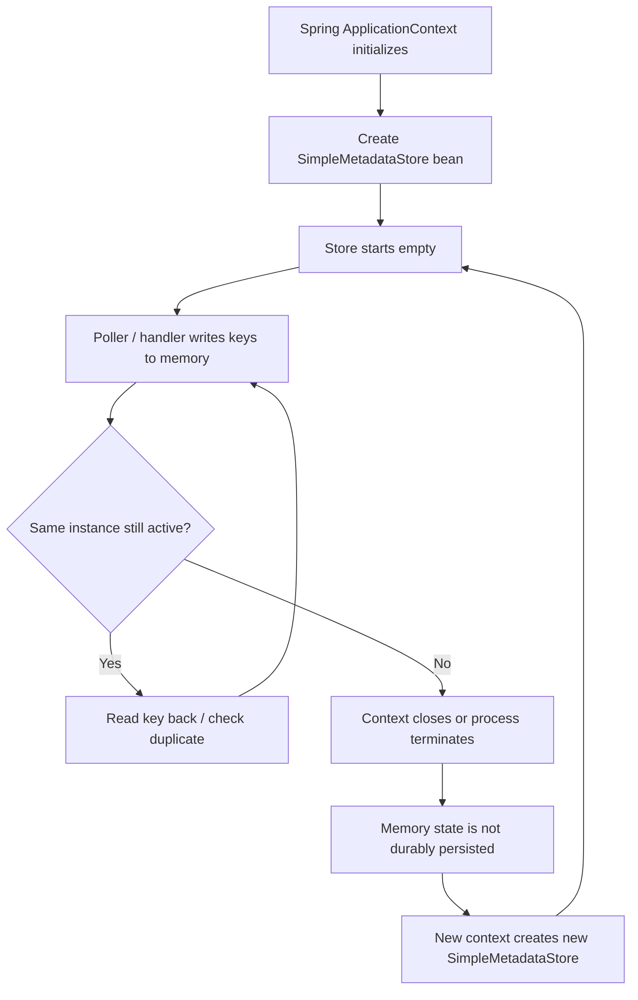
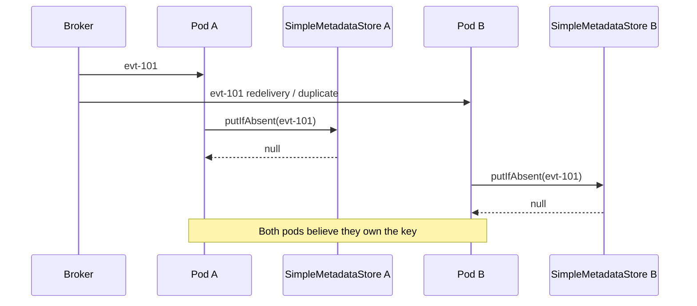
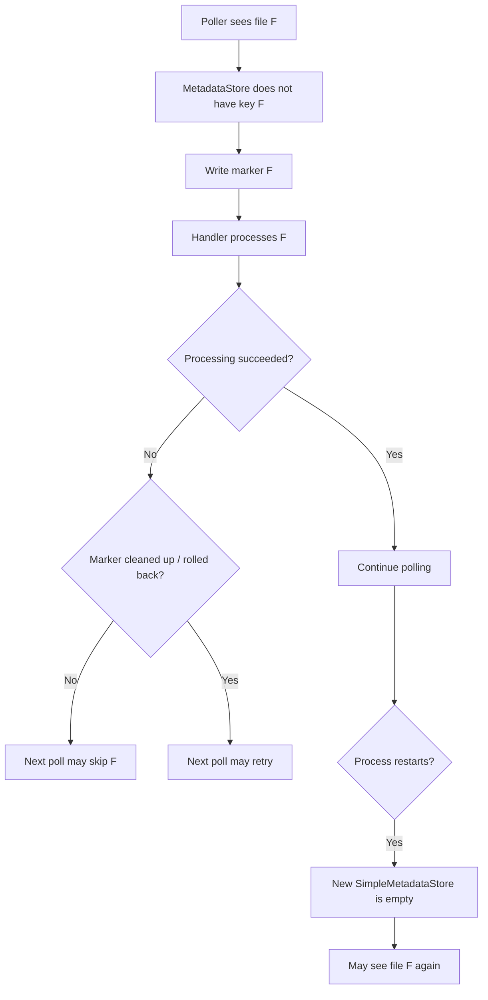

# SimpleMetadataStore and Memory Lifecycle in Spring Integration

## 1. Why Is In-Memory Metadata a Runtime Decision?

In the `SPRING_INTEGRATION_RUNTIME` module, Spring Integration runs and coordinates messages across **channels, endpoints, consumers, pollers, and executors**. Beyond the payload, the runtime also needs to remember small pieces of information so subsequent runs can make decisions: files already seen, offsets read, idempotency keys, duplicate-check state, or a data source's checkpoint.

`SimpleMetadataStore` is an implementation that **stores metadata in process memory**. It is useful because it has minimal dependencies, fast access, and works well for testing. However, a key appearing in `SimpleMetadataStore` only makes sense when we understand **how long that store object lives, how many consumers share it, when data gets deleted, and what happens when the application restarts**.

For example, consider a service processing the `order-paid-202` event:

- The first time the handler receives the event, it marks `orders:v1:order-paid-202` as seen and performs the work.
- The same message is replayed within the same JVM; the handler detects the key and can skip it.
- The process restarts; the new `SimpleMetadataStore` bean no longer has the old key.
- The source resends the event, and the handler risks running again, even though the business effect already committed the first time.

**That is a limit of the memory lifecycle**, not a bug in the retry mechanism. When recovery across restarts is required, you must choose a durable store or design external idempotency/recovery mechanisms.

### Learning Objectives

After this lesson, you will be able to:

1. Explain `MetadataStore`, `ConcurrentMetadataStore`, and `SimpleMetadataStore`, along with their basic operations.
2. Trace the lifecycle from bean initialization, sharing across multiple endpoints, key updates, and key removal, through context/process termination.
3. Analyze risks when multiple threads share a store, multiple instances use separate stores, and keys live too long.
4. Design experiments demonstrating duplicate detection with `putIfAbsent`, `replace`, and cleanup on failure.
5. Distinguish "metadata written" from "business committed", and decide when to move to a durable store.
6. Connect this knowledge to pollers, retries, message stores, transactions, correlation, and runtime observability.

## 2. What Does MetadataStore Store?

In Spring Integration, a **metadata store** stores `String` **key → value** pairs to support processing decisions. It is not a storage repository for `Message<?>` payloads, nor does it provide a message queue on its own.

| Abstraction / Component | Main Content | Role |
|---|---|---|
| `MetadataStore` | Key/value metadata | `put`, `get`, `remove` a marker or checkpoint. |
| `ConcurrentMetadataStore` | Metadata with atomic contending operations | `putIfAbsent` and `replace` against old values; useful when multiple threads claim the same key. |
| `SimpleMetadataStore` | Metadata in local JVM memory | Simple implementation of `ConcurrentMetadataStore`; does not provide persistence across restarts. |
| `MessageStore` / `MessageGroupStore` | Message or group state | Stores payloads, headers, correlation/group state; different contract from metadata store. |
| `JdbcMetadataStore` or another shared durable store | Metadata in a database/shared storage | The direction to choose when keys must survive restarts or be shared across instances. |

**Do not use `SimpleMetadataStore` as if it were `SimpleMessageStore`.** A key `"last-file" → "invoice.csv"` does not mean the store retains the file's bytes, nor does it hold the full `Message<?>`. If the source file is deleted, metadata cannot recover the payload by itself.

Example metadata in a system:

```text
source:invoices:last-file        -> invoice-2026-11-22.csv
source:orders:last-offset        -> 8842
idempotent:loyalty:v1:evt-202    -> PROCESSED
poller:sync:last-success         -> 2026-11-22T01:00:00Z
```

These keys illustrate how **the application** names and stores values; Spring Integration does not create them automatically just because `SimpleMetadataStore` is declared. Each adapter/filter or custom code defines the meaning of each key/value pair.

### Basic Operations API

```java
import org.springframework.integration.metadata.ConcurrentMetadataStore;
import org.springframework.integration.metadata.SimpleMetadataStore;

ConcurrentMetadataStore store = new SimpleMetadataStore();

// Overwrite the value for the key.
store.put("source:orders:last-offset", "42");

// Read: returns null if the key does not exist.
String offset = store.get("source:orders:last-offset"); // "42"

// Write only if key does not exist; returns existing value if present.
String previous = store.putIfAbsent(
        "source:orders:last-offset", "43");             // "42"

// Compare-and-set: change only if current value equals "42".
boolean changed = store.replace(
        "source:orders:last-offset", "42", "43");       // true

// Remove key; afterward no marker remains in the store.
String removed = store.remove("source:orders:last-offset"); // "43"
```

With `putIfAbsent`, when the key does not yet exist, the result is `null` and the new key is added. If the key already exists, the method returns the old value without modifying it. With `replace`, only one caller can win when multiple threads concurrently try to change from the same old value to a new value on a shared instance, per the atomic operation's contract.

Individual `put` and `get` calls do not form a multi-operation transaction. In particular, the sequence `get(key) == null` followed by `put(key, value)` is **not atomic** under multiple threads.

## 3. Memory Lifecycle: From Bean Creation to Restart

A typical `SimpleMetadataStore` holds metadata in an in-process concurrent map structure. Entries are held by the living store object, are not automatically written to disk, and have no built-in TTL expiration mechanism in `SimpleMetadataStore`.



### Lifecycle by Spring Bean Scope

**Singleton bean in an `ApplicationContext`:** by default, a singleton bean is reused across invocations within the same context. If multiple endpoints receive **the same bean instance**, they see the same keys/values and can coordinate through the concurrent API.

**Creating `new SimpleMetadataStore()` on every call:** each object has its own map, so calls no longer share metadata. Declaring the store as a bean and injecting it into consumers avoids this mistake.

**Creating two different beans:** even though both have type `SimpleMetadataStore`, state is not automatically merged. A handler writing a key to store A does not make a handler using store B see that key.

**Closing the context or restarting the JVM:** without an external component persisting/restoring state, a new instance starts empty. You cannot expect metadata to be "picked up again" simply by reusing the old bean name.

**GC and data retention:** while the bean holds a reference to the map, remaining entries are not reclaimed by the garbage collector merely because they have not been read for a long time. To free them, you must intentionally delete entries, discard the entire store when the lifecycle ends, or move to a storage architecture with a retention policy.

### Which Events Do *Not* Automatically Delete Keys?

| Runtime Event | Key in `SimpleMetadataStore` |
|---|---|
| Handler returns normally | Kept intact, unless handler/filter explicitly removes or updates it. |
| Handler throws an exception | Previously written key may still remain; a DB transaction does not automatically roll back the map. |
| Poller runs a new cycle | Still reads keys from the previous cycle if using the same store instance. |
| An executor thread terminates | Key does not automatically disappear when the thread exits. |
| Message times out at gateway | Key does not expire automatically on reply timeout. |
| Message is routed to error channel | Key is not automatically reverted by error handling. |
| ApplicationContext/JVM is recreated | New local map does not contain old keys unless explicitly reloaded. |

This table explains why a failure after the "mark as seen" step can become a recovery issue on the next retry.

## 4. Runnable Demo: Sharing Metadata Across Messages in One JVM

The following example demonstrates **in-memory scoped deduplication** over a `DirectChannel`. This is an exercise on lifecycle and concurrency, **not a design that guarantees business exactly-once across restarts**.

Assume the application has Spring Context and `spring-integration-core`. Place public classes/records in separate `.java` files under package `example.integration`. Use Java 17+ for `record`.

### 4.1. Creating the Channel and Singleton Metadata Store

```java
package example.integration;

import org.springframework.context.annotation.Bean;
import org.springframework.context.annotation.ComponentScan;
import org.springframework.context.annotation.Configuration;
import org.springframework.integration.channel.DirectChannel;
import org.springframework.integration.config.EnableIntegration;
import org.springframework.integration.metadata.ConcurrentMetadataStore;
import org.springframework.integration.metadata.SimpleMetadataStore;
import org.springframework.messaging.MessageChannel;

@Configuration
@EnableIntegration
@ComponentScan(basePackageClasses = DemoEventHandler.class)
public class DemoConfig {

    @Bean("eventsIn")
    public MessageChannel eventsIn() {
        return new DirectChannel();
    }

    @Bean
    public ConcurrentMetadataStore demoMetadataStore() {
        return new SimpleMetadataStore();
    }
}
```

Every time a handler is injected with `demoMetadataStore` in the same context, it references the same instance. Do not instantiate a new store inside `handle()`.

### 4.2. Message and Handler

```java
package example.integration;

public record DemoEvent(String eventId, String description) {}
```

```java
package example.integration;

import org.springframework.integration.annotation.MessageEndpoint;
import org.springframework.integration.annotation.ServiceActivator;
import org.springframework.integration.metadata.ConcurrentMetadataStore;

@MessageEndpoint
public class DemoEventHandler {

    private final ConcurrentMetadataStore store;

    public DemoEventHandler(ConcurrentMetadataStore store) {
        this.store = store;
    }

    @ServiceActivator(inputChannel = "eventsIn")
    public void handle(DemoEvent event) {
        if (event.eventId() == null || event.eventId().isBlank()) {
            throw new IllegalArgumentException("eventId must not be blank");
        }

        String key = "demo:v1:" + event.eventId();
        String previous = store.putIfAbsent(key, "IN_PROGRESS");

        if (previous != null) {
            System.out.println("Already claimed: " + key
                    + ", current state=" + previous);
            return;
        }

        try {
            performDemoWork(event);
            store.replace(key, "IN_PROGRESS", "DONE");
        } catch (RuntimeException failure) {
            // Illustrated only for demo operations without external side effects.
            store.remove(key);
            throw failure;
        }
    }

    private void performDemoWork(DemoEvent event) {
        System.out.println("Handled: " + event.eventId()
                + " - " + event.description());
    }
}
```

Expected behavior:

- First time with `eventId = "evt-101"`: `putIfAbsent` returns `null`, the handler executes `performDemoWork`, and transitions state to `DONE`.
- Second time in the same context: `putIfAbsent` returns `"DONE"`, and the handler enters the duplicate-detection branch.
- Two threads receive `evt-101` concurrently: with the same `SimpleMetadataStore` instance, only one thread wins the key via `putIfAbsent`; the other sees the existing value.
- If the demo code throws `RuntimeException` before finishing, the `catch` branch deletes the key so another attempt can retry.

**Important limitation:** the `catch` branch deleting the marker is safe only for *demo work* with no irreversible side effects. If business logic already called a payment API or committed to the DB before throwing, deleting the marker can cause a retry to **execute the side effect a second time**. If a duplicate arrives while the marker is still `IN_PROGRESS` and the source already acked immediately, that duplicate may be skipped even if the first attempt later fails. Such scenarios require a state machine/lease and transactions or idempotency at the target resource; `SimpleMetadataStore` alone cannot solve them.

### 4.3. Resending the Same Event and Creating a New Context

```java
package example.integration;

import org.springframework.context.annotation.AnnotationConfigApplicationContext;
import org.springframework.messaging.MessageChannel;
import org.springframework.messaging.support.MessageBuilder;

public class DemoMain {

    public static void main(String[] args) {
        for (int run = 1; run <= 2; run++) {
            try (var context =
                    new AnnotationConfigApplicationContext(DemoConfig.class)) {

                MessageChannel channel =
                        context.getBean("eventsIn", MessageChannel.class);

                var event = new DemoEvent("evt-101", "metadata lifecycle");
                channel.send(MessageBuilder.withPayload(event).build());
                channel.send(MessageBuilder.withPayload(event).build());
            }
        }
    }
}
```

Each time a context is created in this example, the first message is processed and the second is identified as a duplicate. On the second loop iteration, the **new context** owns a fresh `SimpleMetadataStore`, so `evt-101` is processed again. Try placing breakpoints in the constructor and `putIfAbsent` to observe the key disappearing after the old context closes.

Running this example directly requires no database or broker, because both the channel and metadata live in memory. That is also the **recovery limit** of the demo.

## 5. What Happens When Two Consumers or Two Instances Receive the Same Key?

### 5.1. Same JVM, Same Store

`ConcurrentMetadataStore.putIfAbsent` lets two threads contend for a key without manually implementing read-then-write logic:

```text
Thread A -> putIfAbsent("demo:v1:evt-101", "IN_PROGRESS") -> null
Thread B -> putIfAbsent("demo:v1:evt-101", "IN_PROGRESS") -> "IN_PROGRESS"

A acquires the claim; B sees an existing owner.
```

This is **atomicity of a single map operation**, not a transaction spanning `handler + database + queue ack`. If two handlers use **two separate store instances**, both `putIfAbsent` calls can return `null` because they are not operating on the same map.

### 5.2. Two JVMs/Pods



Scaling an application with Kubernetes, rolling deploys, or running two application contexts **does not** turn in-memory stores into a shared store. When shared claims are required, choose a metadata store backed by a shared resource (such as JDBC/Redis depending on the system), or use a unique constraint/inbox in the business database.

### 5.3. Misconceptions to Avoid

| Observation | Correct Conclusion |
|---|---|
| Two threads did not process the same event together locally | Only proves contention logic within one JVM/shared store in that test. |
| Restart causes the event to be processed again | In-memory contract lost state; external recovery outside the JVM is needed. |
| Using a singleton bean | Shared within one context, not cluster-wide. |
| Calling `putIfAbsent` | One key is claimed atomically in that store, not a guarantee of once-only business effects. |
| Adding `@Transactional` on the handler | A JDBC transaction does not automatically roll back changes in `SimpleMetadataStore`'s map. |

## 6. How Metadata Is Retained Too Long: Memory Growth

A `SimpleMetadataStore` does not cap entry counts on its own. If every request has a new ID, the number of keys can grow continuously:

```text
New event rate       = 100 events/second
Time without cleanup = 1 day
New keys             = 100 × 86,400 = 8,640,000
```

That is **8.64 million entries**, not counting keys for other sources or retries. Even when the value is just `"DONE"`, the map must retain the key, value, entry, hash/bucket, and associated Java objects. Heap usage cannot be accurately estimated from string UTF-8 bytes alone.

Rough estimate:

\[
N \approx \lambda \times T_{\text{retention}}
\]

\[
M_{\text{approx}} \approx N \times (S_{\text{key}} + S_{\text{value}} + S_{\text{object/entry}})
\]

Where `λ` is the rate of new keys per second, `T` is retention duration, and `S` is only an approximate size. Java version, String representation, map layout, GC, object uniqueness, and heap overhead can skew the numbers. Use a **heap profiler or realistic load test** to determine safe limits.

### Signals to Watch

- Heap used grows proportionally with **unique event IDs**, not dropping after normal GC.
- Longer GC pauses and rising allocation rate when keys/values are long or traffic is high.
- Full GC still fails to reclaim entries referenced by the map.
- After restart heap usage drops, but **duplicate detection capability also disappears**.
- Duplicate detection rate drops abnormally after a rolling restart, even though redelivery rate stays constant.

**Do not conclude a memory leak just because heap grows.** When an application intentionally retains every event ID permanently, that is **growth from retention policy**, distinct from objects retained unintentionally. You must define when a key loses business value to pick the right solution.

### Safe Deletion or Just Deferring the Bug?

Calling `store.remove(key)` frees state but also allows the same event to be accepted again. For idempotency, delete only after **the redelivery/replay window** has passed or when another durable layer protects against duplicates.

If a poller uses the key as a checkpoint, deleting the key can make the poller read from the beginning again. If the key represents a workflow's "processed" state, deleting it while a worker is still running can let a second worker reclaim the same job.

When TTL, size caps, or time-based eviction are required, design a **dedicated lifecycle mechanism** or choose a store supporting appropriate retention; `SimpleMetadataStore` does not provide built-in TTL or cleanup jobs. Timer-based cleanup is also often insufficient for safety when coordination across multiple threads or instances is required.

## 7. Relationship with Pollers, File Filters, Checkpoints, and Executors

Several Spring Integration components rely on metadata to remember **already-read items or state from the previous poll**. For instance, accept-once file filters, checkpoints, or offset trackers can use `MetadataStore` / `ConcurrentMetadataStore` according to each component's contract.

Note that the word "persistent" in the name of a filter or tracker **does not guarantee durable persistence** if the injected metadata store itself is memory-only.

| Scenario | How `SimpleMetadataStore` Helps | Lifecycle Risk |
|---|---|---|
| File poller in one JVM | Marks seen files to curb duplicate processing across poll cycles. | Restart may rescan old files without a durable store or source cleanup. |
| Idempotent receiver | Detects keys encountered in the same instance. | Business effects can repeat after restart or on another pod. |
| Source offset/cursor | Remembers last read position during the current lifecycle. | Checkpoint is lost on restart; must define replay/start position. |
| `ExecutorChannel` with multiple workers | Atomic `putIfAbsent` can reduce duplicate processing when sharing the store bean. | Transactions on another thread do not roll back markers; a dead worker can leave a key `IN_PROGRESS` indefinitely. |
| Request–reply gateway | Stores auxiliary metadata for request tracking. | Keys do not expire automatically on gateway reply timeout; return addresses should not be stored as long-term checkpoints. |
| Retry/advice chain | Markers can help detect duplicate attempts. | Writing a marker before work and hitting an exception can cause retries to be skipped. |

**Checkpointing and acking are two distinct decisions.** An offset written to `SimpleMetadataStore` before the handler finishes can skip unprocessed messages after a failure. Conversely, writing it after processing can cause a message to be re-read if the process dies between business commit and checkpoint. Preserving outcomes requires transaction, retry, and idempotency strategies matched to the source.

### Example Poller Timeline



This is an **explanatory model**, not a guarantee of operation order for every file filter. Some filters update the marker on **accept** before the message reaches the handler; some have separate retry/recovery configuration. Always check the exact contract of the adapter and where exceptions are handled.

## 8. Idempotent Receiver: "Seen" Metadata Differs from "Completed"

A filter/`IdempotentReceiverInterceptor` uses keys to detect duplicates. Yet two different questions must be answered:

1. **Seen:** has this key ever appeared in the metadata store?
2. **Completed:** has the business effect for this key committed successfully?

A `seen` marker written too early can cause an **incomplete** message to be treated as a duplicate on the next retry.

```text
Attempt 1:
  putIfAbsent(eventId) succeeds
  call database => exception, transaction rolls back
  metadata key remains in SimpleMetadataStore

Attempt 2:
  putIfAbsent(eventId) sees existing key
  flow skips event
  => business work incomplete yet never retried
```

Even when switching to a durable metadata store, the problem persists if **marker and business effect do not commit in the same transaction**, or if there is no sufficiently strong state machine/recovery mechanism.

### Approach by Requirement Level

| Requirement | Viable Solution | Limitations to State Clearly |
|---|---|---|
| Demo or temporary processing within a single JVM | `SimpleMetadataStore` + `putIfAbsent` | Metadata lost on restart; does not protect side effects after a crash. |
| Deduplication across restarts and multiple instances | Shared/persistent `ConcurrentMetadataStore` | If business effects live on another resource, atomicity is not automatic. |
| DB processing requiring once-only business effect | Inbox table/unique business key + business update in **the same DB transaction** | Redelivery can still happen; handle duplicates per contract. |
| External API/email/payment involved | Provider idempotency key, outbox/inbox, or workflow with reconciliation | No local JDBC transaction rolls back a completed HTTP call. |
| Long-running work with multiple workers | `IN_PROGRESS/COMPLETED` with lease, ownership, and recovery | Lease expiration does not prove the old side effect did not occur; needs fencing/reconciliation. |

**`correlationId`** links messages in splitters/aggregators; it is not automatically an idempotency key. One flow can emit multiple distinct messages sharing the same correlation ID. Use a **stable business event ID** combined with a consumer/operation namespace, such as `loyalty-award:v1:evt-202`.

## 9. Distinguishing Memory Consistency, Thread Safety, and Persistence

Three properties are often conflated:

| Property | `SimpleMetadataStore` in One JVM | When Multiple Instances / Restarts Are Needed |
|---|---|---|
| **Thread safety** of store operations | `putIfAbsent`/`replace` coordinate concurrent access on the same object. | Each instance has independent state; must use a shared store for cross-JVM coordination. |
| **Atomicity** of a single key/value operation | Provided by the concurrent operations offered. | Not equivalent to multi-key transactions or DB transactions. |
| **Durability** on process death | Not guaranteed. | Requires persistence and proper commit/flush/backup. |
| **Consistency** with business database | No automatic atomic commit between the map and JDBC. | Requires transaction/resource design, or accepting eventual consistency and recovery. |
| **Eviction/TTL** | None by default. | Choose a dedicated retention policy or a store that supports it. |

For `ConcurrentMetadataStore`, `replace(key, expected, newValue)` is an entry-level **compare-and-set** model. It helps with conditional checkpoint updates but does not replace transactional monotonic offsets. If two workers process offsets 100 and 101, a rule that "writes the latest offset without comparing order" can move the checkpoint **backward to 100** when the slower worker writes last; the application must design an order-preserving algorithm.

## 10. When Should You Move from SimpleMetadataStore to a Durable Store?

You can use the following selection matrix:

| Condition | Keep `SimpleMetadataStore` | Should Change Store/Design |
|---|---|---|
| State needed only during a single app run | Suitable | Not yet necessary. |
| Metadata can be safely reconstructed from source | May work once replay is defined | Use durable if replay cost is too high or side effects are sensitive. |
| Restart can occur anytime and duplicate processing is unacceptable | Not suitable on its own | Shared persistent store or business ledger transaction. |
| Multiple pods must see the same key | No | Shared store, lock/unique constraint, or appropriate broker semantics. |
| Key count grows without bound | Unsuitable without cleanup | TTL/retention/partitioning or persistence with manageable capacity. |
| Near-zero RPO required for checkpoints | No | Proven durable store with matching transaction/ack behavior. |
| Metadata contains secrets or sensitive data | Avoid putting raw values in memory/logs even in testing | Opaque keys, access control, encryption, and policy-driven retention. |

In real systems, `JdbcMetadataStore` is an option when a shared database already exists; some applications use Redis or another shared store for metadata. Verify the contract, atomic semantics of `putIfAbsent`/`replace`, schema/namespace, durability (persistence configuration), timeouts, and behavior on store disconnection. **"Running on Redis/DB" does not automatically prove zero RPO or atomic coupling with the business DB.**

### Short Migration Plan

1. Inventory all key namespaces, which consumers read/write them, value meanings, and retention durations.
2. Determine whether the source replays if old keys are absent, and whether replays cause duplicate side effects.
3. Decide startup behavior when switching to the new store: backfill keys, perform controlled replay, or start a new key epoch/version.
4. Configure the persistent store and test **multiple instances contending on the same key**, mid-flight restarts, and transactions/acks.
5. Verify duplicate metrics and business-effect counts before/after switching; establish a deployment rollback plan that does not break key semantics.

**Do not assume merely changing the bean type migrates old metadata.** In-memory data from the old process does not automatically transfer to the database; during a rolling update, instances running the two store types can make conflicting decisions.

## 11. Observing, Measuring, and Diagnosing the Memory Lifecycle

When a flow behaves abnormally, log details by **business event ID** and **processing timestamp**, not only by framework message UUID.

| Signal | Meaning |
|---|---|
| Unique keys claimed per minute | Growth rate of metadata. |
| Duplicate count and duplicate ratio | Frequency with which the same key returns. |
| Count of keys stuck `IN_PROGRESS` too long | Workers may have died or the flow lacks completion/recovery handling. |
| Heap used, GC pauses, heap dump | Identify memory pressure and maps holding entries long-term. |
| Restart / context-recreation count | Explains sudden drops in duplicate protection. |
| Executor queue length / poller delay | Identifies threads or schedules affecting when markers are updated. |
| Business commit count per event ID | Distinguishes handler execution count from actual side-effect count. |

`ConcurrentMetadataStore` does not define a common `size()` API across all implementations. To track entry counts, use application counters, custom metrics, or implementation-specific inspection tools; do not assume every store lets you iterate keys or read all contents.

### Symptom-Based Diagnosis

| Symptom | Possible Cause | How to Verify |
|---|---|---|
| After redeploy, old events are processed again | Local memory store recreated fresh. | Compare restart timestamp with first event receipt; check store implementation. |
| Two pods both process the same event | Two independent `SimpleMetadataStore` instances. | Compare instance IDs and claimed keys on each pod. |
| Retry skips event even though DB rolled back | `"seen"` marker remains in the map. | Log key state after failure; inspect cleanup/recovery path. |
| Heap grows continuously | Keys grow per event; no TTL/remove. | Profile heap and compare against new-key rate. |
| A file is not polled again after an error | Filter marked it accepted before handler finished. | Trace key, file status, and poller retry/rollback behavior. |
| Old files reappear after restart | Filter metadata was not persisted. | Inspect file source, filter/store, and context lifecycle. |
| Markers lost without JVM restart | Components use different store instances or code deletes keys. | Check bean identity, scope, and cleanup code. |
| Gateway times out while marker stays `IN_PROGRESS` | Gateway timeout does not cancel work/markers by default. | Trace handler thread, retries, completion, and TTL policy. |

## 12. Hands-On Verification Across Lifecycle Boundaries

Using the code in section 4 and a controllable test message source:

1. **Same context:** send `evt-101` twice; verify one `Handled` and one `Already claimed`.
2. **New context:** close the context, create a new one, and send `evt-101`; observe the handler running again.
3. **Two separate stores:** create two `SimpleMetadataStore` instances and call `putIfAbsent("evt-101","IN_PROGRESS")` on both; both can succeed because the keys live in different maps.
4. **Concurrency:** use multiple threads sending the same event into the same channel/store bean; observe only one thread claiming within the same JVM, while ensuring the duplicate branch is handled per contract.
5. **Failure path:** make `performDemoWork` throw `RuntimeException` before creating side effects; observe `remove` allowing retries. Then simulate a side effect already committed before the error to explain why this pattern does not guarantee exactly-once.
6. **Memory growth:** send an increasing number of unique event IDs in a test environment; observe heap, GC duration, and key growth rate. Do not run unbounded load tests in shared environments.
7. **Poller:** use this metadata store as the backend for an appropriate filter/checkpoint; process a file, restart, and observe what happens to the old file.
8. **Persistent alternative:** in an isolated test environment, configure a durable metadata store; rerun the restart/2-instance tests and verify markers survive and concurrent claims do not duplicate.
9. **Expired replay:** deliberately remove a marker and replay the event; explain when cleanup is valid and when it causes duplicate business effects.

For each case, record:

| Tracked Field | Question |
|---|---|
| `eventId`/key namespace | Does the same logical event keep the same key? |
| Instance/context ID | Which handlers share the same store object? |
| Thread name | Are threads contending on the same map? |
| Store value before/after | `null`, `IN_PROGRESS`, `DONE`, or removed? |
| Transaction/business result | Did business work commit, roll back, or never run? |
| Error/retry path | What decides the next attempt? |
| After restart | Does the key remain, and can the message be replayed? |

## 13. Rules to Remember

- `SimpleMetadataStore` is an **in-memory metadata store**, suitable for testing and transient state within one JVM; metadata **does not automatically survive restarts**.
- With a singleton bean in the same context, multiple handlers can share one store. Two pods or two distinct beans still hold independent state.
- `ConcurrentMetadataStore.putIfAbsent`/`replace` provide atomic key operations within a shared store, but **do not form a transaction** with a database, broker, or external API.
- Every key is a **retention** decision; no default TTL/eviction means entry counts can grow with unique events and cause memory pressure.
- "Message seen" **does not mean** "business effect committed." Retries, redeliveries, and crashes between milestones can cause lost work or duplicate processing.
- Recovering across restarts, sharing across instances, or protecting critical side effects requires a **persistent/shared store paired with appropriate transaction, ack, and idempotency policies**, not just swapping a bean name.
- When investigating failures, correlate **store instance, key/value, commit timing, threads, and restarts** against logs from pollers, endpoints, executors, and error flows.

### Official References

- [Spring Integration Reference — Metadata Store](https://docs.spring.io/spring-integration/reference/meta-data-store.html): role and metadata store implementations.
- [Spring Integration API — SimpleMetadataStore](https://docs.spring.io/spring-integration/api/org/springframework/integration/metadata/SimpleMetadataStore.html): in-memory metadata store class.
- [Spring Integration API — ConcurrentMetadataStore](https://docs.spring.io/spring-integration/api/org/springframework/integration/metadata/ConcurrentMetadataStore.html): `putIfAbsent`, `replace`, and concurrent contract.
- [Spring Integration Reference — Idempotent Receiver](https://docs.spring.io/spring-integration/reference/handler-advice/idempotent-receiver.html): key selection, duplicate handling, and advice limitations.
- [Spring Integration Reference — Transaction Support](https://docs.spring.io/spring-integration/reference/transactions.html): transaction scope and thread boundaries in flows.
