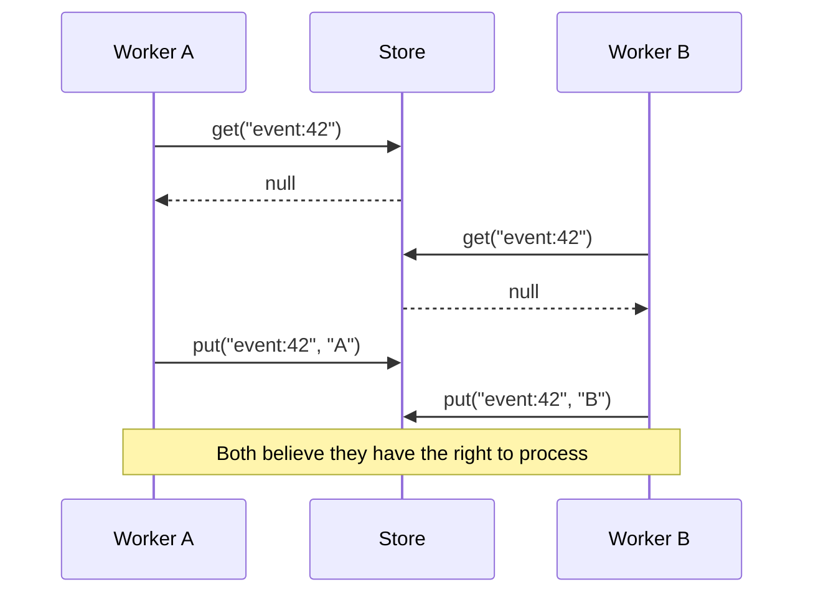
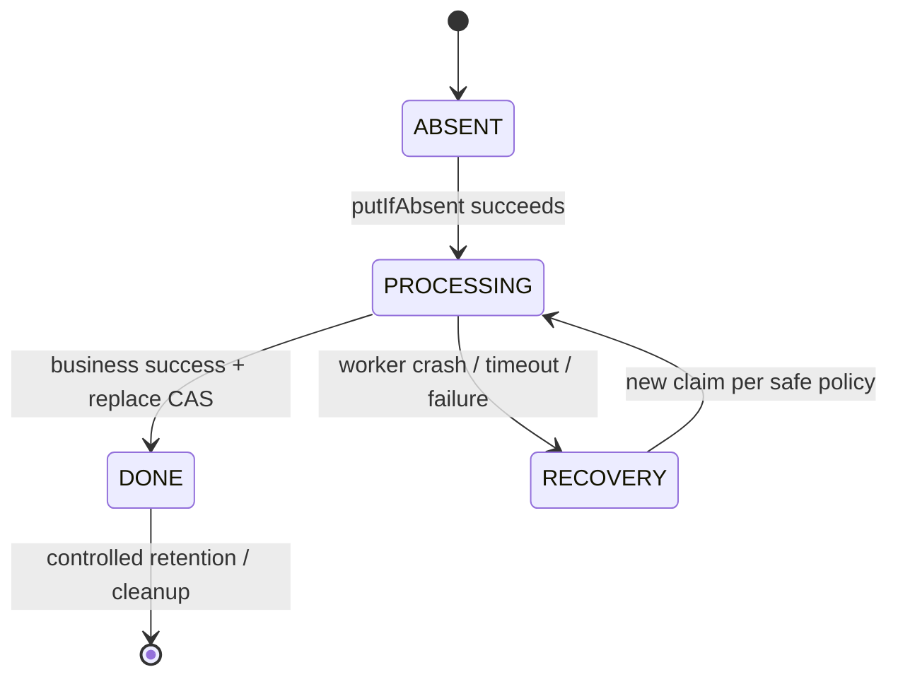
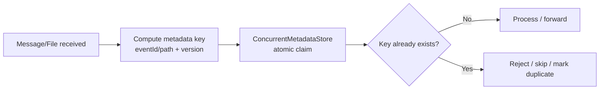

# ConcurrentMetadataStore for Multiple Threads or Instances

## 1. The Problem: Multiple Consumers Seeing the Same Work

In Spring Integration, a message may be reprocessed when a broker redelivers, a poller retries, an application restarts, or two producers send the same event. When multiple workers or multiple service instances exist, an operation such as **recording a payment**, **syncing a file**, or **creating an order** can be executed twice.

For example, a message carrying `eventId=evt-2026-001` is dispatched to workers A and B nearly simultaneously. Both check a flag `processed=false`, then both write the order. Checking and writing across two non-atomic operations creates a *race condition*.

Spring Integration provides the **`ConcurrentMetadataStore`** contract to perform conditional metadata operations, serving many use cases such as *accept-once*, idempotency, claim/checkpoint tracking, and milestone management. The key lies in two operations—**`putIfAbsent`** and **`replace`**: they allow multiple flows to contend on a **metadata key** while distinguishing which one won the right to update.

This lesson belongs to the **Metadata store** chapter of the **SPRING_INTEGRATION_RUNTIME** module. The goal goes beyond the API: we need to understand the impact of `DirectChannel`, `ExecutorChannel`, polling consumers, transactions, retries, message stores, `IntegrationFlow` lifecycle, and runtime state when a message is processed repeatedly.

> **Distinguish two levels of guarantee:** `ConcurrentMetadataStore` specifies conditional metadata operations. It **does not automatically turn database, HTTP, broker, and business processing calls into a distributed transaction**. Deduplication results also depend on where the claim step is placed, the durability and atomicity of the backend, crash recovery behavior, and the idempotency key.

## 2. How Do MetadataStore and ConcurrentMetadataStore Differ?

`MetadataStore` in `org.springframework.integration.metadata` stores **`String key` / `String value`** pairs, with basic operations like `get`, `put`, and `remove`. `ConcurrentMetadataStore` extends that contract with conditional write operations aimed at safe usage when multiple actors modify **the same key**.

| API | Meaning | Suitable for Concurrent Processing? |
| --- | --- | --- |
| `get(key)` | Reads the current value or `null` if absent | Read-only; cannot establish ownership with a single `get`. |
| `put(key, value)` | Writes the value and returns the old value per store contract | Does not protect a "write if absent" operation from races. |
| `remove(key)` | Deletes the key and returns the previous value if any | **Unconditional** delete; requires caution when the owner may have changed. |
| `putIfAbsent(key, value)` | Writes only if the key does not exist; returns `null` on successful insert, or the existing value | Used to contend for creating a unique marker or claim. |
| `replace(key, oldValue, newValue)` | Replaces only if the current value equals `oldValue`; returns `boolean` | Used for compare-and-set (CAS) style state transitions. |

Conditional operations must be executed atomically by the **implementation** within the scope supported by its backend. An in-memory object can be safe across threads within **one JVM**, whereas a shared store on JDBC/Redis can let multiple JVMs contend if the implementation uses an appropriate atomic mechanism.

### Why Is `get` Followed by `put` Wrong?



A standalone `get` does not lock the subsequent `put`. Using `putIfAbsent` guarantees **only one actor wins key creation** within the store's atomic scope:

```mermaid
sequenceDiagram
    participant A as Worker A
    participant S as ConcurrentMetadataStore
    participant B as Worker B
    A->>S: putIfAbsent("event:42", "A")
    S-->>A: null (write succeeded)
    B->>S: putIfAbsent("event:42", "B")
    S-->>B: "A" (key already exists)
    Note over A,B: A wins processing rights; B must follow duplicate policy
```

The two calls may arrive in the reverse order; **never assume A always wins**. What must be verified is that multiple attempts contending for the same key produce only one successful key creation when the backend operates properly.

## 3. Difference Between Multiple Threads and Multiple Instances

Common implementations:

| Option | State Scope | When to Use | Important Limitations |
| --- | --- | --- | --- |
| `SimpleMetadataStore` | Memory of **one instance/JVM** | Demos, single-instance apps, coordinating local threads | Other instances have separate maps; restarts lose state. |
| `JdbcMetadataStore` | Shared table when instances connect to **the same database/schema/namespace** | Multiple instances needing state across restarts | Must initialize schema, configure transactions and connections, and check latency/contention. |
| Shared store on Redis or another backend with a suitable implementation | Per the shared backend's scope | Multiple instances needing atomic operations on a shared store | Must verify consistency, durability, expiry, failover, and compare-and-set semantics of the specific implementation. |
| `PropertiesPersistingMetadataStore` or file-based options | Per the implementation's file read/write and synchronization mechanism | Certain local checkpoint tasks | Not safe by default across multiple processes modifying the same file. |

**The same interface does not produce the same level of guarantee.** Two Spring Boot instances, each with its own `SimpleMetadataStore`, can both observe `putIfAbsent("event:42", ...) == null`, because each instance only sees its own map.

For multi-instance deployments, ensure **all instances use the same backend and the same namespace**, and verify the backend implements `putIfAbsent`/`replace` atomically **across processes**. Even if instances share a database, pointing to different tables, regions, or prefixes will still yield multiple "winners".

## 4. Java Example: Only One Thread Wins a Key

The minimal example below uses `SimpleMetadataStore` to demonstrate an atomic claim within a single JVM. This is runnable Java in an application that includes Spring Integration:

```java
import java.util.concurrent.CountDownLatch;
import java.util.concurrent.ExecutorService;
import java.util.concurrent.Executors;
import java.util.concurrent.TimeUnit;
import java.util.concurrent.atomic.AtomicInteger;

import org.springframework.integration.metadata.ConcurrentMetadataStore;
import org.springframework.integration.metadata.SimpleMetadataStore;

public class ConcurrentClaimDemo {

    public static void main(String[] args) throws Exception {
        ConcurrentMetadataStore store = new SimpleMetadataStore();
        String key = "job:v1:evt-2026-001";

        int workers = 8;
        AtomicInteger winners = new AtomicInteger();
        CountDownLatch ready = new CountDownLatch(workers);
        CountDownLatch go = new CountDownLatch(1);
        ExecutorService executor = Executors.newFixedThreadPool(workers);

        try {
            for (int i = 0; i < workers; i++) {
                final int workerId = i;

                executor.submit(() -> {
                    ready.countDown();
                    go.await();

                    String existing = store.putIfAbsent(
                        key, "PROCESSING:worker-" + workerId);

                    if (existing == null) {
                        winners.incrementAndGet();
                        System.out.println("Winner: worker-" + workerId);
                    } else {
                        System.out.println(
                            "Loser: worker-" + workerId +
                            ", current=" + existing);
                    }
                    return null;
                });
            }

            ready.await();
            go.countDown();
            executor.shutdown();

            if (!executor.awaitTermination(10, TimeUnit.SECONDS)) {
                throw new IllegalStateException("Workers have not finished");
            }
            System.out.println("Winners: " + winners.get()); // 1
        } finally {
            executor.shutdownNow();
        }
    }
}
```

Key takeaways:

- With a contract-compliant `putIfAbsent`, **one** worker receives `null` and becomes the initial owner; the others receive the existing value.
- Which worker wins varies between runs: do not predict thread scheduling order.
- The `PROCESSING` state remains in the store after the demo; supporting retries or key cleanup requires a **lifecycle policy**. Do not blindly call `remove(key)` after every run without considering races.
- This test **does not prove** safety across multiple JVMs because all threads share a single in-memory `SimpleMetadataStore`.

## 5. Safe State Transitions with `replace`

Suppose a worker claimed a key with token `PROCESSING:run-17`. After business processing succeeds, the worker wants to record `DONE:run-17`. A naive `put(key, "DONE")` could overwrite a newer state written by another worker via recovery. `replace` prevents that kind of overwrite:

```java
ConcurrentMetadataStore store = /* injected bean */;
String key = "job:v1:evt-2026-001";
String myToken = "PROCESSING:run-17";

String previous = store.putIfAbsent(key, myToken);

if (previous == null) {
    // This worker acquired the claim; execute business work here.
    boolean transitioned =
        store.replace(key, myToken, "DONE:run-17");

    if (!transitioned) {
        throw new IllegalStateException(
            "Metadata state changed, reconciliation required");
    }
} else {
    // Existing value shows whether work is finished or still being handled.
    System.out.println("Existing state: " + previous);
}
```

`replace(key, expected, updated)` carries **compare-and-set (CAS)** semantics: only the worker observing `expected` at the moment of update can transition the state. This is especially useful for state flows like `NEW → PROCESSING → DONE` or `PROCESSING → FAILED`.

However, CAS **does not by itself prove the side effect ran once**. If a worker successfully calls an order-creation API and crashes **before** `replace(..., "DONE")`, metadata may remain `PROCESSING`. When another worker recovers it, it must check the business outcome using an idempotency key on the target resource or use an appropriate transaction/outbox.

### Why Not Use `remove(key)` to Release a Claim Arbitrarily?

`MetadataStore.remove(key)` takes no `expectedValue` parameter. A slow worker could delete the key after recovery already transferred ownership to another worker. The new state gets wiped out, and a third worker can claim it again, causing duplicate execution.

If you require **only the current owner to release a claim**, you need a compare-and-delete/lease/fencing mechanism supported by the backend, or conditional transitions via `replace` coupled with policy-driven cleanup. Do not assume `ConcurrentMetadataStore` provides an owner-checked atomic delete when the interface declares no such operation.

## 6. Integration with IntegrationFlow: Idempotent Handler

This example receives `OrderEvent` from `orders.in`. A handler uses `ConcurrentMetadataStore` to claim the event ID, perform a simulated side effect, and then transition the state to `DONE`. The result is sent to `orders.results` for verification.

```java
import java.util.UUID;

import org.springframework.integration.metadata.ConcurrentMetadataStore;

public class EventProcessor {

    public record OrderEvent(String tenantId, String eventId) {}

    private final ConcurrentMetadataStore store;

    public EventProcessor(ConcurrentMetadataStore store) {
        this.store = store;
    }

    public String handle(OrderEvent event) {
        if (event.tenantId() == null || event.tenantId().isBlank()
                || event.eventId() == null || event.eventId().isBlank()) {
            throw new IllegalArgumentException("Missing tenantId or eventId");
        }

        // Namespace separated by domain, key version, and tenant.
        String key = "orders:v1:" + event.tenantId() + ":" + event.eventId();
        String token = "PROCESSING:" + UUID.randomUUID();

        String prior = store.putIfAbsent(key, token);
        if (prior != null) {
            return prior.startsWith("DONE:")
                ? "ALREADY_DONE"
                : "IN_PROGRESS";
        }

        try {
            // In this demo, no external system is called.
            System.out.println("Process event " + event.eventId());

            boolean markedDone =
                store.replace(key, token, "DONE:" + event.eventId());

            if (!markedDone) {
                throw new IllegalStateException(
                    "Claim is no longer owned by this worker");
            }
            return "PROCESSED";
        } catch (RuntimeException failure) {
            // Intentionally do not call remove(key) unconditionally.
            // A PROCESSING record requires separate reconciliation/recovery.
            throw failure;
        }
    }
}
```

Java DSL configuration:

```java
import org.springframework.context.annotation.Bean;
import org.springframework.context.annotation.Configuration;
import org.springframework.beans.factory.annotation.Qualifier;
import org.springframework.integration.channel.DirectChannel;
import org.springframework.integration.channel.QueueChannel;
import org.springframework.integration.config.EnableIntegration;
import org.springframework.integration.dsl.IntegrationFlow;
import org.springframework.integration.metadata.ConcurrentMetadataStore;
import org.springframework.integration.metadata.SimpleMetadataStore;
import org.springframework.messaging.MessageChannel;
import org.springframework.messaging.PollableChannel;

@Configuration
@EnableIntegration
public class EventFlowConfig {

    @Bean
    ConcurrentMetadataStore claimStore() {
        // Single JVM: for learning and testing.
        return new SimpleMetadataStore();
    }

    @Bean
    EventProcessor eventProcessor(
            @Qualifier("claimStore") ConcurrentMetadataStore claimStore) {
        return new EventProcessor(claimStore);
    }

    @Bean("orders.in")
    MessageChannel ordersInput() {
        return new DirectChannel();
    }

    @Bean("orders.results")
    PollableChannel results() {
        return new QueueChannel(100);
    }

    @Bean
    IntegrationFlow ordersFlow(EventProcessor processor) {
        return IntegrationFlow.from("orders.in")
            .handle(processor, "handle")
            .channel("orders.results")
            .get();
    }
}
```

Testing repeated sends of the same event:

```java
import org.springframework.messaging.Message;
import org.springframework.messaging.MessageChannel;
import org.springframework.messaging.PollableChannel;
import org.springframework.messaging.support.GenericMessage;

MessageChannel input = context.getBean("orders.in", MessageChannel.class);
PollableChannel output = context.getBean(
    "orders.results", PollableChannel.class);

var event = new EventProcessor.OrderEvent("tenant-A", "evt-42");

input.send(new GenericMessage<>(event));
Message<?> first = output.receive(1_000); // payload: "PROCESSED"

input.send(new GenericMessage<>(event));
Message<?> duplicate = output.receive(1_000); // payload: "ALREADY_DONE"
```

`context` is the running `ApplicationContext`. Because `DirectChannel` is synchronous, the handler claims and sends the reply before `send` returns in this example. If an `ExecutorChannel` is placed at the input, two messages can be processed almost concurrently: `putIfAbsent` still determines who claims first, while the producer can receive results asynchronously on the output branch rather than immediately.

**Demo limitation:** the business operation is only `System.out.println`, so there is no real side effect to verify idempotency. If replaced with a database write or HTTP call, you must add transactional/idempotency mechanisms on that resource. The `IN_PROGRESS` status also does not mean the event finished; never permanently acknowledge or discard a message based solely on this return string if the business requires recovery.

## 7. Switching to a Shared Store for Multiple Instances

When running multiple replicas, replace `SimpleMetadataStore` with an implementation backed by shared storage. For example, with **`JdbcMetadataStore`**, assuming the application already has a `DataSource` and the metadata schema matching the Spring Integration version has been created:

```java
import javax.sql.DataSource;
import org.springframework.context.annotation.Bean;
import org.springframework.integration.jdbc.metadata.JdbcMetadataStore;
import org.springframework.integration.metadata.ConcurrentMetadataStore;

@Bean
ConcurrentMetadataStore claimStore(DataSource dataSource) {
    return new JdbcMetadataStore(dataSource);
}
```

This is a **replacement** for the `claimStore()` bean in section 6; do not register two beans with the same name simultaneously. Include the proper Spring Integration JDBC dependency, create tables/constraints via appropriate migrations, and ensure **every replica connects to the same database and intended region**. Verify directly by running two instances contending on the same key: only one instance must report creating the key successfully.

If using a Redis-based or another database implementation, verify that it actually implements `ConcurrentMetadataStore` and provides atomic semantics across **multiple processes**. Do not infer distributed safety merely from the name "metadata store" or from having a shared cache.

### When to Choose JDBC vs. Redis?

| Criterion | Shared JDBC Metadata Store | Redis-Backed Metadata Store |
| --- | --- | --- |
| Multi-instance synchronization | Can use database constraints and conditional operations | Can use Redis atomic primitives if the implementation honors the contract. |
| Durability | Depends on transaction, backup, and database configuration | Depends on Redis persistence, replication, and failover policy. |
| Latency | Involves SQL round trips and index/lock contention | Typically low on suitable workloads; still has network round trips and backend limits. |
| Cleanup | Requires retention/GC jobs for stale keys | Backend TTL may exist, though not every `ConcurrentMetadataStore` exposes TTL via the interface. |
| Syncing with business DB | Can share a transaction manager when using the same resource and scope | Usually a separate resource; must analyze consistency/dual-write risks. |

Neither option guarantees cross-system "exactly once" by default. Choose based on recovery requirements and **verify via failure injection**, not normal-case latency.

## 8. Metadata State and Crash Timing

The same key `orders:v1:tenant-A:evt-42` can move through these states:



At least four scenarios must be analyzed:

| Failure Moment | What Might Metadata Hold? | Risk | How to Handle |
| --- | --- | --- | --- |
| Crash **before** `putIfAbsent` | No key | Message may redeliver; another worker claims it | Usually reprocessable if input remains durable. |
| Crash **after claim, before side effect** | `PROCESSING` | Event can remain stuck forever without recovery | Detect stale claims and allow conditional reclaim. |
| Crash **after side effect, before `DONE`** | `PROCESSING` | Another worker may repeat the side effect | Idempotency at target DB/API, transactional outbox, or outcome reconciliation. |
| Crash **after `DONE`, before input ack** | `DONE` | Broker may redeliver the event | New worker reads `DONE` and skips in a controlled way. |

The hardest point is that **you cannot reliably distinguish** "crash before side effect" from "crash after side effect" from a `PROCESSING` metadata key alone. Therefore, recovery needs another source of truth: a business table with a unique constraint, a target API supporting idempotency keys, a transactional outbox, or inspecting committed results.

### Do Not Assume Built-In TTL or Leases

`ConcurrentMetadataStore` does not define TTL, lease renewal, fencing tokens, or ownership transfer when a worker disconnects. A specific backend might offer those via its own API, but do not treat them as universal features of the interface.

If reclaiming an old claim is necessary:

1. Store a token containing the worker identifier and claim timestamp in an explicit format.
2. Determine via operational policy that the claim **is expired and recoverable**; avoid relying entirely on two machines' clocks if clock skew exists.
3. Read the old value and call `replace(key, observedValue, newToken)` so only one worker wins the reclaim.
4. Prevent the old worker from writing side effects after its ownership is revoked; **fencing/authorization checks at the target resource** are required, not just metadata CAS.
5. Maintain appropriate retention/dedupe for `DONE` and message redeliveries.

A CAS `replace` prevents two workers from **both acquiring the new claim**, but it does not stop a still-running old worker from completing a side effect. That is the difference between an atomic metadata update and a distributed lock with fencing.

## 9. Relationship with Idempotent Receiver and File Filters

Spring Integration provides components that use metadata to reduce duplicate processing, such as **idempotent receiver** or **persistent accept-once** filters for local/remote files. These components typically compute a **key** from message/file attributes, record a seen marker, and filter duplicates according to policy.



**Examples of choosing keys for files:**

- Plain `path` fits when a path means "processed once ever."
- `path + modified time` fits better if a file's contents can change at the same path; consider timestamp resolution and source consistency.
- `path + content hash` detects content changes but incurs read/hashing cost.
- A prefix such as `file-sync:v2:tenantA:` prevents two applications from accidentally sharing keys.

**MetadataStore and MessageStore serve different roles:**

| Store Type | What Does It Hold? | Question Answered |
| --- | --- | --- |
| `ConcurrentMetadataStore` | Markers or state as string key/value pairs | Has this event/file/key been claimed or processed? |
| `MessageStore` | Stored `Message<?>` for retrieval/lookup | Which payload and headers are being retained? |
| `MessageGroupStore` | Message groups by correlation key plus group state | Which fragments belong to the group, and is it ready to release? |

A metadata key **does not replace** full message payloads in a queue or group state in an aggregator. In brokered systems, dedupe metadata typically pairs with a durable message source and an explicit acknowledgement mechanism.

## 10. Threads, Pollers, Retries, and Transactions: Practical Boundaries

Metadata CAS remains a CAS operation regardless of which thread invokes the handler, yet **claim timing** and **transaction scope** determine failure behavior.

| Execution Path | Who Calls Claim? | What to Check |
| --- | --- | --- |
| `DirectChannel` → handler | Calling `send` thread, if flow is synchronous | Exceptions can propagate to producer; multiple producers can still contend on the store. |
| `ExecutorChannel` → handler | Executor worker | Claim happens after dispatch; producer may return early; handle errors in worker/error channel. |
| `QueueChannel` + poller | Polling consumer or executor poller thread | Has the message been dequeued yet; is receive rollback supported? |
| Multiple instances reading a broker | Consumer on each instance | All must share an atomic store and agree on namespaces/keys. |

### Retries Encountering the `PROCESSING` State

Suppose worker A succeeds with `putIfAbsent`, DB processing fails, and the exception enters retry advice. If retry wraps **the entire handler**, the next attempt may call `putIfAbsent` again, see the prior `PROCESSING`, report `IN_PROGRESS`, and stop. That is a logic bug, not proof the failure was resolved.

Design options include:

- Place **the single claim outside the retry boundary** and retry only the protected side effect.
- Allow the same owner token to re-execute attempts when retry policy confirms it still owns the work, while still guarding against other workers.
- Conditionally transition `PROCESSING` to a failure state and let a recovery job decide whether to reclaim after reconciliation.

### Metadata and Database Transactions

If `JdbcMetadataStore` and business tables share **the same database/transaction manager**, metadata operations and business updates **can** participate in the same transaction when running on the same thread and resource. Still, verify the implementation's SQL/transaction policy, broker ack timing, and advice/poller propagation. If metadata is in Redis and business data is in JDBC, the two operations generally **do not belong to one local transaction**.

Placing `TransactionInterceptor` on a handler does not automatically wrap message reception from a broker or queue. Crossing an `ExecutorChannel` can drop the producer's transaction context on the worker. **Never treat a successful CAS operation as a business commit.**

For unique side effects, prefer a **unique constraint** or idempotency key directly at the target database/endpoint, using metadata as a coordination or load-shedding layer. When writing to a DB and publishing events, consider the **transactional outbox**.

## 11. Runtime Observability, Performance, and Cleanup

When a metadata store is shared across workers, measure more than just the "key seen" rate:

| Metric / Signal | Meaning |
| --- | --- |
| Claim attempts / wins / conflicts | How many workers attempt claims, how many win, how many hit duplicates. |
| Pending/PROCESSING key count and max age | Whether any claims are stuck after errors or worker crashes. |
| DONE key count and cleanup rate | Whether the store is growing unbounded due to retention. |
| `putIfAbsent` / `replace` latency (p50, p95, p99) | Whether the backend becomes a bottleneck under load. |
| Database lock waits/unique-constraint conflicts, Redis errors | Whether contention, connection errors, or failover affect atomic operations. |
| Retries/redeliveries and duplicate side effects | Actual idempotency effectiveness, not just CAS wins. |
| Executor active threads, queue depth, poll delay | Runtime pressure affecting claim/finish timing. |
| Error channel deliveries / failures | Whether processing or error-publishing failures are observed and recovered. |

Example: a service receives **500 messages/second**, of which **10%** are duplicates carrying an event ID already marked `DONE`. Then `putIfAbsent` calls may still run at roughly **500 calls/second** even though only about **450 messages/second** enter business logic. The metadata store must handle the full check/claim volume, including duplicates. If multiple workers contend on **a single hot key**, contention can cause high latency even at modest overall throughput.

### Controlled Metadata Cleanup

Do not keep `DONE` state indefinitely if storage is bounded, yet do not delete too early while the broker may still redeliver. Retention must exceed **the actual replay/duplicate window**, or rely on non-reusable IDs backed by durable unique constraints in business data.

For `PROCESSING` states, **never bulk-delete blindly by age**. A worker might still be executing slowly, retrying, or waiting on a DB lock. Deleting the key before the side effect finishes lets another worker claim and duplicate execution. Use a verified lease/reconciliation/fencing policy.

## 12. Typical Troubleshooting Table

| Symptom | Likely Cause | How to Check / Fix |
| --- | --- | --- |
| Two instances both process the same event | Each instance uses its own `SimpleMetadataStore`, different namespaces, or mismatched keys | Log store implementation/backend, key, and instance; test CAS on the same key across JVMs. |
| Two threads process concurrently despite checking store | Used `get` then `put`, skipped `putIfAbsent`, or a bypass path exists | Audit all claim paths; replace non-atomic operations with CAS. |
| Duplicate marked "already done" while still running | Conflated `PROCESSING` and `DONE` into one state | Separate "in progress" from "completed" and design proper ack/retry. |
| Event stuck forever after crash | `PROCESSING` token has no recovery | Measure pending age and build policy-driven reconciliation. |
| Work repeated after restart even though `DONE` existed | In-memory store, data loss, premature cleanup, or wrong backend/namespace | Check durability, retention, and stored keys. |
| Old worker finishes writing after new worker reclaims | No fencing at business resource | Add fencing tokens/ownership enforcement or target-side idempotency. |
| CAS succeeded but DB has no data | Metadata and business work not in same transaction; crashed between steps | Check commits, recovery, and idempotent DB constraints. |
| Database updated but metadata remains `PROCESSING` | Crash/error during `replace` to `DONE` | Reconcile from business DB then conditionally transition state. |
| `remove` causes event reprocessing | Unconditional delete when owner may have changed | Use CAS state transitions, retention, and safe cleanup. |
| Throughput drops as workers increase | Shared store hotspot, undersized connection pool, or high key contention | Measure CAS latency, lock waits, DB pool, and executor queue. |
| Duplicates occur with file adapter | Key based only on filename, unstable mtime, or non-durable state store | Inspect accept-once filter, key prefix, modified time/hash. |
| Worker fails silently from producer's view | `ExecutorChannel`/poller present; exception occurred on another thread | Inspect error channel, trace ID, failed message, and worker logs. |

When diagnosing, record the **metadata key**, **values before/after CAS**, **instance ID**, **thread name**, **message ID**, **trace/correlation ID**, and **root cause**. Do not record sensitive information in keys or values; mask/hash business IDs before logging if security policies require it.

## 13. Progressive Hands-On Exercises

**Exercise 1 — Prove a single winner in one JVM.** Run `ConcurrentClaimDemo` with 8 and 32 workers. Confirm total winners equals 1 when all use the same `SimpleMetadataStore` and key. Replace with `get`-then-`put` with an intentional delay in a test environment and observe the race.

**Exercise 2 — Distinguish PROCESSING and DONE.** Run `EventFlowConfig` and send two `OrderEvent` instances with the same ID. The first returns `PROCESSED`, the second `ALREADY_DONE`. Modify test code to stop right after claiming and send again: why should the result now be `IN_PROGRESS` rather than concluding work finished?

**Exercise 3 — Two instances.** Run two instances using `SimpleMetadataStore`, send the same event to both, and observe both can process it. Then replace with a shared `JdbcMetadataStore` using the same schema/namespace, test concurrent contention, and verify only one claim wins.

**Exercise 4 — Crash recovery.** Trigger a crash after the side effect but before `replace(..., "DONE")`. Restart and inspect metadata and business data. Design a recovery job that **reconciles target state** before reclaiming; verify that if the side effect already completed, it is not executed again.

**Exercise 5 — Contention during reclaim.** Have two workers read an old token concurrently and both call `replace(key, oldToken, newToken)` with different tokens. Verify only one wins CAS. Explain why fencing is still needed for a still-alive old worker.

**Exercise 6 — Properly scoped retry.** Add retry advice to a flow across an `ExecutorChannel`. Inject a transient error after claiming and observe how retrying the whole handler hits its own `PROCESSING` marker. Move the claim/retry scope or pass an ownership token per design and compare results.

**Exercise 7 — Retention and observability.** Simulate a large number of `DONE` keys and a few stuck `PROCESSING` keys. Design a cleanup policy accounting for the redelivery window, business state, and safety boundaries; measure CAS latency, store size, and duplicate rate across runs.

### Self-Check Questions

1. Why can't `get` followed by `put` replace `putIfAbsent` when multiple threads contend for a key?
2. Which race does `replace(key, oldValue, newValue)` solve? Which race does it leave unsolved?
3. Why is `SimpleMetadataStore` unsuitable for synchronizing deduplication across multiple JVMs?
4. When using a shared `JdbcMetadataStore`, which configuration elements must all instances agree on?
5. Can you conclude a side effect succeeded simply by observing `PROCESSING`?
6. What risk arises if a worker crashes after writing to the DB but before updating `DONE`?
7. Why can calling `remove(key)` inside a `catch` block break another worker's claim?
8. Why is an idempotency key/unique constraint still needed at the target resource despite metadata CAS?
9. How does a metadata store differ from `MessageStore` and `MessageGroupStore`?
10. If a broker retries for 24 hours, how would you choose `DONE` retention and a key cleanup policy?
11. When adding an `ExecutorChannel`, which parts of the transaction and error path change?
12. Which metrics help identify that the metadata backend is throttling throughput?

**Operational principle:** use `ConcurrentMetadataStore` to perform conditional claims and state transitions keyed by **stable keys**, select an implementation matched to **thread or instance scope**, and manage the complete `PROCESSING/DONE` lifecycle. Combine evidence from transactions, retries, message stores, error channels, and correlation to recover from crashes or redeliveries. To guarantee a side effect executes once, add **idempotency and transaction boundaries at the business resource**, rather than stopping at atomic metadata operations.
