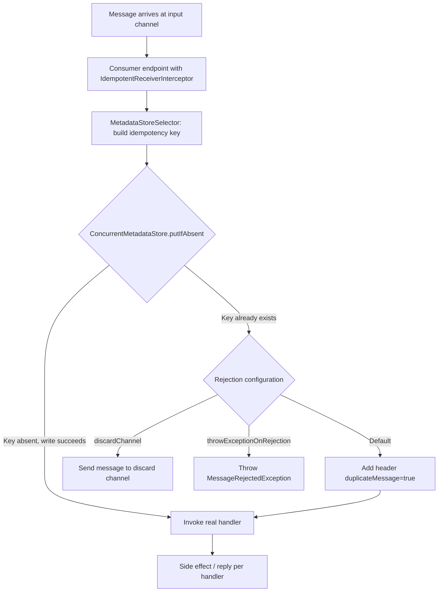
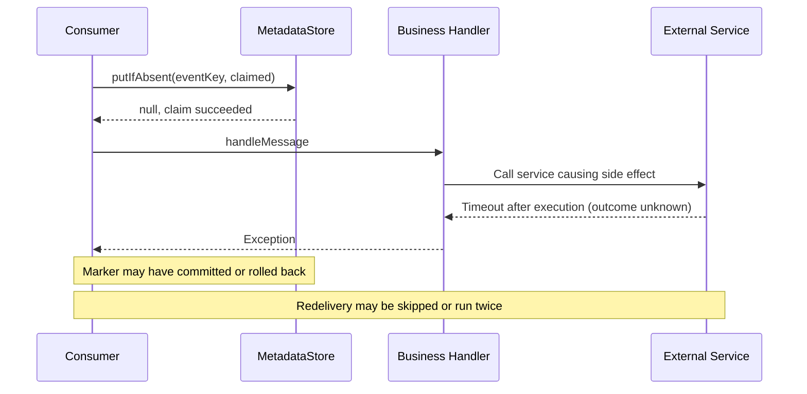

# Idempotent Receiver Based on MetadataStore in Spring Integration

## 1. The Problem: A Message Can Arrive Multiple Times

Suppose a service receives the event `PaymentCaptured(eventId="evt-204", orderId="ORD-42")`. The handler updates the order status and sends a notification. If the broker redelivers the message due to a consumer timeout, the source resends after a reconnect, or an operator replays a record, the same business operation may execute twice. Repeating a balance credit, email send, or payment capture can cause serious consequences even when every Java execution succeeds.

**Idempotent receiver** is an Enterprise Integration Pattern in which a consumer handles repeated deliveries of **the same business event** without producing unwanted duplicate business effects. In Spring Integration, `MetadataStore` remembers seen keys, while `IdempotentReceiverInterceptor` and `MetadataStoreSelector` help detect duplicate messages at a **message handler endpoint**.

This topic belongs to the **Metadata store** chapter of the **SPRING_INTEGRATION_RUNTIME** module. Applying it correctly requires tying deduplication to how flows execute across channels, endpoints, consumers, pollers, and executors, while understanding transactions, retries, message stores, recovery, correlation, and multi-instance runtime state.

After this lesson, you will be able to:

1. Distinguish **duplicate message delivery** from a **duplicate business event** and choose an appropriate idempotency key.
2. Use `ConcurrentMetadataStore.putIfAbsent(...)` to check and record keys atomically.
3. Attach `IdempotentReceiverInterceptor` to the right endpoint; distinguish the default *mark duplicate* behavior from *discarding duplicates*.
4. Choose an in-memory or persistent/distributed store and test concurrency, restarts, rollbacks, and handler failures.
5. Identify the boundary between writing metadata and executing side effects to design safe idempotency in distributed systems.

> **Version:** APIs and examples target Spring Integration **6.5.x** (Spring Framework 6.x, Java 17+). Examples intentionally separate learning-oriented configuration from transactional and durability guarantees that must be tested in real deployments.

## 2. Roles of the Components

| Component | Package/API | Role in the Flow |
| --- | --- | --- |
| `MetadataStore` | `org.springframework.integration.metadata.MetadataStore` | `String` key/value contract: `get`, `put`, `remove`. |
| `ConcurrentMetadataStore` | `org.springframework.integration.metadata.ConcurrentMetadataStore` | Extends with `putIfAbsent` and `replace(key, oldValue, newValue)` **atomic per implementation**. |
| `SimpleMetadataStore` | `org.springframework.integration.metadata.SimpleMetadataStore` | Default in-memory map store, atomic within a single instance; loses data when context/process stops. |
| `JdbcMetadataStore` | `org.springframework.integration.jdbc.metadata.JdbcMetadataStore` | Durable JDBC store, supporting multi-instance sharing and transactions with a suitable DataSource. |
| `MetadataStoreSelector` | `org.springframework.integration.selector.MetadataStoreSelector` | Derives key/value from the message; decides new vs. duplicate using `ConcurrentMetadataStore`. |
| `IdempotentReceiverInterceptor` | `org.springframework.integration.handler.advice.IdempotentReceiverInterceptor` | `HandleMessageAdvice` attached to `MessageHandler.handleMessage(...)`, handling selector rejections. |
| `MessageChannel` / consumer endpoint | Spring Messaging / Integration | Delivers messages to the handler; channels do not automatically make consumers idempotent. |

**Do not confuse three types of data:** `MetadataStore` typically holds only **markers/keys**, `MessageStore` can store full messages or message groups, and business tables hold **processing outcomes**. Data in one store does not automatically roll back or stay in sync with the other two.

## 3. Execution Path and Three Ways to Handle Duplicates



**Most common misconception:** by default `IdempotentReceiverInterceptor` **does not block** duplicate messages. When the selector rejects a message, the interceptor produces a message with header `IntegrationMessageHeaderAccessor.DUPLICATE_MESSAGE` set to `true` and still forwards it to the handler. The handler or downstream components must inspect that header to avoid side effects.

Options:

| Interceptor Configuration | How Duplicate Messages Are Handled | When to Use |
| --- | --- | --- |
| No discard/throw configured | Handler is still invoked, with header `duplicateMessage=true`. | Need branching, returning an "already processed" status, or result-merging logic. |
| `setDiscardChannel(...)` or `setDiscardChannelName(...)` | Rejected message is routed to the discard channel; target handler is not called. | Want to route duplicates to a metrics, inspection, or drop branch. |
| Discard to `nullChannel` | Duplicate is dropped. | Event notifications that require no reply for duplicates. |
| `setThrowExceptionOnRejection(true)` | Throws `MessageRejectedException`, even when a discard channel is set (after sending to discard). | Must signal an error to the caller under an explicit contract; must guard against infinite broker retries. |

**Distinguish from `MessageFilter`:** a filter drops messages using a selector at a filter endpoint, whereas idempotent receiver is an **advice attached to a handler**. `MetadataStoreSelector` can be used with both, but the flow structure and error/reply handling differ.

**Regarding replies:** if duplicates are discarded, the handler emits no business reply; a synchronous gateway waiting for a reply may time out unless the duplicate branch is designed to respond properly. Do not blindly point `discardChannel` to `nullChannel` on a request-reply gateway that must return idempotent status.

## 4. Key Check and Write Must Be Atomic

The following check is **unsafe** across two threads or two instances:

```java
// Incorrect example: non-atomic check-then-act.
if (store.get(key) == null) {
    store.put(key, "seen");
    processBusinessEvent(); // Two threads can enter this branch together.
}
```

Two consumers reading before the key exists both get `null` and both run the business logic. The `ConcurrentMetadataStore` API provides a combined check-and-write operation:

```java
import org.springframework.integration.metadata.ConcurrentMetadataStore;

boolean firstDelivery(ConcurrentMetadataStore store, String eventKey) {
    String previous = store.putIfAbsent(eventKey, "claimed");
    return previous == null;
}
```

`putIfAbsent(key, value)` returns `null` when newly inserted, and returns the **old value** if the key already exists. This lets multiple consumers contend on the same key while only one "claims" it at the instant the atomic operation succeeds—**within the guarantee scope of the chosen store**.

`MetadataStoreSelector` uses this exact pattern: it computes the key and value from `MessageProcessor<String>` (by default deriving the value from the `timestamp` header, formatted in hex), then calls `putIfAbsent`. An **accepted** message means the key was **written to the store**, not that the business handler completed successfully.

This introduces two failure windows:

- **Marker written, handler didn't run or failed:** later deliveries may be treated as duplicates and skipped even though business work is unfinished.
- **Handler executed side effect, marker not committed or rolled back:** later deliveries may be treated as new and run the side effect again.

Handling this properly requires **a same-resource transaction**, a business idempotency key, dedicated processing states, or reconciliation depending on the use case. `putIfAbsent` alone does not create end-to-end exactly-once guarantees.

## 5. Designing Idempotency Keys and Values

A good key identifies **the same unit of business work** across retries, restarts, and sources capable of duplicate sends.

| Key Choice | Assessment | Proper Usage |
| --- | --- | --- |
| Producer-assigned stable `eventId` | Suitable if guaranteed unique within a namespace. | Add `tenantId`, event type, or source to prevent collisions across producers. |
| `orderId` | Often too broad: one order can have multiple valid events. | Suitable only when the business allows strictly one such event per order. |
| `correlationId` | Commonly shared across a message group/chain. | Use for tracing; do not automatically treat as a unique idempotency key. |
| `MessageHeaders.ID` | Can change when a message is reconstructed/redelivered. | Use only if the source guarantees it remains stable across all retries to deduplicate. |
| `hash(payload)` | Sensitive to field order, whitespace/serialization, and collisions. | Use only with canonicalization, a clear hash strategy, and an explicit contract. |
| `file + rowNumber` / `source + sequence` | Reasonable for files/streams with stable offsets. | Clearly scope file version and source region so new data is not missed. |

Example namespace: `payment-captured:v1:tenant-7:evt-204`. Namespacing prevents two handler types from sharing a key with different processing semantics. Keep key lengths within store limits (for example, `JdbcMetadataStore`'s default DDL uses `METADATA_KEY VARCHAR(255)`), and avoid putting raw PII/tokens in keys/logs.

The **value** can be a timestamp, version, or sequence. If you only need "already seen", the value can be a simple marker. When tracking "highest version received", combine `MetadataStoreSelector.compareValues(...)` with `ConcurrentMetadataStore.replace(...)` for conditional updates. Versions must be compared using well-defined numeric/order rules rather than default string comparison between `"10"` and `"9"`.

## 6. Spring Integration Java DSL Example: Blocking Duplicate Events

We will build a flow receiving a `String` payload plus `eventId` and `tenantId` headers; a simulated business handler increments a counter only when actually invoked. The advice uses `MetadataStoreSelector` and `SimpleMetadataStore` to track markers, routing duplicates to `nullChannel`. This is a **single-JVM learning configuration** and does not protect across restarts or across instances.

```java
import java.util.concurrent.atomic.AtomicInteger;

import org.springframework.beans.factory.annotation.Qualifier;
import org.springframework.context.annotation.Bean;
import org.springframework.context.annotation.Configuration;
import org.springframework.integration.annotation.EnableIntegration;
import org.springframework.integration.channel.DirectChannel;
import org.springframework.integration.dsl.IntegrationFlow;
import org.springframework.integration.handler.advice.IdempotentReceiverInterceptor;
import org.springframework.integration.handler.MessageProcessor;
import org.springframework.integration.metadata.ConcurrentMetadataStore;
import org.springframework.integration.metadata.SimpleMetadataStore;
import org.springframework.integration.selector.MetadataStoreSelector;
import org.springframework.messaging.MessageChannel;

@Configuration
@EnableIntegration
class IdempotentPaymentConfiguration {

    static class PaymentHandler {
        private final AtomicInteger calls = new AtomicInteger();

        public void handle(String paymentId) {
            calls.incrementAndGet();
            // In practice: update DB by business key inside a transaction.
        }

        int calls() {
            return calls.get();
        }
    }

    @Bean
    PaymentHandler paymentHandler() {
        return new PaymentHandler();
    }

    @Bean
    MessageChannel paymentsInput() {
        return new DirectChannel();
    }

    @Bean("paymentDedupeStore")
    ConcurrentMetadataStore paymentDedupeStore() {
        return new SimpleMetadataStore();
    }

    @Bean
    IdempotentReceiverInterceptor idempotentPaymentAdvice(
            @Qualifier("paymentDedupeStore") ConcurrentMetadataStore store) {

        MessageProcessor<String> keyStrategy = message -> {
            Object eventId = message.getHeaders().get("eventId");
            Object tenantId = message.getHeaders().get("tenantId");
            if (!(eventId instanceof String id) || id.isBlank()
                    || !(tenantId instanceof String tenant) || tenant.isBlank()) {
                throw new IllegalArgumentException(
                        "Both eventId and tenantId headers are required");
            }
            return "payment-captured:v1:" + tenant + ":" + id;
        };

        MetadataStoreSelector selector = new MetadataStoreSelector(
                keyStrategy, store);
        IdempotentReceiverInterceptor advice =
                new IdempotentReceiverInterceptor(selector);

        // Duplicates go to nullChannel without calling paymentHandler.
        advice.setDiscardChannelName("nullChannel");
        return advice;
    }

    @Bean
    IntegrationFlow paymentFlow(
            PaymentHandler paymentHandler,
            IdempotentReceiverInterceptor idempotentPaymentAdvice) {

        return IntegrationFlow.from("paymentsInput")
                .handle(paymentHandler, "handle",
                        endpoint -> endpoint.advice(idempotentPaymentAdvice))
                .get();
    }
}
```

To exercise this example, send a message with the same `eventId` twice:

```java
import org.springframework.context.ApplicationContext;
import org.springframework.messaging.MessageChannel;
import org.springframework.messaging.support.MessageBuilder;

void demo(ApplicationContext context) {
    MessageChannel input =
            context.getBean("paymentsInput", MessageChannel.class);

    input.send(MessageBuilder.withPayload("PAY-42")
            .setHeader("tenantId", "tenant-7")
            .setHeader("eventId", "evt-204")
            .build());

    input.send(MessageBuilder.withPayload("PAY-42")
            .setHeader("tenantId", "tenant-7")
            .setHeader("eventId", "evt-204")
            .build());

    IdempotentPaymentConfiguration.PaymentHandler handler =
            context.getBean(IdempotentPaymentConfiguration.PaymentHandler.class);

    // Within the same ApplicationContext, after DirectChannel processing:
    // handler.calls() == 1
}
```

The flow executes in order:

1. `DirectChannel` dispatches the message to the endpoint, on the sender's thread in standard configuration.
2. `IdempotentReceiverInterceptor` invokes the selector to build key `payment-captured:v1:tenant-7:evt-204`.
3. On the first message, `putIfAbsent` returns `null`; the handler is called once.
4. On the second message, the store returns the previous marker; the interceptor sends the duplicate to `nullChannel` and **does not** call the handler.
5. `send()` may complete normally on both sends. This only confirms processing at the message dispatch layer; it does not prove payment was recorded accurately in the database.

If you omit `setDiscardChannelName("nullChannel")`, duplicates **still reach the handler** with header `duplicateMessage=true`. Writing handler logic to inspect that header is an alternative pattern, especially when returning a reply with the previously processed status.

### 6.1. Example Handler Inspecting the Duplicate Header Directly

When intentionally keeping the default configuration (no discard), the method can accept the full `Message<?>`:

```java
import org.springframework.integration.IntegrationMessageHeaderAccessor;
import org.springframework.messaging.Message;

public void handle(Message<String> message) {
    boolean duplicate = Boolean.TRUE.equals(
            message.getHeaders().get(
                    IntegrationMessageHeaderAccessor.DUPLICATE_MESSAGE));

    if (duplicate) {
        // Skip side effects or load previously processed status to return to caller.
        return;
    }
    // Execute business logic for the event accepted by the selector.
}
```

Note: this behavior applies only if the handler is wrapped with the corresponding advice. The `duplicateMessage` header is a marker added by the advice, not proof of a successful transaction in an external system.

## 7. Unit Testing, Concurrency, and Real Wiring

### 7.1. Testing That the Selector Tracks Keys Properly

This unit test runs without a Spring context:

```java
import org.junit.jupiter.api.Test;
import org.springframework.integration.metadata.SimpleMetadataStore;
import org.springframework.integration.selector.MetadataStoreSelector;
import org.springframework.messaging.support.MessageBuilder;
import static org.junit.jupiter.api.Assertions.*;

@Test
void selectorRejectsSameEventButAcceptsDifferentEvent() {
    var store = new SimpleMetadataStore();
    var selector = new MetadataStoreSelector(
            message -> (String) message.getHeaders().get("eventId"), store);

    var first = MessageBuilder.withPayload("pay")
            .setHeader("eventId", "evt-204").build();
    var same = MessageBuilder.withPayload("pay")
            .setHeader("eventId", "evt-204").build();
    var another = MessageBuilder.withPayload("pay")
            .setHeader("eventId", "evt-205").build();

    assertTrue(selector.accept(first));
    assertFalse(selector.accept(same));
    assertTrue(selector.accept(another));
    assertNotNull(store.get("evt-204"));
}
```

### 7.2. Testing Multiple Workers Contending for the Same Key

Two calls `get()` + `put()` can race; a concurrency test highlights the value of `putIfAbsent`:

```java
import java.util.ArrayList;
import java.util.List;
import java.util.concurrent.CountDownLatch;
import java.util.concurrent.ExecutorService;
import java.util.concurrent.Executors;
import java.util.concurrent.Future;
import org.junit.jupiter.api.Test;
import org.springframework.integration.metadata.ConcurrentMetadataStore;
import org.springframework.integration.metadata.SimpleMetadataStore;
import static org.junit.jupiter.api.Assertions.*;

@Test
void onlyOneConcurrentCallerClaimsKey() throws Exception {
    ConcurrentMetadataStore store = new SimpleMetadataStore();
    int workers = 16;
    CountDownLatch start = new CountDownLatch(1);

    ExecutorService executor = Executors.newFixedThreadPool(workers);
    try {
        List<Future<Boolean>> results = new ArrayList<>();
        for (int i = 0; i < workers; i++) {
            results.add(executor.submit(() -> {
                start.await();
                return store.putIfAbsent("event:204", "claimed") == null;
            }));
        }
        start.countDown();

        int accepted = 0;
        for (Future<Boolean> result : results) {
            if (result.get()) {
                accepted++;
            }
        }
        assertEquals(1, accepted);
    }
    finally {
        executor.shutdownNow();
    }
}
```

**Note on concurrency testing:** `finally` cleans up the executor even if an assertion fails. In real integration tests, bound all futures with timeouts instead of waiting indefinitely and release latches if a worker fails before starting. The snippet above tests `SimpleMetadataStore` atomicity within one JVM, not persistence across restarts.

The test above verifies atomicity **within one JVM**. To verify across multiple instances, use `JdbcMetadataStore` or a persistent/distributed `ConcurrentMetadataStore` and run multiple application contexts/processes sharing the backend.

### 7.3. Testing the Flow Rather Than Only the Selector

Testing the selector shows `putIfAbsent` works. An IntegrationFlow test must also verify **the advice is attached to the right endpoint**. Using `@SpringJUnitConfig` and the config from section 6, send two messages with the same key through `paymentsInput`, then assert `paymentHandler.calls() == 1`. Send a different `eventId` and assert the call count increments by one. Send a message missing `eventId` and verify the input is rejected before business logic runs; a `MessagingException` may wrap the exception thrown by the key strategy.

When switching to an `ExecutorChannel` or a `QueueChannel` with a poller, do not assert counters immediately after `send()` because the handler may run on another thread. Use `CountDownLatch`, bounded awaits, and collectors keyed by business key; avoid fixed `Thread.sleep` calls. Also inspect the error channel/recovery because exceptions in async consumers do not necessarily propagate back to `send()`.

## 8. Updating Metadata by Version with `compareValues`

Some events do not require storing every ID forever. For example, a file with ordered lines, or a source sending a monotonic version per entity. Since Spring Integration 5.3, `MetadataStoreSelector` supports `compareValues(BiPredicate<String, String>)`, where the first argument is **the old value** and the second is **the new value**:

```java
import org.springframework.integration.metadata.ConcurrentMetadataStore;
import org.springframework.integration.selector.MetadataStoreSelector;

MetadataStoreSelector versionSelector(ConcurrentMetadataStore store) {
    return new MetadataStoreSelector(
            message -> "order-status:" + message.getHeaders().get("orderId"),
            message -> String.valueOf(message.getHeaders().get("version")),
            store)
            .compareValues((oldVersion, newVersion) ->
                    Long.parseLong(newVersion) > Long.parseLong(oldVersion));
}
```

When the store holds `"8"`, version `"9"` is accepted and can replace the value via compare-and-set; versions `"7"` or `"8"` are rejected. Atomic replacement prevents multiple consumers from overwriting a value based on stale reads.

**Ordering trap:** if version 9 is accepted by the selector first, yet its handler runs slowly, version 10 can finish business updates first. A "latest version received" marker does not guarantee **business state is applied in the same completion order**. If updating order status requires versions to advance strictly, the business table also needs a condition like `UPDATE ... WHERE stored_version < incoming_version` inside the transaction, or sequential per-key processing.

**Data trap:** the version example only illustrates the API. Production requires validating `orderId`, ensuring version is present, a positive number, within bounds, and defining behavior for events missing a version or when a source resets its sequence. Deleting markers while older-version messages still sit in a queue allows them to be accepted again as new.

## 9. Choosing a MetadataStore Matched to Runtime Lifecycle

| Store | Survives Restart? | Atomicity and Sharing Scope | When Appropriate? |
| --- | --- | --- | --- |
| Default `SimpleMetadataStore` | No, in-RAM map. | Atomic `putIfAbsent` within the same instance; each JVM has its own map. | Demos, tests, single-instance apps needing no memory across restarts. |
| `PropertiesPersistingMetadataStore` | Can save to file on `flush()` or proper context shutdown. | Atomic within the current map object; does not natively coordinate multiple processes sharing one file. | Low-load cases without strict crash or multi-node requirements. |
| `JdbcMetadataStore` | Yes, if DB commits and retains data. | `ConcurrentMetadataStore` with atomic ops via DB/transactions; shared across instances. | Multi-node consumers where business data can share a JDBC transaction. |
| `RedisMetadataStore` | Depends on Redis persistence/replication config. | Atomic ops per backend; shared across JVMs. | High speed; requires designing around TTL/eviction, failures, and Redis data-loss modes. |
| MongoDB/Hazelcast/ZooKeeper MetadataStore | Per store and implementation. | Check atomic, consistency, durability, and partition guarantees of each backend. | When matching infrastructure exists and required semantics are verified. |

**"Implements ConcurrentMetadataStore" does not mean "cluster-safe."** `SimpleMetadataStore` uses a local map, so two independent app instances can still claim the same key. Shared database/Redis-backed stores coordinate across nodes, and even then you must design for temporary backend unavailability.

### 9.1. Migrating the Example to `JdbcMetadataStore`

To upgrade the section 6 example to a persistent store, replace **only the** `paymentDedupeStore` bean with the JDBC implementation (do not declare two beans with the same name simultaneously):

```java
import javax.sql.DataSource;
import org.springframework.beans.factory.annotation.Qualifier;
import org.springframework.context.annotation.Bean;
import org.springframework.context.annotation.Configuration;
import org.springframework.integration.jdbc.metadata.JdbcMetadataStore;
import org.springframework.integration.metadata.ConcurrentMetadataStore;
import org.springframework.jdbc.datasource.DataSourceTransactionManager;
import org.springframework.transaction.PlatformTransactionManager;

@Configuration
class PersistentDedupeConfig {
    @Bean("paymentDedupeStore")
    ConcurrentMetadataStore paymentDedupeStore(DataSource dataSource) {
        JdbcMetadataStore jdbc = new JdbcMetadataStore(dataSource);
        jdbc.setRegion("PAYMENT_RX_V1");
        return jdbc;
    }

    @Bean
    PlatformTransactionManager paymentTransactionManager(DataSource dataSource) {
        return new DataSourceTransactionManager(dataSource);
    }
}
```

This code assumes a DataSource and a database with the appropriate Spring Integration JDBC schema. The default metadata DDL uses table `INT_METADATA_STORE` with columns such as `METADATA_KEY`, `METADATA_VALUE`, and `REGION`, with a primary key on `(METADATA_KEY, REGION)`. Spring Integration 6.5 ships schema scripts per RDBMS; apply them via dedicated migrations before starting the application. `JdbcMetadataStore` can check the table on startup and fail fast if missing.

`setRegion("PAYMENT_RX_V1")` isolates namespaces in the table; **keep it stable across restarts** if you want to recognize older keys. If multiple flow types share the same region, still prefix idempotency keys to reflect the business operation type.

In Spring Boot, a compatible transaction manager bean for the DataSource may already exist; in that case **reuse** the existing bean instead of declaring `paymentTransactionManager` as in the example. If the application has multiple DataSources/transaction managers, explicitly specify the manager bound to the store and business writes.

**Do not automatically assume data is "processed" merely because a row exists in `INT_METADATA_STORE`.** Per the `MetadataStoreSelector` contract, the row may appear right at claim time before the handler runs; depending on transactions, it is only durably effective after commit.

## 10. Transactions, Retries, and the "Marked Seen but Unprocessed" Risk

This is the most critical runtime limitation of this pattern.



### 10.1. When Marker and Business Data Share a JDBC Transaction

If using `JdbcMetadataStore` and the handler updates **the same DataSource**, a sound design can be:

1. The consumer starts a transaction **before** the interceptor claims the key.
2. The interceptor calls `putIfAbsent` (joining the same transaction).
3. The handler writes business tables via JDBC on the same DataSource/transaction.
4. On success, both the metadata marker and business writes commit together; when an error is thrown, **both roll back together**.

With a JDBC-backed `QueueChannel` and a polling consumer, the **poller's** transaction can span `receive()`, the advice, and subsequent synchronous processing. On rollback, dequeuing from the queue, the metadata marker, and business data in the same database can all be undone. This requires the exact same DataSource, transaction manager, and thread boundary.

**Configuration trap:** merely putting `@Transactional` on the handler method **does not guarantee** the marker was written in the same transaction, because the idempotent advice can invoke the selector **before** the method starts a transaction. When using transaction advice on an endpoint, verify the actual advice order so the transaction encloses both the selector **and** business updates, or configure the transaction at the poller. Placing an `ExecutorChannel` between poller and handler creates a thread boundary; the poller thread's transaction does not automatically propagate to worker threads.

### 10.2. Retry Advice Can Change the Outcome

Suppose `IdempotentReceiverInterceptor` runs **inside** retry advice. The first attempt claims the key and the handler throws; the second attempt returns to the selector, finds the key already present, and treats it as a duplicate. If the interceptor uses `nullChannel`, the handler may **never actually be retried**. If the idempotent advice wraps **outside** retry, it can claim once and let the inner retry advice re-invoke the handler, though appropriate transaction/idempotency handling is still required.

Therefore:

- Verify which advice wraps which; test how many times the **business handler** is called, not just how many times the retry template executes.
- Verify when the marker commits/rolls back relative to the retry callback.
- Do not use `SimpleMetadataStore` to demonstrate transactional marker rollback, because an in-RAM map does not participate in JDBC transactions.
- Separate transient errors from permanent validation errors, configure bounded max attempts/backoff, and design dedicated recovery.

Typical failure outcomes:

| When Failure Occurs | Possible State Encountered | Primary Mitigation |
| --- | --- | --- |
| Claim marker persisted, then crash before handler | Event marked seen, but business logic never ran. | Same transaction, or `IN_PROGRESS/DONE` state with lease and retry/reconciliation. |
| Handler writes JDBC, then marker rolls back | Redelivered event may cause duplicate writes. | Shared transaction and unique business key. |
| Handler makes HTTP call that succeeds, then times out | Unknown whether side effect occurred. | Idempotency key at **receiving service**, status query, and reconciliation. |
| Recovery advice swallows error and acks message | Message may vanish from source even though business failed. | Durable recovery with business keys and a replay process. |
| Marker in RAM while application restarts | Marker lost; same event treated as new. | Persistent/distributed store + idempotency guards in business data. |
| Key deleted too early | Late redelivery looks like a "new" message. | Retention matched to redelivery/replay window. |

### 10.3. Business-Layer Idempotency Remains the Last Line of Defense

If a payment transaction has business event ID `evt-204`, an inbox table with a unique constraint on `(consumer_name, event_id)` ensures the same event is never applied twice inside the business transaction itself. For calls to external services, pass a **stable idempotency key** per the receiver's API contract and maintain a lookup flow for ambiguous outcomes.

Some systems track `NEW → PROCESSING → DONE/FAILED` states with leases and timeout handling to recover unfinished work. That is an **application workflow/idempotency protocol**, not a built-in feature of `MetadataStoreSelector` (which primarily checks key/value presence). If strong exactly-once effects are required in a distributed system, build inbox/outbox patterns, unique constraints, and dedicated transaction/broker semantics.

## 11. Expiration, Cleanup, and Key/Schema Evolution Across Versions

A persistent store accumulates markers over time. With one million new event IDs per day retained forever, DB tables/Redis keys grow rapidly. Determine **marker retention** based on:

- How long the broker can redeliver, including after outages and consumer restarts.
- The permitted window for manual replay or upstream backfill.
- How long a business event remains valid and capable of being resent.
- Capacity, lookup cost, backups, replication, and audit requirements.

`MetadataStore` has no uniform TTL in its interface; TTL/eviction support depends on the backend or custom application logic. `PropertiesPersistingMetadataStore` typically saves to file on normal context shutdown or `flush()`, making it unsuitable for strong deduplication across sudden crashes without a proper synchronization strategy.

**Never clean up blindly with "read timestamp then `remove(key)`" while other workers are active.** Deleting a key after checking can race with a new worker. Use retention policies, completion states, safe deletion conditions, isolation, or store-supported CAS/leases. `ConcurrentMetadataStore` offers atomic `replace(old, new)`; `remove(key)` in the base interface provides no "delete only if value is still X" condition.

When changing key strategies—for example from `eventId` to `tenantId:eventId`—old data no longer matches new keys. Build versioning/namespacing into the design, actively migrate or drain, or accept a window where old events might be reprocessed. Changing the JDBC store `region` also makes old markers invisible to the new region.

## 12. Runtime Observability and Diagnostics

Track these signals at the **exact endpoint**:

| Signal | Question to Answer |
| --- | --- |
| Messages accepted by selector | How many new keys are created over an interval? |
| Duplicates discarded or marked | Are there abnormal redeliveries, duplicate sources, or unplanned replays? |
| Latency and errors of `putIfAbsent`/`replace` | Is the metadata backend experiencing latency, lock contention, or connection failures? |
| Business handler invocation count | Does execution count actually drop when duplicates spike? |
| Handler failures after claim | Are there "seen" markers whose business work was never recorded? |
| Recovery/dead-letter and backlog | Are poison messages quarantined or endlessly looping? |
| Blank/invalid idempotency key rate | Are producers violating contracts or missing metadata? |
| Marker count and age | Do TTL/retention match retry windows and storage capacity? |
| `correlationId` and business key | Can events, attempts, and business outcomes be correlated across layers? |

Procedure when an event appears "not processed":

1. Check whether the input actually reached the channel/endpoint; is a consumer subscriber or poller running?
2. Take the business event ID and compute the **exact key strategy** (including tenant, source, version, region).
3. Look up the key in the store and inspect its value/state; determine when the marker was written and whether it committed.
4. Check whether the advice uses `discardChannel`, `throwExceptionOnRejection`, or mark-only mode. If mark-only, does the handler handle duplicates properly?
5. Inspect exceptions, retries, transaction managers, thread boundaries, recovery callbacks, and source acks.
6. Query final business state and external systems to determine whether processing succeeded before a timeout.
7. Check for store restarts, wrong regions, key migrations, TTL/cleanup, or data loss.

| Symptom | Common Cause | How to Fix |
| --- | --- | --- |
| Handler still runs twice with interceptor enabled | Default mode only sets `duplicateMessage`, does not discard. | Add a discard channel or inspect the header in the handler. |
| Handler reruns old events after restart | Using `SimpleMetadataStore` or marker not flushed/committed. | Switch to a persistent store and verify durability. |
| Two pods process the same event ID | Each pod has its own in-memory store, or computes a different key. | Use a shared `ConcurrentMetadataStore` backend and consistent key strategy. |
| Event skipped after an initial failure | Claim marker committed before business handler threw. | Use a shared transaction or recovery/inbox ensuring reprocessing. |
| Retry appears to call handler only once | Idempotent advice sits inside retry and blocks the next attempt. | Inspect advice order and marker transaction. |
| Store has key but no business data | Claimed before side effect then crashed, or ran outside transaction. | Audit logs, rollbacks, reconciliation, and business-layer idempotency. |
| Duplicates spike after deployment | Namespace/region/key strategy changed or backend lost markers. | Keep key strategies stable and perform controlled migrations. |
| Gateway times out on duplicate event | Duplicate discarded with no reply. | Design an "already processed" reply or return stored prior result. |

**Regarding logs and metrics:** never log raw payloads containing PII or put unique `eventId` values in metric labels (causing high cardinality). Aggregate metrics by endpoint, tenant tier/source, and error type; keep business keys in protected traces/logs.

## 13. Hands-On Exercises and Self-Check Questions

**Exercise 1 — Default behavior:** remove `advice.setDiscardChannelName("nullChannel")` from the example. Change the handler to accept `Message<String>` and count occurrences of `duplicateMessage=true`. Send two messages with the same key and explain why the method still has two invocations.

**Exercise 2 — Blocking duplicates:** re-enable `nullChannel`, assert that sending the same `eventId` twice invokes the business handler once, while a different event increments the counter. Send the same `eventId` with a different tenant and verify two distinct keys.

**Exercise 3 — ConcurrentMetadataStore:** run the 16-thread test in section 7; change it to check-then-put to observe the race (increase load/repeat runs if needed). Then switch to two Spring contexts sharing a JDBC/Redis store and verify only one claims the key.

**Exercise 4 — Crash scenario:** make the handler throw right after the selector claims the key; resend the message. Observe that `SimpleMetadataStore` still holds the marker and can skip the second message. Propose a fix matching business requirements.

**Exercise 5 — JDBC rollback:** replace the store with `JdbcMetadataStore` and add a business table on the same DataSource. Wrap both claim and business update in a transaction; force a rollback and resend. Verify both marker and row roll back so the next delivery can process.

**Exercise 6 — Advice ordering:** combine `RequestHandlerRetryAdvice` and `IdempotentReceiverInterceptor`. Swap their ordering, make the handler fail twice then succeed. Compare calls, markers, and recovery; explain the risk of markers blocking retries.

**Exercise 7 — Versioning:** use `compareValues` for event versions 9, 8, and 10 of the same order. Check which versions are accepted; add concurrency tests and monotonic business-state update conditions.

**Exercise 8 — Retention and replay:** simulate upstream redelivery after 14 days; design 30-day retention and safe marker deletion. Analyze a 60-day replay scenario and how to check business state before processing.

**Self-Check Questions:**

1. What guarantee distinguishes `ConcurrentMetadataStore` from `MetadataStore`?
2. Why isn't `get() == null` followed by `put()` enough to prevent concurrent duplicate processing?
3. What does `IdempotentReceiverInterceptor` do by default with a message rejected by the selector?
4. Why can using `MessageHeaders.ID` or `correlationId` as an idempotency key be wrong?
5. When a marker write succeeds but the handler crashes, what risk arises on redelivery?
6. Why are `JdbcMetadataStore` and business `JdbcTemplate` safe only when a transaction properly encloses both?
7. How do you combine idempotent advice with retry advice without skipping critical retry attempts?
8. Does `compareValues` preventing metadata version regression guarantee business state is applied in order?
9. Why doesn't a persistent metadata store automatically yield exactly-once side effects against an HTTP service?

## 14. Official References

- Spring Integration 6.5 — [Idempotent Receiver Enterprise Integration Pattern](https://docs.spring.io/spring-integration/reference/6.5/handler-advice/idempotent-receiver.html): three duplicate behaviors and advice configuration.
- Spring Integration 6.5 — [Metadata Store](https://docs.spring.io/spring-integration/reference/6.5/meta-data-store.html): purpose, default in-memory store, implementations, and lifecycle.
- Spring Integration 6.5 — [JDBC Metadata Store](https://docs.spring.io/spring-integration/reference/6.5/jdbc/metadata-store.html): transactions, schema, and multi-instance atomicity.
- Spring Integration 6.5 API — [`MetadataStoreSelector`](https://docs.spring.io/spring-integration/docs/6.5.0/api/org/springframework/integration/selector/MetadataStoreSelector.html): constructors, `compareValues`, and default timestamp value.
- Spring Integration 6.5 API — [`IdempotentReceiverInterceptor`](https://docs.spring.io/spring-integration/docs/6.5.0/api/org/springframework/integration/handler/advice/IdempotentReceiverInterceptor.html): `setDiscardChannel`, `setThrowExceptionOnRejection`.
- Spring Integration 6.5 API — [`ConcurrentMetadataStore`](https://docs.spring.io/spring-integration/docs/6.5.0/api/org/springframework/integration/metadata/ConcurrentMetadataStore.html): `putIfAbsent` and `replace`.
- Spring Integration 6.5 API — [`JdbcMetadataStore`](https://docs.spring.io/spring-integration/docs/6.5.0/api/org/springframework/integration/jdbc/metadata/JdbcMetadataStore.html): constructors, region, table prefix, and transactions.
