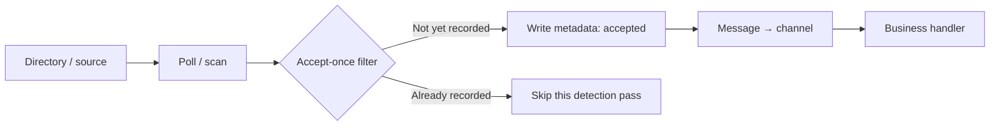
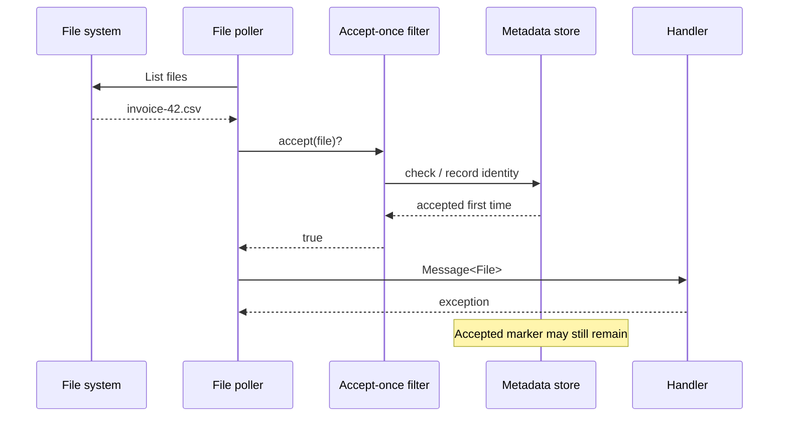
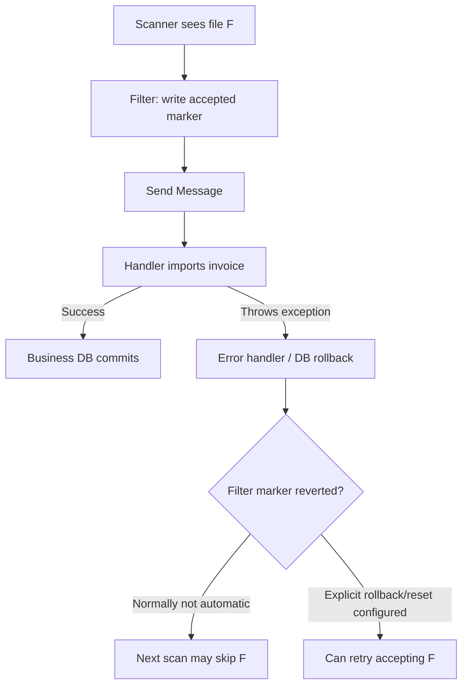
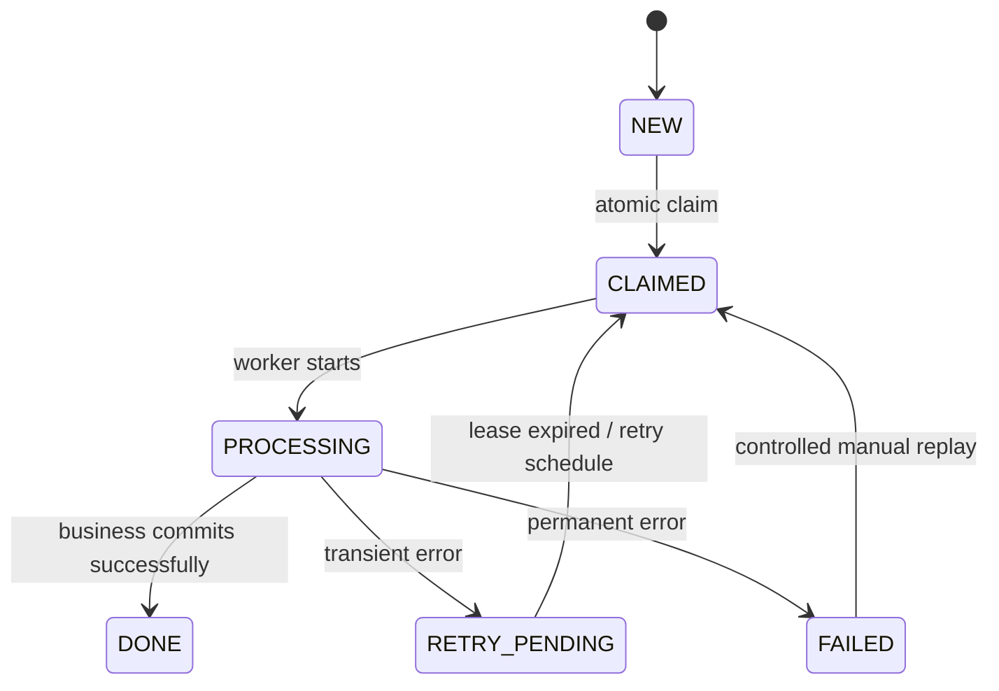
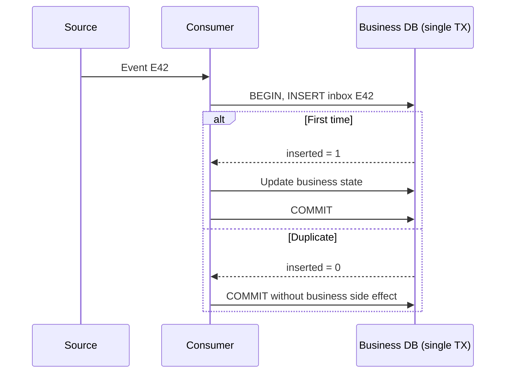
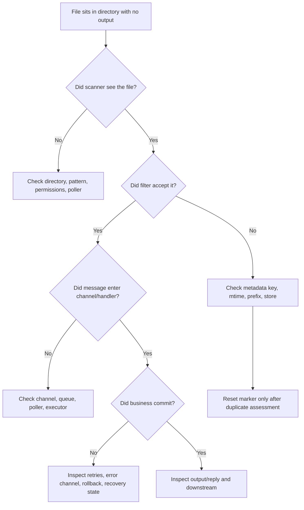
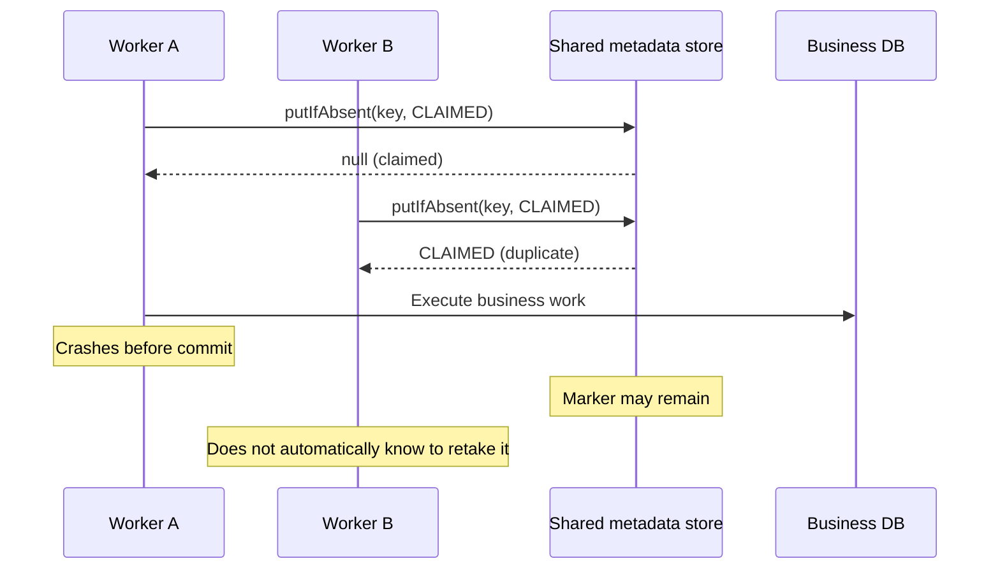

# Accept-Once Pattern and Processed State

In **Spring Integration runtime**, a message can flow from a source into a channel, be picked up by a poller, pass through a consumer endpoint, and finally reach a handler. When a poller scans a directory or a source capable of returning the same record multiple times, the system must avoid re-ingesting previously seen data. The **accept-once pattern** solves the first step: identifying whether an item has already been *accepted*.

However, there is a critical boundary: **"accepted" does not mean "business processing succeeded."** A file may be marked by an Accept-Once filter during directory scanning, yet the downstream handler may time out. Without proper transactions or recovery mechanisms, the next poll may skip that file even though it never finished processing.

This lesson belongs to the **Metadata store** chapter in the `SPRING_INTEGRATION_RUNTIME` module. It focuses on Accept-Once filters, `MetadataStore`, `ConcurrentMetadataStore`, processed states, limits under retry/redelivery, multi-instance operation, and procedures for diagnosing "missing" or duplicate-processed messages.

## 1. The Problem: A Source Item Can Appear Multiple Times

Suppose a service periodically reads the `incoming/` directory. The file `invoice-42.csv` is present across three scans:

```text
10:00:00  scan #1 -> invoice-42.csv
10:00:05  scan #2 -> invoice-42.csv
10:00:10  scan #3 -> invoice-42.csv
```

If every scan forwarded the file to the handler, a single invoice could be imported three times. An accept-once filter remembers an **identity or version** of the accepted file so subsequent scans do not accidentally re-emit the same input.



The diagram shows that metadata is written at the **input selection step**, before the handler confirms success. This is precisely why you cannot look solely at filter state to conclude work has finished.

### 1.1. Distinguishing Four States

| Term | Meaning | Proves Business Processing Succeeded? |
| --- | --- | --- |
| **Discovered** | Poller/scanner sees the item | No |
| **Accepted** | Filter allows the item into the flow | No |
| **Processing** | A consumer is executing business logic | Not yet |
| **Processed/Completed** | Business success condition committed/confirmed | Yes, **if** recorded at the right transaction boundary |

A system may also use `FAILED`, `RETRY_PENDING`, and `QUARANTINED`, but those are **application-designed business states**, not states automatically provided by every Accept-Once filter.

## 2. Accept-Once Is "Candidate Filtering", Not Exactly-Once Delivery

In Spring Integration, Accept-Once is commonly represented by a `FileListFilter` for an inbound file adapter. The filter answers: "Is this item eligible to enter the processing stream this time?"



When processing fails, whether metadata is rolled back or deleted depends on the **specific filter, source, and error-handling code**. Never assume that a handler throwing an exception automatically re-invokes the filter or returns the file to the source queue.

Specifically:

- **At-most-once selection**: an already-marked item may not be re-selected even if the previous attempt failed.
- **At-least-once processing**: the source/broker may redeliver after a rollback, so the handler must tolerate duplicates.
- **Exactly-once business effect**: achieving non-duplicated side effects requires idempotency, transactions, deduplication, and an appropriate business contract.

An accept-once filter **does not automatically turn** HTTP calls, DB writes, email sends, or message publishes into an exactly-once transaction.

## 3. Common Accept-Once Classes

Spring Integration provides filters for local file sources and remote sources like FTP/SFTP. Class names, constructors, and version-update support depend on the source type and library version.

| Component | Where State Is Remembered | Best Fit | Limitations |
| --- | --- | --- | --- |
| `AcceptOnceFileListFilter` | In the filter instance's memory | Demos, simple sources, single process | Restarts wipe the seen set; not shared across nodes |
| `FileSystemPersistentAcceptOnceFileListFilter` | Via `ConcurrentMetadataStore` | Local files needing scan state preserved across restarts | Durable only if the store is durable; still does not prove handler success |
| Persistent accept-once filters for FTP/SFTP | Via the corresponding metadata store | Avoids re-downloading previously selected remote files | Must understand file/modified timestamp matching as well as local filters |
| `IdempotentReceiverInterceptor` + `MetadataStoreSelector` | Via configured metadata store | Prevents duplicate processing at a consumer endpoint | Check runs inside the flow; outcome depends on duplicate policy |

```text
                 Item selection boundary           Message processing boundary
Remote/File scan -> FileListFilter -> inbound channel -> IdempotentReceiver -> handler
                      |                                     |
                  accepted key                          business key
```

Choosing the right protection point matters. A file filter operates on **files** or source objects; an idempotent receiver operates on **business messages**. One order might arrive across two different files, or one file might contain many orders; in such cases the two deduplication keys are not equivalent.

## 4. MetadataStore and ConcurrentMetadataStore

`org.springframework.integration.metadata.MetadataStore` is an interface storing `key → value` pairs. When multiple threads or instances must contend to claim the same work, `ConcurrentMetadataStore` provides **compare-and-set** style operations such as:

- `putIfAbsent(key, value)`: writes only when the key does not exist.
- `replace(key, oldValue, newValue)`: replaces only if the current value matches expected.
- Along with `get`, `put`, and `remove` from the base metadata store interface.

Conditional operations curb race conditions: two workers will not both read "absent" and both take the work. However, **actual atomicity holds only within the scope guaranteed by the backend**. `SimpleMetadataStore` is safe across threads in **one JVM**, not automatically synchronized across two apps running on separate hosts.

### 4.1. Minimal Example with SimpleMetadataStore

```java
import org.springframework.integration.metadata.ConcurrentMetadataStore;
import org.springframework.integration.metadata.SimpleMetadataStore;

public class FirstClaimExample {
    public static void main(String[] args) {
        ConcurrentMetadataStore store = new SimpleMetadataStore();
        String key = "inbound:v1:invoice-42";

        String first = store.putIfAbsent(key, "ACCEPTED");
        String second = store.putIfAbsent(key, "ACCEPTED");

        System.out.println(first == null);   // true: first claim acquired key
        System.out.println(second == null);  // false: key already exists
        System.out.println(store.get(key));   // ACCEPTED
    }
}
```

In the example above, `"ACCEPTED"` is **only an illustrative application value**, not a mandatory metadata format for Spring Integration file filters. Never manually alter values of entries managed by framework filters without knowing their exact format and comparison rules.

### 4.2. Metadata Store vs. Message Store

| | Metadata store | Message store / message group store |
| --- | --- | --- |
| Primary purpose | Store state keys/values, checkpoints, markers | Hold messages, queues, or message groups |
| Typical stored items | `source:file/version → marker` | Message payload, headers, and message metadata |
| Enough to replay a message after crash? | **No**, if only markers are stored | Possibly, if the backing store and transactions support it |
| Examples | `SimpleMetadataStore`, `JdbcMetadataStore` | `JdbcChannelMessageStore`, `JdbcMessageStore` |

A metadata store answers **"have we seen/received this item yet?"**, whereas a message store can hold **"which items are pending processing?"** Depending on reliability requirements, you may need both or a dedicated stateful inbox model.

### 4.3. Choosing a Backend

| Illustrative Backend | Characteristics | What to Verify When Using |
| --- | --- | --- |
| `SimpleMetadataStore` | In RAM, easy to configure | Lost on restart; cannot synchronize a cluster |
| `PropertiesPersistingMetadataStore` | Persists as properties on filesystem | Multi-instance sync, flush/persist timing, write permissions |
| `JdbcMetadataStore` | Uses a JDBC table | Schema, transactions, SQL concurrency, retention |
| `RedisMetadataStore` | Shared via Redis | Atomic commands, key namespace, persistence/eviction |

**Durability** and **concurrency** are separate properties. A store that writes to disk is not necessarily safe when two JVMs update it concurrently; a concurrent store in RAM does not preserve keys across restarts. Verify specific backend properties before running multiple instances.

## 5. Example: FileSystemPersistentAcceptOnceFileListFilter

Suppose a poller reads files in `./incoming` and needs to remember selected files across multiple scans. `FileSystemPersistentAcceptOnceFileListFilter` is an option for **local files**. The Java 17+ example below uses the Spring Integration file adapter and Spring Integration DSL; the application requires `spring-integration-file` on the classpath.

```java
import java.io.File;
import java.time.Duration;

import org.springframework.context.annotation.Bean;
import org.springframework.context.annotation.Configuration;
import org.springframework.integration.annotation.EnableIntegration;
import org.springframework.integration.dsl.IntegrationFlow;
import org.springframework.integration.dsl.Pollers;
import org.springframework.integration.file.FileReadingMessageSource;
import org.springframework.integration.file.filters.FileSystemPersistentAcceptOnceFileListFilter;
import org.springframework.integration.metadata.ConcurrentMetadataStore;
import org.springframework.integration.metadata.SimpleMetadataStore;

@Configuration
@EnableIntegration
public class FileAcceptOnceConfig {

    @Bean
    ConcurrentMetadataStore inboundMetadataStore() {
        // Demo: in RAM. Production requires a durable backend if surviving restarts.
        return new SimpleMetadataStore();
    }

    @Bean
    IntegrationFlow invoiceFileFlow(ConcurrentMetadataStore inboundMetadataStore) {
        FileReadingMessageSource source = new FileReadingMessageSource();
        source.setDirectory(new File("./incoming"));
        source.setAutoCreateDirectory(true);
        source.setFilter(
                new FileSystemPersistentAcceptOnceFileListFilter(
                        inboundMetadataStore, "invoice-import:v1:"));

        return IntegrationFlow
                .from(source, endpoint ->
                        endpoint.poller(Pollers.fixedDelay(Duration.ofSeconds(3))))
                .handle(File.class, (file, headers) -> {
                    System.out.println("Accepted file: " + file.getName());
                    // Replace with real import + appropriate transaction / idempotency.
                    return null;
                })
                .get();
    }
}
```

**Note on the example:** `SimpleMetadataStore` is used to observe semantics, but it is **not durable across restarts**. Swap in a properly durable and shared `ConcurrentMetadataStore` when recovery or multiple replicas are required. The example does not yet confirm invoice data committed; the handler only logs.

### 5.1. What Is Recorded When a File Is Accepted?

A persistent file filter typically uses **file identification info and a version/modified timestamp** to compare against previously stored metadata. Consequently, if the file's content and timestamp change, the same path **can be accepted again** depending on the implementation. This behavior differs from "each path runs strictly once forever."

```text
scan #1: ./incoming/invoice-42.csv, mtime=T1 -> accepted
scan #2: ./incoming/invoice-42.csv, mtime=T1 -> duplicate, skip
scan #3: ./incoming/invoice-42.csv, mtime=T2 -> may be accepted again
```

Do not assume timestamps are exact: filesystems have varying timestamp granularity, producers may preserve timestamps after modifying content, remote syncs may bump timestamps, and files may still be mid-write. If correctness depends on **content version**, consider a content hash, source-system version, or business invoice ID rather than relying solely on path and mtime.

### 5.2. Ensuring File Stability Before Ingestion

A poller should never read a large file that a producer is still writing. Common techniques:

1. Producer writes to a temporary name (`.tmp`), finishes, then **atomically renames** to the final name if the filesystem supports it.
2. Use a file-age filter such as `LastModifiedFileListFilter` when appropriate to avoid overly fresh files.
3. Use a separate marker such as `.ready` or an acknowledgment protocol from the producer.
4. Check file size/checksum when the business requires integrity.

**Accept-once is not a file-stability filter.** If it marks a partially written file, merely being accepted once does not prove the payload is valid.

## 6. Failure Path: "Accepted but Not Processed"

Consider a file dispatched through `FileReadingMessageSource → DirectChannel → ServiceActivator`:



In the usual case, the filter marker is written **before** the business transaction commits. If the database rolls back while the marker does not, metadata creates a **lost-work gap**: no business result exists, yet the file is never picked up again.

| Crash/Error Timing | Accept-Once Marker | Business Outcome | Risk |
| --- | --- | --- | --- |
| Before filter accepts | Not written | Not executed | File can be picked up next time |
| After filter accepts, before handler runs | Written | Not executed | File skipped on rescan |
| Handler fails, DB rolls back | May still be written | Not committed | Retry opportunity lost without recovery |
| DB commits, but final reply/ack is lost | Marker may exist or source redelivers | Committed | Duplicate without business idempotency |
| After everything finishes | Written | Committed | Valid state if key/retention are right |

Therefore, separate **source acceptance** from **business completion** in your design. A transaction in the handler does not automatically bind the metadata store and file source into one atomic transaction. If you need consistent "receive → process → mark DONE", use a dedicated transactional or workflow model.

## 7. IdempotentReceiverInterceptor: Consumer-Side Control

File filters operate at the source level. Yet duplicates can also appear after a message enters the system: broker redelivery, producer resends of the same event, gateway retries, or a single file containing duplicate records. For those cases, Spring Integration offers `IdempotentReceiverInterceptor`, typically paired with `MetadataStoreSelector` to filter messages by business key.

```text
Broker / HTTP / File reader
    -> Message (eventId=E42)
    -> IdempotentReceiverInterceptor
         -> MetadataStoreSelector: key=E42
         -> metadata store
    -> handler / duplicate policy
```

Example of building a selector keyed by `eventId`:

```java
import org.springframework.context.annotation.Bean;
import org.springframework.context.annotation.Configuration;
import org.springframework.integration.handler.advice.IdempotentReceiverInterceptor;
import org.springframework.integration.metadata.ConcurrentMetadataStore;
import org.springframework.integration.selector.MetadataStoreSelector;

@Configuration
class ReceiverDedupConfiguration {

    @Bean
    IdempotentReceiverInterceptor orderDedupAdvice(
            ConcurrentMetadataStore metadataStore) {

        MetadataStoreSelector selector = new MetadataStoreSelector(
                message -> message.getHeaders().get("eventId"),
                metadataStore);

        return new IdempotentReceiverInterceptor(selector);
    }
}
```

Advice can be attached to a **handler endpoint** via Spring Integration's advice chain. For example, in Java DSL, an endpoint can use `endpoint -> endpoint.advice(orderDedupAdvice)`. Place it on **the exact endpoint**: other handler invocations in the same IntegrationFlow do not automatically inherit this advice.

### 7.1. How Are Duplicates Handled?

Do not confuse **the selector flagging a duplicate** with **the message definitely being dropped**. `IdempotentReceiverInterceptor` supports marking duplicates (typically via the `duplicateMessage` header) as well as discarding or throwing an exception on rejection. Behavior depends on the advice configuration; **under default configuration, duplicates can still reach the handler with the duplicate flag**, so the handler must not skip checking policy.

| Policy | Behavior | When to Use |
| --- | --- | --- |
| Mark duplicate and let flow continue | Handler can read header and decide to skip/audit | Want to observe and handle duplicates explicitly |
| Route to discard channel | Separates duplicates from the business path | Have a clear audit/discard flow |
| Throw exception | Caller or transaction error handling takes over | Only when the system truly treats duplicates as errors |
| Use business inbox with unique key | One DB transaction checks "already processed" and updates data | Need idempotency bound to business commit |

To avoid losing messages when a handler fails, **never treat metadata written by the selector as proof of DONE**. Depending on policy, control duplicate processing via a DB inbox, or record completion only after the transaction commits.

## 8. Why Is putIfAbsent Necessary Yet Insufficient?

Suppose two consumers receive event `ORDER-42` concurrently and both execute:

```java
// Wrong without synchronization: two workers can both see null.
if (store.get("order:" + orderId) == null) {
    processOrder(orderId);
    store.put("order:" + orderId, "DONE");
}
```

Both workers can read `null` and both run. Using `putIfAbsent` as an **atomic claim** curbs races among workers **if all use the same backend guaranteeing atomicity**:

```java
String key = "order-import:v1:" + orderId;
String prior = store.putIfAbsent(key, "CLAIMED");

if (prior == null) {
    processOrder(orderId);
} else {
    System.out.println("Already claimed: " + key);
}
```

Yet the snippet above is **not crash-safe**:

- If the process stops after `CLAIMED`, the marker can remain forever; no worker will retry.
- If the process finishes work but crashes before writing `DONE`, a system with a timeout lease might rerun it.
- If you blindly delete the marker on failure, another worker may have already reclaimed the key; unconditional deletion can break the new worker's claim.
- If business work and the marker live on **two separate resources**, `putIfAbsent` alone provides no atomic commit.

A reliable distributed workflow usually needs **a lease with owner/version**, an expiration timestamp, compare-and-set on state transitions, and **idempotent** business outcomes. A generic metadata store does not provide a full state machine out of `get`/`put` methods alone.

### 8.1. Suggested State Machine for Safe Reprocessing



This is a **recommended business model**, not states built into `SimpleMetadataStore` or `AcceptOnceFileListFilter`. Transitions must be recorded safely under concurrency and permit replay when the business contract agrees.

## 9. Durable Solution: Business Inbox in the Same Transaction

If the goal is **"each order event updates the business DB at most once"**, use an **inbox table** with a unique constraint and update business state in **the same DB transaction**.

PostgreSQL example:

```sql
CREATE TABLE processed_event (
    event_id VARCHAR(128) PRIMARY KEY,
    processed_at TIMESTAMPTZ NOT NULL DEFAULT NOW()
);

-- In the same transaction as business changes:
BEGIN;

INSERT INTO processed_event (event_id)
VALUES ('ORDER-42:CREATED')
ON CONFLICT (event_id) DO NOTHING;

-- Application checks number of rows INSERTed:
--   1 row  -> perform business UPDATE/INSERT
--   0 rows -> duplicate; do not apply side effect a second time

-- After business updates succeed:
COMMIT;
```

**Always check the inserted row count** before running business logic; the SQL illustrates transaction sequencing, not a complete stored procedure. If the handler throws an exception and the transaction rolls back, both the `processed_event` marker and business DB changes roll back. When the source redelivers, the event can be retried without being blocked by a false `DONE` marker.



This eliminates duplicate **side effects within the same DB**. If the handler also sends HTTP requests, payments, or emails, those actions outside the DB transaction still need downstream idempotency keys, an outbox, or separate reconciliation.

**Important limitation:** an inbox truly prevents duplicate processing only when all workers contend on **a unique key in one consistent storage system**, and the marker plus business updates share the proper transaction boundary. Never rely on a `SELECT` check followed by `INSERT` without a unique constraint.

## 10. How Do Retries, Rollbacks, and Redeliveries Interact?

Accept-once filters, retry advice, and broker redelivery can coexist in the same system at different stages:

```text
File scan:
  Accept-once -> accepted marker
      |
      v
Message handler:
  attempt #1 -> error
  attempt #2 -> error
  RecoveryCallback -> write error record

Broker source (in another flow):
  delivery #1 -> handler fails -> rollback
  delivery #2 -> handler runs again
```

| Scenario | Does Accept-Once Metadata Auto-Revert? | What Else Is Needed? |
| --- | --- | --- |
| Handler retries the same message | Not by default | Prevent duplicate side effects within each attempt |
| Poller transaction rolls back DB | Does not auto-roll back a metadata store on another resource | Same transaction resource or recovery mechanism |
| Broker redelivery | Upstream filter might not re-run | Consumer-side idempotency |
| Recovery callback just logs and returns | Accept-once marker may still persist | Durable error record/replay policy |
| File updates timestamp | Persistent filter may accept new version | Business dedup if contents represent the same invoice |
| App restarts with `SimpleMetadataStore` | Seen markers are lost | Durable store + idempotent business logic |

Do not stack HTTP client retries, `RequestHandlerRetryAdvice`, and broker redeliveries without calculating total downstream call attempts. A single message can go through multiple attempts and multiple deliveries; a file's `accepted` value does not reflect these counts.

## 11. Remote Files: Two Accept-Once Boundaries

With FTP/SFTP inbound synchronization, many systems have two stages:


The **remote filter** prevents re-downloading seen remote files; the **local filter** controls which local files are emitted into the flow. There are two distinct "seen" states. Looking only at remote metadata does not prove the local import succeeded.

Scenarios to test:

- Download fails mid-transfer: does the filter/adapter roll back acceptance or reset the marker? Verify for the exact remote file filter type and version.
- Download succeeds but handler fails: the local file remains, yet will the local filter block re-emission?
- Remote file with the same name is updated: are modified timestamp/version sufficient to detect the new revision?
- Two replicas sync the same directory: is the metadata store genuinely shared/atomic?
- A file downloads to a temporary name then renames: which name/timestamp will the local filter observe?

Do not manually edit keys managed by remote filters by guesswork. Filters may format prefixes, paths, and timestamps specifically. When replay is needed, identify **the exact key of the right filter**, address both remote and local stages, and guard against business duplicates.

## 12. Namespaces, Versioning, and Metadata Key Lifecycle

A shared metadata store can serve many adapters and flows. If all of them create key `invoice-42.csv`, two independent sources can **collide on keys**:

```text
Wrong:
  invoice-42.csv -> ACCEPTED

Better in principle:
  tenant-A:import-invoices:v1:invoice-42.csv -> marker
  tenant-B:import-invoices:v1:invoice-42.csv -> marker
```

Persistent filters typically accept a **prefix** in configuration. The prefix should stay stable for a given source, differ across sources, and include a version when identity strategy changes. Changing the prefix causes prior keys **to stop matching**, potentially re-scanning and reprocessing batches of files. Treat prefix changes as migrations requiring a replay plan.

### 12.1. When to Delete Markers?

No single marker retention period fits every system:

| Situation | Suggested Policy |
| --- | --- |
| Short-lived files with an archive of processed imports | Archive/delete files after processing; keep business dedup long enough |
| Same filename reused periodically | Include version/batch in key instead of deleting arbitrarily |
| Manual retry of a failed file | Verify business state first; reset exact marker or trigger a replay job |
| Metadata store growing unbounded | Establish retention/compaction based on completion policy |
| Multiple active instances | Stop/coordinate consumers before manual key manipulation |

**Deleting a marker only makes the filter treat the item as unseen**—it does not erase committed side effects. If a file was partially imported, replaying can cause duplicates or data overwrites. Therefore, any "reset accept-once" action must include business idempotency checks and auditing.

## 13. Runtime Observability: Separating Accepted from Processed

In operations, `filesAccepted` may rise while `invoicesCommitted` stays flat. Never use one metric as a proxy for the other.

| Metric/Log | What It Measures | Anomaly Signal |
| --- | --- | --- |
| `sourceDiscovered` | Files/records seen by scanner | Rising fast while accepted stays low |
| `filterAccepted` | Items passing the filter | Higher than business completed over extended periods |
| `filterRejectedDuplicate` | Skipped as already seen | Sudden jump after restart/config change |
| `handlerAttempt` | Handler invocation count | Higher than business event count (retries/redeliveries) |
| `businessCommitted` | Completed business units | Lower than accepted with no pending/recovery items |
| `retryPending` / `quarantined` | Unfinished work | Backlog growing abnormally |
| `metadataStoreErrors` | IO/DB/Redis errors writing markers | Source may stall or emit duplicates |

Include useful correlation fields in logs: `sourceId`, `filePath` or remote path, `businessId`, `metadataKey` (if safely normalized), `messageId`, `correlationId`, attempt, and final status. Avoid logging sensitive payloads or entire invoice documents.

### 13.1. Diagnosing "File Exists but Was Not Processed"



This troubleshooting order distinguishes three separate problems: **filter rejected upfront**, **message stuck in runtime**, and **handler ran but transaction/side effect failed**.

## 14. Multi-Instance Operation and Crash Scenarios

With an application running three replicas, all three may see the same file on a shared filesystem. If each replica uses its own `SimpleMetadataStore`, **each instance can accept once**, leading to three executions for the same item. Using a shared `ConcurrentMetadataStore` with proper atomic operations usually ensures only one instance acquires the marker at a time, yet that **still does not solve crashes between acceptance and commit**.



To recover, the design must answer: **how long does a claim live**, who can reclaim it, how to know the old worker truly stopped, whether a fencing token is needed, and how to guarantee business updates are not duplicated. If you only attach a TTL to metadata, the key may expire while the old worker is still running, causing **two workers to process concurrently**.

Production requirements typically include:

1. Shared atomic claims across instances, if the source allows contention.
2. Safe lease/version or ownership transfer rules.
3. Durable pending/recovery queue if work must never be lost.
4. Business inbox/dedup with unique constraints and matching transactions.
5. Bounded retries and DLQ/quarantine for permanent errors.
6. Monitoring when `ACCEPTED` persists too long without `DONE`.

## 15. Testing Matrix

| Scenario | With Plain Accept-Once | What Else to Verify |
| --- | --- | --- |
| Poller scans same file twice in one JVM | Second scan may skip | Correct identity/version |
| Restart with in-memory filter | File may be accepted again | Idempotent business handler |
| Restart with persistent filter and durable store | May preserve accepted marker | If previous handler failed, how does replay happen? |
| File with same name changes modified timestamp | Persistent filter may treat as new version | Business duplicate or genuine new version? |
| Handler fails after file is accepted | Marker may still persist | Error record and replay path |
| Two replicas scan same directory, separate stores | May process twice | Shared atomic store |
| Shared metadata store, worker crashes after claim | Marker may stay stuck | Lease/recovery policy |
| Broker redelivers same eventId | File filter does not block at consumer | Inbox/idempotent receiver |
| DB commits, message ack fails | Event redelivered | Unique business event key |
| Reset prefix or bulk-delete markers | Many files may be re-accepted | Dedup and replay plan |

## 16. Hands-On Exercises

### Exercise 1 — In-Memory Accept-Once

Create a `FileReadingMessageSource` with `AcceptOnceFileListFilter` or use `SimpleMetadataStore` to observe claims. Put two files in the directory, start the poller, and wait for two scan cycles. Record how many messages the handler receives; restart to see the difference when markers exist only in RAM.

### Exercise 2 — Persistent Filter and Timestamps

Switch to `FileSystemPersistentAcceptOnceFileListFilter` with a durable `ConcurrentMetadataStore` backend. Poll the same file across a restart; then intentionally update mtime. Explain when it gets re-accepted and why that does not imply a new invoice.

### Exercise 3 — Crash After Accept, Before Commit

Make the handler throw an exception right after the filter accepts a file. Observe whether the message is re-emitted, whether the marker remains, and whether the business DB committed. Design a recovery record carrying a business key instead of automatically wiping all metadata.

### Exercise 4 — Two Consumers with the Same Event ID

Send the same `eventId` to two consumers running concurrently. Compare `get()`-then-`put()` against `putIfAbsent()` on a shared `ConcurrentMetadataStore`. Then crash the claiming worker and analyze why CAS alone is still insufficient to guarantee completion.

### Exercise 5 — Transactional Inbox

Create a `processed_event` table with a unique key. Have two workers attempt to process the same event and update a business table in the same transaction. Verify only one business update commits. Throw an exception to force a rollback; the next redelivery must be allowed to reprocess.

### Exercise 6 — Remote and Local Filters

With an SFTP inbound flow in a test environment, inspect both remote and local metadata. Simulate a successful download followed by a handler failure; determine at which layer to reset or replay without re-importing already-succeeded files.

### Exercise 7 — Operational Observability

Design a minimal dashboard: discovered, accepted, duplicate rejected, attempts, completed, failed, retry pending. Inject an intentional failure and explain why `accepted` increases while `completed` does not; specify which alerts should fire.

## 17. Common Mistakes

| Mistake | Consequence | Fix |
| --- | --- | --- |
| Treating "accepted" as "business committed" | Lost work when handler fails | Separate input-acceptance marker from DONE state |
| Using `SimpleMetadataStore` across multiple replicas | Each instance accepts once | Shared concurrent backend |
| Using filename as absolute business idempotency key | Same invoice under two filenames still duplicates | Use business ID or appropriate content version |
| Deleting markers on every exception | May replay already-committed side effects | Check business state and perform controlled replay |
| No expiry/recovery for CLAIMED markers | Crash stalls work indefinitely | Leases, ownership, pending queues |
| Short TTL without fencing/idempotency | Two workers run the same job | Ownership design and unique constraints |
| Relying on timestamp to prove unchanged content | Missed updates or unintended reprocessing | Version/content hash when needed |
| Assuming IdempotentReceiverInterceptor always drops duplicates | Duplicates may still reach handler | Configure discard/reject and check header |
| Confusing MetadataStore with MessageStore | Marker exists with no payload to replay | Store messages/recovery records appropriately |
| Changing prefix casually in production | Entire source may be re-accepted | Migration, dedup, and monitoring plan |

## 18. Self-Check Questions

1. **What does Accept-once guarantee?** A filter can avoid re-accepting the same item/version within the state it stores; it does not guarantee handler success.
2. **Does `SimpleMetadataStore` retain state across restarts?** No, data defaults to JVM memory.
3. **Why is `putIfAbsent()` needed with multiple workers?** To claim a key atomically when the backend is shared and supports those semantics.
4. **If the `ACCEPTED` marker is written and the DB rolls back, will the file be re-accepted?** Do not assume so; the marker may remain.
5. **Do `JdbcChannelMessageStore` and `JdbcMetadataStore` serve the same role?** No; one stores queued messages, the other stores key-value metadata.
6. **Is using mtime to detect new files 100% accurate?** No; timestamp granularity, content updates, and how producers write files all matter.
7. **Is `IdempotentReceiverInterceptor` equivalent to a business transaction by default?** No.
8. **Do two replicas with separate `SimpleMetadataStore` instances coordinate claims?** No.
9. **When a worker crashes after claiming, what should happen?** Have leases/recovery and verify business state before replaying; never delete keys blindly.
10. **What is a strong way to prevent duplicate updates in a single DB?** An inbox/unique business event key in the same transaction as the business update.

## 19. Summary

**Accept-once is an input deduplication step, not a completion state.** In Spring Integration, file filters and metadata stores remember selected items; `ConcurrentMetadataStore` coordinates concurrent claims per backend capabilities; `IdempotentReceiverInterceptor` extends duplicate protection to the message level.

To build a reliable flow, explicitly design **source identity**, **business keys**, **`ACCEPTED/PROCESSING/DONE` states**, **transactions and idempotency**, **retry/recovery paths**, **marker reset policies**, and **observability**. When a file is "seen yet produced no outcome", trace **scan → filter → metadata store → channel → handler → commit/error flow** instead of looking at an Accept-Once marker alone.
