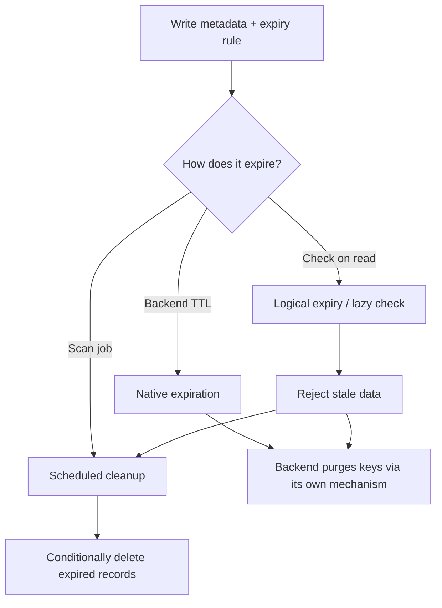
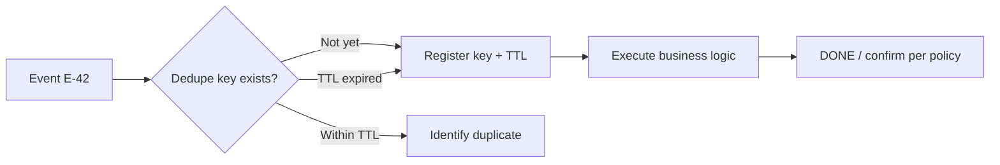

# Metadata TTL and Cleanup in Spring Integration

## Learning Objectives

A Spring Integration flow often needs to record **small state**: the last poll of a source, markers of processed files, deduplication keys, checkpoints, or indicators that a task is held by a worker. These values can be stored using `MetadataStore`. However, when an application runs for weeks or months, old metadata accumulates, changes meaning, or blocks a valid message from being processed. The question then becomes: **how long should metadata be kept, when is it considered expired, and how should it be cleaned up without breaking flow correctness?**

This **Metadata TTL and Cleanup** lesson belongs to the **Metadata store** chapter of the **SPRING_INTEGRATION_RUNTIME** module. We will connect the `MetadataStore` model to message flows, channels, endpoints, consumers, pollers, and executors; and analyze the effects of transactions, retries, message stores, error flows, and correlation on metadata expiration and cleanup.

After this lesson, you will be able to:

- Distinguish **TTL**, logical expiration, and physical record deletion (*physical cleanup*).
- Explain why the `MetadataStore` contract does not guarantee TTL by itself, and choose an implementation approach for in-memory, JDBC, or Redis.
- Choose when TTL starts, renewal conditions, idempotency marker retention duration, and cleanup policies.
- Read and write expiring metadata in Java; build a rate-limited cleanup job for expired records.
- Identify race conditions among cleanup, workers, retries, and redeliveries, especially across multiple instances.
- Measure cleanup lag, detect stale metadata, and test expiry/replay after restarts.

## 1. What Is TTL Really?

**TTL (time to live)** is the duration a record is permitted to remain valid under the application or backend contract. If a 10-minute TTL is set from write time `t0`, then expiration occurs at `t0 + 10 minutes`.

```text
t0 = 10:00           10:10                10:13
|-------------------|--------------------|
write metadata      TTL ends             cleanup runs
                    |
                    +-- metadata logically expired;
                        physical record may still remain in store
```

Three timestamps must be distinguished:

1. **`createdAt` or `updatedAt`:** the starting point for measuring time; may be initial creation, last update, or business event time.
2. **`expiresAt`:** the point at which metadata is no longer valid for new processing passes.
3. **`deletedAt`:** the point at which the backend or cleanup job physically removes the record.

In a design that checks expiration on read, you can enforce `now >= expiresAt` and treat the record as **immediately invalid**, even if the database row still exists. Conversely, if only an hourly cron job deletes rows and every consumer calls `get()` and trusts whatever exists, metadata past its TTL can still be used for nearly an extra hour.

### 1.1. When Does TTL Start Counting?

| Policy | When Deadline Resets | Best Fit | Risks to Control |
| --- | --- | --- | --- |
| **Absolute TTL** | Only from creation/initial issue | Verification codes, dedupe keys for a fixed window | Must not renew unintentionally |
| **Sliding TTL** | Extended on valid activity | Active sessions, leases, or caches in use | Overly frequent access keeps data alive forever |
| **Business deadline** | Based on a precomputed business milestone | Workflows awaiting payment until an expiration hour | Changing deadlines requires explicit rules |
| **Post-completion retention** | Counted from reaching DONE state | Retaining deduplication or audit markers | Early cleanup makes old replays look new |
| **Post-failure retention** | Counted from last failure/incident closure | Error metadata for investigation | Extends forever if errors keep updating it |

No single TTL value is optimal for every key. For example, metadata for an active batch must live long enough for workers to finish, while a processed-file marker may need to outlive how long that file stays at the source.

### 1.2. TTL Differs from Timeout and Retry Delay

- **Timeout:** maximum time a request, poll, or task is allowed to wait.
- **Retry delay/backoff:** pause duration before running the next attempt.
- **TTL:** validity or retention lifetime of metadata.
- **Cleanup interval:** cadence of scanning for and deleting expired records.

If a handler takes 5 minutes, retries may fire after 2 minutes, and a metadata lease expires after 1 minute, a second worker may think the resource is free while the first worker is still running. A short TTL does not replace locking with fencing/renewal.

## 2. What Does MetadataStore Provide?

Spring Integration's `MetadataStore` reads/writes **`String` key → `String` value** pairs, not full `Message<?>` persistence. Its core operations are `get(key)`, `put(key, value)`, and `remove(key)`.

```java
import org.springframework.integration.metadata.MetadataStore;
import org.springframework.integration.metadata.SimpleMetadataStore;

MetadataStore store = new SimpleMetadataStore();

store.put("si:files:invoice:2026-11-22.csv", "processed");
String state = store.get("si:files:invoice:2026-11-22.csv");
String removed = store.remove("si:files:invoice:2026-11-22.csv");

System.out.println(state);   // processed
System.out.println(removed); // processed (previous value)
```

`SimpleMetadataStore` is an in-memory store suited for demos or tests; in-memory contents do not survive restarts. In real applications, metadata that must survive restarts or be shared across replicas typically uses a backend implementation such as JDBC or Redis, depending on dependencies and configuration.

The base contract **does not define a universal TTL method** such as `put(key, value, Duration)` or `expire(key, Duration)`. Therefore, merely choosing `MetadataStore` does not mean metadata expires automatically after some duration. A specific backend may support TTL at its own layer, but enabling it, its scope, and its precision depend on the implementation.

### 2.1. ConcurrentMetadataStore

`ConcurrentMetadataStore` adds conditional update capabilities such as `putIfAbsent(key, value)` and `replace(key, oldValue, newValue)`. These operations help when multiple consumers must avoid overwrites or contention on the same key:

```java
import org.springframework.integration.metadata.ConcurrentMetadataStore;

ConcurrentMetadataStore concurrentStore = /* bean supporting CAS */ null;

// Illustrating contract: putIfAbsent returns null if newly written.
String previous = concurrentStore.putIfAbsent(
        "si:jobs:ORD-42", "worker-a");
boolean claimed = previous == null;

boolean updated = concurrentStore.replace(
        "si:jobs:ORD-42", "worker-a", "worker-a:processing");
```

This snippet illustrates operation semantics, **not a standalone runnable program** (`concurrentStore` must be injected with a real bean). Compared to `get() -> if null -> put()`, atomic operations per the implementation contract reduce race conditions under contention.

However, `ConcurrentMetadataStore` **does not provide distributed TTL, lease renewal, or fencing tokens on its own**. Time-based expiration of a key still must be designed and enforced properly at the backend.

### 2.2. MetadataStore vs. MessageStore

| Mechanism | Typical Key/Value | When to Use |
| --- | --- | --- |
| `MetadataStore` | `String key -> String value` | Checkpoints, idempotency markers, small state |
| `ConcurrentMetadataStore` | String key/value with conditional update operations | Metadata with contention across multiple workers |
| `MessageStore` | Message ID UUID → `Message<?>` | Holding and retrieving full messages |
| `MessageGroupStore` | Group ID → multiple messages | Aggregators, resequencers, message group state |
| Error store/DLQ | Error key/business record → recovery data | Investigation, repair, controlled replay |

Deleting a metadata key **does not automatically delete messages** in `MessageStore`, acknowledge a broker, or stop an `IntegrationFlow`.

## 3. Why Does Metadata Become Stale?

Stale metadata is data that still exists but is no longer valid or meaningful, such as:

- A "file processed" marker retained for a new file with the same name but updated content.
- A checkpoint pointing to an old offset after the data source was reset.
- An "in-progress" key left behind after a worker crash.
- A deduplication marker cleaned up too early, letting an old message be accepted again.
- Session or correlation records for closed workflows still sitting in the store.
- Keys with an old prefix/version after an application upgrade that new code no longer reads.

Not every kind of staleness is solved by **deleting faster**. For instance, an inbound adapter checkpoint usually must survive restarts to avoid reprocessing previously read data; deleting a checkpoint just because it is "over 24 hours old" can reprocess the entire source. Conversely, a broken lease may need revocation so the system can continue.

### 3.1. Mapping Metadata Categories

Before assigning TTLs, document the purpose and owner of each key group:

| Key Category | Example | Suggested Policy | What Can Happen on Expiration? |
| --- | --- | --- | --- |
| Dedupe/idempotency | `si:dedupe:order:ORD-42` | Retain longer than the redelivery/replay window to block | Old messages may be accepted again |
| Poller checkpoint | `si:poller:orders:cursor` | Usually no arbitrary TTL; manage per source lifecycle | Re-reading, skipping, or wrong position |
| Inbound file filter | `si:file:processed:<path>` | Match file lifecycle and timestamp comparison rules | Source files may be reprocessed |
| Temporary lease/claim | `si:lease:job:42` | Short TTL with renewal and protection against stale owners writing | Two workers may process concurrently |
| Auxiliary state cache | `si:lookup:sku:42` | TTL aligned with data freshness | Cache miss and backend call |
| Errors awaiting review | `si:error:order:ORD-42` | Follow error retention policy | Loss of evidence or replay capability |
| Auxiliary correlation state | `si:workflow:run:abc` | Follow workflow deadline and late-arrival handling | Unable to correlate late-arriving messages |

Use **namespaced and schema-versioned prefixes**, such as `si:runtime:v1:dedupe:tenant-a:ORD-42`, so multiple flows never accidentally overwrite each other's keys. Never use a bare `orderId` as a global key if multiple tenants can share the same value.

## 4. Three TTL and Cleanup Strategies



| Strategy | Read-Path Impact | Storage Capacity Impact | Caveats |
| --- | --- | --- | --- |
| **Logical TTL / lazy check** | Read record and compare `expiresAt`; reject if expired | Does not free storage on its own | Accumulates leftovers without cleanup |
| **Native backend TTL** | Backend treats key as expired per its own semantics | Can free storage in the background | Expiration may not be millisecond-exact; API/namespace must align |
| **Scheduled cleanup** | Without read-time expiry checks, consumers may still read stale records before the cleanup pass | Batch cleanup, controllable load | Races with refresh tasks, multi-instance runs, DB contention |

Two strategies can work together: **checking expiration on the read path to honor the contract**, paired with **a background physical deletion job** to keep storage bounded. If the backend provides a suitable native TTL, you may not need a separate deletion job for those specific keys; still monitor expiration status and effectiveness.

## 5. Java Example: Logical TTL on MetadataStore

We can encode a deadline inside the `String` value of `MetadataStore`. This example clarifies TTL semantics without needing Redis or a database; it suits tests and simple single-instance applications.

```java
import java.time.Clock;
import java.time.Duration;
import java.util.Optional;

import org.springframework.integration.metadata.MetadataStore;
import org.springframework.integration.metadata.SimpleMetadataStore;

final class ExpiringMetadataView {
    private final MetadataStore store;
    private final Clock clock;

    ExpiringMetadataView(MetadataStore store, Clock clock) {
        this.store = store;
        this.clock = clock;
    }

    void put(String key, String value, Duration ttl) {
        if (ttl.isNegative() || ttl.isZero()) {
            throw new IllegalArgumentException("ttl must be positive");
        }

        long expiresAtMillis =
                Math.addExact(clock.millis(), ttl.toMillis());

        // Demo format: <expiresAtMillis>|<value>
        store.put(key, expiresAtMillis + "|" + value);
    }

    Optional<String> getFresh(String key) {
        String encoded = store.get(key);
        if (encoded == null) {
            return Optional.empty();
        }

        int separator = encoded.indexOf('|');
        if (separator <= 0) {
            throw new IllegalStateException("Malformed metadata");
        }

        long expiresAtMillis = Long.parseLong(
                encoded.substring(0, separator));

        // Once expired, callers must not use this value.
        if (clock.millis() >= expiresAtMillis) {
            return Optional.empty();
        }

        return Optional.of(encoded.substring(separator + 1));
    }
}

// Usage example:
MetadataStore store = new SimpleMetadataStore();
Clock start = Clock.systemUTC();
ExpiringMetadataView view = new ExpiringMetadataView(store, start);

view.put("si:runtime:v1:cache:SKU-42", "available", Duration.ofMinutes(10));

Optional<String> state =
        view.getFresh("si:runtime:v1:cache:SKU-42");
```

**Important limitations of the example:**

1. `getFresh()` returns `Optional.empty()` upon expiration, but **does not remove** the key from `SimpleMetadataStore`. It demonstrates logical expiry, not cleanup.
2. `put()` overwrites any existing value; this wrapper provides no exclusive claim policy, CAS, race protection, or transactions.
3. Values containing `|` are preserved after the first delimiter; this format is for learning only. Production code should use explicit schemas/versions and validation.
4. Injecting `Clock` lets tests use `Clock.fixed` or `Clock.offset` instead of waiting in real time.
5. Across multiple instances, node clocks can drift. If deadlines govern work ownership, use a consistent backend clock or a dedicated lease mechanism.

### 5.1. Testing Expiration Without Sleeping

```java
import java.time.Clock;
import java.time.Duration;
import java.time.Instant;
import java.time.ZoneOffset;

import org.springframework.integration.metadata.MetadataStore;
import org.springframework.integration.metadata.SimpleMetadataStore;

MetadataStore store = new SimpleMetadataStore();
Clock t0 = Clock.fixed(
        Instant.parse("2026-11-22T00:00:00Z"), ZoneOffset.UTC);

new ExpiringMetadataView(store, t0).put(
        "demo:key", "active", Duration.ofMinutes(10));

Clock before = Clock.offset(t0, Duration.ofMinutes(9));
Clock after = Clock.offset(t0, Duration.ofMinutes(11));

System.out.println(new ExpiringMetadataView(store, before)
        .getFresh("demo:key")); // Optional[active]

System.out.println(new ExpiringMetadataView(store, after)
        .getFresh("demo:key")); // Optional.empty
```

This test proves **deadline evaluation logic**, not that the physical record disappeared. After expiration, `store.get("demo:key")` still returns the stored string until a cleanup step runs.

### 5.2. Why Not Call `remove` Immediately Inside `getFresh`?

Suppose worker A reads an expired record and prepares to delete it. Meanwhile, worker B updates the same key with a new deadline. If A calls unconditional `store.remove(key)`, A can wipe out B's fresh record:

```text
A: get(key) -> expiresAt=10:00 (stale)
B: put(key, "expiresAt=11:00|processing")
A: remove(key) -> deletes the fresh record too!
```

Therefore, `getFresh` in the example only **ignores expired data**. Cleanup in a concurrent system needs conditional deletion based on the current value/deadline and backend atomicity guarantees. Do not mistake `ConcurrentMetadataStore.replace(...)` for a universal `remove(key, expectedValue)` API.

## 6. Native TTL with Redis: Using the Right API Layer

Redis has native key expiration. For **application-owned TTL data**, you can use Spring Data Redis to set both value and TTL in one operation. This leverages backend native expiration; it **does not mean every `MetadataStore` implementation accepts a `Duration`**.

```java
import java.time.Duration;

import org.springframework.data.redis.core.StringRedisTemplate;

final class RedisTtlMetadata {
    private final StringRedisTemplate redis;

    RedisTtlMetadata(StringRedisTemplate redis) {
        this.redis = redis;
    }

    void rememberRecentEvent(String eventKey) {
        String key = "si:runtime:v1:recent-event:" + eventKey;

        // SET with TTL: value lives at most 15 minutes in Redis.
        redis.opsForValue().set(key, "seen", Duration.ofMinutes(15));
    }

    boolean seenRecently(String eventKey) {
        String key = "si:runtime:v1:recent-event:" + eventKey;
        return "seen".equals(redis.opsForValue().get(key));
    }
}
```

Here the key lives in a **separate application-owned namespace**. Do not use this snippet to manually alter internal physical keys managed by `RedisMetadataStore` without verifying prefixes, serializers, and implementation contracts. Having a `RedisMetadataStore` bean does not give the `MetadataStore.put(key, value)` call in section 2 a 15-minute TTL.

### 6.1. Atomic Put-If-Absent with TTL

For a deduplication marker **within a bounded time window**, an application may need "write only if absent, while setting TTL":

```java
import java.time.Duration;

import org.springframework.data.redis.core.StringRedisTemplate;

boolean firstWithinWindow(
        StringRedisTemplate redis,
        String tenantId,
        String eventId) {

    String key = "si:runtime:v1:dedupe:"
            + tenantId + ":" + eventId;

    Boolean accepted = redis.opsForValue().setIfAbsent(
            key, "seen", Duration.ofHours(24));

    return Boolean.TRUE.equals(accepted);
}
```

When the backend supports the atomic operation, `setIfAbsent` with TTL avoids the gap between `SETNX` and `EXPIRE`. However, it only provides **deduplication while the key remains live**, not eternal exactly-once. After 24 hours, the key expires and the same `eventId` can be accepted again.

For critical work, decide whether marking `seen` **before** executing side effects is acceptable. If `seen` succeeds and the worker crashes before business processing, retries can be blocked even though the work never finished. When needed, use a `PENDING/PROCESSING/DONE` state model, proper transactions/queues, or idempotency at the target system instead of a single `seen` key.

### 6.2. TTL Is Not a Safe Distributed Lock

A TTL key used as a lease is not enough to stop an old worker from writing after the lease expires. Worker A may suffer a GC pause longer than TTL; worker B acquires a new lease; A wakes up and still calls the API. When operations have side effects, you need **fencing tokens**, conditional updates, or target-resource guards.

Likewise, never let an old owner call `redis.delete(key)` without verifying ownership: the key may have expired and been claimed by a new owner. Safe deletion requires atomic token-checked compare-and-delete or a proven lock/lease mechanism.

## 7. Scheduled Cleanup: Example with an Application-Owned JDBC Table

Not every backend offers suitable native expiration. For metadata stored in an **application-owned table**, you can maintain an `expires_at` column and run batched cleanup jobs. The example below uses PostgreSQL; this is **not the default internal schema of `JdbcMetadataStore`**.

```sql
CREATE TABLE integration_metadata_expiring (
    metadata_key   VARCHAR(255) PRIMARY KEY,
    metadata_value TEXT NOT NULL,
    expires_at     TIMESTAMPTZ NOT NULL,
    updated_at     TIMESTAMPTZ NOT NULL DEFAULT CURRENT_TIMESTAMP
);

CREATE INDEX idx_metadata_expiring_expires
    ON integration_metadata_expiring (expires_at);
```

Reading a key only while valid:

```sql
SELECT metadata_value
FROM integration_metadata_expiring
WHERE metadata_key = :key
  AND expires_at > CURRENT_TIMESTAMP;
```

The condition `expires_at > CURRENT_TIMESTAMP` enforces logical expiry **right at query time**, even if the cleanup cron has not run yet. When multiple services share a DB, using the DB's clock for comparison avoids clock drift across application instances.

### 7.1. Batched Cleanup Job and Expiration Condition at DELETE Time

```java
import org.springframework.jdbc.core.JdbcTemplate;
import org.springframework.scheduling.annotation.Scheduled;
import org.springframework.stereotype.Component;

@Component
class ExpiredMetadataCleaner {
    private final JdbcTemplate jdbc;

    ExpiredMetadataCleaner(JdbcTemplate jdbc) {
        this.jdbc = jdbc;
    }

    @Scheduled(fixedDelay = 60_000)
    public void removeExpiredBatch() {
        // PostgreSQL, application-managed metadata table.
        // Do NOT DELETE directly from JdbcMetadataStore's internal table.
        int removed = jdbc.update("""
            DELETE FROM integration_metadata_expiring AS m
            WHERE m.expires_at <= CURRENT_TIMESTAMP
              AND m.metadata_key IN (
                  SELECT x.metadata_key
                  FROM integration_metadata_expiring AS x
                  WHERE x.expires_at <= CURRENT_TIMESTAMP
                  ORDER BY x.expires_at
                  LIMIT 500
              )
            """);

        // Use production logger/metrics; this is illustrative code.
        System.out.println("Expired metadata removed: " + removed);
    }
}
```

Requires `@EnableScheduling` in the application, `JdbcTemplate`, and the table created. Each pass deletes **at most 500** rows to prevent a single long-running job. If backlog grows, run multiple batches within a time/iteration budget or tune cadence to DB capacity.

The `m.expires_at <= CURRENT_TIMESTAMP` predicate on the `DELETE` itself is crucial: a row renewed right around cleanup time must not be deleted just because it matched an earlier read. Verify locking/isolation semantics and actual update behavior on your backend under multi-process concurrency; for critical workflows, test concurrent refresh and cleanup.

**Do not run this SQL against `JdbcMetadataStore`'s internal table.** When using `JdbcMetadataStore`, follow the schema, key namespace, transaction contract, and cleanup mechanisms supported by your library version. If you want general `expires_at`-based TTL, an explicit application table is usually far easier to control than altering columns or arbitrarily deleting rows in a shared store.

### 7.2. Multi-Replica Cleanup

If every pod runs the same `@Scheduled` method, multiple cleaners scan the DB concurrently. Conditional `DELETE` and proper transactions reduce corruption risk, but still create wasted load and contention. For large tables, use **a single coordinated cleanup worker**, a distributed scheduler/leader election, or a proper job lock; measure scan duration and deleted row counts.

A cleanup job must tolerate failures: DB outages, timeouts, or conflicts must not halt application processing indefinitely. Yet you must alert when persistent cleanup failures let the table grow past bounds. Never write a job that "catches every exception and logs once" with no observability.

## 8. How Does TTL Affect Idempotency?

A `MetadataStore` is often used to retain data supporting an **idempotent receiver** or **persistent accept-once filter**. When metadata expires, a previously blocked event or file may be treated as new.



The diagram illustrates a deduplication window; a "register before processing" policy can lose work if the worker crashes after registration, so production must choose an appropriate contract.

### 8.1. Sizing TTL to the Actual Redelivery Window

Suppose the broker can redeliver for up to 3 days and operations can replay from a DLQ for 7 days. Setting a 1-hour dedupe TTL will not stop duplicates arriving afterward. One approach is keeping idempotency records for at least **the permitted redelivery + replay window**, accounting for operator-triggered replays and audit needs.

Yet keeping a `seen` key for 30 days still does not guarantee correctness if the DB or API side effect lacks a unique constraint. Design idempotency around **business keys**, not solely metadata TTL.

### 8.2. Persistent File Filters and File Re-Ingestion Risk

In Spring Integration, file/remote-file filters use persistent metadata to remember seen items. If you purge metadata for a file still sitting at the source, the filter may accept that file again under its comparison rules. This can be helpful for intentional reprocessing, but causes duplicates if a global TTL is applied carelessly.

Therefore, cleanup policies must understand **the exact metadata keys owned by adapters/filters**. Never sweep all keys sharing a prefix just because a different key group has a short TTL. When deleting during deployment changes or incident recovery, verify whether old files remain at the source.

### 8.3. Different TTLs for PENDING and DONE States

A practical model can use states:

```text
ABSENT
   -> PENDING (received; a worker is processing)
   -> DONE (business committed)
   -> EXPIRED / ARCHIVED (after retention)
```

`PENDING` may need a lease/heartbeat to detect dead workers, but **never delete `DONE` records on the same short TTL as `PENDING`** while a redelivery window remains open. A worker losing its lease does not mean earlier work produced no side effect. Check durable business state before reassigning or replaying.

## 9. Transactions, Threads, and Rollbacks

Metadata cleanup may run on a scheduler thread, while handlers run on sender, executor, or poller threads. These are distinct transaction boundaries.

| Location | Metadata Operation | Risk |
| --- | --- | --- |
| Before synchronous `DirectChannel` | Write key then send message | Handler fails while key already committed earlier |
| Inside transactional handler | Store metadata with DB work (if truly same resource/manager) | Caught exceptions may prevent transaction rollback |
| After `ExecutorChannel` | Worker reads/writes store on another thread | Caller's transaction does not automatically propagate to worker |
| Poller reading source | Checkpoint/accept-once state before or after processing | Source ack/rollback may be out of sync with metadata |
| Error flow/recovery | Save error state then ack source | If saving error metadata fails and source still acks, replay is lost |
| Scheduled cleanup | Delete expired keys, possibly overlapping worker updates | Races with refresh/claim, contention, or deleting the wrong key |

### 9.1. A Message-Loss/Duplicate Scenario Caused by Early Expiration

```text
10:00 Worker A receives ORD-42, saves "seen" with 10-minute TTL
10:01 Worker A calls order-creation API successfully
10:02 Worker A crashes before writing DONE
10:10 "seen" key expires
10:11 Broker redelivers ORD-42
10:11 Worker B finds no key -> creates the order again
```

TTL does not answer "has the order already been created?" You need business keys, unique constraints, API idempotency keys, durable state, or compensating workflows. That is why **expiration policies cannot be decoupled from transactions and redelivery behavior**.

### 9.2. Retries and Fail-Open / Fail-Closed When the Store Fails

If `MetadataStore` (such as a JDBC/Redis backend) is temporarily unreachable, there are at least two policies:

- **Fail-closed:** reject or defer processing when dedupe/ownership cannot be verified; protects against duplicates at the cost of availability.
- **Fail-open:** allow processing even when keys cannot be read; improves availability at the risk of duplicate side effects.

No single choice fits every flow. For money transfers or inventory deductions, fail-closed is usually justified if no secondary idempotency layer exists; for rebuildable statistics, fail-open may be acceptable. Bind this decision to the business contract and store alerts rather than letting it emerge accidentally from a `catch(Exception)`.

## 10. Safe Cleanup Across Multiple Threads and Instances

### 10.1. Races Between Reads, Renewals, and Deletions

```text
T1 Cleanup: reads key K, sees expiresAt=10:00
T2 Worker:  extends K to 11:00
T1 Cleanup: unconditional remove(K)
Result:     still-valid metadata is lost
```

Prefer backend operations that are **conditional at update/delete time** (e.g., `DELETE WHERE key=? AND expires_at<=now` in JDBC), or atomic token/compare-and-delete for lease keys. Never try to fix races by adding `Thread.sleep`: sleeping does not eliminate races.

With Redis native expiration, Redis manages when keys expire, yet races between old and new owners can still happen on business operations. For leases, use owner tokens and (when genuinely guarding write resources) downstream fencing.

### 10.2. Clock Skew and Time

If one node sets `expiresAt` using a local clock off by 5 minutes, other nodes may view the key as expired too early or too late. Prefer the datastore's consistent clock for TTL/conditional SQL, or synchronize application clocks and monitor skew. In unit tests, use `Clock.fixed` to simulate before/after deadlines.

Store UTC/epoch timestamps in metadata. Display timezones should only affect reporting, never deadline comparison logic.

### 10.3. Batched Cleanup and Load Limiting

A cleanup job deleting millions of rows in one transaction can trigger locks, I/O spikes, and degrade pollers/consumers. For large tables:

1. Create appropriate indexes on `expires_at` and scanned namespaces.
2. Delete in small batches, capping total batches/time per run.
3. Tune cadence and avoid uncoordinated execution across all replicas.
4. Track remaining expired rows, scan duration, DB errors, and cleanup lag.
5. Check backup/retention/archiving rules if metadata serves audit purposes.

If metadata must be kept for investigation, **archive cleanly before deleting** per legal/operational policy; never turn TTL into automatic destruction of evidence before retention terms are settled.

## 11. IntegrationFlow Lifecycle and Metadata

Spring Integration can start/stop endpoints and dynamically register or remove `IntegrationFlow` instances. Stopping a flow **does not guarantee** its metadata is deleted. Likewise, startup does not mean all keys start fresh.

| Runtime Event | Metadata Questions to Answer |
| --- | --- |
| Startup/restart | Resume old checkpoint or start over? Is the store durable? |
| Stop consumer/poller | Keep processed state or unfinished leases? |
| Redeploy new version | Are old prefixes/schemas still read? Is there migration or cleanup? |
| Remove a dynamic flow | Which metadata belongs solely to this flow vs. shared with others? |
| Partition/tenant change | Should key namespaces change to avoid mixing state? |
| Disaster recovery | Does the store need point-in-time recovery aligned with message broker/business DB? |

A common strategy is versioning prefixes and **cleaning up old keys on a migration schedule** after confirming no consumer still uses them. Do not delete an old prefix immediately on deploy if messages are still queued or can redeliver under the old schema.

## 12. Observability and Diagnostics for TTL/Cleanup

TTL affects both **correctness** and **operational capacity**. Monitor these signals together:

| Signal | Meaning | Interpretation |
| --- | --- | --- |
| `metadata.keys.active` | Count of keys valid per policy | Rapid abnormal growth may mean duplicate writes or overly long TTLs |
| `metadata.keys.expired_pending` | Keys logically expired but not yet purged | Continuous growth means cleanup is falling behind |
| `metadata.cleanup.deleted` | Rows deleted per run | Zero may be normal or mean the job stopped running |
| `metadata.cleanup.duration` | Cleanup execution time | Increases may indicate slow DB or large backlog |
| `metadata.cleanup.error` | Job or backend error count | Detects stalled cleanup |
| `metadata.get.miss` / `metadata.get.stale` | Absent vs. present-but-expired | Separates missing keys from logical expiration |
| `metadata.write.conflict` | Failed CAS/put-if-absent calls | Shows worker contention levels |
| `dedupe.reaccepted` | Old events accepted again after expiry | Reveals TTL shorter than replay window |
| `idempotency.duplicate` | Side effects blocked by business key | Verifies the business protection layer |
| `checkpoint.replay` | Source data re-read after cleanup | Catches accidental checkpoint/filter-state deletion |

These are **suggested application metric names**, not built-in metrics provided automatically by Spring Integration. Avoid putting `messageId`, `correlationId`, `orderId`, or full metadata keys into metric labels due to high cardinality; use controlled logs/tracing to inspect individual events.

### 12.1. Symptom-Based Diagnostic Table

| Symptom | Common Cause | Check First |
| --- | --- | --- |
| Key past TTL yet `get()` still returns a value | Deadline stored in value without read check; cron hasn't purged | `expiresAt`, `getFresh` code, scheduler/namespace |
| Metadata disappears early | TTL too short, time skew, cleanup race | Write timestamp, deadline, worker refresh, native expiry |
| Restart wipes all keys | Using `SimpleMetadataStore` | Actual implementation and backend |
| Old event reprocessed | Dedupe key expired before redelivery/replay | TTL and source message retention policy |
| Remote files re-downloaded | Accidentally deleted persistent accept-once metadata | Filter prefix and source file lifetime |
| Cleanup runs yet table keeps growing | Batch too small, schedule too infrequent, writes outpace deletes | Incoming rate, `expired_pending`, delete throughput |
| Two workers process the same job | Lease expired, old owner still running, missing fencing | Owner token, deadline, heartbeat, downstream state |
| Cleanup job slows down the DB | Bulk delete, missing index, multiple replicas running | Query plan, lock waits, batch size, scheduler |
| `ErrorMessage` appears after cleanup | Cleanup erased needed checkpoint or correlation state | Error cause, key, endpoint, retry/transaction |
| Key purged yet messages remain | Confused `MetadataStore` with `MessageStore` | Store API and message lifecycle |
| Key expired yet broker hasn't redelivered | TTL does not control broker acks | Consumer/adapter transactions, nack, visibility timeout |
| Fresh key deleted by cleanup | Check-then-remove race | Atomic delete condition, concurrent expiry updates |

### 12.2. Investigation Sequence for a TTL Incident

1. Collect `businessKey`, `correlationId`, endpoint, and the relevant metadata key.
2. Identify who creates the key, what information the value holds, when TTL starts, and the real deadline.
3. Inspect the implementation: `SimpleMetadataStore`, persistent metadata store, or direct backend TTL calls.
4. Compare **logical expiry** vs. **physical deletion**, checking schedulers/native expiry and clocks.
5. If duplicates or lost messages appear, inspect transactions/acks/redeliveries/retries alongside downstream idempotency.
6. With multiple workers, review claim, renewal, conditional delete operations, and current ownership.
7. Cross-check committed business state before resetting keys or replaying messages; document remediation and add alert metrics.

## 13. Guided Hands-On Exercises

### Exercise A — Logical TTL with `Clock.fixed`

Use `SimpleMetadataStore` and the `ExpiringMetadataView` class from section 5. Store a key with a 10-minute TTL. Create two clocks before and after the deadline, call `getFresh()`, and then call `store.get()` directly.

**Expected outcome:** returns the value before the deadline and `Optional.empty()` after, while the raw value remains in the store. Learners clearly separate logical expiry from physical cleanup.

### Exercise B — Native TTL with Redis

Using a separate namespace `si:runtime:v1:recent-event:` and `StringRedisTemplate`, store an event with a short TTL in a test environment. Read before/after expiry and verify Redis removes the key. Then test `setIfAbsent` with TTL for the same `eventId`.

**Expected outcome:** native expiry requires no `expiresAt` parsing from the value; duplicate keys are blocked during the TTL window but accepted again once the key expires. Contrast with durable idempotency in the business DB.

### Exercise C — Cleanup on an Application JDBC Table

Create `integration_metadata_expiring` in a test PostgreSQL DB, insert 1,200 expired rows and 100 active rows. Run `removeExpiredBatch()` repeatedly and track row counts, query duration, and rows deleted per pass.

**Expected outcome:** at most 500 rows deleted per pass; active rows remain intact; at least three passes are needed to clear all 1,200 expired rows. Try renewing a key right as cleanup runs to verify the delete condition.

### Exercise D — How TTL Impacts Dedupe and Replay

Simulate a broker redelivering a message with the same `orderId` after 30 minutes while the dedupe TTL is 10 minutes. Have the handler call a fake order-creation API. Observe the consequence once the key expires, then add a unique business key/idempotency key downstream.

**Expected outcome:** a 10-minute TTL does not block duplicates after 30 minutes; the business idempotency layer protects against duplicate side effects.

### Exercise E — Race Between Cleanup and Worker Renewal

Simulate worker A reading an expired `expiresAt`, worker B renewing the key, and then A calling `remove(key)`. Then replace it with a backend conditional delete checking the current `expiresAt`, and verify results on a test JDBC DB or suitable backend.

**Expected outcome:** check-then-remove can delete fresh data; atomic conditional delete preserves the renewed record.

### Exercise F — Cleanup While Poller and Executor Are Running

Place metadata checkpoint/dedupe into an inbound polling adapter flow with a handler running across an `ExecutorChannel`. Make the handler fail, trigger retries and redeliveries; trace when keys are written, metadata states, worker transactions, and when cleanup executes.

**Expected outcome:** metadata TTL does not control source acks or rollbacks; the same key can be accessed across threads/transactions, so cleanup policies must align with the real processing lifecycle.

## 14. Self-Check Questions

1. How does TTL differ from cleanup interval? Why can a key past its TTL still exist in the database?
2. Does `MetadataStore` expose a universal TTL API like `put(key, value, Duration)`?
3. What are the differences among `MetadataStore`, `MessageStore`, and `MessageGroupStore`?
4. Why doesn't `getFresh()` in the example directly call `remove(key)` when metadata is stale?
5. When is Redis `setIfAbsent` with TTL suitable for deduplication? What is its limitation regarding exactly-once?
6. Why does a TTL lease still need owner tokens or fencing in a multi-worker system?
7. What effect can deleting persistent file filter metadata have if the source file still exists?
8. How should dedupe TTL relate to redelivery and replay windows?
9. Why can writing `seen` metadata before the handler cause a message to go unprocessed after a worker crash?
10. When an `ExecutorChannel` switches threads, does the caller's transaction automatically cover store operations on the worker?
11. Why can a cleanup job running on every replica cause contention even with a conditional SQL `DELETE`?
12. If a record is renewed right before cleanup, which condition must be checked **at deletion time**?
13. Which metrics distinguish "key logically expired" from "physical cleanup job lagging behind"?
14. When should checkpoints be kept long-term instead of given a short TTL?
15. Does TTL expiration mean the source message was acked, succeeded, or is safe to replay?

**Remember:** `MetadataStore` holds small keyed state values, whereas **TTL** and **cleanup** are lifecycle policies that must be designed intentionally. Separate **logical expiry** from **physical deletion**, size TTLs to business windows, use conditional operations under concurrency, align idempotency/transactions/acks with contracts, and measure cleanup lag. Deleting metadata on time is never enough by itself to guarantee messages were processed correctly.
