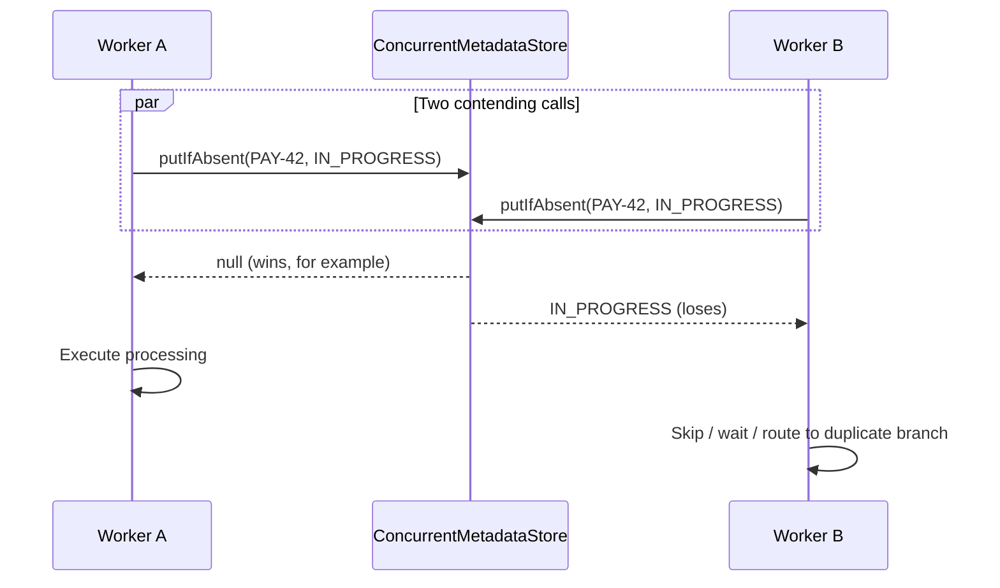
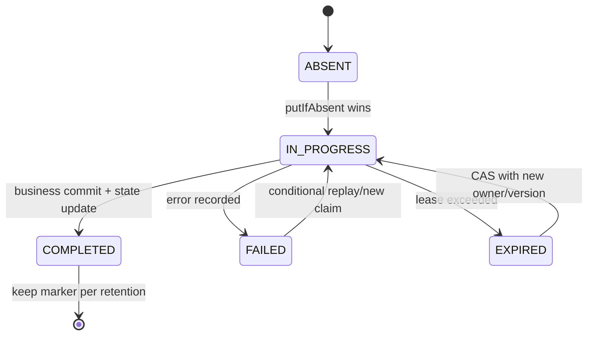

# Atomic Put-If-Absent and Race Conditions in Spring Integration

## 1. The Problem: Two Consumers Seeing the Same "Unprocessed" Message

In the **Metadata store** chapter of the **SPRING_INTEGRATION_RUNTIME** module, a classic scenario is two consumers receiving the same event from two pollers or threads. Both want to check whether the event has already been processed so they do not create duplicate invoices, emails, or charges.

Suppose the event has business key `payment:PAY-42`. A seemingly reasonable piece of code:

```java
// WRONG APPROACH with multiple threads or multiple instances
if (metadataStore.get("payment:PAY-42") == null) {
    paymentService.charge("PAY-42");       // Side effect
    metadataStore.put("payment:PAY-42", "done");
}
```

This is a **check-then-act (TOCTOU: time of check → time of use)** bug: checking and acting are **two non-atomic steps**. Both threads can read `null` before either thread writes `done`.

```mermaid
sequenceDiagram
    participant A as Worker A
    participant S as MetadataStore
    participant B as Worker B
    A->>S: get(PAY-42)
    S-->>A: null
    B->>S: get(PAY-42)
    S-->>B: null
    A->>A: charge(PAY-42)
    B->>B: charge(PAY-42)
    A->>S: put(PAY-42, done)
    B->>S: put(PAY-42, done)
    Note over A,B: Both process; the final value is still just done
```

Inspecting the store after the incident shows only a single `done` key, yet **two side effects occurred**. Wrapping that block in `synchronized` only saves threads sharing **a single monitor in one JVM**; it does not protect two separate application instances.

The solution at the metadata-key layer is **atomic put-if-absent**: "if the key does not exist, insert it" happens in **one atomic operation** of `ConcurrentMetadataStore`. However, winning the right to process and actually finishing business work are still two separate things; later sections will detail crash and replay scenarios.

## 2. How Do MetadataStore and ConcurrentMetadataStore Differ?

Spring Integration provides key/value contracts for small state—typically deduplication markers, timestamps of processed feeds/files, or checkpoints.

| Component | Primary API | Meaning | Race Protection |
| --- | --- | --- | --- |
| `MetadataStore` | `get(key)`, `put(key,value)`, `remove(key)` | Read/write/delete string key/value pairs | **Does not provide** atomic check-and-write in the interface |
| `ConcurrentMetadataStore` | Extends `MetadataStore`, adds `putIfAbsent` and `replace` | Atomic insert and compare-and-set | Protects these operations per the store implementation's capability |
| `MessageStore` / `MessageGroupStore` | Store messages or message groups | Queues, aggregators, resequencers, claim-check | Different goal from key/value metadata |
| `LockRegistry` | Acquire locks by key | Coordinate critical sections | Needs a shared registry if locking across JVMs |
| Business idempotency table | Unique keys, states, transactions | Protects side effects and recovery workflows | Depends on application transactions and invariants |

**`ConcurrentMetadataStore` is not a map holding entire messages.** This interface stores `String` keys and values. Do not try to stuff a large business payload or a serialized `Throwable` into metadata merely to flag a failed message.

### Key API Signatures

```java
public interface ConcurrentMetadataStore extends MetadataStore {
    String putIfAbsent(String key, String value);
    boolean replace(String key, String oldValue, String newValue);
}
```

Base methods inherited from `MetadataStore`:

```java
String get(String key);
void put(String key, String value);
String remove(String key);
```

These are **simplified signatures for learning**, omitting version-specific nullability annotations/Javadocs; you do not redeclare the interface when using the library.

- `putIfAbsent(key,value)` **returns `null` when newly inserted** because the key did not exist previously. If the key already exists, it returns the **existing value** without overwriting it.
- `replace(key,oldValue,newValue)` returns `true` if the current value **equals** `oldValue` and replaces it with `newValue`; returns `false` if the key is absent or the value changed.
- `get` followed by `put` does not become atomic merely because both are called on a `ConcurrentMetadataStore`.
- `put(key,value)` is an unconditional write; it can clobber state just written by another worker.
- `remove(key)` in the base interface **has no condition matching an expected old value**. Accidentally deleting a key just claimed by another worker is a major race condition.

The official Javadoc confirms the return values of `putIfAbsent` and `replace`. When using Spring Integration 6.x/7.x, verify against the exact dependency version in your application.

## 3. How Does Atomic Put-If-Absent Prevent Races?

With two workers calling concurrently:

```java
String previous = store.putIfAbsent("payment:PAY-42", "IN_PROGRESS");
boolean acquired = previous == null;
```

Only **one** worker wins when both operate against **a genuinely shared store** whose implementation guarantees atomicity.



This is an **atomic claim** on a key. It helps both with intra-JVM concurrency and across multiple instances **when the store backend supports cross-instance sharing and atomicity**.

The atomicity of `putIfAbsent` applies strictly to the key/value write operation. It **does not** make an external `paymentService.charge(...)` call part of a metadata transaction. If the winning worker dies before finishing, `IN_PROGRESS` may linger forever. If the side effect succeeded but the worker died before marking completion, a replay can cause duplicate execution unless the side-effect target itself is idempotent.

## 4. Small Java Example: Selecting Exactly One Worker

A service using `ConcurrentMetadataStore` instead of `get + put`:

```java
import org.springframework.integration.metadata.ConcurrentMetadataStore;

public final class EventClaimService {

    private final ConcurrentMetadataStore store;

    public EventClaimService(ConcurrentMetadataStore store) {
        this.store = store;
    }

    public boolean tryClaim(String tenantId, String eventId) {
        String key = "incoming:" + tenantId + ":" + eventId;
        return store.putIfAbsent(key, "IN_PROGRESS") == null;
    }

    public boolean markCompleted(String tenantId, String eventId) {
        String key = "incoming:" + tenantId + ":" + eventId;
        return store.replace(key, "IN_PROGRESS", "COMPLETED");
    }
}
```

This code assumes **a single successful claim per key**, without leases or state overwrites from other processes. `replace` from `IN_PROGRESS` to `COMPLETED` checks that the key **is still in the expected pending state**; if it returns `false`, investigate because the key may have been altered or removed.

Using `tenantId + eventId` makes sense when event IDs are not globally unique. For sources with offsets, filenames, or revisions, the business key must match the **definition of "duplicate"**. For example, `message.getHeaders().getId()` is typically **unsuitable as an idempotency key across replays**: message IDs can change when messages are recreated for the same business request.

### Method Endpoint Filter Example

```java
import org.springframework.integration.annotation.Filter;
import org.springframework.integration.annotation.MessageEndpoint;
import org.springframework.integration.annotation.ServiceActivator;
import org.springframework.messaging.Message;

@MessageEndpoint
public class IncomingEventEndpoint {

    private final EventClaimService claims;
    private final PaymentService paymentService;

    public IncomingEventEndpoint(
            EventClaimService claims,
            PaymentService paymentService) {
        this.claims = claims;
        this.paymentService = paymentService;
    }

    @Filter(
        inputChannel = "incomingPayments",
        outputChannel = "uniquePayments",
        discardChannel = "duplicatePayments")
    public boolean accept(Message<PaymentEvent> message) {
        PaymentEvent event = message.getPayload();
        return claims.tryClaim(event.tenantId(), event.eventId());
    }

    @ServiceActivator(inputChannel = "uniquePayments")
    public void process(PaymentEvent event) {
        paymentService.processIdempotently(event);
        if (!claims.markCompleted(event.tenantId(), event.eventId())) {
            throw new IllegalStateException("Metadata state changed");
        }
    }
}
```

Here, `PaymentEvent` and `PaymentService` are **application-defined domain types**, for example:

```java
public record PaymentEvent(
        String tenantId,
        String eventId,
        String paymentId
) {}

public interface PaymentService {
    void processIdempotently(PaymentEvent event);
}
```

The flow needs `incomingPayments`, `uniquePayments`, and `duplicatePayments` channels and appropriate consumers; `discardChannel` can connect to `nullChannel` or an endpoint recording duplicate metrics. **This is only a claim-and-filter example**, not a complete exactly-once solution. The claim is written **before** processing: if the worker dies after the filter, the key remains `IN_PROGRESS`. `PaymentService` must still guard against duplicate execution itself, or share an appropriate transaction/idempotency record.

Especially with `ExecutorChannel` or pollers: the filter invocation and handler execution across two endpoints may not share the same transaction/thread. If the handler retries without re-running the filter, state and attempt counts can diverge from assumptions based solely on message order.

## 5. Compare-and-Set Races: Updating Without Overwriting Each Other

`putIfAbsent` solves **inserting a new key**. When multiple workers must update an existing value, use `replace(key, expectedOld, newValue)` as a **compare-and-set (CAS)**.

Suppose key `feed:partner-A:lastOffset` holds `"100"`:

```text
Worker A reads "100"; wants to write "101".
Worker B reads "100"; wants to write "102".

If both use put():
  A.put("101"); B.put("102") or vice versa.
  Final value depends on scheduling and can move backward.

If using replace():
  A.replace(key, "100", "101") → true, say A wins.
  B.replace(key, "100", "102") → false, because current is "101".
  B must re-read, check offset, and retry if business rules permit.
```

Example updating a monotonically increasing numeric checkpoint:

```java
import org.springframework.integration.metadata.ConcurrentMetadataStore;

public final class OffsetCheckpoint {

    private final ConcurrentMetadataStore store;

    public OffsetCheckpoint(ConcurrentMetadataStore store) {
        this.store = store;
    }

    public void advance(String sourceId, long candidate) {
        String key = "offset:" + sourceId;

        for (;;) {
            String current = store.get(key);

            if (current == null) {
                String previous = store.putIfAbsent(
                        key, Long.toString(candidate));
                if (previous == null) {
                    return;
                }
                // Another worker just initialized it; re-read.
                continue;
            }

            long known = Long.parseLong(current);
            if (candidate <= known) {
                return; // Never move backward.
            }

            if (store.replace(
                    key, current, Long.toString(candidate))) {
                return;
            }
            // CAS failed: another worker changed the key; retry.
        }
    }
}
```

This code guarantees the checkpoint **advances monotonically** with `candidate` when all writers follow the same protocol and the store provides atomic CAS. It **does not** prove every message with an offset below `candidate` finished processing. If offset 103 finishes in parallel before 102 and saves 103, skipping 102 after a restart loses work. When persisting source progress, explicitly track the **contiguous committed offset**, not merely `max(offset)` seen.

In production, CAS loops need bounded retries/backoff or a different coordination mechanism if contention is high; an unbounded loop can burn CPU when many writers contend.

## 6. MetadataStoreSelector and IdempotentReceiverInterceptor

Spring Integration includes the **Idempotent Receiver** pattern out of the box:

- `MetadataStoreSelector` uses key/value strategies and a `ConcurrentMetadataStore` to decide whether a message should be accepted or treated as duplicate.
- `IdempotentReceiverInterceptor` is an advice around a message handler that can set a duplicate header or, per configuration, discard/throw when rejected.
- Configurable in Java/XML/DSL for your project version instead of hand-rolling the entire filtering mechanism.

Per the reference documentation, `MetadataStoreSelector` normally accepts when the key does not exist yet. With `compareValues` (Spring Integration 5.3+), it can accept a new message if a `BiPredicate<String,String>` permits replacing the old value with the new value via the corresponding atomic operation. This is useful for ordered checkpoints or file readers.

**Note on default interceptor behavior:** duplicates are not necessarily dropped outright. Depending on configuration, the interceptor may attach the `duplicateMessage` header for downstream inspection; if `discardChannel` or `throwExceptionOnRejection=true` is configured, duplicates are routed away or throw before the handler. Always inspect the actual configuration rather than equating "idempotent interceptor" with "never runs duplicates."

### Why Is a `get(key) == null` Filter Insufficient?

A filter that merely checks:

```xml
<!-- UNSAFE with two concurrent consumers due to check-then-act -->
<int:filter input-channel="input"
            output-channel="unique"
            expression="@metadataStore.get(headers.businessKey) == null"/>
```

When two messages with the same key arrive close together, both filters can let them through. Even if a downstream endpoint later calls `put`, the gap remains. Replace it with an **atomic claim step** before allowing continuation, or use a properly configured `MetadataStoreSelector`/idempotent advice.

Yet a filter that atomically claims before processing creates an **IN_PROGRESS window**. Ensuring business work ultimately completes after a crash requires transactions or a downstream recovery process.

## 7. The Store Implementation Determines the Scope of Atomicity

Operations with the same name `putIfAbsent` do not offer the same protection scope if two workers use **two separate backends**.

| Implementation | Where State Lives | Atomic Across Threads? | Safe to Share Across JVMs? | Restart |
| --- | --- | --- | --- | --- |
| `SimpleMetadataStore` | `ConcurrentHashMap` in JVM | Yes, within the store instance | **No** if each JVM uses its own store | Lost when JVM/context stops |
| `PropertiesPersistingMetadataStore` | State and properties file | Has concurrent ops per implementation | Do not treat a shared file as safe distributed CAS without verifying locking/filesystem | Depends on flush/clean shutdown |
| `JdbcMetadataStore` | DB table with key/region | Yes, transactions + unique key | Yes when sharing DB with right transactions/config | Survives per DB durability |
| `RedisMetadataStore` | Redis shared keyspace | Yes for supported atomic ops | Yes when sharing Redis, subject to cluster/version limits | Depends on Redis persistence |
| `MongoDbMetadataStore`, ZooKeeper/Hazelcast stores | Corresponding backend | Per contract/interface and backend | Depends on cluster config and semantics | Per backend durability |

`SimpleMetadataStore` is a great choice for concurrency unit tests **within one JVM**. It does not automatically "sync with the database", and after a restart all `IN_PROGRESS`/`COMPLETED` keys are lost.

`PropertiesPersistingMetadataStore` normally flushes to file when the application context shuts down cleanly; you can call `flush()` explicitly. **Do not treat shutdown flush as a guarantee when a container is killed abruptly.** Multiple processes sharing a properties file are likewise not equivalent to a properly configured distributed CAS service like JDBC or Redis.

For `RedisMetadataStore`, Spring Integration documentation includes a specific warning: `replace()` cannot be used in certain **Redis Cluster** topologies because the `WATCH` mechanism required for atomicity is not supported per the implementation. If your workflow requires CAS, test on your exact Redis topology/version before choosing the backend.

## 8. JdbcMetadataStore: Put-If-Absent Across Multiple Instances

When two service instances connect to the same relational DB, `JdbcMetadataStore` is a common choice because `putIfAbsent` and `replace` are backed by transaction/unique-key atomicity.

Example bean configuration for Spring Integration 6.x/7.x:

```java
import javax.sql.DataSource;
import org.springframework.context.annotation.Bean;
import org.springframework.context.annotation.Configuration;
import org.springframework.integration.jdbc.metadata.JdbcMetadataStore;
import org.springframework.integration.metadata.ConcurrentMetadataStore;

@Configuration
public class MetadataStoreConfiguration {

    @Bean("paymentMetadataStore")
    public ConcurrentMetadataStore paymentMetadataStore(
            DataSource dataSource) {

        JdbcMetadataStore store = new JdbcMetadataStore(dataSource);
        store.setRegion("PAYMENT_IDEMPOTENCY_V1");
        return store;
    }
}
```

The application needs the `spring-integration-jdbc` dependency, a datasource, a suitable transaction manager, and the metadata schema for its database version. Illustrative DDL from the JDBC reference:

```sql
CREATE TABLE INT_METADATA_STORE (
    METADATA_KEY VARCHAR(255) NOT NULL,
    METADATA_VALUE VARCHAR(4000),
    REGION VARCHAR(100) NOT NULL,
    CONSTRAINT INT_METADATA_STORE_PK
        PRIMARY KEY (METADATA_KEY, REGION)
);
```

**The unique key is `(METADATA_KEY, REGION)`.** Two instances using the same region and business key contend on the same entry. If instance A uses `PAYMENT_IDEMPOTENCY_V1` while instance B uses `PAYMENT_IDEMPOTENCY_V2`, both can **win the claim** due to differing regions, even while pointing at the same database.

Database engines differ in syntax, lock hints, and isolation levels. `JdbcMetadataStore` supports configuring `lockHint` (defaulting to `FOR UPDATE` on many databases) and table prefixes; consult vendor-specific DDL/queries rather than copying one SQL script everywhere.

### Transactions and Commit Points Matter Greatly

Per the JDBC metadata store reference, a change inside an uncommitted transaction is not yet a checkpoint guaranteed to survive a crash. If the transaction rolls back, metadata changes inside that transaction can roll back as well.

Dangerous scenario:

```text
Worker A:
  Tx.begin
  putIfAbsent(PAY-42, IN_PROGRESS) → wins
  calls payment gateway → money charged in external system
  DB transaction rolls back due to error
  metadata marker disappears

Worker B later:
  putIfAbsent(PAY-42, IN_PROGRESS) → wins again
  calls payment gateway a second time
```

Therefore, **atomic put-if-absent is not an exactly-once side effect**. For payments, the partner system should receive a **stable idempotency key** and the application needs durable business state for reconciliation. When metadata updates and side effects execute inside **one genuine local DB transaction**, some divergence windows can be eliminated; when side effects involve HTTP/brokers, use distributed transaction strategies or outbox/reconciliation patterns.

## 9. Designing a State Machine Instead of a Single "done" Flag

A metadata value `"done"` supports basic deduplication but cannot distinguish "currently processing", "finished vs. just claimed", or "has this claim expired?"

A usable model:



This is an **application state model**, not a built-in Spring Integration enum. `ConcurrentMetadataStore` stores `String` values; to track owner, version, deadline, reason, or attempt count, encode a versioned string value or use a dedicated domain table.

Example value:

```text
IN_PROGRESS|owner=node-A-12|version=17|leaseUntil=2026-11-22T10:00:00Z
COMPLETED|version=18|completedAt=2026-11-22T09:59:30Z
```

If values include owner/version, `replace(key, oldValue, newValue)` performs CAS against **the entire `oldValue` string**. Only the worker holding the matching version succeeds. Even so:

- **Do not blindly `remove` on error** because another worker may have taken over after lease expiration.
- **Do not extend leases using `put`** because it can overwrite a new owner.
- Ensure sensible clocks and lease policies. If an old process keeps running after losing its lease, it can still execute external side effects: you need **fencing tokens** or target-side idempotency.
- `replace` is atomic CAS on a single key, **not a multi-key transaction**.

For rich business state machines, a table with `status`, `owner`, `version`, `lease_until`, a unique business key, and transactions is usually easier to maintain, query, alert on, and audit than packing everything into one `String`.

## 10. Be Careful When "Releasing Locks" with `remove()`

Suppose worker A claims a key and hangs. After timeout, B detects the expired claim and uses CAS to transition from `A/v1` to `B/v2`. Moments later, A "wakes up" and calls `store.remove(key)` inside `finally`.

Result: A deletes **B's valid claim** because `remove(key)` does not check the owner.

```text
A: putIfAbsent(key, "A/v1")     → wins
A: hangs
B: replace(key, "A/v1", "B/v2") → wins
A: remove(key)                  → deletes B's state!
C: putIfAbsent(key, "C/v3")     → wins again
```

Mitigations:

- Minimize `remove`; retain `COMPLETED` markers long enough to cover the redelivery/replay window.
- Use versioned CAS state transitions, then clean up with a coordinated job and rules that never break active claims.
- If "conditional delete" is needed, use an API/backend supporting owner/version-checked deletes (e.g., SQL `DELETE ... WHERE key=? AND version=?` or an equivalent atomic script). **The base `ConcurrentMetadataStore` interface does not provide conditional remove.**
- Consider never deleting entries on failure; transition to `FAILED` with conditional retry workflows instead, preventing a third worker from bypassing recovery logic.

These scenarios are **work ownership** problems; knowing how to call `putIfAbsent` alone is not enough to design leases.

## 11. Message Flows, Executors, Pollers, and Error Channels

Race conditions emerge at **fan-out and concurrency points** in the runtime:

| Concurrency Source | How Races Arise | What to Inspect |
| --- | --- | --- |
| `ExecutorChannel` | Multiple workers handle messages sharing a business key | Pool size, queue wait, failures inside handlers |
| `QueueChannel` + poller | Potentially multiple consumers/pollers or poll cycles | Transactions, max messages per poll, redelivery |
| Broker inbound consumers | Multiple instances/partitions/subscriptions receive the same event | Acks, broker redelivery, idempotency keys |
| `PublishSubscribeChannel` | Multiple subscribers receive the same event | Which subscriber owns side effects vs. metrics only |
| Retry advice | Handler re-invoked with the same input after exception | Is `IN_PROGRESS` marker reused properly? |
| Restarts and replays | In-memory store wiped, pending messages redelivered | Persistence, leases, cleanup, schema compatibility |
| Dynamic `IntegrationFlow` | Endpoints stopped/re-registered mid-flight | Do key/region and claim lifecycle remain consistent? |

With a synchronous `DirectChannel`, handler exceptions typically propagate to the calling `send()` thread. With `ExecutorChannel` or pollers, errors may route through `ErrorMessage` and `errorChannel` per framework mechanics. **The result of `putIfAbsent` must not replace error handling**: the claim winner can still fail mid-processing, and the claim loser may still need to observe the final status or await results.

If an error is handled by a recovery callback that returns normally, the poller's transaction may commit even though the business operation never completed. To roll back metadata with the business DB, ensure both share a compatible transaction. To dead-letter after retries exhaust, persist a durable failure record with correlation and idempotency keys; never just drop a `Throwable` onto `errorChannel` and assume recovery is done.

### Do Not Blindly Use Redis/JDBC Store as a Global Flow Lock

A metadata key typically protects **one business event**. Aggregators/resequencers require `MessageGroupStore` and an appropriate `LockRegistry` to guard sequential group-state updates. A metadata store does not automatically synchronize multi-message grouping operations or release ordering.

When correlating multiple messages, distinguish:

- `correlationId`: groups fragments belonging to the same logical group.
- `idempotencyKey`: determines whether a business command has already been processed.
- `messageId`: identifies a specific framework message instance.
- `ownerId` / `leaseVersion`: manages temporary processing ownership across workers.

Keys may look superficially similar in demos, but production should define distinct semantics and lifecycles to avoid misusing them.

## 12. When Do You Need Transactions Instead of CAS Alone?

A CAS operation enforces **a condition on a single key**. Transactions are valuable when preserving invariants across multiple rows, multiple steps, or between metadata and business data.

Suppose a worker needs to:

1. Claim an event.
2. Insert an invoice.
3. Mark the event completed.
4. Emit an `invoiceCreated` event.

If metadata and invoices live in the same database, a transaction can shrink the divergence window; emitting the broker event still needs an outbox or proper confirmation. Across separate databases or external APIs, there is no "atomic put-if-absent and then everything becomes exactly-once."

A simple DB pattern is a **unique business key** on a task table:

```sql
CREATE TABLE processed_commands (
    command_key  VARCHAR(160) PRIMARY KEY,
    status       VARCHAR(24) NOT NULL,
    version      BIGINT NOT NULL,
    updated_at   TIMESTAMP NOT NULL
);
```

With an appropriate DB, you can claim via an insert enforcing the unique key; a parallel transaction hits the unique constraint. To transition states, use a conditional update:

```sql
UPDATE processed_commands
   SET status = 'COMPLETED',
       version = version + 1,
       updated_at = CURRENT_TIMESTAMP
 WHERE command_key = :key
   AND status = 'IN_PROGRESS'
   AND version = :expectedVersion;
```

This is **illustrative logic SQL**, not `JdbcMetadataStore` DDL. If 0 rows update, never assume success; the worker may have lost ownership. When auditability, message replay, or pause/resume are needed, a stateful business table is usually better suited than packing state into a short metadata `String`.

## 13. Concurrency Testing: Proving Only One Worker Wins

A basic lab uses `SimpleMetadataStore` to test atomicity **within one JVM**, without needing a database connection. Park multiple threads at the same latch, then release them simultaneously to call `putIfAbsent` on the same key:

```java
import java.util.ArrayList;
import java.util.List;
import java.util.concurrent.CountDownLatch;
import java.util.concurrent.ExecutorService;
import java.util.concurrent.Executors;
import java.util.concurrent.Future;
import java.util.concurrent.atomic.AtomicInteger;

import org.springframework.integration.metadata.ConcurrentMetadataStore;
import org.springframework.integration.metadata.SimpleMetadataStore;

public final class AtomicClaimDemo {

    public static void main(String[] args) throws Exception {
        ConcurrentMetadataStore store = new SimpleMetadataStore();
        ExecutorService workers = Executors.newFixedThreadPool(16);
        CountDownLatch start = new CountDownLatch(1);
        AtomicInteger winners = new AtomicInteger();

        try {
            List<Future<?>> tasks = new ArrayList<>();
            for (int i = 0; i < 64; i++) {
                tasks.add(workers.submit(() -> {
                    start.await();
                    String previous =
                            store.putIfAbsent("event:42", "IN_PROGRESS");
                    if (previous == null) {
                        winners.incrementAndGet();
                    }
                    return null;
                }));
            }

            start.countDown();
            for (Future<?> task : tasks) {
                task.get(); // Wait for all tasks; exceptions fail the test.
            }

            if (winners.get() != 1) {
                throw new AssertionError(
                        "Expected one winner, got " + winners.get());
            }

            System.out.println("Winners = " + winners.get());
        } finally {
            workers.shutdown();
        }
    }
}
```

**Expected outcome:** 64 tasks contend, yet only **one** increments `winners`; all others receive the existing value. To demonstrate broken check-then-act deterministically, place a barrier **after `get()` and before `put()`** across two threads so both reliably read `null` without relying on scheduling luck.

Note: testing on `SimpleMetadataStore` **does not prove** JDBC/Redis behavior across hosts. It only verifies an in-memory implementation whose threads share one object.

### Two-Instance Integration Test

To verify `JdbcMetadataStore` truly protects multiple instances:

1. Run two applications or two separate contexts sharing a database/metadata table.
2. Configure **the same region** and the same key `payment:PAY-42`.
3. Use an external barrier (or synchronized request dispatch) so both instances claim simultaneously.
4. Verify exactly one call returns `null` and only one business handler runs.
5. Roll back the winning instance's transaction; verify the outcome and post-rollback retry behavior under your isolation level.
6. Restart one instance, confirm committed metadata persists, and verify startup causes no duplicates.
7. Test a version rollout changing region/key format; observe the risk of both versions processing an event during rolling deployment.

When using Redis, repeat the test on the **exact target topology** (standalone, Sentinel, Cluster). Specifically check implementation limitations on `replace` under Redis Cluster.

## 14. Races Worth Testing Beyond Put-If-Absent

| Race | Trigger Condition | Defense |
| --- | --- | --- |
| Check-then-act | Two threads both `get(null)` | Use atomic `putIfAbsent` |
| Lost update | Two workers write checkpoints via `put` | Use CAS `replace` and controlled retries |
| ABA | Value changes A → B → A; CAS with `oldValue=A` succeeds unexpectedly | Include monotonically increasing version in value or DB row |
| Stale cleanup | Old worker calls `remove(key)` after losing lease | Conditional delete checking owner/version; avoid unconditional remove |
| Crash after claim | Claim stuck `IN_PROGRESS` while handler unfinished | Leases/recovery and auditing |
| Crash after side effect | External operation succeeded, marker uncommitted | Target-side idempotency, outbox/reconciliation |
| Duplicate delivery | Broker retry/redelivery or replay | Stable business keys and dedup policy |
| Region mismatch | Two instances use different regions | Config migration with unified namespaces |
| Store unavailable | DB/Redis error during claim | Never execute side effects when claim state is unknown |
| Hot key | Many workers contend on one key | Backoff, partition by business key, measure contention |
| Checkpoint leapfrogging | Offset 103 commits before 102 | Record contiguous committed offset rather than raw max |

### Rule for "Store Unavailable"

If `putIfAbsent` throws an exception because the database/Redis is unavailable, **never treat it as returning `null`**. "Could not check for duplicates" is not "the key definitely does not exist." For flows with critical side effects, fail closed: throw to trigger retry/backoff or route to a properly configured recovery path—never process blindly hoping the store updates later.

If the store returns existing value `IN_PROGRESS`, merely ignoring it may also be insufficient. Determine whether the event is actively being handled by a healthy worker or stuck behind a dead worker; you may return "in progress", await final state, or coordinate retries via leases.

## 15. Observability: Do Not Let One Key Hide All Errors

To operate atomic claims safely, track these metrics:

| Suggested Metric (Application-Defined) | Explanation |
| --- | --- |
| `metadata_claim_attempts_total` | Total claim attempts |
| `metadata_claim_wins_total` | Times `putIfAbsent` returned `null` |
| `metadata_claim_conflicts_total` | Times a value already existed |
| `metadata_claim_errors_total` | Store read/write errors |
| `metadata_cas_failures_total` | Times `replace` returned false |
| `metadata_operation_latency` | Backend operation duration (p95/p99) |
| `metadata_in_progress_age` | Age of oldest/longest-waiting active claim |
| `business_duplicate_suppressed_total` | Duplicates suppressed per policy |
| `business_side_effect_duplicate_total` | Detected duplicate side-effect incidents |

The names above are **application instrumentation suggestions**, not built-in Spring Integration metrics.

Do not attach `paymentId`, `eventId`, or `correlationId` as Micrometer tags when cardinality is high. Keep those in controlled logs/tracing. Better tags are `flow`, `result=won|existing|error`, `storeType`, and normalized `exceptionType`.

When investigating a specific event, logs should include: business key, source message ID, correlation ID, worker/instance ID, attempt/replay count, claim/CAS result, transaction outcome, and business result. For sensitive payloads, never log raw tokens, payment details, or personal data.

## 16. Runtime Adoption Checklist

Before declaring `putIfAbsent` "idempotency solved", answer:

1. **What is the key?** Does it represent an event, command, or payment? Is it stable across retries/replays/restarts?
2. **What is the atomicity scope?** Do workers share **the same store instance or actual backend/region**?
3. **What if a worker crashes after winning a claim?** Is there state to recover stuck claims? Who can take over, and after how long?
4. **What if a worker crashes after the side effect?** Is there downstream idempotency or a transaction/outbox preventing duplicate execution?
5. **What if CAS fails?** Is conflict handling explicit, with bounded retries and no blind `put` overwrites?
6. **What about metadata cleanup?** Does TTL/retention exceed the replay/redelivery window? Could cleanup delete active claims?
7. **What if the store fails?** Are fail-closed behavior, retries, and error channels properly configured?
8. **What about multi-instance deployments?** Do all instances share the same region, schema, key version, and compatible transaction managers?
9. **What if messages arrive out of order?** Do offsets/checkpoints reflect contiguous completion rather than max seen?
10. **What about investigations?** Are metrics, correlation-ID logs, and concurrency/restart tests in place?

`Atomic put-if-absent` is the foundational tool for eliminating the race where *two workers both see a key as absent*. `replace` extends it to conditional updates on a single key. Building a reliable message flow requires placing both operations in the right spot across **channel → endpoint/consumer → poller/executor → transaction/retry/error flow**, combined with metadata persistence, lifecycle management, business idempotency, and crash recovery.

## References

- [Spring Integration Reference — Metadata Store](https://docs.spring.io/spring-integration/reference/meta-data-store.html)
- [Spring Integration API — ConcurrentMetadataStore](https://docs.spring.io/spring-integration/api/org/springframework/integration/metadata/ConcurrentMetadataStore.html)
- [Spring Integration Reference — JDBC Metadata Store](https://docs.spring.io/spring-integration/reference/jdbc/metadata-store.html)
- [Spring Integration Reference — Redis Metadata Store](https://docs.spring.io/spring-integration/reference/redis.html)
- [Spring Integration Reference — Idempotent Receiver](https://docs.spring.io/spring-integration/reference/handler-advice/idempotent-receiver.html)
