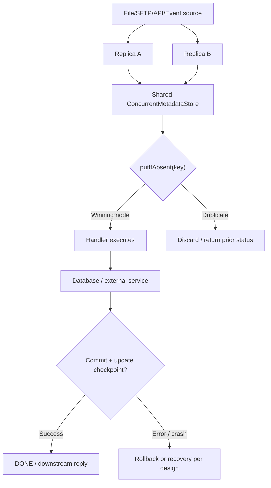

# Choosing a Durable Store for Scale-Out in Spring Integration

## 1. The Problem: Multiple Instances Must Share Processing State

When a Spring Integration application runs on **one JVM**, an in-memory `SimpleMetadataStore` may suffice to remember read files, processed feed entries, or previously seen request IDs. Yet when deploying multiple replicas on Kubernetes or VMs, each instance has its own memory. One instance marking `invoice.csv` as processed does not inform the other instance; on restart, in-memory entries also vanish.

In the **Metadata store** chapter of the `SPRING_INTEGRATION_RUNTIME` module, the lesson **Choosing a Durable Store for Scale-Out** focuses on selecting a metadata backend when the runtime routes messages across channels, endpoints, consumers, pollers, and executors, and then performs transactions, retries, recovery, and correlation.

The core question is: **which state must survive restarts, be visible across multiple instances, and how must it be updated when two instances contend simultaneously?**

Sample scenario:

- Two replicas scan an SFTP directory concurrently. Both see `daily-17.csv`.
- Both attempt to claim the file to download and process it.
- If each replica uses its own store, both can process the same file.
- A shared metadata store with atomic claim operations lets strictly one replica win the key.
- Yet if the winning replica **crashes after claiming and before finishing**, a rollback/lease/recovery policy is required; atomic operations alone do not solve that.

**Learning Objectives**

1. Distinguish `MetadataStore`, `ConcurrentMetadataStore`, `MessageStore`, and distributed locks.
2. Compare JDBC, Redis, MongoDB, Hazelcast, ZooKeeper, and file stores from a scale-out perspective.
3. Build clear, safe metadata keys and regions across tenants, flows, and replicas.
4. Configure `JdbcMetadataStore` and `RedisMetadataStore`, understanding schema, transaction, and consistency requirements.
5. Test atomic claims, crashes/restarts, rollbacks, redeliveries, conflicts, and failovers.
6. Design idempotency alongside business transactions, monitoring, retention, and migration plans.

> **Reference version:** Spring Integration 6.5, Spring Framework 6.x, Java 17+; API/SQL names below align with version 6.5 documentation and Javadocs. For Redis backends, JDBC drivers, or cluster clients, verify behavior on your exact deployed version.

## 2. What Does MetadataStore Store, and What Does It Not Store?

`org.springframework.integration.metadata.MetadataStore` is a **`String` key/value** interface for coordination metadata; it is neither a message payload repository nor a general-purpose transaction log.

```java
package org.springframework.integration.metadata;

public interface MetadataStore {
    void put(String key, String value);
    String get(String key);
    String remove(String key);
}
```

Typical applications:

- **Idempotent receiver:** remember received `requestId`/`eventId` values to detect duplicates.
- **File/FTP/SFTP inbound adapters:** remember seen filenames or modification timestamps to avoid unintended re-reads.
- **Feed inbound adapter:** store markers of processed feed entries/timestamps.
- **Business checkpoints/offsets:** store completed positions when the source lacks a suitable transaction/ack mechanism.
- **Simple leader/coordination state:** store coordination keys if the chosen backend provides appropriate contention semantics; complex lease/fencing needs may require a dedicated distributed lock.

Do not misuse metadata stores as follows:

| Need | More Suitable Component |
|---|---|
| Storing full `Message<?>`, payloads, headers, and durable queues | `MessageStore` or `ChannelMessageStore`, e.g., `JdbcChannelMessageStore` |
| Storing `MessageGroup` for aggregators/resequencers | `MessageGroupStore`, e.g., `JdbcMessageStore` |
| Distributed locks with explicit owner, lease, and fencing | Distributed `LockRegistry` or backend locking primitives |
| Reliable event emission after DB commit | Transactional outbox + idempotent publisher/consumer |
| Storing business truth and querying order state | Business table/document with unique constraints and proper transactions |
| Storing simple key/value checkpoints, markers, revisions | `MetadataStore` / `ConcurrentMetadataStore` |

**Do not confuse "persistent" with "exactly once."** A metadata store can survive restarts, yet a request can still be processed twice when a caller retries, an acknowledgment is lost, or a process dies right between updating metadata and executing a side effect. An accurate end-state contract requires analyzing every boundary.

## 3. From MetadataStore to ConcurrentMetadataStore

`ConcurrentMetadataStore` extends the base interface with two operations carrying atomic semantics:

```java
package org.springframework.integration.metadata;

public interface ConcurrentMetadataStore extends MetadataStore {
    String putIfAbsent(String key, String value);
    boolean replace(String key, String oldValue, String newValue);
}
```

**Contract explanation:**

- `putIfAbsent(k, v)`: writes the new pair only if the key does not exist; returns `null` if inserted, or returns **the existing value** if already present.
- `replace(k, old, next)`: writes the new value only if the current value equals `old`; returns `true` when updated.

Example when two replicas contend for one file:

```text
Replicas: A and B both see key = "ftp:daily-17.csv"

A: putIfAbsent(key, "CLAIMED:A") -> null     (A wins)
B: putIfAbsent(key, "CLAIMED:B") -> "CLAIMED:A" (B is rejected)

Only one replica creates the initial marker if both use
the same backend with atomic putIfAbsent on the same key/region.
```

### Why Not Use `get` Followed by `put`?

**Wrong for scale-out:**

```java
if (metadataStore.get(key) == null) {
    metadataStore.put(key, value);
    process();
}
```

Two nodes can both read `null` before either writes, causing both to process.

**Right for the claim step:**

```java
String previous = concurrentMetadataStore.putIfAbsent(key, value);
if (previous == null) {
    process();
} else {
    // Entry already exists; handle duplicate/in-progress branch.
}
```

Limitation: `putIfAbsent` guarantees **claim exclusivity at a point in time**; `process()` can still error or crash mid-way. Key existence does not mean business work committed. Hence the design must distinguish `CLAIMED`, `DONE`, and deadlines/recovery, or place claim + business work inside the same DB transaction when appropriate.

### Local Atomicity Differs from Distributed Atomicity

`SimpleMetadataStore` also implements `ConcurrentMetadataStore`, yet holds state **within one JVM**. Two replicas can both receive `null` from their own stores. Likewise, an independent properties file per pod does not create shared state.

To scale out, you need **a genuinely shared backend**; every replica must connect to the same data namespace and use the same keys/regions. Also verify that the backend guarantees atomicity under the deployed topology—do not rely solely on seeing the Java interface.

## 4. Scale-Out Architecture and Failure Windows



Four failure points stand out:

| Failure Point | Observable State | Risk |
|---|---|---|
| Before claim | No key | Another node can process; usually no lost data. |
| After claim, before business write | Marker exists, no side effect | Subsequent attempts treated as duplicate **even though unfinished** without rollback/recovery. |
| After business commit, before completion marker | Business done, marker still `CLAIMED` | Retries may repeat side effects or get stuck on the key. |
| After commit, before reply/ack | Business and metadata may both be committed | Caller/broker retries after missing reply; requires idempotent response. |

**Durability** means store data survives restarts per backend commitments; **consistency** means two nodes cannot both overwrite a key violating semantics; **recovery** means the system knows how to resolve incomplete states. All three must be evaluated separately.

## 5. Comparing Backend Options

| Backend | Strengths | What to Verify for Scale-Out | Best Fit |
|---|---|---|---|
| `SimpleMetadataStore` | Minimal, very fast, zero external infrastructure | Single-JVM RAM only; restarts/multi-node lose consensus | Dev, unit tests, single instance with reconstructible metadata |
| `PropertiesPersistingMetadataStore` | Writes to a properties file, no database needed | Typically flushes on normal context close; crashes lose unflushed changes; shared mounts and file locking are tricky | Single-node apps or small tools; avoid for pod-to-pod claim contention |
| `JdbcMetadataStore` | Implements `ConcurrentMetadataStore`, transactions, constraints; coordinates easily with business DB | Schema, indexes, row locks/SQL vendor quirks, pools, deadlocks, latency, and connection failures | **Preferred when RDBMS exists and metadata + business DB must commit/roll back together** |
| `RedisMetadataStore` | Shared store, fast key/value ops, suits frequent updates | Redis persistence/failover, eviction, namespaces, `replace()` semantics on **Redis Cluster** | Low-latency checkpoints/idempotency where Redis is well operated |
| `MongoDbMetadataStore` | Shared MongoDB infrastructure, atomic operations | Unique indexes, write concern, transactions with business collections, network partitions | Systems built primarily on MongoDB |
| `HazelcastMetadataStore` | Distributed map, embeddable in-memory cluster | Persistence, backups, split-brain, fencing, and concrete concurrency limits | Organizations operating Hazelcast with clear durability policies |
| `ZookeeperMetadataStore` | Small coordination metadata, watchable changes | Throughput/size limits, session semantics, quorum, ops, and hot-path cost | Small-scale coordination/control-plane metadata |
| Other backends (e.g., AWS DynamoDB via integration support) | Managed cloud service, atomic conditional writes | Conditional-write semantics, SDK/version, IAM, latency/cost, TTL, partition scope | Systems already standardized on that platform with compatible implementations |

**No single backend fits every case.** With an RDBMS for business data, JDBC usually gives the cleanest transactional reasoning. With many pollers requiring fast lookups, Redis can work well if topology and consistency needs match the APIs used. A shared backend lacking durability or CAS support in the actual topology creates a false sense of safety.

### 5.1. Special Caveats for Redis Cluster

Spring Integration 6.5 documentation explicitly notes: `RedisMetadataStore.replace()` relies on Redis `WATCH` and **is not supported for replacement on Redis Cluster** in the documented implementation. This matters because several persistent file-list filters call `replace()` to handle **files with the same name whose modification time changes**.

If your architecture uses Redis Cluster:

1. Check whether the actual component calls `replace()`, not just `putIfAbsent()`.
2. Do not assume every `ConcurrentMetadataStore` operation works on Redis Cluster.
3. Consider JDBC or another backend when that CAS behavior is needed, or an implementation verified on the target topology.
4. Test same-name file updates, failovers, and concurrency on a **real Redis Cluster** if that is your production topology.

In addition, Redis persistence (`RDB`/`AOF`), replication acknowledgments, eviction policies, and failover timing determine whether markers can be lost on crashes. `ConcurrentMetadataStore` is a method contract; it does not configure Redis server durability by itself.

### 5.2. Properties Files and Shared Volumes

Pointing two replicas at a shared filesystem file **does not** turn `PropertiesPersistingMetadataStore` into a distributed database. Each process maintains its own cache, flush lifecycle, and file locking; concurrent overwrites can lose updates. Even though `PropertiesPersistingMetadataStore` implements concurrent operations within one JVM, do not infer multi-process atomicity. Use JDBC, Redis, or a genuinely distributed store when multiple replicas contend on claims.

## 6. Store Selection Table by Real Requirements

Before picking a technology, answer these questions:

| Requirement | What to Confirm | Selection Direction |
|---|---|---|
| Share state across multiple pods? | Do pods use the **exact same** physical store and compatible region/keys? | JDBC, Redis, MongoDB, or distributed backend |
| Atomic claim when two pods contend on a key? | Is `putIfAbsent` truly atomic on the current topology? | `ConcurrentMetadataStore` with a suitable backend |
| CAS updates on the same key? | Does `replace` work on the topology? | JDBC or CAS-verified backend; watch out for Redis Cluster |
| Metadata and DB write must roll back together? | Same DataSource and transaction manager? | JDBC coordinated inside one local transaction |
| No shared database available? | Is a well-managed Redis/MongoDB/distributed service available? | Pick an appropriate backend and design recovery |
| Tolerate checkpoint loss on crash? | Actual checkpoint RPO, persistence, fsync/replication | Configure durability and run kill/restart tests |
| Massive key count or many namespaces? | Memory/indexes, cardinality, retention, and query patterns | Capacity tests, key partitioning/regions, TTL/cleanup |
| Return idempotent results on retry? | Is there a business result store or unique key? | Metadata + persisted business result/outbox |
| Multiple nodes reading mutable files? | Need timestamp/version comparison, not just existence | CAS `replace` and filters with reprocessing policy |

**Practical rule of thumb:** if metadata truly gates writes to the business database, try to place the check/claim and the business write inside **one transaction that rolls back together**. When metadata lives outside the business database, define recovery for split commits between the two.

## 7. Example 1: Shared JdbcMetadataStore Across Replicas

### 7.1. Dependencies and Schema

Spring Boot 3.x, Java 17+, Spring Integration 6.5 example. Use Spring Boot dependency management for compatible versions:

```groovy
dependencies {
    implementation 'org.springframework.boot:spring-boot-starter-integration'
    implementation 'org.springframework.boot:spring-boot-starter-jdbc'
    implementation 'org.springframework.integration:spring-integration-jdbc'
    runtimeOnly 'org.postgresql:postgresql'
    testImplementation 'org.springframework.boot:spring-boot-starter-test'
    testRuntimeOnly 'com.h2database:h2'
}
```

Spring Integration JDBC bundles vendor-specific schema scripts. Illustrative H2 DDL for the metadata store:

```sql
CREATE TABLE INT_METADATA_STORE (
    METADATA_KEY VARCHAR(255) NOT NULL,
    METADATA_VALUE VARCHAR(4000),
    REGION VARCHAR(100) NOT NULL,
    CONSTRAINT INT_METADATA_STORE_PK
        PRIMARY KEY (METADATA_KEY, REGION)
);

CREATE TABLE orders_processed (
    event_id VARCHAR(128) NOT NULL,
    tenant_id VARCHAR(64) NOT NULL,
    amount BIGINT NOT NULL,
    CONSTRAINT orders_processed_pk PRIMARY KEY (tenant_id, event_id)
);
```

In production, use migration tools like Flyway/Liquibase or official scripts matching your database vendor. **Do not** paste H2 DDL blindly into PostgreSQL; verify column types, indexes, and schemas. Create the table before `JdbcMetadataStore` starts because in Spring Integration 6.5 the store checks table existence at startup.

### 7.2. Defining the `metadataStore` Bean and Region

```java
import javax.sql.DataSource;

import org.springframework.context.annotation.Bean;
import org.springframework.context.annotation.Configuration;
import org.springframework.integration.jdbc.metadata.JdbcMetadataStore;

@Configuration
class MetadataConfiguration {

    @Bean("metadataStore")
    JdbcMetadataStore metadataStore(DataSource dataSource) {
        JdbcMetadataStore store = new JdbcMetadataStore(dataSource);
        store.setRegion("orders-v1");
        return store;
    }
}
```

Key details:

- The bean name `metadataStore` matters: many adapters look up a bean with **this exact name** if none is explicitly wired; if absent, they often fall back to a local `SimpleMetadataStore`.
- `region` is a logical namespace in the metadata table; identical `METADATA_KEY` values in different regions do not collide.
- **Every replica processing the same flow** must share the database connection, region, and key-generation rules.
- Changing `region` on a deploy causes the app to treat all old keys as **unprocessed**, triggering bulk re-ingestion. Plan migrations first.
- `tablePrefix` and `lockHint` can be tuned per database; all nodes must use compatible schemas and SQL.

Spring transaction infrastructure must be active, and `JdbcMetadataStore` must share the transaction manager for this `DataSource`. When combining multiple `DataSource` instances, specify the transaction manager explicitly; if the store and business data sit in different DBs, one DB's local transaction does not cover the other.

### 7.3. Claim and Business Work in One Local DB Transaction

Minimal example placing claim and business insert inside the same service activator over a synchronous `DirectChannel`. When an unchecked exception occurs and the transaction proxy is properly applied, both the metadata row and business row roll back.

```java
public record OrderEvent(
        String tenantId,
        String eventId,
        long amount
) {
}
```

```java
import org.springframework.integration.annotation.ServiceActivator;
import org.springframework.integration.metadata.ConcurrentMetadataStore;
import org.springframework.jdbc.core.JdbcTemplate;
import org.springframework.stereotype.Component;
import org.springframework.transaction.annotation.Transactional;

@Component
public class OrderConsumer {
    private final ConcurrentMetadataStore metadataStore;
    private final JdbcTemplate jdbc;

    public OrderConsumer(ConcurrentMetadataStore metadataStore,
                         JdbcTemplate jdbc) {
        this.metadataStore = metadataStore;
        this.jdbc = jdbc;
    }

    @Transactional
    @ServiceActivator(inputChannel = "orders.in", requiresReply = "true")
    public String accept(OrderEvent event) {
        String tenant = require(event.tenantId(), "tenantId");
        String id = require(event.eventId(), "eventId");
        String key = tenant.length() + ":" + tenant
                + ":event:" + id.length() + ":" + id;
        String signature = Long.toString(event.amount());

        String previous = metadataStore.putIfAbsent(key, signature);
        if (previous != null) {
            if (!previous.equals(signature)) {
                throw new IllegalArgumentException(
                        "Same event identity with different amount");
            }
            return "DUPLICATE:" + id;
        }

        jdbc.update(
                "INSERT INTO orders_processed(event_id, tenant_id, amount) "
                        + "VALUES (?, ?, ?)",
                id, tenant, event.amount());

        if (id.startsWith("FAIL-")) {
            throw new IllegalStateException("Simulated DB rollback");
        }

        return "APPLIED:" + id;
    }

    private static String require(String value, String name) {
        if (value == null || value.isBlank()) {
            throw new IllegalArgumentException("Missing " + name);
        }
        return value;
    }
}
```

With this schema, the business primary key is composite `(tenant_id, event_id)`: two tenants can legitimately reuse the same `eventId`. The metadata key also includes tenant + event ID, keeping deduplication scope consistent across both layers. Real applications should compare a full fingerprint of critical payload fields, not just `amount`.

A demo gateway:

```java
import org.springframework.integration.annotation.MessagingGateway;

@MessagingGateway(defaultRequestChannel = "orders.in")
public interface OrderGateway {
    String accept(OrderEvent event);
}
```

Spring Boot needs Integration annotation processing and component scanning enabled (e.g., `@EnableIntegration` and `@IntegrationComponentScan` or auto-configuration), plus `orders.in` declared as a suitable channel. Two replicas behind a load balancer run the same code against the shared DB store/region.

**Conditions for genuine transactional semantics:** calls to `OrderConsumer.accept()` must pass through the Spring AOP proxy, use the same transaction manager/DataSource for `JdbcMetadataStore` and `JdbcTemplate`, and must not cross an `ExecutorChannel` before this transaction finishes. Do not call `this.accept(...)` internally and expect `@Transactional` to apply.

### 7.4. Testing Commit and Rollback

The goal is not merely asserting the response, but **querying committed state** outside the handler's transaction.

```java
@SpringBootTest
class MetadataStoreIntegrationTest {

    @Autowired OrderGateway gateway;
    @Autowired JdbcTemplate jdbc;

    int businessRows(String tenant, String id) {
        Integer count = jdbc.queryForObject(
                "SELECT COUNT(*) FROM orders_processed "
                        + "WHERE tenant_id = ? AND event_id = ?",
                Integer.class, tenant, id);
        return count == null ? 0 : count;
    }

    @Test
    void successfulClaimCommitsOnce() {
        var event = new OrderEvent("tenant-a", "EVT-1", 100);

        assertEquals("APPLIED:EVT-1", gateway.accept(event));
        assertEquals("DUPLICATE:EVT-1", gateway.accept(event));
        assertEquals(1, businessRows("tenant-a", "EVT-1"));
    }

    @Test
    void failedHandlerRollsBackClaimAndBusinessWrite() {
        var event = new OrderEvent("tenant-a", "FAIL-2", 100);

        assertThrows(RuntimeException.class,
                () -> gateway.accept(event));
        assertEquals(0, businessRows("tenant-a", "FAIL-2"));

        // Check exact marker for the failed event, not the entire region:
        String failedKey = "8:tenant-a:event:6:FAIL-2";
        Integer metadataRows = jdbc.queryForObject(
                "SELECT COUNT(*) FROM INT_METADATA_STORE "
                        + "WHERE REGION = ? AND METADATA_KEY = ?",
                Integer.class, "orders-v1", failedKey);
        assertEquals(0, metadataRows);
    }
}
```

In real tests, avoid asserting the entire region has 0 entries if other tests leave data; query by **specific key** or isolate each test's region/database. Do not annotate the test method with `@Transactional`, as test-level rollback can mask a handler that failed to commit. These snippets assume JUnit, Spring Boot Test imports, and an initialized schema; parallel test execution requires isolated databases or contexts.

### 7.5. Why Isn't This End-to-End Exactly Once?

The JDBC example guarantees claim + insert within **one local DB transaction**, yet:

- HTTP/JMS calls to external services inside the method do not roll back with the DB.
- A reply sent via the gateway after commit may be lost; the caller retries.
- `DUPLICATE` only signals that the marker existed; if the caller needs **the exact same business result as the first run**, store and query the committed outcome.
- Deleting markers early enables reprocessing; keeping markers forever grows the store.
- Under multi-replica load, transaction isolation, row locks, deadlocks, and throughput on hot keys must be stress-tested.

When external event emission is mandatory, consider a **transactional outbox**: write the business row + outbox row in the same DB transaction; a publisher reads the outbox and sends with retries, and consumers remain idempotent by event ID.

## 8. Example 2: RedisMetadataStore for Shared Checkpoints

When a system already operates Redis reliably, you can declare a shared store:

```groovy
dependencies {
    implementation 'org.springframework.boot:spring-boot-starter-integration'
    implementation 'org.springframework.integration:spring-integration-redis'
    implementation 'org.springframework.boot:spring-boot-starter-data-redis'
}
```

```java
import org.springframework.context.annotation.Bean;
import org.springframework.context.annotation.Configuration;
import org.springframework.data.redis.connection.RedisConnectionFactory;
import org.springframework.integration.redis.metadata.RedisMetadataStore;

@Configuration
class RedisMetadataConfiguration {

    @Bean("metadataStore")
    RedisMetadataStore metadataStore(
            RedisConnectionFactory connectionFactory) {
        return new RedisMetadataStore(
                connectionFactory, "orders:metadata:v1");
    }
}
```

`RedisMetadataStore` uses a Redis hash namespace/region. The internal Redis key layout of the store differs from flat application keys; standardize both the **Redis hash region** and the **logical metadata key**.

Claim example:

```java
String key = "tenant-a:event:EVT-1";
String current = metadataStore.putIfAbsent(key, "SEEN");
if (current == null) {
    // Allowed to proceed per designed policy.
} else {
    // Claim/checkpoint already exists; do not automatically assume DONE.
}
```

**Difference from same-transaction JDBC:** Redis updates and SQL business updates normally **do not** share a local transaction manager. If the Redis claim succeeds and the DB write fails, the marker may linger, suppressing subsequent retries. Address this via recovery, proper leases+fencing/expiry, a single-source-of-truth transaction/outbox, or switching to a JDBC metadata store.

Notes:

- **Redis Cluster:** do not rely on `RedisMetadataStore.replace()` per 6.5 docs, especially with file list filters needing CAS.
- **Durability:** verify AOF/RDB, replication/failover, and eviction; never place long-lived required markers in an evictable namespace.
- **TTL:** do not assume generic `MetadataStore` provides per-key TTL APIs; if expiration is needed, build a cleanup scheduler or explicit backend mechanism. A Redis hash region does not offer independent per-field TTLs.
- **Namespaces:** multiple teams sharing Redis must separate hash names, key prefixes, and ACLs to prevent accidental deletion.

## 9. File Adapters and Persistent Accept-Once Filters

A common scale-out scenario has multiple replicas polling SFTP/FTP/files. Persistent accept-once filters save **file markers** in the metadata store to reduce duplicate downloads/processing. On file sources where `lastModified`/versions change, some filters need `replace()` to re-accept modified files.

```text
SFTP remote directory: /incoming
        |
        v
Replica A poll ---------+
                        +--> Shared ConcurrentMetadataStore
Replica B poll ---------+        |
                                 +--> atomic accept-once marker
        |
        v
Download / local filter / handler / output
```

Distinguish the layers:

- **Remote filter:** selects which remote files to download; metadata may encode remote filename and version/timestamp.
- **Local filter:** prevents re-emitting an already-downloaded file in the local directory.
- **Business processing:** parses the file, writes to DB, and sends downstream; can fail after the filter marked the file.
- **Recoverable source:** when download/processing fails, define when markers are cleared/replaced and whether files remain or move to another directory.

**Keys must carry strong identity.** Plain filename `daily.csv` is dangerous if multiple remote hosts/tenants/directories share filenames. Include source, directory, file path, and version/timestamp per the filter semantics supported by the adapter.

### Pitfalls When Scaling Out File Polling

1. Two replicas poll one SFTP server while each node uses an in-memory store: duplicate downloads.
2. Shared store used, yet one node wins the claim and crashes before processing: file may be skipped forever unless the marker is recovered.
3. Shared metadata store used with separate per-pod local directories: "downloaded" metadata does not prove the file exists on another pod.
4. Remote checkpointing without downstream idempotency: a file downloaded once can still yield duplicate events/rows across retries.
5. File overwritten with the same name: filter must detect content/version changes; `putIfAbsent` alone may be insufficient.
6. Running a filter that calls `replace()` against Redis Cluster as noted earlier: topology does not support the expected operation.

When each file must yield strictly one business effect, enforce a business file ID/fingerprint and downstream unique constraint; never treat a file-filter marker as proof the whole pipeline finished.

## 10. Idempotent Receiver and MetadataStoreSelector

Spring Integration provides `IdempotentReceiverInterceptor`: an advice around `MessageHandler.handleMessage()` paired with `MetadataStoreSelector` to decide whether a message was previously accepted.

**Common pitfall:** by default, when the selector rejects a message, the interceptor can **set `duplicateMessage=true` and still let the message reach the handler**. Only when `discardChannel` or `throwExceptionOnRejection=true` is configured is the duplicate kept away from the handler. Always verify the advice contract before claiming "idempotent interceptor is enabled so the handler never sees duplicates."

Example selector with an injected store:

```java
import org.springframework.integration.selector.MetadataStoreSelector;
import org.springframework.integration.metadata.ConcurrentMetadataStore;
import org.springframework.messaging.Message;

MetadataStoreSelector selector =
        new MetadataStoreSelector(
                message -> (String) message.getHeaders().get("eventId"),
                metadataStore);
```

In real applications, validate that `eventId` is non-null/non-blank before using it; the selector uses a default value strategy based on the timestamp header. To accept versioned updates, configure `compareValues(BiPredicate<String,String>)` to CAS old and new values. Do not use receive timestamps as business versions when event ordering is not guaranteed.

**Marking timing:** the selector can claim metadata **before** the business handler runs. If the handler fails without sharing a transaction or recovery with the metadata claim, retries may be flagged as duplicates despite incomplete work. For exactly-once business effects, use a shared transaction or distinct `PROCESSING`/`COMPLETED` states with leases and idempotency.

### Line-Number Checkpoints: Versioned CAS

Suppose you read a large file line by line, keyed by `fileId` with the last committed line number as the value. When receiving a new line, accept only line numbers greater than the prior checkpoint:

```java
selector.compareValues(
        (oldValue, newValue) ->
                Long.parseLong(newValue) > Long.parseLong(oldValue));
```

This works if `newValue` is genuinely a line sequence and business rules demand strictly increasing progress. **Yet metadata CAS only makes updating the checkpoint itself atomic;** if line N is claimed before the DB write commits and the process crashes, retrying line N may be skipped. Align checkpoints and business work via transactions or resume-with-replay + deduplication.

## 11. Transactions, Retries, and Recovery: Where Atomic Claims Fall Short

### 11.1. JDBC Sharing a Transaction

```mermaid
sequenceDiagram
    participant R as Replica A
    participant MS as JDBC MetadataStore
    participant DB as Business DB
    R->>MS: BEGIN TX; putIfAbsent(requestId)
    MS-->>R: claimed
    R->>DB: INSERT business row
    alt success
        R->>MS: COMMIT TX
        Note over MS,DB: Metadata and business row commit together if sharing resource
    else exception
        R->>MS: ROLLBACK TX
        Note over MS,DB: Both marker and row roll back
    end
```

When the transaction manager governs the same DB, metadata operations and business SQL can commit/roll back as one unit. This is a strong option when the goal is idempotent DB processing across replicas.

### 11.2. Redis + SQL: Two Independent Resources

```text
t0: Redis putIfAbsent(eventId) -> claim OK
t1: Business SQL INSERT -> fail / rollback
t2: Retry eventId -> Redis reports already claimed
t3: Handler is skipped -> lost business operation
```

Possible solutions:

- Use JDBC metadata inside the same business DB.
- Use an inbox/idempotency table with unique constraints in the business DB as the source of truth; treat Redis strictly as a cache/optimization.
- Use leases/claims with expiry + fencing tokens and queryable business state; lease expiration **must never** let two workers run non-idempotent side effects concurrently.
- Combine outbox/inbox, backoff, retries, and reconciliation jobs keyed by business ID.

**Never automatically delete markers on every exception.** When an external side effect succeeded and an error occurred while sending the reply, deleting the marker can cause retries to repeat the side effect. Before clearing a claim, inspect true business state or enforce downstream compensation/deduplication.

### 11.3. Transactions + ExecutorChannel / QueueChannel

Spring transactions normally bind to threads. A transaction started on the sender over `DirectChannel` can span same-thread handlers; across `ExecutorChannel` or `QueueChannel`, consumers usually run on different threads.

Consequences:

- If metadata is claimed on the sender before async handoff, the claim can commit **before** the business task.
- If the worker fails, the sender's transaction does not automatically roll back.
- When a poller reads from a transactional source, `receive()` and synchronous handlers can join the poller's transaction.
- To commit claim and business work together, place them inside **the same worker-side transaction boundary**, or configure genuine coordinated transactions rather than assuming context propagates across threads automatically.

## 12. Namespaces, Key Design, and Retention

### 12.1. Multi-Dimensional Key Design

A well-structured key should distinguish at least:

```text
environment / application / flow / tenant / source / business identity / version
```

Examples:

```text
prod:billing:invoice-import:tenant-7:sftp-a:/incoming/2026-11.csv:v3
prod:billing:order-events:tenant-7:order-9081:event-12
```

When keys contain free-form segments, joining with `:` can collide. Normalize encoding, escape delimiters, use length-prefixing, or hash a structured schema-versioned tuple. Never put raw secrets or PII into keys if backend logs/metrics could expose them.

### 12.2. Region vs. Key Prefix

In `JdbcMetadataStore`, the table has `METADATA_KEY` and `REGION` columns; the unique constraint spans **the pair**, keeping regions isolated in the DB. In `RedisMetadataStore`, region is the Redis hash key containing individual metadata keys.

Decisions required:

- Replicas of the same flow share the same region to contend on keys.
- `dev/staging/prod` environments use separate regions/backends.
- Distinct flows never reuse keys with differing semantics.
- When changing key-version logic, plan dual-reads, migrations, and deployment rollbacks to avoid resetting every checkpoint.

### 12.3. Retention Is Not a "Clear All" Button

Metadata accumulates over time. If every event ID is kept forever, the store grows endlessly. If deleted too soon, replayed old events can trigger duplicate side effects.

Size retention based on:

1. How long the broker/source can redeliver messages.
2. Maximum window for backfills/manual replays.
3. Processing SLAs and late-message delays.
4. How long business data needs duplicate protection.
5. Audit/compliance rules and snapshot restore capabilities.

You can embed timestamps/expirations in values and run controlled cleanup jobs; base `MetadataStore` provides no standard per-key TTL. On some backends, deletions must avoid racing active workers. When metadata retention expires, the business layer must still guard against duplicates via long-lived unique constraints or archived idempotency records.

## 13. Real Testing Before Scaling Out

Do not only test that a Java interface injects cleanly; test the real backend and its failure modes.

### 13.1. Two-Instance Contention Test on the Same Key

Use two `JdbcMetadataStore` instances pointing to **the same database and region** with real transaction management. Scenario:

1. Start with a clean metadata table and choose a fresh key `test:tenant-a:EVT-100`.
2. Two workers on different threads call `putIfAbsent(key, "SEEN")` concurrently.
3. Verify **strictly one** worker receives `null`.
4. Verify the other worker receives the existing value; only one business effect commits.
5. Query the DB from a separate connection after both transactions finish.
6. Repeat across two real JVMs/processes if production runs multi-node.

JUnit assertion sketch:

```java
ExecutorService pool = Executors.newFixedThreadPool(2);
try {
    CountDownLatch ready = new CountDownLatch(2);
    CountDownLatch go = new CountDownLatch(1);

    Callable<String> contender = () -> {
        ready.countDown();
        if (!go.await(5, TimeUnit.SECONDS)) {
            throw new TimeoutException("Start barrier timeout");
        }
        return store.putIfAbsent("test:EVT-100", "SEEN");
    };

    Future<String> first = pool.submit(contender);
    Future<String> second = pool.submit(contender);

    assertTrue(ready.await(5, TimeUnit.SECONDS));
    go.countDown();

    String a = first.get(10, TimeUnit.SECONDS);
    String b = second.get(10, TimeUnit.SECONDS);

    assertTrue((a == null && "SEEN".equals(b))
            || (b == null && "SEEN".equals(a)));
} finally {
    pool.shutdownNow();
}
```

The snippet illustrates **a race/claim operation** and needs appropriate JUnit/concurrency imports. Use `try/finally` to shut down the pool even on assertion failure; use Testcontainers PostgreSQL/Redis to test real semantics while keeping test keys isolated.

### 13.2. Crash/Restart and Rollback Tests

| Test | How to Simulate | Expectation |
|---|---|---|
| Node restart after commit | Node A claims + commits, stops; node B reads the same key | Node B sees marker and does not reclaim before retention expires |
| JDBC rollback | Claim + business write in transaction then throw | Neither key nor business row exists after rollback |
| Crash after claim across split resources | Redis claim succeeds, business SQL uncommitted, kill worker | Recovery detects unfinished work, avoiding permanent skips |
| Claim during backend outage | Disconnect Redis/DB right at claim time | Never silently "fail open"; stop/retry/DLQ per policy |
| Redis failover | Write marker, fail over primary, read from replica/new primary | Verify durability/RPO and avoid repeating side effects |
| Two keys, same tenant, different source | Create entries in different namespaces | No collisions |
| Region change during rolling deploy | Both old and new versions running | Avoid unintentionally creating two independent filter sets |
| TTL/cleanup race | Delete marker while worker is still running | Fencing/unique constraint or protective strategy holds |
| Same-name file modified | Send same filename with updated mtime/version | Filter/CAS handles update properly |
| Load + hot keys | Many workers on one key and across many keys | Latency, DB lock waits, and pool stay within SLO |

**Never use fixed `Thread.sleep()`** to assume races or restarts finished. Use latches, deadlines, transaction completion signals, and queries against committed data.

### 13.3. Verifying Against Both Duplicates and Lost Work

Every test should prove two invariants simultaneously:

- **No duplicates:** for the same business ID across retries/2 nodes, at most one business effect commits.
- **No lost work:** if an attempt fails mid-way, the message can be retried or enters failure/recovery tracking; metadata markers do not block it forever.

Guaranteeing only one side is insufficient for reliable operations.

## 14. Observing and Operating a Distributed Store

### Metrics to Monitor

| Signal Group | Meaning |
|---|---|
| `metadata.putIfAbsent.accepted` and `rejected` | Claim vs. duplicate rate; abnormal replay trends |
| `metadata.replace.cas.failed` | Contention or out-of-order checkpoints |
| `get/putIfAbsent/replace` P95/P99 latency | Store becoming a bottleneck for pollers/handlers |
| DB connection pool waits, deadlocks, lock waits | JDBC saturation and hot-key contention |
| Redis memory, evictions, AOF/replication lag, failovers | Risk of lost state or rising access errors |
| Metadata entry counts by region/age | Capacity, retention, orphan markers |
| Overdue `CLAIMED` marker count | Stalled recovery or worker crashes |
| `errorChannel`, retry, and DLQ counts | Correlating store errors with business outcomes |
| Duplicate side effects by business ID | Verifying real-world idempotency |
| Deploy events changing region/schema | Detecting unintended checkpoint resets |

These metrics are **instrumentation suggestions**, not built-in metrics automatically emitted by Spring Integration. Spring Integration management/Micrometer can observe channels, handlers, and pollers when configured; metadata-specific metrics usually need explicit instrumentation around the store/client.

### Checklist When Two Pods Process the Same File

1. Are both pods running the same endpoint/adapter and the exact same region/namespace?
2. Is the store truly shared? Did any pod fall back to `SimpleMetadataStore` due to a missing bean?
3. Does the filter use `ConcurrentMetadataStore` properly? Are there separate `get(); put()` calls?
4. Does the key include source, tenant, path, and version as intended?
5. Is any pod using Redis Cluster while the filter calls `replace()`?
6. When is the marker committed relative to download, parsing, DB writes, and publishing?
7. Did a retry/redelivery or rolling deploy alter region, key format, or schema?
8. If metadata looks right yet business data duplicated, is DB/outbox idempotency missing?

### Checklist When a File Is Never Reprocessed After Failure

1. Was the marker claimed before the business transaction?
2. Did the handler throw, or did advice/recovery swallow the exception?
3. Does the marker live in a backend separate from the business DB so they didn't roll back together?
4. Is there cleanup/recovery for incomplete claims?
5. Are the poller/endpoint started, and is the file still at the source or already moved?
6. Does the file-list filter retain local state/caches out of sync with the distributed store?
7. Can it be replayed safely using business keys and unique constraints?

Never wipe an entire metadata table or Redis hash as a "quick fix": doing so can re-ingest all historical files and events, causing traffic spikes and duplicate business effects.

## 15. Architecture Recommendations by Scenario

**Scenario A — Multiple pods polling SFTP and writing to PostgreSQL.** Choose `JdbcMetadataStore` on PostgreSQL when you want shared metadata and transactions with business data. Design remote/local filters, checkpoints, and processing transactions clearly. Even with metadata, enforce a downstream unique constraint on business file ID.

**Scenario B — Independent high-volume feed polling with stable Redis already operated.** `RedisMetadataStore` can work if you do not need unsupported CAS on your topology and have defined RPO/persistence/failover. Keys must include source, partition, and feed item; measure real latency/capacity.

**Scenario C — A single standalone app saving checkpoints on shutdown.** `PropertiesPersistingMetadataStore` can suffice if losing unflushed changes on crash is acceptable and no multi-process contention exists. For reliable resume after crashes, choose a more durable backend.

**Scenario D — Multiple consumers processing order events with payment side effects.** Never treat a key marker as the sole source of truth. Use an inbox/idempotency table in the same transaction as business state, an outbox for emitting events, and status queries after timeouts. The metadata store can assist filtering, but never replaces the database business contract.

**Scenario E — Multiple replicas aggregating message groups or backing durable queues.** Choose the corresponding `MessageGroupStore`/`ChannelMessageStore` with distributed locking, transactions, and correlation; `MetadataStore` only manages markers/checkpoints, not group contents.

## 16. Self-Check Questions

**1.** Why does `SimpleMetadataStore` implement `putIfAbsent` yet remain insufficient to stop two pods from duplicate processing?  
**Answer:** It is only atomic within one JVM; each pod holds separate state with no shared coordination.

**2.** Two pods both read `get(key)==null` and then both call `put(key, "YES")`. What is wrong?  
**Answer:** Read and write are two separate racing operations. Use `ConcurrentMetadataStore.putIfAbsent()` on a backend with genuine atomicity.

**3.** Can `JdbcMetadataStore` roll back together with a business insert?  
**Answer:** Yes, when both participate in the same real transaction using the same resource/transaction manager; verify outside transactions to prove it.

**4.** A Redis metadata marker writes successfully, then the DB order insert fails. Does the Redis marker roll back automatically?  
**Answer:** Not under the default local JDBC transaction. You need recovery or a different transaction/inbox design.

**5.** Why shouldn't `PropertiesPersistingMetadataStore` on NFS be used as a distributed claim mechanism?  
**Answer:** In-JVM file persistence and concurrency do not provide cross-process atomicity when multiple caches write concurrently on a shared filesystem.

**6.** What caveat does Spring Integration 6.5 note regarding `RedisMetadataStore.replace()` on Redis Cluster?  
**Answer:** The implementation does not support that operation on Redis Cluster per documentation; pick a suitable backend/topology if a component relies on CAS.

**7.** Does sharing a `ConcurrentMetadataStore` mean idempotent receiver drops duplicates from reaching the handler by default?  
**Answer:** No. `IdempotentReceiverInterceptor` may only attach header `duplicateMessage=true`; dropping requires configuring discard/throw or handling it inside the handler.

**8.** Why shouldn't `"daily.csv"` be used as a metadata key in a multi-tenant/SFTP-host system?  
**Answer:** Files from different sources sharing the same name collide on the key; include source, tenant, path, and needed version.

**9.** If the DB already committed yet the reply was lost, should you delete the marker so the caller's retry automatically reruns it?  
**Answer:** No. The side effect may have already completed; query business status or use an idempotency key to return the prior result.

**10.** When choosing a store for an `Aggregator` to persist `MessageGroup` across restarts, should you use `JdbcMetadataStore`?  
**Answer:** No. Use an appropriate `MessageGroupStore`, such as `JdbcMessageStore`; metadata stores only retain key/value checkpoints.

## 17. Official References

1. [Spring Integration 6.5 — Metadata Store](https://docs.spring.io/spring-integration/reference/6.5/meta-data-store.html): contract, `metadataStore` bean lookup, backends, and idempotent receiver.
2. [Spring Integration 6.5 — JDBC Metadata Store](https://docs.spring.io/spring-integration/reference/6.5/jdbc/metadata-store.html): schema, transactions, atomicity, prefix/region, lock hints, and startup check.
3. [Spring Integration 6.5 — Redis Support](https://docs.spring.io/spring-integration/reference/6.5/redis.html): `RedisMetadataStore`, region/hash, and `replace()` limitations on Redis Cluster.
4. [Spring Integration API 6.5 — MetadataStore](https://docs.spring.io/spring-integration/docs/6.5.0/api/org/springframework/integration/metadata/MetadataStore.html): key/value methods.
5. [Spring Integration API 6.5 — ConcurrentMetadataStore](https://docs.spring.io/spring-integration/docs/6.5.0/api/org/springframework/integration/metadata/ConcurrentMetadataStore.html): atomic `putIfAbsent`/`replace` semantics.
6. [Spring Integration API 6.5 — JdbcMetadataStore](https://docs.spring.io/spring-integration/docs/6.5.0/api/org/springframework/integration/jdbc/metadata/JdbcMetadataStore.html): `SmartLifecycle`, constructors, `setRegion`, and schema check.
7. [Spring Integration API 6.5 — RedisMetadataStore](https://docs.spring.io/spring-integration/docs/6.5.0/api/org/springframework/integration/redis/metadata/RedisMetadataStore.html): Redis constructors and storage operations.
8. [Spring Integration 6.5 — Idempotent Receiver](https://docs.spring.io/spring-integration/reference/6.5/handler-advice/idempotent-receiver.html): interceptor, `MetadataStoreSelector`, duplicate header, and discard configuration.
9. [Spring Integration Reference — Message Store](https://docs.spring.io/spring-integration/reference/message-store.html): differences from storing messages/groups.
10. [Spring Integration Reference — Transaction Support](https://docs.spring.io/spring-integration/reference/transactions.html): transaction boundaries, pollers, and threads.
