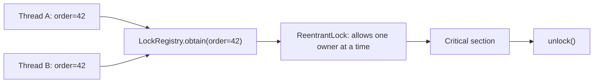
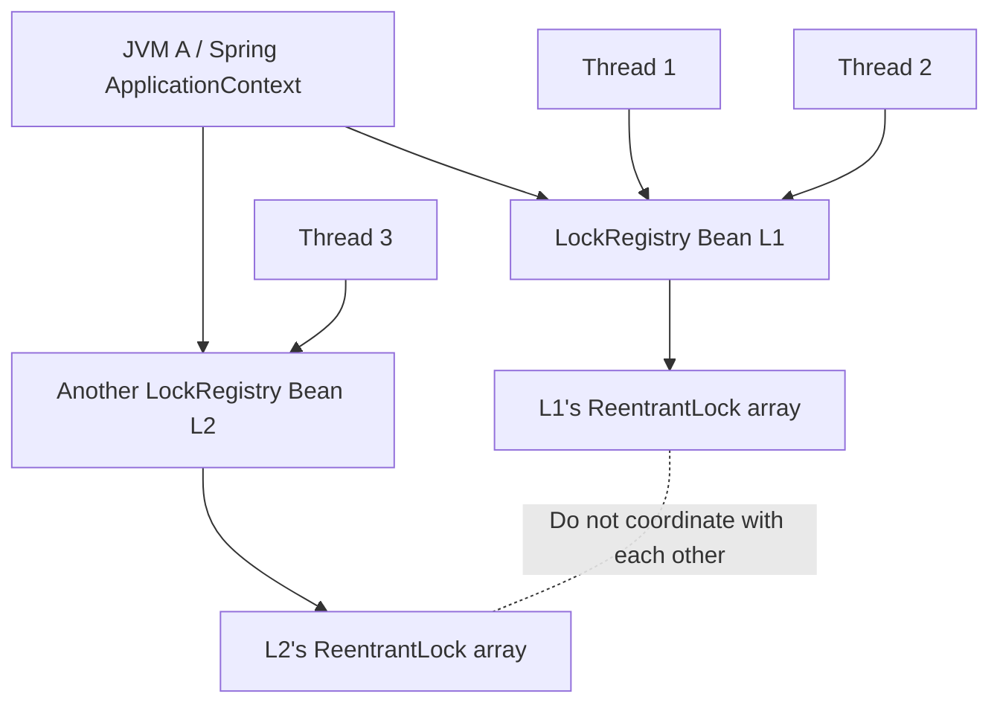
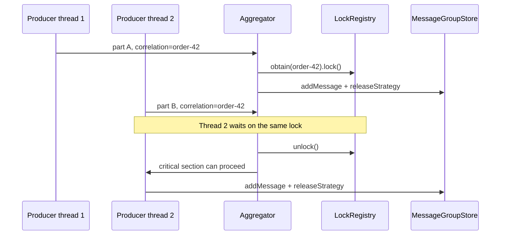
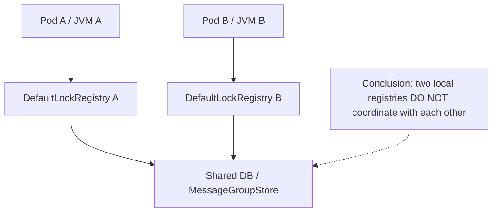

# DefaultLockRegistry Within a Single JVM in Spring Integration

## Objectives and Context

In the **SPRING_INTEGRATION_RUNTIME** module, message flows can execute concurrently across multiple threads via `DirectChannel` with multiple producers, `ExecutorChannel`, pollers, and consumer endpoints. When multiple messages operate on shared state — such as an order, an aggregator message group, or a counter — you must prevent read/modify/write operations from overwriting one another.

The **Lock registry** chapter introduces `org.springframework.integration.support.locks.LockRegistry` and its default implementation `DefaultLockRegistry`. This lesson focuses strictly on how **DefaultLockRegistry coordinates locks within a single JVM**, without conflating it with distributed locks or database transactions.

After this lesson, you will be able to:

- Explain how `DefaultLockRegistry` maps a lock key to a `ReentrantLock` and why two distinct keys can contend on the same lock.
- Use `obtain(Object)`, `lock()`, `tryLock(...)`, `unlock()`, and `executeLocked(...)` according to their contracts.
- Configure a lock registry for an aggregator or `LockRequestHandlerAdvice` in Spring Integration.
- Identify transaction boundaries, thread ownership, deadlocks, lock contention, and duplicate processing risks.
- Distinguish a shared registry within a single JVM from multiple registry instances and from independent JVMs/containers.
- Measure, test, and handle scenarios including concurrent access on the same key, distinct keys with hash collisions, exceptions while holding a lock, wait timeouts, and restarts.

API examples target **Spring Integration 6.5.x** and **Java 17+**. Some helpers, such as `LockRegistry.executeLocked()`, were introduced in Spring Integration 6.2. When using a different version, consult the Javadoc for that exact version.

## 1. Why do message flows need locks?

Consider a service processing two messages with the same `orderId=ORD-42`:

```text
Thread A: reads order version 5
Thread B: reads order version 5
Thread A: increments processing count → 6, writes back
Thread B: increments processing count → 6, writes back

Expected: 7
Possible result: 6 (lost update)
```

If these operations only touch shared state within the same JVM, a properly keyed lock ensures threads execute sequentially. This is critical for an aggregator: two parts belonging to the same `correlationId` must not concurrently update or release a message group without synchronization.



However, **a lock registry does not automatically fix race conditions simply by existing as a Spring bean**. Every code path touching the same shared state must actually use the same registry, the same key-building rules, and the same protected region.

### Three independent scopes

| Scope | Who guarantees it? | Can a lock registry replace it? |
|---|---|---|
| Thread synchronization | `java.util.concurrent.locks.Lock` | Yes, if every thread uses the exact same registry instance and key |
| Database commit/rollback | `PlatformTransactionManager`, DB transaction | No; unlock does not mean commit |
| Synchronization across JVMs/pods | Shared/distributed lock implementation | `DefaultLockRegistry` does **not** solve this |

A thread holding a `DefaultLockRegistry` lock can still encounter a DB error, crash the process, or succeed on an HTTP call and then roll back the DB. An in-JVM lock does not provide durability, retries, business idempotency, or atomicity with the message source.

## 2. LockRegistry and DefaultLockRegistry

Common abstraction:

```java
package org.springframework.integration.support.locks;

public interface LockRegistry {
    java.util.concurrent.locks.Lock obtain(Object lockKey);
    // Since 6.2: default methods executeLocked(...).
}
```

`DefaultLockRegistry` is an **in-memory**, final class implementation that uses an array of `ReentrantLock` instances created when the registry is initialized.

```java
import org.springframework.integration.support.locks.DefaultLockRegistry;
import org.springframework.integration.support.locks.LockRegistry;

LockRegistry registry = new DefaultLockRegistry();
```

An important detail to understand accurately: **Spring Integration 6.5 does not allocate a separate lock per key**. It uses **striped locking** backed by a fixed-size array.

### Mapping formula

```java
int stripeIndex = lockKey.hashCode() & mask;
Lock lock = locks[stripeIndex];
```

This models the algorithm documented in the Javadoc rather than the full framework source code. With the no-arg constructor:

```text
mask = 0xFF = 255 (binary: 1111_1111)
number of locks = mask + 1 = 256
stripeIndex = lockKey.hashCode() & 0xFF
```

Therefore:

- The same `lockKey` with a stable hash code always selects the **same ReentrantLock** on the same registry.
- Two distinct keys, even with `equals()==false`, can still select the **same stripe** if their masked hash bits match.
- Hash collisions cause **false contention** (without breaking mutual exclusion), rather than creating two unsafe locks for the same key.
- Each registry instance owns its own locks array. Two `new DefaultLockRegistry()` instances are completely independent, even inside the same JVM.

### Reproducible collision example

```java
LockRegistry registry = new DefaultLockRegistry(0x3); // 4 stripes

// Java Strings "Aa" and "BB" have the same hashCode.
System.out.println("Aa".hashCode() == "BB".hashCode()); // true

boolean sameLock = registry.obtain("Aa") == registry.obtain("BB");
System.out.println(sameLock); // true
```

This example shows that **one physical lock can represent multiple business keys**. If thread A processes `Aa` and thread B processes `BB`, they will serialize even though they do not share a business entity.

**Do not conclude** that collisions mix group data: each business key is still stored separately in the store/mapping if correlation logic is correct. Collisions only reduce parallelism across critical sections.

## 3. Choosing the mask: stripe count, not cache capacity

`DefaultLockRegistry` has two constructors:

```java
DefaultLockRegistry small = new DefaultLockRegistry();
DefaultLockRegistry larger = new DefaultLockRegistry(0x3ff);
```

| Constructor | Mask | Number of `ReentrantLock`s | Notes |
|---|---|---:|---|
| `new DefaultLockRegistry()` | `0xFF` | 256 | Default |
| `new DefaultLockRegistry(0x3)` | `0x3` | 4 | For demonstrating/testing collisions only |
| `new DefaultLockRegistry(0x3ff)` | `0x3FF` | 1,024 | Reduces collision probability when many keys are active concurrently |
| `new DefaultLockRegistry(0xfff)` | `0xFFF` | 4,096 | More stripes, higher fixed memory footprint |

According to the Javadoc, a valid mask has the form `2^n - 1` with `n` from 1 to 31. Do not pass the "lock count" directly: `new DefaultLockRegistry(1024)` does **not** mean 1,024 locks; the mask must be `1023` if you want 1,024 stripes.

Do not raise the mask to the maximum without measurement: the registry allocates the entire lock array up front, so excessive stripes waste memory. Nor should you expect 1,024 stripes to quadruple throughput over the default; the bottleneck may be the DB, message store, network, executor, or a single hot key.

### Differences from JdbcLockRegistry and RedisLockRegistry

Other implementations cache locks by key and provide TTLs, `setCacheCapacity(...)`, or `expireUnusedOlderThan(...)`. **Do not copy those methods onto `DefaultLockRegistry` 6.5**: this default class only has mask configuration, `obtain(Object)`, and the interface's default methods.

The advantage of striped locking is that memory is **bounded by the stripe count**, rather than growing proportionally with the number of correlation keys. The trade-off is that keys with hash collisions must wait for each other.

## 4. Safe manual usage

### 4.1. `obtain` followed by `lock/unlock`

```java
import java.util.concurrent.locks.Lock;
import org.springframework.integration.support.locks.LockRegistry;

public final class LocalOrderCounter {

    private final LockRegistry locks;
    private final java.util.Map<String, Integer> counts =
            new java.util.concurrent.ConcurrentHashMap<>();

    public LocalOrderCounter(LockRegistry locks) {
        this.locks = locks;
    }

    public int increase(String orderId) {
        Lock lock = locks.obtain(orderId);
        lock.lock();
        try {
            int next = counts.getOrDefault(orderId, 0) + 1;
            counts.put(orderId, next);
            return next;
        }
        finally {
            lock.unlock();
        }
    }
}
```

The example uses `ConcurrentHashMap` because two keys mapped to different stripes **can be updated concurrently**; `HashMap` is generally unsafe for that case. Each read–increment–write sequence for the **same key** must still go through the same lock protocol. If other code mutates state while bypassing the lock, the atomicity of the composite operation is no longer guaranteed. For a simple counter, `ConcurrentHashMap<String, AtomicInteger>` may suffice without a separate registry.

**Mandatory rule:** Call `unlock()` inside `finally` after confirming the lock was acquired. Do not call `unlock` when `tryLock` returns `false`; without ownership, `ReentrantLock` can throw `IllegalMonitorStateException`.

### 4.2. `tryLock` with timeout

```java
import java.util.concurrent.TimeUnit;
import java.util.concurrent.locks.Lock;

Lock lock = registry.obtain("order:ORD-42");

boolean acquired = false;
try {
    acquired = lock.tryLock(500, TimeUnit.MILLISECONDS);
    if (!acquired) {
        // Example: push message to retry queue / signal busy;
        // do not execute side effects without holding the lock.
        return;
    }

    updateOrderLocally();
}
catch (InterruptedException ex) {
    Thread.currentThread().interrupt();
    // Record interruption / let caller decide retry policy.
    throw new IllegalStateException("Interrupted while waiting for lock", ex);
}
finally {
    if (acquired) {
        lock.unlock();
    }
}
```

This snippet illustrates a method body: `registry` and `updateOrderLocally()` are assumed to exist. Set the lock wait duration according to your gateway/poller SLA and end-to-end latency budget. When lock acquisition fails, define an **explicit outcome** (requeue, timeout, error flow, or busy response); never invoke the business operation outside the protected region.

### 4.3. `LockRegistry.executeLocked`

Since Spring Integration 6.2, the interface includes the `executeLocked` utility to reduce the risk of forgetting to unlock:

```java
import org.springframework.integration.support.locks.DefaultLockRegistry;
import org.springframework.integration.support.locks.LockRegistry;

LockRegistry registry = new DefaultLockRegistry();

registry.executeLocked("order:ORD-42", () -> {
    // Runs while holding the lock.
    performLocalCriticalSection();
});
```

Timeout overload:

```java
import java.time.Duration;
import java.util.concurrent.TimeoutException;

try {
    registry.executeLocked(
            "order:ORD-42",
            Duration.ofMillis(250),
            () -> performLocalCriticalSection());
}
catch (TimeoutException ex) {
    // Could not acquire lock within wait limit.
    scheduleRetryForOrder("ORD-42");
}
catch (InterruptedException ex) {
    Thread.currentThread().interrupt();
    throw new IllegalStateException("Interrupted while waiting", ex);
}
```

`performLocalCriticalSection()` and `scheduleRetryForOrder(...)` are illustrative application APIs. `executeLocked` guarantees `unlock` is called according to the task lifecycle; exceptions from the task propagate to the caller. It **does not automatically roll back the DB, turn the task into a transaction, or automatically publish an `ErrorMessage`**.

There is also an overload accepting `CheckedCallable<T,E>` to return a value.

### Comparing the three approaches

| Approach | When to use? | What to verify |
|---|---|---|
| `lock()` | Need to wait until acquired and manage the critical section manually | Can wait indefinitely; `finally` must unlock |
| `tryLock(timeout, unit)` | Endpoint/gateway has a time limit | Handle `false`, `InterruptedException`, and conditional unlock |
| `executeLocked(key, task)` | Want a concise API with fewer unlock mistakes | Can block; exception handling and task duration remain application responsibilities |
| `executeLocked(key, Duration, task)` | Want bounded wait via Spring Integration's API | Can throw `TimeoutException`; this is not group timeout |

## 5. Why must all workers share the same registry instance?

Two workers in the same JVM can synchronize only if they use the **same instance** of `DefaultLockRegistry`.



Incorrect usage:

```java
public void workerOne(String key) {
    new DefaultLockRegistry().executeLocked(key, this::doWork);
}

public void workerTwo(String key) {
    new DefaultLockRegistry().executeLocked(key, this::doWork);
}
```

Each new registry instance creates a new `ReentrantLock` array. The two methods above **do not share locks**, even with identical keys, in the same process.

The proper setup is to register a shared bean:

```java
@Configuration
class LockRegistryConfig {

    @Bean
    LockRegistry localLockRegistry() {
        return new DefaultLockRegistry(0x3ff);
    }
}
```

Then inject **that exact bean** into the handlers protecting the shared resource:

```java
@Service
public class OrderCoordinator {
    private final LockRegistry localLockRegistry;

    public OrderCoordinator(LockRegistry localLockRegistry) {
        this.localLockRegistry = localLockRegistry;
    }

    public void update(String orderId) throws InterruptedException {
        localLockRegistry.executeLocked(orderId,
                () -> updateSharedInMemoryState(orderId));
    }
}
```

The example assumes the application provides `updateSharedInMemoryState` and appropriate dependency management. With multiple `ApplicationContext` instances in the same JVM, each context can create its own registry bean; never treat "same JVM" as automatic sharing if instances differ.

## 6. Integration with Aggregator and correlation

Spring Integration uses a `LockRegistry` to coordinate updates to message groups by resolved correlation key. An aggregator is typically configured by default with an in-memory **`DefaultLockRegistry`**.



With a single aggregator and registry in the JVM, group updates for the same key are serialized. This protects **operations on group state**, not guarantees on message counts, end-to-end ordering, or single execution of downstream side effects.

### Java DSL using LockRegistry

Example aggregator collecting three parts with the same `batchId`:

```java
import org.springframework.context.annotation.Bean;
import org.springframework.context.annotation.Configuration;
import org.springframework.integration.channel.DirectChannel;
import org.springframework.integration.config.EnableIntegration;
import org.springframework.integration.dsl.IntegrationFlow;
import org.springframework.integration.support.locks.DefaultLockRegistry;
import org.springframework.integration.support.locks.LockRegistry;
import org.springframework.messaging.MessageChannel;

@Configuration
@EnableIntegration
public class AggregatorLockConfig {

    @Bean
    public MessageChannel batchParts() {
        return new DirectChannel();
    }

    @Bean
    public LockRegistry batchGroupLocks() {
        return new DefaultLockRegistry(0x3ff);
    }

    @Bean
    public IntegrationFlow batchAggregationFlow(
            LockRegistry batchGroupLocks) {

        return IntegrationFlow.from("batchParts")
                .aggregate(spec -> spec
                        .correlationExpression("headers['batchId']")
                        .releaseStrategy(group -> group.size() >= 3)
                        .lockRegistry(batchGroupLocks))
                .handle(message -> System.out.println(
                        "GROUP OUTPUT: " + message.getPayload()))
                .get();
    }
}
```

This declaration demonstrates the `CorrelationHandlerSpec.lockRegistry(...)` API. A fixed group size of 3 is only appropriate when messages are never redelivered or you already have deduplication. For exact sequence reassembly, prefer `sequenceNumber`/`sequenceSize` headers and a matching release strategy.

**Do not** use a standalone `DefaultLockRegistry` across application replicas operating on a **shared persistent `MessageGroupStore`**: each replica has its own local registry, so two instances can still concurrently mutate or release the same group. You need a shared/distributed lock registry or an architecture that partitions each group to a single owner.

### Deadlock between two aggregators

Suppose two aggregators A and B share the same registry and send output synchronously over a `DirectChannel`: one path holds lock A and enters B, while another path holds lock B and enters A:

```text
Thread 1: holds L_A → waits for L_B
Thread 2: holds L_B → waits for L_A

=> Deadlock
```

Spring Integration documents several mitigation strategies in the aggregator reference:

1. Use **separate registries for aggregators** that do not need to protect a shared store (while ensuring each registry still covers its own aggregator's concurrency scope).
2. Put an `ExecutorChannel` or `QueueChannel` on the output so downstream runs asynchronously on another thread, breaking synchronous nested locking.
3. Consider `releaseLockBeforeSend(true)` so the aggregator releases the group lock before sending output.

DSL example:

```java
.aggregate(spec -> spec
        .lockRegistry(batchGroupLocks)
        .correlationExpression("headers['batchId']")
        .releaseStrategy(group -> group.size() >= 3)
        .releaseLockBeforeSend(true))
```

**Trade-off:** releasing the lock before sending output can increase concurrency, but it changes the serialization point of downstream side effects. Verify deduplication, ordering, interleaving, and how two versions of a group are released. Do not enable it merely to mask a deadlock without analyzing the flow.

## 7. Using DefaultLockRegistry with LockRequestHandlerAdvice (6.5+)

Since Spring Integration 6.5, `LockRequestHandlerAdvice` enables locking **service handler invocations** by a lock key extracted from the request message. This applies `LockRegistry` at the endpoint layer instead of calling `obtain()` manually inside business logic.

```java
import java.util.Objects;

import org.springframework.context.annotation.Bean;
import org.springframework.context.annotation.Configuration;
import org.springframework.integration.handler.advice.LockRequestHandlerAdvice;
import org.springframework.integration.support.locks.DefaultLockRegistry;
import org.springframework.integration.support.locks.LockRegistry;

@Configuration
public class OrderLockAdviceConfig {

    @Bean
    public LockRegistry localOrdersRegistry() {
        return new DefaultLockRegistry(0x3ff);
    }

    @Bean
    public LockRequestHandlerAdvice orderLockAdvice(
            LockRegistry localOrdersRegistry) {

        return new LockRequestHandlerAdvice(
                localOrdersRegistry,
                message -> Objects.requireNonNull(
                        message.getHeaders().get("orderId"),
                        "Header orderId is required"));
    }
}
```

Attach the advice to a consumer endpoint:

```java
@ServiceActivator(
        inputChannel = "ordersIn",
        adviceChain = "orderLockAdvice")
public void processOrder(Message<String> message) {
    // Processes one order at a time within the same registry/JVM.
    String orderId = String.valueOf(
            message.getHeaders().get("orderId"));
    updateOrderCache(orderId, message.getPayload());
}
```

`processOrder` and `updateOrderCache` belong to the application service bean you create; you also need to define the `ordersIn` input channel. This pattern uses `orderId` as the key and fails when the header is missing, avoiding entering an unprotected critical section.

**If the key callback returns `null`**, `LockRequestHandlerAdvice` by default skips locking around the service call; if a `discardChannel` is configured, it can route keyless messages to the discard branch. For business data that strictly requires locking, validate the key early instead of silently running unlocked.

A lock wait timeout can be configured via `setWaitLockDurationExpressionString(...)` per the documentation:

```java
orderLockAdvice.setWaitLockDurationExpressionString("'PT1S'");
```

`PT1S` is an ISO-8601 duration representing one second. On timeout, design explicit error handling at the endpoint: avoid "immediate infinite retries" because that ties up worker threads or inflates queue backlogs.

### Scope of the advice

`LockRequestHandlerAdvice` protects **the advised handler invocation**. It does not automatically cover every downstream handler, subsequent responses, or a transaction that started earlier. If the application spawns a new thread inside the method and returns before that thread finishes, the lock is normally released upon method return—it does **not** wait for your manually spawned async work to finish.

For a `MessageHandler` calling a remote API for several seconds, the lock may be held across the HTTP call. This forces messages on the same stripe to wait on each other, even two unrelated business keys that collide. Prefer protecting only the short state-access section; keep remote calls outside the critical section whenever possible.

## 8. How LockRegistry differs from transactions, retries, message stores, and idempotency

A properly scoped lock avoids races between threads in the JVM. However, "thread-safe" does not mean side effects commit properly or replays are safe.

| Runtime layer | Responsibility | What does DefaultLockRegistry help with? | What you still must design |
|---|---|---|---|
| `DirectChannel` | Synchronous message handoff | Serializes critical sections when callers share the same registry | Caller retry/error propagation |
| `ExecutorChannel` | Runs handler on a worker thread | Prevents races on JVM-shared state | Pool sizing, queue backlog, cancellation |
| Poller / `QueueChannel` | Receives messages on a schedule | Coordinates two pollers/workers in the same JVM sharing a registry | Ack/redelivery, transactions, scheduling |
| Aggregator | Mutates/releases message groups | Serializes group updates by lock key | Release strategy, persistent store, expiry, and late arrivals |
| JDBC transaction | Commits/rolls back database work | Does not replace transactions | Isolation, unique constraints, versioning, rollback |
| `RequestHandlerRetryAdvice` | Retries handler on failure | Can guard attempts if advice ordering is scoped properly | Max attempts, backoff, transaction ordering |
| `MessageGroupStore` | Persists group state | Protects in-JVM operations by key | Durability and multi-instance ownership |
| Remote API | External system side effects | Does not stop another replica from calling the API | Idempotency keys, outbox, timeouts, compensation |

### Lock then transaction?

```text
Acquire local lock
  BEGIN DB transaction
  UPDATE row
  COMMIT DB transaction
Release local lock
```

Suitable for very short critical sections when all writers in the same JVM share the same lock. However, another process can still update the DB without acquiring this lock. Therefore, DB unique constraints, optimistic locking/`@Version`, or proper isolation remain mandatory defenses for data shared across applications.

### Transaction then lock?

```text
BEGIN DB transaction
  Wait 3 seconds for lock
  UPDATE row
COMMIT DB transaction
```

The transaction can hold a DB connection and transaction context while waiting on the local lock, causing connection pool exhaustion. If the application needs to lock before the DB transaction, design explicit boundaries and verify advice/transaction-manager ordering. Never use a local lock as a substitute for distributed consistency.

### Retrying while holding the lock

If `RequestHandlerRetryAdvice` sits **inside** the lock advice, one thread holds the lock across all attempts and backoff delays. If retry sits **outside** the lock advice, each attempt acquires and releases the lock separately, allowing other messages in between attempts. These two arrangements have different effects on ordering, fairness, and idempotency.

```text
LockAdvice → RetryAdvice → handler
  one lock held across multiple attempts

RetryAdvice → LockAdvice → handler
  each attempt acquires/releases once
```

Neither order is universally best for every domain. If each attempt mutates shared in-memory state, examine which invariants must hold across attempts; if attempts make slow remote calls, avoid holding the lock broadly just for serialization.

### Locks do not prevent duplicates after a restart

The `ReentrantLock` array disappears when the JVM stops. If the process is killed after an HTTP call succeeds but before the DB saves state, message redelivery can still trigger the side effect again. Use a **business idempotency key** and a persistent inbox/outbox when correctness across crashes is required.

## 9. Multi-threaded verification within the same JVM

The standalone Java 17 example below requires `spring-integration-core` on the classpath. Multiple threads increment a shared counter under the same key; `maxConcurrentInCriticalSection` (measured by `peak`) must equal 1.

```java
import java.util.ArrayList;
import java.util.List;
import java.util.concurrent.Callable;
import java.util.concurrent.CountDownLatch;
import java.util.concurrent.ExecutorService;
import java.util.concurrent.Executors;
import java.util.concurrent.Future;
import java.util.concurrent.TimeUnit;
import java.util.concurrent.atomic.AtomicInteger;

import org.springframework.integration.support.locks.DefaultLockRegistry;
import org.springframework.integration.support.locks.LockRegistry;

public class LocalLockDemo {

    public static void main(String[] args) throws Exception {
        LockRegistry registry = new DefaultLockRegistry();

        AtomicInteger active = new AtomicInteger();
        AtomicInteger peak = new AtomicInteger();
        AtomicInteger count = new AtomicInteger();

        ExecutorService pool = Executors.newFixedThreadPool(8);
        CountDownLatch start = new CountDownLatch(1);
        List<Future<?>> futures = new ArrayList<>();

        try {
            for (int i = 0; i < 24; i++) {
                futures.add(pool.submit((Callable<Void>) () -> {
                    start.await();

                    registry.executeLocked("order:ORD-42", () -> {
                        int inside = active.incrementAndGet();
                        peak.accumulateAndGet(inside, Math::max);
                        try {
                            Thread.sleep(10L);
                            count.incrementAndGet();
                        }
                        finally {
                            active.decrementAndGet();
                        }
                    });
                    return null;
                }));
            }

            start.countDown();
            for (Future<?> future : futures) {
                future.get(); // Propagate exceptions from workers.
            }
        }
        finally {
            pool.shutdown();
            if (!pool.awaitTermination(5, TimeUnit.SECONDS)) {
                pool.shutdownNow();
            }
        }

        System.out.println("count=" + count.get());
        System.out.println("peak=" + peak.get());

        if (count.get() != 24 || peak.get() != 1) {
            throw new AssertionError("Critical section not serialized");
        }
    }
}
```

Expected output:

```text
count=24
peak=1
```

Because the example uses a single key, all tasks enter the same stripe. To test concurrency for **different keys**, let two tasks acquire keys on distinct stripes and use a latch so both enter the critical section simultaneously; they will be able to run concurrently. Never rely on `Thread.sleep` alone to assume a particular schedule will always happen, as thread scheduling is non-deterministic.

### Proving two registries are independent

```java
LockRegistry registryOne = new DefaultLockRegistry();
LockRegistry registryTwo = new DefaultLockRegistry();

System.out.println(
        registryOne.obtain("same-key")
                == registryTwo.obtain("same-key")); // false
```

Even with an identical key, the two locks belong to different registry instances. This is a common mistake when each service calls `new DefaultLockRegistry()` instead of injecting a shared Spring singleton bean.

### Verifying that collisions cause contention

```java
LockRegistry striped = new DefaultLockRegistry(0x3);

// "Aa" and "BB" have the same Java String hash.
assert striped.obtain("Aa") == striped.obtain("BB");
```

Avoid using `assert` in production code because the JVM disables assertions by default. In unit tests, use JUnit `assertSame(...)` or AssertJ `isSameAs(...)` to verify object identity. The purpose of this test is to **confirm sharing due to stripe collision**, not to validate business correlation correctness.

## 10. When is DefaultLockRegistry not enough?

### Multi-JVM, multiple pods, or multiple Spring contexts



If two pods update the same `JdbcMessageStore` or the same business record, each pod holds its own array of locks. Because there is no shared state between those locks, both pods can hold a `Lock` for the same key simultaneously. DefaultLockRegistry is **not safe as a distributed mutex**.

Cluster-wide options include:

- `JdbcLockRegistry` when sharing a database, with appropriate repository and isolation configuration.
- `RedisLockRegistry` when using Redis and accepting the implementation's TTL/renewal/failure semantics.
- `ZookeeperLockRegistry` or `HazelcastLockRegistry` when running those infrastructures.
- Consistent partitioning/ownership schemes or DB-level optimistic locking if a distributed mutex is not needed on every operation.

The choice depends on durability, failure model, leader ownership, load, latency, and fencing/idempotency needs. **Switching registries does not automatically create exactly-once effects**; if a lease expires while an old worker is still running, you still need to prevent the stale owner from overwriting newer writes.

### Within the same JVM but two registry instances

Even without multi-JVM, two `ApplicationContext` instances or two bean factory methods can create two distinct `DefaultLockRegistry` instances. They do not coordinate despite running in the same process.

The accurate scope description is: **threads/callers sharing the same registry instance within one JVM**. Do not call it a "JVM-global lock" if the application creates multiple registries.

### When the workload only requires DB consistency

If two instances update the same DB row, unique constraints and optimistic locking may be more suitable than distributed locks. Local locks can sometimes reduce contention within a single instance, but the DB must still enforce invariants across instances.

## 11. Lock contention, deadlocks, and performance

### 11.1. Contention from hot keys

If a single `orderId` receives too many messages, they must all serialize on the same lock. Increasing the stripe count does not help because **the same key still selects the same stripe**. Consider splitting the entity, sharding work by business key, shortening the critical section, or switching to partitioned sequential processing.

### 11.2. Contention from hash collisions

Two different keys share `hashCode() & mask`. Increasing the stripe count reduces collision probability without eliminating it; some hash codes distribute poorly in the low bits, so inspect key format and hash design before allocating a huge array.

With 256 stripes and many concurrent keys, collisions are normal. Having more keys than stripes guarantees collisions by the pigeonhole principle. This is a **design trade-off** of DefaultLockRegistry.

### 11.3. Deadlocks from nested locks

```text
Thread A: acquires lock(order-A), waits for lock(order-B)
Thread B: acquires lock(order-B), waits for lock(order-A)
```

To reduce risk:

1. Do not hold a lock while invoking code that can re-enter another handler/aggregator and request a second lock.
2. Enforce a consistent acquisition order when multiple keys are genuinely required (e.g., sorting stable keys), while keeping in mind that striped collisions can map two keys to the same physical lock and reentrancy changes behavior.
3. Keep critical sections small; avoid network calls, blocking queues, or uncontrolled callbacks under a lock.
4. On aggregators, consider `releaseLockBeforeSend(true)` or async channels to break nested call stacks; verify semantics before changing.
5. Use `tryLock` with a timeout and a failure path when waiting cannot be unbounded.

### 11.4. ReentrantLock has thread ownership

`ReentrantLock` allows the **same thread** to lock multiple times, but every acquisition must be balanced by an `unlock`. Another thread cannot unlock on its behalf.

**Never** pass a held `Lock` across a `CompletableFuture` and unlock it from a callback on another executor thread. That can throw `IllegalMonitorStateException`, and holding a lock across async callbacks also invites starvation/deadlocks.

### 11.5. Thread dumps and metrics

Useful signals:

| Signal | Possible meaning | Action |
|---|---|---|
| Many threads `WAITING`/`TIMED_WAITING` on `ReentrantLock` | Lock contention / hot key / collision | Inspect owner thread, hold duration, and key distribution |
| Handler p99 latency rises while DB is fast | Waiting for lock or network inside critical section | Measure lock wait separately from service time |
| Executor queue backlog | Workers waiting long on locks or retrying | Shorten critical section / tune concurrency |
| Slow group release | Lock on message group or downstream output blocking | Check `releaseLockBeforeSend` / store / consumer |
| Deadlock warning in thread dump | Inconsistent nested lock order | Find owner/waiter cycle, fix call graph |
| One pod always wins, another overwrites | No shared lock across pods | Use distributed ownership / DB consistency |

You can capture thread dumps in appropriate environments using JDK `jcmd <pid> Thread.print` or `jstack <pid>`, then inspect `ReentrantLock`, owner threads, and where locks are held. Measure **wait duration** and **hold duration** separately to tell whether you need more stripes or faster handlers.

## 12. Relationship with error flows, retries, and lifecycle

A lock does not make a handler swallow or handle exceptions on its own. If code inside the critical section throws an exception, `finally` or `executeLocked` must release the lock; the exception is then handled according to the active contract:

- `DirectChannel` typically propagates the exception back to the `send()` caller.
- `ExecutorChannel`/pollers use their own error handler or emit an `ErrorMessage` to `errorChannel` when configured.
- When `LockRequestHandlerAdvice` hits a lock wait timeout, the exception must be routed or bounded-retried.
- `RequestHandlerRetryAdvice` can retry the handler; choose advice ordering so you do not hold the lock across backoff delays unnecessarily.
- A transaction rollback does not undo a completed remote call even if the lock was held properly.

### Lifecycle and restarts

There is no such thing as a "lock surviving forever" across a JVM shutdown. When the process stops or restarts, the `ReentrantLock` instances disappear along with the registry's array. However, **a thread dying without unlocking does not automatically release a `ReentrantLock` in a running JVM**: other threads can still remain stuck. `DefaultLockRegistry` has no TTL lease or dead-thread lock reclamation mechanism; you must use `finally` to release locks after acquiring them.

If a live thread forgets to unlock, other threads can block indefinitely. Do not try to design a fix around `expireUnusedOlderThan` because that API belongs to other expirable registries, not DefaultLockRegistry.

When a dynamic `IntegrationFlow` is stopped or unregistered, handlers/consumers stop receiving new messages, though in-flight work may not finish immediately. Do not assume `stop()` automatically unlocks every `Lock` held by custom code; ensure `finally` blocks and thread shutdown policies handle cleanup.

## 13. Exercises and testing strategy

### Exercise 1 — Same key is serialized

Use `LocalLockDemo` with 24 tasks and 8 threads:

1. Run and verify `count=24`, `peak=1`.
2. Remove the lock from the critical section and repeat multiple times: you may observe `peak>1` or races; concurrency bugs do not necessarily surface on every run.
3. Try both `executeLocked` and manual `lock/finally/unlock`, and compare results.
4. Make one task intentionally throw an exception inside the critical section; verify subsequent tasks can still acquire the lock.

### Exercise 2 — Two distinct keys sharing a stripe

1. Use `new DefaultLockRegistry(0x3)`.
2. Verify `"Aa"` and `"BB"` share the same hash code and the same `Lock` instance.
3. Use a latch to hold the lock for `Aa` in thread A and call `tryLock` for `BB` from thread B: expect B to fail acquiring the lock while A holds it.
4. Switch to keys on different stripes and verify both threads can enter the critical section simultaneously.

### Exercise 3 — Two registries do not protect shared state

1. Create `DefaultLockRegistry registryA` and `registryB`.
2. Have two threads use the same key on different registries; verify `obtain(key)` returns two distinct locks.
3. Replace them with a single Spring singleton `@Bean LockRegistry` injected into both services; verify serialization.

### Exercise 4 — Aggregator and lock release

1. Create an aggregator with `.lockRegistry(batchGroupLocks)` receiving messages with matching `batchId` from multiple threads.
2. Verify no concurrent/duplicate release occurs due to internal races.
3. Have the synchronous downstream invoke another aggregator; inspect potential nested locking and deadlocks via thread dumps.
4. Evaluate `releaseLockBeforeSend(true)`, then re-test ordering, interleaving, and side effects.

### Exercise 5 — Timeout and recovery

1. Hold a lock long enough while calling `executeLocked(key, Duration.ofMillis(100), ...)` from another thread; verify `TimeoutException`.
2. Throw an exception inside the critical section; verify the lock is released.
3. Configure `LockRequestHandlerAdvice` with a header key and bounded wait; test the handling path when the header is missing or lock wait times out.
4. Run two separate JVMs/pods against the same DB; verify DefaultLockRegistry does **not** coordinate across the two processes, then apply a shared lock / DB consistency mechanism as required.

### Key assertions

```java
// Pseudocode for JUnit/AssertJ:
// assertThat(peakInCriticalSection).isEqualTo(1);
// assertThat(tasksCompleted).isEqualTo(taskCount);
// assertThat(registry.obtain("Aa"))
//     .isSameAs(registry.obtain("BB")); // With mask 0x3
// assertThat(registryOne.obtain("key"))
//     .isNotSameAs(registryTwo.obtain("key"));
// assertThatCode(() -> registry.executeLocked("key", task))
//     .doesNotThrowAnyException();
```

Do not write unit tests that rely solely on `Thread.sleep` or execution times that "look fast". Use `CountDownLatch`/`CyclicBarrier`/`Future.get` with timeouts and assertions on the **number of threads inside the critical section**. This document is illustrative; integration tests against real JDBC/Redis/Zookeeper backends remain necessary for distributed scenarios.

## 14. Production checklist

- [ ] Identified the **shared state** to protect and ensured all writers follow the same lock protocol.
- [ ] Handlers coordinating **within the same JVM** inject the exact same `LockRegistry` instance.
- [ ] Did not mistake `DefaultLockRegistry` for a JVM-global lock when multiple `ApplicationContext`s or instances exist.
- [ ] Understand that default mask `0xFF` creates 256 stripes; distinct keys can hash-collide.
- [ ] If tuning, the mask has the form `2^n - 1`; did not confuse the mask with lock count.
- [ ] Using stable immutable keys; no objects whose `hashCode` changes during processing.
- [ ] Always unlock in `finally` or use `executeLocked`; handle interruption and timeouts.
- [ ] Critical sections are short; avoid blocking network I/O or retry sleep inside the lock.
- [ ] Do not hold a `ReentrantLock` across async callbacks and unlock from a different thread.
- [ ] Aggregators use a lock registry with the right scope; distinguished shared group stores from single-JVM stores.
- [ ] Nested aggregators have a tested lock order or `releaseLockBeforeSend`/async output.
- [ ] Do not use DefaultLockRegistry as a distributed mutex across different pods/JVMs.
- [ ] Still enforce DB transactions, optimistic locking, unique constraints, and idempotency where appropriate.
- [ ] Monitor lock wait/hold times, hot keys, collisions, executor backlogs, and deadlocks.
- [ ] Test same key, different keys/collisions, exceptions, timeouts, restarts, and multi-instance setups.
- [ ] Error flows, retry policies, and shutdown lifecycles do not leave hung threads or duplicate side effects.

## References

- [Spring Integration 6.5.0 Javadoc — DefaultLockRegistry](https://docs.spring.io/spring-integration/docs/6.5.0/api/org/springframework/integration/support/locks/DefaultLockRegistry.html): masked hash code algorithm, default 256 locks, mask constructor, and `obtain`.
- [Spring Integration 6.5.0 Javadoc — LockRegistry](https://docs.spring.io/spring-integration/docs/6.5.0/api/org/springframework/integration/support/locks/LockRegistry.html): `obtain` contract and `executeLocked` overloads.
- [Spring Integration 6.5 Reference — Distributed Locks](https://docs.spring.io/spring-integration/reference/6.5/distributed-locks.html): local and distributed registries, helper APIs, and lock key semantics.
- [Spring Integration Reference — Aggregator](https://docs.spring.io/spring-integration/reference/aggregator.html): default in-memory lock registry, group synchronization, and deadlock avoidance.
- [Spring Integration Reference — Lock Advice](https://docs.spring.io/spring-integration/reference/6.5/handler-advice/lock.html): `LockRequestHandlerAdvice` and keyed bounded wait.
- [Spring Integration 6.5.x Javadoc — AbstractCorrelatingMessageHandler](https://docs.spring.io/spring-integration/docs/6.5.1/api/org/springframework/integration/aggregator/AbstractCorrelatingMessageHandler.html): registry API and `releaseLockBeforeSend`.
- [Java SE — ReentrantLock](https://docs.oracle.com/en/java/javase/17/docs/api/java.base/java/util/concurrent/locks/ReentrantLock.html): thread ownership, reentrancy, and timeouts.

**Key takeaway:** `DefaultLockRegistry` is an **in-memory striped lock registry** within **a single registry instance of a single JVM**. Its default 256 `ReentrantLock`s are selected via `hashCode() & 0xFF`, so a given key consistently maps to the same stripe when its hash is stable, while different keys can share a stripe. The registry synchronizes critical sections across threads sharing it; it does not replace transactions, distributed coordination, message persistence, error recovery, or idempotency.
