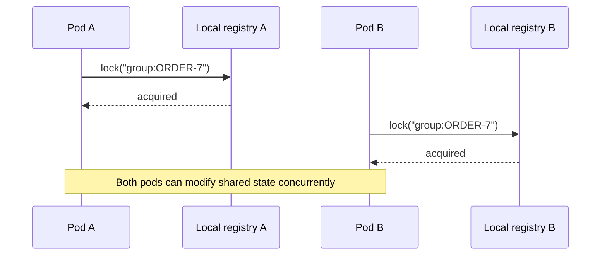
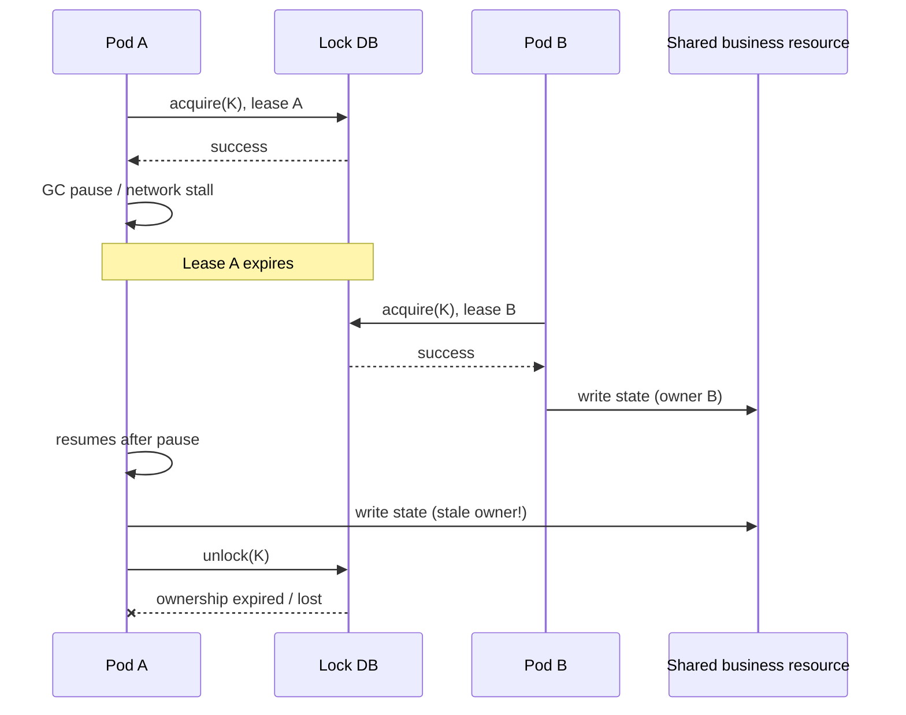
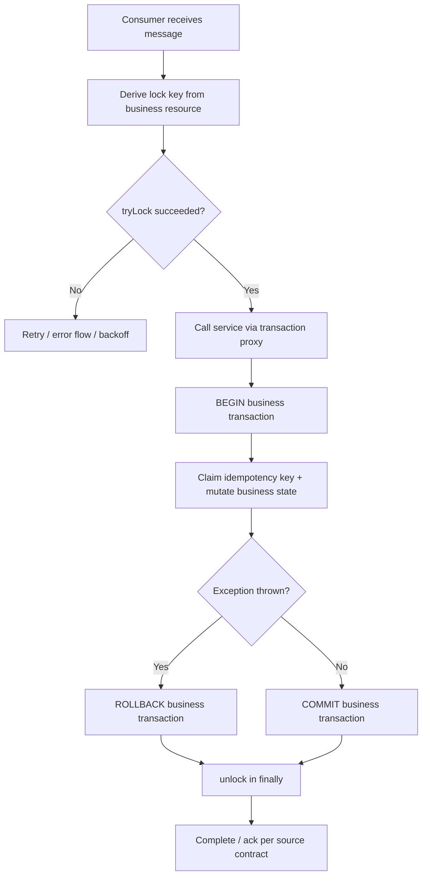

# JdbcLockRegistry or Distributed Locks in Spring Integration

## 1. The problem: two instances modifying the same state

In the `SPRING_INTEGRATION_RUNTIME` module, Spring Integration coordinates messages across **channels, endpoints, consumers, pollers, and executors**. When an application scales out to multiple JVMs or multiple pods, two consumers may concurrently process messages related to **the same resource**: an aggregator message group, a report generation task, or an inventory SKU. Single-JVM `synchronized` and `ReentrantLock` are not enough to protect shared resources across the cluster.

For example, two instances concurrently receive update events for the same invoice:

```text
Pod A receives event E1, key = invoice:INV-42
Pod B receives event E2, key = invoice:INV-42

If both read the old state and then update,
the final result may be wrong or the message group may be mutated concurrently.
```

A **distributed lock** enables instances to **coordinate exclusive entry into a critical section by lock key**, through a shared storage system. `JdbcLockRegistry` is a Spring Integration implementation that uses a database to coordinate locks; other options include Redis and ZooKeeper.

A distributed lock is only **one part** of correctness: leases can expire, workers can stop mid-flight, and brokers can redeliver messages after a transaction has committed. Therefore, this lesson always distinguishes **mutual exclusion**, **transactions**, **retry/redelivery**, **idempotency**, and **recoverability**.

### After this lesson, you will be able to

1. Explain `LockRegistry.obtain(key)` and the difference between in-memory `DefaultLockRegistry` and shared `JdbcLockRegistry`.
2. Configure `DefaultLockRepository`, the `INT_LOCK` table, region, transaction manager, and `JdbcLockRegistry`.
3. Write a handler that holds the lock **on the exact thread executing business logic**, using `tryLock` and `unlock` safely.
4. Analyze lease/TTL, `renewLock`, lock ownership, unlock errors, and the limits of "single owner".
5. Choose among JDBC/Redis/ZooKeeper based on architecture, lock volume, latency, and availability requirements.
6. Diagnose contention, deadlocks, lock expiry, transaction rollbacks, message replays, and inconsistent data.

## 2. Concepts and contracts to distinguish

| Concept | Meaning | What must **not** be inferred |
|---|---|---|
| `LockRegistry` | Registry returning a `Lock` bound to a logical key via `obtain(Object)`. | Calling `obtain` does **not** acquire lock ownership yet; you must call `lock()` or `tryLock()`. |
| `DefaultLockRegistry` | Uses in-memory locks within a single registry/JVM, backed by Java concurrency. | Does not synchronize independent pods/JVMs. |
| `JdbcLockRegistry` | Registry coordinating locks via a shared database, combining local locks with JDBC ownership records. | Does not automatically create a business transaction or prevent duplicate business events. |
| `LockRepository` / `DefaultLockRepository` | Accesses lock records via SQL, owner, region, and TTL. | Not a `MessageStore` or payload storage. |
| `Lock key` | Name of the resource to protect, e.g., `inventory:SKU-1` or an aggregator's correlation key. | Not necessarily the message ID; two different messages may need the **same** lock key. |
| `Lease / TTL` | Duration ownership remains valid in the store, allowing lock recovery if the owner dies. | TTL is not the `tryLock` wait time and does not guarantee the old worker has stopped. |
| `Transaction` | Unit of work committed/rolled back across resources supported by the transaction manager. | Having a lock does not make HTTP/email and JDBC atomic together. |
| `Idempotency key` | Logical identity of a request used to prevent duplicate side effects. | Cannot be replaced by a lock key when multiple valid events target the same resource. |

A standard `Lock` is the `java.util.concurrent.locks.Lock` interface with familiar operations:

```java
Lock lock = lockRegistry.obtain("inventory:SKU-1");
boolean acquired = lock.tryLock(2, TimeUnit.SECONDS);

if (acquired) {
    try {
        performCriticalWork();
    } finally {
        lock.unlock();
    }
}
```

The snippet above is a **usage pattern**; `lockRegistry` and `performCriticalWork()` are supplied by the application. `tryLock(2, ...)` limits **the wait time to acquire the lock**, not the TTL. If acquisition fails, apply a fail/retry/requeue policy rather than silently treating the business work as done.

## 3. From local locking to distributed locking

### 3.1. When the application runs on a single JVM

```java
import org.springframework.integration.support.locks.DefaultLockRegistry;
import org.springframework.integration.support.locks.LockRegistry;

LockRegistry registry = new DefaultLockRegistry();
Lock lock = registry.obtain("group:ORDER-7");

lock.lock();
try {
    updateGroupState();
} finally {
    lock.unlock();
}
```

`DefaultLockRegistry` prevents multiple threads **sharing the same registry instance** from concurrently modifying state for the same key. However, Pod A and Pod B have two separate registries:



Even with identical keys, Java locks/maps on two JVMs **do not share ownership**. A shared database or Redis store does not solve the problem by itself if the code still uses a local `DefaultLockRegistry`.

### 3.2. When multiple instances must protect the same resource

Participating instances must follow the same locking protocol and share **the same lock scope**: shared backend, compatible key/region/prefix conventions, and consistent acquire/renew/release operations.

```mermaid
sequenceDiagram
    participant A as Pod A
    participant B as Pod B
    participant DB as Shared database / INT_LOCK
    A->>DB: acquire("group:ORDER-7")
    DB-->>A: success, owner A
    B->>DB: acquire("group:ORDER-7")
    DB-->>B: busy; retry/wait
    A->>A: update shared group
    A->>DB: release("group:ORDER-7")
    DB-->>A: released
    B->>DB: acquire("group:ORDER-7")
    DB-->>B: success, owner B
    B->>B: update shared group
```

In practice, `JdbcLockRegistry` also pairs a **local `ReentrantLock`** with the JDBC record; the diagram focuses on the backend ownership protocol.

**Correctness requirement:** all participating nodes must use keys with the same semantics. If Pod A locks `"inventory:SKU-1"` while Pod B locks `"sku:SKU-1"`, they can still run concurrently even on the same database.

## 4. How does JdbcLockRegistry work?

`JdbcLockRegistry` relies on `LockRepository`; the built-in implementation is `DefaultLockRepository`. When attempting to acquire a lock, the repository executes SQL operations on the lock table to coordinate ownership across processes. When the owner finishes, it releases the ownership record; when an owner dies without releasing, **lease expiry** lets another process re-acquire it according to the TTL policy.

A typical table structure in **Spring Integration 7.x** is:

```sql
-- Illustrative structure from the official docs (e.g., H2).
-- When running PostgreSQL/MySQL/..., use the schema script matching
-- your project's Spring Integration version and DBMS.
CREATE TABLE INT_LOCK (
    LOCK_KEY CHAR(36) NOT NULL,
    REGION VARCHAR(100) NOT NULL,
    CLIENT_ID CHAR(36),
    CREATED_DATE TIMESTAMP NOT NULL,
    EXPIRED_AFTER TIMESTAMP NOT NULL,
    CONSTRAINT INT_LOCK_PK PRIMARY KEY (LOCK_KEY, REGION)
);
```

| Column/concept | Purpose |
|---|---|
| `LOCK_KEY` | Lock identifier converted by the registry into its stored representation. Do not assume it is the raw unprocessed business key string. |
| `REGION` | Lock partition. The same key in different regions **does not contend on the same lock record**. |
| `CLIENT_ID` | Participating owner/repository identifier, used to verify lock ownership. |
| `CREATED_DATE` and `EXPIRED_AFTER` | Lock/lease timing metadata according to schema and version. |
| Primary key `(LOCK_KEY, REGION)` | Prevents two owners from simultaneously holding a valid lock record for the same scope under the SQL protocol. |

**Version detail:** `EXPIRED_AFTER` was added in the **Spring Integration 7.0** API/schema to support per-lock TTL. Projects on **6.x** have a different schema/TTL contract; do not apply 7.x DDL verbatim to 6.x. When upgrading from 6.x to 7.x, run the **migration matching your version and database engine**, backfilling existing data and new column values with your migration tool before swapping the application binary. Never merely add a `NOT NULL` column directly to a populated table while skipping the backfill step.

`DefaultLockRepository` must be a Spring-managed bean to complete its lifecycle and transaction setup. Starting in 6.x releases, you can pass an explicit `PlatformTransactionManager` instead of relying on the default one in the application context.

### Region, prefix, client ID

- **Region** is a logical namespace, such as `inventory-v1` or `aggregator-orders-v1`. Every instance coordinating on the same workflow must use the **same region**; distinct regions isolate lock scopes.
- **Prefix** is the SQL table prefix, defaulting to `INT_`. If using custom table names, configure the matching prefix on the repository and execute the corresponding schema. The prefix must also match across participating instances.
- **Client ID** distinguishes repositories/owners. Reusing an owner identifier improperly or sharing one repository across multiple registries against contract can corrupt ownership semantics.

**Do not share a single `DefaultLockRepository` instance across separate `JdbcLockRegistry` instances.** They maintain separate local locks while the repository holds the same owner identity; the API documentation warns this can violate the `Lock` contract. Within a single application context, typically register **one registry bean** and inject it into the components that need to coordinate under an appropriate namespace.

## 5. Configuring Spring Integration with JdbcLockRegistry

This example uses Java 17+, Spring Integration JDBC, Spring JDBC, Spring transactions, and a JDBC `DataSource` connecting to a database shared by **both instances**. Assume the module includes `spring-integration-core`, `spring-integration-jdbc`, the JDBC driver, and the relevant Spring dependencies; connection settings/credentials are supplied by the application. If Spring Boot already provides a `JdbcTemplate` or transaction manager, reuse those beans instead of creating duplicates.

### 5.1. Transaction manager, repository, registry, and channel beans

```java
package example.integration;

import java.time.Duration;
import javax.sql.DataSource;

import org.springframework.context.annotation.Bean;
import org.springframework.context.annotation.ComponentScan;
import org.springframework.context.annotation.Configuration;
import org.springframework.integration.channel.DirectChannel;
import org.springframework.integration.config.EnableIntegration;
import org.springframework.integration.jdbc.lock.DefaultLockRepository;
import org.springframework.integration.jdbc.lock.JdbcLockRegistry;
import org.springframework.jdbc.core.JdbcTemplate;
import org.springframework.jdbc.support.JdbcTransactionManager;
import org.springframework.messaging.MessageChannel;
import org.springframework.transaction.PlatformTransactionManager;
import org.springframework.transaction.annotation.EnableTransactionManagement;

@Configuration
@EnableIntegration
@EnableTransactionManagement
@ComponentScan(basePackageClasses = {
        InventoryEndpoint.class, InventoryCommandService.class
})
public class JdbcDistributedLockConfig {

    @Bean("inventoryIn")
    public MessageChannel inventoryIn() {
        return new DirectChannel();
    }

    @Bean("transactionManager")
    public PlatformTransactionManager transactionManager(DataSource dataSource) {
        return new JdbcTransactionManager(dataSource);
    }

    @Bean
    public JdbcTemplate jdbcTemplate(DataSource dataSource) {
        return new JdbcTemplate(dataSource);
    }

    @Bean
    public DefaultLockRepository inventoryLockRepository(
            DataSource dataSource,
            PlatformTransactionManager transactionManager) {

        DefaultLockRepository repository =
                new DefaultLockRepository(dataSource);
        repository.setTransactionManager(transactionManager);
        repository.setRegion("inventory-v1");
        return repository;
    }

    @Bean
    public JdbcLockRegistry inventoryLockRegistry(
            DefaultLockRepository inventoryLockRepository) {

        JdbcLockRegistry registry =
                new JdbcLockRegistry(inventoryLockRepository);
        registry.setIdleBetweenTries(Duration.ofMillis(200));
        return registry;
    }
}
```

Explaining the constraints:

1. **Both instances must use the same JDBC backend** and the same `INT_LOCK` schema. If each pod connects to a separate database, locks are not shared.
2. `setRegion("inventory-v1")` must match across all instances processing the same SKU; changing the region **isolates** locks.
3. `JdbcLockRegistry` uses a `DefaultLockRepository` declared as a **Spring bean**. The repository goes through proper lifecycle initialization and can validate the schema table at startup.
4. The transaction manager must match the datasource. A transaction used for **lock records** does not mean the entire business flow is automatically transactionally managed.
5. `setIdleBetweenTries(Duration.ofMillis(200))` tunes the pause between database lock acquisition attempts; this value is neither the TTL nor the total wait limit.

**Version note:** the configuration above uses long-standing APIs available from 6.x onward and does not rely on 7.0-specific TTL overloads. In real deployments, select the **matching schema** and compatible dependency versions without mixing documentation across branches.

### 5.2. Sample data and idempotency ledger

We use an inventory row and a business-identity table to separate the **SKU lock key** from the **event idempotency key**:

```sql
CREATE TABLE inventory_balance (
    sku VARCHAR(80) PRIMARY KEY,
    quantity INTEGER NOT NULL CHECK (quantity >= 0)
);

CREATE TABLE inventory_operation (
    operation_id VARCHAR(120) PRIMARY KEY,
    sku VARCHAR(80) NOT NULL REFERENCES inventory_balance(sku),
    delta INTEGER NOT NULL
);

INSERT INTO inventory_balance(sku, quantity)
VALUES ('SKU-1', 10);
```

The example uses PostgreSQL `ON CONFLICT DO NOTHING` syntax. On other DBMSs, substitute the corresponding unique insert/merge strategy. Create the `INT_LOCK` table using the official schema for your **active Spring Integration version**.

Business message:

```java
package example.integration;

public record InventoryDelta(
        String operationId,
        String sku,
        int delta
) {}
```

`operationId` distinguishes each operation that must be applied once; `sku` identifies the resource to serialize. Two valid operations with different `operationId`s but the same `sku` **contend on the same lock**, and then **both are allowed** to modify inventory sequentially.

### 5.3. Handler acquiring the lock on the thread executing the work

```java
package example.integration;

import java.util.concurrent.TimeUnit;
import java.util.concurrent.locks.Lock;

import org.springframework.integration.annotation.MessageEndpoint;
import org.springframework.integration.annotation.ServiceActivator;
import org.springframework.integration.jdbc.lock.JdbcLockRegistry;

@MessageEndpoint
public class InventoryEndpoint {

    private final JdbcLockRegistry lockRegistry;
    private final InventoryCommandService inventoryService;

    public InventoryEndpoint(JdbcLockRegistry lockRegistry,
                             InventoryCommandService inventoryService) {
        this.lockRegistry = lockRegistry;
        this.inventoryService = inventoryService;
    }

    @ServiceActivator(inputChannel = "inventoryIn")
    public void handle(InventoryDelta event) {
        if (event.sku() == null || event.sku().isBlank()) {
            throw new IllegalArgumentException("sku is required");
        }

        String lockKey = "inventory:" + event.sku();
        Lock lock = lockRegistry.obtain(lockKey);
        boolean acquired = false;

        try {
            acquired = lock.tryLock(2, TimeUnit.SECONDS);
            if (!acquired) {
                throw new IllegalStateException(
                        "Lock busy; retry later: " + lockKey);
            }

            // The business service runs its own transaction,
            // invoked before releasing the lock.
            inventoryService.applyOnce(event);
        } catch (InterruptedException interrupted) {
            Thread.currentThread().interrupt();
            throw new IllegalStateException(
                    "Interrupted while waiting for " + lockKey, interrupted);
        } finally {
            if (acquired) {
                lock.unlock();
            }
        }
    }
}
```

Key points:

- **Acquire and release on the same thread.** Per the `java.util.concurrent.locks.Lock` API and `JdbcLockRegistry` ownership rules, never offload `unlock()` to a task on another executor.
- `tryLock` uses a bounded wait so workers are not tied up indefinitely under contention. On timeout, throw an exception so caller/error/retry flows handle it per contract.
- The `finally` block ensures an unlock attempt even when business logic throws an exception. If the lock **already expired and was claimed by another owner**, `unlock` can throw a serious error indicating lost ownership; observe and handle this case rather than hiding it.
- If you change `inventoryIn` from `DirectChannel` to `ExecutorChannel`, the lock must still **be acquired inside the handler running on the worker thread**. Acquiring a lock on the producer and then enqueueing onto an executor sets the wrong boundary.

### 5.4. Transaction for business effects, independent of the lock

```java
package example.integration;

import org.springframework.jdbc.core.JdbcTemplate;
import org.springframework.stereotype.Service;
import org.springframework.transaction.annotation.Transactional;

@Service
public class InventoryCommandService {

    private final JdbcTemplate jdbc;

    public InventoryCommandService(JdbcTemplate jdbc) {
        this.jdbc = jdbc;
    }

    @Transactional(transactionManager = "transactionManager")
    public void applyOnce(InventoryDelta event) {
        if (event.operationId() == null || event.operationId().isBlank()) {
            throw new IllegalArgumentException("operationId is required");
        }

        // Claim the business operation inside the same DB transaction.
        int inserted = jdbc.update(
                "INSERT INTO inventory_operation(operation_id, sku, delta) " +
                "VALUES (?, ?, ?) ON CONFLICT DO NOTHING",
                event.operationId(), event.sku(), event.delta());

        if (inserted == 0) {
            // Duplicate business operation: do not re-apply delta.
            return;
        }

        int changed = jdbc.update(
                "UPDATE inventory_balance SET quantity = quantity + ? " +
                "WHERE sku = ? AND quantity + ? >= 0",
                event.delta(), event.sku(), event.delta());

        if (changed != 1) {
            throw new IllegalStateException(
                    "Unknown SKU or insufficient stock: " + event.sku());
        }
    }
}
```

Here, `@Transactional` makes the `inventory_operation` marker and the `inventory_balance` update commit or roll back together. If an error occurs after inserting the marker, rollback restores the prior state so a retry can try again. If an event is redelivered after commit, the duplicate `operation_id` prevents subtracting or adding stock a second time.

**Locks and ledgers protect two different things:** the `SKU` lock coordinates **contention between instances** entering the critical section; the `operationId` ledger protects **business effects when a message is redelivered**. DB constraints and transactions are still required even with a distributed lock, because a lease can be lost.

In a real system, the same `operationId` arriving with a different `sku/delta` payload must be detected as a **conflict**, not silently treated as a duplicate. Store a request fingerprint or compare against the existing record before returning a duplicate result.

### 5.5. Sending messages and observing

In a Spring-managed component with `ApplicationContext context`:

```java
import org.springframework.messaging.MessageChannel;
import org.springframework.messaging.support.MessageBuilder;

MessageChannel input =
        context.getBean("inventoryIn", MessageChannel.class);

InventoryDelta first =
        new InventoryDelta("op-101", "SKU-1", -2);

InventoryDelta second =
        new InventoryDelta("op-102", "SKU-1", -3);

input.send(MessageBuilder.withPayload(first).build());
input.send(MessageBuilder.withPayload(second).build());
input.send(MessageBuilder.withPayload(first).build()); // redelivery
```

After three sends, the expected database state is:

```sql
SELECT quantity FROM inventory_balance WHERE sku = 'SKU-1';
-- Result: 5 (10 - 2 - 3), not 3.

SELECT operation_id, sku, delta
FROM inventory_operation
ORDER BY operation_id;
-- Two operations: op-101 and op-102.
```

To genuinely **verify the distributed lock**, sequential calls in one JVM are not enough: run **two application instances** pointed at the same DB and send two events for the same `sku` nearly simultaneously. Measure acquire/release timestamps and verify each instance holds the lock for the duration of its work.

## 6. TTL, renewal, and lost-ownership errors

### 6.1. Distinguishing wait time and lease

| Parameter | Meaning |
|---|---|
| `tryLock(2, SECONDS)` | Thread waits at most roughly 2 seconds to acquire the lock; on failure, decide retry/fail. |
| `idleBetweenTries` | Pause between SQL acquire retries, affecting acquisition latency and DB load under contention. |
| TTL/expiration | Validity window of the ownership record in the backend; upon expiration, another owner can reclaim/acquire the lock. |
| Renewal | Extending the lease before expiration while the **valid owner** still holds the lock. |
| Business timeout | Limit on a DB/HTTP call or business SLA; does not automatically stay in sync with TTL. |

If a critical section can run **longer than the TTL**, configure an appropriate TTL or renew on time. A TTL that is too long delays recovery when an owner dies; a TTL that is too short risks expiring while a worker is still active (GC pauses, slow network, DB failover, stalled thread).

### 6.2. Renewing a lock

`JdbcLockRegistry` supports `RenewableLockRegistry` and the `renewLock(lockKey)` method in current 6.x releases. **Renewal must only be invoked by the thread currently holding the lock.** Never schedule `lockRegistry.renewLock(key)` on another scheduler thread assuming it can renew the same lock.

In a multi-stage processing block running on **the same thread holding the lock**:

```java
Lock lock = lockRegistry.obtain(lockKey);
lock.lock();
try {
    performBoundedStep1();
    lockRegistry.renewLock(lockKey); // same thread holding the lock
    performBoundedStep2();
} finally {
    lock.unlock();
}
```

This code is an illustrative template; the work methods and `lockRegistry`/`lockKey` are supplied by the application. If `performBoundedStep1()` can exceed the TTL, calling `renewLock` **after** that step is too late; split work appropriately, choose a sufficient TTL, or use a renewal strategy tested on **your exact version**.

### 6.3. API additions in Spring Integration 7.0

Spring Integration **7.0+** adds `DistributedLock` with per-acquisition custom TTL and `JdbcLockRegistry.renewLock(key, Duration)`. Example **for 7.x only**:

```java
import java.time.Duration;
import java.util.concurrent.TimeUnit;
import org.springframework.integration.support.locks.DistributedLock;

DistributedLock lock = registry.obtain("inventory:SKU-1");

boolean acquired = lock.tryLock(
        2, TimeUnit.SECONDS, Duration.ofSeconds(45));

if (acquired) {
    try {
        executeShortCriticalSection();
    } finally {
        lock.unlock();
    }
}
```

Prerequisites: project dependencies are 7.0+ and the lock table is migrated to the schema containing `EXPIRED_AFTER`. Version 6.x only supports standard lock APIs and renewal per its contract; do not copy 7.x TTL overloads into 6.x.

### 6.4. Dangerous scenario: old owner keeps running after TTL



During this window, **two workers can both believe they hold exclusive rights**, even though the backend followed the lease policy properly. A lock cannot kill thread A when TTL expires. Since Spring Integration 6.4, `JdbcLockRegistry.JdbcLock.unlock()` can throw `ConcurrentModificationException` when ownership has expired; treat this as a signal that **integrity of the protected resource may be compromised**, not a low-severity log message to ignore.

To protect sensitive resources:

- Prefer **database constraints, transactions, and idempotency** for business mutations.
- If the target resource can validate a **monotonically increasing fencing token**, issue a token per lease acquisition and reject writes from older owners/tokens. Standard `JdbcLockRegistry` does not automatically provide a universal fencing token for arbitrary targets; an additional design is needed.
- Without fencing, consider versioning/optimistic concurrency, compare-and-set, ownership checks close to commit, and reconciliation mechanisms.
- Pick TTL based on **p99 critical-section duration + GC/network pause + margin**, using real measurements; never assume average duration is safe enough.
- Never "fix" lost-ownership `unlock` exceptions by catching and ignoring them.

## 7. Locks and transactions: two independent boundaries

`JdbcLockRegistry` uses SQL operations to manage lock records. Your business `PlatformTransactionManager` governs transactions for **application data**. Even within the same database, lock acquisition/release and business commit must be understood under separate contracts.



In the `InventoryEndpoint` example, the transactional service finishes before `unlock`. If an exception occurs, the service transaction rolls back and the lock is still released in `finally`. However, a crash can occur **after commit, before ack**: the source redelivers the event, and the idempotency ledger decides not to apply it a second time.

**Do not hold a distributed lock across an asynchronous call whose completion you cannot bound.** For example:

```text
Thread A: acquire(K) -> send to ExecutorChannel -> unlock(K)
Thread B:                ... actual work runs later ...
```

Thread B may not even have started when A releases the lock. If B's work needs protection, **B must acquire and release** on its own thread. A transaction on thread A also does not propagate across an `ExecutorChannel`.

### When locks and retries intersect

- `tryLock` timeout: usually indicates **resource contention**; retry with backoff, cap attempts, and record metrics rather than spinning in a tight loop against the DB.
- Business exception: rolls back per `@Transactional`/advice; after releasing the lock, a retry can run again. Putting retry **outside** vs. **inside** the lock region is a domain trade-off: holding the lock across all retry attempts blocks other owners longer.
- Worker death: TTL lets another instance claim the lock, but the message must be redeliverable/recoverable from the source. **A lock registry does not store payloads and does not replay messages.**
- Error flow receives exception: handling an error message does not mean business state rolled back; check which thread started and ended the transaction.

A common mistake is treating lock acquisition as proof that an event has not been processed yet. **A lock only tells you who may access the resource right now**; a ledger/idempotency record or business state determines whether the event is already complete.

## 8. How do aggregators, resequencers, and MessageGroupStore use locks?

In an **aggregator**, multiple messages sharing a `correlationId` are stored in a `MessageGroupStore`. Before adding a message, evaluating the release condition, completing a group, or expiring a group, the endpoint uses `LockRegistry` to guard group mutations by correlation key. Endpoints like **resequencer** have similar group synchronization needs.

If aggregators A and B run across **two application instances** accessing a **shared persistent `MessageGroupStore`**, each instance's local `DefaultLockRegistry` is insufficient. You must configure an appropriate **shared lock registry**, such as `JdbcLockRegistry` pointed at the shared database with the same namespace/region.

```text
Pod A                         Pod B
  aggregator                    aggregator
      |                             |
      +---- shared LockRegistry ----+
                    |
              JDBC INT_LOCK
                    |
          shared MessageGroupStore
```

An XML example of an aggregator endpoint (fragment requiring Spring Integration namespaces and matching beans):

```xml
<int:aggregator
        id="orderAggregator"
        input-channel="orderPartsIn"
        output-channel="ordersComplete"
        message-store="sharedGroupStore"
        lock-registry="jdbcLockRegistry"
        release-lock-before-send="true"/>
```

This snippet illustrates the **binding** between aggregator, shared group store, and distributed lock; channels and beans must exist, and correlation/release settings must match your message sequence. `release-lock-before-send` should be evaluated per version and flow: releasing the lock before dispatching output can prevent downstream deadlocks, while also changing the exclusivity scope as subsequent steps run.

### Deadlock between aggregators

When `aggregator1` dispatches synchronously to `aggregator2` over a `DirectChannel` and both endpoints share a registry/key improperly, multiple threads can acquire locks in **opposite orders**, forming a wait cycle:

```text
Thread T1 holds lock A -> waits for lock B
Thread T2 holds lock B -> waits for lock A
```

Spring Integration documentation lists common strategies:

1. Use **separate registries per aggregator** within the same flow, while still sharing the same registry/namespace **across instances of the same aggregator**.
2. Introduce an asynchronous boundary using `ExecutorChannel` or `QueueChannel` on the output so downstream runs on another thread; redesign transactions/recovery accordingly.
3. Configure `releaseLockBeforeSend` where supported by the endpoint and appropriate for the use case.

A distributed lock **does not replace a persistent message group store**. If group state lives only in each pod's RAM, no amount of locking ensures pods see the same message history.

## 9. Choosing JdbcLockRegistry, RedisLockRegistry, or another option?

| Option | Scope | Common advantages | Trade-offs / considerations |
|---|---|---|---|
| `DefaultLockRegistry` | One registry/JVM | No external service, low latency | Does not synchronize across processes; loses local state on restart. |
| `JdbcLockRegistry` | Instances sharing RDBMS/region | Reuses existing database; familiar SQL/transactions/backups/monitoring | Every acquire/retry/renew hits the DB; contention, pool sizing, lock-table schema/TTL, DB outages. |
| `RedisLockRegistry` | Instances sharing Redis backend/namespace | Often suits distributed locking with low latency | Lease expiry, Redis availability/failover, pub-sub/spin behavior, Redis persistence/semantics must be tested. |
| `ZookeeperLockRegistry` | Clients sharing a ZooKeeper ensemble | Session/ephemeral-node coordination suited for cluster use cases | Requires operating an ensemble; session timeouts, connection loss, operational complexity. |
| `DynamoDbLockRegistry` from Spring Cloud AWS | Applications sharing DynamoDB | Fits infrastructure centered on AWS | Different dependencies/contracts from Spring Integration core; read Spring Cloud AWS docs and test leases/throughput. |
| Lock/claim directly in business DB | Row-level or unique/CAS business key | Enforces correctness right where state lives; simpler when one DB suffices | Does not coordinate external systems directly; long row locks increase contention/deadlocks. |

**Selection principle:** start from the **actual resource to protect** and its SLA, not from technology names:

- If you only need **a single DB row updated correctly**, optimistic locking, unique constraints, and transactions may be cleaner than an external distributed lock.
- If multiple instances manipulate **message groups** in a shared store, using a shared lock registry supported by the endpoint makes sense.
- If you already have a stable RDBMS and moderate contention, JDBC locks avoid introducing another infrastructure dependency.
- If acquisition volume is high or low latency is critical, benchmark Redis or other options under your workload and failure modes; never assume one option is universally faster.
- If lock backend loss halts the flow, design backoff/error flows and availability monitoring. Never silently fall back to a local lock, as that breaks distributed semantics.

## 10. Key design, contention, and system cost

### 10.1. Locking at the right granularity

| Lock key | Outcome |
|---|---|
| `inventory:SKU-1` | All updates for one SKU serialize; other SKUs can run in parallel. |
| `inventory:*` | Too coarse: all SKUs contend on one lock, hurting throughput. |
| `message:<randomUUID>` | Too fine: every message gets a unique key, failing to protect the shared SKU. |
| `aggregator:ORDER-7` | Protects the corresponding group if all instances use the same correlation convention. |
| `billing:invoice:INV-42` | Clear namespacing avoids collisions with locks from other modules. |

Do not use payloads containing secrets as raw lock keys, and do not log raw keys containing PII. Normalize key casing/encoding before acquiring. If keys grow too long or have unbounded cardinality, measure local cache and DB overhead.

### 10.2. Latency and database pressure

- `JdbcLockRegistry` polls SQL periodically; a low `idleBetweenTries` generates more queries under contention, while a high value increases acquisition latency.
- Long lock hold times increase `wait time` for other workers using the same key; monitor **p95/p99 critical-section duration** and **lock acquisition latency**.
- The connection pool must accommodate business SQL, lock operations, and other pollers/consumers; too few connections can stall flows waiting on the pool or trigger timeouts.
- Define wait bounds, retry backoff, competing worker counts, and a message handling policy when a lock cannot be acquired.
- When new keys appear continuously, the registry keeps a local cache of lock objects; `setCacheCapacity` and `expireUnusedOlderThan(...)` manage unused entries. **Cache eviction does not delete active lease records held in the database.**

**Never hardcode assumptions about default cache capacity or TTL across versions.** Configure values explicitly per requirements and check the exact API/version; defaults can change.

### 10.3. Lock ordering

If an operation needs two locks, such as `warehouse:A` and `warehouse:B`, enforce a system-wide acquisition order:

```text
Correct: always acquire locks in sorted key order:
         lock("warehouse:A") -> lock("warehouse:B")

Wrong:   Thread 1 locks A then waits for B;
         Thread 2 locks B then waits for A.
```

On failure, release in reverse order and only unlock locks that were actually acquired. If holding two locks simultaneously is not strictly required, simplify the critical section to reduce deadlock risk.

## 11. Runtime failures and recovery

| Scenario | What can happen | Appropriate action |
|---|---|---|
| Lock is busy | `tryLock` times out, handler throws, message may retry | Use backoff, cap attempts, track wait-time metrics; do not treat business work as done. |
| Pod dies before `unlock` | Lock record stays until TTL/reclaim allows another owner | Bounded wait for TTL, owner monitoring, message redelivery, and idempotency. |
| Pod pauses longer than TTL | Another owner takes the lock; old pod can resume and write | Fencing/versioning/transactions; treat unlock ownership failures as critical. |
| DB outage | Acquire/renew/release fails or stalls | Never fall back to local locks; use error flows, circuit/backoff, alerts, and integrity checks. |
| Missing/wrong `INT_LOCK` schema | Repository startup/SQL operations fail | Apply the schema script for your exact version/DBMS; verify migrations. |
| Two pods configured with different `region`/`prefix` | Do not contend on the same lock record | Compare configs and environment variables across instances. |
| Two registries mis-share one repository bean | Local locking may conflict with shared owner records | Give each separate registry its own repository per contract; prefer one shared registry bean per context. |
| `unlock` throws `ConcurrentModificationException` | Ownership expired/changed; protected data may have raced | Log incident, reconcile business state, inspect TTL and critical section. |
| Worker loses transaction or retries after commit | Duplicate messages and duplicate side effects may occur | Check transactions, acks, and idempotency ledger; do not rely solely on distributed locks. |
| Same lock key held too long | Hot key / slow critical section or deadlock | Measure hold duration, capture thread dumps, check SQL latency and lock ordering. |

**When investigating, construct a unified timeline by business key:**

```text
message_received
  -> lock_wait_started
  -> lock_acquired(owner, key, region)
  -> business_tx_started
  -> business_tx_committed/rolled_back
  -> unlock_attempted/succeeded/failed
  -> message_acked/retried
```

These milestones must be **instrumented**; Spring Integration does not emit full business logs in this format by default. Include correlation/event IDs to connect logs across threads, while avoiding logging sensitive payloads or database credentials.

## 12. Hands-on lab for verifying cluster locks

Prepare a shared database, the version-appropriate `INT_LOCK` schema, the business schema from section 5, and **two application instances** sharing the same `region` configuration. Use a test environment; never induce crashes or lock contention in production.

1. **Single instance, single key:** send `op-101`, verify acquire → transaction commit → unlock; quantity drops from 10 to 8.
2. **Two instances, same SKU:** simultaneously send `op-102` and `op-103` for `SKU-1`; measure acquisition order and verify no two valid owners execute concurrently within an active lease.
3. **Two different SKUs:** send two events for `SKU-1` and `SKU-2`; verify keyed locking does not accidentally block the entire inventory. Create the row for `SKU-2` before running.
4. **Duplicate delivery:** resend `op-101`; observe the ledger blocking duplicate effects even though the handler can still re-acquire the lock.
5. **Lock timeout:** hold a lock long enough on Pod A while Pod B calls `tryLock` with a short timeout; verify Pod B takes the retry/error flow instead of falsely acking success.
6. **Owner crash:** terminate the pod holding the lock at a controlled step, wait for configured TTL/reclaim; verify the other pod acquires the lock and performs appropriate business recovery.
7. **Lease expiry while owner is alive:** intentionally configure a short TTL in test, inject a long pause, then observe lost-ownership signals. Do not consider the test complete merely because Pod B acquires the lock—inspect the data as well.
8. **Mismatched region:** change Pod B's region, repeat the concurrency test, and prove the two pods no longer coordinate; then restore matching configuration.
9. **Database outage:** temporarily block the DB during acquire/renew, observe exceptions, backoff, alerts, and behavior once DB recovers.
10. **Aggregator with shared group store:** if your module has an aggregator flow, run two pods with a shared `MessageGroupStore` and shared lock registry; test group release, correlation, duplicates, and deadlocks when wired downstream.

For each experiment, record:

| Measurement | Question |
|---|---|
| Key, region, owner/client ID | Are both instances actually contending on the same lock resource? |
| Thread name, pod ID | Who called acquire/renew/unlock? Did execution switch threads mid-way? |
| Acquisition attempts/wait time | Is contention driving up DB query volume? |
| TTL, renewal, elapsed hold time | Is there risk of the lease expiring while work is still running? |
| Business transaction result | Committed or rolled back? Are business records consistent? |
| Message delivery/ack | After a crash, are there redeliveries and duplicates? |
| Exception/error channel | Timeout, SQL error, lost owner, or business error? |
| End state | Inspect final data, not just lock acquisition logs. |

## 13. Checklist for selecting and operating distributed locks

- Identify the **resource needing mutual exclusion**, distinguishing the lock key (resource) from the idempotency key (logical event).
- If running in one JVM only, `DefaultLockRegistry` may suffice; when running **multiple instances with shared state**, use a shared lock registry backend.
- For JDBC: choose the right `DataSource`, `DefaultLockRepository`, `PlatformTransactionManager`, **region/prefix**, and version-matched `INT_LOCK` schema migration.
- Acquire and release on **the same thread executing the critical section**; use bounded `tryLock`, `finally`, and treat lost-ownership errors seriously.
- Size TTL and renewal according to realistic durations; account for GC pauses, network/DB failovers, and lease expiry. **TTL expiration does not stop the old worker.**
- Place transactions and idempotency on the business resource; a distributed lock **does not replace** commit/rollback, acks, DLQs, or replays.
- For multi-instance aggregators/resequencers, synchronize **both the shared `MessageGroupStore` and the shared lock registry**, and guard against downstream flow deadlocks.
- Measure contention, latency, hold duration, errors, retries, and final business state; verify with **two processes and fault injection** before going to production.

### Official references

- [Spring Integration Reference — Distributed Locks](https://docs.spring.io/spring-integration/reference/distributed-locks.html): `LockRegistry`, `DefaultLockRegistry`, distributed backends, and the `DistributedLock` API from 7.0.
- [Spring Integration Reference — JDBC Lock Registry](https://docs.spring.io/spring-integration/reference/jdbc/lock-registry.html): `JdbcLockRegistry`, `DefaultLockRepository`, TTL, `INT_LOCK` schema, renewal, caching, and 7.x upgrade notes.
- [Spring Integration Reference — Aggregator](https://docs.spring.io/spring-integration/reference/aggregator.html): message group protection, `LockRegistry`, and strategies to avoid deadlocks on downstream dispatch.
- [Spring Integration Reference — Redis Lock Registry](https://docs.spring.io/spring-integration/reference/redis.html): Redis option, TTL, release/renewal, and acquisition methods.
- [Spring Integration Javadoc — DefaultLockRepository](https://docs.spring.io/spring-integration/docs/6.4.x/api/org/springframework/integration/jdbc/lock/DefaultLockRepository.html): bean lifecycle, region, prefix, and rules against mis-sharing a repository.
