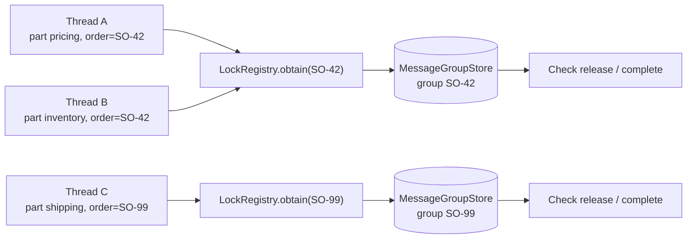
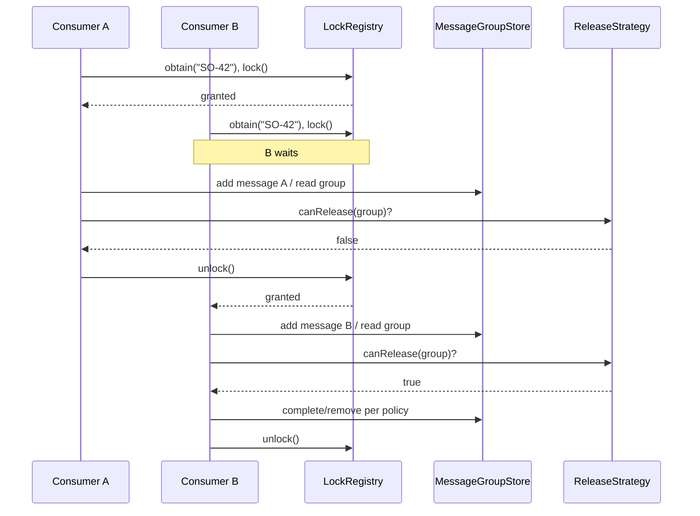
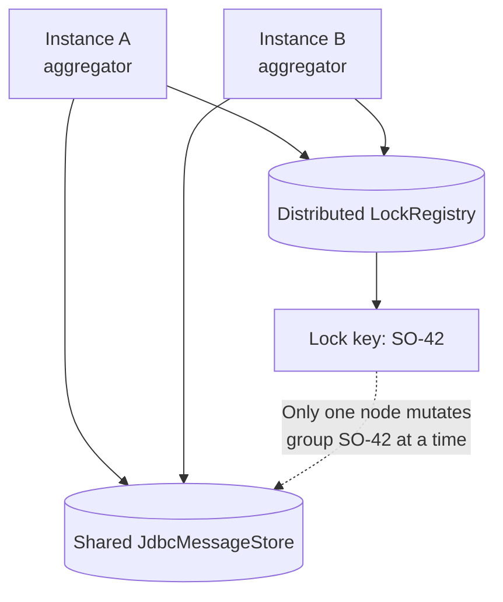
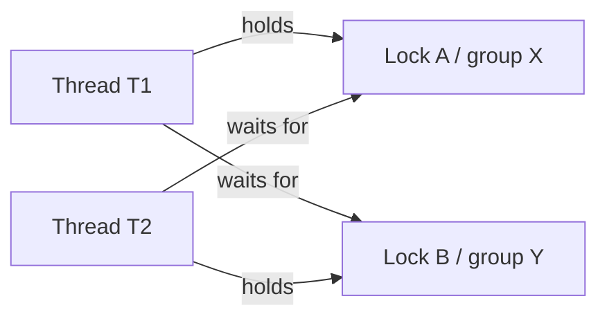
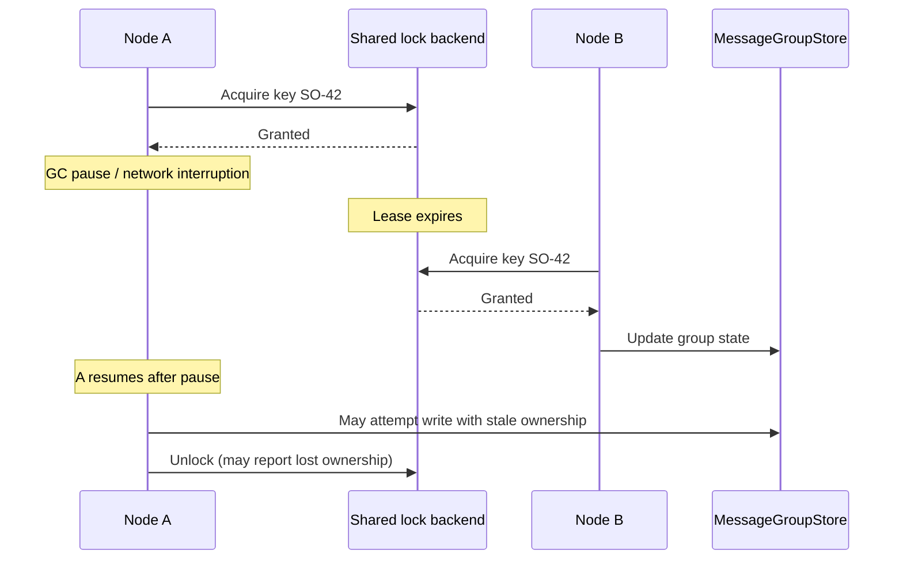

# Locking Around Message Groups in Spring Integration Runtime

## 1. Why must a message group have a lock?

In Spring Integration, an **aggregator** may wait for multiple messages carrying the same `correlationId` to produce an aggregated result. For example, order `SO-42` needs pricing, inventory, and shipping check results. Those three messages can arrive from three threads, multiple pollers, or even different application instances.

If two consumers concurrently read and mutate group state, both might see "all three parts present" and both release the group. One order flow could emit two outputs, or a late-arriving message could sneak in right while the group is being marked complete. To protect the **sequence of operations on a group** rather than just individual write statements, Spring Integration uses `LockRegistry`.

In the **SPRING_INTEGRATION_RUNTIME** module, this lesson focuses on **Locking around message groups**, within the **Lock registry** chapter. The material connects directly to:

- `MessageGroupStore` and the waiting, release, complete, and expire states.
- Correlation, aggregators, resequencers, and concurrently executing consumers.
- `DirectChannel`, `ExecutorChannel`, pollers, and threading.
- Local locking vs. distributed locking in multi-instance deployments.
- Transactions, retries, runtime errors, performance, and deadlock handling.

After this lesson, you will be able to explain **what to lock, when to lock, and how long to hold the lock**, properly configure `LockRegistry` for an aggregator, and diagnose race conditions and lock contention before adding more threads or replicas.

## 2. Distinguishing group locking from group storage

`MessageGroupStore` holds group data and metadata; `LockRegistry` decides **who gets exclusive access under a given key** at a point in time.



| Component | Question it answers | Does not replace |
| --- | --- | --- |
| `CorrelationStrategy` | Which group ID does the message belong to? | Concurrent access control. |
| `LockRegistry` | Who may enter the *critical section* for this group ID? | Persistence or transactions. |
| `MessageGroupStore` | Where are the messages and group state stored? | Ownership coordination across multiple JVMs if no proper lock is configured. |
| `ReleaseStrategy` | Has the group met the criteria to emit output? | Locking or transaction commits. |
| `MessageGroupProcessor` | What payload/message is produced from the released group? | Idempotency at the target system. |
| Transaction manager | Which resource updates commit/roll back together? | Automatic distributed locking or propagating transactions across executors. |

**A lock is not the group data.** A lock may be released as soon as a method returns, while the `MessageGroup` lives for minutes or days. Conversely, an already-deleted group may still have consumers waiting for its old lock, depending on concurrency and registry lifetime.

### Why is locking just a single `addMessageToGroup(...)` call not enough?

The business operation typically spans multiple steps that must be treated as one **critical section**:

```text
1. Determine groupId from correlation key
2. Acquire the lock for groupId
3. Read MessageGroup and check complete state
4. Add new message / update metadata
5. Evaluate ReleaseStrategy
6. If ready: release, update/remove/complete group per policy
7. Release the lock
```

This is a conceptual model; exact internal ordering inside a handler depends on implementation and version. The **design invariant** is that *check–then–act* operations on the same group require appropriate synchronization. Synchronizing only `addMessageToGroup` without guarding the state read and release decision still lets two threads make decisions from stale snapshots.

## 3. Locking by `groupId` instead of one global lock

A `LockRegistry` returns a `java.util.concurrent.locks.Lock` corresponding to the **lock key** provided by the caller. For an aggregator/resequencer, the lock key is usually the group ID resolved by `CorrelationStrategy`.

```text
SO-42: Thread A holds lock; Thread B with SO-42 must wait
SO-99: Thread C can proceed in parallel
SO-77: Thread D can proceed in parallel
```

Thus group-level locking provides two properties:

1. **Per-group mutual exclusion:** normally only one thread mutates a given correlation group's state at a time.
2. **Inter-group parallelism:** distinct groups can be processed concurrently without halting the entire store behind a single mutex.

This depends on implementation: a lock registry backend or DB store can introduce contention on connection pools, rows/indexes, shards, or hashed lock stripes. Internally, `DefaultLockRegistry` also uses its own lock management/striping strategy; it neither allocates unbounded memory nor guarantees a distinct lock object per key at the implementation level.

### Group IDs must be stable and share the same contract

| Scenario | Impact |
| --- | --- |
| Both nodes use `"SO-42"` for the same order | Can share the same distributed lock key and group ID. |
| Node A uses `UUID`, Node B uses `String` for the same correlation | Risks mismatched locks and groups; normalize at the boundary. |
| Two aggregators with different purposes use `"SO-42"` in the same namespace | Causes unnecessary contention or lock-wait cycles. |
| Key is a mutable object whose `equals/hashCode` changes | Can produce inconsistent locking; normalize to an immutable ID. |
| Flow reuses a group ID after completion | Risks hitting tombstones/late-arriving messages; consider adding a run/version. |

By default, Spring Integration uses `IntegrationMessageHeaderAccessor.CORRELATION_ID` to correlate in aggregators unless another strategy is provided. In architectures using multiple protocol adapters, verify header names and Java types after HTTP/JMS/Kafka mapping.

## 4. The `LockRegistry` API and the `try/finally` rule

In Spring Integration 6.x, the relevant APIs reside in package `org.springframework.integration.support.locks`:

```java
import java.util.concurrent.locks.Lock;
import org.springframework.integration.support.locks.LockRegistry;

// API concept:
Lock lock = lockRegistry.obtain(groupId);
lock.lock();
try {
    // Only read/modify the group with this groupId inside the critical section.
} finally {
    lock.unlock();
}
```

`LockRegistry.obtain(Object lockKey)` returns a `Lock`; you then use standard Java methods: `lock()`, `tryLock()`, `unlock()`. Always **release the lock once**, even if `ReleaseStrategy`, the store, or the handler throws an exception. Do not store a lock in a shared field and attempt to unlock it from another thread; lock implementations typically bind ownership to the acquiring thread/registry.

### 4.1. Java example: locking around a group update

The snippet below illustrates *code that manages a group store manually*. If you already use the standard `AggregatingMessageHandler`, **do not** wrap `handleMessage` in an extra ad-hoc lock; configure `LockRegistry` directly on the handler as shown in section 5.

```java
import java.util.concurrent.TimeUnit;
import java.util.concurrent.locks.Lock;
import org.springframework.integration.store.MessageGroup;
import org.springframework.integration.store.MessageGroupStore;
import org.springframework.integration.support.locks.LockRegistry;
import org.springframework.messaging.Message;

public final class GroupWriter {
    private final LockRegistry locks;
    private final MessageGroupStore store;

    public GroupWriter(LockRegistry locks, MessageGroupStore store) {
        this.locks = locks;
        this.store = store;
    }

    public int append(String groupId, Message<?> part) {
        Lock lock = locks.obtain(groupId);
        boolean acquired;
        try {
            acquired = lock.tryLock(2, TimeUnit.SECONDS);
        } catch (InterruptedException ex) {
            Thread.currentThread().interrupt();
            throw new IllegalStateException("Interrupted while waiting for " + groupId, ex);
        }

        if (!acquired) {
            throw new IllegalStateException("Timed out waiting for group " + groupId);
        }

        try {
            MessageGroup group = store.getMessageGroup(groupId);
            if (group != null && group.isComplete()) {
                throw new IllegalStateException("Group already complete: " + groupId);
            }
            store.addMessageToGroup(groupId, part);
            return store.messageGroupSize(groupId);
        } finally {
            lock.unlock();
        }
    }
}
```

**Limitations of this demo:**

- This is a state-checked *append* operation, **not an aggregator**, and does not implement release, output, or timeouts.
- `getMessageGroup(...)` when a group does not exist yet may return an empty group or `null` depending on contract/implementation; production code must test group creation and concurrent deletion handling.
- `tryLock(2, TimeUnit.SECONDS)` is the **maximum wait time to acquire the lock**, not the TTL of a distributed lock.
- The code does not make a DB transaction atomic with a message broker ack; locks do not replace transactions.
- All other components writing to the same group must use the **same coordination scheme**; any code path bypassing the lock breaks mutual exclusion assumptions.

## 5. How do aggregators and resequencers use locks?

`AggregatingMessageHandler` extends `AbstractCorrelatingMessageHandler`. It uses `LockRegistry` to synchronize operations on each group, avoiding concurrent updates that corrupt state or trigger duplicate releases. Resequencers use a similar correlation/group-state mechanism, emitting outputs in sequence order rather than combining payloads into one result.

Per the Spring Integration Reference, group mutations such as adding or releasing are guarded by a lock. Each handler's default registry is an in-memory `DefaultLockRegistry`; when multiple instances concurrently update a shared `MessageGroupStore`, you need a shared backend registry to coordinate across JVMs.



### 5.1. Configuring an aggregator in Java

The example below uses `SimpleMessageStore` and `DefaultLockRegistry` to highlight each component. Connect a subscriber/handler to `ordersOut` to receive actual output.

```java
import org.springframework.beans.factory.annotation.Qualifier;
import org.springframework.context.annotation.Bean;
import org.springframework.context.annotation.Configuration;
import org.springframework.integration.annotation.ServiceActivator;
import org.springframework.integration.aggregator.AggregatingMessageHandler;
import org.springframework.integration.aggregator.DefaultAggregatingMessageGroupProcessor;
import org.springframework.integration.channel.DirectChannel;
import org.springframework.integration.store.MessageGroupStore;
import org.springframework.integration.store.SimpleMessageStore;
import org.springframework.integration.support.locks.DefaultLockRegistry;
import org.springframework.integration.support.locks.LockRegistry;
import org.springframework.messaging.MessageChannel;
import org.springframework.messaging.MessageHandler;

@Configuration
public class OrderGroupConfiguration {

    @Bean
    public MessageGroupStore orderGroupStore() {
        return new SimpleMessageStore();
    }

    @Bean
    public LockRegistry orderGroupLockRegistry() {
        return new DefaultLockRegistry();
    }

    @Bean("partsIn")
    public MessageChannel partsIn() {
        return new DirectChannel();
    }

    @Bean("ordersOut")
    public MessageChannel ordersOut() {
        return new DirectChannel();
    }

    @Bean
    @ServiceActivator(inputChannel = "partsIn")
    public MessageHandler orderAggregator(
            MessageGroupStore orderGroupStore,
            LockRegistry orderGroupLockRegistry,
            @Qualifier("ordersOut") MessageChannel ordersOut) {

        AggregatingMessageHandler handler = new AggregatingMessageHandler(
                new DefaultAggregatingMessageGroupProcessor(), orderGroupStore);

        handler.setCorrelationStrategy(
                message -> message.getHeaders().get("orderId"));
        handler.setReleaseStrategy(group -> group.size() >= 3);
        handler.setLockRegistry(orderGroupLockRegistry);
        handler.setOutputChannel(ordersOut);
        return handler;
    }
}
```

**Explanation:**

1. `orderId` is the correlation key; it must be present and stable across every message in the group. Validate the header before the aggregator rather than letting the strategy return `null`.
2. `group.size() >= 3` is only an illustrative condition. If a part is delivered twice, the group may reach count 3 without having all **part types**; production code needs a release strategy checking part IDs and duplicates.
3. `DefaultLockRegistry` protects concurrent access within **one instance**, suitable for a demo. Do not treat this setup as an inter-JVM guarantee.
4. `SimpleMessageStore` does not persist state across restarts. To recover waiting groups, use a persistent `MessageGroupStore` such as `JdbcMessageStore`.
5. `ordersOut` uses `DirectChannel`, so downstream handlers run synchronously; consider `releaseLockBeforeSend` or an asynchronous boundary if chaining multiple aggregators.

### 5.2. Configuring with Java DSL or XML

In Java DSL, `CorrelationHandlerSpec` provides `lockRegistry(LockRegistry)`, configurable on the corresponding aggregator/resequencer endpoint spec.

With XML (illustrative snippet assuming namespaces and beans are declared):

```xml
<int:channel id="partsIn"/>
<int:channel id="ordersOut"/>

<int:aggregator id="orderAggregator"
                input-channel="partsIn"
                output-channel="ordersOut"
                message-store="orderGroupStore"
                lock-registry="orderGroupLockRegistry"
                correlation-strategy-expression="headers['orderId']"
                release-strategy-expression="size() >= 3"
                expire-groups-upon-completion="false"/>
```

When running multiple instances, both `orderGroupStore` and `orderGroupLockRegistry` must be chosen and configured **to match the shared scope**. Simply declaring beans with the same names in two JVMs does not turn two in-memory registries into a distributed registry.

## 6. Local lock vs. distributed lock: choosing by deployment topology

### 6.1. Single JVM with `DefaultLockRegistry`

`DefaultLockRegistry` uses in-memory `Lock`/`ReentrantLock` instances to coordinate threads accessing the same correlation key. It fits when all messages for a group **can only be processed in the same JVM**.

For example, two workers from an `ExecutorChannel` feed parts into a local aggregator: the default lock prevents both workers from mutating the group simultaneously. However, if two replicas share a `JdbcMessageStore`, each replica has its own `DefaultLockRegistry` and they do **not** lock against each other. Races can still occur on the same group's data.

### 6.2. Two or more JVMs sharing a `MessageGroupStore`



To synchronize across nodes, all of the following conditions must **hold simultaneously**:

1. Instances handling the same **logical aggregator/resequencer** must share a lock backend (same JDBC table/region or same Redis registry key).
2. Correlation keys must be normalized identically on every node.
3. Those instances must access the **same shared message group state** and obey the lock protocol on every code path.
4. Locks must maintain ownership long enough for the critical section; lease expiration must not silently allow two owners to process the same data.
5. Transactions/commits of the group store and output flow must be designed explicitly, because a distributed mutex does not guarantee exactly-once delivery on its own.

### 6.3. Comparing implementations

| Implementation | Synchronization scope | Good fit when | Operational considerations |
| --- | --- | --- | --- |
| `DefaultLockRegistry` | Single JVM | Single-instance aggregator or per-JVM group partitioning | Do not use as a distributed lock; monitor local lock contention. |
| `JdbcLockRegistry` + `DefaultLockRepository` | Multiple JVMs sharing a database lock table | Already using an RDBMS for group state | `INT_LOCK` schema, region, TTL, DB availability, transactions/connection pool. |
| `RedisLockRegistry` | Multiple JVMs sharing Redis | Need distributed locks via Redis | Expiry/renewal, network latency, failover, eviction policy. |
| `ZookeeperLockRegistry` (when module is present) | Multiple JVMs via ZooKeeper | Infrastructure already operates ZooKeeper | Sessions, connectivity, and lost-ownership events. |

Implementation names and advanced APIs may vary by version/dependency. For single-instance workloads, a distributed registry may not justify the extra I/O and latency cost.

## 7. Example distributed group lock with JDBC

Suppose multiple instances share a `JdbcMessageStore` for an order aggregator. We can configure `DefaultLockRepository` and `JdbcLockRegistry` to acquire locks through the database.

**`DistributedOrderLockConfiguration.java`**

```java
import javax.sql.DataSource;
import org.springframework.context.annotation.Bean;
import org.springframework.context.annotation.Configuration;
import org.springframework.integration.jdbc.lock.DefaultLockRepository;
import org.springframework.integration.jdbc.lock.JdbcLockRegistry;
import org.springframework.integration.jdbc.store.JdbcMessageStore;
import org.springframework.integration.store.MessageGroupStore;
import org.springframework.integration.support.locks.LockRegistry;
import org.springframework.transaction.PlatformTransactionManager;

@Configuration
public class DistributedOrderLockConfiguration {

    @Bean
    public DefaultLockRepository orderLockRepository(
            DataSource dataSource,
            PlatformTransactionManager transactionManager) {

        DefaultLockRepository repository = new DefaultLockRepository(dataSource);
        repository.setRegion("orders-aggregator");
        repository.setTransactionManager(transactionManager);
        // Choose TTL and retry interval based on actual processing duration.
        return repository;
    }

    @Bean
    public LockRegistry orderGroupLockRegistry(
            DefaultLockRepository orderLockRepository) {
        return new JdbcLockRegistry(orderLockRepository);
    }

    @Bean
    public MessageGroupStore orderGroupStore(DataSource dataSource) {
        JdbcMessageStore store = new JdbcMessageStore(dataSource);
        store.setRegion("orders-aggregator");
        return store;
    }
}
```

Wire `orderGroupLockRegistry` and `orderGroupStore` into the aggregator as in section 5. When switching from the in-memory demo to JDBC, keep **only one** matching bean configuration in the application context to avoid duplicate bean names.

**Prerequisites before running:**

- Apply the Spring Integration schemas for both the **JDBC lock repository** and the **JDBC message store** matching your database and version. Distributed locks typically use `INT_LOCK`; message/group storage uses separate tables.
- Replicas of the **same logical aggregator** must share the same region and lock table, as well as the same group store data/region. Distinct logical aggregators should use separate namespaces/registries when architecture permits.
- `DefaultLockRepository` has a Spring bean lifecycle and needs an appropriate transaction manager; verify transaction wiring rather than assuming all beans share the same manager by default.
- **Do not share the same `DefaultLockRepository` instance across multiple independent `JdbcLockRegistry` instances.** Each registry coordinates local `ReentrantLock`s; sharing a repository violates the implementation's contract.
- Tune TTL/renewal to match critical-section duration and failover; an expired lock does not mean group data is safe for two nodes to mutate together.

`JdbcLockRegistry` does not automatically make `JdbcMessageStore` commit in the same database transaction as a broker ack or an outbound HTTP request. Locks provide mutual exclusion while ownership is valid; resource atomicity must be designed and tested separately.

### 7.1. Schema and lock ownership

In 6.x releases, the JDBC lock table typically stores `LOCK_KEY`, `REGION`, `CLIENT_ID`, and creation timestamp. Unique key/region constraints and repository SQL operations coordinate lock contention across instances.

If Node A dies while holding a lock, the repository uses a time-to-live mechanism so another node **can** reclaim the expired lock. Node B acquiring the new lock does not prove Node A's side effects rolled back: A might have already completed an HTTP call, sent output, or committed to another system before disconnecting. Business idempotency/fencing is still necessary to protect resources outside the store.

## 8. Alternative example: `RedisLockRegistry`

When replicas share Redis, another option is:

```java
import org.springframework.context.annotation.Bean;
import org.springframework.context.annotation.Configuration;
import org.springframework.data.redis.connection.RedisConnectionFactory;
import org.springframework.integration.redis.util.RedisLockRegistry;
import org.springframework.integration.support.locks.LockRegistry;

@Configuration
public class RedisOrderLockConfiguration {

    @Bean
    public LockRegistry orderGroupLockRegistry(
            RedisConnectionFactory connectionFactory) {
        // 120000 ms is an illustrative TTL, not the default setting.
        return new RedisLockRegistry(
                connectionFactory, "orders-aggregator", 120_000L);
    }
}
```

This snippet **only defines the registry**; it does not create a `MessageGroupStore`. For a multi-node aggregator to work correctly, pair it with a shared store and correlation contract. Do not activate this Redis configuration alongside the JDBC `orderGroupLockRegistry` in section 7 if they share the same bean name.

`RedisLockRegistry` stores ownership in Redis with a TTL to reduce the risk of permanently orphaned locks when a node dies. However:

- If processing takes too long and **the lease expires before unlock**, another node can acquire the same key; the old owner may get an exception on unlock. Treat this as a sign of potential concurrent writes—a serious incident.
- `RenewableLockRegistry` provides a renewal API and newer releases support an optional scheduler for automatic renewal; verify version compatibility and behavior before relying on it.
- `RedisLockRegistry` coordinates over the network, not with the latency of an in-memory `ReentrantLock`.
- Test Redis failover, timeouts, connectivity loss, and expiration; do not set an ultra-short TTL solely for faster failover.

Specifically for distributed locks, **TTL is the ownership/lease limit**, whereas `tryLock(timeout)` is how long **the caller waits to acquire the lock**. They are completely distinct parameters.

## 9. Deadlocks when two aggregators hold locks simultaneously

Spring Integration officially warns about two aggregators sharing a lock registry and sending messages synchronously:

```text
Flow: ... → aggregatorA → DirectChannel → aggregatorB → ...

Thread T1:
  holds lock A(group=X)
  → calls downstream, waits for lock B(group=Y)

Thread T2:
  holds lock B(group=Y)
  → enters path requiring lock A(group=X)

T1 waits for B; T2 waits for A → DEADLOCK
```



This can occur even when every `lock()` call is paired properly with `finally`. `finally` only executes when the call stack unwinds; a deadlock leaves threads blocked on each other indefinitely.

### 9.1. Three ways to reduce deadlock risk

**Option 1 — Separate registries per logical aggregator.** Do not share one registry namespace between two independent aggregators just because their group IDs share a format. One aggregator should share its registry across **its own replicas**, while distinct aggregators in the flow should use separate registries/namespaces when needed to prevent unrelated lock conflicts.

**Option 2 — Isolate downstream with `ExecutorChannel` or `QueueChannel`.** If A releases and dispatches output across an asynchronous boundary, the call into B no longer shares A's call stack or lock. In return, transactions and error propagation **do not automatically cross** the thread boundary; design retries, ordering, delivery, and backpressure explicitly.

**Option 3 — `releaseLockBeforeSend = true`.** In Spring Integration versions supporting it, the handler can release the group lock **before sending output** downstream. This shortens lock hold times and lowers nested-locking risk. Test release/completion ordering, late arrivals, and downstream error cases because output dispatch is no longer inside the same protected critical section.

### 9.2. Example enabling `releaseLockBeforeSend`

Using `AggregatingMessageHandler` as in section 5, you can add:

```java
handler.setReleaseLockBeforeSend(true);
```

This setting **does not make output dispatch atomic**. When sending to an external system, if the sender crashes between updating the store and publishing output, an outbox or destination-side idempotency mechanism may be needed.

### 9.3. Fixed lock ordering when multiple locks must be held

If business code genuinely must lock multiple groups simultaneously:

1. Normalize keys into a fixed comparable order, e.g., `"A:SO-42"` before `"B:SO-42"`.
2. Ensure every code path acquires locks in that same order regardless of data arrival order.
3. Use bounded wait times and handle acquisition failure cleanly.
4. Release locks in reverse order inside `finally`.

Avoid nested locks whenever possible. In particular, never hold a group lock while calling external systems with unbounded latency.

## 10. Locks, transactions, and retries are not the same thing

This is a frequent source of confusion when an aggregator uses `JdbcMessageStore` and `JdbcLockRegistry`.

| Mechanism | What does it protect? | What does it NOT guarantee? |
| --- | --- | --- |
| Group lock | Mutual exclusion by correlation key while ownership is valid | Replacing DB rollback/commit; blocking duplicate external side effects. |
| JDBC transaction | DB operations in the same transaction commit/roll back together per manager | That message brokers, HTTP calls, emails, or lock leases belong to the same transaction. |
| Retry | Re-runs handler/transaction on failure per policy | That the prior attempt had no side effects, or whether the source acked. |
| Message store | Persists messages/groups and metadata over time | Coordinating across all JVMs without proper locking. |
| Idempotent consumer | Blocks or neutralizes duplicate effects by business key | Automatically locking every mutation on group state. |

### 10.1. Two orderings that behave differently

```text
Case A:
  acquire group lock
    begin DB TX
      add message
      update group complete
    commit DB TX
  release group lock

Case B:
  begin DB TX
    acquire group lock
      add message
      update group complete
    release group lock
  commit DB TX
```

In Case B, **the lock may be released before the transaction commits**. Another node can acquire the lock and read group state without seeing the previous node's uncommitted changes, depending on database isolation. Exact behavior depends on advice order, transaction manager, store queries, and the lock registry implementation.

Never assume "distributed lock + `@Transactional`" automatically guarantees atomicity. Verify **acquire → DB write → commit → unlock** order in integration tests and transaction logs. On shared data, combine transactions, optimistic versioning, lock leases, and business idempotency as needed.

### 10.2. Retries with locks

Retrying inside the critical section can hold the lock across backoff delays, blocking other parts of the same group. Retrying outside releases and re-acquires the lock on each attempt, allowing interleaved group updates between attempts; code must then re-read state after acquiring the new lock.

```text
Do not assume this is good:
  lock(SO-42)
    retry (sleep 1s, sleep 2s, sleep 4s)
      remoteServiceCall()
  unlock(SO-42)

Better direction when feasible:
  briefly update group state under lock
  commit/persist properly
  then call external service with its own timeout/idempotency
```

For database deadlocks or serialization failures, you typically need to retry **an entire fresh transaction**, not continue inside a rollback-only transaction. When retrying a source message after a group has already released, avoid duplicate outputs; group tombstones and business event IDs are distinct but complementary mechanisms.

### 10.3. Distributed locks do not guarantee exactly-once

Example:

```text
Node A holds lock for group SO-42
  → releases group and publishes PaymentRequested
  → output broker receives message successfully
  → Node A crashes before persisting completion state

Node B acquires lock when lease expires
  → reprocesses based on state still in store
  → publishes PaymentRequested again
```

Here **no two nodes ever held the lock concurrently while it was valid**, yet output was still duplicated because target systems are not in the same transaction. Solutions like idempotency keys (`eventId`), transactional outboxes, database unique constraints, and versioned business state address this problem.

## 11. Lease expiry, stale owners, and fencing

Distributed locks often use a TTL/lease mechanism so another instance can take over when an owner crashes. However, a timeout between two systems does not mean the old owner has halted all execution:



This is why you should never pick an overly tiny TTL to speed up failover while ignoring worst-case latency, GC pauses, database contention, and network partitions.

**Distinguish three levels of protection:**

1. **Mutual exclusion while the lock is valid:** one owner operates at a time per backend contract.
2. **Detecting lease loss:** unlock/renew may throw or report failure; treat that as an incident signal and mark processing untrusted.
3. **Fencing at the target resource:** the backend or business state checks a monotonically increasing version/epoch to reject updates from a stale owner, even if the old node wakes up after lease revocation.

A plain `LockRegistry` **does not automatically issue fencing tokens for every database or external API**. When strong safety across network partitions is required, enforce version/ownership checks directly at the resource undergoing side effects. For JDBC, consider `WHERE version = ?` updates / optimistic locking; for calls outside the JVM, use stable operation IDs / idempotency keys and explicit policies.

### 11.1. When should you renew a lock?

If a critical section can run longer than the registry's TTL, consider `RenewableLockRegistry` capabilities per your version. For instance, `JdbcLockRegistry` supports lock renewal; for Redis, Spring Integration 6.4+ offers an optional scheduler for renewal.

Do not attach an arbitrary renewal task blindly:

- Renewal must apply to the **exact owner/lock key**.
- If renewal fails, stop assuming ownership is valid.
- A network partition can delay or drop renewal calls.
- Refreshing a lease does not extend a transaction timeout; a DB transaction may already be rollback-only.

Whenever possible, **shorten the critical section** so you do not hold distributed locks across slow I/O, timeouts, or retry backoffs.

## 12. Timeouts, expiry, and the `MessageGroup` lifecycle

A group may wait a long time for parts, yet its lock **only needs to be held during state-mutation steps**. Do not hold a lock from the first part's arrival until the last part arrives.

```text
10:00:00  part A arrives → lock(SO-42) → add A → unlock
10:00:02  part B arrives → lock(SO-42) → add B → unlock
10:00:10  group timeout task runs → lock(SO-42)
          → decide partial release / discard / complete
          → unlock
10:00:11  part C arrives late → lock(SO-42)
          → evaluate complete/tombstone policy → unlock
```

Components such as `MessageGroupStoreReaper`, `groupTimeout`/`forceComplete`, and a consumer receiving a new part can run **concurrently**. They must participate in a consistent locking mechanism when modifying the same group. If a timeout task on Node A uses a local lock while a consumer on Node B uses a distributed registry, races on the shared store remain possible.

**Distinguish states:**

- `ReleaseStrategy` authorizes release when criteria are met.
- `MessageGroupStore.completeGroup(...)` marks the group complete per the store contract.
- Keeping an empty complete group/tombstone helps detect late arrivals.
- Deleting the group erases completion history; a late message with the same key can start a brand-new group.
- The lock is released after the mutation; it is not a group-completion marker.

### 12.1. Store-level locking API by version

Since Spring Integration **6.5**, `AbstractMessageGroupStore` also supports locking when manipulating message group metadata (via `setLockRegistry(...)`), alongside the `AbstractCorrelatingMessageHandler` lock in aggregators/resequencers. These two layers serve different scopes:

- **Handler lock:** coordinates the entire decision flow within a correlation handler.
- **Store lock:** guards group/metadata mutations at the store implementation level under multi-threaded access.

Do not assume configuring a registry on an aggregator automatically replaces every store-level lock configuration. In multi-node deployments on versions with both layers, verify registry/namespace compatibility, reentrancy, and lock acquisition order. On versions prior to 6.5, do not copy `AbstractMessageGroupStore.setLockRegistry(...)` if the API is not present.

### 12.2. Resequencers and out-of-order messages

A resequencer also maintains group sequence state: received parts, gaps, and `lastReleasedMessageSequenceNumber`. Two consumers concurrently adding sequences 4 and 5 must not update/release based on stale snapshots. Per-group locking protects read–modify–decide steps, though it **does not replace** stable sequence IDs and duplicate filtering.

## 13. Channels and threads: viewing locks through the runtime

| Component | Typical thread behavior | Impact on group locks |
| --- | --- | --- |
| `DirectChannel` | Consumer runs on sender thread | Lock may remain held while synchronous downstream handlers execute. |
| `ExecutorChannel` | Handoff to executor thread | Aggregator group state still needs locking; upstream transactions do not follow automatically. |
| `QueueChannel` + poller | Poller receives and runs handler on its own thread | Multiple pollers can contend for the same group lock. |
| `PublishSubscribeChannel` with executor | Subscribers fan out across workers | Messages for the same group can reach the aggregator concurrently. |
| Multiple application instances | Each JVM has separate pools and local registries | Cross-instance locking requires a shared backend lock registry. |
| `MessageGroupStoreReaper` or group timeout | May run on a separate scheduler | Expiry callbacks must coordinate with adds/releases on the same group. |

Example flow:

```text
Splitter → ExecutorChannel → Aggregator(groupLockRegistry) → DirectChannel
                             |                               |
                             v                               v
                      MessageGroupStore                 Downstream handler
```

After splitting, parts sharing a correlation ID can be processed in parallel. Upon reaching the aggregator, locking serializes **each group**. However, if downstream over `DirectChannel` is slow, lock hold duration grows; adding executor threads only creates more workers waiting on the lock without speeding up a hot group.

### 13.1. Performance depends on key distribution

If 10,000 messages all belong to `groupId=ONE`, every operation contends on **the same lock**, capping per-group throughput. If 10,000 messages span thousands of independent groups, workers utilize concurrency much better.

Do not try to "break the lock" by appending a random suffix to group IDs if the business domain still requires all parts of the group to release together. That alters correlation semantics rather than optimizing locking.

## 14. Observability and diagnosing contention/deadlocks

Signals to measure by endpoint, store backend, and **logical group**:

| Metric/signal | Meaning | How to investigate |
| --- | --- | --- |
| Lock acquisition wait time | Multiple workers contending or slow lock backend | Group ID distribution, thread dumps, DB/Redis latency. |
| Lock hold duration | Long critical section or slow downstream send | Trace store I/O, `ReleaseStrategy`, processor, and output channel. |
| `tryLock` timeout count | Callers failing to acquire within SLA | Check hot groups, TTL, and worker count. |
| Renewal failures / unlock errors | Owner may have lost its lease | Treat as potential data incident; inspect store & outputs to reconcile. |
| Waiting group count and group age | Backlog from missing parts, lock contention, or slow DB | Compare group size/lastModified against arrival rate. |
| Messages discarded as late arrivals | Timeout or tombstone blocking late messages | Verify correlation IDs, deadlines, and retry/redelivery. |
| Lock table size and query latency | JDBC lock storage overload | Check schema/indexes, TTL, cache, and connection pool. |
| Redis request latency / key expiry | Network/backend affecting lock speed | Check failover, expiry, connection pool, and renewal scheduler. |
| Deadlock thread dump | Circular wait chain present | Inspect held A/B locks and output routing order. |

Do not log full `MessageGroup.getMessages()` during investigations. Groups can be large and contain sensitive data. Log `groupId`, business/event ID, endpoint, thread, attempt, lock wait time, and completion state after scrubbing PII.

### 14.1. Diagnosing Java-level deadlocks

If the runtime stalls with low CPU usage, capture a thread dump with an appropriate JVM tool such as `jcmd <pid> Thread.print` or `jstack <pid>` per operational procedures. Look for:

- Threads in `WAITING`/`BLOCKED`, waiting on `ReentrantLock` or inside backend registry calls.
- Patterns like "thread T1 holds lock X and waits for Y; T2 holds Y and waits for X".
- Call stacks involving `AbstractCorrelatingMessageHandler`, `DirectChannel` sends, expiry callbacks, or custom handlers.
- Corresponding message group IDs/namespaces from application instrumentation.

**Do not conclude every lock wait is a deadlock.** High contention also stalls threads for a long time while still making forward progress. A distributed lock experiencing network/DB latency may not even show up as a Java-level deadlock in a thread dump. Combine thread dumps with backend metrics and transaction logs.

### 14.2. Symptom → remediation table

| Symptom | Likely cause | Remediation |
| --- | --- | --- |
| Duplicate aggregated output across two replicas | Local registry with shared store without distributed locking; or output not atomic with state | Check registry backend and correlation keys; add idempotency/outbox. |
| Two parts of the same group corrupt state | Check-then-act outside critical section; custom code bypassing lock | Route all mutations through a unified aggregator/registry. |
| One group processes extremely slowly | Hot group, lock held across downstream I/O | Measure hold time; optimize processor/strategy, decouple side effects. |
| Entire flow hangs across two chained aggregators | Lock order inversion, synchronous send holding lock | Separate registries per logical endpoint, `releaseLockBeforeSend`, async boundary. |
| `unlock()` reports lost ownership | Lease expired, backend failover, or long worker pause | Assume concurrent writes may have occurred; reconcile, fix TTL/renewal. |
| JDBC lock acquire frequently times out | Lock table/transaction manager/connection pool slow, heavy contention | Inspect DB lock waits, retry intervals, indexes, and pool sizing. |
| Redis lock fails after network partition | Lease/ownership lost, long processing duration | Review renewal, TTL, failover, and fencing/idempotency. |
| Lock acquired but stale group state read | Transaction commits after unlock; DB isolation/visibility | Audit transaction boundaries, advice ordering, and version checks. |
| Reaper expires group right as new part arrives | Group expiry not coordinated with registry or bad timeout settings | Share the same lock coordination; review timeouts and late-arrival policy. |
| Duplicates after JVM restart | In-memory store, or output side effect succeeded before crash | Use a persistent store and stable idempotency keys. |
| Scaling replicas does not raise throughput | Workers contending on the same hot correlation ID | Inspect group cardinality, lock hold time, and DB contention. |
| One logical endpoint blocked by unrelated endpoint | Improper sharing of registry region/key | Separate namespaces per logical aggregator within the cluster. |
| Handler released cleanly yet ErrorMessage appears later | Downstream error after async handoff or commit failure | Trace thread boundaries, transaction/ack, and error channels separately. |

### 14.3. Production investigation sequence

1. **Draw the flow:** splitters, channels, aggregators/resequencers, outputs, schedulers, message stores, and error paths.
2. **Verify correlation contract:** group ID source, Java type, namespace, store region, and lock key.
3. **Check registry scope:** single JVM vs. multi-JVM, shared vs. separate backends, any write paths bypassing locks?
4. **Correlate concurrency:** acquire/hold times, group cardinality, worker count, executor saturation, DB/Redis health.
5. **Determine lifecycle state:** group waiting, releasing, complete, expired, or removed; is a timeout task running concurrently?
6. **Check order/ownership:** nested locks, `releaseLockBeforeSend`, distributed lease/renewal, and thread dumps.
7. **Check transactions/retries:** commit timing relative to unlock, redelivery, output publishing, and idempotency.
8. **Recover safely:** reconcile groups/outputs/event IDs, then adjust concurrency, locks, and recovery policies; never delete lock rows manually without understanding owners and state.

## 15. Hands-on exercises and test cases

### Exercise A — One group processed sequentially

1. Create `SimpleMessageStore` and `DefaultLockRegistry`, attached to an `orderId` aggregator as in section 5.
2. Create three messages for `SO-42` and three for `SO-99`; send them concurrently from multiple threads.
3. Instrument lock acquire/release timestamps, group sizes, and outputs. Verify no two threads enter the `SO-42` critical section concurrently.
4. Increase thread count; observe that `SO-42` remains serialized while `SO-99` progresses independently.
5. Send a duplicate `pricing` message, explain why `size() >= 3` alone is unsafe, and add part-ID-aware release logic.

### Exercise B — Two replicas, one shared group store

1. Configure `JdbcMessageStore` for two instances A and B using the same schema/region.
2. Give each instance a local `DefaultLockRegistry`, send parts for the same group concurrently, and observe potential races (without assuming the bug reproduces on every run).
3. Switch to `JdbcLockRegistry` sharing the DB lock table/region, measure lock wait times, and verify per-group ownership.
4. Inject a failure on one instance after it updates the group but before commit; reconcile group state after recovery.
5. Trigger a failover right near lease expiry, check whether the old owner stops writing, and propose reconciliation if ownership is ambiguous.

### Exercise C — Deadlocks and lock hold time

1. Build `aggregatorA → DirectChannel → aggregatorB` plus a branch that loops back to A or acquires locks in reverse order.
2. Use latches to reproduce two threads cross-holding locks **in a test environment**; capture a thread dump and identify the wait cycle.
3. Separate registries for A and B and retry; also evaluate `releaseLockBeforeSend=true`.
4. Switch A's output to `ExecutorChannel` and observe changes in transaction and error paths.
5. Measure lock hold duration before and after removing a slow HTTP call from the critical section.

### Exercise D — Timeouts and late-arriving messages

1. Deliver only 2/3 parts to a group and trigger `groupTimeout`/expiry callback.
2. Concurrently send the third part from another thread; observe how locking arbitrates final group state.
3. Retain complete group metadata to reject late arrivals; then test deleting the group immediately upon completion.
4. Demonstrate that locking does not replace tombstones and cannot prevent duplicates after a group is deleted.

### Self-check questions

1. Why should `LockRegistry` lock by `groupId` instead of locking the entire `MessageGroupStore`?
2. Is `DefaultLockRegistry` sufficient when two applications in two JVMs both operate on a `JdbcMessageStore`?
3. When using `JdbcLockRegistry`, why must two replicas share the same region while two distinct logical aggregators should usually use separate registries?
4. When `tryLock` times out, is that wait duration the TTL of the distributed lock?
5. Why is `try/finally` alone insufficient to prevent deadlocks between two aggregators?
6. Which kind of deadlock does `releaseLockBeforeSend=true` help mitigate, and what additional behavior must be tested?
7. Why can committing a transaction after unlock cause another node to read stale group state?
8. If an owner's lease expires while it is still alive, what design is needed at the target resource to prevent stale writes?
9. Does completing a group mean its lock should be held forever to block late messages?
10. Do retries, distributed locks, and `MessageGroupStore` automatically guarantee exactly-once output?
11. What different scopes do `AbstractMessageGroupStore` locking (from 6.5) and correlation handler locking address?
12. When throughput drops after increasing executor threads, will you measure lock wait, lock hold time, or backlog first?

## 16. References

- [Spring Integration Reference — Aggregator, Lock Registry, and Avoiding Deadlocks](https://docs.spring.io/spring-integration/reference/aggregator.html)
- [Spring Integration Reference — Distributed Locks](https://docs.spring.io/spring-integration/reference/distributed-locks.html)
- [Spring Integration Reference — JDBC Lock Registry](https://docs.spring.io/spring-integration/reference/jdbc/lock-registry.html)
- [Spring Integration Reference — Redis Lock Registry](https://docs.spring.io/spring-integration/reference/redis.html)
- [Spring Integration Reference — Message Store and store-level locking](https://docs.spring.io/spring-integration/reference/message-store.html)
- [Spring Integration 6.4 API — LockRegistry and DefaultLockRegistry](https://docs.spring.io/spring-integration/docs/6.4.x/api/org/springframework/integration/support/locks/package-summary.html)
- [Spring Integration 6.4 API — AbstractCorrelatingMessageHandler](https://docs.spring.io/spring-integration/docs/6.4.x/api/org/springframework/integration/aggregator/AbstractCorrelatingMessageHandler.html)
- [Spring Integration 6.4 API — JdbcLockRegistry](https://docs.spring.io/spring-integration/docs/6.4.x/api/org/springframework/integration/jdbc/lock/JdbcLockRegistry.html)
- [Spring Integration 6.4 API — RedisLockRegistry](https://docs.spring.io/spring-integration/docs/6.4.x/api/org/springframework/integration/redis/util/RedisLockRegistry.html)
