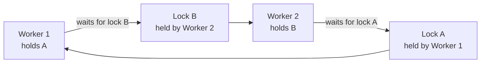
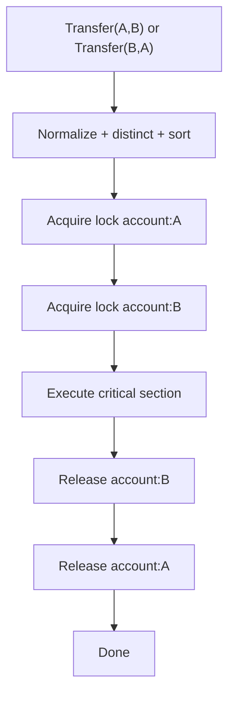
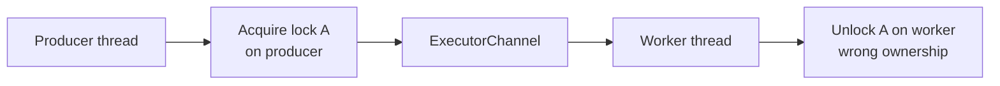
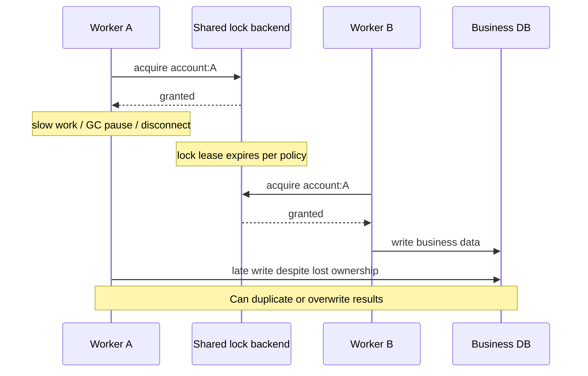

# Deadlocks and Lock Acquisition Ordering

## 1. Why do deadlocks occur in Spring Integration runtime?

In Spring Integration, messages flow from producers through channels to consumer endpoints, where they may run on the producer's thread (`DirectChannel`), an executor thread (`ExecutorChannel`), or a poller thread (`QueueChannel` and polling consumers). When multiple messages mutate a resource such as inventory, balances, files, or message group state, applications often use **`LockRegistry`** to coordinate access.

Problems begin when a single operation requires **more than one lock**. Suppose two concurrent transfers run between accounts A and B:

- Worker 1 holds lock `account:A` and waits for `account:B`.
- Worker 2 holds lock `account:B` and waits for `account:A`.

Both **hold an acquired lock while waiting for the other**. If they use unbounded `lock()` without a way to break the stalemate, the system enters a **deadlock**: neither can proceed nor release its lock.



This topic belongs to the **Lock registry** chapter of the **SPRING_INTEGRATION_RUNTIME** module. Beyond explaining deadlocks, we will design lock acquisition ordering, practice with Java DSL, examine transactions and retries, handle multi-instance locking, and diagnose hung threads or throughput drops.

> **Core principle:** whenever multiple locks must be held simultaneously, threads must obey **a global, consistent lock order** independent of the order resources appear in the message. Lock wait timeouts are a secondary safety net—they **do not replace** ordered acquisition design.

## 2. Deadlock vs. lock contention, starvation, and livelock

Not every thread waiting on a lock is deadlocked.

| Phenomenon | What happens | Symptoms |
| --- | --- | --- |
| **Lock contention** | Multiple workers wait on one lock; the owner eventually releases it | Latency increases, yet the system keeps making progress. |
| **Deadlock** | Workers form a mutual wait cycle | Participating workers make zero progress even while external resources remain healthy. |
| **Starvation** | One worker repeatedly fails to win a lock due to contention or scheduling policy | Other workers progress, while one task waits excessively long. |
| **Livelock** | Workers repeatedly try, release, and retry without completing work | CPU/logs/retries climb while completed work stays low. |
| **Lock leak / unreleased lock** | Code skips `unlock()` on exception, or an owner gets stuck | Other workers wait indefinitely; no wait cycle is necessarily present. |
| **Distributed lock lease loss** | A worker loses ownership due to lease expiration or connectivity issues | Risk of the old worker still executing side effects alongside a new worker. |

The four classic conditions for deadlock are: **mutual exclusion**, **hold-and-wait**, **no preemption of held locks**, and **circular wait**. In multi-lock systems, the easiest condition to eliminate systematically is **circular wait** through a single global ordering rule.

### Reading a wait-for graph

A *wait-for* graph has an edge `W1 → W2` when W1 waits for a resource held by W2. A cycle `W1 → W2 → W1` indicates a potential deadlock when those locks cannot be preempted or cleanly expired.

Seeing a worker wait on a lock because another worker is performing a slow database write is **not enough** to conclude deadlock. Identify the current owner and what that owner is waiting on, rather than reacting solely to `WAITING` in a thread dump.

## 3. What does `LockRegistry` actually provide?

Spring Integration provides the `org.springframework.integration.support.locks.LockRegistry` interface. Its core contract is:

```java
import java.util.concurrent.locks.Lock;
import org.springframework.integration.support.locks.LockRegistry;

LockRegistry registry = /* inject bean */;
Lock lock = registry.obtain("account:A");

lock.lock();
try {
    // Processing region that must be protected.
} finally {
    lock.unlock();
}
```

`obtain(Object lockKey)` returns a `java.util.concurrent.locks.Lock` representing the key's lock. **`LockRegistry` does not automatically know** which message is running, which business resources need locking, or in what order locks must be acquired; the application decides that.

Two distinct scopes exist:

- `DefaultLockRegistry` keeps locking **within a single JVM**. Threads sharing **the same registry instance** coordinate with one another, whereas other replicas have separate registries.
- Shared-backend implementations, such as `JdbcLockRegistry` or `RedisLockRegistry` when backed by their supporting modules, can coordinate **across multiple instances** when sharing the same backend/namespace and configured properly.

Do not assume every implementation provides identical reentrancy, fairness, renewal, timeout, or fencing semantics. Verify your exact version and backend semantics.

**Distinction from `ConcurrentMetadataStore`:** a metadata store provides operations like `putIfAbsent`/`replace` on string values to track checkpoints or state; `LockRegistry` provides a `Lock` guarding a **critical section up to `unlock()`**. Using metadata CAS does not automatically turn operations across two resources into a locked critical section; holding a lock does not guarantee business results have committed.

## 4. Why is message-dependent lock ordering dangerous?

An unsafe transfer design often looks like this:

```java
// Unsafe under opposing transfers A -> B and B -> A.
Lock source = registry.obtain("account:" + command.fromAccount());
Lock destination = registry.obtain("account:" + command.toAccount());

source.lock();
try {
    destination.lock(); // May block forever if another worker acquires in reverse.
    try {
        transferMoney(command);
    } finally {
        destination.unlock();
    }
} finally {
    source.unlock();
}
```

With `Transfer(A,B)`, thread 1 locks A then B; with `Transfer(B,A)`, thread 2 locks B then A. That pair of transactions can form a wait cycle.

**Do not try to fix this merely by adding `synchronized` to the method** when scaling to multiple instances: `synchronized` only guards a monitor within one JVM and may lock more broadly than intended. Nor should you use thread IDs or arrival timestamps to vary lock order dynamically; workers would lack a shared ordering rule.

### The fix: global ordering

Standardize all account lock keys, for example:

```text
account:A
account:B
account:C
```

For any set of accounts:

1. Normalize keys (tenant, resource type, ID) using the exact same rules across all producers/instances.
2. Deduplicate keys.
3. Sort by a **stable global order**, such as `String.compareTo` on normalized keys.
4. Acquire locks sequentially in **ascending order**.
5. Execute business logic.
6. Release locks in **reverse order**, always inside `finally`.

For example, both `Transfer(A,B)` and `Transfer(B,A)` lock `account:A` first and `account:B` second, regardless of transfer direction. The second worker waits right at `account:A` **without holding `account:B`**, preventing the A/B wait cycle.



This ordering must be followed on **every** code path touching the same resources, including normal handlers, recovery jobs, scheduled tasks, and post-retry logic. One "exception" path acquiring B then A can still reintroduce a deadlock.

## 5. Java utility for ordered multi-lock acquisition

Below is a standalone helper reducing the risk of forgetting to sort, forgetting to unlock, or mishandling partial lock acquisition. It accepts a collection of normalized keys and uses timed `tryLock` **for each acquisition**.

```java
import java.util.ArrayList;
import java.util.Collection;
import java.util.List;
import java.util.concurrent.Callable;
import java.util.concurrent.TimeUnit;
import java.util.concurrent.TimeoutException;
import java.util.concurrent.locks.Lock;

import org.springframework.integration.support.locks.LockRegistry;

public final class OrderedLocks {

    private OrderedLocks() {}

    public static <T> T call(
            LockRegistry registry,
            Collection<String> keys,
            long waitMillisPerLock,
            Callable<T> task) throws Exception {

        if (waitMillisPerLock <= 0) {
            throw new IllegalArgumentException("Timeout must be positive");
        }

        List<String> ordered = keys.stream()
            .distinct()
            .sorted()
            .toList();

        List<Lock> acquired = new ArrayList<>();

        try {
            for (String key : ordered) {
                Lock lock = registry.obtain(key);

                // Do not wait forever. Previously acquired locks are released on timeout.
                if (!lock.tryLock(waitMillisPerLock, TimeUnit.MILLISECONDS)) {
                    throw new TimeoutException("Could not acquire lock: " + key);
                }
                acquired.add(lock);
            }

            return task.call();
        } catch (InterruptedException interrupted) {
            Thread.currentThread().interrupt();
            throw interrupted;
        } finally {
            // Release even if the task fails or only a subset of locks was acquired.
            for (int i = acquired.size() - 1; i >= 0; i--) {
                acquired.get(i).unlock();
            }
        }
    }
}
```

**Guarantees provided by the helper:**

- Same key set → same `obtain` and `tryLock` order.
- If any `tryLock` times out, previously acquired locks are released in `finally`.
- If the task throws an exception, locks are still released.
- When interrupted during an interruptible wait, the interrupt flag is restored and the exception propagates to the caller.
- `distinct()` avoids acquiring the same key twice, regardless of whether the implementation is reentrant.

**What the helper does NOT guarantee:**

- `waitMillisPerLock` does **not** cap total wait time across multiple locks; total wait can approach key count multiplied by per-lock wait. Enforce an overall deadline if the API has a strict SLA.
- Once all locks are acquired, `task.call()` can still run indefinitely; lock acquisition timeout is not critical-section timeout.
- If other code paths acquire locks in the opposite order or use a different registry, the guarantee breaks.
- With lease-based distributed locks, ownership can expire if the task runs too long, even before Java's `Lock.unlock()` runs.
- Exceptions from `unlock()` under abnormal conditions must also be observed; never ignore lost-ownership errors in production.

Validate that the input key list is **non-null and non-empty** per business rules before calling the helper. Passing an empty list runs the task without acquiring any locks—acceptable for a generic utility, unsafe for a transfer that strictly requires resource locks.

## 6. Reproducing a wait cycle with timeouts instead of hanging the JVM

Never write a test that creates a real deadlock with two unbounded `lock()` calls and hangs the JVM. The snippet below creates **opposing acquisition orders**, while using bounded `tryLock` so both threads can exit and release their locks.

```java
import java.util.concurrent.CountDownLatch;
import java.util.concurrent.TimeUnit;
import java.util.concurrent.locks.Lock;

import org.springframework.integration.support.locks.DefaultLockRegistry;
import org.springframework.integration.support.locks.LockRegistry;

public class DeadlockOrderDemo {

    static void oppositeOrder(
            LockRegistry registry,
            String firstKey,
            String secondKey,
            CountDownLatch bothHoldFirst) {

        Lock first = registry.obtain(firstKey);
        Lock second = registry.obtain(secondKey);

        first.lock();
        try {
            bothHoldFirst.countDown();

            // Ensure both threads already hold their first lock.
            if (!bothHoldFirst.await(2, TimeUnit.SECONDS)) {
                throw new IllegalStateException("Barrier timeout");
            }

            if (second.tryLock(300, TimeUnit.MILLISECONDS)) {
                try {
                    System.out.println("Acquired both locks");
                } finally {
                    second.unlock();
                }
            } else {
                System.out.println(
                    Thread.currentThread().getName() +
                    " blocked on second lock: " + secondKey);
            }
        } catch (InterruptedException e) {
            Thread.currentThread().interrupt();
        } finally {
            first.unlock();
        }
    }

    public static void main(String[] args) throws InterruptedException {
        LockRegistry registry = new DefaultLockRegistry();
        CountDownLatch barrier = new CountDownLatch(2);

        Thread t1 = new Thread(
            () -> oppositeOrder(
                registry, "account:A", "account:B", barrier),
            "worker-A-to-B");

        Thread t2 = new Thread(
            () -> oppositeOrder(
                registry, "account:B", "account:A", barrier),
            "worker-B-to-A");

        t1.start();
        t2.start();
        t1.join();
        t2.join();
    }
}
```

Because each worker holds a different first lock before proceeding, they enter an **A ↔ B wait cycle** when trying to acquire the second lock. `tryLock(300ms)` lets them break out instead of hanging forever; print order between the two threads is non-deterministic.

Try replacing both branches with `OrderedLocks.call(registry, List.of("account:A", "account:B"), ...)` for the same key set. The second worker may wait on lock A, while the first worker is never blocked by another worker holding B in reverse order. That is the difference between **bounded contention** and **circular-wait deadlock**.

## 7. Integrating with Spring Integration Java DSL

Problem: two messages can concurrently request transfers A → B and B → A. We use `OrderedLocks` to lock both accounts in canonical order, then apply JDBC updates inside a transaction.

Assume the application provides `JdbcTemplate` and `PlatformTransactionManager` for the same `DataSource`. Demo schema:

```sql
CREATE TABLE account_balance (
    account_id VARCHAR(40) PRIMARY KEY,
    balance BIGINT NOT NULL
);

CREATE TABLE transfer_log (
    transfer_id VARCHAR(60) PRIMARY KEY,
    from_account VARCHAR(40) NOT NULL,
    to_account VARCHAR(40) NOT NULL,
    amount BIGINT NOT NULL
);

INSERT INTO account_balance (account_id, balance) VALUES ('A', 100);
INSERT INTO account_balance (account_id, balance) VALUES ('B', 100);
```

Business service using both locks and `TransactionTemplate`. `TransactionTemplate.execute(...)` returns **after completing commit/rollback when it owns a new transaction**; thus, in the example's setup with no outer transaction, the locks stay held until the JDBC transaction completes.

```java
import java.util.List;

import org.springframework.integration.support.locks.LockRegistry;
import org.springframework.jdbc.core.JdbcTemplate;
import org.springframework.transaction.PlatformTransactionManager;
import org.springframework.transaction.support.TransactionTemplate;

public class TransferService {

    public record TransferCommand(
        String transferId, String fromAccount,
        String toAccount, long amount) {}

    public record TransferResult(String transferId, String status) {}

    private final LockRegistry locks;
    private final JdbcTemplate jdbc;
    private final TransactionTemplate transactions;

    public TransferService(
            LockRegistry locks,
            JdbcTemplate jdbc,
            PlatformTransactionManager manager) {
        this.locks = locks;
        this.jdbc = jdbc;
        this.transactions = new TransactionTemplate(manager);
    }

    public TransferResult process(TransferCommand command) throws Exception {
        if (command.amount() <= 0 ||
            command.fromAccount().equals(command.toAccount())) {
            throw new IllegalArgumentException("Invalid transfer");
        }

        List<String> keys = List.of(
            "account:" + command.fromAccount(),
            "account:" + command.toAccount());

        return OrderedLocks.call(locks, keys, 2_000, () ->
            transactions.execute(status -> {
                // Business ID in log table must be unique to prevent replays.
                jdbc.update(
                    "INSERT INTO transfer_log " +
                    "(transfer_id, from_account, to_account, amount) " +
                    "VALUES (?, ?, ?, ?)",
                    command.transferId(), command.fromAccount(),
                    command.toAccount(), command.amount());

                int debit = jdbc.update(
                    "UPDATE account_balance SET balance = balance - ? " +
                    "WHERE account_id = ? AND balance >= ?",
                    command.amount(), command.fromAccount(),
                    command.amount());

                if (debit != 1) {
                    throw new IllegalStateException("Insufficient balance");
                }

                int credit = jdbc.update(
                    "UPDATE account_balance SET balance = balance + ? " +
                    "WHERE account_id = ?",
                    command.amount(), command.toAccount());

                if (credit != 1) {
                    throw new IllegalStateException(
                        "Destination account does not exist");
                }

                return new TransferResult(
                    command.transferId(), "TRANSFERRED");
            }));
    }
}
```

**The execution order here is intentional:** acquire both locks → begin transaction → insert log and update balances → finish transaction → release locks. If an **outer transaction** exists that `TransactionTemplate` joins via default `REQUIRED` propagation, the real commit may happen **after the helper releases the locks**. If business logic requires locks to stay held until final commit, explicitly design the transaction scope inside the locks and check propagation rather than inferring from line order.

Minimal `IntegrationFlow` configuration:

```java
import org.springframework.beans.factory.annotation.Qualifier;
import org.springframework.context.annotation.Bean;
import org.springframework.context.annotation.Configuration;
import org.springframework.integration.channel.DirectChannel;
import org.springframework.integration.channel.QueueChannel;
import org.springframework.integration.config.EnableIntegration;
import org.springframework.integration.dsl.IntegrationFlow;
import org.springframework.integration.support.locks.DefaultLockRegistry;
import org.springframework.integration.support.locks.LockRegistry;
import org.springframework.jdbc.core.JdbcTemplate;
import org.springframework.messaging.MessageChannel;
import org.springframework.messaging.PollableChannel;
import org.springframework.transaction.PlatformTransactionManager;

@Configuration
@EnableIntegration
public class TransferFlowConfig {

    @Bean("accountLocks")
    LockRegistry accountLocks() {
        // Coordinates only across threads within the same JVM.
        return new DefaultLockRegistry();
    }

    @Bean
    TransferService transferService(
            @Qualifier("accountLocks") LockRegistry accountLocks,
            JdbcTemplate jdbc,
            PlatformTransactionManager transactionManager) {
        return new TransferService(accountLocks, jdbc, transactionManager);
    }

    @Bean("transfers.in")
    MessageChannel transfersIn() {
        return new DirectChannel();
    }

    @Bean("transfers.out")
    PollableChannel transfersOut() {
        return new QueueChannel(100);
    }

    @Bean
    IntegrationFlow transferFlow(TransferService service) {
        return IntegrationFlow.from("transfers.in")
            .handle(service, "process")
            .channel("transfers.out")
            .get();
    }
}
```

The example uses Java records (Java 16+). Place `TransferService` and `OrderedLocks` in the same package as the config or import them according to your project structure. The application requires a working transaction manager alongside `JdbcTemplate`, database, and created tables. The output `QueueChannel` here is an in-memory queue for testing and does **not** guarantee durability.

### Verifying with two messages

```java
import org.springframework.messaging.MessageChannel;
import org.springframework.messaging.PollableChannel;
import org.springframework.messaging.support.GenericMessage;

MessageChannel input =
    context.getBean("transfers.in", MessageChannel.class);
PollableChannel output =
    context.getBean("transfers.out", PollableChannel.class);

// Send from two separate threads to test contention on the same two accounts.
Thread first = new Thread(() ->
    input.send(new GenericMessage<>(
        new TransferService.TransferCommand("T-1", "A", "B", 20))));

Thread second = new Thread(() ->
    input.send(new GenericMessage<>(
        new TransferService.TransferCommand("T-2", "B", "A", 30))));

first.start();
second.start();
first.join();
second.join();

// The two successful replies can arrive in either order.
var result1 = output.receive(1_000);
var result2 = output.receive(1_000);
```

`context` is a started `ApplicationContext`. With initial balances A = 100, B = 100, no other writers, and both transactions committing, the expected balances are A = 110, B = 90. `transfer_log` contains two records, T-1 and T-2. If a send call throws inside a thread, the test should capture exceptions and assert thoroughly rather than treating `join()` completion as proof of successful processing.

To test under realistic load, replace `DirectChannel` with `ExecutorChannel` **before the handler** with a bounded thread pool. Locks must still be acquired and released **on the exact worker thread executing the critical section**.

## 8. Lock placement relative to transactions: committing after unlock

`LockRegistry` protects a region of Java code under the `Lock` contract. The transaction manager protects operations on transactional resources. These two scopes **do not necessarily coincide**.

### Error-prone arrangement

```text
TransactionInterceptor opens transaction
  Handler:
    acquire lock(account:A)
      UPDATE account_balance
    unlock(account:A)
  Handler returns
TransactionInterceptor commits
```

Another worker can acquire `account:A` **before the outer transaction commits**. Depending on isolation level and SQL, the next worker may wait on a DB row lock, see stale data, or time out. Releasing a Java lock does not mean the DB transaction has finished.

### Usually desired arrangement

```text
acquire lock(account:A)
  begin transaction
    UPDATE account_balance
    INSERT transfer_log
  commit / rollback transaction
unlock(account:A)
```

The scope is clearer: the lock stays held through commit/rollback of the **new** transaction. In section 7's demo, `OrderedLocks` wraps `TransactionTemplate` with no outer transaction, closely matching this pattern.

When transactions are opened by a **poller**, **gateway**, or advice wrapping the endpoint outside the helper, review ordering carefully. When combining retries, transactions, and locks, a commonly safe structure per attempt is:

```text
Retry (outermost, bounded)
  acquire locks in order
    begin new transaction or controlled scope
      handler/SQL
    commit or rollback
  release locks
```

This still depends on isolation, propagation, and data atomicity. Never assume reordering advice alone fixes races with upstream brokers or HTTP sources.

### Database deadlocks can still exist

Ordering application locks eliminates deadlocks within **that lock system**. It does not eliminate every database deadlock:

- Another service updates tables/rows in reverse order **without using the registry**.
- Transactions touch indexes/foreign keys or hidden row locks outside application control.
- Replicas use **separate in-memory registries** that do not lock against each other.
- An outer transaction already holds JDBC locks before entering the helper.

Continue enforcing **consistent SQL access ordering**, keep transactions short, maintain proper indexes, inspect database deadlock logs/lock graphs, and retry only appropriate transient errors.

## 9. Threads, pollers, executors, and endpoint lifecycle

Spring Integration does not keep every message on the same thread across all channels. This directly affects lock hold times, lock ownership, and error handling.

| Configuration | Where the handler runs | Lock-related risk |
| --- | --- | --- |
| `DirectChannel` | Usually on producer thread | Producer blocks waiting for locks; timeouts can impact gateways. |
| `ExecutorChannel` | Thread from executor | Multiple workers contend on same key; executor pool can fill with lock-waiting tasks. |
| `QueueChannel` + poller | Polling consumer thread | Slow locks reduce queue consumption rate; messages can back up. |
| `PublishSubscribeChannel` with executor | Possibly multiple workers/subscribers | Same resource may be touched from multiple branches; unify keys and ordering. |
| Dynamic flow via `IntegrationFlowContext` | Depends on registered/started channels and endpoints | Stopping a flow does not automatically roll back or unlock code still running. |

### Never lock before an executor and unlock inside a worker



Many `ReentrantLock`-based implementations require the thread calling `unlock()` to be the thread holding the lock; violating this can trigger `IllegalMonitorStateException` or backend ownership errors. Never pass a `Lock` inside message headers to "hand off ownership". **Acquire and release locks around the critical section on the handler's executing thread**, or use work/command partitioning suited to your backend.

### Avoid filling the thread pool with waiting tasks

Suppose an executor has 8 workers and all 8 are blocked in `lock()` waiting on a long-held lock. The executor may have zero threads left to process other messages, including error or resource-freeing messages if topology creates dependencies. This can look like a flow-wide deadlock even when algorithmically it is contention or pool starvation.

Monitor **active threads, executor queue depth, lock-waiting task counts, and p95/p99 wait times**. Bound `tryLock` and use backpressure/retry with jitter when appropriate; never busy-retry without backoff.

## 10. Multiple instances: distributed locks, leases, and fencing

Within one JVM, `DefaultLockRegistry` can suffice for local updates. However, across three replicas each creating its own `DefaultLockRegistry`, all three can acquire `account:A` in their own local maps. Identical key ordering **does not solve** each replica using separate locks.

With a shared lock backend like JDBC or Redis, verify:

1. All instances access **the same backend/namespace** and map identical business entities to **the same lock key**.
2. The implementation provides atomicity and ownership semantics suited to the workload.
3. Instance crashes, network partitions, failovers, and lease expirations are handled.
4. If the backend uses leases, **max processing duration**, wait timeouts, and renewal are properly configured and monitored.
5. When a lock is revoked or its lease expires, can the old worker still write to the business resource?

### Lease expiration does not stop the old worker



Therefore, for high-integrity domains, **a distributed lock alone cannot guarantee exactly-once execution**. Consider monotonic **fencing tokens** verified at the target resource, idempotency keys / unique constraints, or appropriate transactions. `LockRegistry` does not guarantee every implementation provides fencing tokens; extra backend/infrastructure design may be required.

For example, a business table tracks `last_fence` and accepts updates only with a newer token; a worker presenting an older token is rejected at the database. This is a design pattern, not a built-in `LockRegistry` API.

**Lock acquisition timeout** differs from **lease duration**: `tryLock(2, TimeUnit.SECONDS)` bounds how long to *wait* for the lock. A lease (if supported by the backend) bounds how long *ownership lasts* per backend rules. The two values are not interchangeable.

## 11. Aggregator locks, message stores, and metadata stores

Spring Integration manages concurrent state in several places:

| Component | State to protect | Remember |
| --- | --- | --- |
| Aggregator / resequencer | `MessageGroup` by correlation key | Uses appropriate locking to coordinate group changes; multi-instance sync needs matching store and locks. |
| `MessageGroupStore` | Fragments awaiting release | Persistent stores do not automatically make multi-JVM release operations atomic. |
| `ConcurrentMetadataStore` | Metadata values, processing checkpoints | `putIfAbsent` and `replace` are atomic state transitions, not locks guarding full critical sections. |
| `LockRegistry` | Access rights to a processing section by one or more keys | Locks serialize code execution; they do not store payloads/messages. |
| Poller / inbound adapter | Reading/claiming source records or updating resources | Account for source transactions/acks and actual concurrency. |

When an aggregator holds a group lock and a custom handler acquires business locks, define **an ordering between the two lock categories**. If a reverse path exists (holding a business lock and synchronously invoking an aggregator that needs a group lock), a wait cycle can form even if each lock category is sorted internally.

Example global convention:

```text
1. group:<groupId>              (group lock, if truly needed)
2. account:<accountId>          (account locks, sorted by ID)
3. inventory:<sku>              (inventory locks, sorted by SKU)
```

This is purely an **illustrative convention**; what matters is that all flows follow one consistent ordering relation. If an aggregator acquires internal locks outside application control, avoid calling back synchronously into it while holding external locks, or split the flow across an asynchronous boundary without holding locks across steps.

### Locking by correlation key

When messages sharing a `correlationId` update the same `MessageGroup`, lock keys can be normalized from the correlation ID. However, **never** turn `correlationId` into a catch-all lock for accounts if messages with different correlations still mutate the same account. Lock keys must reflect the **resource needing protection**, not just message grouping.

## 12. Retries, error channels, and unlocking on errors

An exception can occur in three places:

1. **Before acquiring locks:** validation error, missing key; no lock to release.
2. **While waiting for locks:** timeout or interrupt; must release all locks already acquired earlier in the list.
3. **Inside the critical section:** SQL error, business validation failure, or downstream failure; must roll back appropriate transactions and release locks in `finally`.

Error routing depends on the channel:

- On a synchronous `DirectChannel`, unhandled exceptions propagate back to `send()` or the gateway. The helper still runs `finally` before the exception escapes.
- On an `ExecutorChannel` or poller, errors may be wrapped in an `ErrorMessage` and sent to the configured error channel; the producer thread does not necessarily see the exception.
- When the error channel has no consumer or the error handler itself fails, that is a **secondary failure**; it does not alter the requirement to release locks and verify original transaction rollback.

### Retrying the right errors

| Error | Should retry? | Reason |
| --- | --- | --- |
| `tryLock` timeout due to short-lived contention | Possibly, with bounded attempts and backoff/jitter | If the owner finishes soon, the next attempt can succeed. |
| JDBC deadlock victim or transient connection error | Possibly, after rollback and targeted classification | The old transaction must end; retries should run in a fresh transaction. |
| Invalid input or invalid business key | Usually no | Retrying will not fix malformed payloads. |
| Wrong lock order on one code path | Not a root fix | Can keep timing out/livelocking; fix the lock order. |
| Lost distributed lock lease after executing side effects | Do not retry blindly | Check ownership and target state before re-running. |

If retry advice wraps the entire handler, each attempt re-acquires locks in the global order. Avoid **holding locks during retry backoff/sleep between attempts**, which ties up resources unnecessarily. If a transaction sits outside the retry boundary, an exception may mark the transaction rollback-only; retrying inside that same transaction will fail on commit.

During retries/redeliveries, use a **business idempotency key**, such as a unique `transferId`, to prevent money transfers from executing twice. Locks only coordinate concurrent access at a single moment; after `unlock()`, a duplicate message can still execute again without durable checks.

## 13. Diagnosing deadlocks and lock contention at runtime

### Signals to collect

- Message ID, `correlationId`/`traceId`, endpoint ID, thread name, and instance name.
- Held lock keys, acquisition order, awaited key, wait start time, and timeout.
- **Wait time**, **hold time**, timeout counts, retry attempts, and completion latency.
- Executor active threads, executor queue depth, poller lag, and `QueueChannel` depth.
- JDBC transaction duration, row-lock waits, DB deadlock reports, and commit/rollback status.
- For distributed stores: backend round-trip latency, connectivity, lease expiry/renewal, and ownership errors.

Useful structured log:

```text
trace=req-71 transfer=T-1 worker=orders-3 acquire=["account:A","account:B"]
trace=req-71 transfer=T-1 waitLock=account:B waitMs=820
trace=req-71 transfer=T-1 timeoutLock=account:B released=["account:A"]
trace=req-72 transfer=T-2 worker=orders-7 held=["account:B"] waitLock=account:A
```

Logs should show **which locks are held** and **which lock is awaited**, rather than just logging `"timeout"`. Mask or hash sensitive identifiers in lock keys; never log payment payloads or personal data.

### Thread dumps and backends

Within the JVM, use approved diagnostic tools such as `jcmd <pid> Thread.print` or `jstack <pid>` to inspect threads waiting on monitors or `ReentrantLock`s. Threads using `java.util.concurrent.locks` typically appear in `WAITING` or `TIMED_WAITING` (parked), not necessarily `BLOCKED` on a monitor.

Note: deadlocks involving **distributed locks** may appear only as I/O waits or polling in the JVM; a single instance's thread dump lacks ownership details from other instances. Correlate lock state in Redis/JDBC with logs across all replicas.

### Troubleshooting table

| Symptom | Likely cause | Priority action |
| --- | --- | --- |
| Two threads hold different keys and wait on each other | Locks A/B acquired in opposite order | Build wait-for graph; enforce global lock order. |
| Entire worker pool is WAITING | Lock contention, pool starvation, or deadlock | Identify owner; measure wait/hold times and executor saturation. |
| `tryLock` constantly times out under low load | Owner holding too long, lock leak, or backend failure | Measure hold time; check `finally`, DB/network, and leases. |
| Adding replicas causes same key to run concurrently | Each replica has its own `DefaultLockRegistry` | Switch to an appropriate shared registry; verify namespace/backend. |
| Timeout on unlock after GC pause | Lease expired / lost ownership | Inspect lease/renewal and fencing/idempotency. |
| DB reports deadlock despite sorted application keys | Code path bypassing registry or conflicting row/index lock order | Analyze DB deadlock graph, SQL, and transaction scope. |
| Retries lower throughput further | Retry storm, backoff inside critical section | Cap retries; release locks before backoff, add jitter/backpressure. |
| Locks released yet messages remain stuck | Error channel, reply channel, message store, or unfinished transaction | Inspect endpoint/poller lifecycle and error paths. |
| Aggregator group never emits output | Missing fragments, group lock/store contention, or release condition | Check group age, correlation key, release strategy, and store locks. |
| Transfer duplicated despite locking | Message redelivery after unlock | Add unique constraint / idempotency key in business DB. |

**Never fix deadlocks by infinitely growing the thread pool.** Doing so spawns more threads waiting on locks, increases database load, and worsens outages.

## 14. Safe design for multiple resources

Short pre-deployment checklist:

1. Identify the **resources requiring serialization**: accounts, inventory, groups, or files; avoid overly coarse locks when resources can be independent.
2. Build **canonical keys** with proper namespace, tenant, and business ID; every instance uses the exact same rules.
3. Establish a **total order** and enforce it everywhere two or more locks can be held together.
4. Acquire locks on the **thread executing the critical section**; never hold locks across executor boundaries.
5. Use bounded `tryLock` with cleanup in `finally`; enforce an end-to-end deadline when strict SLAs apply.
6. Keep critical sections short; avoid slow HTTP calls or human waits while holding locks.
7. With JDBC transactions, evaluate whether locks sit **outside or inside** the transaction and when real commits happen.
8. With retries, decide where backoff happens and guarantee idempotency on message redelivery.
9. Across multiple replicas, verify the shared registry, crash/recovery behavior, leases, and fencing capabilities.
10. Monitor wait/hold times, lock timeouts, executor saturation, DB deadlocks, queue depths, and message completion.

### Estimating lock cost

Suppose a hot key is held for an average of **50 ms** per message, with no parallel execution for the **same key**. The theoretical throughput ceiling for that hot key is roughly `1 / 0.05 = 20` critical sections per second, before backend overhead or wait latency. Adding more workers will not raise that ceiling for the same key; raising throughput requires shortening lock hold time, sharding independent resources, or changing the data model.

This number is purely theoretical. Latency distributions, p99 spikes, retries, transaction hold times, and distributed lock round trips can push real throughput significantly lower.

## 15. Hands-on exercises and self-check questions

**Exercise 1 — Reproducing a bounded circular wait.** Run `DeadlockOrderDemo`. Confirm the workers acquire their first locks in opposite orders and block on the second lock. Explain why `tryLock` prevents the test from hanging without fixing the flawed ordering in the design.

**Exercise 2 — Fixing with a global order.** Use `OrderedLocks.call` so both workers lock A and B using the same key set. Observe one worker waiting on A and completing once the first releases A/B. Measure wait time and hold time separately.

**Exercise 3 — Bidirectional transfers.** Run `TransferFlowConfig` with `T-1: A→B 20` and `T-2: B→A 30`, then verify balances and `transfer_log` after both commit. Resend `T-1` to observe how unique constraints prevent double transfers; never assume a retry succeeded simply because the lock was re-acquired.

**Exercise 4 — Executor boundary.** Put an `ExecutorChannel` before the transfer handler. Log thread names during lock acquisition/release and inject a timeout error. Verify workers release locks in `finally` and the error handler receives expected details.

**Exercise 5 — Transaction boundary.** Compare two variants: transaction advice wrapping the handler while the handler locks internally, vs. `TransactionTemplate` inside the locking helper. Use two workers on the same key to observe commit timing relative to unlock timing. Never run this experiment on live production data.

**Exercise 6 — Two instances.** Run two instances with `DefaultLockRegistry` and send messages sharing a key; verify each instance holds only local locks. Replace with an appropriate shared implementation and test cross-replica contention, timeouts, and recovery when one replica stops abruptly.

**Exercise 7 — Failure injection.** In a test environment, simulate a task holding a lock too long, an interrupted worker, an unavailable backend, and lease expiration (for lease-based backends). Verify whether retry storms, lock leaks, duplicate side effects, lost messages, or unrouted errors occur.

**Exercise 8 — Three-tier resources.** Design a flow updating `account`, `inventory`, and `group` within one business operation. Pick a global lock order, audit every existing code path acquiring more than one lock to verify none invert the order, and propose how to avoid synchronously calling an aggregator while holding external locks if internal locks cannot be controlled.

### Self-check questions

1. How does deadlock differ from contention and starvation?
2. Why can locking `fromAccount` then `toAccount` cause a deadlock?
3. How does sorting keys by `String.compareTo` eliminate wait cycles?
4. If `tryLock` times out after some earlier locks were already acquired, what must happen?
5. Does `DefaultLockRegistry` protect two Spring Boot replicas running in different JVMs?
6. Why can releasing a lock before a JDBC transaction commits cause problems?
7. Why are transaction rollback and lock release two separate responsibilities?
8. When introducing an `ExecutorChannel`, what requirement on the threads acquiring and releasing locks changes?
9. How does a `tryLock` timeout differ from distributed lease duration?
10. Why can an expired distributed lock lease still let two workers write data concurrently?
11. Does application-level lock ordering eliminate all database deadlocks?
12. Which metrics and logs help reconstruct a lock wait cycle when the system stalls?
13. Why do retries not replace unique constraints/idempotency when messages are redelivered?
14. When an aggregator uses internal locks, what must you check before acquiring additional business locks?

**Operational rule:** deadlocks do not happen simply because there are many threads—they happen because threads hold different locks and form a **wait cycle**. Design one global lock acquisition order, acquire and release on the right thread, bound wait times, coordinate transactions and retries, and observe the full message lifecycle. When running multiple instances, add a shared lock backend, manage leases, and enforce appropriate idempotency/fencing; never treat acquiring a lock as proof that data has committed or executed only once.
