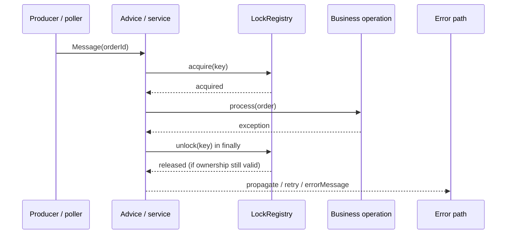
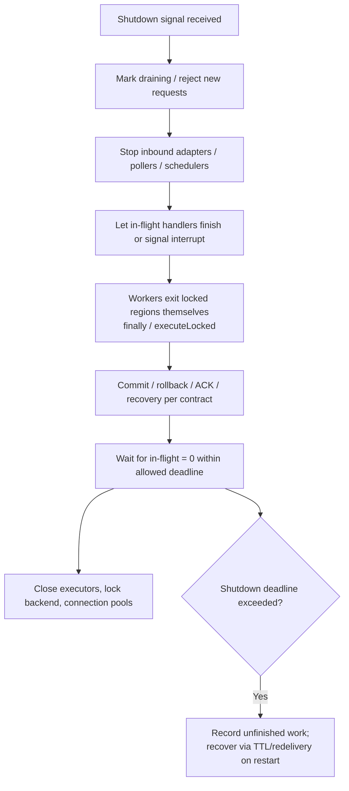
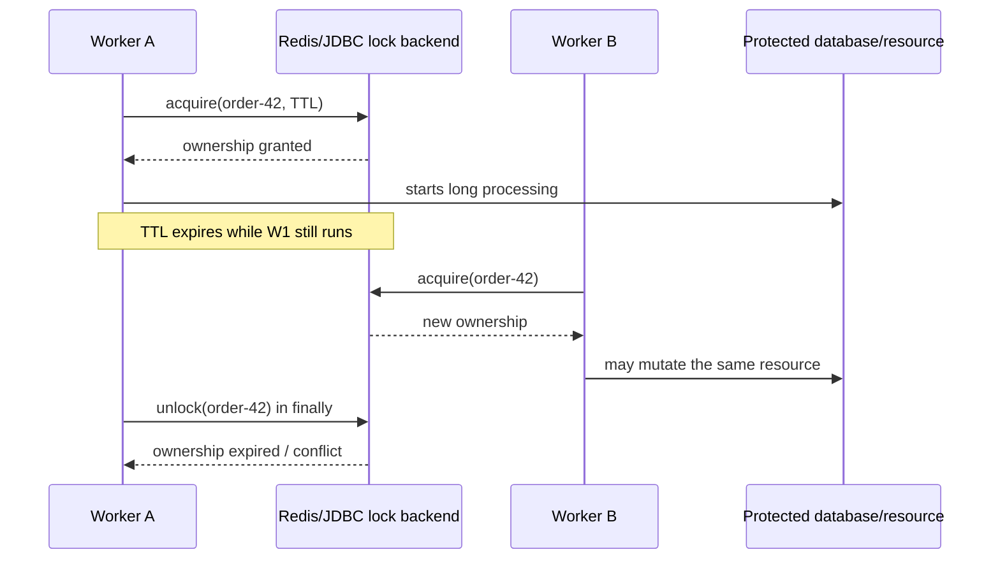
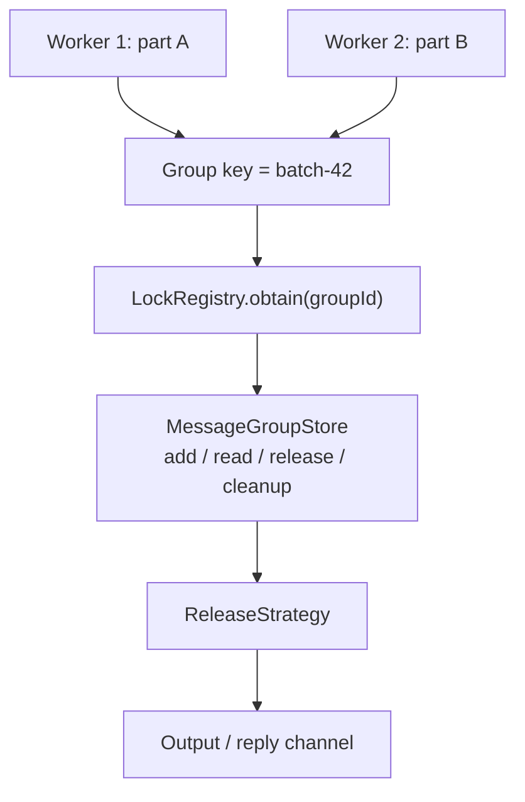

# Releasing Locks on Exception or Shutdown in Spring Integration

## 1. Objectives and runtime context

In **Spring Integration Runtime**, multiple messages can be processed in parallel across `DirectChannel`, `ExecutorChannel`, consumer endpoints, pollers, and concurrent `IntegrationFlow` instances. Some messages operate on a shared resource: an aggregator message group, order state, offset records, or a job requiring single-thread/single-instance execution at a time.

`LockRegistry` is the Spring Integration abstraction for obtaining a `java.util.concurrent.locks.Lock` by **lock key**. When an exception, timeout, shutdown, or loss of connectivity to the lock backend occurs, the lock lifecycle must be handled properly: **never leak a held lock, never release an unowned lock, and never assume a lock was released simply because the application received a shutdown signal**.

This is the topic **Releasing locks on exception or shutdown**, in the **Lock registry** chapter of the `SPRING_INTEGRATION_RUNTIME` module. The lesson connects message flow execution, `IntegrationFlow` lifecycle, transactions, retries, message stores, error handling, correlation, threading, performance, and runtime state.

**After this lesson, you will be able to:**

1. Write the `lock → try → finally → unlock` and timed `tryLock` patterns correctly.
2. Use `LockRegistry.executeLocked()` (available since Spring Integration 6.2) to reduce the risk of forgetting to unlock.
3. Distinguish business errors, lock acquisition errors, unlock errors, and lease/TTL expiration errors.
4. Explain why shutdown hooks, `@PreDestroy`, and `SmartLifecycle.stop()` cannot replace each worker unlocking its own locks.
5. Design graceful shutdown in flows with consumers, executors, aggregators, and a persistent `MessageGroupStore`.
6. Monitor lock contention, handle distributed locks that lost ownership, and test exceptions, interruption, and forced termination.

**Reference versions:** Spring Integration **6.5.x**, Java 17+, Spring Framework 6.x. Check exact deployment versions when using `RedisLockRegistry`/`JdbcLockRegistry` because TTL, renewal, and exception behaviors have evolved across releases.

## 2. LockRegistry is a lock registry, not a transaction manager

### 2.1. Core contract

```java
import java.util.concurrent.locks.Lock;
import org.springframework.integration.support.locks.LockRegistry;

LockRegistry registry = ...;
Object key = "orders:tenant-A:42";

Lock lock = registry.obtain(key); // retrieves the Lock object bound to the key
lock.lock();                      // actually acquires the lock
try {
    // Only one valid owner may enter the critical section.
}
finally {
    lock.unlock();                // released by the owning thread
}
```

`obtain(key)` **does not mean the lock is acquired**. It retrieves the `Lock` associated with the key. You may enter the mutually exclusive region only after `lock.lock()`, `lock.lockInterruptibly()`, or `lock.tryLock(...)` succeeds.

`LockRegistry` does NOT automatically perform:

- DB commits or rollbacks.
- Broker acknowledgments/nacks/requeues.
- Retries or sending an `ErrorMessage` to `errorChannel`.
- Message deduplication, correlation strategies, or group releases.
- Application shutdown orchestration ensuring every in-flight task finishes.
- Exactly-once guarantees across multiple resources.

It is strictly **a synchronization mechanism**. Those other responsibilities belong to endpoints/transaction managers, adapters, message stores, and business contracts.

### 2.2. Distinguishing acquire, release, expire, and renewal

| Concept | Meaning | Notes |
|---|---|---|
| `obtain(key)` | Retrieves lock object by key | Does not own the lock yet |
| `lock()` | Waits until ownership is acquired | Can block indefinitely |
| `lockInterruptibly()` | Waits for lock while interruptible | Must handle `InterruptedException` |
| `tryLock(wait, unit)` | Waits up to a duration, returns boolean | Only unlock when returning `true` |
| `unlock()` | Owner exits the critical section | Must be in `finally` after successful acquire |
| Lease/TTL (distributed) | Validity lifetime of backend lock record | Can expire **while the thread is still running** |
| `renewLock(key)` | Extends lease of a currently held lock | Only with `RenewableLockRegistry` under valid ownership |
| `expireUnusedOlderThan(age)` | Cleans cached locks that are **not held** and idle | **Not** a mechanism to force-unlock another thread |

Remember there are **two layers of state** with distributed locks: a thread may believe it is inside the critical section, while the key in Redis/DB already expired and another thread acquired a new lock. In that case, `unlock()` detecting lost ownership is a **lost mutual-exclusion alert**, not a minor cleanup error.

### 2.3. DefaultLockRegistry uses striped locks

`DefaultLockRegistry` is a **single-JVM** implementation. In Spring Integration 6.5, the no-arg constructor creates **256 `ReentrantLock`s**; locks are selected by masking the key's `hashCode()`. Therefore:

- The same key uses the same lock (within that registry instance).
- Two **different** keys can still map to the same stripe, causing them to wait on each other without **merging data**.
- There is no coordination between two JVMs even when they use the same key name.
- When the process exits, in-RAM lock objects disappear; that is **not a recovery protocol** for business work.

```java
import org.springframework.integration.support.locks.DefaultLockRegistry;

LockRegistry localRegistry = new DefaultLockRegistry();        // 256 stripes
LockRegistry moreStripes = new DefaultLockRegistry(0x3ff);     // 1024 stripes
```

Do not confuse **hash collisions in striped locks** with **aggregator correlation key collisions**: lock contention can happen between two distinct keys sharing a stripe, whereas a correlation collision causes two logical groups to produce the same semantic key and potentially mix messages.

## 3. Why is finally mandatory?

### 3.1. Wrong pattern: unlocking only on the success path

```java
Lock lock = registry.obtain(orderId);
lock.lock();

updateDatabase(orderId); // may throw RuntimeException

lock.unlock();            // skipped when updateDatabase() throws
```

If the method throws an exception, `unlock()` never runs. With local `ReentrantLock`s, other workers needing the same stripe wait indefinitely. With distributed locks, the key can remain locked until TTL expires or another valid mechanism releases it; the system can suffer prolonged stalls.

### 3.2. Correct pattern: every exit path goes through finally

```java
import java.util.concurrent.locks.Lock;

Lock lock = registry.obtain("order:" + orderId);
lock.lock();
try {
    updateDatabase(orderId);
    publishBusinessEvent(orderId);
}
finally {
    lock.unlock();
}
```

With JDK `Lock`, `finally` still executes when:

- The method returns early.
- Business code throws a caught or uncaught exception.
- The method is interrupted and throws `InterruptedException` inside the protected region.
- A handler advice throws an exception from a downstream call.

`finally` is **not guaranteed to run** on `SIGKILL`, process crashes, `Runtime.halt()`, power loss, or certain system-level faults. That is why distributed locks need TTL/leases and post-crash recovery.

**Note:** calling `unlock()` inside `finally` can **itself throw an exception** (lost ownership, wrong thread, backend unavailable). When both business code and unlock fail, an exception thrown in `finally` can mask the original exception. Log and handle errors appropriately without silently swallowing unlock failures.

### 3.3. Unlock only after successful acquisition

A common mistake when adding timeouts:

```java
Lock lock = registry.obtain(key);
try {
    if (!lock.tryLock(300, TimeUnit.MILLISECONDS)) {
        return false;
    }
    return process();
}
finally {
    lock.unlock(); // WRONG if tryLock() returned false or threw InterruptedException
}
```

Here `finally` runs even when the lock was never acquired, causing `unlock()` to throw `IllegalMonitorStateException` or an equivalent error.

Correct version:

```java
import java.util.concurrent.TimeUnit;
import java.util.concurrent.locks.Lock;

boolean acquired = false;
Lock lock = registry.obtain(key);

try {
    acquired = lock.tryLock(300, TimeUnit.MILLISECONDS);
    if (!acquired) {
        return false; // timed out, never entered critical section
    }

    process();
    return true;
}
catch (InterruptedException e) {
    Thread.currentThread().interrupt();
    return false;
}
finally {
    if (acquired) {
        lock.unlock();
    }
}
```

**Why restore the interrupt flag?** `tryLock(timeout)` can throw `InterruptedException` while waiting and clear the interrupt status. `Thread.currentThread().interrupt()` restores the signal so higher-level executor/shutdown lifecycles see the stop request. Depending on the message handling contract, rethrow an exception instead of returning `false`; never equate "interrupted" with "message handled successfully".

Never call `unlock()` from another thread to "rescue" a thread holding a lock. With `ReentrantLock` and many distributed lock implementations, thread ownership is mandatory.

## 4. executeLocked(): an API for safer cleanup

Since **Spring Integration 6.2**, `LockRegistry` provides `executeLocked()` overloads. The API acquires the lock, executes a `CheckedRunnable` or `CheckedCallable`, and releases the lock even when the callback throws.

### 4.1. No need to repeat finally

```java
import org.springframework.integration.support.locks.LockRegistry;

void updateOrder(LockRegistry registry, String orderId) throws Exception {
    registry.executeLocked("order:" + orderId, () -> {
        updateDatabase(orderId);
        publishBusinessEvent(orderId);
    });
}
```

This is equivalent to acquiring and unlocking in `finally`, while reducing the chance a developer forgets cleanup. If `updateDatabase` throws, the callback exits abnormally and the API still runs lock release.

If the callback needs to return a result:

```java
String result = registry.executeLocked("order:" + orderId, () -> {
    validateOrder(orderId);
    return "validated:" + orderId;
});
```

**Contract:** `executeLocked()` guarantees structured release when the callback finishes, yet it **cannot** prevent distributed TTL expiration, backend outages, infinitely hung threads, or killed processes.

### 4.2. Acquisition timeout in executeLocked

```java
import java.time.Duration;
import java.util.concurrent.TimeoutException;

try {
    registry.executeLocked(
            "order:" + orderId,
            Duration.ofMillis(500),
            () -> {
                updateDatabase(orderId);
            });
}
catch (TimeoutException timeout) {
    // Could not acquire within 500 ms; business logic must not run.
    routeForRetryOrRecovery(orderId, timeout);
}
catch (InterruptedException interrupted) {
    Thread.currentThread().interrupt();
    throw interrupted;
}
```

The `Duration` overload uses `Lock.tryLock(long, TimeUnit)` semantics and throws `TimeoutException` when the deadline expires. This is a **lock acquisition timeout**, not an overall timeout for `updateDatabase()` or a transaction.

`LockRegistry.executeLocked(key, runnable)` **without a Duration** uses interruptible acquisition (`lockInterruptibly()`). When wait time must be bounded at runtime, prefer the `Duration` overload with an explicit failure path when the lock cannot be obtained.

### 4.3. No need to invent a shutdown unlock hook

Calling `executeLocked` or `try/finally` **directly around the critical section** is far better than storing a `Lock` in a global field and hoping `@PreDestroy` unlocks it. Locks are normally bound to the running thread, whereas shutdown callbacks typically run on a different lifecycle thread.

For long tasks, design the task to **finish promptly or respond to interrupts**, allowing control flow to unwind through `finally`. Shutdown hooks should only coordinate **stopping new work intake, awaiting completion, and logging status**.

## 5. Locks in service activators / handler advice

Since **Spring Integration 6.5**, `LockRequestHandlerAdvice` wraps a handler invocation in `LockRegistry.executeLocked()`. It derives the lock key from the request message using a callback, SpEL, or a static key.

### 5.1. Annotation-based configuration

```java
import java.util.concurrent.atomic.AtomicInteger;

import org.springframework.context.annotation.Bean;
import org.springframework.context.annotation.Configuration;
import org.springframework.integration.annotation.ServiceActivator;
import org.springframework.integration.channel.DirectChannel;
import org.springframework.integration.config.EnableIntegration;
import org.springframework.integration.handler.advice.LockRequestHandlerAdvice;
import org.springframework.integration.support.locks.DefaultLockRegistry;
import org.springframework.integration.support.locks.LockRegistry;
import org.springframework.messaging.Message;
import org.springframework.messaging.MessageChannel;
import org.springframework.messaging.support.MessageBuilder;

@Configuration
@EnableIntegration
class LockAdviceConfig {

    @Bean("orders.input")
    MessageChannel input() {
        return new DirectChannel();
    }

    @Bean
    LockRegistry orderLockRegistry() {
        return new DefaultLockRegistry();
    }

    @Bean("orderLockAdvice")
    LockRequestHandlerAdvice orderLockAdvice(LockRegistry registry) {
        return new LockRequestHandlerAdvice(registry, message -> {
            Object tenant = message.getHeaders().get("tenantId");
            Object order = message.getHeaders().get("orderId");
            if (tenant == null || order == null) {
                throw new IllegalArgumentException("Missing lock identity");
            }
            return "order:" + tenant + ":" + order;
        });
    }

    @Bean
    OrderHandler orderHandler() {
        return new OrderHandler();
    }
}

class OrderHandler {

    private final AtomicInteger calls = new AtomicInteger();

    @ServiceActivator(
            inputChannel = "orders.input",
            adviceChain = "orderLockAdvice")
    public void handle(String orderId) {
        int number = calls.incrementAndGet();
        System.out.println("Handling " + orderId + ", call " + number);

        if (orderId.startsWith("FAIL")) {
            throw new IllegalStateException("Simulated service failure");
        }

        // Invocation runs only after the advice has acquired the lock.
    }
}
```

`LockRequestHandlerAdvice` handles wrapping the handler invocation in the critical section. The handler **does not call `unlock()`** itself. Throwing an exception from the handler does not skip release; the advice returns from `executeLocked()` along the exception path.

**Important note:** the key callback must not return `null` accidentally. Per the 6.5 docs, if the key is `null`, the advice may run **without locking** or send the message to `discardChannel` if configured. For operations that strictly require locking, **fail fast when headers are missing**, as shown above.

### 5.2. Different keys can run in parallel

`LockRegistry` locks by **lock key**, so two distinct orders can generally be processed concurrently. However, `DefaultLockRegistry` uses **striped locks**, meaning two distinct keys can hit the same stripe and wait on each other despite having no business conflict. That is a performance trade-off, not a sign that two orders' payloads mixed.

With `DirectChannel`, the handler/advice runs on the sender's thread (unless the flow switches to async elsewhere). With `ExecutorChannel`, the lock is acquired on the worker thread. If the same key arrives in bursts, the worker pool can fill up with threads **waiting on the lock** even while CPU stays low.

### 5.3. Advice timeouts and error paths

`LockRequestHandlerAdvice` supports configuring `waitLockDuration`. Example per the 6.5 reference:

```java
LockRequestHandlerAdvice advice =
        new LockRequestHandlerAdvice(registry,
                message -> message.getHeaders().get("orderId"));

advice.setWaitLockDurationExpressionString("'PT1s'");
```

If acquisition fails within the configured wait time, the timeout error follows endpoint/advice-chain semantics; do not assume the message is automatically retried or queued. On a synchronous `DirectChannel`, the exception usually propagates to the producer; on a poller/executor, it may route to error handling depending on configuration.

**Never scope lock keys improperly:** a bare `orderId` can collide across tenants, while blocking parallelism with an overly coarse key degrades throughput. Design stable, namespaced keys (tenant + business ID + stage if needed).

## 6. Exceptions, retries, transactions, and unlock order

### 6.1. A handler fails while holding a lock



**Separate the three outcomes:**

1. **Business failed:** handler threw an exception.
2. **Lock released:** mutual exclusion region was freed so other requests can proceed.
3. **Message acknowledged/retried:** governed by adapter, transaction, and retry advice.

The latter two cannot be blindly inferred from the first. An unlocked call may still need rollback, and a message handled by an error channel does not guarantee the backend properly released the lock.

### 6.2. Retry advice: lock per attempt or across the entire chain?

Suppose a handler has both `RequestHandlerRetryAdvice` and `LockRequestHandlerAdvice`:

```text
Pattern A: Retry outside Lock
retry {
    lock {
        attempt-1
    }
    backoff
    lock {
        attempt-2
    }
}
→ each attempt acquires/unlocks independently; lock is NOT held during backoff.

Pattern B: Lock outside Retry
lock {
    attempt-1
    backoff
    attempt-2
}
→ lock stays held across backoff and all attempts.
```

The choice has consequences:

| Choice | Advantage | Risk |
|---|---|---|
| Retry outside Lock | Avoids holding lock idly during backoff; raises concurrency | State may be mutated by another message between attempts |
| Lock outside Retry | Entire group of attempts forms one critical section | Easy to hold lock too long, increasing contention and risking distributed TTL expiry |
| Poller-level retry outside handler-level lock | Protects just the handler section per attempt | Retrying the whole flow can repeat upstream side effects |

**Do not assume advice array ordering mechanically:** Spring Integration has `AbstractRequestHandlerAdvice` and `HandleMessageAdvice` types with different interception points. To verify semantics, instrument acquire/release timestamps and count attempts on your exact version.

### 6.3. Transactions: unlock must align with commit boundaries

An easily overlooked bug:

```text
BEGIN TRANSACTION
    lock
        UPDATE database
    unlock
COMMIT
```

Here the transaction commits **after unlock**. Another thread can acquire the lock and read uncommitted state or hit a database lock. When business logic requires serialization from transaction start **until commit/rollback**, this arrangement may fail that goal.

If the design permits, pick this boundary:

```text
lock
    BEGIN TRANSACTION
       UPDATE database
    COMMIT / ROLLBACK
unlock
```

Example using `TransactionTemplate` inside the locked section (illustrative of ordering):

```java
Lock lock = registry.obtain("order:" + orderId);
lock.lock();
try {
    transactionTemplate.executeWithoutResult(status -> {
        updateOrder(orderId);
        writeAuditRecord(orderId);
    }); // transaction finishes before exiting the locked region
}
finally {
    lock.unlock();
}
```

In real applications, transaction scope, message group persistence, reply publishing, broker ACKs, and thread switches each have distinct semantics. Never treat `LockRegistry` and `@Transactional` together as a distributed transaction. When tasks cross to an executor/poller, transactions bound to the caller thread do not propagate automatically.

**In addition:** avoid holding locks across slow external HTTP APIs or backoffs unless full-step exclusion is truly required; that causes timeouts and lease loss in distributed mode.

## 7. Shutdown: graceful stop vs. process crash

### 7.1. Shutdown is not an unlock from an administrative thread

In a Spring application, shutdown may be triggered by:

- `ApplicationContext.close()`, normal application exit.
- `SIGTERM` from Kubernetes/container orchestrator before pod termination.
- Stopping a `SmartLifecycle` or unregistering a dynamic `IntegrationFlow`.
- Executor threads interrupted during shutdown.
- Crash, OOM, power loss, or `SIGKILL`.

**Only coordinated shutdown paths give the application a chance to run cleanup.** `SIGKILL`/process crashes do not reliably run Java `finally`, `@PreDestroy`, or shutdown hooks. No Java mechanism guarantees physical release of a distributed lock if the process dies without contacting the backend.

With `ReentrantLock`, unlock must be called by **the exact thread holding the lock**. Shutdown callbacks normally run on a different lifecycle thread, so code like this is wrong:

```java
// DO NOT DO THIS: cleanup thread trying to release a worker's lock.
@PreDestroy
void onShutdown() {
    sharedCurrentLock.unlock();
}
```

Consequences include `IllegalMonitorStateException`, broken coordination with active workers, or corrupting distributed lock contracts by arbitrarily deleting keys from the backend. Never store `Lock` in a global field for a shutdown thread to force-unlock.

### 7.2. Proper graceful shutdown sequence

A practical procedure:



Design-level ordering:

1. **Stop admitting new messages** from inbound adapters, schedulers, or API ingress; in Kubernetes, configure readiness/draining so the load balancer stops routing traffic to the pod.
2. **Stop pollers/consumers** in a coordinated way without shutting down DB/Redis before lock-holding workers finish.
3. **Wait for in-flight tasks** within a bounded deadline aligned with `terminationGracePeriodSeconds` / shutdown budget.
4. Let **each worker run its own `finally`** and unlock on its own thread before closing lock-backend connections.
5. Complete transactions or roll back / ACK / nack / requeue according to adapter contracts and business state.
6. Close executors, JDBC pools, Redis connections/schedulers, and the ApplicationContext in lifecycle dependency order.
7. If the deadline expires, **do not assume every lock was released**; rely on TTL/leases, redelivery, idempotency, and recovery mechanisms on restart.

Adapt this sequence to your topology. Some adapters stop accepting new messages on `stop()` while letting active callbacks finish; others have specific interrupt/cancellation semantics. Test the exact adapter rather than guessing from the name `stop`.

### 7.3. Executor shutdown and tasks holding locks

In flows with `ExecutorChannel` or polling consumers on `ThreadPoolTaskExecutor`, executor settings control waiting for task completion:

```java
import org.springframework.context.annotation.Bean;
import org.springframework.scheduling.concurrent.ThreadPoolTaskExecutor;

@Bean
ThreadPoolTaskExecutor integrationExecutor() {
    ThreadPoolTaskExecutor executor = new ThreadPoolTaskExecutor();
    executor.setCorePoolSize(4);
    executor.setMaxPoolSize(8);
    executor.setQueueCapacity(100);

    // Give accepted tasks a chance to finish when the executor shuts down.
    executor.setWaitForTasksToCompleteOnShutdown(true);
    executor.setAwaitTerminationSeconds(20);
    return executor;
}
```

This only configures the executor—it **does not stop inbound producers**, guarantee blocking HTTP calls finish in 20 seconds, or replace transaction/ACK management. If workers use unbounded `lock()`, the executor can hang during shutdown; use `lockInterruptibly()`, timed `tryLock(timeout)`, or `executeLocked(key, Duration, ...)` wherever cancellation/timeouts may be needed.

**Never place long `Thread.sleep()` calls inside a critical section.** If a task is interrupted, `finally` cleanup still needs a chance to run, and catching `InterruptedException` must handle it deliberately, normally restoring the interrupt flag.

### 7.4. What should @PreDestroy and ContextClosedEvent do?

Lifecycle hooks are appropriate for **coordinating** shutdown:

- Setting draining flags.
- Halting schedulers that create new tasks.
- Triggering cooperative cancellation in workers when permitted.
- Waiting for in-flight counters to drain.
- Recording metrics/telemetry for unfinished tasks.
- Closing infrastructure resources after business cleanup completes.

They are **not** appropriate for unlocking locks owned by another thread. With `SmartLifecycle.stop(Runnable callback)`, never invoke the callback claiming "stopped" before the component's promised stop conditions have actually finished. Also avoid blocking infinitely inside the callback, which prevents the entire ApplicationContext from closing.

## 8. Distributed locks: TTL, lost ownership, and unlock failures

### 8.1. Why do distributed locks have a TTL?

`RedisLockRegistry` and `JdbcLockRegistry` must avoid leaving a lock orphaned forever when the node holding it dies. Thus the backend stores an ownership record with a **time-to-live** or equivalent expiry mechanism.

`RedisLockRegistry` in the Spring Integration 6.5 line defaults to a **60-second** expiration unless configured otherwise. `JdbcLockRegistry` uses a `LockRepository` such as `DefaultLockRepository` and its `timeToLive` property so other nodes can reclaim expired ownership.



Once TTL expires, **W1 has lost its data-protection guarantee**, even though W1's code keeps running. If W2 just acquired new ownership, two workers can touch the resource concurrently; W1's late `finally` cannot turn back time to restore correctness.

Since Spring Integration **6.4**, reference documentation notes that `RedisLockRegistry.RedisLock.unlock()` and `JdbcLockRegistry.JdbcLock.unlock()` can throw `ConcurrentModificationException` when ownership has expired; older Javadocs/versions described `IllegalStateException`. Check the **actual cause, backend, and version** rather than catching one exception type and assuming cleanup was safe.

### 8.2. Proper reaction when unlock reports lost ownership

1. Log a **high-severity** error: key (masked if sensitive), owner/process ID, acquire timestamp, hold duration, backend, correlation/business ID.
2. Mark the work's outcome as **uncertain**, because mutations may have occurred after the lock was lost.
3. Never delete Redis keys or DB lock rows blindly without checking owner identity. You could delete a lock validly held by the **new worker**.
4. Never infinitely retry `unlock()` after losing ownership. Never assume unlock succeeded merely because a DELETE affected 0 rows.
5. Inspect side effects and transactions; if concurrent modification was possible, you may need **fencing tokens, optimistic concurrency/version checks, or idempotency** at the target system.
6. Tune TTL/renewal and critical-section duration limits based on real SLOs; test chaos, GC pauses, and network partitions.

This is **different** from the common bug "forgot `finally`". On lease expiration, **cleanup ran, yet the lock had already stopped protecting the critical section**.

### 8.3. Redis: renewal when holding a lock for a long time

Since Spring Integration **6.4**, `RedisLockRegistry.setRenewalTaskScheduler()` supports periodic lock renewal; when configured with a scheduler, the registry schedules renewals for acquired locks until unlocked or deleted. Example configuration snippet (module `spring-integration-redis`):

```java
import org.springframework.context.annotation.Bean;
import org.springframework.data.redis.connection.RedisConnectionFactory;
import org.springframework.integration.redis.util.RedisLockRegistry;
import org.springframework.scheduling.concurrent.ThreadPoolTaskScheduler;

@Bean
ThreadPoolTaskScheduler lockRenewalScheduler() {
    ThreadPoolTaskScheduler scheduler = new ThreadPoolTaskScheduler();
    scheduler.setPoolSize(2);
    scheduler.setThreadNamePrefix("lock-renew-");
    return scheduler;
}

@Bean
RedisLockRegistry redisLockRegistry(
        RedisConnectionFactory connectionFactory,
        ThreadPoolTaskScheduler lockRenewalScheduler) {

    RedisLockRegistry registry =
            new RedisLockRegistry(connectionFactory, "order-group", 120_000L);

    registry.setRenewalTaskScheduler(lockRenewalScheduler);
    return registry;
}
```

`120_000L` is an illustrative **120-second** lease/expiration, not a `tryLock()` wait timeout. Renewal reduces the chance of TTL expiry on long processing, **yet does not eliminate the risks** of network outages, scheduler stalls, stop-the-world GC pauses, or Redis failover. Choose a TTL larger than expected pause windows, alert on renewal failures, and avoid arbitrarily long critical sections.

If your project uses Spring Integration prior to 6.4, scheduler-based renewal is not available by default; check Javadoc/reference for your exact version.

### 8.4. JDBC: renewal must obey the thread contract

`JdbcLockRegistry` implements `RenewableLockRegistry` with:

```java
import org.springframework.integration.support.locks.RenewableLockRegistry;

RenewableLockRegistry renewable = jdbcLockRegistry;
renewable.renewLock("order:" + orderId);
```

`renewLock(key)` requires the lock to be owned by **the current thread**. Therefore, you cannot arbitrarily spawn a separate scheduler thread to renew a lock held by another worker unless your implementation/mechanism explicitly supports it. For multi-phase loops, renewal can be called by **the worker itself** after each phase while still inside the critical section.

`DefaultLockRepository.timeToLive` must be long enough to tolerate processing time and DB/network jitter, yet short enough to recover after node failures. Configure the schema, transaction manager, and backend isolation properly; `LockRegistry` does not replace DB row versions or unique constraints.

### 8.5. Local cache cleanup is not forced unlocking

`ExpirableLockRegistry.expireUnusedOlderThan(age)` cleans up **cached lock entries that have been idle and are not currently locked**. It is not an "unlock everything" button at shutdown.

Similarly, `setCacheCapacity(...)` manages the size of the registry's local lock-object cache, not the count of valid owned keys in the backend. Triggering eviction or clearing caches cannot replace ownership-safe unlock protocols.

## 9. Aggregator, MessageGroupStore, and LockRegistry

### 9.1. Why does an aggregator need locks?

An `AggregatingMessageHandler` can receive multiple messages with the same `correlationId` across multiple threads. When mutating, releasing, or expiring a `MessageGroup`, two workers must not modify group state concurrently without synchronization.



In Spring Integration 6.5, `AbstractMessageGroupStore` also supports locking group metadata operations via `LockRegistry`, defaulting to `DefaultLockRegistry`. Aggregators/resequencers can use their endpoint-level registry to synchronize group handling. When using a **shared persistent store** across multiple JVMs, configure lock coordination consistently with the store, transactions, and endpoints touching the same groups.

**Boundary note:** a JVM-local `DefaultLockRegistry` only guards threads sharing **that registry within one process**. If two pods share a database store while each runs its own local lock, locks do not coordinate across pods. You need `JdbcLockRegistry`, `RedisLockRegistry`, or another properly configured distributed option.

### 9.2. Avoiding long-held group locks during recovery

Suppose an aggregator holds a group lock while evaluating `ReleaseStrategy` or running a long processor, and the handler throws. If `finally` runs properly, the lock is released and the flow can retry per configuration. Still, messages may remain in the group store if the release did not commit/complete or rolled back.

Do not equate **unlock = delete message group**. These are three distinct states:

| State | What to check |
|---|---|
| Group lock released | Another thread can attempt to mutate the group |
| Message group completed or expired | `MessageGroupStore` metadata/cleanup |
| Reply emitted and received by caller | `outputChannel`, `replyChannel`, gateway timeout |

When shutdown strikes mid-group-mutation:

- With an in-memory store, heap state disappears when the process exits.
- With a persistent store, data is retained or rolled back per transaction boundaries.
- Distributed lock TTL lets another instance take over after failure, though business logic still needs to handle group state, duplicates, and late arrivals.

### 9.3. Lock key collisions and deadlocks

If two unrelated business groups share a group key (e.g., `orderId` without `tenantId`), locks may **serialize** access while data still **aggregates incorrectly**; locking does not fix correlation key collisions.

If one flow must acquire multiple locks (`A` then `B`) while another acquires `B` then `A`, deadlocks can happen:

```text
Thread 1: acquire(A) -> wait(B)
Thread 2: acquire(B) -> wait(A)
```

Mitigations:

- Enforce a **global lock ordering** rule (e.g., sorting by stable key) across all code paths.
- Minimize nested locking and keep critical sections small.
- Use timed `tryLock` with rollback/recovery on timeout when contracts permit.
- Monitor lock hold durations and thread dumps; never delete distributed locks manually when suspecting a deadlock.
- With `DefaultLockRegistry`, distinct keys can map to the same stripe; verify contention and reentrancy risks when nesting locks.

## 10. Consolidated error-handling matrix

| Event | Acquired? | Must unlock? | Next handling step |
|---|---:|---:|---|
| Handler succeeds | Yes | Yes, in `finally` | Send reply / commit per flow |
| Handler throws `RuntimeException` | Yes | Yes | Propagate, retry, error channel, rollback |
| `executeLocked()` callback throws checked exception | Yes | API unlocks on callback exit | Handler/caller handles exception |
| `tryLock()` times out and returns `false` | No | **No** | Retry with backoff or recovery |
| `tryLock()` interrupted before acquisition | No | **No** | Restore interrupt / exit |
| Thread interrupted **after acquisition** | Yes | Yes upon exiting critical section | Stop cooperatively and handle message state |
| Worker throws `Error` or returns early | Yes | Java `finally` normally runs | Depends on error severity / transaction |
| Redis/JDBC lease expires during processing | Was acquired, **lost ownership** | Cleanup call may throw | Incident: state uncertain, inspect data |
| JVM killed before `finally` | Was held while running | Java cleanup cannot run | TTL/lease, restart/reconcile/replay |
| Shutdown callback runs on another thread | Does not own worker's lock | **Never unlock on worker's behalf** | Stop/drain, wait for worker to release |
| Consumer stops while group remains in persistent store | Not necessarily | Not directly coupled | Coordinate release/expiry and redelivery |

## 11. Testing lock release on exception: you must use another thread

A common testing mistake is calling `tryLock()` again **on the exact same thread that held the lock**. `ReentrantLock` is **reentrant**: the owning thread can re-acquire its own lock, so a same-thread check still succeeds even if the code forgot to unlock earlier.

**The right test** uses a second thread after the callback throws:

```java
import java.util.concurrent.*;
import java.util.concurrent.locks.Lock;

import org.springframework.integration.support.locks.DefaultLockRegistry;
import org.springframework.integration.support.locks.LockRegistry;

public class ExceptionUnlockDemo {

    private static void simulateFailure() {
        throw new IllegalStateException("Simulated processing failure");
    }

    public static void main(String[] args) throws Exception {
        LockRegistry registry = new DefaultLockRegistry();
        String key = "orders:A:42";

        try {
            registry.executeLocked(key, () -> {
                System.out.println("Critical section started");
                simulateFailure();
            });
            throw new AssertionError("Expected handler exception");
        }
        catch (IllegalStateException expected) {
            System.out.println("Handler failed; verify lock is released");
        }

        ExecutorService executor = Executors.newSingleThreadExecutor();
        try {
            Future<Boolean> secondThreadCanAcquire = executor.submit(() -> {
                Lock next = registry.obtain(key);
                boolean acquired = next.tryLock(1, TimeUnit.SECONDS);
                try {
                    return acquired;
                }
                finally {
                    if (acquired) {
                        next.unlock();
                    }
                }
            });

            boolean ok = secondThreadCanAcquire.get(2, TimeUnit.SECONDS);
            if (!ok) {
                throw new AssertionError("Lock was not released after exception");
            }
            System.out.println("PASS: Another thread acquired the lock");
        }
        finally {
            executor.shutdownNow();
        }
    }
}
```

This test needs no Redis/DB and focuses on the **release contract when a Java callback throws**. It does not prove that a distributed lease stays valid during long processing or that backend network errors are handled properly.

### 11.1. Testing timeouts and interrupted acquisition

Additional tests to write:

- Worker A acquires the lock and holds it until the test permits release.
- Worker B tries `tryLock(100, MILLISECONDS)` on the same key; expect `false`.
- Verify B does **not** call `unlock()` after timing out.
- Use `lockInterruptibly()` or timed tryLock on B; send `interrupt()` while waiting.
- Verify B exits cleanly, preserving interrupt status if required by contract, while the lock remains held by A.
- Once A releases, worker C can acquire the lock.

Interrupt management pattern:

```java
Lock lock = registry.obtain(key);
boolean acquired = false;

try {
    acquired = lock.tryLock(500, TimeUnit.MILLISECONDS);
    if (!acquired) {
        throw new TimeoutException("Could not acquire " + key);
    }
    processMessage();
}
catch (InterruptedException interrupted) {
    Thread.currentThread().interrupt();
    throw interrupted;
}
finally {
    if (acquired) {
        lock.unlock();
    }
}
```

If the caller handles timeout by retrying, ensure retries are **bounded with backoff** and do not replay a message that already produced side effects when transaction status is unclear.

### 11.2. Testing graceful shutdown vs. forced termination

**Graceful test:**

1. Create a handler with a critical section using `executeLocked`.
2. Use a `CountDownLatch` inside the handler to keep work "in-flight".
3. Trigger `ContextClosedEvent`/close the ApplicationContext per operational mechanism and request draining.
4. Release the latch so the handler finishes.
5. Verify the handler exits, releases the lock, and the executor shuts down without admitting new messages.
6. Have another instance or thread acquire the same key; verify no duplicate side effects occurred.

**Crash test (staging only):**

1. Instance A acquires a distributed lock and initiates a side effect with a verifiable business key.
2. Kill instance A **ungracefully**, e.g., forceful container termination.
3. Observe the lock remaining in the backend for the TTL duration; Java `finally` **does not run**.
4. After lease expiration, instance B attempts acquisition. Verify idempotency/recovery prevents duplicate side effects.
5. If renewal is enabled, test stopping the scheduler or cutting network connectivity while the critical section is still running.

Never test `SIGKILL` or ultra-short TTLs directly on production without safeguards for live data.

### 11.3. Testing lease expiry mid-critical-section

A flawed test checks only that no lock remains after the handler finishes. That is **not enough** for distributed locking. Simulate this scenario:

```text
A acquires(key, lease=2s)
A runs 5s without renewal
A's lease expires at second 2
B acquires same key at second 3
A is still running at second 4
A calls unlock at second 5 -> may report lost ownership
```

Expectations in a safe test:

- An **ownership expired** event is observed.
- Transaction A does not silently commit success if the resource may already have been mutated by B.
- Business idempotency, optimistic versioning, or fencing blocks stale writes when strong guarantees are required.
- A's cleanup never deletes B's lock.
- Incident/correlation logs capture enough detail to verify data and run reconciliation.

## 12. Monitoring lock contention and shutdown state

### 12.1. Metrics to measure

| Metric | Question |
|---|---|
| `lock.acquire.duration` p50/p95/p99 | How long do threads wait to acquire the lock? |
| `lock.hold.duration` p50/p95/p99/max | How long does the critical section run? Is it near/exceeding TTL? |
| `lock.acquire.timeout.count` | How many messages are rejected because the lock could not be acquired? |
| `lock.unlock.failure.count` | Is cleanup failing? What is the root cause? |
| `lock.lease.expired.count` | Is ownership being lost mid-processing? |
| `lock.renewal.failure.count` | Is the scheduler/network/backend preventing lease renewal? |
| `inflight.message.count` | Which handlers are still active during shutdown? |
| `executor.queue.depth`, active threads | Are workers tied up waiting on locks? |
| `poller.lag`, `group.age` | Are message groups stalled by locks or missing parts? |
| `gateway.reply.timeout.count` | Are callers timing out while handlers wait on locks? |
| `transaction.duration` | Are locks held too long due to transaction/DB latency? |
| `retry/redelivery.count` | Are acquisition failures triggering a retry storm? |

Do not assume every registry exposes these metrics out of the box. These are **recommended instrumentation points**: measure around `obtain`, `lock/tryLock`, `unlock`, or interceptors, or use Micrometer/JFR/thread dumps depending on environment.

**Avoid high-cardinality metrics:** never use raw `orderId` or literal lock keys as time-series labels. Log masked/hashed keys and trace IDs for investigation, while aggregating metrics by endpoint, registry type, exception class, pod/instance, and status.

### 12.2. Logging acquisition and unlock properly

Structured logging pattern:

```text
event=lock_acquired
registry=redis
component=order-aggregator
keyHash=8fd1e2
instance=orders-pod-2
thread=worker-7
traceId=trace-42
waitMs=18

event=lock_release
registry=redis
component=order-aggregator
keyHash=8fd1e2
instance=orders-pod-2
thread=worker-7
holdMs=65
result=success
```

On failure:

```text
event=lock_release_failed
registry=redis
component=order-aggregator
keyHash=8fd1e2
instance=orders-pod-2
thread=worker-7
holdMs=129000
error=ConcurrentModificationException
action=mark_inconsistent_and_reconcile
```

These event/field names are **recommended logging conventions**, not formats emitted automatically by Spring Integration. Include distinct correlation IDs, trace IDs, and business IDs; mask keys containing customer information.

### 12.3. When it looks like a "hung lock"

A thread dump for `ReentrantLock` usually shows workers waiting via `AbstractQueuedSynchronizer`/park. Yet seeing many `WAITING` threads is not enough to declare a deadlock:

- A handler may simply be running slowly inside the critical section.
- Multiple keys may land in the **same stripe** of `DefaultLockRegistry`.
- Redis/JDBC acquire may be polling the backend under network latency.
- A held lock may have leaked due to a missing `finally`.
- Two threads may acquire multiple locks in opposite order.
- Shutdown may have stopped consumers while a worker is still waiting on a lock.

Correlate acquire/release timestamps, timeout counters, thread ownership, stack traces, and backend metrics together. Never try to fix every stall by growing the thread pool: adding lock-waiting workers only inflates queues, memory usage, and timeout rates.

## 13. Troubleshooting matrix

| Symptom | Primary cause to check | Action |
|---|---|---|
| Fails only when handler throws | `unlock` not inside `finally` | Wrap critical section properly; prefer `executeLocked` |
| `IllegalMonitorStateException` during cleanup | Unlocking without acquiring or from a different thread | Track `acquired` boolean; never unlock from shutdown hook |
| Exception in finally after `tryLock` timeout | Calling unlock even when `tryLock` returned false | Unlock only if `acquired == true` |
| Thread interrupted yet flow keeps running | Code catches `InterruptedException` and ignores it | Restore interrupt or rethrow; stop cooperatively |
| Lock still held when `@PreDestroy` runs | Worker still in-flight; shutdown callback on another thread | Drain and wait for worker to exit on its own |
| Distributed lock still visible after process kill | TTL not yet expired | Wait for lease recovery; do not delete blindly |
| Redis/JDBC unlock throws `ConcurrentModificationException` | Lease expired; another owner took over | Incident: inspect state, raise TTL/renewal where appropriate |
| Many workers wait despite distinct keys | `DefaultLockRegistry` striped hash collision | Measure contention; increase stripes if justified and re-measure |
| Two pods mutate the same group despite locking | Local `DefaultLockRegistry` used with shared store | Switch to distributed registry with proper scope |
| Group stays pending after successful unlock | Release/expiry criteria unmet; lock does not delete messages | Check `ReleaseStrategy`, `MessageGroupStore` |
| Infinite retries when lock is busy | Retry policy lacks backoff/deadline | Bound retries or throttle inbound source |
| Worker hangs during shutdown | Uninterruptible `lock()`, hung external call | Use timed acquire, cooperative cancellation, deadlines |
| Another instance takes over lock yet side effect repeats | Lease expired / non-idempotent ACK and retry | Fencing/versioning, idempotency, transaction boundaries |
| Unlock succeeds yet DB state looks anomalous | Unlocked before commit or separate transactions | Verify lock–commit ordering and isolation |
| Lock cache memory grows | Too many keys / cached lock objects | Check `setCacheCapacity`, cache cleanup, key cardinality |
| Error appears on error channel yet lock may still be held | Error handling independent of cleanup | Inspect `finally`, TTL, ownership, and in-flight work |

**Ordered investigation workflow:**

1. Identify **registry type**: Default, Redis, JDBC, or other backend; version, TTL, renewal, cache.
2. Find the **lock key** and scope (tenant/order/groupId/flow); do all nodes share the backend and key namespace?
3. Trace the acquire/tryLock call path and verify **exactly one unlock per successful acquire**.
4. Compare business exceptions with acquire/unlock exceptions; check whether cleanup masked the root cause.
5. Inspect thread dumps, acquire/hold latency, executor/poller backlogs, and shutdown timelines.
6. If distributed, inspect TTL expiry, ownership changes, backend timeouts/failovers, and renewal.
7. Cross-check DB commit/rollback, message store, ACK/redelivery, retries, and reply status.
8. Once root cause is found, fix both **data safety** (idempotency/versioning) and **stability** (timeouts, TTL, graceful shutdown).

## 14. Practice exercises

### Exercise 1 — Prove finally runs on exception

Run `ExceptionUnlockDemo` from section 11. Intentionally break it by removing `finally`, then use a second thread to test acquiring the lock. Explain why testing on the same thread gives misleading results due to `ReentrantLock` reentrancy.

### Exercise 2 — Timeouts and interrupted acquisition

Hold a lock in thread A while thread B calls `tryLock(200, MILLISECONDS)`. Verify B times out and **does not unlock**. Repeat with `lockInterruptibly()` and interrupt B. Observe thread status and exceptions.

### Exercise 3 — Handler advice on two messages with the same key

Attach `LockRequestHandlerAdvice` with a key callback combining `tenantId` and `orderId`. Send two messages with the same key concurrently and log handler entry/exit times. Confirm critical sections do not overlap. Send messages with different keys and observe parallel execution when they do not land in the same stripe.

### Exercise 4 — Retries, backoff, and lock hold duration

Combine `RequestHandlerRetryAdvice` and `LockRequestHandlerAdvice`. Make the handler fail twice before succeeding. Swap advice order, measure acquisition counts and lock hold durations, and choose the arrangement matching business consistency needs.

### Exercise 5 — Graceful shutdown

Have a handler hold a lock for 2 seconds and send an ApplicationContext close signal before it finishes. Implement draining, wait for in-flight tasks, and ensure the worker unlocks itself; configure `ThreadPoolTaskExecutor` and verify no new messages are accepted after stop.

### Exercise 6 — Distributed lease expiration

In staging, set a short TTL and a task longer than TTL with renewal disabled to observe expiry. Have two instances contend on the key. Confirm ownership loss is detected and cleanup **never** deletes the other instance's new lock.

### Exercise 7 — Aggregator and shared store

Build an aggregator backed by `JdbcMessageStore` or a shared store across two instances. Test first with local `DefaultLockRegistry`, then switch to a properly scoped distributed `JdbcLockRegistry`/`RedisLockRegistry`. Observe throughput, group consistency, and transaction boundaries. Never test against production data.

### Exercise 8 — Incident after unlock reports ownership expired

Assume worker A sent a payment transaction, lost its Redis lease, worker B took over, and A saw `ConcurrentModificationException` on `unlock()`. Design a reconciliation procedure to check whether the transaction was recorded, avoid duplicate reprocessing, and route trace details into alerts.

## 15. Design and operations checklist

- **Acquire properly:** distinguish `obtain()` from `lock()/tryLock()`; timeouts must have explicit handling paths.
- **Unlock properly:** only after successful acquire, on the owning thread, inside `finally` or `executeLocked()`.
- **Do not mask errors:** distinguish business exceptions from release exceptions; lost ownership is a critical alert.
- **Shut down cleanly:** stop message intake, let workers exit critical sections, and close the lock backend last.
- **Do not expect miracles on crash:** Java cleanup cannot run after `SIGKILL`; rely on TTL, durable state, redelivery, and idempotency.
- **Size TTL/renewal:** critical sections must not accidentally exceed lease duration; renewal has limits during network/GC pauses.
- **Stable keys, proper scope:** clear tenant/groupId/stage namespacing; never use locks to patch correlation key collisions.
- **Match store and registry:** local locks for a single JVM; distributed locks when persistent state is shared across pods.
- **Align transaction order:** understand commit/rollback timing relative to unlock.
- **Bound retries:** avoid holding locks across unnecessary backoffs or triggering retry storms when locks are busy.
- **Observe real metrics:** acquire/hold p99, contention, unlock failures, lease-expired counts, queue backlogs, and late replies.
- **Test with a second thread:** prove release via cross-thread acquisition, plus shutdown and chaos tests in distributed mode.

**Summary:** `LockRegistry` synchronizes keyed operations, yet safety depends on the **acquisition–ownership–release lifecycle**. `finally` and `executeLocked()` prevent common cleanup bugs; shutdown, distributed TTLs, transactions, and message redelivery still require dedicated runtime design to prevent ownership loss or duplicate processing.

## 16. Official references

- [Spring Integration 6.5 — LockRegistry Javadoc](https://docs.spring.io/spring-integration/docs/6.5.0/api/org/springframework/integration/support/locks/LockRegistry.html): `obtain()`, `executeLocked()`, checked callbacks, `TimeoutException`.
- [Spring Integration 6.5 — DefaultLockRegistry Javadoc](https://docs.spring.io/spring-integration/docs/6.5.0/api/org/springframework/integration/support/locks/DefaultLockRegistry.html): striped `ReentrantLock`, default 256 stripes, mask.
- [Spring Integration 6.5 — Lock Advice](https://docs.spring.io/spring-integration/reference/6.5/handler-advice/lock.html): `LockRequestHandlerAdvice`, lock key callback, `waitLockDuration`, and `discardChannel`.
- [Spring Integration 6.5 — Redis Support: Redis Lock Registry](https://docs.spring.io/spring-integration/reference/6.5/redis.html): default TTL, expiry, renewal, loss-of-ownership, and cache cleanup.
- [Spring Integration 6.5 — JDBC Lock Registry](https://docs.spring.io/spring-integration/reference/6.5/jdbc/lock-registry.html): `DefaultLockRepository`, TTL, `renewLock()`, and ownership errors.
- [Spring Integration 6.5 — RenewableLockRegistry Javadoc](https://docs.spring.io/spring-integration/docs/6.5.0/api/org/springframework/integration/support/locks/RenewableLockRegistry.html): thread ownership requirement and `setRenewalTaskScheduler()`.
- [Spring Integration — Message Store](https://docs.spring.io/spring-integration/reference/6.5/message-store.html): `MessageGroupStore` and locking group metadata.
- [Java 17 — java.util.concurrent.locks.Lock](https://docs.oracle.com/en/java/javase/17/docs/api/java.base/java/util/concurrent/locks/Lock.html): `lock()`, `lockInterruptibly()`, `tryLock()`, `unlock()`.
