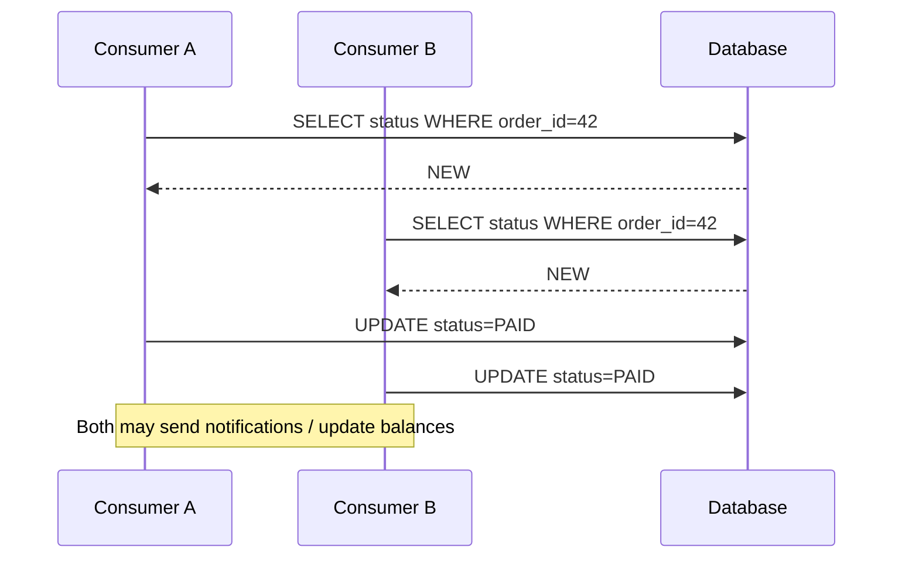
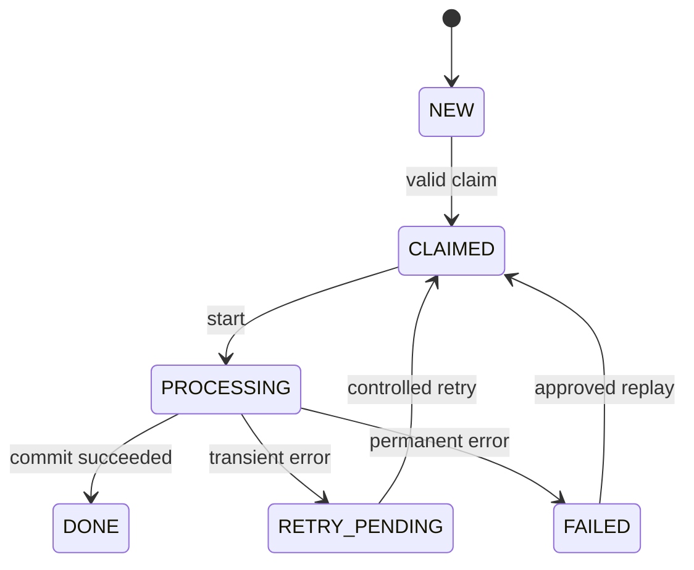
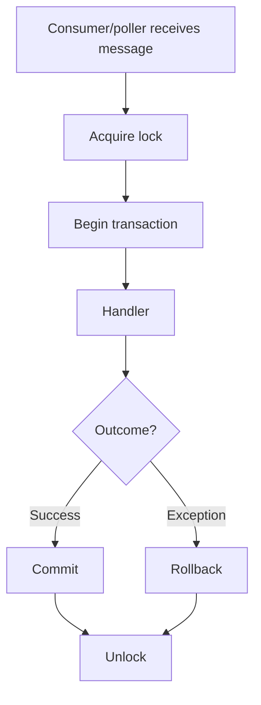
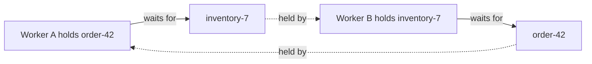
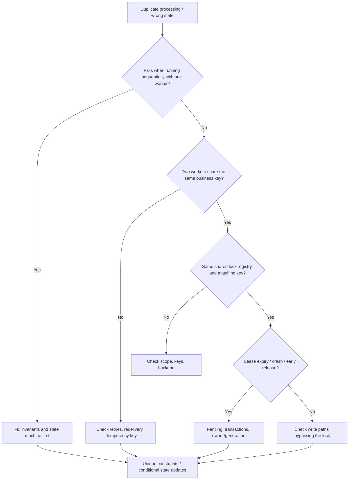

# Never Use Locks to Mask Flawed State Design

In **Spring Integration runtime**, multiple consumers, pollers, executors, or application instances can concurrently process messages related to the same order, correlation key, or job record. `LockRegistry` helps coordinate **concurrent access** to a keyed resource. However, it **cannot fix a broken business state model**: if you acquire a lock and mark `DONE` too early, fail to persist state across crashes, use unstable IDs, or call external APIs without idempotency, data can still be lost or processed twice.

This lesson belongs to the **Lock registry** chapter of the `SPRING_INTEGRATION_RUNTIME` module. The focus is distinguishing *mutual exclusion* from *state correctness*, spotting anti-patterns that use locks to paper over state bugs, and designing a message flow with **invariants**, **atomic state transitions**, **transactions**, **retry/redelivery**, **recovery**, **message stores**, **correlation**, and operational diagnosability.

## 1. Which questions does a lock answer — and which does it not?

A lock on key `K` generally says only: **"At any instant, within the scope guaranteed by the lock registry, one holder may enter the critical section for `K`."** It does not answer "has the work already finished?".

| Question | Does a lock solve it directly? | What else is required? |
| --- | --- | --- |
| Do two threads in the same JVM mutate data simultaneously in the critical section? | Potentially, if sharing the lock and right scope | Guard every code path accessing that state |
| If two instances receive the same business message, will side effects duplicate? | Not sufficient | Distributed lock **and/or** durable idempotency |
| After a crash, does the system know whether in-flight work committed? | No | DB state, transactions, recovery records |
| Is the business entity prevented from invalidly reverting from `DONE` to `PROCESSING`? | No | State machine and atomic conditional updates |
| Does a database transaction roll back together with an HTTP call? | No | Idempotency keys / outbox / reconciliation |
| Will a redelivered message be processed twice? | Not guaranteed on its own | Inbox / unique constraints, idempotent receiver |
| What if a lock expires while the old worker is still running? | Does not stop side effects automatically | Fencing/version checks at the protected resource |
| Will two messages with a bad correlation key mix into the same group? | No | Proper correlation/group identity design |

**Principle:** use locks to reduce contention or guard a genuine critical section; **never use locks as a substitute for data constraints**. Final constraints should be enforced where authoritative state lives: database transactions, unique constraints, conditional updates, or idempotency-capable target services.

## 2. Typical scenario: receiving the same order twice

Suppose an upstream source can redeliver `OrderPaid(orderId=42, eventId=E-42)`. Two consumers run concurrently:



A superficial fix wraps `SELECT → UPDATE` in a lock on `"order:42"`. If both consumers genuinely share a working registry, they execute sequentially. Even then, questions remain:

- Worker A may finish writing the DB and crash before sending acknowledgement.
- Worker B receives the redelivered event after A calls `unlock()`.
- Code forgets to check `DONE` after acquiring the lock, so B executes the side effect a second time.
- Another code path updates the DB without taking the same lock.
- In a cluster, each node creates its own `DefaultLockRegistry`, giving zero mutual exclusion across JVMs.
- The held lock's lease expires; the old worker keeps calling APIs even after a new worker acquired the lock.

**The proper fix** starts by asking: *"Which business invariant must always hold, even if locks are lost or messages repeat?"* For this example: **an `eventId` must be applied to business state at most once**, and an order must never make illegal state transitions.

## 3. State correctness: define invariants before choosing a lock

A simple state machine for processing a job:



This is an **application-designed model**, not states automatically generated by `LockRegistry`.

| Invariant to preserve | Reliable enforcement |
| --- | --- |
| Only one worker owns the active processing attempt | Atomic claim by job ID + owner/generation |
| `DONE` reflects committed outcome, not "message received" | Mark `DONE` in the same transaction as business state changes |
| An event never credits money / deducts stock twice | Unique business event key or conditional update |
| A stale worker cannot finish a job after losing ownership | Version/generation/fencing check when writing state |
| Failed jobs have a recovery path | `RETRY_PENDING`/DLQ/quarantine and explicit policy |
| Group correlation never merges two distinct work sessions | Properly namespaced, lifecycled, and versioned keys |

A lock can serve as a supporting tool to cut contention, yet the **source of truth** for state must rest on **durable data and atomically enforced state transition rules**.

## 4. Anti-pattern 1: "We have a lock, so no need to re-check state"

```java
// BUSINESS-LOGIC BUG — do not use in production.
Lock lock = registry.obtain("order:" + orderId);
lock.lock();
try {
    paymentGateway.capture(orderId);   // Can run again after redelivery
    orderRepository.markPaid(orderId); // No state-transition guard
}
finally {
    lock.unlock();
}
```

A lock only queues callers sequentially—it **does not remember that the previous request already finished**. Once A calls `unlock`, B acquires the lock and invokes the payment gateway again.

Even adding `if (!orderRepository.isPaid(...))` leaves problems:

1. If `isPaid` reads uncommitted state from another transaction, the result is unreliable.
2. If any code path skips the lock, it can mutate state unexpectedly.
3. Calling the payment API before persisting `PAID` leaves an **ambiguous external outcome** on a crash in between.
4. Persisting `PAID` before calling the API can leave **false success state** on a crash.

**Fix direction:** pass a business idempotency key `paymentRequestId` to the target API; persist state via transactions/conditional updates, and reconcile ambiguous outcomes. Locks cannot replace that protocol.

## 5. Anti-pattern 2: "The lock wraps the whole flow, so everything is atomic"

```text
lock(K)
  -> receive message
  -> update DB
  -> HTTP call
  -> publish event
unlock(K)
```

A broad critical section blocks other workers on the same key, yet **does not merge three resources into one atomic transaction**. DB commit succeeds, HTTP times out, and event publishing fails—all while one worker held the lock the entire time.


Solutions typically combine **short DB transactions**, an **outbox** to publish events post-commit, **inbox/idempotency keys** on consumers, and **reconciliation states** for external calls. If genuine distributed transactions are needed, weigh the cost and feasibility of transaction coordination; a lock is not a substitute for XA/JTA.

## 6. LockRegistry in Spring Integration

Spring Integration provides the `org.springframework.integration.support.locks.LockRegistry` interface:

```java
// Summary of the usage contract.
Lock lock = lockRegistry.obtain(lockKey); // java.util.concurrent.locks.Lock
lock.lock();
try {
    // Critical section
}
finally {
    lock.unlock();
}
```

Common implementations:

| Registry | Primary scope | Key considerations |
| --- | --- | --- |
| `DefaultLockRegistry` | Synchronizes threads **in the same JVM** sharing the registry | Does not protect other instances/JVMs |
| `JdbcLockRegistry` | Coordinates locks via a database using `LockRepository` | Schema/repository, connectivity, lease/timeout, and version semantics |
| `RedisLockRegistry` | Distributed locks backed by Redis | TTL, connection loss, lease renewal, unlock, and availability |
| Other implementations | Depends on lock backend/service | Always verify consistency, lease, and failure semantics |

Never switch from `DefaultLockRegistry` to a distributed registry and conclude the system achieved "exactly once". Implementations differ in **lock expiration**, **reentrancy**, **renewal**, **unlock behavior**, and **recovery from connection failures**.

Depending on the endpoint, Spring Integration may already lock internally to protect **message groups/stores** or coordinate correlating components. Adding outer locks without knowing what locks exist internally can raise contention or cause deadlocks if lock ordering is inconsistent.

## 7. Java example: local lock + durable transaction/idempotency

The example below illustrates separation of concerns:

1. `DefaultLockRegistry` reduces contention among threads in the same JVM by `orderId`.
2. The transactional service uses a **unique `event_id`** to ensure an event is never re-applied to the business DB.
3. The method is invoked on a **separate Spring bean** so `@Transactional` actually runs under the Spring transaction proxy; the transaction completes before the outer consumer releases the lock.
4. When the lock cannot be acquired, it **throws an exception** so the source/advice handles it per policy instead of silently accepting and dropping work.

Assume `orders(order_id, total_amount)` and `processed_event(event_id)` tables exist with appropriate schemas, and `JdbcTemplate` and `PlatformTransactionManager` target the same database.

```java
import java.util.concurrent.TimeUnit;
import java.util.concurrent.locks.Lock;

import org.springframework.context.annotation.Bean;
import org.springframework.context.annotation.Configuration;
import org.springframework.integration.annotation.EnableIntegration;
import org.springframework.integration.annotation.ServiceActivator;
import org.springframework.integration.channel.DirectChannel;
import org.springframework.integration.support.locks.DefaultLockRegistry;
import org.springframework.integration.support.locks.LockRegistry;
import org.springframework.jdbc.core.JdbcTemplate;
import org.springframework.messaging.MessageChannel;
import org.springframework.stereotype.Service;
import org.springframework.transaction.annotation.Transactional;

record AddAmount(String eventId, String orderId, int amount) {}

@Configuration
@EnableIntegration
class OrderLockConfiguration {
    @Bean
    LockRegistry orderLockRegistry() {
        return new DefaultLockRegistry(); // Single JVM only; for illustration.
    }

    @Bean
    MessageChannel orderCommands() {
        return new DirectChannel();
    }
}

@Service
class OrderCommandConsumer {
    private final LockRegistry locks;
    private final OrderTransactionalService service;

    OrderCommandConsumer(LockRegistry locks, OrderTransactionalService service) {
        this.locks = locks;
        this.service = service;
    }

    @ServiceActivator(inputChannel = "orderCommands")
    public void accept(AddAmount command) {
        Lock lock = locks.obtain("order:" + command.orderId());
        boolean acquired = false;
        try {
            acquired = lock.tryLock(2, TimeUnit.SECONDS);
            if (!acquired) {
                throw new IllegalStateException(
                        "Lock busy for order " + command.orderId());
            }
            service.applyOnce(command); // Commit/rollback happens inside this call.
        }
        catch (InterruptedException ex) {
            Thread.currentThread().interrupt();
            throw new IllegalStateException("Interrupted while waiting for lock", ex);
        }
        finally {
            if (acquired) {
                lock.unlock();
            }
        }
    }
}

@Service
class OrderTransactionalService {
    private final JdbcTemplate jdbc;

    OrderTransactionalService(JdbcTemplate jdbc) {
        this.jdbc = jdbc;
    }

    @Transactional
    public void applyOnce(AddAmount cmd) {
        int inserted = jdbc.update(
                "INSERT INTO processed_event(event_id) " +
                "VALUES (?) ON CONFLICT (event_id) DO NOTHING",
                cmd.eventId());

        if (inserted == 0) {
            return; // Event already committed earlier: duplicate.
        }

        int updated = jdbc.update(
                "UPDATE orders SET total_amount = total_amount + ? " +
                "WHERE order_id = ?",
                cmd.amount(), cmd.orderId());

        if (updated != 1) {
            // Roll back the processed_event marker as well.
            throw new IllegalStateException("Order not found or not unique");
        }
    }
}
```

The `ON CONFLICT` SQL uses **PostgreSQL** syntax; substitute the equivalent for other databases. `processed_event.event_id` must have a unique constraint/primary key, and `orders.order_id` must uniquely identify one row. Wiring a connection pool or transaction manager to the wrong datasource can put the marker and business update in separate transactions.

**Key point:** even if the application runs multiple instances where `DefaultLockRegistry` does not coordinate across nodes, **the unique constraint and transaction still uphold the invariant "an event applies at most once in the DB"**. Locks reduce concurrent contention, but they are not the final correctness barrier.

### 7.1. Why is the transaction on the inner service?

If you place `@Transactional` directly on `accept()`, the transaction interceptor normally wraps **outside the method body**. The `finally { unlock(); }` block can run **before the proxy commits the transaction**, letting another worker acquire the lock before the transaction finishes.

In the example above, `accept()` holds the lock and invokes a separate bean through its transaction proxy. `applyOnce()` commits or rolls back before returning to `accept()`, at which point the lock is released. This gives clean boundaries, though you must still verify transaction propagation, timeouts, and exception behavior in your real application.

Never call a `@Transactional` method via `this.applyOnce()` expecting Spring to intercept **self-invocation**. With standard proxy-based transactions, internal calls within the same object bypass the interceptor.

## 8. When to use a lock and when not to?

| Need | Preferred approach | Appropriate role of a lock |
| --- | --- | --- |
| An event updates the business DB at most once | Unique constraint/inbox in DB transaction | Reduces contention; not required to enforce the invariant |
| Two workers must not concurrently mutate a complex local cache | Guard with local lock or concurrent collections | Protects a genuine critical section |
| Only one node runs a scheduled job at a time | Lease-based leader election / cluster coordination | Coordination mechanism; job still needs idempotency |
| An order processes sequentially across a cluster | Partition by order ID; conditional updates | Per-order lock if strict serialization is needed |
| Job state with leases and crash recovery | Atomic claim + owner/generation + timeout | Can help reduce claim contention |
| Send HTTP/payment once despite retries | Target-side idempotency key, outbox/reconciliation | Does not create atomicity for external APIs |
| Prevent aggregator groups from mixing or premature release | Correlation strategy, release strategy, group store | Locks do not fix bad group keys/sequences |
| Guarantee output ordering after `ExecutorChannel` | Serial/partitioned processing by key | A lock serializes one segment; does not restore end-to-end ordering |

When a bug is described as "**state changes incorrectly even with one thread at a time**", the cause is almost always **state design or boundaries**. Adding locks will not fix bugs that already occur under sequential execution.

## 9. Anti-pattern 3: RAM-only state with distributed locks

```text
Node A                         Node B
  Redis lock(order-42)           Redis lock(order-42)
  localMap[order-42] = DONE      localMap[order-42] = NEW
```

Even when only one node holds the Redis lock at a time, the two nodes still hold **two separate copies of state**. Worker B acquires the lock after A releases, yet reads `NEW` from its own RAM and reprocesses the order.

**Rule:** locks coordinate **access to a shared resource**; if the underlying data is neither shared nor consistent, lock ordering will not magically synchronize local copies.

In Spring Integration, an in-RAM `QueueChannel` per instance or an in-RAM `SimpleMetadataStore`/message group store does not become cluster-safe merely by adding a distributed lock. When shared durable state is needed, pick an **appropriate store/queue/broker** and align locking scopes and transaction policies with that state.

## 10. Anti-pattern 4: locking on a key that mismatches the invariant

Consider two events with the same `orderId=42` but different `messageId` values:

```text
Message M1: messageId=f3... orderId=42
Message M2: messageId=9a... orderId=42

lock(messageId)  -> two distinct locks -> fails to protect the same order.
lock(orderId)    -> same lock scope -> can serialize order access.
```

Lock keys must reflect the **contended resource**, not blindly copy message IDs. Conversely, overly coarse keys cause bottlenecks:

- `lock("ALL_ORDERS")`: one slow order stalls all other orders.
- `lock("tenant:" + tenantId)`: reasonable for tenant-wide invariants; too broad when protecting individual orders.
- `lock("order:" + orderId)`: parallelizes per order, yet does not guard cross-order invariants like "total warehouse order quota".

For aggregators/resequencers, a correlation key is an appropriate lock key only when the **critical section genuinely belongs to that group**. If two distinct correlation IDs both update a shared inventory total row, group locks alone do not protect the warehouse-wide invariant.

### 10.1. Namespacing lock keys

```text
orders:v1:tenant-7:42
inventory:v1:warehouse-2:sku-11
aggregation:v1:batch-2026-11-22-01
```

Namespacing separates independent state domains sharing one registry, preventing accidental collisions when two domains share ID `42`. Never put tokens, passwords, or sensitive payloads in lock keys or logs; pick stable, safe business IDs.

## 11. Anti-pattern 5: assuming ownership after lease expiration

With lease-based distributed locks, a common failure mode occurs:

```mermaid
sequenceDiagram
    participant A as Worker A
    participant L as Lock backend
    participant B as Worker B
    participant DB as Shared DB
    A->>L: acquire(K), 10s lease
    L-->>A: granted
    Note over A: GC pause or network partition > 10s
    L-->>L: A's lease expires
    B->>L: acquire(K)
    L-->>B: granted
    B->>DB: update state
    Note over A: A resumes, believing it still holds lock
    A->>DB: stale update (DANGER)
```



**Losing a lock does not stop a Java thread or cancel an in-flight HTTP request.** Some backends support lock renewal, yet renewals can fail during network outages or GC pauses. Relying on leases alone is insufficient when a stale worker can keep mutating state.

### 11.1. Fencing tokens / generations

One mitigation assigns a **monotonically increasing generation** on each claim and requires the protected resource to **reject operations carrying an older generation**. For instance, A gets token `17`, then B gets token `18`; the DB refuses A's commit once the active token is `18`.

```text
claim K -> generation=17 (A)
lease expires
claim K -> generation=18 (B)

B UPDATE ... WHERE generation=18 -> allowed
A UPDATE ... WHERE generation=17 -> rejected
```

**Do not assume `LockRegistry.obtain()` returns a fencing token.** `LockRegistry` returns a `Lock`; generation/fencing is an additional design in the store or backend. Fencing also works only if **the destination receiving side effects actually validates the token**. An email provider or payment gateway lacking token support still needs dedicated idempotency/reconciliation.

## 12. Atomic claim pattern for durable job processing

When business state lives in a DB, you can use a **conditional update** to claim jobs instead of treating a distributed lock as the source of truth. Illustrative SQL (PostgreSQL):

```sql
-- Assumptions:
-- work_item(id PK, state, owner, generation, lease_until)
-- States: NEW, RETRY_PENDING, PROCESSING, DONE, FAILED

UPDATE work_item
SET state = 'PROCESSING',
    owner = :workerId,
    generation = generation + 1,
    lease_until = CURRENT_TIMESTAMP + INTERVAL '30 seconds'
WHERE id = :jobId
  AND (
      state IN ('NEW', 'RETRY_PENDING')
      OR (state = 'PROCESSING' AND lease_until < CURRENT_TIMESTAMP)
  )
RETURNING generation;
```

- Row returned: the worker acquired the **new generation**.
- No row returned: the job was ineligible to claim; **do not** proceed as if ownership were granted.
- Upon completion, the worker may transition state only with its **active owner + generation**:

```sql
UPDATE work_item
SET state = 'DONE',
    lease_until = NULL
WHERE id = :jobId
  AND state = 'PROCESSING'
  AND owner = :workerId
  AND generation = :generation;
```

Verify **the updated row count equals 1**. If 0, the worker likely lost ownership because another worker reclaimed the job. This illustrates state transitions; to fully guard against stale workers, **business state** updates themselves must also be guarded by generation or combined into the appropriate transaction/conditional update—not checked only when marking `DONE`.

### 12.1. What conditional claims alone do not solve

A worker can finish updating the business DB and crash right before marking `DONE`; if those two steps are not in the same transaction, the job can run again. Therefore:

1. Store an **inbox/event ID** with a unique constraint so work can be safely replayed.
2. Combine the business update and completion marker into **one transaction** when they share a DB and it fits.
3. For non-DB side effects, use an **outbox/idempotency key** and reconciliation state.
4. Define lease timeout handling, max retries, and recovery records/DLQ.
5. Accept that locks/leases do not replace broker delivery and acknowledgement contracts.

## 13. Locks, transactions, and retry advice: order determines outcomes

These two compositions are not equivalent:

```text
Lock( Transaction( handler ) )
Transaction( Lock( handler ) )
```

With `Lock(Transaction(handler))`, the lock stays held while the inner transaction commits or rolls back, assuming the transaction proxy participates as designed. With `Transaction(Lock(handler))`, the lock may release before the outer transaction commits. Advice ordering can produce the exact same difference:



**Yet acquiring a lock before a transaction still does not guarantee correctness by itself:** other entry points to state may bypass the lock; the lock lease may expire; the transaction may cover only the DB while excluding message receive/ack or HTTP. Verify the actual scope of every advice and transaction manager.

### 13.1. Retry inside or outside the lock?

| Conceptual order | Characteristics | What to watch |
| --- | --- | --- |
| `Lock(Retry(handler))` | Holds the same lock across attempts and backoffs | Blocks other consumers longer; does not replace idempotency |
| `Retry(Lock(handler))` | Each attempt re-acquires the lock | Reduces hold time, though state can change between attempts |
| `Lock(Transaction(handler))` | Lock outlives commit when transaction is inside | Lock hold duration depends on transaction length |
| `Transaction(Lock(handler))` | Lock may release before outer commit | Race window between unlock and commit |

Do not treat this table as a rigid formula for every `RequestHandlerRetryAdvice` or `TransactionInterceptor`. At a poller, the transaction may wrap `receive()`; at a handler, it wraps only the handler. Verify order and threads with traces and integration tests.

### 13.2. Avoid holding locks during long backoffs unnecessarily

Five retries with multi-second backoffs can keep a thread holding a lock for a long time. With coarse lock keys, throughput collapses and backlogs grow in `QueueChannel`/brokers. Consider key-partitioned queues, delayed retries, or `RETRY_PENDING` states instead of holding both a lock and a thread while waiting.

## 14. Pollers, executors, and asynchronous boundaries

`LockRegistry` protects the section wrapped on the thread holding the lock. If a lock is acquired in a poller while the handler actually runs on a worker thread past an `ExecutorChannel`, the lock may already be released before the handler starts:

```text
Poller thread:
  lock(K)
  receive() -> ExecutorChannel.send() -> accepted
  unlock(K)

Executor thread:
  handler(K) -> updates state
```

Therefore, **place the lock around the exact code mutating state**, not merely where the message is handed off. On a `DirectChannel` with a synchronous handler, calls stay on the same thread; on an `ExecutorChannel`/poller executor, inspect the concrete thread handoff path.

A lock acquired on thread A **must not be unlocked from thread B** unless the implementation/contract explicitly allows it. For traditional reentrant `Lock`s, ownership is bound to the thread; unlocking from another thread throws an exception and breaks cleanup.

Also, never equate:

- "message passed `send()` into an executor" with "handler committed";
- "poller held a lock while polling" with "every downstream endpoint is protected";
- "a lock by correlation ID" with "output side-effect ordering after fan-out is guaranteed".

## 15. Locks do not replace message stores and correlation design

### 15.1. Queues and transactions

If an in-RAM `QueueChannel` message is consumed by `receive()`, the handler fails, and the DB rolls back, **the lock does not put the message back on the queue**. To achieve redelivery, use a source with matching semantics (a broker, a transactional `JdbcChannelMessageStore` with properly scoped poller transactions) or a durable recovery flow.

### 15.2. Aggregators, resequencers, and message groups

If an aggregator merges two orders by mistake because `correlationId` is underspecified, locking the group only ensures the **wrong merge happens sequentially**. If a release strategy only counts messages, redelivery duplicates can still trigger premature release. You need:

- Properly scoped, namespaced/versioned correlation keys.
- A persistent `MessageGroupStore` when durability is required.
- Explicit release, expiry, and late-arrival policies.
- Deduplication by business member key.

A lock cannot turn an unordered stream missing `sequenceNumber` into an ordered one, cannot decide when a group should release, and cannot validate whether a late barrier trigger is valid.

### 15.3. Accept-once and metadata stores

`AcceptOnceFileListFilter` or `MetadataStoreSelector` can record **ACCEPTED/CLAIMED** before the handler finishes. Locking only the marker write still leaves a crash window between the marker and business commit. Never label a marker `DONE` if it only means the message was seen.

A shared `ConcurrentMetadataStore` with `putIfAbsent` provides atomic claims within its backend scope, yet does not provide cross-resource transactions or post-crash replay on its own. Separate **claimed** from **completed**, and use leases/recovery or a durable inbox where needed.

## 16. Deadlocks, lock ordering, and lock scope

A flawed design can deadlock even when every lock works properly:

```text
Worker A: lock(order-42) -> waits for lock(inventory-7)
Worker B: lock(inventory-7) -> waits for lock(order-42)
```



When multiple locks must be acquired, enforce a **global order** such as `inventory → order` or sort lock keys consistently. Use `tryLock(timeout)` and handle acquisition failures per policy; **never swallow a timeout and return success** when work was not performed.

Other alternatives:

- Reduce lock count using a single transaction/conditional update on the authoritative store.
- Split work into durable steps instead of holding multiple locks across HTTP calls.
- Avoid re-acquiring locks from async callbacks on other threads.
- Bound critical sections sensibly and define interrupt/cancellation paths.
- Never lock an entire tenant/cluster when the invariant applies only to a single order.

## 17. Handling failed lock acquisition

A `tryLock` failure is **a coordination signal**, not proof that the work was processed. Three valid paths exist depending on requirements:

| Behavior | Appropriate when | Mandatory rule |
| --- | --- | --- |
| Throw exception for source retry/redelivery | Message lives in a broker/store with reliable redelivery | Never ack as success before processing; cap retries |
| Record `RETRY_PENDING` and reschedule | Application has a durable job scheduler | Persist payload/business key and schedule |
| Skip because already `DONE` | Read **authoritative committed state** proving duplicate | Skip only when truly already completed |

**Never do this:** `if (!lock.tryLock(...)) return;` and treat the handler as finished. For many adapters, returning normally acknowledges the message and removes it from the queue. Skipping requires proof—such as a unique inbox key—that the business work already committed.

When a lock-waiting thread catches `InterruptedException`, restore the interrupt flag (`Thread.currentThread().interrupt()`) and propagate the error per policy. Avoid swallowing interrupts, which stalls pollers, lifecycle endpoints, or executors during shutdown.

## 18. Runtime diagnostics: lock contention or broken state?

When a service slows down or processes duplicates, first classify among three failure modes:

1. **Concurrency conflict:** two workers genuinely contend on the same resource.
2. **Incorrect state transition:** even a single worker can produce invalid state.
3. **Delivery/recovery gap:** crashes or rollbacks cause messages to reappear or vanish.



### 18.1. Signals to log and measure

| Signal | Explanation |
| --- | --- |
| `lockKey`, `lockRegistryType` | Which scope and backend are being locked |
| `lockWaitDuration`, `lockHoldDuration` | Whether waiting on the lock or inner work is slow |
| `lockAcquired` / `lockTimeout` | Presence of lock contention |
| `threadName`, instance ID | Whether threads/instances switch between steps |
| `businessKey`, `eventId`, `correlationId` | Links retries, redeliveries, and deduplication |
| Job `state`, `owner`, `generation` | Detects stale workers or illegal transitions |
| `transactionBegin/Commit/Rollback` | Whether lock releases before or after commit |
| Broker delivery count, handler attempt count | In-invocation retries vs. source redeliveries |
| Inbox conflict count / duplicate skipped count | Whether idempotency is genuinely active |
| Queue depth, poller lag, executor saturation | Where lock contention creates backlogs |

Log using **stable business keys**, not solely `MessageHeaders.ID`, which can change across redeliveries. Avoid logging payloads, secrets, or Redis/JDBC tokens. Metrics labeled dynamically per order ID can explode cardinality; keep granular IDs in traces/logs when needed and aggregate metrics by endpoint and error type.

### 18.2. A telling clue: low lock wait yet duplicates still occur

When lock wait time is near zero yet operations execute twice, do not rush to raise timeouts. Look for mismatched lock keys for the same entity, per-node local registries, expired locks, or duplicates running **sequentially after unlock**. In that case, **invariants and idempotency—not lock performance—are the real issue**.

## 19. Pre-production testing matrix

| Scenario | Expected outcome | Check |
| --- | --- | --- |
| Two consumers with same `eventId` in one JVM | Business DB updates exactly once | Inbox row count, final DB value |
| Two consumers across two instances | Side effects do not double | Shared backend and unique constraint |
| Message retried three attempts | Does not apply three business updates | Handler count ≠ committed effect count |
| Broker redelivery after DB commit, before ack | Duplicate safely ignored | Unique event ID, external API not called twice |
| Worker crashes after claim, before processing | Retry/reclaim mechanism recovers | Lease/pending state, never stuck forever |
| Lease expires, old worker wakes up | Stale write rejected | Owner/generation check at DB |
| Transaction rolls back on handler failure | `DONE` marker is absent if uncommitted | Verify state rolled back with transaction |
| `ExecutorChannel` switches threads | Lock and transaction guard the actual write site | Trace lock enter/exit, thread, and commit |
| Two locks acquired in opposite order | No infinite deadlock | Ordering rule + timeouts |
| Redis/JDBC lock backend disconnects | Never silently accepts unfinished message | Error propagation, recovery policy |
| Bad or reused correlation key | Groups never mix | Group identity + expiry/dedup |
| Message store still holds work after restart | Resumes/replays cleanly | Durable store and idempotent consumer |

A test proving only "one holder at a time" **does not prove** correct processing. Assert **business outcomes after crashes and redeliveries**, including faults injected between commit, event publishing, and acknowledgement.

## 20. Practice exercises

### Exercise 1 — Locks only serialize; they do not prevent duplicates

Run two workers receiving `eventId=E-42` using `DefaultLockRegistry` on the same key `"order:42"`. Have the handler increment a total without checking whether the event was already processed. Let worker A finish, then B acquires the lock: the total increases twice. Next add an inbox unique constraint and verify only one update commits.

### Exercise 2 — Wrong lock key scope

Send two messages with the same `orderId` but different `messageId`s. Compare `lock(messageId)` vs. `lock(orderId)` for contention behavior. Then create two distinct orders and compare throughput between `lock("ALL_ORDERS")` and `lock("order:" + orderId)`.

### Exercise 3 — Transactions and unlock timing

Build a flow with a `@Transactional` handler and log lock acquire/unlock, transaction commit, and thread names. Compare (a) locking inside the transactional method vs. (b) holding the lock outside a call to a separate transactional bean. Observe the window where the lock can be released prior to commit.

### Exercise 4 — Simulating a crash window

In a test environment, mark a job `CLAIMED` and stop the process before writing `DONE`. Replay and identify which state gets stuck. Add leases/conditional claims and a business inbox key; verify the job re-runs without duplicating side effects.

### Exercise 5 — Expired leases and stale workers

Have worker A claim generation `17` and deliberately pause longer than the lease; have B claim generation `18` and finish. Let A execute its update `WHERE generation=17` and verify 0 rows are affected. Explain why an HTTP API lacking fencing support still needs its own idempotency.

### Exercise 6 — Pollers, executors, and lock scope

Create a `QueueChannel` with a polling consumer. Acquire a lock before an `ExecutorChannel` and log threads and `lockHoldDuration`; compare with locking inside the worker handler. Make the handler throw intentionally and inspect message source/redelivery behavior rather than assuming `unlock = rollback`.

### Exercise 7 — Stress testing and observability

Run multiple workers across a set of business keys with uneven skew. Measure `lockWaitDuration`, `lockHoldDuration`, queue depth, retry attempts, and business commits. Spot overly coarse lock keys, long holds from backoff, and verify metrics do not explode cardinality by labeling every time series with order IDs.

## 21. Mistakes to remember

| Mistake | Consequence | Fix |
| --- | --- | --- |
| Locks only, no business invariants | Duplicates run sequentially and still duplicate | Unique constraints, conditional transitions, idempotency |
| Distributed locks guarding per-node RAM state | Each node maintains separate state | Authoritative shared store |
| Using `messageId` when the invariant is per `orderId` | Duplicate deliveries do not contend on the same lock | Key locks by protected resource |
| Overly coarse lock across all orders | Bottleneck and backlog | Narrow key/partition to business unit |
| Wrapping long HTTP calls in locks thinking it is atomic | Crashes or timeouts leave partial state | Outbox, idempotency, reconciliation |
| Releasing lock before commit | Another worker sees uncommitted state | Lock outside transaction or use DB atomicity |
| Assuming lease expiration stops the old worker | Stale worker overwrites state | Fencing/generation checks |
| Returning success on `tryLock` timeout | Unprocessed message gets acked | Throw or move to durable retry pending |
| Calling `lock()` without `finally unlock` | Leaked lock, other workers hang forever | `try/finally` and timeouts/interrupts |
| Assuming switching `DefaultLockRegistry` to Redis gives exactly-once | Crashes/redeliveries still produce duplicates | Inbox / idempotent business effects |
| Adding locks to fix wrong aggregator correlation keys | Wrong groups are assembled sequentially | Fix correlation/release strategies |
| Equating message deliveries with business commits | Retries/redeliveries skew counts | Track attempts, deliveries, and business outcomes separately |

## 22. Self-check questions

1. **Does a lock prove a message was processed successfully?** No; it only coordinates critical-section access within the backend's scope.
2. **Can two sequential duplicates both cause side effects?** Yes, if idempotency or committed-state checks are missing.
3. **Does `DefaultLockRegistry` protect two independent JVMs?** No.
4. **Why can placing `@Transactional` on the method containing `unlock()` be problematic?** The transaction proxy may commit after the method body already released the lock.
5. **Does an expired lock lease automatically stop the old worker?** No; fencing/generation checks are required if stale writes are dangerous.
6. **Is `lock(messageId)` sufficient for two messages targeting the same order with different IDs?** No; the key must match the contended resource.
7. **Does `putIfAbsent` in a metadata store mean `DONE`?** No; it may represent only a claim.
8. **When a lock cannot be acquired, can you return normally and treat the job as done?** Only if authoritative state confirms completion; otherwise route to retry/recovery.
9. **Does locking around `QueueChannel.receive()` automatically trigger redelivery after rollback?** No; the source/store must support transactions/redelivery.
10. **What is the strongest way to ensure an event updates a DB once?** Unique event ID/inbox and business update inside the same transaction.

## 23. Summary

**A lock is a concurrency coordination mechanism, not proof of valid state.** A solid design answers: *which invariants must hold; who owns state; which transitions are valid; what commits atomically; what happens after a crash; whether redelivery is safe; and whether an old worker can keep acting after losing its lease?*

In Spring Integration, trace the full path **source → channel → poller/consumer → executor → advice/transaction → handler → message/metadata store → error/recovery**. Use `LockRegistry` only on the right critical section, with the right key and right backend; rely on transactions, conditional updates, inbox/outbox patterns, idempotency, and correlation to guarantee business outcomes. If a bug still occurs with only one worker running, **never add a lock: fix the state model first**.
