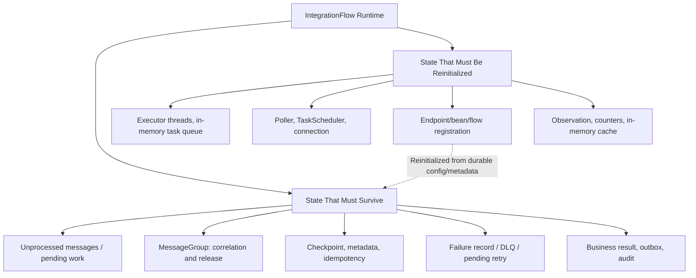
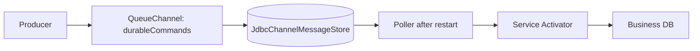
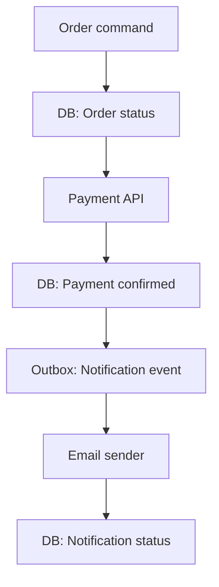
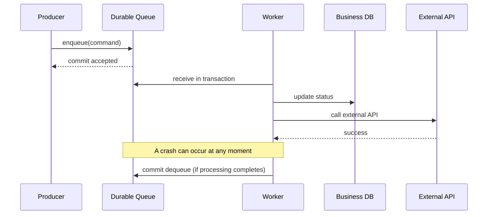
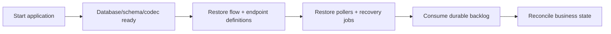

# Which Runtime State Must Survive Restarts in Spring Integration?

## 1. Asking the Right Question: What Does "Restarting the Application" Mean to Recover?

Spring Integration orchestrates message flows through `MessageChannel`, endpoints, consumers, pollers, executors, and stateful components such as aggregators, resequencers, or idempotent receivers. A flow that runs reliably for months can still misbehave when the Java process is killed, a container is replaced, or the application is upgraded to a new version.

Consider order `ORDER-42`:

1. An HTTP gateway receives the order and sends a message to a channel.
2. An executor handles multiple asynchronous steps.
3. A splitter creates three messages to calculate fees from three services.
4. An aggregator has received two results and is waiting for the third part.
5. The service is restarted before completion.

After a restart, the application may recreate all Spring beans **without the two messages in the old group**. Or it may still have the messages but lack the right correlation key, the poller may not have started yet, or a command that already charged money may be delivered a second time.

For the **Persistence and Restarts** chapter of the **SPRING_INTEGRATION_RUNTIME** module, two questions must be distinguished:

- **Which state carries business meaning or processing progress that must survive?** That state must have a durable data source or reliable reconstruction capability.
- **Which state is merely temporary execution resource?** Threads, connections, scheduler tasks, or call stacks must be reinitialized; snapshotting them is usually unfeasible and unnecessary.

> **Design Principle:** You do not need to persist every variable in the JVM. You need to protect *information whose loss prevents the system from continuing properly or detecting that a side effect has already occurred*. Each type of information requires its own recovery mechanism and commit boundary.

## 2. Map of Runtime State Types



Overview decision table:

| State Type | What Happens If Lost After Restart? | How Should It Be Stored or Recovered? |
| --- | --- | --- |
| **Unprocessed messages** | Received work is dropped before being processed | Durable broker, persistent `QueueChannel`, or a source with redelivery |
| **Message group** | Aggregator/resequencer loses waiting fragments | Persistent `MessageGroupStore`, stable correlation/sequence |
| **Inbound reader checkpoint** | Files/feeds/records are re-read or skipped incorrectly | Persistent `MetadataStore` or durable source offset/checkpoint |
| **Idempotency marker** | Replay charges money, creates invoices, or sends duplicate emails | Unique business key table, `JdbcMetadataStore`/durable store |
| **Long-term scheduled retry/delay** | Scheduled retry attempt is no longer triggered | Durable retry queue, broker, scheduled work table and recovery worker |
| **Dead-letter/failure record** | No data left for investigation or replay | Broker DLQ, persistent message queue, or business error table |
| **Business progress state** | Unknown which steps have been completed | Work status database, event log, saga/process state |
| **Dynamic IntegrationFlow registration** | Flow disappears even though messages remain in DB | Store **registration definition or intent** separately, rebuild at startup |
| **Executor threads, running callbacks** | Threads stop, call stack is lost | Reinitialize; use a durable source to replay work that must continue |
| **Poller/scheduler instance** | Running tasks no longer exist | Recreate endpoints and schedules from config; persist deadlines when schedule is business-critical |
| **Temporary reply channel / session** | Caller is no longer waiting, reply is lost | Design async responses around business ID, persistent result, and client polling/events |
| **Metrics, cache, log buffer** | Transient metrics lost, cache cold | Export metrics/logs externally; rebuild cache from source of truth |

The table above serves as design guidance; some sources such as Kafka/JMS have **their own persistence mechanisms** and do not necessarily require copying messages into another JDBC queue.

## 3. Three Guarantees That Must Be Separated

**Durability** means data that has been written and committed will survive failures according to the storage guarantee. **Delivery semantics** describes how messages are handed off to consumers: they may be lost, duplicated, or redelivered. **Business correctness** means business logic does not produce incorrect outcomes when messages are duplicated or steps fail partway through.

```text
Persistent data
    != guarantee of immediate delivery
    != guarantee of exactly-once business side effect
```

For example, an invoice-creation command resides in `JdbcChannelMessageStore` and is polled again after a crash. Durability is achieved: the command is still there. However, if the system already called the payment API successfully before the queue-processing transaction rolled back, the message will be redelivered and risks charging twice. This requires a **business idempotency key** or a transaction/reconciliation protocol with the external system.

Explicitly document the following for each state type:

1. **Source of truth:** database, broker, metadata store, or third-party system?
2. **Commit point:** at what moment is the app allowed to say "received" or "completed"?
3. **Recovery owner:** who will detect the backlog after a restart and trigger processing?
4. **Duplicate policy:** if the same work is delivered twice, what will the outcome be?
5. **Expiry/retention:** how long should state be kept and under what conditions should it be cleaned up?

## 4. Pending Messages: Keeping Work Received but Not Yet Processed

### 4.1. DirectChannel and ExecutorChannel Are Not Durable Queues

`DirectChannel` dispatches messages directly to subscribers on the sending thread's call stack. `ExecutorChannel` hands work off to a `TaskExecutor`, which may run the handler on another thread. Both are useful for orchestration, but **they do not automatically turn a call into durable work**.

With an executor backed by an in-memory queue:

```text
Producer.send() ---> ExecutorChannel ---> TaskExecutor queue ---> Worker
                         received            in-memory          not yet run
                                             ^
                                             JVM killed -> queued work may be lost
```

Even when `send()` returns successfully, it does not guarantee that the worker has executed or that the task has been durably written. If work cannot be lost, **move it across a durable boundary** before acknowledging the input.

### 4.2. Persistent QueueChannel

Spring Integration can use `JdbcChannelMessageStore` as the backing store for a `QueueChannel`. Messages enqueued and committed to the database can be polled again after recreating the application context.



An illustrative XML configuration (part of a Spring context with the `int` namespace; requires a datasource and version-appropriate DDL):

```xml
<bean id="commandChannelStore"
      class="org.springframework.integration.jdbc.store.JdbcChannelMessageStore">
    <constructor-arg ref="dataSource"/>
    <property name="region" value="ORDERS_V1"/>
    <!-- Choose a channelMessageStoreQueryProvider appropriate for the database. -->
</bean>

<int:channel id="durableCommands">
    <int:queue message-store="commandChannelStore"/>
</int:channel>

<int:service-activator
        input-channel="durableCommands"
        ref="commandConsumer"
        method="handle">
    <int:poller fixed-delay="1000" max-messages-per-poll="5">
        <int:transactional transaction-manager="transactionManager"/>
    </int:poller>
</int:service-activator>
```

To run this, you need `spring-integration-jdbc`, a `dataSource` bean, `transactionManager`, `commandConsumer`, and the tables/indexes from the Spring Integration JDBC SQL schema. The query provider (for example PostgreSQL, Oracle, SQL Server) must match the dialect. This example focuses on the channel–store–poller–transaction relationship, not a standalone deployment configuration.

**What must stay stable across restarts:**

- **Channel ID** `durableCommands` and store `region=ORDERS_V1`, if the backend uses them to partition data.
- DB connectivity and compatible schema/message serializer.
- Consumer and poller are re-registered; `autoStartup`/lifecycle allows them to run.
- Dequeue transaction boundary and business operation are clearly designed.

If you rename the channel or region in a new deployment, old messages may **still remain in the DB but become invisible to the new channel**. That is a migration/identity error, not "the database lost data."

### 4.3. Messages Do Not Need to Be Copied to JDBC If the Source Is Already Durable

With brokers like JMS/RabbitMQ or Kafka, pending state and consumption progress can be managed by the broker and container/adapter. Adding a JDBC `QueueChannel` can introduce two commit points, creating a window for duplicate writes or data loss without an outbox/transaction/reconciliation mechanism.

For example, start with the question: **Has the broker already persisted the message and does it only ack/commit when processing is safe?** If yes, you can rely on that source to redeliver after a restart. If the producer is an HTTP endpoint that simply returns `202 Accepted` and hands work to an in-memory executor, you must design a durable handoff before returning success.

## 5. MessageGroup: Incomplete State of Aggregator and Resequencer

An aggregator typically receives multiple fragments sharing a `correlationId`, adds them to a `MessageGroup`, and waits for a `ReleaseStrategy`. A resequencer also holds fragments to emit them in `sequenceNumber` order.

```text
batch-42: sequenceSize=3
  #1 arrives -> group has {1}
  #3 arrives -> group has {1,3}
  JVM restart
  #2 arrives -> must restore {1,3} first, then release properly
```

If the group store is only in memory, the new instance will not know about the two fragments before the restart. Using `JdbcMessageStore` or an appropriate persistent `MessageGroupStore` preserves groups and metadata.

Java DSL example (within a Spring configuration with a JDBC datasource):

```java
import javax.sql.DataSource;
import org.springframework.context.annotation.Bean;
import org.springframework.integration.dsl.IntegrationFlow;
import org.springframework.integration.jdbc.store.JdbcMessageStore;
import org.springframework.integration.store.MessageGroupStore;

@Bean
MessageGroupStore persistentGroups(DataSource dataSource) {
    return new JdbcMessageStore(dataSource);
}

@Bean
IntegrationFlow aggregateResults(MessageGroupStore persistentGroups) {
    return IntegrationFlow.from("processedFragments")
            .aggregate(spec -> spec
                    .messageStore(persistentGroups)
                    .expireGroupsUponCompletion(false))
            .channel("completedBatches")
            .get();
}
```

Prerequisites: upstream produces consistent correlation/sequence headers; downstream `completedBatches` has a consumer; the JDBC schema is compatible and the store is reused after restart.

**Important:** Persisting a group does **not** persist in-RAM timers or the Java code of `ReleaseStrategy`. The app must recreate the handler with the same correlation key, message-group namespace, and appropriate release rules. A group sitting in the store may still wait for **a new message** or a reconfigured expiry/reaper schedule; it will not automatically produce output just because the JVM restarted.

### Completed Groups, Late Arrivals, and Duplicates

If all metadata is deleted immediately upon release, a late-arriving old message with the same key can create a **new group**. Keep a completed-group marker for an appropriate duration, use a group ID with a clear lifecycle (`orderId + revision + processingRunId`), and apply business idempotency if the output has side effects.

If multiple application instances share a persistent `MessageGroupStore`, concurrent updates must also be synchronized using an appropriate shared/distributed `LockRegistry`. `DefaultLockRegistry` inside each JVM only locks within that single process; two nodes do not automatically see each other's locks.

## 6. Inbound Checkpoints and Duplicate Markers: Small Data, Big Impact

Many inbound adapters use metadata to record having "seen/processed" a file, resource, or checkpoint. `MetadataStore` is a key/value abstraction; `ConcurrentMetadataStore` also supports `putIfAbsent` and `replace` to avoid check-then-act races.

### File Inbound Case

Suppose a poller scans the file `sales-2026-11.csv`. If an **in-memory accept-once filter** is used, a restart can cause the file to be accepted again. With `FileSystemPersistentAcceptOnceFileListFilter` and an appropriate durable `ConcurrentMetadataStore`, the system can preserve the record of accepted files across restarts.

However, **"file accepted" is not the same as "every line of the file processed successfully."** If the accept marker is recorded before all business logic commits, a crash after marking can prevent the file from being picked up again even though work was left unfinished. In some cases, the filter has rollback/removal logic or the flow coordinates compensation, but you cannot assume all adapters share the same policy.

### Offset-Based Source Case

A source checkpoint must represent the **contiguous completed range**. If offset 105 is processed in parallel before 104, saving `maxSeen=105` followed by a restart can skip 104. You must identify the source's commit point (such as a Kafka consumer group offset) and not mistakenly record "highest read" as "processed up to here."

### Atomic Claim and Restart

```java
import org.springframework.integration.metadata.ConcurrentMetadataStore;

public boolean claim(ConcurrentMetadataStore store, String businessId) {
    String key = "order:" + businessId;
    return store.putIfAbsent(key, "IN_PROGRESS") == null;
}
```

Only one worker can win an atomic operation on **a properly shared backend**. After a restart, however, the `IN_PROGRESS` key may remain even though the work never finished. A state machine or lease is needed to determine when takeover is allowed, and `remove(key)` must not be called unconditionally if another owner might hold the key.

| Metadata | If Lost | If Kept Too Long |
| --- | --- | --- |
| File accept-once marker | File processed repeatedly | Legitimately modified file is not re-accepted |
| Polling checkpoint | Data skipped or re-read | Cannot advance if checkpoint is wrong |
| Idempotency marker | Duplicate side effects | Work stuck in `IN_PROGRESS` cannot be retried |
| Lease/owner/version | Two workers process concurrently | Old worker could hold lock indefinitely |
| Completed status | Cannot tell what is finished | Data grows forever without retention |

Therefore, state must survive restarts **alongside expiration and recovery rules**, not merely with the "persistent" attribute.

## 7. Retries, Delayed Work, and Dead-Letters

### 7.1. In-RAM Retries

`RequestHandlerRetryAdvice` or similar retry mechanisms can retry a handler according to a policy and backoff. If the thread is sleeping between attempts and the JVM is killed, **the call stack, in-task attempt counter, and wait timer** typically vanish.

If the message source is durable and transactions/acks are configured properly, the message can be redelivered from the beginning; the local retry counter may **start over**. If you must cap the total number of attempts **across restarts**, persist the attempt count in a business record, a durably managed header, or appropriate broker retry infrastructure.

### 7.2. Work Scheduled for a Future Time

An in-memory `TaskScheduler` or `ScheduledExecutorService` is not a durable scheduling system. If business requirements demand "retry order ORDER-42 after 15 minutes even across a deploy," store a work item with `nextAttemptAt`, `attemptCount`, `status`, and a unique identifier in a DB or a properly designed delayed queue/broker.

```text
retry_jobs
  job_id=RETRY-42
  business_key=ORDER-42
  attempt_count=4
  next_attempt_at=2026-11-22T10:00:00Z
  status=WAITING
```

This is an **application-defined logical schema**, not a default Spring Integration table. After a restart, the worker starts up and queries for due jobs; when multiple instances run, atomic claim/lease and idempotency are required.

### 7.3. Dead-Letter and Error Flows

`ErrorMessage` contains a `Throwable` and may contain the original message context. The default `errorChannel` serves runtime error distribution; it does not automatically become a durable DLQ store. If exhausted retries must be investigated after a restart, persist a normalized **failure record** or route to a broker DLQ with appropriate durability.

At minimum, persist `failureId`, business key, flow/endpoint, sanitized error type, timestamp, attempt count, correlation ID, data/references needed for replay, and schema version. A raw `Throwable` or stack trace may not serialize safely, may contain sensitive data, and is not a guaranteed copy of the original command.

## 8. Business State and Side Effects: The Most Important Source of Truth

An order system may perform three steps: save the order, charge payment, send an email. Storing messages in a queue alone does not tell you which step completed when a process dies between two steps.



A robust design relies on business state committed across steps, stable idempotency keys, and when events must be sent to a broker, a **transactional outbox** or appropriate equivalent mechanism:

- Write business state and the outbox row in **the same local database transaction** when possible.
- A separate publisher reads the outbox after commit, publishes the event, and marks it published under an at-least-once/idempotent policy.
- Downstream consumers deduplicate by event ID/business key; never assume a network send is inherently exactly-once.
- For third-party payments, use an idempotency key supported by the partner or a reconciliation process when the outcome is uncertain.

This is why **state that must be persisted** can live outside `MessageStore` interfaces: the business database, transaction log, outbox, and idempotency records are part of the restart solution.

## 9. What Does NOT Need to Be Persisted Directly?

### 9.1. Threads, Executors, and Call Stacks

`ThreadPoolTaskExecutor`, active thread counts, in-memory thread pool queues, stack frames, and Java locks are recreated when the process starts. You cannot "resume from the exact running Java line" solely by having a persistent `MessageStore`.

Move critical work across a durable boundary before handing it to an executor, and design retry/restart around **a re-executable business step**, not around thread snapshots.

### 9.2. Network Connections, Listeners, and Temporary Reply Channels

HTTP requests, TCP sockets, sessions, temporary reply channels, or anonymous channels are short-lived resources. A serialized message carrying a `replyChannel` header referencing an object that only existed in the old process may **no longer have a valid reply path** after a restart.

For long-running work, return `202 Accepted` with an `operationId` and let the client query status via an API or receive events/webhooks. Business results are durably stored by `operationId`; do not rely on the client holding the same TCP connection across a deployment.

### 9.3. Endpoints, Pollers, and Runtime Schedules

`IntegrationFlow` beans, handlers, pollers, schedulers, and adapters are **reinitialized from Spring configuration**. For flows created dynamically via `IntegrationFlowContext`, in-RAM registrations do not automatically persist just because messages passing through the flow are stored. If a flow must reappear after a restart, persist the **registration definition/intent** in a metadata/config DB or repository and rebuild it at startup.

`SmartLifecycle` and `autoStartup` control start/stop in the new application. If an endpoint was paused by an operator before a restart and that paused state is a business requirement, persist the **desired state** separately and reapply it at startup; do not assume the framework snapshots "stopped" into `MessageStore`.

### 9.4. Caches, Metrics, and Observation

Caches can be rebuilt from the source of truth; in-memory counters/gauges can reset when the process changes. For cross-restart analysis, export logs/traces/metrics to an external system. `traceId` and `correlationId` should be propagated through messages/persistent records when needed to correlate events, but an in-flight span itself cannot "stay alive" across a crash.

## 10. Crash Windows: Test Around Commit Points



Scenario table to design for:

| When the Process Dies | What Can Happen | How to Guard Against It |
| --- | --- | --- |
| Before enqueue commit | Message does not exist in durable store | Producer retry/ack policy and stable request ID |
| After enqueue commit, before poll | Message remains in queue | Restart poller, keep channel/region and schema consistent |
| After poll, before transaction commit | Dequeue may roll back | Properly scoped transaction; idempotent consumer |
| After external API succeeds, before internal commit | Message may be redelivered and API called again | Target-side idempotency key and reconciliation |
| After dequeue commit, before writing business result | Work may be lost from queue | Ensure proper transaction boundary/outbox, do not ack early |
| After persisting complete group, before output | May re-release or produce no output yet | Completion marker and idempotent output |
| While waiting for retry | Attempt timer is lost | Durable retry item or source redelivery |
| While registering a dynamic flow | Flow config may not be committed yet | Persist intent and reinitialize at startup |
| While writing an error record | Error log may exist, DLQ not saved | Treat recovery as successful only after durable sink commits |

Each row must be evaluated against **the actual transaction manager and source**: a JDBC queue with a transactional poller does not guarantee an atomic commit between the DB and an HTTP service. If a recovery callback "swallows" an exception and returns normally, the poller may commit the source transaction even though the work failed from a business standpoint.

## 11. Transactions, Acknowledgments, and Redelivery Sources

Message durability lies in **coordination between writer, source, and consumer**:

| Source / Channel | Durability Anchor | What to Test After a Crash |
| --- | --- | --- |
| JDBC-backed `QueueChannel` | Enqueue commits in DB, dequeue runs in transaction | Message remains if consumption did not commit; rollback on error |
| JMS broker durable queue | Broker persistence and session acknowledgment/transaction | Redelivery, DLQ, delivery count, duplicates |
| RabbitMQ | Queue/message durability, publisher confirms, and consumer ack | Nack/requeue/DLX, connection drop at exact boundary |
| Kafka | Durable records in topic per config and consumer offset commit | Which offset replay starts from, duplicate records when processed before commit |
| HTTP -> in-memory flow | No durable boundary yet | When `202` is returned, whether command is persisted before returning |
| File poller | Source file + accept-once marker/checkpoint | Whether file is re-accepted or skipped after restart |

Some systems use **at-least-once delivery**: accepting duplicates to reduce the risk of data loss. This is often more practical than trying to guarantee end-to-end exactly-once across multiple independent resources.

**Do not persist a `"processed=true"` marker before business commit and then ack the source** unless recovery is explicitly designed: a restart will see the marker and skip unfinished work. Conversely, writing the marker after side effects without idempotency also leaves a window for duplicate side effects.

## 12. When Multiple Instances Recover Together

A persistent store shared between two JVMs introduces additional concurrency challenges:

- Two pollers can compete for the same queue; use the proper query provider/transaction for the backend and test delivery semantics.
- Two aggregators for the same group can race to add messages and release; use an appropriate distributed `LockRegistry`, not just an in-JVM `DefaultLockRegistry`.
- Two workers can see the same due retry job; use atomic claim/lease or a unique constraint.
- Two nodes can replay the same dead-letter record; require a `REPLAYING` state with owner/version and CAS.
- One node running an old app version and another running a new version may not read the same serialized payload; plan for schema evolution/rolling deployments.
- An old node whose lease expired may still execute an external side effect; consider fencing tokens or idempotency at the target system.

```text
Durable storage + shared correlation keys
           does not automatically equal
distributed coordination + exactly-once output
```

Distinguish between **locking inside a critical section** and **business idempotency across multiple deliveries**. Locks protect concurrent updates; idempotency also protects against reprocessing after an old lock was released or a process restarted.

## 13. Serialization and Compatibility Across Version Upgrades

Messages sitting in a persistent store must be readable by **the application instance after a restart**, which is sometimes a new deployment.

Common failures:

1. Java payload class/package rename or serialization structure change.
2. Header contains a non-serializable object, temporary channel, or callback.
3. New producer and old consumer use incompatible schemas during a rolling deployment.
4. Correlation key/release strategy changes, preventing old groups from meeting release conditions.
5. Bean name/channel region changes, making old records unfindable.
6. Encryption, serializer, or class allowlist changes causing deserialization failures.

A durable message should use an explicitly versioned command schema:

```java
public record ProcessOrderCommand(
        String commandId,
        String orderId,
        String customerId,
        int schemaVersion
) implements java.io.Serializable {}
```

`Serializable` only illustrates one way of representing a Java object. It **does not guarantee format compatibility across all versions**. When messages need to be retained for days or across rolling deploys, consider JSON/Avro/Protobuf with managed codecs and schema evolution, and test reading data produced by version A with version B.

For correlation keys, use stable business/run IDs; for replay, generate a new message ID if the framework requires it, while preserving the original `commandId`/`idempotencyKey` for duplicate detection. Never use a randomly generated `MessageHeaders.ID` as the unique business key.

## 14. Startup and Shutdown: Recovery Order Matters Too

A newly started application may be up but **not yet ready to consume** because database migrations, secrets, or dependent services are not ready. Startup must be coordinated:

1. Ensure datasource/broker and schema/codec are ready.
2. Recreate required channels, endpoints, pollers, schedulers, and dynamic flows.
3. Validate configuration identity: regions, channel IDs, metadata keys, correlation strategy.
4. Start inbound adapters/pollers after dependencies and transaction/recovery sinks are stable.
5. Reconcile store backlog against in-flight work; monitor oldest message age.
6. Enable required reapers/retry schedulers and intentionally handle overdue backlog items.



With graceful shutdown, you can stop intake, wait for certain tasks to finish, commit/rollback transactions, and close connections. However, never treat graceful shutdown as guaranteed: containers can be killed on OOM, power loss, or termination grace period expiration.

Running **`kill -9` / force-stop** tests (in a test environment) reveals far more than just calling `context.close()`. If the app replies "saved" while the record is only in an uncommitted buffer, a crash test will expose the data-loss window.

## 15. A State Inventory Table Before Designing Persistence

Build a "state inventory" for each flow instead of adding database stores by guesswork:

| Question | Example Answer |
| --- | --- |
| Where do messages come from? | HTTP, JMS, Kafka, file poller |
| Where is the first durable handoff? | HTTP writes DB inbox before returning 202 |
| Are there waiting messages or groups? | JDBC QueueChannel, aggregator group |
| Is there a checkpoint or accept-once marker? | File metadata/JDBC metadata |
| Are there delayed retries or dead letters? | Durable retry_jobs, broker DLQ |
| Are there side effects outside local transactions? | Payment HTTP, email, SaaS API |
| What ensures duplicates cause no harm? | Unique business key, target idempotency |
| Who restarts the flow after a restart? | Spring beans + dynamic registration loader |
| What if there is backlog with no consumer? | Startup health check, poller status/alert |
| What if schema changes between two versions? | Versioned codec, migration plan |
| When is old metadata deleted? | Retention longer than redelivery/replay window |
| What if persistence write fails? | Rollback/nack/retry, alert, never ack blindly |

A practical verification question: **If the application is killed immediately after any line with a side effect or commit, is tomorrow's state sufficient to know what step to take next without repeating an already completed step?**

## 16. Runtime Observability After Restart

Key metrics should be exported outside the JVM:

| Metric Group | Observation Points |
| --- | --- |
| Backlog | `QueueChannel` pending count, broker consumer lag, DLQ size |
| Message age | Oldest pending age, time from enqueue to processing |
| Group | Open groups, oldest group age, partial/expired/released count |
| Checkpoint | Last committed offset/file checkpoint, time without progress |
| Recovery | Retry pending, attempt count, dead-letter rate, replay success/failure |
| Threading | Executor active threads, queue depth, rejected tasks, poller active |
| Persistence | DB connection pool, write/read latency, lock waits, storage usage |
| Correctness | Duplicates suppressed, idempotency conflicts, external reconciliation |
| Lifecycle | Endpoint running/paused, dynamic flow registration, scheduler status |
| Errors | Deserialization failures, transaction rollbacks, error publishing failures |

**Do not use `correlationId`/`orderId` as high-cardinality metric labels.** Put them in logs/tracing/audits according to security policy to trace a single request. Use stable metric tags such as `flowId`, `endpoint`, `storeType`, `outcome`, and normalized error types.

If you see **messages in the DB but queue metrics at 0**, check channel ID/region, DB permissions, codec, and consumer version. If you see **messages being polled with no output**, check transactions, error flows, and retry/recovery handlers swallowing errors before commit.

## 17. End-to-End Restart Testing Labs

### Lab A: Queue Retains Data Across Restarts

1. Create a `QueueChannel` backed by `JdbcChannelMessageStore` on a test database.
2. Send `commandId=CMD-001` and verify the enqueue committed.
3. Pause the poller/endpoint and restart the process while keeping the DB running.
4. Enable the poller and wait for the handler to confirm receipt of `CMD-001`.
5. Verify the business key is processed per delivery/idempotency policy.

**Expected:** the committed record survives the restart. If skipped, check channel/region and consumer startup.

### Lab B: Crash Between Dequeue and Business Commit

1. Use a transactional poller for the JDBC queue.
2. Upon receiving `CMD-002`, intentionally throw an exception before business commit.
3. Force-stop or roll back the transaction and restart.
4. Verify the message is redelivered if the store/transaction mechanism protects dequeue.
5. Enable an idempotent handler and repeat when an external side effect succeeded before DB rollback.

**Expected:** rollback prevents a successful dequeue when the transaction fails, yet external side effects may still occur; idempotency prevents duplicates.

### Lab C: Aggregator Group Waiting for the Final Part

1. Send two messages with `correlationId=BATCH-42`, `sequenceSize=3`, sequences 1 and 3.
2. Ensure the group is committed to the persistent `MessageGroupStore`.
3. Restart the process, reusing the same group store, correlation strategy, and compatible component ID/region.
4. Send sequence 2 and wait for the three-part output.
5. Send an additional old message and verify late-message handling and completion metadata.

**Expected:** the group can complete after restart; old in-JVM scheduled timeouts are not automatically restored.

### Lab D: Idempotency Markers and Retries Across Restarts

1. Send a command with a unique business key.
2. Have the handler claim `IN_PROGRESS` and then force-stop before commit.
3. Restart and observe whether the marker remains or disappears depending on store/transaction type.
4. Design replay/lease so stale claims are resolved cleanly.
5. Send the same command again and verify there are no duplicate side effects.

**Expected:** no lost work due to stale markers; no duplicate processing due to vanished markers. Both must be proven via transactions/business state.

### Lab E: Version Upgrade and Two-Instance Execution

1. Store messages/groups using version A's codec; read them with version B.
2. Run two instances concurrently sharing a persistent store and check locking/duplicates.
3. Rename the channel or region in staging and observe the backlog "disappearing from view" while still in the DB.
4. Recover through controlled migration, without manually deleting records while the owner is unknown.
5. Verify dynamic flows, pollers, and reapers are registered after every startup.

**PASS Criteria:** durable records exist before restart, correct consumer after restart, no lost business commands, no double-committed side effects, observable errors/recovery, and a valid replay path.

## 18. Common Misconceptions

| Misconception | Reality |
| --- | --- |
| "Once `MessageStore` is configured, every message in the flow is durable." | Only points that actually use the store and have committed are protected. |
| "Once `ExecutorChannel` accepts it, processing is guaranteed to finish." | Executor queues/tasks may live in memory; producers do not necessarily wait for workers. |
| "A DB-backed `QueueChannel` guarantees exactly-once." | Redelivery can still happen; business idempotency is still required. |
| "A persistent aggregator automatically restores all timeouts." | Group state may remain, but schedulers/reapers and strategies must be rebuilt. |
| "Seeing no output means the message was lost." | The poller might be stopped, release strategy unmet, or error flow swallowed the exception. |
| "Keeping metadata forever is safer." | Stuck `IN_PROGRESS` markers or stale keys can lock out work permanently. |
| "An `ErrorMessage` is a message copy ready for replay." | A `Throwable` may lack the original payload; a dedicated failure record/command schema is needed. |
| "Having a transaction rolls back external APIs." | Local DB transactions do not automatically roll back HTTP/payment/email calls. |
| "Messages are still in JDBC so the dynamic `IntegrationFlow` is still there." | Flow registration is lifecycle/configuration and must be recreated separately. |
| "After a restart, execution resumes at the exact running Java line." | Threads/call stacks are lost; workflows need business checkpoints. |

## 19. Conclusion

**Runtime state that must survive restarts** is state representing **unfinished work, committed decisions, or the minimum information needed to recover without corrupting business logic**: pending messages, message groups, checkpoints, idempotency markers, delayed/retry jobs, dead-letter records, and business/outbox status. Depending on the source, this state may reside in a persistent `MessageStore`, `MetadataStore`, broker, or business database.

Execution resources such as thread pools, connections, pollers, `TaskScheduler`, temporary reply channels, and `IntegrationFlow` instances must be **rebuilt from configuration/metadata**; a persistent store cannot be expected to snapshot a live JVM as-is. Correct recovery requires alignment across **durable handoff, transactions/acknowledgments, correlation, idempotency, serialization, lifecycle, and recovery policy**.

## References

- [Spring Integration Reference — Message Store](https://docs.spring.io/spring-integration/reference/message-store.html)
- [Spring Integration Reference — JDBC Message Store](https://docs.spring.io/spring-integration/reference/jdbc/message-store.html)
- [Spring Integration Reference — Message Channels](https://docs.spring.io/spring-integration/reference/channel/configuration.html)
- [Spring Integration Reference — Aggregator](https://docs.spring.io/spring-integration/reference/aggregator.html)
- [Spring Integration Reference — Metadata Store](https://docs.spring.io/spring-integration/reference/meta-data-store.html)
- [Spring Integration Reference — Transactions](https://docs.spring.io/spring-integration/reference/transactions.html)
- [Spring Integration Reference — Error Handling](https://docs.spring.io/spring-integration/reference/error-handling.html)
- [Spring Integration Reference — Dynamic Integration Flows](https://docs.spring.io/spring-integration/reference/dsl/java-runtime-flows.html)
