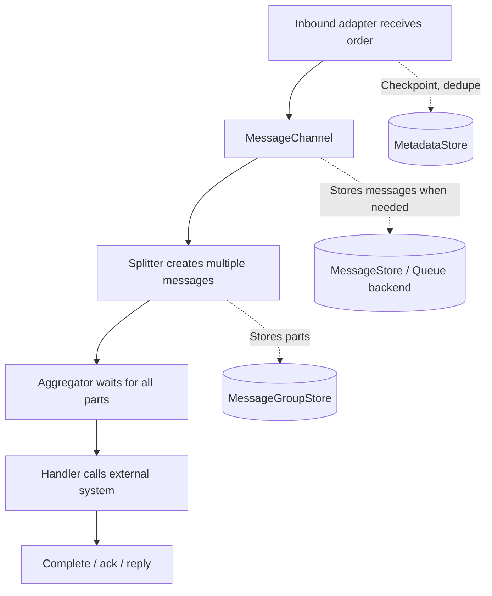
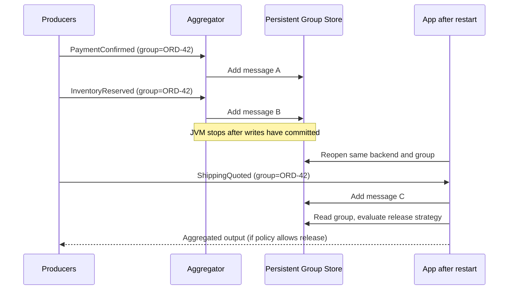
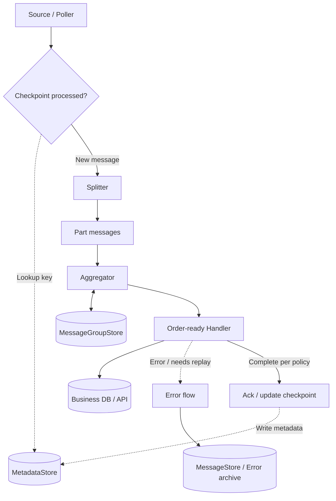

# Message Store, Group Store, and Metadata Store in Persistence and Restarts

## Learning Objectives

In Spring Integration, messages are not necessarily persisted to disk. A message passing through a `DirectChannel` may be processed immediately on the sender's thread; messages in a `QueueChannel`, aggregator state, or an inbound adapter's checkpoint can exist for a long time. If the application stops unexpectedly and restarts, **which states survive, which states are lost, and how do we continue without dropping or duplicating work?**

The lesson **Message Store, Group Store, and Metadata Store** belongs to the **Persistence and Restarts** chapter in the **SPRING_INTEGRATION_RUNTIME** module. It connects the three storage types to Spring Integration's execution lifecycle across channels, endpoints, consumers, pollers, and executors, then examines transactions, retries, error handling, correlation, threading, performance, and runtime state on restart.

After this lesson, you will be able to:

- Distinguish `MessageStore`, `MessageGroupStore`, and `MetadataStore` by stored data, key types, and API contracts.
- Identify what is lost when using in-memory stores and the conditions under which a persistent store genuinely recovers committed data.
- Design a flow using JDBC message/group stores and a JDBC metadata store; understand the required schema, namespace, serializer, and transactions.
- Explain how aggregators, persistent queues, accept-once filters, and checkpoints use stores at different points in time.
- Build restart/crash scenarios at each processing step, distinguishing persisted messages, delivered messages, and committed side effects.
- Test recovery of messages, message groups, metadata, and idempotency policies, and diagnose common post-redeploy failures.

## 1. A Restart Is a Runtime Boundary, Not a Perfect Rewind

When a JVM is killed, a host loses power, or a pod is replaced, Java state in RAM is lost. **Persistence** mechanisms only preserve data written to a backend that survives restarts and committed according to that backend's contract.

Consider this flow:



Different failure windows can occur:

- The adapter **has read** a message but has not yet acknowledged the source.
- A message is sitting in an **in-memory channel** or an **executor queue**.
- The splitter created three branches, but the aggregator has received only two.
- The metadata store recorded `seen`, while the business work has not yet been performed.
- The handler successfully called the external API, but the database has not recorded the `DONE` state.
- The aggregator released an output, but the output has not been delivered to the next consumer.

A persistent store **does not solve all of the windows** listed above. It only protects data within the scope that a component actually writes to that store. Therefore, you must also design the **durable write point**, **ack point**, **transactions**, **retry/redelivery semantics**, and **how consumers reactivate on restart**.

### 1.1. Four States to Track Separately

```text
RECEIVED  -> PERSISTED  -> DELIVERED  -> BUSINESS_COMMITTED
  source       store         handler       business outcome
```

These four states are not equivalent:

- **Received:** the adapter or channel received the message, though it is not necessarily persisted durably.
- **Persisted:** a record or group has been saved and committed; the consumer has not necessarily received it.
- **Delivered:** the handler received/read the message; the business transaction has not necessarily succeeded.
- **Business committed:** business state is definitively recorded, for example a unique order/transfer has been committed.

After a restart, a message may be re-read from the store or source even though an external operation already succeeded. That is why **idempotency and business keys** are needed, even when you already have a database storing messages.

## 2. Three Store Types Solving Three Different Problems

Spring Integration uses several storage abstractions with distinct purposes. Looking at the **key** type, **value** type, and consuming component tells you which store to choose.

| Abstraction | Logical Key | Value/State Managed | Typical API | Common Scenarios |
| --- | --- | --- | --- | --- |
| `MessageStore` | `UUID` in `MessageHeaders.ID` | A single `Message<?>` | `addMessage`, `getMessage(UUID)`, `removeMessage(UUID)` | Claim check, looking up stored messages, custom recovery |
| `MessageGroupStore` | `groupId` (`Object`) | A `MessageGroup` of multiple messages and group metadata | `addMessageToGroup`, `getMessageGroup` | Aggregator, resequencer, certain queue models |
| `MetadataStore` | `String` | Small status `String` value | `get`, `put`, `remove` | Poller checkpoint, accept-once filter, dedupe marker, small tokens |
| `ConcurrentMetadataStore` | `String` | Metadata string with conditional updates | `putIfAbsent`, `replace` | Preventing key contention across multiple workers |
| Dedicated business store/ledger | Order ID, request ID, account ID | Business state with unique/transaction constraints | SQL repository, command handler | Exactly-once *effect* or durable idempotency |

One implementation can support **both** `MessageStore` and `MessageGroupStore` (for example `SimpleMessageStore`, `JdbcMessageStore`). That **does not turn** the `MessageStore` interface into a business-key query API; the two interfaces have different contracts.

### 2.1. A Message's Key Differs from a Group's Key

For example, request `ORD-42` produces two partial results:

```text
Message A:
  headers.id       = UUID-A
  correlationId    = "tenant-a:ORD-42"
  payload          = PaymentConfirmed(...)

Message B:
  headers.id       = UUID-B
  correlationId    = "tenant-a:ORD-42"
  payload          = InventoryReserved(...)

MessageStore:
  UUID-A -> Message A
  UUID-B -> Message B

MessageGroupStore:
  "tenant-a:ORD-42" -> {Message A, Message B}

MetadataStore:
  "si:orders:checkpoint" -> "offset-120"
```

`MessageHeaders.ID` identifies a single message instance, typically of type `UUID`. `correlationId` can be a string or another object and usually helps identify messages that belong together in a group. `MetadataStore` does not use UUIDs/group keys by default: it stores string keys and string values defined by the adapter/application.

If a transformer creates a new message, the message ID can change while the business key/correlation is preserved. Consequently, looking up a UUID in `MessageStore` using a correlation ID **uses the wrong API**; to find a group, you must know the actual group ID.

### 2.2. A Store Is Not a Channel or a Scheduler

A `MessageStore` only provides a place to save and retrieve messages. Calling `addMessage(message)` **does not automatically dispatch the message** to consumers; after a restart, there is no hidden scheduler automatically scanning all stored messages and calling handlers. You need a connecting component such as a queue/channel, aggregator, inbound adapter, poller, or a purpose-built recovery worker.

Similarly, `MetadataStore.put("cursor", "120")` does not automatically resume reading the source at offset 120. Only when the restarted adapter or logic **actually reads the same key** from the same backend does that checkpoint take effect.

## 3. Trying All Three Stores with an In-Memory Example

Before using JDBC or Redis, you can verify the difference between the three abstractions in a single program.

```java
import java.util.UUID;

import org.springframework.integration.store.MessageGroup;
import org.springframework.integration.store.MessageGroupStore;
import org.springframework.integration.store.MessageStore;
import org.springframework.integration.store.SimpleMessageStore;
import org.springframework.integration.metadata.MetadataStore;
import org.springframework.integration.metadata.SimpleMetadataStore;
import org.springframework.messaging.Message;
import org.springframework.messaging.support.MessageBuilder;

public class StoresBasicsDemo {

    public static void main(String[] args) {
        // The same object supports storing messages and message groups.
        SimpleMessageStore combined = new SimpleMessageStore();
        MessageStore messages = combined;
        MessageGroupStore groups = combined;

        // String -> String metadata belongs to a different store.
        MetadataStore metadata = new SimpleMetadataStore();

        Message<String> payment = MessageBuilder
                .withPayload("PAYMENT_CONFIRMED")
                .setHeader("correlationId", "tenant-a:ORD-42")
                .setHeader("businessKey", "ORD-42")
                .build();

        Message<String> inventory = MessageBuilder
                .withPayload("INVENTORY_RESERVED")
                .setHeader("correlationId", "tenant-a:ORD-42")
                .setHeader("businessKey", "ORD-42")
                .build();

        UUID paymentId = payment.getHeaders().getId();

        // Save/read a specific message by UUID.
        messages.addMessage(payment);
        Message<?> loaded = messages.getMessage(paymentId);
        System.out.println(loaded.getPayload()); // PAYMENT_CONFIRMED

        // Save multiple messages under a group key.
        String groupKey = "tenant-a:ORD-42";
        groups.addMessageToGroup(groupKey, payment);
        groups.addMessageToGroup(groupKey, inventory);

        MessageGroup group = groups.getMessageGroup(groupKey);
        System.out.println(group.size()); // 2

        // Small metadata with its own String key/value.
        metadata.put("si:orders:checkpoint", "offset-120");
        System.out.println(metadata.get("si:orders:checkpoint"));

        // Each API has its own delete/cleanup lifecycle.
        // Not deleting yet because the demo inspects all three data types.
    }
}
```

The example using `SimpleMessageStore` and `SimpleMetadataStore` is **in-memory**. It illustrates the keys and APIs, **not persistence across restarts**. When the JVM stops, data in these instances is lost. Never test durability by creating a new `new SimpleMessageStore()` and expecting to read previously saved messages.

A `MessageGroupStore` holds messages associated with a group; it does not decide on its own when the group is ready to release. That is decided by the **correlation strategy**, **release strategy**, and an endpoint such as an aggregator.

## 4. In-Memory vs. Persistent: What Actually Survives a Restart?

| Component | When Only in RAM | When Using an Appropriate Persistent Backend | Conditions for Recovery |
| --- | --- | --- | --- |
| `SimpleMessageStore` | Lost when process stops | Replace with an appropriate persistent store | Record committed, same backend/namespace, compatible serializer |
| `SimpleMessageStore` as group store | Pending groups lost | Persistent `MessageGroupStore` preserves group state | New aggregator reads same group, compatible release policy |
| `SimpleMetadataStore` | Cursors/dedupe keys lost | Persistent `MetadataStore` preserves key/value | Adapter/flow uses same key, prefix, and backend |
| `DirectChannel` | Does not create a durable queue | Declaring another store does not make it durable | Upstream must ensure source/ack or persist elsewhere |
| `ExecutorChannel` with in-RAM queue | Queued/in-flight tasks may be lost | Must design durable queue/source and redelivery | Worker/ack/transaction align with source |
| Queue or adapter with durable backend | Implementation-dependent | Can retain data across restarts | Consumer restarts and has claim/ack policy |
| Service call to external API | Outside Spring Integration's database | Does not roll back with local store | Idempotency or compensating workflow |

"Persistent" does not mean **every message in the application** is durable. Only messages that a component has written through the corresponding store/queue and committed successfully are within its protection scope.

### 4.1. Persistent Storage Does Not Equal HA or Exactly-Once

- **Durability:** committed records can survive a restart.
- **High availability:** the backend and processing flow continue serving when a node fails; requires actual replication/failover.
- **At-least-once:** messages may be redelivered after failure; handlers must tolerate duplicates.
- **At-most-once:** reduces duplicate risk by not redelivering, at the cost of potential message loss.
- **Exactly-once business effect:** requires contracts and safeguards at the target resource (unique business key, idempotent API, transactional constraints...), and cannot be inferred merely from enabling a `MessageStore`.

A message existing in JDBC does not guarantee it is processed only once after a crash. A message missing from the store also does not prove the side effect completed.

## 5. JDBC MessageStore and MetadataStore: Foundational Configuration

Spring Integration provides JDBC-backed implementations. An illustrative configuration:

```java
import javax.sql.DataSource;

import org.springframework.context.annotation.Bean;
import org.springframework.context.annotation.Configuration;
import org.springframework.integration.jdbc.store.JdbcMessageStore;
import org.springframework.integration.jdbc.metadata.JdbcMetadataStore;

@Configuration
class PersistentStoreConfiguration {

    @Bean
    JdbcMessageStore jdbcMessageStore(DataSource dataSource) {
        // Can be used as either MessageStore or MessageGroupStore.
        return new JdbcMessageStore(dataSource);
    }

    @Bean
    JdbcMetadataStore jdbcMetadataStore(DataSource dataSource) {
        // Stores String key -> String value for checkpoints, filters...
        return new JdbcMetadataStore(dataSource);
    }
}
```

This example requires `spring-integration-jdbc`, a configured `DataSource`, an appropriate transaction manager, and **the tables/schemas required by Spring Integration for the exact version and database engine**. Creating the beans alone does not prove the tables are ready or that data is durable. Initialize the schema via controlled migrations and verify DB access permissions.

`JdbcMessageStore` and `JdbcMetadataStore` serve **two different data models**. They may share a datasource, but that does not mean a message/group operation and a metadata operation always share the same transaction unless an actual transaction boundary is configured.

### 5.1. Avoid Mixing Namespaces, Regions, and Purposes

In a large system, multiple flows may share a single backend. Set namespaces/prefixes or storage regions consistent with the implementation's capabilities:

```text
Order flow:
  message/group key:  tenant-a:ORD-42
  metadata key:       si:orders:v1:poller:lastCursor

Invoice flow:
  message/group key:  tenant-a:INV-100
  metadata key:       si:invoice:v1:remote-file:...
```

These strings are examples of **logical keys**, not default physical row/key names of the JDBC store. With persistent stores, distinguish region/table prefix/implementation settings from the business keys passed into the API by the application. Two message stores pointing to the same table without proper scoping configuration can interfere with each other.

Do not delete "all metadata from the previous version" during deployment if there are still pending messages, active flows, or source data that might redeliver later.

### 5.2. Serialization Is a Survival Requirement

A message may carry application DTOs, collections, custom headers, or `replyChannel`/`errorChannel` info. A message serializable today might fail to read after a deploy when class/package names or schemas change. For persistent stores, define:

- Storage format for payload/headers and serializability of every type.
- DTO/schema versioning and backward compatibility policy.
- Handling headers containing runtime objects such as channel beans, executors, or proxies.
- Payload size limits, security, encryption, retention, and backups.
- How pending records are migrated after an application upgrade.

Never assume every Java object placed into a `Message` can round-trip through JDBC/Redis or pass through a broker. Test **write -> stop application -> start new version -> read -> process**, not just unit tests reading back immediately in the same JVM.

## 6. MessageStore: Saving a Message and Retrieving by UUID

`MessageStore` manages a message instance by `MessageHeaders.ID`:

```java
import java.util.UUID;

import org.springframework.integration.store.MessageStore;
import org.springframework.messaging.Message;
import org.springframework.messaging.support.MessageBuilder;

void archive(MessageStore store) {
    Message<String> input = MessageBuilder
            .withPayload("ORDER_ACCEPTED")
            .setHeader("businessKey", "ORD-42")
            .setHeader("correlationId", "corr-42")
            .build();

    UUID id = input.getHeaders().getId();

    store.addMessage(input);
    Message<?> restored = store.getMessage(id);

    if (restored == null) {
        throw new IllegalStateException("Cannot locate " + id);
    }

    // Do not equate reading the record with completing business work.
    System.out.println(restored.getPayload());
}
```

When the store is JDBC-backed and the transaction has committed, the message can be read back after a restart **if** the code knows the old UUID and the backend still retains the record. However, a question arises: **after a crash, where do you get the UUID?** If the UUID existed only in RAM and the process died, even though the record sits in the database, it is hard to know which record to fetch.

For real workflows, you need a durable business index/record linking the business key and message ID, or a dedicated component that owns scanning/receiving messages by queue/group. Do not treat `MessageStore` as a `getMessage("ORD-42")` API — the core lookup method takes a UUID.

### 6.1. Claim Check and Recovery

In the *claim-check pattern*, a large payload or message is stored in a store while a small **claim token** is passed through subsequent steps:

```text
Message<LargePayload>
    -> Claim-check in: store.addMessage(...)
    -> Message<ClaimToken>
    -> Broker / Channel / Routing
    -> Claim-check out: look up store by token
    -> Restore payload and process
```

If the application restarts after sending the claim token but before the consumer checks it out, the token must point to a **persistent store accessible by the new consumer**. If the token pointed only to the old JVM's `SimpleMessageStore`, the data is gone.

Another trap: checking out and **immediately deleting** the message from the store before the downstream handler succeeds. If the process crashes right after checkout, the ability to retrieve the payload may be lost. Removal/retention policies must align with acks, transactions, and retries across the entire flow.

### 6.2. Saving a Message Does Not Automatically Schedule Redelivery

If code only calls `store.addMessage(input)`, after a restart the record may still sit in JDBC while **no endpoint automatically reads it**. You must define a recovery worker, queue/correlation component, or a UUID-based retrieval step to resume. Any replay decision must check current business state to avoid duplicate side effects.

## 7. MessageGroupStore: Aggregators and Incomplete Groups

`MessageGroupStore` stores parts sharing a group ID:

```text
groupId = tenant-a:ORD-42
  ├── PaymentConfirmed    [messageId=UUID-A]
  ├── InventoryReserved   [messageId=UUID-B]
  └── ShippingQuoted      [messageId=UUID-C]
```

An aggregator requires two separate policies:

1. **Correlation strategy** returns the group ID; for example reading `headers['correlationId']`.
2. **Release strategy** decides when conditions are met to emit output; for example when all three valid result types have arrived.

A persistent group store helps preserve parts **already saved and committed** across restarts, but it does not decide on its own "three messages are enough" or "how to release if one part never arrives."

### 7.1. Model of a Group Surviving Before and After Restart



Group data A/B can still remain when using `JdbcMessageStore` properly. However, after a restart, operational questions must still be answered:

- Has the new consumer/aggregator started and received part C?
- Does the new correlation strategy still produce **the same group key and data type**?
- Did the release strategy change after deployment?
- Do parts A/B deserialize into the current payload types?
- Was the group expired/cleaned up by a timeout or maintenance policy?
- Was the output of a pre-crash release already sent, and could it be emitted twice?

### 7.2. Example of an Aggregator Attached to a Message Group Store

Java DSL example illustrating how to pass a durable `MessageGroupStore` to an aggregator:

```java
import org.springframework.context.annotation.Bean;
import org.springframework.integration.dsl.IntegrationFlow;
import org.springframework.integration.store.MessageGroupStore;

@Bean
IntegrationFlow orderPartsFlow(MessageGroupStore groupStore) {
    return IntegrationFlow.from("orders.parts")
            .aggregate(spec -> spec
                    .messageStore(groupStore)
                    .correlationStrategy(message ->
                            message.getHeaders().get("correlationId"))
                    // Suitable for demo only if there are exactly three distinct parts.
                    .releaseStrategy(group -> group.size() >= 3))
            .handle(message -> System.out.println(
                    "Aggregated: " + message.getPayload()))
            .get();
}
```

To run, a `MessageGroupStore` bean and the `orders.parts` channel must be configured in the application. In a complete Spring Integration configuration, also consider group timeout, expiration, lock registry, and transaction scope. If multiple candidate beans exist for `MessageGroupStore`, use a qualifier to inject the intended store.

**Business warning:** `group.size() >= 3` is a simplified example. Three messages could consist of `PAYMENT_CONFIRMED` sent twice and `INVENTORY_RESERVED` once, while `SHIPPING_QUOTED` is still missing. Production should verify required part types, deduplication, and late arrivals — not merely count items.

### 7.3. Successful Release Does Not Mean Downstream Committed

Suppose an aggregator releases output and the message goes to a handler calling an external API. If the handler fails or the process crashes after release, the group may already have transitioned/cleaned up per policy. A persistent group store **does not automatically provide** an atomic commit between output release and an HTTP API. Place transactions at the right boundaries, use idempotent downstream handlers, and design redelivery/recovery for the output if needed.

A persistent group store serves **aggregation state**. It is not equivalent to a queue that replays all outputs, does not guarantee exactly-once, and does not replace an error flow.

## 8. MetadataStore: Checkpoints, Accept-Once, and Small State

Unlike the two stores above, `MetadataStore` has a `String key -> String value` contract. It typically accompanies inbound adapters/filters or business logic to remember a small piece of state.

```text
"si:poller:invoice:lastCursor"           -> "cursor-120"
"si:file:processed:2026-11-22.csv"        -> "timestamp-or-signature"
"si:dedupe:tenant-a:order-event-E42"      -> "DONE"
```

Direct illustrative example:

```java
import org.springframework.integration.metadata.MetadataStore;

void saveCheckpoint(MetadataStore metadata) {
    metadata.put("si:orders:v1:lastCursor", "offset-120");

    String cursor = metadata.get("si:orders:v1:lastCursor");
    System.out.println("Resume from " + cursor);
}
```

This is **an application-managed key**. If the adapter uses a different key or is not configured to use this exact bean, writing `si:orders:v1:lastCursor` will not make the adapter recover from the value just written.

### 8.1. Checkpoints Can Cause Replays or Skips If Placed at the Wrong Time

Consider a source reading records by offset:

```text
offset 120 -> receive message -> write checkpoint=121 -> call API -> ack
```

If the checkpoint is written/committed **before** the API succeeds, and the process crashes, after restart the adapter may start at 121 and **skip** record 120. Conversely, if the checkpoint is written after the API succeeds, a crash between the two steps can cause record 120 to be re-read and the API called twice.

No single write ordering automatically guarantees neither loss nor duplication across two independent systems. You must coordinate offset/ack transactions, durable work queues, and idempotency at the target resource.

### 8.2. ConcurrentMetadataStore and Conditional Locking

When multiple consumers/instances share a key, `ConcurrentMetadataStore` supports conditional operations like `putIfAbsent` and `replace`.

```java
import org.springframework.integration.metadata.ConcurrentMetadataStore;

boolean markIfNew(
        ConcurrentMetadataStore metadata,
        String tenantId,
        String eventId) {

    String key = "si:dedupe:" + tenantId + ":" + eventId;

    String previous = metadata.putIfAbsent(key, "SEEN");
    return previous == null;
}
```

`putIfAbsent` helps prevent two workers from registering the same key in a backend that supports the operation properly. However, if writing `SEEN` succeeds and the worker crashes **before the side effect commits**, another worker may refuse to reprocess it; this creates a risk of **lost tasks**. A dedupe contract is only correct when tied to processing state and ack/commit timing.

`ConcurrentMetadataStore` **does not automatically add TTLs, fencing tokens, or recovery leases**. A stale key can block forever, while deleting keys too early can cause duplicate work. If you need `PENDING/PROCESSING/DONE` states, consider a business repository or a backend with compare-and-swap/transactions and safe expiry.

### 8.3. Choosing Retention and Cleanup After Restarts

- Checkpoints typically need to survive **restarts and redeploys**; do not set arbitrary TTLs.
- Persistent file filter metadata should be retained according to the source file lifecycle and reprocessing policy.
- Dedupe markers need to live at least as long as the redelivery/replay window the system wants to block.
- Temporary leases need TTLs, renewal, and owner verification; TTL alone is not a distributed lock.
- Error or audit metadata must follow separate retention and access-control rules.

Deleting metadata can cause previously blocked inputs **to be accepted again**. Cleanup must be decided by the component owning the key; never delete a shared prefix merely because one key type within it has a short TTL.

## 9. How Do the Three Stores Work Together in a Recoverable Flow?

Suppose an order has three branches and starts from an inbound poller:



Each store has a different owner and update timing:

1. `MetadataStore` holds **checkpoints or markers** helping the poller track how far it has read/completed.
2. `MessageGroupStore` holds **waiting parts**, allowing the aggregator to combine them when the missing part arrives.
3. `MessageStore` can hold **a message needing later retrieval** by UUID, such as a claim-check record or recovery archive.
4. The business database/API holds **the real outcome**; technical stores do not automatically replace ledgers or unique constraints.
5. The broker/source and transaction manager determine **ack/rollback/redelivery**; no single store coordinates all of them by itself.

Define a runtime contract table per flow instead of enabling all three stores and hoping all processing becomes durable.

### 9.1. Sample Contract Table

| Question | Illustrative Choice | Who Is Responsible? |
| --- | --- | --- |
| When is the source acknowledged? | After work is durably persisted or side effect commits per policy | Adapter + transaction/source |
| Where is the raw message stored? | Durable broker/queue or `MessageStore` with claim token | Producer/adapter |
| Where are waiting order parts stored? | `JdbcMessageStore` via `MessageGroupStore` | Aggregator |
| Where is offset/file state stored? | `JdbcMetadataStore` or corresponding backend | Poller/filter |
| When is a group deleted? | Per tested release/expiration/cleanup policy | Aggregator/group store policy |
| When is an archive deleted? | After business state completes and retention allows | Recovery worker |
| When is an order considered DONE? | When the business/target DB confirms commit | Domain handler |
| How are duplicates prevented? | Unique business key/idempotent API/dedupe state per contract | Domain + source |
| What when an error cannot be retried? | Durable error record/DLQ with correlation and status | Error flow/operations |

## 10. Transactions and Critical "Crash Windows"

Persistence is most useful when you know **when commits happen**. Analyze every milestone before and after a side effect.

```text
T0: Source delivers message
T1: Store writes message/group/metadata
T2: Commit store transaction
T3: Handler calls external API
T4: API returns success
T5: Write DONE state
T6: Ack source / update offset
```

| Crash Timing | What May Survive After Restart | Risk |
| --- | --- | --- |
| Before T1 | No record in store yet | Depends on whether the source redelivers |
| After T1 but before T2 | Uncommitted write may roll back | Cannot treat an `addMessage` log line as durability |
| After T2 but before T3 | Pending state exists | Consumer/recovery must restart properly |
| After T3 but before T4 | API may have executed even though client missed response | Retry may cause duplicate side effect |
| After T4 but before T5 | Side effect finished, DONE state not yet written | Replay requires idempotency/lookup |
| After T5 but before T6 | Business DONE, but source not acked | Source may redeliver message; must recognize DONE |
| After T6 | Source may not redeliver | Must be certain all required durable steps completed |

### 10.1. One JDBC Transaction Does Not Span All Resources

When `JdbcMessageStore` and `JdbcMetadataStore` share the same datasource/transaction manager, related operations can be designed to participate in the same JDBC transaction **if** they run on the same thread and within an appropriate boundary. However:

- An external HTTP API **is not** automatically part of that JDBC transaction.
- Broker acks may require a separate transaction or coordination mechanism.
- Crossing an `ExecutorChannel` usually switches to another thread; a transaction bound to the caller thread does not follow automatically.
- A recovery callback that catches an exception and returns normally can alter the commit/ack outcome.
- `MessageStore` is still not a transaction manager.

If a handler writes to the DB and then emits an event, a **transactional outbox** is a design pattern that writes business state and the event to emit within the same DB transaction, then uses a worker to forward it. This is not built automatically into `MessageStore`: it requires an appropriate schema and worker/outbox contract.

### 10.2. Do Not Delete State Too Early

Dangerous scenario:

```text
Worker reads message from persistent store
  -> removeMessage(id)
  -> calls API
  -> process crashes
```

The record was deleted before confirming the side effect, so the opportunity to recover may be lost. Conversely, deleting after the API call succeeds can still lead to duplicates if a crash occurs between the two steps.

You usually need **business state** (for example `PENDING`, `PROCESSING`, `DONE`), unique keys, idempotency, and a strict ack/cleanup policy — not just moving where `removeMessage` is called.

## 11. Pollers, Executors, and Startup: Who Keeps Reading Data?

### 11.1. DirectChannel and ExecutorChannel

`DirectChannel` passes messages directly to subscribers on the sender's thread. It does not create a durable storage region on its own. If a synchronous flow is killed mid-handler, you need a source capable of redelivery or a durable boundary placed earlier.

`ExecutorChannel` hands off processing to a thread in the executor. If the executor only holds tasks in an in-RAM queue, queued or in-flight messages can be lost when the process dies. Configuring a persistent store that is not used by the executor/channel **does not change** this.

### 11.2. Pollers and Persistent Sources

A poller can read from a channel/adapter backed by a database, broker, filesystem, or remote source. Restart behavior depends on the source type:

- **Database poller:** needs proper queries/transactions and claim states so records are neither missed nor duplicated.
- **File/remote file adapter:** a persistent accept-once filter typically stores metadata to avoid re-accepting seen files. Deleting or changing prefixes can cause old files to be reprocessed.
- **Queue-backed channel:** needs the queue's backend and ack/removal semantics; ensure the post-restart consumer reopens the right queue/group.
- **Aggregator:** persisting pending groups does not mean a poller automatically scans and releases all groups after a restart without a new arrival, timeout task, or corresponding configured component.

### 11.3. Safe Startup Sequence

A sensible operational sequence **to verify**, not an automatic checklist guaranteed by the framework:

1. Verify the storage backend, schema migrations, and access permissions are ready.
2. Initialize message/group/metadata stores with the right namespaces, serializers, and transactions.
3. Start endpoints/consumers that will receive messages or process groups.
4. Verify pollers/adapters read the right checkpoints and group timeouts/reapers (if needed) are actually configured.
5. Then open input traffic according to an appropriate rollout policy.
6. Monitor backlog, pending groups, deserialization errors, duplicates, and reprocessing rates.

During controlled shutdown, restrict new intake, wait appropriately for in-flight work, or ensure the source can redeliver. Do not treat `stop()` as a command to "flush every in-RAM object into the store." Check the shutdown behavior of each adapter and endpoint.

## 12. Error Flows, Retries, and Persisted Messages

When a handler fails, the message may be retried within one invocation, the source may redeliver, or an operator may replay from an archive. These three loops differ:

```text
RetryAdvice:       handler attempt #1 -> #2 -> #3
Broker redelivery: delivery #1 -> rollback -> delivery #2
Manual replay:     error archive -> fix data -> resend
```

Having a `MessageStore` does not automatically convert exceptions into `ErrorMessage`s. In synchronous flows, exceptions may propagate back to the caller; via executors/pollers, an error handler may publish an `ErrorMessage` per configuration. Persisting errors requires **a consumer/recovery handler that actually writes to the archive**.

### 12.1. Example: Extracting the Original Message from ErrorMessage

```java
import org.springframework.messaging.Message;
import org.springframework.messaging.MessagingException;
import org.springframework.messaging.support.ErrorMessage;
import org.springframework.integration.store.MessageStore;

void saveFailedMessage(MessageStore archive, ErrorMessage error) {
    Throwable cause = error.getPayload();

    Message<?> failed = error.getOriginalMessage();
    if (failed == null && cause instanceof MessagingException messaging) {
        failed = messaging.getFailedMessage();
    }

    if (failed == null) {
        // Production needs a dedicated error record when no original message exists.
        throw new IllegalStateException("No failed message", cause);
    }

    archive.addMessage(failed);
}
```

`ErrorMessage.getPayload()` is a `Throwable`, **not the order payload**. `getOriginalMessage()` and `MessagingException.getFailedMessage()` may be `null` or point to messages from different stages. When archiving for replay, also save an error record with `businessKey`, `correlationId`, message ID, endpoint, cause, timestamp, attempt/delivery count, status, and retention.

Never treat `archive.addMessage(failed)` succeeding as "the broker acked" or "business work completed." Those two outcomes must be verified separately.

### 12.2. Retries Combined with Persistent State Can Multiply Executions

Suppose a handler has `maxAttempts=3` and the broker redelivers up to 4 times. One message could trigger up to `3 × 4 = 12` downstream calls if all attempts fail before recovery. If an operator manually replays after a crash, the call count grows further.

Use a **business idempotency key** stable across retries/restarts, rather than relying solely on each newly generated `MessageHeaders.ID`. When replaying from a group store, check whether the group was already released, expired, or still pending; otherwise new messages could mix with stale results.

## 13. Correlation, Group Identity, and Post-Deploy State

For an aggregator, the group ID might come from `headers['correlationId']` or an expression like `headers['tenantId'] + ':' + payload.orderId`. After a restart, if new code changes the expression or key type, stored message parts may no longer join with parts arriving later.

Example:

```text
Version 1: groupId = "ORD-42"
Version 2: groupId = "tenant-a:ORD-42"

Persistent store still holds group "ORD-42"
New message enters group "tenant-a:ORD-42"
=> Two different groups; both may wait indefinitely.
```

Things to keep fixed or migrate when deploying a new version:

- Correlation/group key structure, tenant namespacing, and the Java type used as the key.
- `sequenceNumber`, `sequenceSize`, and release strategy.
- Late-arrival, expiry, cleanup, and completed-group policies.
- Payload class/schema for deserializing old messages.
- Metadata names/prefixes for accept-once filters, checkpoints, and dedupe keys.
- Migration/replay procedures when contracts change significantly.

Do not treat `MessageHeaders.ID` as a durable correlation ID for an entire workflow. One business operation can produce multiple distinct message instances after transforms or redeliveries; an explicit business key is required.

## 14. Security, Retention, and Performance of Persistent Stores

Persistent storage brings recoverability, but also increases cost and operational responsibility:

| Aspect | Design Considerations |
| --- | --- |
| **Capacity** | Number of pending messages, unreleased groups, metadata keys, payload sizes |
| **I/O** | Latency of add/get/remove, batch size, indexes, lock contention, connection pool |
| **Serializer** | Size/format, schema version, ability to read legacy data |
| **Concurrency** | Multiple consumers accessing store, claim/lock/lease, transaction isolation |
| **Retention** | When to delete archived messages, completed groups, and stale metadata |
| **Security** | Sensitive data in payloads/headers, encryption, access controls, audit |
| **Backup/restore** | Consistency across business DB, stores, and broker; periodic restore drills |
| **Multi-instance** | Shared backend/namespace, clocks, uniqueness, and clear ownership |

A persistent group containing thousands of large messages can cause an aggregator to consume heavy memory/CPU when reading the group. Storing every raw large payload also increases restore times and I/O pressure. When needed, consider claim-check, payload references, group size limits, partitioning, and cleanup while preserving recovery semantics.

For metadata, "cleaning up old keys to keep things tidy" can cause a poller **to forget its checkpoint** and reprocess the source. For groups, deleting unreleased groups can **lose waiting state**. For archives, deleting unfinished messages can **lose replay capability**. Therefore, cleanup must always be based on **business state + retention policy**, not merely age.

## 15. Diagnosing Failures When the Application Restarts

| Symptom | Possible Cause | Check |
| --- | --- | --- |
| Message not found after restart | In-memory store, wrong backend/namespace, uncommitted message, already cleaned up | Bean implementation, datasource, UUID, transaction |
| Pending group before restart is now empty | Used `SimpleMessageStore`, namespace changed, group cleanup | Group ID, store type, row count |
| Group still in DB but aggregator does not release | Missing part never arrived, strategy changed, timeout task not running | Correlation key, release strategy, endpoint lifecycle |
| Poller re-reads all old data | In-memory metadata, new checkpoint key/prefix, file filter state deleted | `MetadataStore` bean, key, source state |
| Poller skips an unprocessed record | Checkpoint committed before side effect/ack | Offset write timing, transaction, business ledger |
| Message stored but nothing processes it | No reader/worker/queue consuming the store | Endpoint, poller, `IntegrationFlow` state |
| Duplicates after crash | Source redelivery/replay, missing idempotency, dedupe key deleted early | Business key, ack, retry layers, store cleanup |
| `ClassNotFoundException` or deserialization error | DTO/schema changed | Serializer, stored data version, deployment compatibility |
| State differs across pods | Separate in-memory stores or different backend config | Datasource/Redis, namespace, instance logs |
| Error message missing from archive | No error consumer, synchronous error not published, archive write failed | Error flow, transaction, error channel |
| JDBC store bottlenecks poller | Slow queries, locks, small connection pool, large payloads | Latency metrics, DB plan, pool saturation |
| Store has data but API never succeeded | Store commit occurred before business work | State machine and retry/recovery worker |

### 15.1. Sequence for Investigating a Message Lost After Restart

1. Find the `businessKey`, `correlationId`, and message ID at the time the source received it.
2. Identify which store bean/component **actually wrote** the message, group, or metadata.
3. Locate the backend/namespace/schema, the corresponding record, and whether its transaction committed.
4. Check whether consumers/pollers/aggregators started and registered to read the right store after restart.
5. Compare correlation/group keys and payload serializers between pre- and post-deploy versions.
6. Inspect source ack/redelivery, retry advice, error flows, and replay records.
7. Verify the **final business state** before allowing replay or cleanup to avoid creating duplicates.

## 16. Designing a Restart and Crash-Window Test Suite

A test that only calls `addMessage()` followed by `getMessage()` within a single JVM is insufficient. A persistence/restart test suite should include real stops or recreating the application context/store instances with **the backend preserved**.

| Scenario | What to Prove |
| --- | --- |
| In-memory store, then create new JVM/context | Messages/groups/metadata in RAM are gone |
| JDBC store: write and commit, restart, then read back | Records remain with the right keys and payloads/headers |
| Write in transaction then roll back | Uncommitted data is not treated as durable |
| Aggregator holds two parts, restart, receive third | Right group releases when strategy/payloads are compatible |
| Poller metadata saved checkpoint, restart | Reads the right checkpoint when adapter uses the same store |
| Change payload DTO/serializer between two versions | Compatibility/migration issues are detected and handled |
| Source redelivers after crash before ack | Idempotent handler does not write duplicate business effects |
| Crash after external API succeeds but before DONE | Replay detects existing result or uses idempotent API |
| Two instances resume the same queue/group together | They do not unintentionally claim the same task; concurrency control works |
| Cleanup runs concurrently with recovery/replay | Does not accidentally delete records still needing processing |

### 16.1. Testing a Group Surviving Across a Restart

Set up an aggregator flow with `JdbcMessageStore`, correlation key `tenant-a:ORD-42`, and a release strategy requiring three parts:

1. Send `PAYMENT_CONFIRMED` and `INVENTORY_RESERVED`.
2. Confirm both parts committed to the persistent store and the aggregator **has not released yet**.
3. Stop the application context or container.
4. Restart with the same datasource, schema, key policy, and serializer.
5. Send `SHIPPING_QUOTED` with the same group ID.
6. Verify the output contains only the three expected part types, without mixing with another order.
7. Trigger redelivery of one part and check deduplication/late-arrival policy.

**Distinction in results:** "able to read the two old parts" proves persistence; "releasing exactly one business outcome after restart" additionally requires policies for correlation, release, idempotency, and commits.

### 16.2. Testing Checkpoints and Duplicates

Create a mock source with record `event-42`. Have the flow write the metadata checkpoint at different points, then stop the app after the mock API succeeds but before ack. Upon restart, verify that redelivery can occur. Add a unique business key or idempotency key at the API/DB so the business outcome is recorded only once.

**Expected result:** never assume "persistent metadata = exactly-once." Correctness comes from coordinating checkpoints, source delivery, and business logic.

## 17. Guided Labs

### Lab A — Distinguish Keys Across the Three Stores

Using the Section 3 example, create two `Message<String>` instances with different UUIDs and the same `correlationId`. Save each message using `MessageStore`, add them to a group using `MessageGroupStore`, and save a cursor using `MetadataStore`.

**Expected result:** `getMessage(UUID)` returns one message; `getMessageGroup(groupId)` returns the group; `get(metadataKey)` returns a string. You cannot retrieve a group by UUID or business key through the basic message store API.

### Lab B — Migrate from In-Memory to JDBC

Configure a dedicated JDBC backend for the test environment, version-appropriate schema, and `JdbcMessageStore`/`JdbcMetadataStore` beans. Write a message, a group, and a checkpoint, then restart.

**Expected result:** committed data survives the restart; serialization/namespacing work correctly. Repeat with in-memory stores to observe the difference. Test rolling back a write transaction.

### Lab C — Recover an Aggregator Missing One Part

Send two parts for `ORD-42`, stop the application, restart, and send the third part. Try changing the correlation key to `tenant-a:ORD-42` in a separate run to observe the group splitting.

**Expected result:** group durability does not substitute for stability of the correlation strategy and release policy.

### Lab D — Checkpoint Written Too Early

Build a mock flow `receive -> write metadata cursor -> call downstream`, make downstream fail, then restart. Compare with writing the checkpoint after downstream commits combined with an idempotency key.

**Expected result:** early writes can skip records; late writes can redeliver; idempotency and source ack/transactions address the necessary risks.

### Lab E — Two Workers and Claiming

Have two workers read the same message ID from a store or both read the processing state of a business key. Count calls to a mock API; add `PENDING -> CLAIMED -> DONE` states with conditional updates in the business backend.

**Expected result:** `getMessage(UUID)` is a lookup, not an exclusive claim. If the target resource still needs protection, use appropriate idempotency/fencing/unique constraints.

### Lab F — Testing Serialization Errors and Error Archives

Store an application DTO in a persistent store, then change the DTO version to simulate a schema mismatch. Design a way to read legacy data or migrate it. Also have a handler throw an exception and confirm the error flow actually saves the failed message with its correlation ID and can replay per policy.

**Expected result:** see the boundary between "a row exists in the DB," "the message can be read," and "safe replay."

## 18. Self-Check Questions

1. How do `MessageStore`, `MessageGroupStore`, and `MetadataStore` differ in keys, values, and API consumers?
2. Why does a `MessageStore` successfully writing a message not guarantee the message will continue processing after a restart?
3. How do `MessageHeaders.ID` and correlation/group ID differ?
4. Does an aggregator using a persistent group store automatically release all incomplete groups immediately upon restart? Why?
5. What are the risks of using `SimpleMessageStore` or `SimpleMetadataStore` in production if the application restarts?
6. When an adapter needs to resume from a saved offset, is merely creating a `JdbcMetadataStore` bean enough?
7. What operations does a JDBC transaction cover when a handler also calls an external HTTP API?
8. Why can crashing after an API succeeds but before writing `DONE` cause duplicates on replay?
9. If two replicas share the same persistent store, does `getMessage(UUID)` automatically ensure only one replica processes it?
10. How can changing a correlation expression or group key type after a redeploy leave an aggregator stuck?
11. What can deleting a persistent file filter's checkpoint do to source files that still exist?
12. Why is a persistent error archive not automatically a DLQ with a retry scheduler?
13. How can a metadata key used for deduplication cause **lost tasks** if written too early?
14. Which metrics and logs help distinguish uncommitted records, deleted records, and unread consumers?
15. Which test steps are sufficient to prove a message group can recover across a restart without duplicate processing?
16. When should you use a business repository/outbox instead of stretching the responsibilities of `MessageStore`?

**Key Takeaway:** `MessageStore` holds **a single message by UUID**, `MessageGroupStore` holds **multiple messages by group ID**, and `MetadataStore` holds **small state key/values** like checkpoints or processing markers. Persistence only protects data **written and committed to a backend that survives restarts**. To resume a flow safely, you must also design **recovery consumers, transactions, correlation, serializers, ack/redelivery, retries, cleanup, and business idempotency**.
