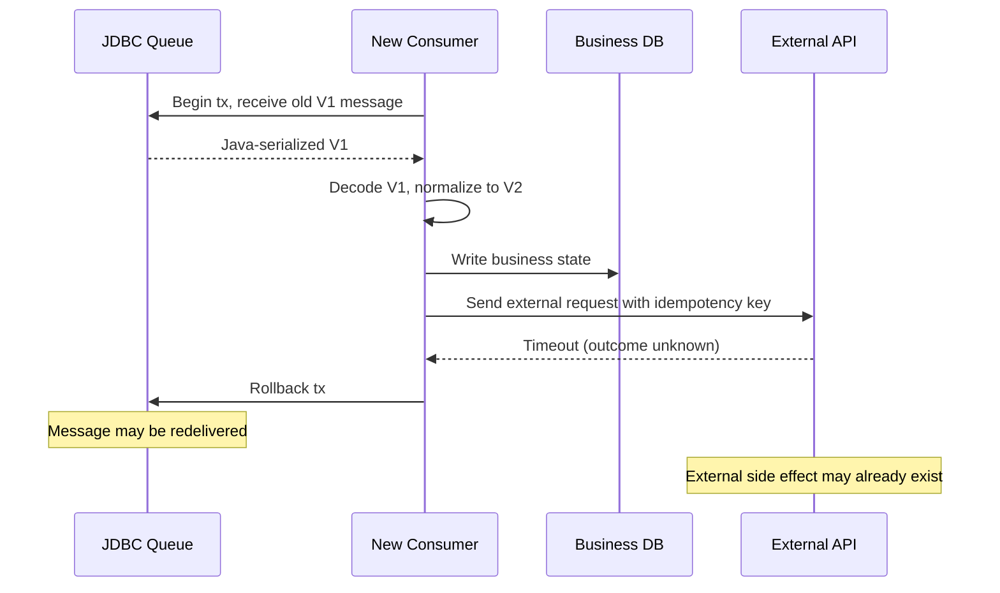
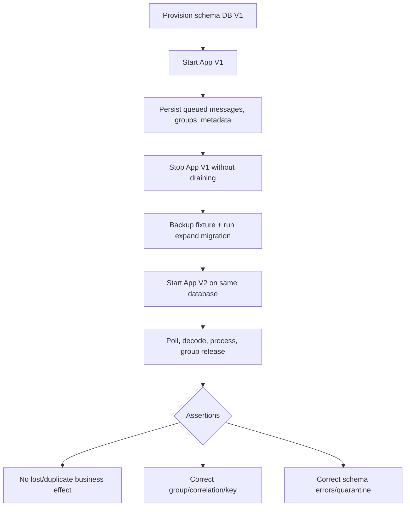

# Schema Versioning of Stored Data in Spring Integration Runtime

## 1. Why Is Schema Versioning a Runtime Problem?

In a stateless message flow, deploying a new version usually only requires restarting the application with the new code. However, when Spring Integration uses a **persistent message store**, data written by an older version can survive across multiple restarts: messages in a `QueueChannel`, incomplete message groups of an aggregator, file poller metadata, or keys of an idempotent receiver. The new version must **be able to read old data and continue processing with the right business meaning**.

For example: V1 receives a message with payload `OrderCreated(orderId, amount)` and stores it in a JDBC queue. The application is upgraded to V2, renaming the package/class of `OrderCreated` and adding a `currency` field. Even though the `INT_CHANNEL_MESSAGE` table still exists, V2's Java deserializer may fail to restore the V1 message. Conversely, the table may have new columns added while a V1 node still uses an incompatible SQL/query provider, causing errors on `poll()`.

**Schema versioning of stored data** is the practice of controlling read/write contract changes for **data that lives beyond the lifecycle of a single application run**. This lesson is part of the **Persistence and Restarts** chapter in the **SPRING_INTEGRATION_RUNTIME** module. The topic relates directly to channels, endpoints, consumers, pollers, executors, `IntegrationFlow` lifecycle, transactions, retries, message stores, correlation, runtime state, and failure recovery.

> **Version Scope:** The mechanisms described reference **Spring Integration 6.5.x**. Code examples use Java 17, PostgreSQL, and JDBC where indicated. Do not assume newer serializers or row mappers introduced in Spring Integration 7.x can be used directly in a 6.5 application.

Learning objectives for this lesson:

1. Distinguish **physical database schema**, **serialized message format**, and **semantic runtime state schema**.
2. Build a migration workflow capable of running with pending messages, multiple nodes, and rolling deployments.
3. Verify upgrades/rollbacks using real data **written by the old version and read by the new version**.
4. Diagnose why restarts leave queues appearing "empty," aggregators stuck, metadata re-accepted, or messages failing deserialization.
5. Design transaction, retry, replay, and idempotency boundaries when migrating long-lived data.

## 2. Three Version Layers Commonly Confused

| Layer | What Data Does It Hold? | Example Changes | How Does It Break After Upgrade? |
| --- | --- | --- | --- |
| **Physical/storage schema** | Tables, columns, indexes, constraints, SQL sequences, triggers, prefixes. | Adding a column to the channel store table; changing an index used for polling. | SQL reads/writes fail, lock waits spike, FIFO order breaks, or startup fails. |
| **Serialization/payload schema** | Bytes or documents of payloads and message headers. | `OrderCreated` changes package, `serialVersionUID`, or class fields; JSON renames a field. | `ClassNotFoundException`, `InvalidClassException`, mapper errors, lost headers, or silent data corruption. |
| **Semantic/runtime state schema** | Meaning of `region`, `groupId`, correlation keys, sequences, metadata keys/values, processed states. | Changing dedup key generation rules, changing aggregator release strategy, renaming a channel. | Messages sit in DB unfound; groups release incorrectly; events reprocessed or skipped. |

Additionally, there are **framework/driver/database versions**: upgrading Spring Integration 6.x, Java, PostgreSQL drivers, or Redis can alter queries, codecs, locks, and serialization contracts. A change that is "just a dependency bump" can still affect all three layers above.

### 2.1. DDL Version Differs from Payload Version

Do not use a single `version = 7` number to implicitly represent every format. For example:

```text
Application release       : 2026.11.0
Spring Integration line   : 6.5.x
Database migration        : V042
Persisted event schema    : order-created/v2
Idempotency key namespace : orders-in:v1
Aggregator correlation    : order-fulfillment:v1
```

Each version answers a different question. `V042` only indicates which physical migration has run; it does not tell you whether the payload in each row is V1 or V2. When a table contains mixed data, **each message or batch must have an identifiable format** via an envelope version, schema ID, controlled namespace, or verifiable mapping rule.

### 2.2. Evidence of Compatibility

"The application starts" is not enough to prove schema compatibility. To conclude an upgrade is safe, you need at least:

- The new version's SQL reads old rows and writes in compliance with the current DB schema.
- Old payloads/headers still deserialize against the new code and classpath.
- Group state, dedup keys, and channel names continue to carry **the same meaning**.
- The `receive + process` transaction can roll back on bad data; messages are not deleted before errors are detected.
- There is a way to trace rejected messages and perform controlled recovery/replay.

## 3. Tables and Resources Spring Integration Commonly Persists

With PostgreSQL and the default `INT_` table prefix, the Spring Integration 6.5 JDBC scripts define the following objects. **Column names, types, and indexes must be verified against the `schema-postgresql.sql` script from the exact JAR version and the actual deployed DDL**:

| Object | Primary Role | Risks When Changing Schema |
| --- | --- | --- |
| `INT_CHANNEL_MESSAGE` | Stores messages for persistent channels (`JdbcChannelMessageStore`). | `MESSAGE_CONTENT`, `MESSAGE_SEQUENCE`, `REGION` columns and poll/priority indexes must match the SQL query provider. |
| `INT_MESSAGE` | Message contents for `JdbcMessageStore` (claim-check/groups). | Old bytes may fail to read with a new codec. |
| `INT_MESSAGE_GROUP` | Metadata about message groups. | Changing completed/release logic may alter how old groups are handled. |
| `INT_GROUP_TO_MESSAGE` | Associates messages with groups. | Wrong foreign mapping or group key breaks aggregation. |
| `INT_METADATA_STORE` | Keys/values for metadata, feed/file markers, idempotency. | Changing `REGION` or key rules may render old keys unrecognized. |
| `INT_LOCK` | JDBC lock registry data if used by the application. | Changing lock semantics during a rolling upgrade can prevent nodes from coordinating safely. |
| `INT_MESSAGE_SEQ` | Sequence for message ordering in certain DBs/scripts. | Improperly recreating/resetting the sequence can cause collisions or break FIFO. |

Not every application creates or uses all tables. Each store can be configured with a different `tablePrefix`, `region`, and group key, or use a dedicated database/schema. Redis/MongoDB/Hazelcast have their own data layouts and persistence contracts; do not treat JDBC tables as a universal spec for every backend.

**Per Spring Integration 6.5 documentation:**

- `JdbcMessageStore` suits aggregators/claim-checks, whereas `JdbcChannelMessageStore` is optimized for message channels.
- The `spring-integration-jdbc` module ships sample scripts `org/springframework/integration/jdbc/schema-*.sql` for multiple database vendors. Those scripts are **structural templates**, not an automatic migration system.
- Since **Spring Integration 6.2**, `JdbcMessageStore`, `JdbcChannelMessageStore`, `JdbcMetadataStore`, and `DefaultLockRepository` check table existence during `SmartLifecycle.start()` via a count query. **Existence checks do not equate to fully verifying every column, index, DDL version, or ability to decode legacy data.**
- `JdbcChannelMessageStore` uses database-specific SQL via `ChannelMessageStoreQueryProvider`. Changing framework versions without comparing the query provider and DDL can break polling or degrade performance.
- Since **6.2**, the PostgreSQL provider polls using `DELETE ... RETURNING` in a single statement; changing query semantics requires testing transactions, locking, and concurrency.

## 4. Managing Physical Migrations with DB Tools

Do not let multiple application instances blindly run `DROP/CREATE` on Spring Integration tables on every startup. In systems with pending messages, a drop statement wipes queue, group, and metadata state. Manage DDL as part of the deployment pipeline using Flyway, Liquibase, or an equivalent migration workflow; only one pipeline/actor should modify the schema per deployment.

A solid migration needs:

1. **Baseline:** current DDL version and template scripts matching the exact Spring Integration JAR/DB vendor.
2. **Up migration:** only necessary changes, defined ordering, and preconditions/locks preventing concurrent runs.
3. **Legacy data:** estimated row counts, `MESSAGE_CONTENT` sizes, backlog, and migration duration.
4. **Compatibility rules:** whether old code and new code can read/write against the new DDL.
5. **Rollback/roll-forward:** how to recover code, data, and migration history without losing new messages.
6. **Post-checks:** verify tables/columns/indexes, groups/stores, payload round-trip, restarts, and poll latency.

### 4.1. Example: Expanding an Application Table via Expand–Backfill–Contract

This example illustrates an **application-owned table** `APP_STORED_EVENT`, **not** commands to apply directly to `INT_CHANNEL_MESSAGE`. Suppose the app stores a JSON copy with `EVENT_ID`, `PAYLOAD_JSON` and now wants a `PAYLOAD_SCHEMA_VERSION` column.

**Expand phase** — add a nullable column so old code does not need to know about it:

```sql
-- V042__add_payload_schema_version.sql (PostgreSQL)
ALTER TABLE APP_STORED_EVENT
    ADD COLUMN PAYLOAD_SCHEMA_VERSION SMALLINT;
```

**Backfill phase** — identify all V1 rows and update conditionally:

```sql
-- Apply ONLY if ALL legacy rows are genuinely in V1 format.
UPDATE APP_STORED_EVENT
SET PAYLOAD_SCHEMA_VERSION = 1
WHERE PAYLOAD_SCHEMA_VERSION IS NULL;
```

**Writer switch phase** — after new code can read both V1/V2 and all writers can emit V2, set a default for new data if aligned with the contract:

```sql
ALTER TABLE APP_STORED_EVENT
    ALTER COLUMN PAYLOAD_SCHEMA_VERSION SET DEFAULT 2;

-- Apply ONLY after proving no NULLs remain and all writers are compatible.
ALTER TABLE APP_STORED_EVENT
    ALTER COLUMN PAYLOAD_SCHEMA_VERSION SET NOT NULL;
```

This is only a syntax/strategy example, not a complete migration for every database. For large tables, run **checkpointed batched backfills** with short transactions and monitor locks/WAL/replication lag; never assume a full-table `UPDATE` is safe during peak hours. **If a V1 writer is still running after the DB sets `DEFAULT 2`**, an insert from V1 omitting the version column will receive default 2: **a V1 payload gets mislabeled as V2**. Therefore, **do not switch the default to 2 while any V1 writer that omits the version column is still active**, unless a specific compatibility mechanism is in place. When to switch writers is a deployment decision, not merely an SQL step.

**Specifically for Spring Integration-owned tables:** do not arbitrarily add, drop, or rename columns without checking `JdbcMessageStore`/`JdbcChannelMessageStore` SQL; column order, row mappers, query providers, and indexes may rely on exact assumptions. To switch serializers from Java bytes to JSON, design content and codec migrations together; **do not** merely alter `MESSAGE_CONTENT` from `BYTEA` to `JSONB` expecting Java binaries to become valid JSON.

## 5. Payload and Message Header Versioning

### 5.1. Default Java Serialization Is a Deployment Constraint

For `JdbcMessageStore`, Spring Integration 6.5 documentation notes that default data must support `Serializable`; non-serializable headers may be dropped before storage. Consequently, a message persisted prior to a deployment is a **binary contract with the classpath at read time**, not just "an old Java object."

Changes that easily break reading:

- Changing the payload class's package/name, deleting old classes, changing field types or inheritance hierarchy.
- Changing `serialVersionUID` or relying on auto-generated UIDs when class contents change.
- Introducing `record`/sealed types when legacy binaries were written with a different class or hierarchy.
- Changing header types from `String` to custom enums/objects, or changing serializer strategies.
- Putting Spring bean instances, resources, or channels directly into headers and expecting restarts to restore live references.

**`serialVersionUID` is not "schema migration."** Keeping the same UID may allow certain Java serialization-compatible changes, but it cannot transform business semantics; package/name renames still risk `ClassNotFoundException`, and incompatible changes cause `InvalidClassException`. If you must keep Java serialization, test reading actual blobs written by the old release in the new release's tests — do not only serialize and deserialize the same class version.

**Reply/error channel headers:** gateways can use temporary reply channels living in the current process. Persisting a message and restarting does not resurrect that channel. Spring Integration provides `HeaderChannelRegistry` and header enrichers to replace certain channel references with lookup keys; however, you must still evaluate registry lifecycle and request timeouts. A business request that already timed out before a restart does not automatically have a waiting caller after restart.

### 5.2. Designing an Application Envelope with `schemaVersion`

For application-owned events, a stable envelope decouples the current domain model from the long-term storage format:

```json
{
  "schemaVersion": 2,
  "eventId": "evt-204",
  "type": "OrderCreated",
  "data": {
    "orderId": "ORD-42",
    "amount": "125000",
    "currency": "VND"
  }
}
```

Conventions:

1. `schemaVersion` describes **the format of the stored payload**, not the table schema version.
2. Stable `eventId` supports deduplication/reconciliation; `type` or schema ID distinguishes event types.
3. Currency units, date formats, and precision must be explicitly defined; decimal strings can avoid floating-point precision errors.
4. Readers recognize **previously published versions** and normalize to the internal V2 model; writers emit V2 only once all readers can understand it.
5. The version resides inside the preserved data; keeping it *only* in a header risks having it stripped on serialization or altered in transit.

Do not confuse this envelope example with a built-in feature of the 6.5 JDBC store. With `JdbcMessageStore`, you can customize `Serializer`/`Deserializer`; with `JdbcChannelMessageStore`, changing storage format may require customizing how messages are inserted/read. **Spring Integration 7.0 introduced built-in JSON serialization APIs for JDBC channel message stores**, so do not copy 7.x APIs verbatim into 6.5. In 6.5, you must deliberately pick an appropriate adapter/transformer/custom codec or use an application-owned table.

### 5.3. Java 17 Example: Reader Supports V1/V2, Writer Only Emits V2

The following example demonstrates an *application-owned event codec* using Jackson `com.fasterxml.jackson.databind`. It is not an automatic drop-in `MessageConverter` for `JdbcChannelMessageStore`. We assume **V1 by contract only ever used VND**; if historical data was multi-currency without storing currency, never fabricate `"VND"`.

```java
import java.io.IOException;
import java.math.BigDecimal;

import com.fasterxml.jackson.databind.JsonNode;
import com.fasterxml.jackson.databind.ObjectMapper;
import com.fasterxml.jackson.databind.node.ObjectNode;

record NormalizedOrderEvent(
        String eventId, String orderId,
        BigDecimal amount, String currency) { }

final class OrderEventCodec {
    private final ObjectMapper json = new ObjectMapper();

    NormalizedOrderEvent decode(byte[] storedBytes) throws IOException {
        JsonNode envelope = json.readTree(storedBytes);
        if (envelope == null || !envelope.isObject()) {
            throw new IllegalArgumentException("Invalid event envelope");
        }
        int version = envelope.path("schemaVersion").asInt(-1);
        String eventId = requiredText(envelope, "eventId");
        JsonNode data = envelope.path("data");
        if (!data.isObject()) {
            throw new IllegalArgumentException("Missing data object");
        }

        String orderId = requiredText(data, "orderId");
        BigDecimal amount = new BigDecimal(requiredText(data, "amount"));
        if (amount.signum() <= 0) {
            throw new IllegalArgumentException("Amount must be positive");
        }
        return switch (version) {
            case 1 -> new NormalizedOrderEvent(
                    eventId, orderId, amount, "VND"); // Known legacy rule
            case 2 -> new NormalizedOrderEvent(
                    eventId, orderId, amount, requiredText(data, "currency"));
            default -> throw new IllegalArgumentException(
                    "Unsupported stored schemaVersion: " + version);
        };
    }

    byte[] encodeV2(NormalizedOrderEvent event) throws IOException {
        ObjectNode root = json.createObjectNode();
        root.put("schemaVersion", 2);
        root.put("eventId", event.eventId());
        root.put("type", "OrderCreated");
        ObjectNode data = root.putObject("data");
        data.put("orderId", event.orderId());
        data.put("amount", event.amount().toPlainString());
        data.put("currency", event.currency());
        return json.writeValueAsBytes(root);
    }

    private static String requiredText(JsonNode parent, String field) {
        JsonNode node = parent.get(field);
        if (node == null || !node.isTextual() || node.asText().isBlank()) {
            throw new IllegalArgumentException(
                    "Missing/invalid field: " + field);
        }
        return node.asText();
    }
}
```

A *golden fixture* test verifies that V1 written by an older release and current V2 decode to the exact same business meaning:

```java
import java.nio.charset.StandardCharsets;
import java.math.BigDecimal;
import org.junit.jupiter.api.Test;
import static org.junit.jupiter.api.Assertions.*;

class OrderEventCodecTest {
    private final OrderEventCodec codec = new OrderEventCodec();

    @Test
    void oldAndNewStoredFormatsDecodeToSameMeaning() throws Exception {
        String v1 = """
                {"schemaVersion":1,"eventId":"evt-204",
                 "data":{"orderId":"ORD-42","amount":"125000"}}
                """;
        String v2 = """
                {"schemaVersion":2,"eventId":"evt-204",
                 "data":{"orderId":"ORD-42","amount":"125000",
                         "currency":"VND"}}
                """;

        var fromOld = codec.decode(v1.getBytes(StandardCharsets.UTF_8));
        var fromNew = codec.decode(v2.getBytes(StandardCharsets.UTF_8));
        assertEquals(fromNew, fromOld);
        assertEquals(new BigDecimal("125000"), fromOld.amount());
        assertEquals(fromOld, codec.decode(codec.encodeV2(fromOld)));
    }

    @Test
    void unknownSchemaIsRejectedInsteadOfSilentlyGuessing() {
        String future = """
                {"schemaVersion":99,"eventId":"evt-x",
                 "data":{"orderId":"ORD-X","amount":"1"}}
                """;
        assertThrows(IllegalArgumentException.class,
                () -> codec.decode(future.getBytes(StandardCharsets.UTF_8)));
    }
}
```

Production implementations should add event-type validation, valid currency allowlisting, a schema registry or schema IDs, payload size thresholds, and error/quarantine handling for unreadable messages. **Never** infer the version solely from "missing currency field" unless that is a verified, documented contract; guessing versions can corrupt historical data.

### 5.4. Incompatibilities That Cannot Be Fixed by Readers Alone

| Change | Can Backward Reading Be Supported? | Watch Out For |
| --- | --- | --- |
| Adding an optional field with a certain business default | Usually yes. | Old version reading new data may ignore the new field; avoid premature writer switch. |
| Renaming field `amount` -> `totalAmount` | Yes, if reader/upcaster maps explicitly. | Do not lose units/precision. |
| Changing decimal number type -> string | Yes, if parser and precision are defined. | Locale and rounding bugs; test boundary values. |
| Removing a field required by old business logic | Not always. | If data cannot be reconstructed, decide whether to drop/quarantine/migrate externally. |
| Changing package of a Java-serialized class | Usually high risk. | Must keep old class, convert data via old reader, or change serializer with migration. |
| V1 instance encounters unsupported V2 schema | Not guaranteed. | Do not run V2 writers alongside V1 readers without proven compatibility. |

## 6. Versioning of Metadata Stores, Group State, and Runtime Identifiers

Unlike payloads, **semantic state versioning** can break messages even when JDBC queries and deserializers keep working.

### 6.1. Metadata Keys: Preventing Skips or Duplicate Processing

Suppose V1's idempotent receiver creates keys `payment:{eventId}` in `JdbcMetadataStore` region `RX_V1`. V2 changes the key to `payment:{tenantId}:{eventId}` and region `RX_V2`. V1 keys remain in the DB, but V2 may fail to find them; the same event gets accepted again as a new message.

| Before Upgrade | After Upgrade | Consequence If Migration Is Skipped |
| --- | --- | --- |
| `region = RX_V1` | `region = RX_V2` | Store does not look up markers in the old region. |
| `payment:{eventId}` | `payment:{tenant}:{eventId}` | Old events can be reprocessed. |
| Value is file timestamp | Value changed to offset number | Wrong version comparison; valid updates may be skipped. |
| File poller stores checkpoint under old path | File/path changed | Old files may be re-scanned/re-read. |

**Migration approach:** define the old-to-new key mapping, namespace identification rules, collisions, and retention ahead of time. New code can **dual-read** old and new markers during transition while writing transactionally in the new format; remove dual-reading only after the safe redelivery/replay window has passed. If mapping is impossible because V1 keys lack the tenant, do not guess: use a business inbox or reconcile from the authoritative source.

### 6.2. Message Groups: Correlation/Release Strategy Is Semantic Schema

Aggregators and resequencers use `MessageGroupStore` to hold groups by correlation key, unreleased messages, and completion metadata. Changing the release strategy, correlation key, or late-arrival handling can cause:

- Old groups to never satisfy the new code's release condition.
- Two valid groups to merge, or one old group to split.
- A result to be emitted twice because completed markers or expiry policies changed.
- Partial legacy messages to be dropped when a reaper cleans groups under a new timeout.

Changing group strategies requires an explicit plan: **drain old groups before deploy**, maintain two flows under V1/V2 namespaces, or migrate group state with idempotent business output. Avoid running two aggregator versions sharing the same `region/groupId` with different release semantics. When multiple instances share a store, use an appropriate distributed `LockRegistry`; local locks protect only a single JVM.

### 6.3. Channel Names, Reply/Error Routes, and Dynamic IntegrationFlows

Channel/group identifiers must stay stable across restarts if a new `QueueChannel` is expected to read the old queue. Changing `tablePrefix`, `region`, `groupId`, or dynamic `IntegrationFlowContext` endpoint IDs can strand messages in the backend with no consumer looking for them. Also:

- Temporary `replyChannel` and `errorChannel` instances from gateways may not exist in the new run; durable request/reply designs need channel resolution/registry and explicit timeout semantics.
- For dynamically created/removed flows, manage both flow lifecycle **and** data lifecycle of logical queues/groups; removing a registration does not automatically delete or migrate persisted rows.
- A correlation key shared across multiple event types does not guarantee idempotency; document key namespaces/versions whenever release logic changes.

## 7. Rollout Plan: Expand -> Read-Both -> Migrate -> Write-New -> Contract

A safe multi-version migration must answer **who is reading, who is writing, and who still has legacy data**. Let us label:

- **A1:** old application, reading and writing V1 payloads.
- **A2:** new application, reading V1+V2 and capable of writing V2.
- **DB1:** old tables; **DB2-expanded:** compatible columns/indexes added.

Sample compatibility matrix:

| Running Code | Active DDL | Data in Store | Allowed? |
| --- | --- | --- | --- |
| A1 | DB1 | V1 only | Yes — pre-upgrade baseline. |
| A1 | DB2-expanded | V1 only | Yes **if** the expand migration preserves all SQL used by A1. |
| A1 + A2 rolling | DB2-expanded | Only V1 written, both readers can read | Conditionally — A2 must not write V2 format yet. |
| A2 only | DB2-expanded | Mixed V1/V2 | Yes — A2 must decode both. |
| A1 + A2 rolling | DB2-expanded | V2 present | **Unsafe** if A1 cannot deserialize V2. |
| A2 only | DB2-contracted | Only data still supported by A2 | Yes after backfill and rollback-window check. |
| Rollback A2 to A1 | DB2 + V2 data | V2 still present | **Unsafe** unless A1 has a compatibility reader or data was safely downgraded. |

**Typical rollout sequence:**

1. **Inventory and backup:** capture schema versions, backlog, unreleased groups, metadata regions, table prefixes, blob counts by type/age, and old class versions. Backups must have a tested restore procedure.
2. **Expand DB:** add compatible columns/indexes first while keeping A1 functional; do not change the writer's serializer yet.
3. **Deploy A2 dual-reader:** gradually roll out new code that reads V1/V2 while **only writing V1** as long as A1 instances remain. Use a feature flag for the writer switch.
4. **Run migration/backfill:** for safely convertible data, upcast to the new format in batches with checkpoints and per-unit verification. Do not delete old records without verified success.
5. **Switch writer to V2:** once all active consumers and rollback candidates support V2 readers, enable V2 writes. Monitor deserialization errors, retries, and queue depth.
6. **Contract:** only after confirming zero V1 data remains across all backlogs, group stores, delayed messages, and backup/replay horizons, clean up V1 readers/old columns if needed. Contraction may wait for a much later release.

### 7.1. Rolling Deployment vs. Drain Before Switching?

Both strategies carry different trade-offs:

| Strategy | How It Works | Best When | Risks |
| --- | --- | --- | --- |
| **Drain -> migrate -> resume** | Pause ingress, let consumers drain backlog, stop pollers, back up, upgrade schema/code, then resume. | Maintenance window is available; queues can reach 0; major incompatible schema/codec change. | Downtime; aggregator groups may still be incomplete even when queues are empty; external sources may keep sending. |
| **Expand + rolling + dual-reader** | DB compatible with both A1/A2, new readers understand V1+V2, enable V2 writer after A1 leaves fleet. | High uptime required; backward-compatible reader is feasible. | Complex configuration; requires testing both versions reading the same persisted state. |
| **Dedicated blue/green stores** | Two separate regions/stores; shift traffic, drain/migrate state on schedule. | Major codec overhaul or incompatible SQL/table layout. | Easy to miss in-flight messages, correlation groups, metadata markers, or cause two consumers to process the same event. |

**"Queue size = 0" does not mean draining is complete:** an aggregator may hold incomplete message groups, a delayer may hold waiting messages, metadata may hold markers, outbound requests may await callbacks, and executors may hold in-memory tasks. Check every stateful component in `IntegrationFlow`, including dynamically registered flows.

### 7.2. Who Controls Stopping and Resuming?

Operational procedures must distinguish **stopping intake** from **stopping backlog processing**:

- Stop ingress/producers at a controlled boundary so no new messages enter the migrating region; if external producers cannot stop, divert intake to a separate durable queue or buffer.
- Let consumers drain if using a drain strategy; then stop transactional pollers/endpoints cleanly before altering the store.
- With rolling upgrades, keep endpoints running on **the current schema** and prevent old versions from reading new formats before compatibility is ensured.
- If changing regions/table prefixes, plan **transactional message migration** or an idempotent dual-reader. Changing configuration and abandoning old storage regions does not migrate data.

## 8. Migrating Binary Messages Requires Code That Reads Legacy Data

Spring Integration 6.5 persists Java-serialized messages in a store-specific internal format. For a `MESSAGE_CONTENT` blob, SQL can copy bytes, but **it cannot understand Java classes**, add a currency field, or rename a class package. For payload schemas, proper migration requires a **reader for the old format** and a **writer for the new format**, or an intermediate adapter understanding both.

Example migration skeleton for an **application-owned** table:

```text
for each batch of rows in APP_STORED_EVENT:
    read row ID + schemaVersion + payload with consistent snapshot
    if schemaVersion == 1:
        decode payload using V1 decoder
        upcast to normalized model
        encode V2
        update row only if ID/version still matches original
        commit small transaction + record checkpoint
    else if schemaVersion == 2:
        leave row unchanged
    else:
        quarantine row and stop/alert for unsupported version

verify counts, checksums, representative decoding, business invariants
```

Conditioning on `WHERE id = ? AND payload_schema_version = 1` and checking the affected row count prevents overwriting rows already upgraded by another process. For a persistent message queue actively being polled, you cannot arbitrarily update payloads while consumers are reading; use locks/snapshots, stop pollers, or apply an isolation-appropriate migration strategy.

**For Spring Integration-owned tables:** a message ID may be referenced by `INT_GROUP_TO_MESSAGE`, `INT_MESSAGE`, or correlation state. Do not generate a new message ID and delete the old row while stranding group links. If moving stores across tables/regions, migrate group memberships, ordering, completion markers, and relevant metadata together — or drain those states beforehand.

### 8.1. Why Should You Not Alter `MESSAGE_CONTENT` Column Type Directly?

If legacy data consists of Java-serialized `byte[]` in PostgreSQL `BYTEA`, a command like:

```sql
-- Unsafe example when legacy data is Java-serialized bytes:
-- ALTER TABLE INT_CHANNEL_MESSAGE
--   ALTER COLUMN MESSAGE_CONTENT TYPE JSONB
--   USING MESSAGE_CONTENT::text::jsonb;
```

does not perform Java deserialization, does not upcast old classes, and does not translate headers/channels into new runtime objects. For existing records, use a two-step/dual-store migration or a tested custom converter. Using the JSON serializer APIs from Spring Integration 7.x carries its own framework version and storage schema requirements; they are not the default 6.5 APIs.

### 8.2. Cases Without Safe Automatic Migration

- Old payload lacks a required field with no source of truth to derive it.
- Binary data written by a class that no longer exists, with no build/classloader left to decode it.
- Legacy codec encrypted sensitive fields, and decryption keys are gone.
- V1 message group uses correlation/sequence rules that cannot map one-to-one to V2.
- Certain request/reply headers reference dead temporary channels only.

These cases require **quarantine, reconciliation, archival, or manual remediation**. Never silently skip them just to make a "migration success" metric look clean.

## 9. Transactions, Retries, and Crash Windows During Data Conversion

If messages are persisted in a JDBC queue, a transactional poller can place `receive()` and business JDBC writes in the same transaction. This helps across restarts because rollbacks restore the message for reprocessing. However, it **does not make migration and all external side effects atomic**.



| Crash/Failure Point | Typical Consequence | Safeguard |
| --- | --- | --- |
| Before producer commit | Message may not be durably stored. | Verify commit/ack per producer protocol and source. |
| After persist, before consumer receive | Message remains in store if transaction committed. | Recover pollers and right region/group after restart. |
| After `receive()` but before poller commit | If receive is transactional, DB rollback returns message to store. | Bounded retries, idempotency, and rollback verification. |
| V1 decode fails | May retry infinitely if treated as transient error. | Classify schema/permanent errors, quarantine with source/correlation. |
| After business DB commit, before external call | External side effect not yet executed. | Outbox, stateful workflow, and replay. |
| External call succeeded but timed out, DB rolled back | Redelivery may call external API again. | Stable idempotency key, receiver-side reconciliation state. |
| After writing new format, before writing migration checkpoint | Batch may run again. | Idempotent migration + version CAS and checkpoint in same tx if possible. |
| After V2 writer cutover, forced to roll back to A1 | A1 may fail to read new data. | Keep compatible dual-reader or roll-forward; never roll back blindly. |

Retries can be configured via `RequestHandlerRetryAdvice` or at the poller/source. **Never** use infinite retries for `ClassNotFoundException`, `InvalidClassException`, or unsupported `schemaVersion`; corrupted or incompatible data will not fix itself on retry. If an old version runs concurrently with a new version, repeated polling can cause contention or poison-message loops. Provide a durable data-error branch and a controlled post-fix replay mechanism.

**Advice and transaction ordering:** when a transaction wraps `receive()` and synchronous processing, rollback protects the shared JDBC store. An `ExecutorChannel` or other async step creates a thread boundary; transactions do not automatically cross onto executor threads. Never assume handlers/codecs on another thread still participate in the poller's transaction.

### 9.1. Code Rollback Policy Differs from DDL Rollback

- **Code rollback:** re-running the old application binary/release. Safe only if old code can read current data and works with the physical schema.
- **DDL rollback:** restoring database structure. Dropping columns/tables can destroy data created by the new release.
- **Backup restore:** reverting the database to an earlier snapshot. Risks losing messages/business writes committed after the snapshot; requires delta replay if used.
- **Roll-forward:** keeping the current schema and deploying a patch that handles mixed data. Usually the practical choice once a new writer has emitted backward-incompatible data.

Test recovery runbooks on copied data before deployment. Never automatically execute library `drop-*.sql` scripts for a "quick rollback" — those scripts destroy tables and state.

## 10. Compatibility Testing Before and After Restarts

The most important test for long-lived stored data is a **cross-version test**: the old version must write real data, and the new version must read that data after a restart. A `serialize -> deserialize` test within the same version **does not prove** compatibility with an earlier release.

### 10.1. Fixtures to Preserve

Prepare data generated by **the actual old release**, for example:

| Fixture | Stored Content | What to Prove After Upgrade |
| --- | --- | --- |
| V1 queue message | Payload and headers from V1 class, valid `correlationId`. | V2 decodes it, maps to the right model, and produces exactly one business outcome. |
| V1 message group | Two of three messages of an aggregator, group unreleased. | V2 receives the third part and releases per contract or migrates the group as planned. |
| V1 metadata key | Idempotency marker or file checkpoint. | V2 does not reprocess completed events or skip new events. |
| V1 priority queue | Multiple messages with close priorities/timestamps. | Ordering follows store rules properly, with no duplicates or lost messages. |
| Headers with reply/error routing | Message persisted across queue and gateway. | Post-restart channel resolution satisfies the contract or times out cleanly. |
| Corrupted/unknown schema data | Bad blobs, future `schemaVersion`. | Classified error and quarantine; no infinite retry or silent drop. |

For Java serialization, fixtures should preserve **raw bytes from the V1 application** along with the corresponding classpath for diagnosis. Do not overwrite legacy fixtures with V2 output on each test run. For JSON, retain representative envelopes covering V1, V2, missing fields, extra fields, nulls, Unicode, large numbers, and timestamp formats.

### 10.2. Testing Two Processes Against the Same Database

Use a durable test PostgreSQL instance across the entire scenario (for example via Testcontainers or a database integration test), **without modifying data between the two processes** except through intentional steps:



With sources/pollers, make sure no stray consumer steals fixture messages while writing them; when validating V2, verify exactly which poller is active. If V1 and V2 run together in a rolling test, let them share the backend only under designed compatibility and **never enable the V2 writer while V1 readers unable to understand V2 are still running**.

### 10.3. Minimum Test Matrix

| Case | Simulated Action | Required Assertion |
| --- | --- | --- |
| T1 — Old -> New | V1 persists messages, stop V1, V2 reads. | Required payload/headers match; side effect happens once. |
| T2 — Mixed versions | V1/V2 readers poll together with only V1 writer active. | Zero version/SQL errors; no lost messages. |
| T3 — Writer switch | All readers on V2, enable V2 writer. | V2 reads both old and new data; no V1 decode failures. |
| T4 — Simulated rollback | With V2 data present, try running A1 against cloned DB. | Compatibility must be proven; if it fails, forbid code rollback to A1. |
| T5 — Crash before commit | Poller receives message, processes, then crashes/rolls back. | Message redelivers per transaction contract; JDBC side effect is not written twice. |
| T6 — Unknown schema | Insert payload with unsupported version. | No false ack; quarantined with recovery metadata. |
| T7 — Aggregator state | Persist partial V1 group, complete with V2 event. | Group releases/discards per agreed semantics. |
| T8 — Metadata marker | V1 processed event, V2 runs against same source. | No duplicate processing due to changed namespace/key strategy. |
| T9 — Large backfill | Millions of representative rows, batched migration. | Stays within lock/pool budget, resumes from checkpoint, matches row counts. |
| T10 — Two nodes | Multi-instance V2 sharing persistent state. | Locking/isolation/idempotency work; no double-release. |

**Testing idempotency:** when a message is redelivered due to rollback, invoking the handler twice may be the right transport behavior. Assertions should verify **one final business effect** per business key, rather than enforcing `handlerInvocationCount == 1` everywhere.

### 10.4. Sample SQL Inventory Queries on PostgreSQL Before/After Migration

The following read queries only **reconcile counts and partitions**; they do not prove payload contents deserialize properly:

```sql
-- Count messages by logical queue (region + group key).
SELECT REGION, GROUP_KEY, COUNT(*) AS pending_count
FROM INT_CHANNEL_MESSAGE
GROUP BY REGION, GROUP_KEY
ORDER BY REGION, GROUP_KEY;

-- Count stored groups by region.
SELECT REGION, COUNT(*) AS group_count
FROM INT_MESSAGE_GROUP
GROUP BY REGION
ORDER BY REGION;

-- Count metadata markers by region.
SELECT REGION, COUNT(*) AS metadata_count
FROM INT_METADATA_STORE
GROUP BY REGION
ORDER BY REGION;
```

If tables use a prefix other than `INT_`, adjust the queries accordingly. Run with a **read-only** account when inspecting production. Never conclude "no messages lost" solely from row counts: messages may have been processed/committed during measurement; compare over time windows and correlate message IDs/business IDs, transaction logs, backlog age, and event outcomes.

## 11. Post-Deploy Diagnostics and Integrity Control

### 11.1. Signals to Monitor

| Runtime Signal | Possible Interpretation |
| --- | --- |
| Startup fails due to missing table/column | DDL migration not run, wrong prefix, script from wrong DB vendor. |
| `ClassNotFoundException` or `InvalidClassException` | Java-serialized payload/header is no longer compatible. |
| `MessageConversionException` or JSON schema error | Writer switched formats before reader understood it, or corrupted data. |
| Sudden backlog spike after rollout | Poller died, incompatible SQL provider, poison message, or lock contention. |
| Queue looks empty on dashboard while table has rows | Different `region`, `groupId`, prefix, or logical channel. |
| Duplicate business events increase | Metadata key/region changed or recovery/retry triggered replay. |
| Aggregator groups fail to complete | Correlation/release strategy changed, incomplete groups, or abnormal lock registry. |
| Gateway timeout on message surviving restart | Temporary `replyChannel` vanished, caller no longer waiting, route invalid. |
| Poll latency and DB lock waits rise | Index/DDL/SQL plan changed, migration/backfill holding locks. |
| Cannot read new messages after rollback | Old release does not understand newly written format. |

When a consumer hits a deserialization error, preserve **the exact bytes and required metadata** in an access-controlled location before intervening; sensitive payload data should not be dumped directly into logs or public error messages. Attach correlation/business keys, store/region name, application build, schema version, and exception cause to traces. Crucially, do not let retry policies treat permanent schema errors as transient errors.

### 11.2. Procedure for Investigating a "Missing Message"

1. Verify whether the producer sent and **committed** the message; check transactions/acks/responses.
2. Identify the exact backend, DB schema, table prefix, region, and logical group/channel ID for **both V1 and V2**.
3. Look up the row, message ID, creation time, and business key; cross-check group mappings and metadata markers.
4. Inspect which poller/executor is actually running; does the `receive()` transaction roll back on error?
5. Check serialization/deserialization errors and classpath. If V1 decoding fails, quarantine rather than drop.
6. Check flow registrations and endpoint lifecycle; a stopped/removed dynamic flow leaves backlog sitting in the store.
7. Reconcile final side effects against inbox/outbox or target systems to spot processed-but-unacked records.
8. If caused by migration, pause related writers/cutover, execute the recovery runbook, and validate on a copy first.

### 11.3. Operational Checklist Before Enabling the New Writer

- Migration history has been applied to the right production DB/schema and table prefix.
- Every running node/consumer has a V2-capable reader; no V1 node remains that could poll V2 data.
- Tested reading **fixtures produced by the old release**, including partial groups, metadata, and headers.
- Baselines exist for backlog, oldest message age, incomplete group counts, and region mappings.
- Transactions/retries/recovery have been tested against deserialization failures and commit-boundary crashes.
- Tested code rollback against a snapshot containing **V2 data**, or explicitly committed to roll-forward only.
- Observability covers decode error rate, queue depth, DLQ/quarantine, DB locks, poll latency, and duplicate business effects.
- Controlled handling exists for unknown-schema messages; no infinite retries, no automatic deletion of old blobs.
- Tested backup/restore drill and checkpointed backfill resumption if migration pauses midway.

## 12. Practice Exercises

**Exercise 1 — Three distinct versions:** given app release `R15` running Spring Integration `6.5.x` with DB migration `V035` and payload `order/v1`. List the components to check when upgrading the app to `R16`, DB to `V036`, and `order/v2`. Why can you not say "the DB is on V036 so the messages are automatically V2"?

**Exercise 2 — Backward reader:** extend `OrderEventCodec` to also accept V0 with a `totalMinorUnits` field. Explicitly specify currency and unit-conversion rules. Write tests for very large amounts, negative numbers, missing fields, and unknown schemas.

**Exercise 3 — Golden fixture:** create a V1 build that actually persists messages into a PostgreSQL JDBC store, then stop it. Start V2 against the same database without dropping tables. Prove V2 reads the payload and correlation headers accurately and creates no duplicate side effects.

**Exercise 4 — Rolling deploy:** simulate two instances A1/A2; A1 reads only V1, A2 reads both V1/V2. Build a table of when enabling the V2 writer is allowed/forbidden; attempt rolling back A2 to A1 on a snapshot with V2 rows to prove the limitation.

**Exercise 5 — Region and metadata:** change the `region` or key prefix of `JdbcMetadataStore`; replay the same event and observe whether deduplication changes. Design dual-read/key migration to avoid duplicate processing.

**Exercise 6 — Aggregator surviving restart:** persist two of three messages in a group, stop V1, start V2, and send the third message. Verify release strategy, completion markers, and late-arrival handling.

**Exercise 7 — Crash mid-migration:** update in checkpointed batches and simulate a process crash between two batches. Rerun and prove updates are idempotent, unconfirmed rows are not deleted, and no new message IDs are generated that break group mappings.

**Exercise 8 — Poison message:** insert a payload with `schemaVersion=99` into the store. Verify the consumer does not retry infinitely, the event is quarantined with enough metadata, and business outcome is not falsely marked successful.

**Exercise 9 — SQL performance:** after adding a polling index, compare execution plans, lock waits, and throughput on a test backlog; do not measure `ApplicationContext.start()` time alone.

### Self-Check Questions

1. Why does DDL compatibility not guarantee old message blobs are readable?
2. Which kinds of changes does `serialVersionUID` solve, and which does it not?
3. Why must the V2 writer not be enabled while V1 consumers unable to understand V2 are still active?
4. Why can changing `region` or `groupId` make a queue look like it lost messages?
5. How do you tell an aggregator still holds incomplete state even when `QueueChannel` is empty?
6. Why does a successful startup alone not prove a migration is correct?
7. When a transactional `receive()` rolls back, what can be restored and what does not automatically roll back?
8. What is the difference between code rollback, DDL rollback, backup restore, and roll-forward?
9. When converting Java blobs to JSON, why is a column-type cast SQL statement insufficient?
10. When changing an idempotency key, what can happen to events already processed in V1?

## 13. Official Documentation and Reference Guide

- Spring Integration 6.5 — [Message Store](https://docs.spring.io/spring-integration/reference/6.5/message-store.html): persistence, serialization, `JdbcMessageStore`, and header behavior.
- Spring Integration 6.5 — [JDBC Message Store](https://docs.spring.io/spring-integration/reference/6.5/jdbc/message-store.html): schema scripts, channel store, table prefixes, regions, and query providers.
- Spring Integration 6.5 — [JDBC Metadata Store](https://docs.spring.io/spring-integration/reference/6.5/jdbc/metadata-store.html): markers, regions, transactions, and atomicity.
- Spring Integration 6.5 — [Transaction Support](https://docs.spring.io/spring-integration/reference/6.5/transactions.html): poller transactions and flow boundaries.
- Spring Integration 6.5 — [Aggregator](https://docs.spring.io/spring-integration/reference/6.5/aggregator.html): message groups, correlation, release strategies, and expiration.
- Spring Integration — [Changes between 6.4 and 6.5](https://docs.spring.io/spring-integration/reference/changes-6.4-6.5.html): reviewing framework changes during upgrades.
- Spring Integration 6.5 API — [`JdbcMessageStore`](https://docs.spring.io/spring-integration/docs/6.5.0/api/org/springframework/integration/jdbc/store/JdbcMessageStore.html) and [`JdbcChannelMessageStore`](https://docs.spring.io/spring-integration/docs/6.5.0/api/org/springframework/integration/jdbc/store/JdbcChannelMessageStore.html).
- Spring Integration JDBC — the `org/springframework/integration/jdbc/schema-postgresql.sql` script **packaged inside the JAR of the exact deployed version**; use it as the baseline to compare against existing DDL rather than copying schemas from another source branch.

**Note on Spring Integration 7.x:** if you see newer documentation about `JsonChannelMessageStorePreparedStatementSetter` and `JsonMessageRowMapper`, those JSON APIs were introduced in 7.0. For 6.5 applications, treat them as a reference for **a separate version-upgrade plan**, not as prebuilt configuration options.
